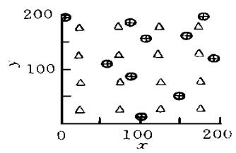
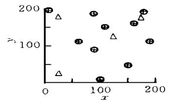
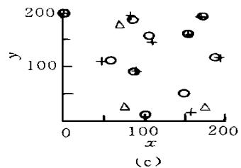

# 实验室声发射三维定位及标本波速场各向异性研究

蒋海昆1） 张 流1） 王 琦2）

1） 中国北京100029中国地震局地质研究所

2） 中国济南250014山东省地震局

摘要 根据慢度离差法的基本原理，给出由遗传算法确定 空间位置、发生时刻及慢度离差个参量的具体方法。结合实验条件，通过数值试验对定位误差等问题进行探讨，并对真实 定位的误差分布给出统计上的圈定。 数值试验结果表明，算法具有较高的精度和较好的收敛性及稳健性；探头数量及布设方式对定位结果的优劣有影响， 个以上探头有记录时，即可得到理想的结果；大的定位误差主要来源于台阵外部少数“ ”的结果。到时测量的随机误差小于最小测量时间单位的 ％时，平均有 ％的“ ”定位误差分布在 范围内，小于物理不可分辨精度 探头直径 。

主题词 声发射定位 慢度离差 遗传算法 数值试验

## 0 引言

实验室内通过对声发射 空间分布图像及其动态迁移的测量，可研究微破裂活动的时空复杂性和微破裂的微观力学机制。研究其与岩体结构和预置构造的空间位置关系，对于实际地震预报工作中根据小震活动图像及演化判断未来大震可能的位置及研究未知的构造状况，具有实用的指导意义。

空间分布特征的研究依赖于精确的 定位，这也是研究破裂震源机制及破裂动。 ， ［1～6］。涉及的一个重要问题是震相及其到时的精确辨识，由于实验工作中所有探头均为垂直向，剪切波到时相对不是很清晰，并且许多较大的 一开始就限幅十分严重，因而本文 定位只使用 波初至到时。 传统定位方法涉及的另一个重要问题是标本的速度模型，由于

频率极高、波长较短，因而样品中微裂隙及晶粒尺寸等对波速有很大影响。 并且随着加载过程样品内部微破裂数目、尺度及分布等亦发生明显变化，这同样对波速产生不容忽视的影响。研究表明，实验室内 波速场受岩石物性、微裂隙尺寸和分布、温度、孔隙流体含量、加载方式等众多因素影响，速度场各向异性并随时间而改变。可见 定位完全照搬天然地震中速度结构已知 或假定已知 ，并且地壳结构基本稳定的定位方法似乎存在问题。虽然一再强调 定位应采用瞬态实测速度场来进行，但“瞬态实测速度场”仍是一段时间内的平均结果，绝非“瞬态实测”的本义，这对于快速加载 相对于地应力的变化速率而言 的岩石破裂过程来说更须认真考虑。

鉴于上述原因，本文将依据慢度离差法的基本原理［7］，对其部分内容进行改进，并引入遗传算法对待定参量进行搜索，结合真实实验条件，利用数值试验对算法有关参数的确定、探头数量及分布和震相到时的测量误差对时空定位结果的影响等问题进行探讨。

## 1 方法

视沿地震射线的加权平均慢度U由等价均匀模型的平均慢度 $U ^ { \mathrm { a v g } }$ 及慢度离差DU二部分组成，即 $U = U ^ { \mathrm { a v g } } + D U$ 。一般情况下 $U ^ { \mathrm { a v g } } > \mathsf { \Omega } _ { D U } \mathrm { ~ }$ ，因而许多工作往往忽略DU 而以 $U ^ { \mathrm { a v g } }$ 近似实际慢度 $U ^ { [ 8 \sim 1 0 ] }$ 。事实上，当走时已知时， $U ^ { \mathrm { a v g } }$ 可表达为 源坐标的函数，因而DU 可作为反演问题中的一个未知参数，当得到DU 的较好估计时，一个较为接近真实慢度结构的近似慢度模型即可建立。

令 $l _ { i } = \int _ { \mathrm { { d } } l ( i } = 1 , 2 , \cdots , N )$ 及ldi 分别表征从源至所有N 个探头真实路径及直线路径的长度， $L = \Sigma _ { i ( }$ （ 求和对i 进行，下同） $\mathit { \Omega } _ { \mathcal { L } } { } ^ { d } = \Sigma { } _ { i } ^ { d } , u _ { i } = \mathit { \Pi } \int _ { u \mathrm { d } l / l _ { i } }$ 为第i 条路径的加权平均慢度，$U = \Sigma _ { u _ { i } l _ { i } } / L$ 为所有路径的加权平均慢度。从 源至第i 个探头的理论走时可表述为

$$
\tau = \int_ {l} u \mathrm{d} l = u _ {i} l _ {i}\tag{1}
$$

从源至所有探头理论走时之和为

$$
T = \sum_ {i = 1} ^ {N} \tau = \sum_ {i = 1} ^ {N} u _ {i} l _ {i} = U L\tag{2}
$$

第i 条射线路径长度 $l _ { i }$ 可分为从源至第i 个探头的直线距离ldi及附加增量 $\mathrm { d } { \boldsymbol { l } _ { i } }$ 二部分之和，即

$$
l _ {i} = l _ {i} ^ {d} + \mathrm{d} l _ {i}\tag{3}
$$

式（3） 两端i 从1至N 求和有

$$
L = L ^ {d} + D L\tag{4}
$$

其中

$$
D L = \sum_ {i = 1} ^ {N} \mathrm{d} l _ {i}\tag{5}
$$

为射线长度附加增量之和。由于实际的 $\mathrm { d } { \boldsymbol { l } _ { i } }$ 未知， 等 $[ 7 ]$ 的做法是以所有 $\mathbf { d } { \boldsymbol { l } } _ { i }$ 的平均来表征，即

$$
\text {中国知网} \quad \mathrm{d} l _ {i} = \frac {D L}{N} \quad (i = 1, 2, \dots , N)\tag{6}
$$

笔者认为所有 $\mathrm d l _ { i } ( i = 1 , 2 , \cdots , N )$ 均相等的假设是不合理的，事实上 $l _ { i } ^ { d }$ 长的射线dli 亦会较大，于是将式（6） 改为

$$
\mathrm{d} l _ {i} = D L \left(\frac {l _ {i} ^ {d}}{\sum_ {i = 1} ^ {N} l _ {i} ^ {d}}\right) \quad (i = 1, 2, \dots , N)\tag{7}
$$

即 $\mathbf { d } { \boldsymbol { l } } _ { i }$ 为 DL 按 $l _ { i } ^ { d }$ 的加权平均。 由前所述有

$$
U = U ^ {\mathrm{avg}} + D U\tag{8}
$$

及

$$
U ^ {\mathrm{avg}} = T / L ^ {d}\tag{9}
$$

由于 $L \mathcal { \mathcal { P } } L ^ { d }$ ，比较式（2） 与式（9） 知 $U \leqslant U ^ { \mathrm { a v g } }$ ，由式（8） 可见 $D U \leqslant 0 _ { \circ }$ 由式（9） 有 $\boldsymbol { T } =$ $L ^ { d } U ^ { \mathrm { a v g } }$ ，与式（8） 一起代入式（2） 得 L ，再代入式（4） 有

$$
D L = - \frac {L ^ {d} D U}{U ^ {\mathrm{avg}} + D U}\tag{10}
$$

将 $u _ { i }$ 分为二部分，即

$$
u _ {i} = U ^ {\mathrm{avg}} + \mathrm{d} u _ {i}\tag{11}
$$

式中， $\mathrm { { d } } u _ { i }$ 为第i 条射线的加权平均慢度与等价均匀模型之间的离差（ deviation） 。将式（1） 和式（7） 代入式（2） 有 $D U = - \ { \cal U } ^ { \mathrm { a v g } } + ( \ { \Sigma } _ { u _ { i } l _ { i } ) / \cal L }$ ，再将式（3） 、式（4） 及式（10） 代入，有

$$
D U = \frac {\sum_ {i = 1} ^ {N} \mathrm{d} u _ {i} \left(l _ {i} ^ {d} + \mathrm{d} l _ {i}\right)}{L ^ {d} + D L}\tag{12}
$$

假定dui 的分布使得 $\operatorname* { m i n } \ \left\{ \Sigma \mathrm { d } u _ { i } ^ { 2 } \ \right\}$ 服从式（12） 的约束，定义 $\Phi$ 为

$$
\Phi = \sum_ {i = 1} ^ {N} \mathrm{d} u _ {i} + \lambda \left[ D U - \frac {\sum_ {i = 1} ^ {N} \left(l _ {i} ^ {d} + \mathrm{d} l _ {i}\right) \mathrm{d} u _ {i}}{L ^ {d} + D L} \right]\tag{13}
$$

式中，λ为拉格朗日乘子，由（ ∂Φ） $/ [ \mathrm { ~ } \partial _ { { \bf d } u _ { i } } ] ] = 0$ 有［7］

$$
\mathrm{d} u _ {i} = \frac {\left(L ^ {d} + D L\right) \left(l _ {i} ^ {d} + \mathrm{d} l _ {i}\right) D U}{\sum_ {i = 1} ^ {N} \left(l _ {i} ^ {d} + \mathrm{d} l _ {i}\right)}\tag{14}
$$

假定声发射源坐标（ $x \ , y \ , z )$ 、发生时刻t 及慢度离差DU，则 $l _ { l } ^ { d } ( i = 1 , 2 , 3 , \cdots , N$ ，下同）及 $L ^ { d }$ 可求；由 ${ \cal T } = \Sigma _ { \left( t \right) } = - \mathbf { \Sigma } _ { t } )$ 计算走时之和 $( \mathbf { \Delta } t _ { i } ^ { \mathrm { { 0 b s } } }$ 为观测到时） ；由式（9） 得 $U ^ { \mathrm { a v g } }$ ；由式（10） 计算DL，之后由式（7） 和式（3） 计算 $\mathrm { d } { \boldsymbol { l } _ { i } }$ 和 $l _ { i }$ ；由式（14） 计算 $\mathrm { { d } } u _ { i }$ ，进而由式（11） 计算 $u _ { i }$ ；由式（1）计算 $\tau$ 。 定义目标函数为

$$
f = \sum_ {i = 1} ^ {N} \left[ t _ {i} ^ {\mathrm{obs}} - t - \tau (x, y, z, D U) \right]\tag{15}
$$

由 min $\left\{ f \ \right\}$ 确定5个未知参数 $( x , y , z , t , D U )$

可以看出慢度离差法是定位与速度结构的联合反演方法，其最大特点是可以不预先知道速度信息并且不须对速度结构进行均匀性假定，这对于速度结构十分复杂、各向异性并随时间 加载过程 变化的 定位问题显得尤为重要。 并且由反演得到 $u _ { i }$ 之后尚可进一步研究速度的各向异性及与加载过程的关系。

由于定位的非线性特性，本文将用遗传算法（ Genetic Algorithms，简称 GA） 来确定5个未知参数。 作为数值估计的一种优化算法，具有全域搜索、勿须求导、效率较高而又普遍适用于各种问题等多方面的优点。 迭代中具体淘汰哪一组搜索结果或选择哪一组搜索结果作为产生下一组解的依据，完全依赖于观测值和模型正演计算值之间的比较，即目标函数式（15） 的极小值。 算法通用部分的程序已由石耀霖① 给出。

## 2 数值试验主要结果分析

根据实验工作中标本尺寸及探头布设方式，在标本平面上建立符合右手螺旋法则的直角坐标系，所有探头均布设在 $_ z = 0$ 的平面上（ 图1） 。假定“ ”直达波波速 $V _ { \mathrm { p } } = 5 . 4 \ : \mathrm { m m } /$ 时间单位 声发射实验中时间单位一般为 ，在 $\mathrm { 2 0 0 } \mathrm { { \ m m } \times 2 0 0 \mathrm { { \ m m } \times 2 0 \mathrm { { m m } } } }$ 的标本范围内随机地产生一批位置已知的“ ”，并在［ ， ］范围内随机地假定其发生时刻，先作为均匀介质计算“ ”在各探头的理论到时，据此运用前述方法对“ ”进行时空定位，对速度 慢度 结构进行联合反演，并与真值作对比分析。 根据石耀霖①的研究，取种群数目、交配概率和变异概率分别为 ，．，．；取指数形式的目标函数尺度变换并规定保留每代的最优模型。 令

$$
\left\{ \begin{array}{l} \Delta p _ {j} = p _ {j} - p ^ {0 j} \\ \Delta p = (\sum_ {j = 1} ^ {m} \Delta p _ {j}) / m \\ \Delta p _ {\min} = \min \{\Delta p _ {j} \} \\ \Delta p _ {\max} = \max \{\Delta p _ {j} \} \end{array} \right.\tag{16}
$$

当分别取 $p$ 为x，y，z，t，则 $p _ { \mathbf { \lambda } ^ { 0 } j }$ 代表第j 个“ ”的真实空间坐标及发生时刻 $_ { ( j } = 1 , 2 , 3 ,$ $\cdots , m ; m$ 为“ ” 总数 ， $p _ { j }$ 为相应的计算值， $\spadesuit _ { j }$ 为计算值与真值之差，直观反映模型对真值的逼近程度及收敛速度， $\phi$ 为所有 $\spadesuit _ { j }$ 的平均值， $\phi _ { p \mathrm { m i n } } , \phi _ { p \mathrm { m a x } }$ 为所有 $\spadesuit _ { j }$ 中的最小值和最大值。

## 2．1 GA 算法迭代步数对结果精度的影响

随机产生的 个“ ”事件在前述参数的约束下迭代到 步时强行停止。随迭代次数的增加，各参量计算值与真值之差的平均值 $\Delta _ { x } , \Delta _ { y } , \Delta $ 和 Δt 渐趋于 ，但收敛速度有差别。平均来看， 步之后收敛速度明显趋缓，迭代结果趋于稳定； 步之后 $| \triangle _ { x } \ | < 0 . 3$ $| \triangle _ { y } \ | < 1 , \ | \triangle _ { z } \ | < 2 , \ | \triangle _ { \mathbf { \ell } } | < 0 . 2 _ { \bullet }$ 。由于深度定位是一个复杂的问题，虽然所有表格均列出深度z 的定位结果，但判断定位的精度还主要依据x，y 的结果来进行。

尽管从数学上可要求偏差无限地小下去，但从物理上考虑是无意义的。因为若仅从空间定位来看，由于探头直径为 $3 _ { \mathrm { \ m m } }$ ，因而与真值误差的绝对值小于 的结果从物理上都无法进一步分辨谁更优或更劣。 这样的话，迭代 步之后的结果一般都可接受。 考虑到该方法的另一目的，即波速场各向异性研究的需要(必须对t及DU作更精细的逼近)，本文中一律取迭代步数为 步，在 Ⅱ 微机上进行这样一个定位的迭代过程大约耗时 $3 { \sim } 4 _ { \mathrm { ~ s ~ } }$ ，是可以接受的。 再则，数值试验中“探头”可看成一个点，其直径为 ，因而数值试验中 以下的误差同样是可以分辨的，为表述、区分算法的计算精度，本文对 $3 _ { \mathrm { \ m m } }$ 以下的误差仍将提及并据此进行比较。

## 2．2 探头数目及其与 $\mathbf { \nabla } \cdot \mathbf { A } \mathbf { E } ^ { \prime \prime }$ 空间位置关系对结果精度的影响

选择前述的 个“ ”进行分析，结果列于表 ，图 给出前 个“ ”的定位结果，探头数分别为 ，，。将图 $1 _ { \mathrm { a } }$ 中间 个探头去掉 表 中 个探头的结果 ，可见其结果是最优的，甚至优于 个探头的结果，这在一定意义上说明除探头数量外，探头布设方式对定位精度也起着重要作用。 本文定位方法只使用 波到时数据，从物理上讲搜索是靠波到达的先后来进行的，并且探头之间的距离越大，波到达的方向就越容易准确地测出。 因而在如图 $1 _ { \mathrm { a } }$ 布设探头的情况下， 个探头的结果优于 个探头的结果，因为如此的探头布设方式下，采用 个探头到时的相同机率肯定较 个探头的大，这无疑增加了搜索的不确定性。 同时，从数学方法上来讲， 实际上是一种具有记忆的全域搜索方法，相同的到时增加了对搜索收敛方向的误导机会，使得向真值的收敛速度降低，而迭代步数又是相同的，必然使得迭代效率降低。 这说明，探头应尽量避免完全对称的布设。

+“AE”计算值  
O“AE”真值  
  
(a)

图 探头数量及其分布对 定位精度的影响  
表 1 探头数目对“AE”时空定位误差的影响

<table><tr><td>探头数</td><td> $\Delta_x$ </td><td> $\Delta_{x\min}$ </td><td> $\Delta_{x\max}$ </td><td> $\Delta_y$ </td><td> $\Delta_{y\min}$ </td><td> $\Delta_{y\max}$ </td><td> $\Delta_z$ </td><td> $\Delta_{z\min}$ </td><td> $\Delta_{z\max}$ </td><td> $\Delta_t$ </td><td> $\Delta_{t\min}$ </td><td> $\Delta_{t\max}$ </td></tr><tr><td>16</td><td>0.43</td><td>0.01</td><td>1.83</td><td>0.47</td><td>0.00</td><td>1.87</td><td>2.22</td><td>0.03</td><td>6.63</td><td>0.175</td><td>0.021</td><td>0.586</td></tr><tr><td>12</td><td>0.19</td><td>0.01</td><td>1.10</td><td>0.30</td><td>0.01</td><td>1.18</td><td>1.59</td><td>0.28</td><td>3.94</td><td>0.092</td><td>0.004</td><td>0.421</td></tr><tr><td>9</td><td>0.57</td><td>0.01</td><td>2.66</td><td>0.58</td><td>0.01</td><td>2.99</td><td>5.30</td><td>0.37</td><td>10.30</td><td>0.308</td><td>0.126</td><td>0.928</td></tr><tr><td>5</td><td>0.98</td><td>0.18</td><td>1.68</td><td>1.28</td><td>0.18</td><td>3.75</td><td>6.01</td><td>0.28</td><td>15.70</td><td>0.385</td><td>0.080</td><td>2.460</td></tr><tr><td>4</td><td>0.82</td><td>0.02</td><td>2.27</td><td>0.56</td><td>0.01</td><td>1.88</td><td>6.45</td><td>0.95</td><td>11.00</td><td>0.427</td><td>0.023</td><td>1.886</td></tr><tr><td>3</td><td>7.49</td><td>1.94</td><td>20.20</td><td>12.90</td><td>0.74</td><td>34.70</td><td>5.20</td><td>0.26</td><td>12.90</td><td>1.369</td><td>0.158</td><td>34.710</td></tr></table>

由表 可见随机地删减探头数目，误差将逐渐增加；但即使只有 个探头时 图 ，x，y 定位结果仍十分理想，与真值的平均及最大偏差仅分别为 ． ，． 和 ． ，． ，小于物理不可分辨误差。 当仅剩 个探头时，表明在实际工作中的定位结果是不可靠的 图 。

## 2．3 初至到时的测量误差对结果精度的影响

时空定位及速度场的反演依赖于震相到时的准确判读。 与数值试验不同，实际工作中初至到时的判读是有误差的，消除了仪器及判读方法的系统偏差之后，初至到时的误差主要是由人工判读过程中随机产生的。为模拟初至到时的这种期望为 的随机误差，取探头数为 ，仍用 个随机分布的“ ”为研究对象，但对其理论到时分别在最小测量时间单位± ％，± ％，± ％，± ％，± ％，± ％的范围内随机叠加一背景噪声，数值试验结果列于表2。

对于全部“AE”的平均结果而言，噪声小于30％时，x，y 的定位结果是理想的，计算值与真值之间偏差的平均值及最大值分别小于 ． 和 ．；噪声达到 ％时，偏差的平均值及最大值分别小于 ． 和 ．，结果尚可接受。 在天然地震震相识别及到时测量中，对数字化记录及模拟记录资料，到时的判读误差一般分别为 ． 和 ． 个时间单位，最大能达到 ．和 ． 个时间单位 震相识别错误除外 ，这与 ％及 ％的噪声大体相当；由于 实验记录是数字化的，其采样频率与信号频率之比在量级上也与天然地震数字化台网大体相当或略高，因而 信号的物理分辨率至少不低于天然地震的数字化记录，到时误差主要来源于震相的判读，但与天然地震比较一般不会大于 ． 个时间单位，表明在现有设备条件下，利用本文方法对真实 的时空定位结果是可信的。

从反演的标本平均速度来看，噪声为 时速度V 为 ． ，与真值 ． 一致；加噪之后V最大的变化量为 ．，但随噪声的增大 V 并无系统的趋势性变化；这从另一个方面说明，对于真实介质标本而言，若震相到时判读准确的话，利用本文方法反演各个方向的速度并进而研究速度各向异性及随时间的变化特征是可能的。

表 2 不同的噪声水平对“AE”时空定位误差的影响

<table><tr><td>噪音</td><td> $\Delta x$ </td><td> $\Delta x_{\min}$ </td><td> $\Delta x_{\max}$ </td><td> $\Delta y$ </td><td> $\Delta y_{\min}$ </td><td> $\Delta y_{\max}$ </td><td> $\Delta z$ </td><td> $\Delta z_{\min}$ </td><td> $\Delta z_{\max}$ </td><td> $\Delta t$ </td><td> $\Delta t_{\min}$ </td><td> $\Delta t_{\max}$ </td><td>V</td></tr><tr><td>0%</td><td>0.43</td><td>0.01</td><td>1.83</td><td>0.47</td><td>0.00</td><td>1.87</td><td>2.22</td><td>0.03</td><td>6.63</td><td>0.175</td><td>0.021</td><td>0.586</td><td>5.39</td></tr><tr><td>5%</td><td>0.98</td><td>0.02</td><td>3.42</td><td>1.02</td><td>0.03</td><td>3.58</td><td>2.75</td><td>0.22</td><td>10.80</td><td>0.326</td><td>0.031</td><td>1.221</td><td>5.48</td></tr><tr><td>10%</td><td>0.57</td><td>0.02</td><td>2.56</td><td>0.63</td><td>0.08</td><td>2.77</td><td>3.27</td><td>0.04</td><td>11.10</td><td>0.222</td><td>0.002</td><td>1.074</td><td>5.08</td></tr><tr><td>30%</td><td>1.23</td><td>0.09</td><td>3.88</td><td>1.31</td><td>0.13</td><td>3.24</td><td>1.31</td><td>0.05</td><td>9.27</td><td>0.313</td><td>0.015</td><td>7.241</td><td>5.03</td></tr><tr><td>50%</td><td>1.24</td><td>0.12</td><td>5.18</td><td>1.48</td><td>0.09</td><td>4.96</td><td>4.00</td><td>0.02</td><td>12.80</td><td>0.445</td><td>0.007</td><td>2.576</td><td>4.90</td></tr><tr><td>100%</td><td>1.92</td><td>0.22</td><td>6.18</td><td>2.64</td><td>0.47</td><td>7.38</td><td>5.62</td><td>0.54</td><td>7.38</td><td>0.611</td><td>0.019</td><td>7.387</td><td>5.15</td></tr><tr><td>200%</td><td>3.35</td><td>0.42</td><td>8.27</td><td>4.69</td><td>1.11</td><td>10.70</td><td>8.09</td><td>0.81</td><td>14.90</td><td>1.054</td><td>0.139</td><td>2.332</td><td>5.08</td></tr></table>

分别统计探头台阵内部 $2 5 { \leqslant } x \leqslant 1 7 5 , 2 5 \leqslant y \leqslant 1 7 5 )$ 及外部“ ”的定位结果，平均来看，探头台阵内部“ ”的定位结果好于台阵外部的结果。 较大的误差主要来源于台阵外少数“ ”的定位结果。 对于台阵内部的“ ”而言，只要噪声在 ％以下，定位结果是精确的，平均和最大误差分别小于 ． 和 ．；当噪声达 ％时，结果仍然可以接受，平均和最大误差不大于 ． 和 ．。 探头台阵外的“ ”噪声小于 ％时，平均和最大定位误差分别小于 ． 和 ．。

## 2．4 定位误差的数值分布范围

为统计研究时空定位误差的数值分布范围，在 个探头台阵的前提下随机产生 个“ ”，其中 个分布在台阵内部 $2 5 \leqslant x \leqslant 1 7 5 , 2 5 \leqslant y \leqslant 1 7 5 )$ ，其余 个分布于台阵之外。 从“ ”空间坐标和发生时刻偏差的数值统计说明，在 ． 的置信水平下，χ2 检验显示其平均结果 $\Delta _ { x } , \Delta _ { y } , \Delta _ { z } )$ 与表 噪声为 的结果无统计上的差别，表明由于“ ”其空间分布及发生时刻的随机性，二批样本统计性态完全一致。若仅从空间定位误差在不同数值范围分布的频次百分比来看 表 ，分别有 ％和 ％的台阵内部及外部的“ ”的空间定位误差落在± $3 _ { \mathrm { m m } }$ 之间。从全部“ ”来看， ％的“ ”定位误差小于 。就深度定位而言，台阵外部“ ”的结果明显好于台阵内部的结果，这实际上与本文完全对称的探头布设方式有关，设想一种极端的探头布设方式及 发生位置，即所有探头均布设在圆环上，而 AE 发生在圆心，此时所有探头的到时都相同，平面位置可准确定出，而深度则无法确定。若 发生在圆环外，则环上探头的到时将产生差异，对三维定位是有利的。这再次表明，探

头的布设应尽量避免完全对称的方式。

表 3 “AE”事件源坐标定位误差不同数值范围的频次百分比

<table><tr><td rowspan="2">数值范围</td><td colspan="3">全部</td><td colspan="3">台阵内</td><td colspan="3">台阵外</td></tr><tr><td>x</td><td>y</td><td>z</td><td>x</td><td>y</td><td>z</td><td>x</td><td>y</td><td>z</td></tr><tr><td>-1~1</td><td>0.91</td><td>0.90</td><td>0.51</td><td>0.98</td><td>0.98</td><td>0.39</td><td>0.81</td><td>0.78</td><td>0.69</td></tr><tr><td>-2~2</td><td>0.98</td><td>0.95</td><td>0.66</td><td>0.99</td><td>0.99</td><td>0.57</td><td>0.90</td><td>0.89</td><td>0.79</td></tr><tr><td>-3~3</td><td>0.99</td><td>0.97</td><td>0.72</td><td>0.99</td><td>0.99</td><td>0.73</td><td>0.94</td><td>0.94</td><td>0.89</td></tr></table>

## 3 结论

本文依据慢度离差法的基本原理，对其部分内容进行改进，并引入 对声发射空间位置发生时刻及慢度离差5个待定参量进行逼近，结合实验条件，利用数值试验对定位误差等一系列问题进行了较深入的探讨，为真实 定位作理论和方法上的准备，并对真实定位的误差分布给出统计上的圈定。慢度离差法是定位与速度结构的联合反演方法，其最大特点是无须预先知道速度信息并且不须对速度结构进行均匀性假定，这对于速度结构十分复杂、各向异性并且随时间 加载过程 变化的 定位问题尤其重要。 由反演得到速度之后尚可进一步研究其各向异性及与加载过程的关系。

算法具有较高的精度和较好的稳定性，一般迭代 步之后，在小于物理不可分辨误差（3 ） 的范围内逼近真值。

探头数量及布设方式对定位结果的优劣有影响，即使是只有 个探头有记录时，结果仍然是理想的。

定位误差与到时测量的随机误差 以叠加的噪声水平表征 正相关，噪声小于最小测量时间单位的 ％时，定位平均误差小于 ．，最大误差小于 ．；大的定位误差主要来源于台阵外部少数“ ”的定位，台阵包围的“ ”，即使噪声高达 ％也仍然可以得到精确的结果；与天然地震的到时测量对比表明，在现有实验设备的条件下，利用本文方法对真实的时空定位结果是可信的。

探头台阵内部、外部及全部“ ”的统计结果表明，分别有 ％、 ％及 ％的定位误差落在± 之间。 据此，对大量真实 的定位结果而言，可以统计地认为其至少 ％以上与真实破裂源之间的偏差小于物理不可分辨精度3 。 就深度定位而言，台阵外部“ ”的结果似乎好于台阵内部“ ”的结果。

赵仲和先生在震相到时的测量误差方面给予指教，陈棋福、周翠英在 算法方面提供帮助，对此谨致谢意。

## 参 考 文 献

1 Byerlee J，L ockner D ．A coustic emission during fluid injection in rock．Proceed First Confer．A E／M-i croseismic Actiy · Geol Struc M ater, 1977. 87\~98

2 L ockner D ，Byerlee J ．A coustic emission and fault formation in rocks．Proceed First Confer．A E／M-i croseismic Activ Geol Struc M ater, 1977, 99\~107

3 L ockner D ，Byerlee J ．Fault grow th and acoustic emissions in confined granite．A ppl M ech．Rev，， - ： ～

4 L ockner D．T he role of acoustic emission in the study of rock fracture．Int Rock M ech M in Sci，1993，： ～

雷兴林，马瑾 ．实验室岩石声发射三维定位及标本速度场联合反演：理论与方法．见：中国地震局灾害防御司编．全国第二届构造物理学术讨论会文集．北京：地震出版社， ． ～

许昭永，梅世蓉，庄灿涛，等．真三轴压缩时几种岩样微破裂定位的初步研究．地震学报， ， 增刊） ：702～709

7 Zhi Xie T erry W ，Spencer Philip D．A new regional hypocenter location method．BSSA ，1996，86（4） ：946〜958

8 Graza T ，L omnitz C，Ruiz de V elasco D ．A n interactive epicenter location procedure for the RESM A Cseismic array．（ Ⅰ） BSSA，1977，67：1577～1586

9 Graza T ，L omnitz C ，Ruiz de V elasco C．A n interactive epicenter location procedure for the RESM A C． Ⅱ ， ， ： ～

10 Pujol J ，Smalley R ．A preliminary earthquake location method based on a hyperbolic approximation to travel times: BSSA, 1990, 80: 129\~150

# 3-D LOCATION OF ACOUSTIC EMISSION AND STUDY ON THE ANISOTROPIC VELOCITY STRUCTURE IN THE SAMPLE

J iang H aikun1） Zhang L iu1） W ang qi2）

1） Institute of Geology，CSB，Beijing 100029，China

2) Seismological Bureau of Shandong Province, Jinan250014, China

## Abstract

Based on the fundamental theorem of Slow ness Deviation M ethod，the specific method to determine the source location，occurring time and slow ness deviation of an AE by the Genetic Algorithm have been offered in this paper．Combining w ith the actual experimental condition, some questions such as AE source location error have been discussed by the numerical tests, and the statistic limitation for error distribution of AE location has been also expressed in the paper．T he results show that the algorithm has a high precision， good convergence and stability．T he number and distribution of the sensors can strongly influence the accuracy of AE location．T he ideal results could be got w hen four or more sensors are triggered．Large location error comes from a few results of AE location outside the sensor array．Generically，w hen random arrival time error is smaller than 50％ of the minimum time measuring unit, the location error, more than 97% of AE events, is distributed in the range of 3 mm to be smaller than the diameter of a sensor

Key words： Acoustic emission，Slow ness deviation，Genetic algorithm，Numerical t est