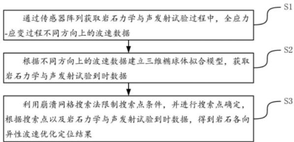
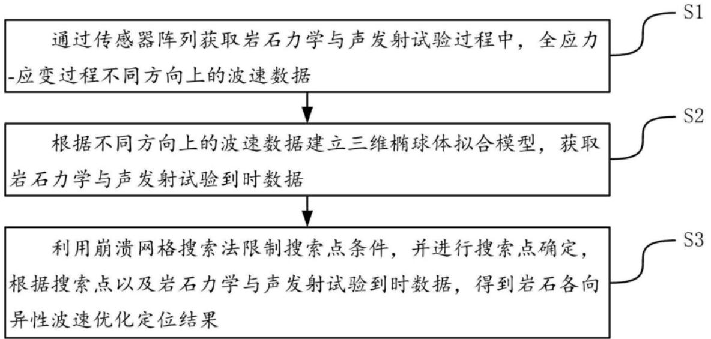
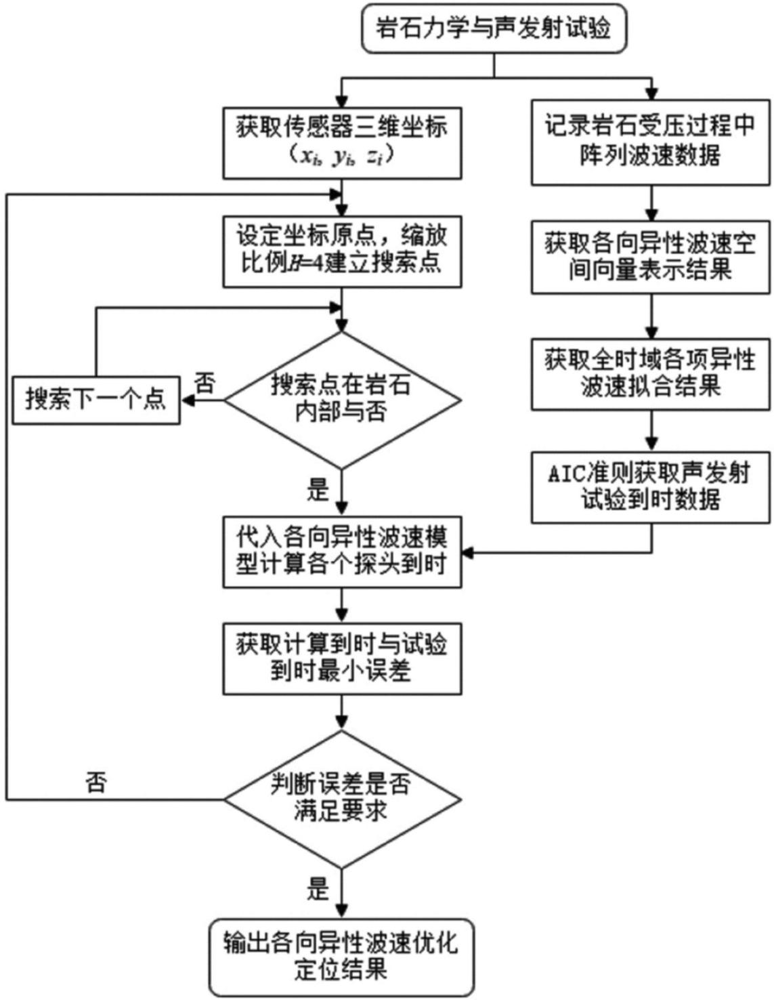
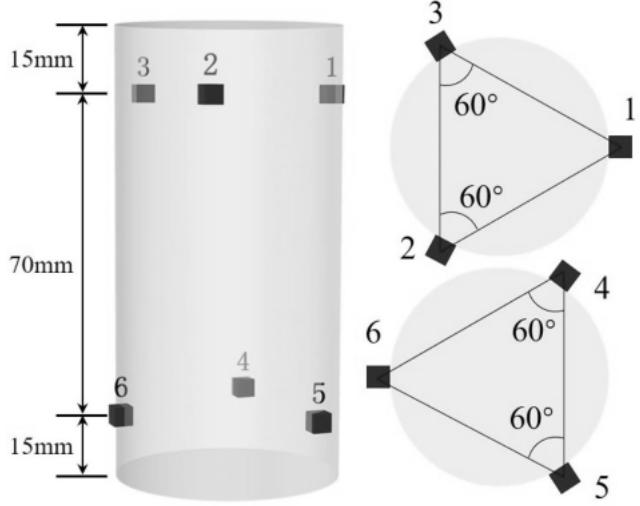
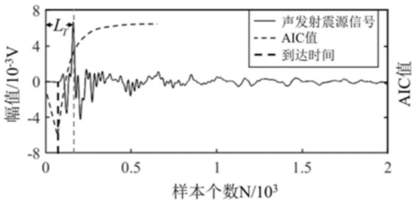
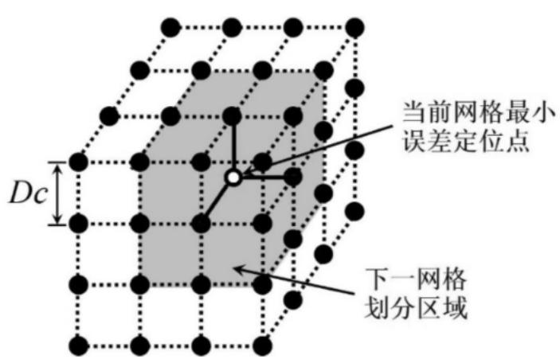
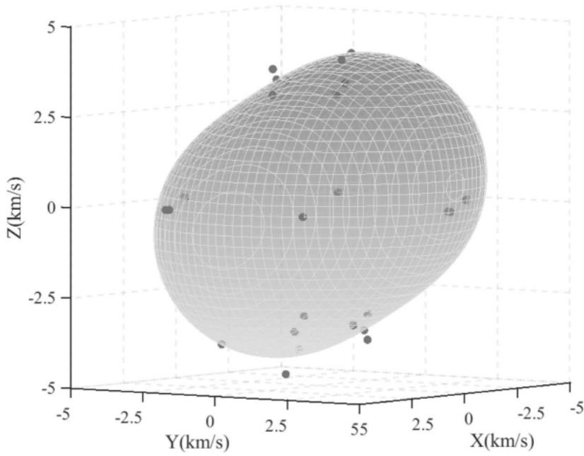
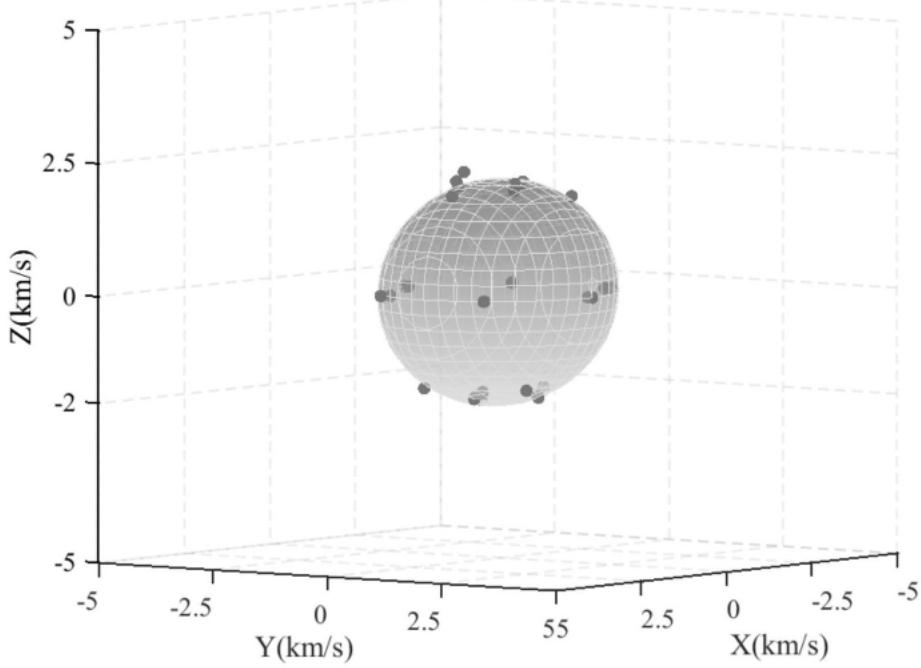
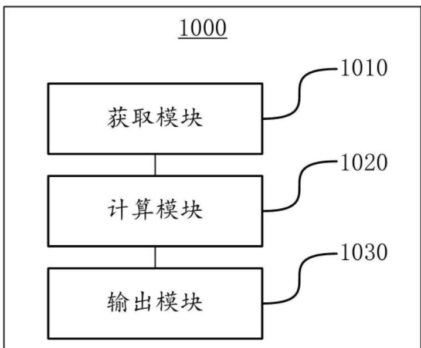
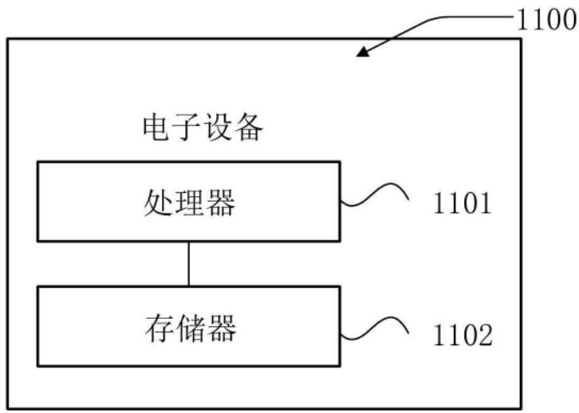

## (12)发明专利

(21)申请号 202310884410.6

(22)申请日 2023.07 .19

(65)同一申请的已公布的文献号申请公布号 CN 116593295 A

(43)申请公布日 2023.08.15

(73)专利权人 北京科技大学地址 100083 北京市海淀区学院路30号

(72)发明人 苗胜军 余文轩 刘泽京 马毓廷李从豪 梁明纯

(74)专利代理机构 北京市广友专利事务所有限责任公司 11237专利代理师 张仲波

(51)Int.Cl. (2006.01) (2006.01) (2023.01)

(56)对比文件CN 110907897 A,2020.03.24

## (54)发明名称

利用岩石各向异性波速提高声发射定位精度的方法及装置

## (57)摘要

本发明公开了一种利用岩石各向异性波速提高声发射定位精度的方法及装置，涉及声发射定位技术领域。包括：通过传感器阵列获取岩石力学与声发射试验过程中，全应力‑应变过程不同方向上的波速数据；根据不同方向上的波速数据建立三维椭球体拟合模型，获取岩石力学与声发射试验到时数据；利用崩溃网格搜索法限制搜索点条件，并进行搜索点确定，得到岩石各向异性波速优化定位结果。本发明定位方法通过限制搜索范围以及定位点判定条件，确保定位点的有效性、准确性，考虑岩石受压过程中波速变化以及岩石波速各向异性，减小传统声发射系统采用岩石初始平均波速进行声发射定位所产生的误差，具有广泛应用前景和较强经济效益。

(10)授权公告号 CN 116593295 B

(45)授权公告日 2023.10.03

CN 109738940 A,2019.05.10 CN 107727744 A,2018.02.23 CN 107748049 A,2018.03.02 CN 108761529 A,2018.11 .06 CN 114910564 A ,2022 .08.16 CN 115795916 A,2023.03.14 CN 115980195 A,2023.04 .18 US 2022381744 A1 ,2022.12.01

李长洪;范丽萍;张吉良;苗胜军;王云飞.卡尔曼滤波在大型深凹露天矿边坡变形监测预测中的应用.北京科技大学学报.2010,(第01期),8-13.

李浩然;杨春和;陈锋;马洪岭;巫尚蔚.岩石声波-声发射一体化测试装置的研制与应用.岩土力学 .2016,(第01期) ,287-296.

王述红;徐源;张航;侯佳男;杨昊.岩体损伤破坏过程三维定位声发射试验分析.工程与试验.2010,(第03期) ,19-23.

审查员 占王彬

权利要求书3页 说明书13页 附图6页

1.一种利用岩石各向异性波速提高声发射定位精度的方法，其特征在于，所述方法包括：

S1、通过传感器阵列获取岩石力学与声发射试验过程中，全应力‑应变过程不同方向上的波速数据；

S2、根据所述不同方向上的波速数据建立三维椭球体拟合模型，获取岩石力学与声发射试验到时数据；

S3、利用崩溃网格搜索法限制搜索点条件，并进行搜索点确定，根据所述搜索点以及岩石力学与声发射试验到时数据，得到岩石各向异性波速优化定位结果；

所述S2中的根据所述不同方向上的波速数据建立三维椭球体拟合模型，获取岩石力学与声发射试验到时数据，包括：

S21、对不同方向上的波速数据中的任一波速数据建立空间向量坐标点；

S22、根据所述空间向量坐标点，结合罗德里格矩阵进行三维坐标旋转，得到旋转后的波速向量三维表示方法；

S23、根据所述旋转后的波速向量三维表示方法以及标准椭球面参数方程，获取球坐标系下的旋转后波速向量三维表示方法，并建立三维椭球体拟合模型；

S24、根据所述三维椭球体拟合模型以及粒子群算法进行拟合，确定任一波速数据的拟合参数值；

S25、根据所述拟合参数值以及赤池信息准则AIC，获取岩石力学与声发射试验到时数据。

2.根据权利要求1所述的方法，其特征在于，所述S21中的对不同方向上的波速数据中的任一波速数据建立空间向量坐标点，包括：

对不同方向上的波速数据中的任一波速数据，以岩石中心为坐标轴原点，传感器阵列中两传感器之间的单位向量为方向向量，各传感器之间的测量波速值为波速向量的模，建立表示所述波速数据的空间向量坐标点。

3.根据权利要求1所述的方法，其特征在于，所述S22中的旋转后的波速向量三维表示方法，如下式（1）所示：

$$
B = R A \tag {1}
$$

其中，B表示旋转后的波速向量坐标；A表示旋转前的波速向量坐标；R表示罗德里格矩阵。

4.根据权利要求1所述的方法，其特征在于，所述S23中的球坐标系下的旋转后波速向量三维表示方法，如下式（2）所示：

$$
\begin{array}{l} r ^ {\prime} = \left\| B \right\| _ {2} \\ \theta^ {\prime} = \arccos \frac {R _ {3 , :} A}{\left\| B \right\| _ {2}} \\ \varphi^ {\prime} = \arctan \frac {R _ {2 , :} A}{R _ {1 , :} A} \end{array} \tag {2}
$$

其中，B表示旋转后的波速向量坐标；A表示旋转前的波速向量坐标； ${ \bf { \sigma } } ; R _ { 1 , }$ 表示罗德里格矩阵R中第1行； $R _ { 2 , \astrosun }$ 表示罗德里格矩阵R中第2行； $R _ { 3 , }$ 表示罗德里格矩阵R中第3行。

5.根据权利要求1所述的方法，其特征在于，所述S23中的三维椭球体拟合模型，如下式（3）所示：

$$
\begin{array}{l} X ^ {2} - (a \sin \arccos \frac {R _ {3 , :} A}{\| B \| _ {2}} \cos \arctan \frac {R _ {2 , :} A}{R _ {1 , :} A}) ^ {2} + Y ^ {2} - \\ (b \sin \arccos \frac {R _ {3 , :} A}{\| B \| _ {2}} \cos \arctan \frac {R _ {2 , :} A}{R _ {1 , :} A}) ^ {2} + Z ^ {2} - (c \cos \arccos \frac {R _ {3 , :} A}{\| B \| _ {2}}) ^ {2} = 0 \end{array}\tag{3}
$$

其中， $X , Y , Z$ 表示自变量；a b c表示拟合参数；B表示旋转后的波速向量坐标；A表示旋转前的波速向量坐标； $: R _ { 1 , }$ 表示罗德里格矩阵R中第1行； $R _ { 2 , \astrosun }$ 表示罗德里格矩阵R中第2行； $\mathbf { \Omega } _ { \mathbf { \lambda } } ^ { \mathbf { \mathcal { R } } } { } _ { 3 , \mathbf { \lambda } }$ 表示罗德里格矩阵R中第3行。

6.根据权利要求1所述的方法，其特征在于，所述S3中的利用崩溃网格搜索法限制搜索点条件，并进行搜索点确定，根据所述搜索点以及岩石力学与声发射试验到时数据，得到岩石各向异性波速优化定位结果，包括：

S31、确定坐标原点，根据初始单位网格长度进行搜索网格划分；

S32、利用崩溃网格搜索法限制搜索点条件，并进行搜索点确定；

S33、对搜索点中非岩石内部的搜索点进行剔除，得到剔除后的搜索点；

S34、建立每个网格点与传感器之间的坐标向量，根据所述坐标向量拟合椭球体波速，计算得到传感器与搜索点之间的搜索点走时时差；

S35、获取岩石力学与声发射试验到时数据之间的试验到时时差，计算所述搜索点走时时差与试验到时时差的误差的绝对值；

S36、判断所述误差的绝对值是否满足预设拟合优度，若是，则输出岩石各向异性波速优化定位结果；

若否，则以最小误差原则确定下一阶段坐标原点，以预设缩放比例确定下一阶段单位网格长度以及搜索网格，根据所述下一阶段单位网格长度进行搜索网格划分，转去执行步骤S32。

7.根据权利要求6所述的方法，其特征在于，所述S36中的以最小误差原则确定下一阶段坐标原点，如下式（4）所示：

$$
\Delta T _ {R M S} = \sqrt {\frac {\sum_ {i = 1} ^ {i = N ^ {P} - 1} \Delta T _ {i} ^ {P}}{N ^ {P} - 1}}\tag{4}
$$

其中， $N ^ { P }$ 为P波到达阵列传感器的个数； $\Delta T _ { i } ^ { P }$ 为第i个计算到时时差与试验到时时差的差值。

8.一种利用岩石各向异性波速提高声发射定位精度的装置，其特征在于，所述装置包括：

获取模块，用于通过传感器阵列获取岩石力学与声发射试验过程中，全应力‑应变过程不同方向上的波速数据；

计算模块，用于根据所述不同方向上的波速数据建立三维椭球体拟合模型，获取岩石力学与声发射试验到时数据；

输出模块，用于利用崩溃网格搜索法限制搜索点条件，并进行搜索点确定，根据所述搜索点以及岩石力学与声发射试验到时数据，得到岩石各向异性波速优化定位结果；

所述根据所述不同方向上的波速数据建立三维椭球体拟合模型，获取岩石力学与声发射试验到时数据，包括：

S21、对不同方向上的波速数据中的任一波速数据建立空间向量坐标点；

S22、根据所述空间向量坐标点，结合 $\varPsi$ 德里格矩阵进行三维坐标旋转，得到旋转后的波速向量三维表示方法；

S23、根据所述旋转后的波速向量三维表示方法以及标准椭球面参数方程，获取球坐标系下的旋转后波速向量三维表示方法，并建立三维椭球体拟合模型；

S24、根据所述三维椭球体拟合模型以及粒子群算法进行拟合，确定任一波速数据的拟合参数值；

S25、根据所述拟合参数值以及赤池信息准则AIC，获取岩石力学与声发射试验到时数据。

## 利用岩石各向异性波速提高声发射定位精度的方法及装置

## 技术领域

[0001] 本发明涉及声发射定位技术领域，尤其涉及一种利用岩石各向异性波速提高声发射定位精度的方法及装置。

## 背景技术

[0002] 岩石破坏失稳一直是国内外岩石力学的重点研究对象，许多岩石工程灾害（冲击地压、边坡失稳等）的发生均与岩石的破坏失稳有关，且灾害的发生往往造成巨大的经济损失与人员伤亡，因此，如何采取有效的技术手段与方法揭示岩石破坏失稳机理，并从源头对工程灾害进行防治和预警显得尤为重要。

[0003] 岩石受压过程中内部会发生损伤，从而引起岩石超声波速以及声发射参数的变化。通过岩石受压过程中波速与声发射演化特征能较好地反映裂纹孕育、萌生、扩展和贯通演化规律，分析岩石破裂机理。然而岩石压缩过程中内部薄弱胶结面破裂，裂纹不断扩展阻碍着超声波传播，波速变化大，因而在不同压缩阶段的不同方向呈现不同的变化趋势。目前对于各向异性波速研究大多针对岩石某2‑3个特定方向，很少对岩石压缩变形全应力‑应变过程的各个方向上波速进行整体分析。

[0004] 岩石作为一种各向异性材料，其不同方向波速随着内部结构变化是动态变化的，部分岩石在各个方向上纵波波速差值甚至能达到1000‑2000m/s，而波速是影响声发射定位结果关键因素，波速变化会直接影响定位结果，波速不准确使得声发射定位结果无法反映真实裂纹位置以及演化趋势。目前大部分研究中采用的PCI、AMSY和PXWAE声发射系统等均采用岩石初始平均波速进行声发射定位计算，无法结合试验过程中波速变化特征更无法结合各向异性波速进行定位结果。因而亟需一种结合岩石压缩过程中各向异性波速规律的优化定位方法。

## 发明内容

[0005] 本发明针对岩石压缩过程中波速变化以及岩石本身的各向异性对声发射定位影响的问题，提出了本发明。

[0006] 为解决上述技术问题，本发明提供如下技术方案：

[0007] 一方面，本发明提供了一种利用岩石各向异性波速提高声发射定位精度的方法，该方法由电子设备实现，该方法包括：

[0008] S1、通过传感器阵列获取岩石力学与声发射试验过程中，全应力‑应变过程不同方向上的波速数据。

[0009] S2、根据不同方向上的波速数据建立三维椭球体拟合模型，获取岩石力学与声发射试验到时数据。

[0010] S3、利用崩溃网格搜索法限制搜索点条件，并进行搜索点确定，根据搜索点以及岩石力学与声发射试验到时数据，得到岩石各向异性波速优化定位结果。

[0011] 可选地，S2中的根据不同方向上的波速数据建立三维椭球体拟合模型，获取岩石

力学与声发射试验到时数据，包括：

[0012] S21、对不同方向上的波速数据中的任一波速数据建立空间向量坐标点。

[0013] S22、根据空间向量坐标点，结合罗德里格矩阵进行三维坐标旋转，得到旋转后的波速向量三维表示方法。

[0014] S23、根据旋转后的波速向量三维表示方法以及标准椭球面参数方程，获取球坐标系下的旋转后波速向量三维表示方法，并建立三维椭球体拟合模型。

[0015] S24、根据三维椭球体拟合模型以及粒子群算法进行拟合，确定任一波速数据的拟合参数值。

[0016] S25、根据拟合参数值以及赤池信息准则AIC，获取岩石力学与声发射试验到时数据。

[0017] 可选地，S21中的对不同方向上的波速数据中的任一波速数据建立空间向量坐标点，包括：

[0018] 对不同方向上的波速数据中的任一波速数据，以岩石中心为坐标轴原点，传感器阵列中两传感器之间的单位向量为方向向量，各传感器之间的测量波速值为波速向量的模，建立表示波速数据的空间向量坐标点。

[0019] 可选地，S22中的旋转后的波速向量三维表示方法，如下式（1）所示：

[0020] $B = R A ^ { ( 1 ) }$

[0021] 其中，B表示旋转后的波速向量坐标；A表示旋转前的波速向量坐标；R表示罗德里格矩阵。

[0022] 可选地，S23中的球坐标系下的旋转后波速向量三维表示方法，如下式（2）所示：

[0023]

$$
\begin{array}{l} r ^ {\prime} = \left\| B \right\| _ {2} \\ \theta^ {\prime} = \arccos \frac {R _ {3 , :} A}{\left\| B \right\| _ {2}} \\ \varphi^ {\prime} = \arctan \frac {R _ {2 , :} A}{R _ {1 , :} A} \end{array} \tag {2}
$$

[0024] 其中，B表示旋转后的波速向量坐标；A表示旋转前的波速向量坐标； $\mathsf { R } _ { 1 , \mathsf { \Phi } }$ 表示罗德里格矩阵R中第1行； $\mathrm { R _ { 2 } } ,$ 表示罗德里格矩阵R中第2行； $\mathrm { R _ { 3 } } ,$ 表示罗德里格矩阵R中第3行。

[0025] 可选地，S23中的三维椭球体拟合模型，如下式（3）所示：

[0026]

$$
\begin{array}{l} X ^ {2} - (a \sin \arccos \frac {R _ {3 , :} A}{\| B \| _ {2}} \cos \arctan \frac {R _ {2 , :} A}{R _ {1 , :} A}) ^ {2} + Y ^ {2} - \\ (b \sin \arccos \frac {R _ {3 , :} A}{\| B \| _ {2}} \cos \arctan \frac {R _ {2 , :} A}{R _ {1 , :} A}) ^ {2} + Z ^ {2} - (c \cos \arccos \frac {R _ {3 , :} A}{\| B \| _ {2}}) ^ {2} = 0 \end{array}\tag{3}
$$

[0027] 其中， $X , Y , Z$ 表示自变量；a、b、c表示拟合参数；B表示旋转后的波速向量坐标；A表示旋转前的波速向量坐标； $\mathrm { R } _ { 1 , }$ 表示罗德里格矩阵R中第1行； $\mathrm { R _ { 2 } } ,$ 表示罗德里格矩阵R中第2行； $\mathrm { R } _ { 3 , \astrosun }$ 表示罗德里格矩阵R中第3行。

[0028] 可选地，S3中的利用崩溃网格搜索法限制搜索点条件，并进行搜索点确定，根据搜索点以及岩石力学与声发射试验到时数据，得到岩石各向异性波速优化定位结果，包括：

[0029] S31、确定坐标原点，根据初始单位网格长度进行搜索网格划分。

[0030] S32、利用崩溃网格搜索法限制搜索点条件，并进行搜索点确定。

[0031] S33、对搜索点中非岩石内部的搜索点进行剔除，得到剔除后的搜索点。

[0032] S34、建立每个网格点与传感器之间的坐标向量，根据坐标向量拟合椭球体波速，计算得到传感器与搜索点之间的搜索点走时时差；

[0033] S35、获取岩石力学与声发射试验到时数据之间的试验到时时差，计算搜索点走时时差与试验到时时差的误差的绝对值；

[0034] S36、判断误差的绝对值是否满足预设拟合优度，若是，则输出岩石各向异性波速优化定位结果。

[0035] 若否，则以最小误差原则确定下一阶段坐标原点，以预设缩放比例确定下一阶段单位网格长度以及搜索网格，根据下一阶段单位网格长度进行搜索网格划分，转去执行步骤S32。

[0036] 可选地，S36中的以最小误差原则确定下一阶段坐标原点，如下式（4）所示：

$$
\Delta T _ {R M S} = \sqrt {\frac {\sum_ {i = 1} ^ {i = N ^ {P} - 1} \Delta T _ {i} ^ {P}}{N ^ {P} - 1}} \tag {4}\tag{[0037]}
$$

[0038] 其中， $N ^ { P }$ 为P波到达阵列传感器的个数； $\Delta T _ { i } ^ { P }$ 为第i个计算到时时差与试验到时时差的差值。

[0039] 另一方面，本发明提供了一种利用岩石各向异性波速提高声发射定位精度的装置，该装置应用于实现利用岩石各向异性波速提高声发射定位精度的方法，该装置包括：

[0040] 获取模块，用于通过传感器阵列获取岩石力学与声发射试验过程中，全应力‑应变过程不同方向上的波速数据。

[0041] 计算模块，用于根据不同方向上的波速数据建立三维椭球体拟合模型，获取岩石力学与声发射试验到时数据。

[0042] 输出模块，用于利用崩溃网格搜索法限制搜索点条件，并进行搜索点确定，根据搜索点以及岩石力学与声发射试验到时数据，得到岩石各向异性波速优化定位结果。

[0043] 可选地，计算模块，进一步用于：

[0044] S21、对不同方向上的波速数据中的任一波速数据建立空间向量坐标点。

[0045] S22、根据空间向量坐标点，结合罗德里格矩阵进行三维坐标旋转，得到旋转后的波速向量三维表示方法。

[0046] S23、根据旋转后的波速向量三维表示方法以及标准椭球面参数方程，获取球坐标系下的旋转后波速向量三维表示方法，并建立三维椭球体拟合模型。

[0047] S24、根据三维椭球体拟合模型以及粒子群算法进行拟合，确定任一波速数据的拟合参数值。

[0048] S25、根据拟合参数值以及赤池信息准则AIC，获取岩石力学与声发射试验到时数据。

[0049] 可选地，计算模块，进一步用于：

[0050] 对不同方向上的波速数据中的任一波速数据，以岩石中心为坐标轴原点，传感器

阵列中两传感器之间的单位向量为方向向量，各传感器之间的测量波速值为波速向量的模，建立表示波速数据的空间向量坐标点。

[0051] 可选地，旋转后的波速向量三维表示方法，如下式（1）所示：

[0052] $B = R A \left( 1 \right)$

[0053] 其中，B表示旋转后的波速向量坐标；A表示旋转前的波速向量坐标；R表示罗德里格矩阵。

[0054] 可选地，球坐标系下的旋转后波速向量三维表示方法，如下式（2）所示：

[0055]

$$
\begin{array}{l} r ^ {\prime} = \left\| B \right\| _ {2} \\ \theta^ {\prime} = \arccos \frac {R _ {3 , :} A}{\left\| B \right\| _ {2}} \\ \varphi^ {\prime} = \arctan \frac {R _ {2 , :} A}{R _ {1 , :} A} \end{array} \tag {2}
$$

[0056] 其中，B表示旋转后的波速向量坐标；A表示旋转前的波速向量坐标； ${ \mathrm { R } } _ { 1 , }$ 表示罗德里格矩阵R中第1行； $\mathtt { R _ { 2 , \frac { } { } } }$ 表示罗德里格矩阵R中第2行； ${ \displaystyle \mathrm { \Omega } } _ { ; \mathrm { \Omega } } { \mathrm { \Omega } } _ { ; \mathrm { \Omega } }$ 表示罗德里格矩阵R中第3行。

[0057] 可选地，三维椭球体拟合模型，如下式（3）所示：

[0058]

$$
\begin{array}{l} X ^ {2} - (a \sin \arccos \frac {R _ {3 , :} A}{\| B \| _ {2}} \cos \arctan \frac {R _ {2 , :} A}{R _ {1 , :} A}) ^ {2} + Y ^ {2} - \\ (b \sin \arccos \frac {R _ {3 , :} A}{\| B \| _ {2}} \cos \arctan \frac {R _ {2 , :} A}{R _ {1 , :} A}) ^ {2} + Z ^ {2} - (c \cos \arccos \frac {R _ {3 , :} A}{\| B \| _ {2}}) ^ {2} = 0 \end{array}\tag{3}
$$

[0059] 其中， $X , Y , Z$ 表示自变量；a、b、c表示拟合参数；B表示旋转后的波速向量坐标；A表示旋转前的波速向量坐标； $\mathrm { R } _ { 1 , }$ 表示罗德里格矩阵R中第1行； $\mathrm { R _ { 2 , } }$ 表示罗德里格矩阵R中第2行； $\displaystyle { \mathrm { . R _ { 3 , } } }$ 表示罗德里格矩阵R中第3行。

[0060] 可选地，输出模块，进一步用于：

[0061] S31、确定坐标原点，根据初始单位网格长度进行搜索网格划分。

[0062] S32、利用崩溃网格搜索法限制搜索点条件，并进行搜索点确定。

[0063] S33、对搜索点中非岩石内部的搜索点进行剔除，得到剔除后的搜索点。

[0064] S34、建立每个网格点与传感器之间的坐标向量，根据坐标向量拟合椭球体波速，计算得到传感器与搜索点之间的搜索点走时时差；

[0065] S35、获取岩石力学与声发射试验到时数据之间的试验到时时差，计算搜索点走时时差与试验到时时差的误差的绝对值；

[0066] S36、判断误差的绝对值是否满足预设拟合优度，若是，则输出岩石各向异性波速优化定位结果。

[0067] 若否，则以最小误差原则确定下一阶段坐标原点，以预设缩放比例确定下一阶段单位网格长度以及搜索网格，根据下一阶段单位网格长度进行搜索网格划分，转去执行步骤S32。

[0068] 可选地，以最小误差原则确定下一阶段坐标原点，如下式（4）所示：

$$
\Delta T _ {R M S} = \sqrt {\frac {\sum_ {i = 1} ^ {i = N ^ {P} - 1} \Delta T _ {i} ^ {P}}{N ^ {P} - 1}} \tag {4}\tag{[0069]}
$$

[0070] 其中， $N ^ { P }$ 为P波到达阵列传感器的个数； $\Delta T _ { i } ^ { P }$ 为第i个计算到时时差与试验到时时差的差值。

[0071] 一方面，提供了一种电子设备，所述电子设备包括处理器和存储器，所述存储器中存储有至少一条指令，所述至少一条指令由所述处理器加载并执行以实现上述利用岩石各向异性波速提高声发射定位精度的方法。

[0072] 一方面，提供了一种计算机可读存储介质，所述存储介质中存储有至少一条指令，所述至少一条指令由处理器加载并执行以实现上述利用岩石各向异性波速提高声发射定位精度的方法。

[0073] 上述技术方案，与现有技术相比至少具有如下有益效果：

[0074] 上述方案，提供的提升声发射定位精度方法带来的有益效果具体有：本发明所建立三维椭球体拟合模型不仅仅用于岩石的各向异性波速的表示，适用于任何需要三维类椭球体表示形式的拟合；采用网格搜索定位，计算参数较少，无需进行非线性求解以及迭代计算，计算过程高效，大幅缩短计算时间；限制搜索范围以及定位点判定条件，使得非岩石内部定位点以及不符合误差允许范围定位点得以剔除，确保定位点的有效性、准确性；考虑岩石受压过程中波速变化以及岩石波速各向异性，准确描述岩石压缩过程中波速变化特征，减小传统PCI、AMSY和PXWAE等声发射系统采用岩石初始平均波速进行声发射定位所产生的误差，具有较强经济效益。

## 附图说明

[0075] 为了更清楚地说明本发明实施例中的技术方案，下面将对实施例描述中所需要使用的附图作简单地介绍，显而易见地，下面描述中的附图仅仅是本发明的一些实施例，对于本领域普通技术人员来讲，在不付出创造性劳动的前提下，还可以根据这些附图获得其他的附图。

[0076] 图1是本发明实施例提供的利用岩石各向异性波速提高声发射定位精度的方法流程示意图；

[0077] 图2是本发明实施例提供的基于各向异性波速声发射定位流程图；

[0078] 图3是本发明实施例提供的6个声发射阵列传感器布置图；

[0079] 图4是本发明实施例提供的AIC原理示意图；

[0080] 图5是本发明实施例提供的崩溃网格建立示意图；

[0081] 图6是本发明实施例提供的测量其初始阵列波速结果图；

[0082] 图7是本发明实施例提供的大理岩初始各向异性椭球体拟合图；

[0083] 图8是本发明实施例提供的测量其初始阵列波速结果图；

[0084] 图9是本发明实施例提供的粉砂岩初始各向异性椭球体拟合图；

[0085] 图10是本发明实施例提供的利用岩石各向异性波速提高声发射定位精度的装置框图；

[0086] 图11是本发明实施例提供的一种电子设备的结构示意图。

## 具体实施方式

[0087] 为使本发明实施例的目的、技术方案和优点更加清楚，下面将结合本发明实施例的附图，对本发明实施例的技术方案进行清楚、完整地描述。显然，所描述的实施例是本发明的一部分实施例，而不是全部的实施例。基于所描述的本发明的实施例，本领域普通技术人员在无需创造性劳动的前提下所获得的所有其他实施例，都属于本发明保护的范围。

[0088] 如图1、2所示，本发明实施例提供了一种利用岩石各向异性波速提高声发射定位精度的方法，该方法可以由电子设备实现。如图1所示的利用岩石各向异性波速提高声发射定位精度的方法流程图，该方法的处理流程可以包括如下的步骤：

[0089] S1、通过传感器阵列获取岩石力学与声发射试验过程中，全应力‑应变过程不同方向上的波速数据。

[0090] 一种可行的实施方式中，进行单轴或三轴岩石力学与声发射试验，布设6个阵列传感器，如图3。在压缩过程中峰前每隔30s，峰后每隔1min记录一次阵列传感器之间波速，获取岩石压缩试验全应力‑应变过程不同方向上纵波波速数据。

[0091] S2、根据不同方向上的波速数据建立三维椭球体拟合模型，获取岩石力学与声发射试验到时数据。

[0092] 可选地，上述步骤S2可以包括如下步骤S21‑  S25：

[0093] S21、对不同方向上的波速数据中的任一波速数据，以岩石中心为坐标轴原点，传感器阵列中两传感器之间的单位向量为方向向量，各传感器之间的测量波速值为波速向量的模，建立表示波速数据的空间向量坐标点。

[0094] S22、根据空间向量坐标点，结合罗德里格矩阵进行三维坐标旋转，得到旋转后的波速向量三维表示方法。

[0095] 其中，罗德里格矩阵，如下式（1）（2）所示：

[0096]

$$
R = (I + S) (I - S) ^ {- 1} \tag {1}\tag{[0097]}
$$

$$
S = \left[ \begin{array}{c c c} 0 & - f & - e \\ f & 0 & - d \\ e & d & 0 \end{array} \right] \tag {2}
$$

[0098] 其中，I为三阶单位阵。

[0099] 可选地，S22中的旋转后的波速向量三维表示方法，如下式（3）所示：

[0100] $B = R A ^ { ( 3 ) }$

[0101] 其中，B表示旋转后的波速向量坐标；A表示旋转前的波速向量坐标；R表示罗德里格矩阵。

[0102] S23、根据旋转后的波速向量三维表示方法以及标准椭球面参数方程，获取球坐标系下的旋转后波速向量三维表示方法，并建立三维椭球体拟合模型。

[0103] 其中，标准椭球面参数方程，如下式（4）所示：

$$
\begin{array}{c} x = a _ {1} \sin \theta \cos \varphi \\ y = b _ {1} \sin \theta \sin \varphi \\ z = c _ {1} \cos \theta \end{array} \tag {4}\tag{[0104]}
$$

[0105] 其中， $a _ { 1 } , b _ { 1 } , c _ { 1 }$ 分别为椭球面的长、中、短三个轴， $\theta .$ 表示波速向量与Z轴的夹角，$\varphi$ 为波速向量在XY平面内投影与X轴正方向的夹角。

[0106] 结合步骤三获取球坐标系表示的旋转后波速向量三维表示方法，如下式（5）所示：r′=∥|b||

[0107]

$$
\begin{array}{r l} \theta^ {\prime} & = \arccos \frac {R _ {3 , :} A}{\| B \| _ {2}} \\ \varphi^ {\prime} & = \arctan \frac {R _ {2 , :} A}{R _ {1 , :} A} \end{array} \tag {5}
$$

[0108] 其中，B表示旋转后的波速向量坐标；A表示旋转前的波速向量坐标； $\mathrm { R } _ { 1 }$ 表示罗德里格矩阵R中第1行； $\mathrm { R _ { 2 } } ,$ 表示罗德里格矩阵R中第2行； $\mathrm { R } _ { 3 , : }$ 表示罗德里格矩阵R中第3行。

[0109] 可选地，S23中的三维椭球体拟合模型，如下式（6）所示：

[0110]

$$
\begin{array}{l} X ^ {2} - (a \sin \arccos \frac {R _ {3 , :} A}{\| B \| _ {2}} \cos \arctan \frac {R _ {2 , :} A}{R _ {1 , :} A}) ^ {2} + Y ^ {2} - \\ (b \sin \arccos \frac {R _ {3 , :} A}{\| B \| _ {2}} \cos \arctan \frac {R _ {2 , :} A}{R _ {1 , :} A}) ^ {2} + Z ^ {2} - (c \cos \arccos \frac {R _ {3 , :} A}{\| B \| _ {2}}) ^ {2} = 0 \end{array}\tag{6}
$$

[0111] 其中， $X , Y , Z$ 表示自变量；a、b、c表示拟合参数；B表示旋转后的波速向量坐标；A表示旋转前的波速向量坐标； ${ \displaystyle \mathrm { R } _ { 1 , : } }$ 表示罗德里格矩阵R中第1行； $\mathrm { R _ { 2 , } }$ 表示罗德里格矩阵R中第2行； $\mathrm { { \cdot R } _ { 3 , \ell } }$ 表示罗德里格矩阵R中第3行。

[0112] S24、根据三维椭球体拟合模型以及粒子群算法进行拟合，确定任一波速数据的拟合参数值。

[0113] 一种可行的实施方式中，步骤S23得出拟合模型为一个关于 $a , b , c , d , e , f , X , Y , Z$ 的方程，其中自变量为 ，通过MATLAB软件粒子群算法拟合确定拟合参数 $a , b , c , d , e , f$ 值。

[0114] 对于每次记录的波速数据均重复步骤S21至步骤S24，获取所有波速数据拟合参数。

[0115] S25、如图4所示，根据拟合参数值以及AIC（Akaike Information Criterion，赤池信息准则），获取岩石力学与声发射试验到时数据，如下式（7）所示：

$$
\operatorname{AIC} (t) = t \log_ {1 0} \left\{\operatorname{var} [ T (1: t) ] \right\} + \left(L _ {T} - t - 1\right) \log_ {1 0} \left\{\operatorname{var} [ T (t + 1, L _ {T}) ] \right\} \tag {7}\tag{[0116]}
$$

[0117] 其中， $\mathrm { L } _ { \mathrm { T } } .$ 为选取信号片段的长度，t取值范围为 $\left[ 1 , \mathrm { L } _ { \mathrm { T } } \right] , \mathrm { v a r } \left[ \mathrm { T } \left( 1 { : } \mathrm { t } \right) \right.$ ]为T(1:t)片段信号的样本方差函数。

[0118] S3、利用崩溃网格搜索法限制搜索点条件，并进行搜索点确定，根据搜索点以及岩石力学与声发射试验到时数据，得到岩石各向异性波速优化定位结果。

[0119] 可选地，上述步骤S3可以包括如下步骤S31‑S36：

[0120] S31、确定坐标原点，根据初始单位网格长度进行搜索网格划分。

[0121] S32、利用崩溃网格搜索法限制搜索点条件，并进行搜索点确定。

[0122] S33、对搜索点中非岩石内部的搜索点进行剔除，得到剔除后的搜索点。

[0123] S34、建立每个网格点与传感器之间的坐标向量，根据坐标向量拟合椭球体波速，计算得到传感器与搜索点之间的搜索点走时时差。

[0124] S35、获取岩石力学与声发射试验到时数据之间的试验到时时差，计算搜索点走时时差与试验到时时差的误差的绝对值。

[0125] 一种可行的实施方式中，确定一个定位点第i个传感器的提取到时为 $t _ { a , i }$ ，则第一个接收到信号的传感器到时数据为 $t _ { a , 1 }$ ，计算剩余第i个传感器到时与第一传感器到时之间时差， $\Delta t _ { a , i } = t _ { a , i } - t _ { a , 1 }$

[0126] 如图5所示，采用崩溃网格搜索法搜索定位点，以岩样中任意一点作为坐标原点，搜索点坐标为 $u ( x _ { s } , y _ { s } , z _ { s } )$ ，声发射传感器坐标为 $u _ { i } ( x _ { i } , y _ { i } , z _ { i } )$ ，以初始单位网格长度进行立体网格划分。

[0127] 搜索点至第i个声发射传感器之间距离 $\mathrm { R } _ { \mathrm { i } }$ ，如下式（8）所示：

[0128]

$$
R _ {i} = \sqrt {\left(x _ {i} - x _ {s}\right) ^ {2} + \left(y _ {i} - y _ {s}\right) ^ {2} + \left(z _ {i} - z _ {s}\right) ^ {2}}\tag{8}
$$

[0129] 进一步地，建立搜索网格点与第i个传感器之间坐标向量，代入步骤四至六对应时间下该向量方向拟合椭球体波速，如下式（9）所示：

$$
v _ {i} = \sqrt {\left(a \sin \theta_ {i} \cos \varphi_ {i}\right) ^ {2} + \left(b \sin \theta_ {i} \cos \varphi_ {i}\right) ^ {2} + \left(c \cos \theta_ {i}\right) ^ {2}} \tag {9}\tag{[0130]}
$$

[0131] 其中： $\theta _ { i }$ 表示第i个网格点与各探头之间坐标向量与Z轴的夹角， $\varphi _ { i }$ 为第i个网格点与各探头之间坐标向量在XY平面内投影与X轴正方向的夹角。

[0132] 代入不同方向对应的波速结果，计算搜索定位点与第i个传感器的走时 $t _ { s , i }$ ，如下式（10）所示：

$$
t _ {s, i} = \frac {R _ {i}}{v _ {i}} (1 0)\tag{[0133]}
$$

[0134] 第一个接收到信号的传感器与搜索点之间走时数据为 $t _ { s , 1 }$ ，计算剩余第i个传感器到时与第一传感器走时时差， $\Delta t _ { s , i } = t _ { s , i } - t _ { s , 1 }$

[0135] 计算搜索点走时时差与AIC提取到时时差之间误差绝对值，如下式（11）所示：

[0136] $\Delta T _ { i } ^ { P } = \left| \Delta t _ { s , i } - \Delta t _ { a , i } \right| ( 1 1 )$

[0137] S36、判断误差的绝对值是否满足预设拟合优度，若是，则输出岩石各向异性波速优化定位结果。

[0138] 若否，则以最小误差原则确定下一阶段坐标原点，以预设缩放比例确定下一阶段单位网格长度以及搜索网格，根据下一阶段单位网格长度进行搜索网格划分，转去执行步骤S32。

[0139] 一种可行的实施方式中，以AIC到时时差为实验值确定拟合优度，剔除拟合优度小于0.7搜索点。

[0140] 可选地，S36中的以最小误差原则确定下一阶段坐标原点，如下式（12）所示：

$$
\Delta T _ {R M S} = \sqrt {\frac {\sum_ {i = 1} ^ {i = N ^ {P} - 1} \Delta T _ {i} ^ {P}}{N ^ {P} - 1}} \tag {12}\tag{[0141]}
$$

[0142] 其中，为P波到达阵列传感器的个数； $\Delta T _ { i } ^ { P }$ 为第i个计算到时时差与试验到时时差的差值。

[0143] 以一定缩放比例确定下一阶段网格搜索单位长度以及搜索区域，如下式（13）所示：

$$
D c _ {i + 1} = \frac {D c _ {i}}{H} (1 3)\tag{[0144]}
$$

[0145] 其中， $D c _ { i }$ 为网格相邻搜索点之间长度；H为缩放比例。

[0146] 确定下一搜索区域后重新建立搜索网格，重新计算网格点与传感器之间时差，最终搜索区域满足误差要求时，搜索点即为结合各项异性波速的声发射定位点。

[0147] 举例来说，实施例一为大理岩。

[0148] 步骤一：进行单轴压缩以及声发射试验，布设6个阵列传感器，在岩石压缩过程中峰前每隔30s，峰后每隔1min记录一次阵列传感器之间波速，获取岩石压缩试验全应力‑应变过程不同方向上纵波波速数据，测量其初始阵列波速结果如图6，传感器编号为1‑6。

[0149] 步骤二：以岩样中心为坐标轴原点，两传感器之间单位向量为方向向量，各传感器之间测量波速值为波速向量的模，建立表示各方向波速的空间向量坐标点。

[0150] 步骤三：结合罗德里格矩阵进行坐标旋转。

[0151] 步骤四：通过标准椭球面参数方程结合步骤三获取球坐标系表示的旋转后波速向量三维表示方法，建立波速空间表示的椭球体拟合模型。

[0152] 步骤五：根据步骤四得出拟合模型为一个关于 $a , b , c , d , e , f , X , Y , Z$ 的方程，其中自变量为 $X , Y , Z$ ，通过MATLAB软件粒子群算法拟合确定拟合参数 $a , b , c , d , e , f$ 值。初始波速的拟合结果如图7。

[0153] 步骤六：对于步骤一中每次记录的波速数据均重复步骤二至步骤五，获取所有波速数据拟合参数。

[0154] 进一步地，利用赤池信息准则（AIC）提取到时数据。

[0155] 进一步地，采用崩溃网格搜索法搜索定位点，以岩样中任意一点作为坐标原点，以初始单位网格长度进行立体网格划分。

[0156] 进一步地，对于非岩样内部搜索点进行剔除，剔除后建立每个网格点与各探头之间坐标向量，代入步骤四至六对应时间下该向量方向拟合椭球体波速。

[0157] 进一步地，计算各搜索点与AIC提取到时时差之间误差。

[0158] 进一步地，以AIC到时时差为实验值确定拟合优度，剔除拟合优度小于0.7搜索点，以最小误差原则确定下一阶段搜索原点。

[0159] 进一步地，以一定缩放比例确定下一阶段网格搜索单位长度以及搜索区域。

[0160] 确定下一搜索区域后重新建立搜索网格，重新计算网格点与传感器之间时差，最终搜索区域满足误差要求时，搜索点即为结合各项异性波速的声发射定位点。

[0161] 对于宏观裂纹扩展主要引起声发射中大能量事件发生，因而通过建立试件主裂纹面函数，计算平均波速定位与各向异性波速定位大能量事件与主裂纹面均方差。大理岩平均波速定位与优化定位结果的均方差分别为45.96和12.62，由此可得优化后大事件定位点误差减小3.23mm，同时从宏观角度判定优化后声发射定位与试验裂纹具有更好对应性。

[0162] 实施例二为粉砂岩，试验利用各向异性波速定位需进行以下步骤。

[0163] 步骤一：进行单轴压缩以及声发射试验，布设6个阵列传感器，在岩石压缩过程中峰前每隔30s，峰后每隔1min记录一次阵列传感器之间波速，获取岩石压缩试验全应力‑应变过程不同方向上纵波波速数据，测量其初始阵列波速结果如图8，传感器编号为1‑6。

[0164] 步骤二：以岩样中心为坐标轴原点，两传感器之间单位向量为方向向量，各传感器之间测量波速值为波速向量的模，建立表示各方向波速的空间向量坐标点。

[0165] 步骤三：结合罗德里格矩阵进行坐标旋转。

[0166] 步骤四：通过标准椭球面参数方程结合步骤三获取球坐标系表示的旋转后波速向量三维表示方法，建立波速空间表示的椭球体拟合模型。

[0167] 步骤五：根据步骤四得出拟合模型为一个关于 $a , b , c , d , e , f , X , Y , Z$ 的方程，其中自变量为 $X , Y , Z$ ，通过MATLAB软件粒子群算法拟合确定拟合参数 $a , b , c , d , e , f$ 值。初始波速的拟合结果如图9。

[0168] 步骤六：对于步骤一中每次记录的波速数据均重复步骤二至步骤五，获取所有波速数据拟合参数。

[0169] 进一步地，利用赤池信息准则（AIC）提取到时数据。

[0170] 进一步地，采用崩溃网格搜索法搜索定位点，以岩样中任意一点作为坐标原点，以初始单位网格长度进行立体网格划分。

[0171] 进一步地，对于非岩样内部搜索点进行剔除，剔除后建立每个网格点与各探头之间坐标向量，代入步骤四至六对应时间下该向量方向拟合椭球体波速。

[0172] 进一步地，计算各搜索点与AIC提取到时时差之间误差。

[0173] 进一步地，以AIC到时时差为实验值确定拟合优度，剔除拟合优度小于0.7搜索点，以最小误差原则确定下一阶段搜索原点。

[0174] 进一步地，以一定缩放比例确定下一阶段网格搜索单位长度以及搜索区域。

[0175] 确定下一搜索区域后重新建立搜索网格，重新计算网格点与传感器之间时差，最终搜索区域满足误差要求时，搜索点即为结合各项异性波速的声发射定位点。

[0176] 计算平均波速定位与各向异性波速定位大能量事件与主裂纹面均方差，上部裂纹平均波速定位与各向异性波速定位的均方差分别为176.23和38.42，上部定位点误差减小7.08mm，下部裂纹平均波速定位与优化定位的均方差分别为127.71和34.47，下部定位点误差减小5.87mm，总定位点平均误差减小6.49mm，通过均方差结果表明：优化声发射定位点与主裂纹存在更好对应关系。同时从宏观角度判定优化后声发射定位与试验裂纹具有更好对应性。

[0177] 本发明实施例中，提供的提升声发射定位精度方法带来的有益效果具体有：本发明所建立三维椭球体拟合模型不仅仅用于岩石的各向异性波速的表示，适用于任何需要三维类椭球体表示形式的拟合；采用网格搜索定位，计算参数较少，无需进行非线性求解以及

迭代计算，计算过程高效，大幅缩短计算时间；限制搜索范围以及定位点判定条件，使得非岩石内部定位点以及不符合误差允许范围定位点得以剔除，确保定位点的有效性、准确性；考虑岩石受压过程中波速变化以及岩石波速各向异性，准确描述岩石压缩过程中波速变化特征，减小传统PCI、AMSY和PXWAE等声发射系统采用岩石初始平均波速进行声发射定位所产生的误差，具有较强经济效益。

[0178] 如图10所示，本发明实施例提供了一种利用岩石各向异性波速提高声发射定位精度的装置1000，该装置1000应用于实现利用岩石各向异性波速提高声发射定位精度的方法，该装置1000包括：

[0179] 获取模块1010，用于通过传感器阵列获取岩石力学与声发射试验过程中，全应力‑应变过程不同方向上的波速数据。

[0180] 计算模块1020，用于根据不同方向上的波速数据建立三维椭球体拟合模型，获取岩石力学与声发射试验到时数据。

[0181] 输出模块1030，用于利用崩溃网格搜索法限制搜索点条件，并进行搜索点确定，根据搜索点以及岩石力学与声发射试验到时数据，得到岩石各向异性波速优化定位结果。

[0182] 可选地，计算模块1020，进一步用于：

[0183] S21、对不同方向上的波速数据中的任一波速数据建立空间向量坐标点。

[0184] S22、根据空间向量坐标点，结合罗德里格矩阵进行三维坐标旋转，得到旋转后的波速向量三维表示方法。

[0185] S23、根据旋转后的波速向量三维表示方法以及标准椭球面参数方程，获取球坐标系下的旋转后波速向量三维表示方法，并建立三维椭球体拟合模型。

[0186] S24、根据三维椭球体拟合模型以及粒子群算法进行拟合，确定任一波速数据的拟合参数值。

[0187] S25、根据拟合参数值以及赤池信息准则AIC，获取岩石力学与声发射试验到时数据。

[0188] 可选地，计算模块1020，进一步用于：

[0189] 对不同方向上的波速数据中的任一波速数据，以岩石中心为坐标轴原点，传感器阵列中两传感器之间的单位向量为方向向量，各传感器之间的测量波速值为波速向量的模，建立表示波速数据的空间向量坐标点。

[0190] 可选地，旋转后的波速向量三维表示方法，如下式（1）所示：

$$
[ 0 1 9 1 ] \quad B = R A (1)
$$

[0192] 其中，B表示旋转后的波速向量坐标；A表示旋转前的波速向量坐标；R表示罗德里格矩阵。

[0193] 可选地，球坐标系下的旋转后波速向量三维表示方法，如下式（2）所示：

[0194]

$$
\begin{array}{l} r ^ {\prime} = \left\| B \right\| _ {2} \\ \theta^ {\prime} = \arccos \frac {R _ {3 , :} A}{\left\| B \right\| _ {2}} \\ \varphi^ {\prime} = \arctan \frac {R _ {2 , :} A}{R _ {1 , :} A} \end{array} \tag {2}
$$

[0195] 其中，B表示旋转后的波速向量坐标；A表示旋转前的波速向量坐标； $\mathrm { R } _ { 1 , }$ 表示罗德里格矩阵R中第1行； $\mathrm { R _ { 2 , : } }$ 表示罗德里格矩阵R中第2行； $\mathrm { R _ { 3 } } ,$ 表示罗德里格矩阵R中第3行。

[0196] 可选地，三维椭球体拟合模型，如下式（3）所示：

[0197]

$$
\begin{array}{l} X ^ {2} - (a \sin \arccos \frac {R _ {3 , :} A}{\| B \| _ {2}} \cos \arctan \frac {R _ {2 , :} A}{R _ {1 , :} A}) ^ {2} + Y ^ {2} - \\ (b \sin \arccos \frac {R _ {3 , :} A}{\| B \| _ {2}} \cos \arctan \frac {R _ {2 , :} A}{R _ {1 , :} A}) ^ {2} + Z ^ {2} - (c \cos \arccos \frac {R _ {3 , :} A}{\| B \| _ {2}}) ^ {2} = 0 \end{array}\tag{3}
$$

[0198] 其中， $X , Y , Z$ 表示自变量；a、b、c表示拟合参数；B表示旋转后的波速向量坐标；A表示旋转前的波速向量坐标； $\mathrm { \cdot R _ { 1 , : } }$ 表示罗德里格矩阵R中第1行； $\cdot \mathrm { R _ { 2 } } ,$ 表示罗德里格矩阵R中第2行； $\displaystyle { \mathrm { . R _ { 3 , } } }$ 表示罗德里格矩阵R中第3行。

[0199] 可选地，输出模块1030，进一步用于：

[0200] S31、确定坐标原点，根据初始单位网格长度进行搜索网格划分。

[0201] S32、利用崩溃网格搜索法限制搜索点条件，并进行搜索点确定。

[0202] S33、对搜索点中非岩石内部的搜索点进行剔除，得到剔除后的搜索点。

[0203] S34、建立每个网格点与传感器之间的坐标向量，根据坐标向量拟合椭球体波速，计算得到传感器与搜索点之间的搜索点走时时差；

[0204] S35、获取岩石力学与声发射试验到时数据之间的试验到时时差，计算搜索点走时时差与试验到时时差的误差的绝对值；

[0205] S36、判断误差的绝对值是否满足预设拟合优度，若是，则输出岩石各向异性波速优化定位结果。

[0206] 若否，则以最小误差原则确定下一阶段坐标原点，以预设缩放比例确定下一阶段单位网格长度以及搜索网格，根据下一阶段单位网格长度进行搜索网格划分，转去执行步骤S32。

[0207] 可选地，以最小误差原则确定下一阶段坐标原点，如下式（4）所示：

$$
\Delta T _ {R M S} = \sqrt {\frac {\sum_ {i = 1} ^ {i = N ^ {P} - 1} \Delta T _ {i} ^ {P}}{N ^ {P} - 1}} \tag {4}\tag{[0208]}
$$

[0209] 其中， $N ^ { P }$ 为P波到达阵列传感器的个数； $\Delta T _ { i } ^ { P }$ 为第i个计算到时时差与试验到时时差的差值。

[0210] 本发明实施例中，提供的提升声发射定位精度方法带来的有益效果具体有：本发明所建立三维椭球体拟合模型不仅仅用于岩石的各向异性波速的表示，适用于任何需要三维类椭球体表示形式的拟合；采用网格搜索定位，计算参数较少，无需进行非线性求解以及迭代计算，计算过程高效，大幅缩短计算时间；限制搜索范围以及定位点判定条件，使得非岩石内部定位点以及不符合误差允许范围定位点得以剔除，确保定位点的有效性、准确性；考虑岩石受压过程中波速变化以及岩石波速各向异性，准确描述岩石压缩过程中波速变化特征，减小传统PCI、AMSY和PXWAE等声发射系统采用岩石初始平均波速进行声发射定位所产生的误差，具有较强经济效益。

[0211] 图11是本发明实施例提供的一种电子设备1100的结构示意图，该电子设备1100可因配置或性能不同而产生比较大的差异，可以包括一个或一个以上处理器（centralprocessing units，CPU）1101和一个或一个以上的存储器1102，其中，存储器1102中存储有至少一条指令，至少一条指令由处理器1101加载并执行以实现下述利用岩石各向异性波速提高声发射定位精度的方法：

[0212] S1、通过传感器阵列获取岩石力学与声发射试验过程中，全应力‑应变过程不同方向上的波速数据。

[0213] S2、根据不同方向上的波速数据建立三维椭球体拟合模型，获取岩石力学与声发射试验到时数据。

[0214] S3、利用崩溃网格搜索法限制搜索点条件，并进行搜索点确定，根据搜索点以及岩石力学与声发射试验到时数据，得到岩石各向异性波速优化定位结果。

[0215] 在示例性实施例中，还提供了一种计算机可读存储介质，例如包括指令的存储器，上述指令可由终端中的处理器执行以完成上述利用岩石各向异性波速提高声发射定位精度的方法。例如，计算机可读存储介质可以是ROM、随机存取存储器（RAM）、CD‑ROM、磁带、软盘和光数据存储设备等。

[0216] 本领域普通技术人员可以理解实现上述实施例的全部或部分步骤可以通过硬件来完成，也可以通过程序来指令相关的硬件完成，所述的程序可以存储于一种计算机可读存储介质中，上述提到的存储介质可以是只读存储器，磁盘或光盘等。

[0217] 以上所述仅为本发明的较佳实施例，并不用以限制本发明，凡在本发明的精神和原则之内，所作的任何修改、等同替换、改进等，均应包含在本发明的保护范围之内。

  
图1

  
图2

图3  

图4  
  
图5

<table><tr><td>波速(m/s)接收\发射</td><td>1</td><td>2</td><td>3</td><td>4</td><td>5</td><td>6</td></tr><tr><td>1</td><td>0</td><td>4465</td><td>4738</td><td>3357</td><td>3670</td><td>3884</td></tr><tr><td>2</td><td>4738</td><td>0</td><td>4741</td><td>4770</td><td>3650</td><td>4366</td></tr><tr><td>3</td><td>4570</td><td>4417</td><td>0</td><td>4875</td><td>3903</td><td>3953</td></tr><tr><td>4</td><td>3340</td><td>4684</td><td>4365</td><td>0</td><td>4520</td><td>4520</td></tr><tr><td>5</td><td>3670</td><td>3497</td><td>4025</td><td>4683</td><td>0</td><td>4628</td></tr><tr><td>6</td><td>3903</td><td>4366</td><td>3976</td><td>4627</td><td>4627</td><td>0</td></tr></table>

图6

图7

<table><tr><td>波速(m/s)接收\发射</td><td>1</td><td>2</td><td>3</td><td>4</td><td>5</td><td>6</td></tr><tr><td>1</td><td>0</td><td>2031</td><td>2031</td><td>2061</td><td>2076</td><td>2305</td></tr><tr><td>2</td><td>2055</td><td>0</td><td>2057</td><td>2245</td><td>2090</td><td>2216</td></tr><tr><td>3</td><td>2055</td><td>2057</td><td>0</td><td>2061</td><td>2160</td><td>2106</td></tr><tr><td>4</td><td>2076</td><td>2230</td><td>2151</td><td>0</td><td>1963</td><td>2159</td></tr><tr><td>5</td><td>2106</td><td>2105</td><td>2622</td><td>1963</td><td>0</td><td>2133</td></tr><tr><td>6</td><td>2321</td><td>2216</td><td>2199</td><td>2244</td><td>2159</td><td>0</td></tr></table>

图8

图9  
  
图10

  
图11