# Three‑dimensional acoustic emission source localization method for layered rock considering anisotropic P‑wave velocity

Tianxiang Song1,2 · Yangyi Zhou1,2  · Xiaojun Yu1,2

Received: 5 August 2023 / Accepted: 11 April 2024 / Published online: 20 April 2024 © The Author(s) 2024

## Abstract

Using acoustic emission (AE) technique to locate the microcracking of rock samples in the process of rock mechanics test is one of the most efective means to study the spatio-temporal evolution of rock failure. At present, the research on AE source localization method for layered rock considering anisotropic P-wave velocity is insuficient and the location methods are usually two-dimensional. This paper first analyses the characteristics of P-wave velocity of layered rocks, and a method for establishing anisotropic P-wave velocity model of layered rocks is introduced. Then, a three-dimensional AE source locali zation method for layered rocks is proposed based on the anisotropic P-wave velocity model and simplex algorithm. The influences of iterative initial value, iterative contraction length, number of iterations and P-wave velocity measurement error on the positioning accuracy of this method are studied. And selection methods of those iterative parameters are introduced. Finally, the numerical analysis and true triaxial compression tests for quartz mica schist, quartz schist and black shale are conducted to verify the high location accuracy and eficiency of the proposed method. Numerical tests show that the average absolute distance errors of AE location results are less than 1 mm when the P-wave velocity measurement error is less than 5%, which is much less than that arising from use of the traditional simplex method. And the AE location results are consistent with the failure modes of the true triaxial compression test rock samples.

Keywords AE source location · Inherent anisotropic rock · Simplex · True triaxial compression · Accuracy analysis

## Introduction

At depth, the rock mass is under unequal high stress in three principal directions $( \sigma _ { 1 } > \sigma _ { 2 } > \sigma _ { 3 } )$ , so the engineering rock mass is prone to instability and failure, while the mechanical properties of layered rock mass, especially those governing its failure, are particularly complex due to the presence of foliation plane (Zhou et al. 2016; Liu et al. 2022, 2023). Since the occurrence of many layered rock engineering disasters (such as rock burst, large deformation and rock slope instability, etc.) is related to the fracture and instability process of layered rock, how to investigate the evolution of internal cracks in the failure process of layered rock under high true triaxial stress condition is important. The acoustic emission (AE) acquisition technique has been widely used to study the failure mechanism of rock, concrete, and other materials due to its ability to continuously monitor the generation and propagation of microcracks in brittle materials under load, and locate the position of microfracture (Dresen et al. 2010; Kwiatek et al. 2014; Goebel et al. 2017; Li and Einstein 2017; Wong and Xiong 2018; Li et al. 2019; Naderloo et al. 2019; Grosse et al. 2022; Guo and Wong 2020, 2021; Wong et al. 2021; Xiong and Hampton 2021; Xiong et al. 2023).

Time diference of arrival (TDOA) location method is the most widely used method to determine the location of AE sources. Commonly used TDOA location methods include the least squares algorithm (Fedorow 1974), Geiger location algorithm (Geiger 1912), and simplex location algorithm (Nelder and Mead 1965). The location accuracy of simplex algorithm is higher than that of Geiger location method (Prugger and Gendzwill 1988). Diferent wave velocities can be set in each direction when using simplex method, which is in accord with the actual situation. This direct iterative method is simple in concept, does not require derivative calculation, avoids matrix inversion, and the iteration converges readily. Most of the widely used AE source location methods are based on the premise of measuring the average wave velocity in advance or giving a fixed unknown wave velocity value (Liu et al. 2015; Dong et al. 2015, 2020; Li et al. 2021; Zhou et al. 2021). The above methods assume that the wave velocities of rocks are equal in all directions. However, for anisotropic layered rocks, due to the presence of inherent planes of anisotropy, there is a significant difference in wave velocities in diferent directions. The AE source location methods based on the isotropic wave velocity value have poor efect in locating the microfracture of layered rocks. The inherent planes of anisotropy including schistosity plane, foliation plane, bedding plane, etc. Within the scope of this study, they all play a role in influencing wave velocity of layered rock.

In terms of AE source localization algorithm for anisotropic materials, Zhou et al. (2020) and Yin et al. (2019, 2021) considered the refraction of AE wave at the heterogeneous interface, and deduced the velocity model of AE signal propagation in two-layered or three-layered heterogeneous structures based on Snell’s theorem. This method is based on the idealized heterogeneous interface and is suitable for materials with a simple layered structure. The heterogeneous structure of layered rocks is much more complex, it is dificult to generalize by idealized two-layered or three-layered heterogeneous structure. Based on the grid search and simplex algorithm, some researchers proposed AE source location methods for the failure process of anisotropic material (Kundu et al. 2009; Debecker and Vervoort 2011; Hajzargerbashi et al. 2011; Zhang et al. 2019, 2020; Wu et al. 2021). The grid search method needs to divide the whole test object into small grids, calculate the error of each grid point, and take the point with the smallest error as the positioning result. When the grid division is sparse, the accuracy of this method is low, and when the division is dense, the calculations in this method will be both complex and onerous. And most of these methods focus on two-dimensional plate tests or rock uniaxial compression tests, do not conducted true triaxial experiments to verify the accuracy of the localization algorithm. In addition, there are limited researches on the selection method of iterative parameters (namely, iterative initial value, iterative contraction length, and number of iterations) in simplex algorithm, however, these parameters have a significant impact on positioning accuracy.

In view of this, a method for establishing anisotropic P-wave velocity model of layered rocks is introduced. And a three-dimensional layered rock AE source localization method is proposed based on the anisotropic P-wave velocity model and simplex algorithm. The influences of iterative parameters and P-wave velocity measurement error on the positioning accuracy of this method are studied, selection methods of those iterative parameters are introduced. Finally, the location accuracy and computational convenience of this method are verified through numerical analysis and true triaxial compression tests.

## Anisotropic P‑wave velocity model of layered rock

Since P-wave propagates fastest in seismic signal phases, the P-wave in the waveform generated by AE events reaches the sensor first, the signal can be detected faster, which is beneficial for real-time monitoring and rapid response. Due to the strong interference of P-phase aftermath and the twice-reflected phase, S-wave generation and propagation are more complicated than P-wave, and S-wave arrival picking is more dificult than P-wave (Zhu et al. 2018; Li et al. 2023). S-wave usually has more energy and is less afected by waveform attenuation, therefore, S-wave based positioning methods are commonly used for large-scale structures. However, for a small-size structure AE event excitation, there usually equipped with three phases, S-wave, reflected wave and surface wave, which will significantly increase the complexity of P-wave coda (Shang et al. 2022). Therefore, it is more appropriate only use P-wave arrival time data for AE event location for a small-size structure. In this paper, the arrival time diference of P-wave is used for calculation.

Quartz mica schist is a typical layered metamorphic rock with a high degree of anisotropy. Taking quartz mica schist as an example, the method of establishing an anisotropic P-wave velocity model of layered rock is introduced, which is also applicable to other similar types of rock.

## Physical properties of quartz mica schist

Quartz mica schist is a typical layered rock as shown in Fig. 1. The thin section identification results in Fig. 2 indicate that the weak schistosity plane is formed due to the directional arrangement of mica minerals, which is the fundamental reason for the anisotropy of quartz mica schist: it is a rock material that is very complex on the microscopic scale and presents a layered structure on the macroscopic scale.

Another characteristic of the metamorphic rocks such as quartz mica schist is that they have a high degree of heterogeneity. Through X-ray difraction analysis of diferent areas of the same rock (Table 1), the same rock shows significant diferences in lithology in diferent areas (Fig. 1(b)). This is because unevenly distributed calcite veins are developed in quartz mica schist (Area I, Fig. 1(b)), which leads to the high heterogeneity of quartz mica schist. This also leads to the relatively high discreteness of quartz mica schist samples used in laboratory rock mechanics tests.

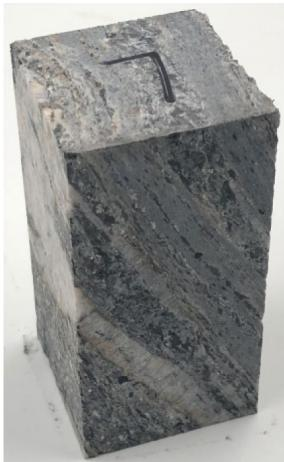  
(a)

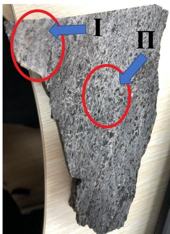  
(b)  
Fig. 1 a  Photograph of a quartz mica schist sample; (b) Sampling positions of quartz mica schist for X-ray difraction analysis (I, II-two analysis regions)

## Method for establishing anisotropic P‑wave velocity model of layered rocks

According to the wave equation, when the medium is an ideal homogeneous material and non-linear effects are ignored, the mechanical wave velocity in the medium is a fixed value, which depends on the elastic parameters and density of the material. For rocks with good homogeneity and low porosity, it can be approximately considered that the P-wave velocities are equal in all directions, however, it can be seen from the above section that the degree of heterogeneity and anisotropy of layered rocks is very high. Due to the presence of foliation planes, the P-wave velocity in rocks exhibits significant anisotropy, which cannot be ignored.

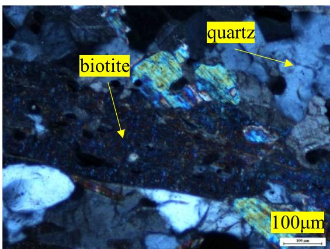

For this kind of material, it is dificult and unnecessary to establish the propagation path of P-waves in microscopic scale: it is dificult to construct its P-wave velocity model by wave equation and Snell’s theorem, because it is neither an ideal two-layered or three-layered heterogeneous structure, nor an ideal transversely isotropic material. In addition, due to the discreteness between samples, it is inappropriate to use a unified formula to describe the properties of all samples.

In general, P-wave velocity of layered rock is related to the angle θ, which is formed between foliation plane and the connecting line of wave transmitter (or AE source) and wave receiver, as shown in Fig. 3, and the P-wave velocity is negatively correlated with θ (Petružálek et al. 2013; Shao et al. 2016; Chu et al. 2020; Ding et al. 2020). When θ is large, due to the presence of flaky minerals, multiple reflection, refraction, and difraction phenomena occur, the propagation paths of P-waves are complex, which leads to the increase of P-wave propagation time and the decrease of P-wave velocity. When the angle θ gradually decreases from 90° to 0°, the number of schistosity planes that P-wave passes through in the process of propagation is reduced, and the P-wave propagation mode changes from penetrating the multiple foliation planes to directly propagating along the foliation plane. Therefore, as θ decreases from $9 0 ^ { \circ }$ to $0 ^ { \circ }$ the complexity of the P-wave propagation path is reduced, the number of refracting and reflecting surfaces decreases, the propagation time is reduced and the P-wave velocity increases. It is therefore suggested to measure the P-wave velocities of each sample in diferent directions, establish an empirical formula relating P-wave velocities and angle θ in each sample, then use the anisotropic P-wave velocity model to locate the AE source during testing.

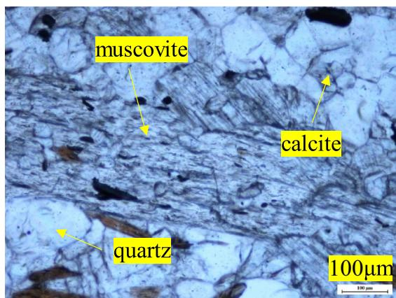  
Fig. 2 Thin section photographs of quartz mica schist

Table 1 X-ray difraction analysis result of quartz mica schist (composition percentage %)

<table><tr><td rowspan="2">Region</td><td colspan="10">Component</td></tr><tr><td>Mica</td><td>Quartz</td><td>Calcite</td><td>Plagioclase</td><td>Potassium feldspar</td><td>Clay minerals</td><td>Iron dolomite</td><td>Pyrite</td><td>Siderite</td><td>Halite</td></tr><tr><td>I</td><td>10</td><td>26</td><td>45</td><td>9</td><td>3</td><td>2</td><td>2</td><td>2</td><td>0</td><td>1</td></tr><tr><td>II</td><td>81</td><td>15</td><td>0</td><td>0</td><td>0</td><td>2</td><td>0</td><td>0</td><td>2</td><td>0</td></tr></table>

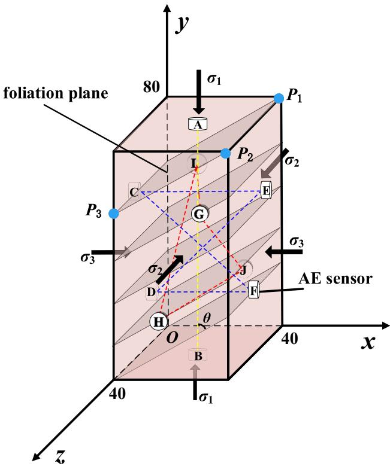  
Fig. 3 Schematic diagram of rock sample P-wave velocity measurement and arrangement of AE sensors on the sample

In order to calculate angle $\theta ,$ it is necessary to determine the orientation of foliation plane and coordinates of sensors in the given coordinate system. To take full advantage of each AE sensor, the sensors should be spaced equally apart and arranged in a regular pattern without any clustering or sparse areas, thus ensuring that each sensor covers a similar surface area of the specimen. And AE sensors should surround the AE source (Ishida et al. 2017). For 40 × 40 × 80 mm rock specimens, the coordinates of the sensors in the given coordinate system in Fig. 3 are shown in Table 2. In true triaxial compression test, the loading angle pair $( \beta$ and ω) are usually used to determine the relationship between foliation plane orientation and principal stress directions. $\beta$ is defined as the angle between foliation plane and maximum principal stress, ω is defined as the angle between foliation plane strike and intermediate principal stress, as shown in Fig.  4 (Liu et  al. 2023). A set of $\beta$ and $\omega$ values cannot uniquely determine the orientation of foliation plane in three-dimensional space. For example, the two foliation planes in Fig. 4 have the same $\beta$ and $\omega$ values, but their orientations in space are diferent. The orientation of the foliation plane in space can be uniquely determined by its normal vector, as shown in Fig. 3. Therefore, in this paper, the normal vector of foliation plane is used to define its orientation in space.

When the spatial position of foliation planes of rock sample is determined, the coordinates of three points on one of the foliation planes can be obtained, for example, when a rock sample with $\beta { = } 6 0 ^ { \circ }$ and $\omega { = } 0 ^ { \circ }$ is placed as shown in Fig. 3, the coordinates of $P _ { 1 } , P _ { 2 } ,$ and $P _ { 3 }$ are (40, 80, 0), (40, 80, 40), and $( 0 , 8 0 { - } \frac { 4 0 } { \sqrt { 3 } } , 4 0 )$ , respectively. Thus, the normal vector n�⃗ of the foliation plane is obtained from Eq. (1).

$$
\overrightarrow {n} = \overrightarrow {P _ {1} P _ {2}} \times \overrightarrow {P _ {1} P _ {3}}\tag{1}
$$

Table 2 The coordinates of the sensors in the given coordinate system in Fig. 3

<table><tr><td>Number</td><td colspan="3">Coordinate</td></tr><tr><td></td><td>x</td><td>y</td><td>z</td></tr><tr><td>A</td><td>20</td><td>80</td><td>20</td></tr><tr><td>B</td><td>20</td><td>0</td><td>20</td></tr><tr><td>C</td><td>0</td><td>53.3</td><td>26.7</td></tr><tr><td>D</td><td>0</td><td>26.7</td><td>13.3</td></tr><tr><td>E</td><td>40</td><td>53.3</td><td>13.3</td></tr><tr><td>F</td><td>40</td><td>26.7</td><td>26.7</td></tr><tr><td>G</td><td>26.7</td><td>13.3</td><td>40</td></tr><tr><td>H</td><td>13.3</td><td>26.7</td><td>40</td></tr><tr><td>I</td><td>13.3</td><td>53.3</td><td>0</td></tr><tr><td>J</td><td>26.7</td><td>26.7</td><td>0</td></tr></table>

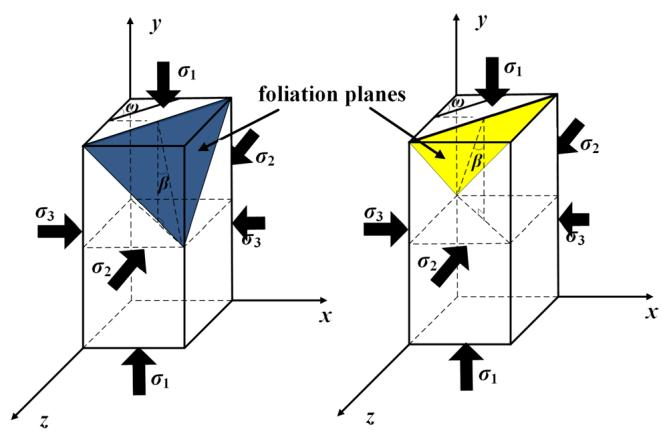  
Fig. 4 Two foliation planes with the same loading orientation but different spatial orientations (modified after Liu et al. 2023)

The angle θ $( 0 ^ { \circ } \leq \theta \leq 9 0 ^ { \circ } )$ between the connecting line $L _ { i j }$ of each two sensors (colored dashed line in Fig. 3) and the foliation plane is calculated by Eq. (2).

$$
\theta = \left(\frac {\pi}{2} - \arccos \frac {\left| \overrightarrow {L _ {i j}} \cdot \vec {n} \right|}{\left| \overrightarrow {L _ {i j}} \right| \cdot | \vec {n} |}\right) \frac {1 8 0}{\pi}, (i, j = A, B, C, D, E, F, G, H, I, J, i \neq j)\tag{2}
$$

AE acquisition apparatus has the function of transmitting pulse waves through AE sensors. Each sensor can emit pulse waves which received by all other sensors, from which the travel times of the waves between any two sensors can be determined. According to travel times and sensor coordinates, the P-wave velocities of rock sample in diferent directions are calculated.

To ensure efective pulse wave transmission through the rock sample to the sensors, only data from each pair of sensors positioned on opposite planes is utilized (as illustrated in Fig. 3). In this way, the measured P-wave velocities are closest to the real P-wave velocities of the sample during the true triaxial compression test.

Combined with Eq. (2), a set of data of anisotropic P-wave velocities and θ values can be obtained, then the functional relationship between θ values and P-wave velocities is expounded by fitting this set of data. To avoid Runge phenomenon (Lin and Sun 2015) and over-fitting, it is suggested to use exponential or quadratic function for curve fitting.

For example, the measured anisotropic P-wave velocities of rock sample in Fig. 1(a) are shown in Table 3, which can be fitted with Eq. (3). The function curve is shown in Fig. 5 and $\mathsf { R } ^ { 2 }$ for this curve fitting is 0.9267.

$$
v = \left[ 0. 1 8 2 2 \cdot \left(\frac {\theta}{\theta_ {0}}\right) ^ {2} - 3 2. 6 5 \frac {\theta}{\theta_ {0}} + 2 5 9 1 \right] v _ {0}\tag{3}
$$

where v is the anisotropic P-wave velocity of the rock sample, $\theta _ { 0 } = 1 ^ { \circ }$ and $\nu _ { 0 } = 1 \mathrm { m } / \mathrm { s } . \theta _ { 0 }$ and $\nu _ { 0 }$ are used to ensure that the units on both sides of the equation are equivalent.

## Three‑dimensional AE source location method for layered rock

Based on the simplex algorithm and anisotropic P-wave velocity model of layered rock, in this section, the three-dimensional layered rock AE source localization method is proposed.

Table 3 Anisotropic P-wave velocities of the quartz mica schist sample shown in Fig. 1(a)

<table><tr><td>Item</td><td>Value</td><td></td><td></td><td></td><td></td></tr><tr><td>θ (°)</td><td>16.1</td><td>26.4</td><td>30</td><td>55.2</td><td>86.4</td></tr><tr><td>P-wave velocity (m/s)</td><td>2108</td><td>2001</td><td>1608</td><td>1378</td><td>1123</td></tr></table>

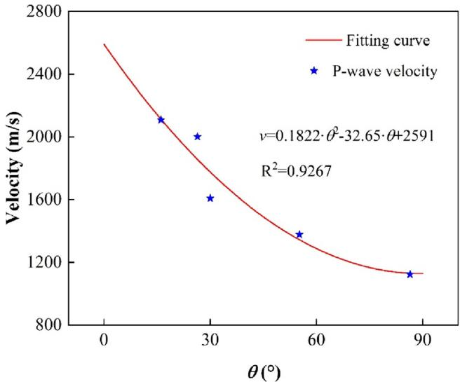  
Fig. 5   P-wave velocity fitting curve of quartz mica schist sample shown in Fig. 1(a)

The principle of calculating the AE source position by simplex algorithm is as follows: firstly, four initial iteration points A, B, C and W are given to form the four vertices of the triangular pyramid, as shown in Fig. 6. The error of each vertex is calculated, assuming the point with the smallest error is point B and the point with the largest error is point W. Then, we can get the reflection point $R e f ,$ expansion point Exp, and contraction point Con of point W. According to the error of the iteration points, a new triangular pyramid can be formed. By repeating this process, the simplex can change the search direction and gradually shrink, and finally “collapse” to the area containing AE source. When the volume of the simplex reaches the predetermined minimum value or the number of iterations reaches the predetermined value, the simplex iteration stops. Based on the TDOA location principle, at least four AE waveform arrival times from diferent channels are required for source location. However, we need as many channels with valid AE signals as possible in practice to establish over-determined equations and use optimization analysis methods, such as the least squares method (L2 norm) or least absolute value method (L1 norm), to mitigate efects of P-wave velocity and arrival time random errors.

Assume that the coordinate of the AE source is $( x _ { 0 } , y _ { 0 } ,$ $z _ { 0 } ) _ { : }$ , the coordinate of the iteration point is $( x , y , z )$ , and the coordinates of the sensors are $( x _ { i } , y _ { i } , z _ { i } ) , i = 1 , 2 , 3 , . . . , N .$ where N is the number of sensors used in the experiment.

The distance from the iteration point to the $i ^ { \mathrm { { t h } } }$ sensor receiving the AE signal (hereinafter referred to as the $i ^ { \mathrm { { t h } } }$ sensor) is expressed as:

$$
L _ {i} = \sqrt {\left(x _ {i} - x\right) ^ {2} + \left(y _ {i} - y\right) ^ {2} + \left(z _ {i} - z\right) ^ {2}}, (i = 1, 2, 3, 4, \dots , N)\tag{4}
$$

Fig. 6 Schematic graph of the simplex algorithm (modified after Prugger and Gendzwill 1988)  
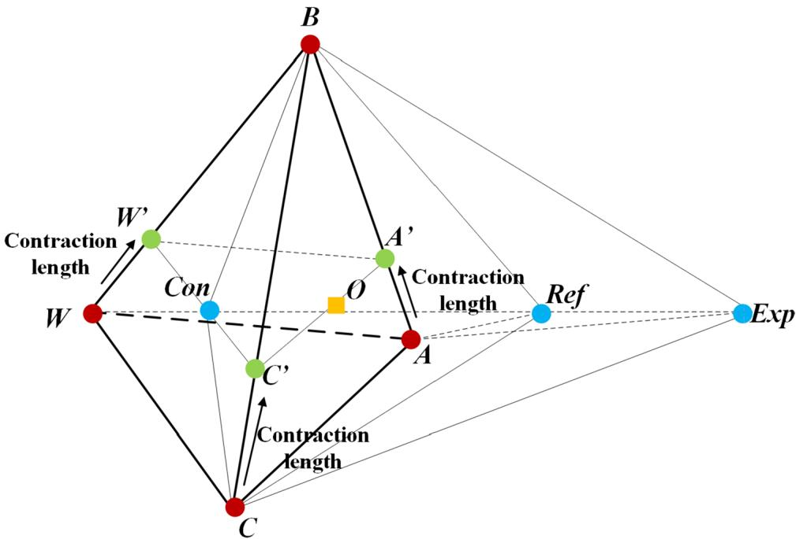

When using TDOA method for AE source location, it is necessary to calculate the arrival time diferences between AE signals arriving at diferent sensors from the iteration point. When the rock sample has a high isotropy, the isotropic P-wave velocity can be used in the calculation, as shown in Eq. (5):

$$
d t _ {i} = \frac {L _ {i} - L _ {1}}{v _ {i s o}}, (i = 2, 3, 4,..., N)\tag{5}
$$

where $d t _ { i }$ is the time diference in which an AE signal goes from the iteration point to the first sensor and the $\bar { i } ^ { \mathrm { { t h } } }$ sensor, $\nu _ { i s o }$ is the isotropic P-wave velocity of the rock sample, $L _ { 1 }$ and $L _ { i }$ are the distances from the iteration point to the first and $i ^ { \mathrm { t h } }$ sensor, respectively.

For layered rocks, the propagation velocities of AE signals in diferent directions are diferent. Using isotropic P-wave velocity will give rise to significant error in the positioning results, therefore, the anisotropic P-wave velocity model is needed to calculate the arrival time diferences. The calculated time diferences in which an AE signal goes from the iteration point to the first sensor and the $i ^ { \mathrm { { t h } } }$ sensor using the anisotropic P-wave velocity model can be determined by Eqs. (6)-(8):

$$
d t _ {i} ^ {\prime} = \frac {L _ {i}}{v _ {i}} - \frac {L _ {1}}{v _ {1}}, (i = 2, 3, 4, \dots , N)\tag{6}
$$

$$
v _ {i} = f \big (\theta_ {i} \big), (i = 1, 2, 3, 4,..., N)\tag{7}
$$

$$
\theta_ {i} = \left(\frac {\pi}{2} - \arccos \frac {\left| \overrightarrow {L _ {i}} \cdot \vec {n} \right|}{\left| \overrightarrow {L _ {i}} \right| \cdot | \vec {n} |}\right) \frac {1 8 0}{\pi}, (i = 1, 2, 3,..., N)\tag{8}
$$

where $d t _ { i } ^ { \prime }$ denotes the calculated time diference between an AE signal travelling from the iteration point to the first sensor and the $i ^ { \mathrm { { t h } } }$ sensor, $\nu _ { 1 }$ and $\nu _ { i }$ are the P-wave velocities from the iteration point to the first sensor and the $i ^ { \mathrm { { t h } } }$ sensor, respectively, $\theta _ { i }$ is the angle between the connecting line (between iteration point and the $i ^ { \mathrm { { t h } } }$ sensor) and the foliation plane, f(θ) is the function of angle θ.

According to the diference between the measured time diference and calculated time diference, the error of the iterative point can be calculated based on the L1 norm or L2 norm. The advantage of L1 norm statistics over L2 norm is that it has strong resistance to individual large errors and is more suitable for source-location calculation, therefore, the error calculation formula adopted is:

$$
E = \frac {1}{N - 1} \sum_ {i = 2} ^ {N} \left| d T _ {i} - d t _ {i} ^ {\prime} \right|\tag{9}
$$

where $d T _ { i }$ is the measured time diference between the times at which the AE signal reaches the first sensor and the $i ^ { \mathrm { { t h } } }$ sensor.

The iterative process involves finding min(E). The specific iterative steps are shown in Fig. 7.

## Influence of the iterative parameters on positioning accuracy

The factors that afect the accuracy of the proposed method include the initial value of iteration (the vertices of the initial simplex), the iteration contraction step length, the number of iterations, and the P-wave velocity measurement error.

Four numerical samples are established in MATLAB™, as shown in Fig. 8. The proposed method with diferent iteration parameters and P-wave velocity measurement error will be used to locate the nine pre-determined AE sources in the four numerical samples (Table 4). Through numerical experiments, the influences of the above factors are investigated, and specific suggestions for the selection of those parameters are given. The arrangement and coordinates of the sensors are the same as those in Fig. 3, and the P-wave velocity model of the numerical samples is established according to Eq. (3).

In fact, the P-wave velocity measurement cannot be completely accurate in reality. Even if the same sample is tested twice, the results may be diferent. Secondly, the measured P-wave velocity cannot fully reflect the P-wave velocity of the whole sample. Therefore, to verify the robustness and accuracy of the algorithm proposed in this paper, the cases of P-wave velocity measurement errors of 0%, 2%, 5%, and 10% were considered. During the positioning calculation, the real P-wave velocity function (Eq. (3)) is dot multiplied by a random number matrix distributed in -0.98 \~ 1.02, -0.95 \~ 1.05, -0.9 \~ 1.1, so as to carry out numerical tests with diferent P-wave velocity measurement errors.

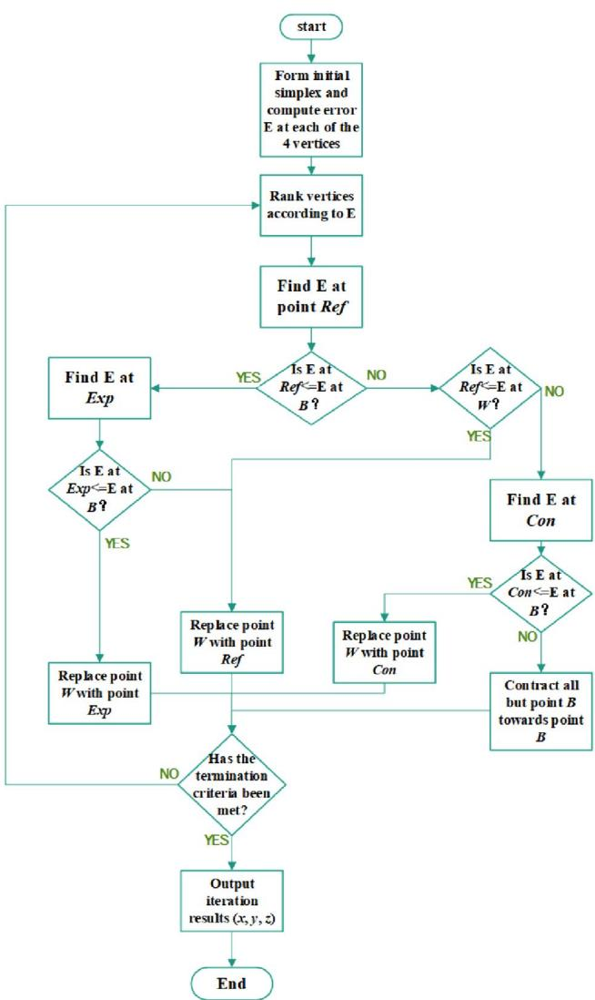  
Fig. 7 Simplex iterative process for AE source positioning (modified after Prugger and Gendzwill 1988)

## Influence of the iterative initial value on positioning accuracy

Since the location of the AE source is unknown, to avoid the influence of human subjectivity on the search direction of the simplex, the shape of the initial simplex should be a regular tetrahedron. And the first sensor receiving the AE signal is take as the center of the regular tetrahedron, which is conducive to the iteration converging to the global minimum value.

When considering the influence of the iterative initial value, the selected iterative contraction length is a third of side length of the tetrahedron and the number of iterations is one hundred. Due to the real P-wave velocity matrix being dot multiplied by a random number matrix and the random number matrix generated each time is diferent, the P-wave velocity model used in each calculation will be diferent. And diferent P-wave velocity models will lead to diferent positioning results. Therefore, in order to avoid the influence of random number matrix on the location results, a hundred positioning calculations using diferent random number matrices are conducted for each AE source in each numerical sample, and the average value is taken as the positioning result. The numerical tests are carried out respectively considering that the distance between the vertices of the initial simplex and the center point is 2 mm, 5 mm, 10 mm, 15 mm, 20 mm, 25 mm, and 30 mm. The average error of the positioning results of nine AE sources in each model (the distance between the positioning results and the actual value) is calculated. The test results are shown in Fig. 9.

Figure 9 indicates that when the distance between the vertices of the initial simplex and the center point is about 15 mm, the iterative result is stable, and the positioning error is small. The selection of the iterative initial value is related to the number and arrangement of AE sensors. According to the sensor arrangement adopted herein (Fig. 3), the minimum distance between two sensors is 29.8 mm, therefore, it is suggested that the distance between the vertices of the initial simplex and the center point is 1/2 of the minimum distance between any two sensors.

## Influence of the iterative contraction step length on positioning accuracy

In this numerical test, the distance between the vertices of the initial simplex and the center point is 15 mm, and the number of iterations is one hundred. To avoid random

Table 4 Predetermined coordinates of AE sources  
Fig. 8   Numerical samples: a $\beta = 0 ^ { \circ } , \omega = 0 ^ { \circ } ; \mathbf { b } \beta = 3 0 ^ { \circ } , \omega = 0 ^ { \circ } ;$ c β=60°, ω =0°; d β=90°, ω=0°  
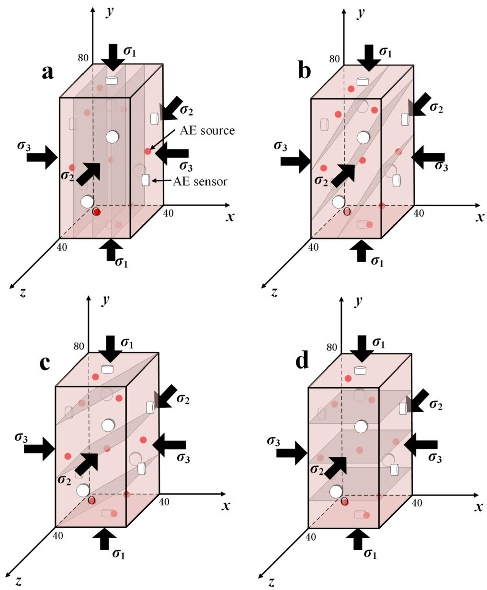

<table><tr><td>Number</td><td colspan="3">Coordinate</td></tr><tr><td></td><td>x</td><td>y</td><td>z</td></tr><tr><td>1</td><td>10</td><td>10</td><td>10</td></tr><tr><td>2</td><td>20</td><td>40</td><td>20</td></tr><tr><td>3</td><td>30</td><td>70</td><td>30</td></tr><tr><td>4</td><td>10</td><td>40</td><td>30</td></tr><tr><td>5</td><td>30</td><td>10</td><td>20</td></tr><tr><td>6</td><td>20</td><td>70</td><td>10</td></tr><tr><td>7</td><td>30</td><td>40</td><td>10</td></tr><tr><td>8</td><td>20</td><td>10</td><td>30</td></tr><tr><td>9</td><td>10</td><td>70</td><td>20</td></tr></table>

errors, one hundred positioning calculations are conducted for each AE source in each model, and the average value is taken as the positioning result. The numerical experiments are carried out considering the contraction step length is 2/3, 1/2, 1/3, 1/4, and 1/5 of the original side length of the tetrahedron. The test results are illustrated in Fig. 10.

Figure 10 illustrates that diferent contraction lengths have relatively little influence on the positioning results when the contraction length is less than half of the side length. The positioning efect is relatively good and stable when the contraction length is about 1/3 of the original side length of the tetrahedron.

## Influence of the number of iterations on positioning accuracy

In this numerical test, the distance between the vertices of the initial simplex and the center point is 15 mm, and the iterative contraction step length is one-third of the original side length of the tetrahedron. Similarly, to avoid random errors, one hundred positioning calculations are conducted for each AE source in each model, and the average value is taken as the positioning result. The numerical experiments are carried out under the conditions of 10, 20, 30, 40, 50,

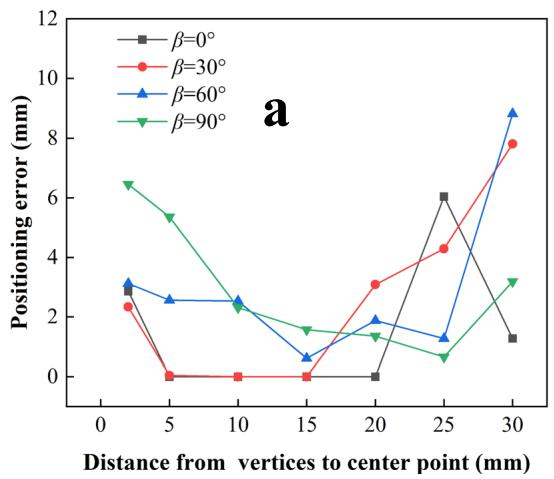

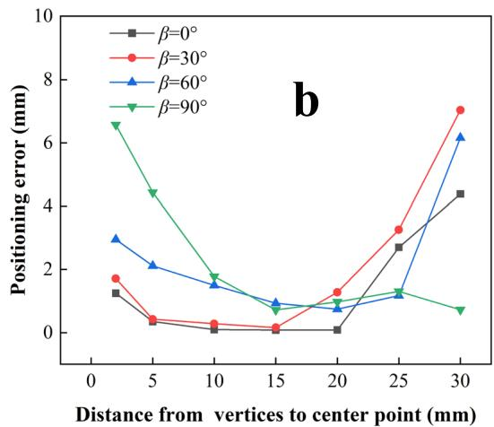

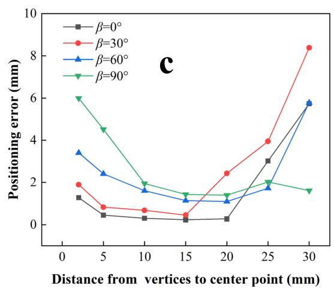

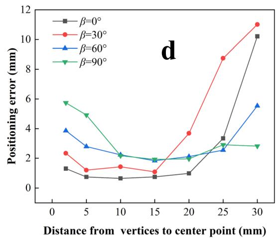

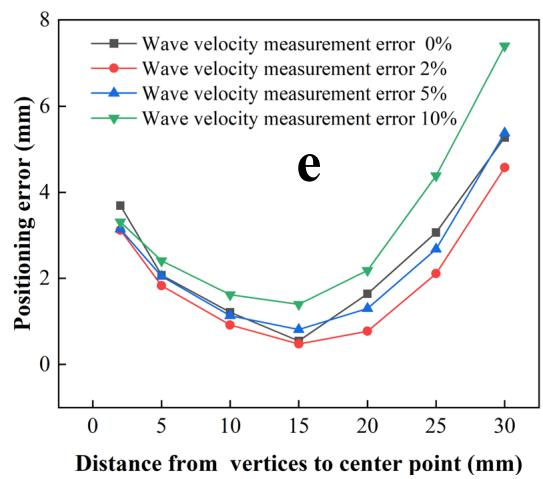  
Fig. 9 Positioning error under diferent distances between the vertices and the center point of initial simplex: a \~ d Four samples with P-wave velocity measurement errors of 0%, 2%, 5%, and 10% respectively; e Average error of four samples

100 and 200 iterations, respectively. The test results are demonstrated in Fig. 11.

Figure 11 demonstrates that the rate of convergence of the proposed method is rapid. The initial rapid decrease in localization error followed by a gradually slowing down rate of convergence as the number of iterations increases is observed in the trend of the descending curve. When the number of iterations reaches100, simply increasing the number of iterations will not improve the positioning accuracy further.

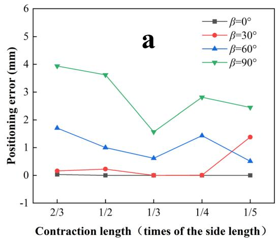

In addition, as shown in Figs. 9, 10, 11, when the P-wave velocity measurement error is less than 5%, the increase of positioning error is less than 0.5mm. When the P-wave velocity measurement error is 10%, the increase of positioning error is less than 1mm. Therefore, the P-wave velocity measurement

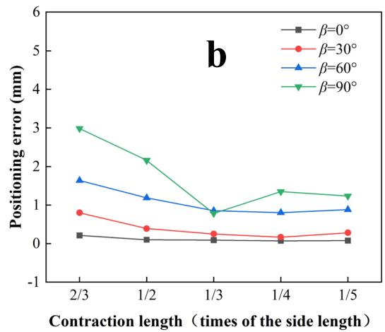

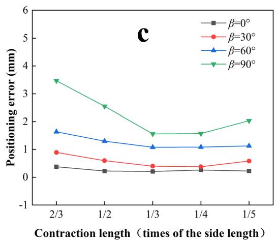

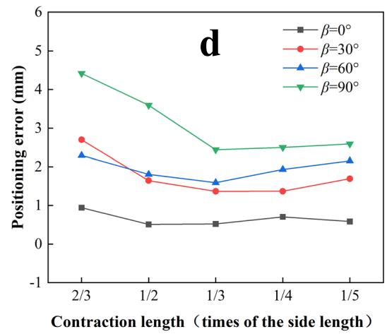

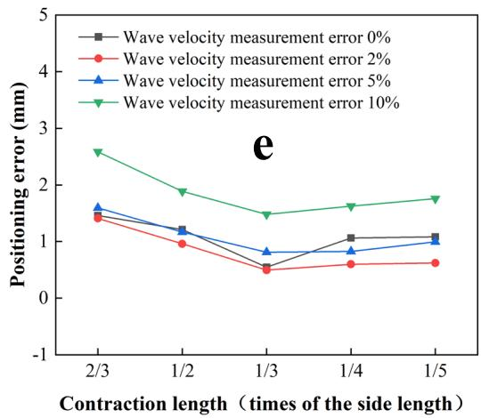  
Fig. 10 Positioning error under diferent contraction step length: a \~ d Four samples with P-wave velocity measurement errors of 0%, 2%, 5%, and 10% respectively; e Average error of four samples

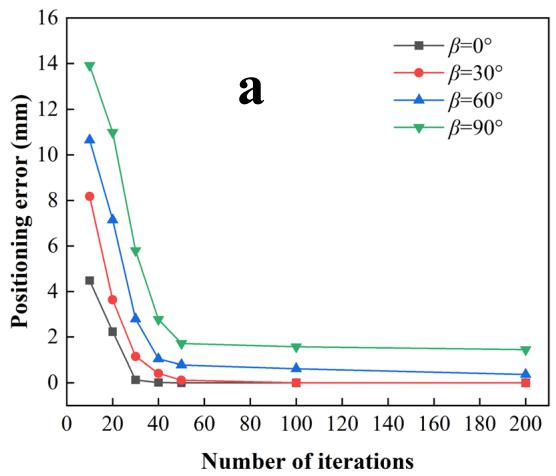

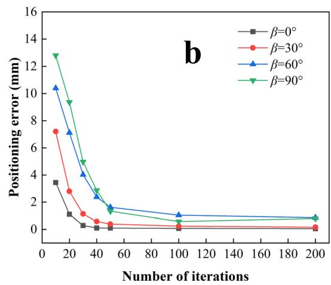

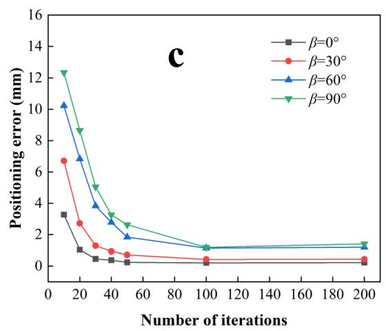

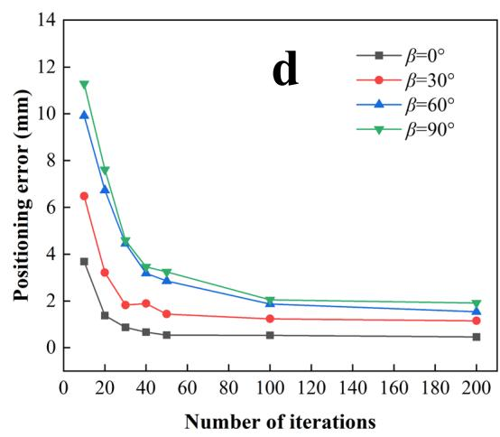

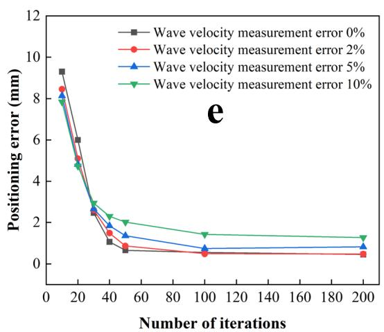  
Fig. 11 Positioning error under diferent numbers of iteration: a \~ d Four samples with P-wave velocity measurement errors of 0%, 2%, 5%, and 10% respectively; e Average error of four samples

error has relatively little efect on the positioning accuracy of the new method, which shows that the new method is also applicable to samples with relatively high heterogeneity.

In this section, the influences of initial value, the iterative contraction length, the number of iterations and P-wave velocity measurement error on the accuracy of the proposed method are evaluated through numerical experiments. It should be noted that numerical experiments for other P-wave velocity functions, such as exponential function, are also conducted, and the results are consistent with the above conclusions.

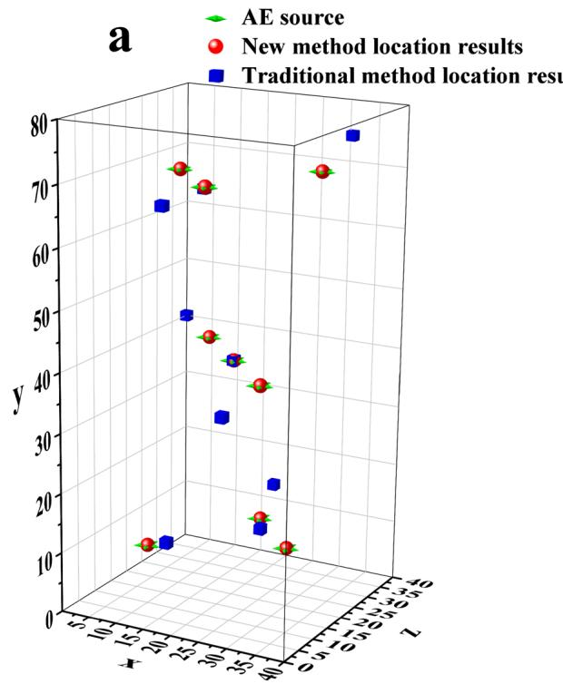

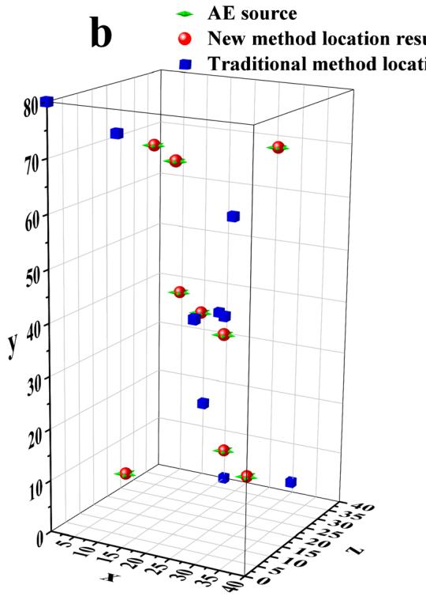

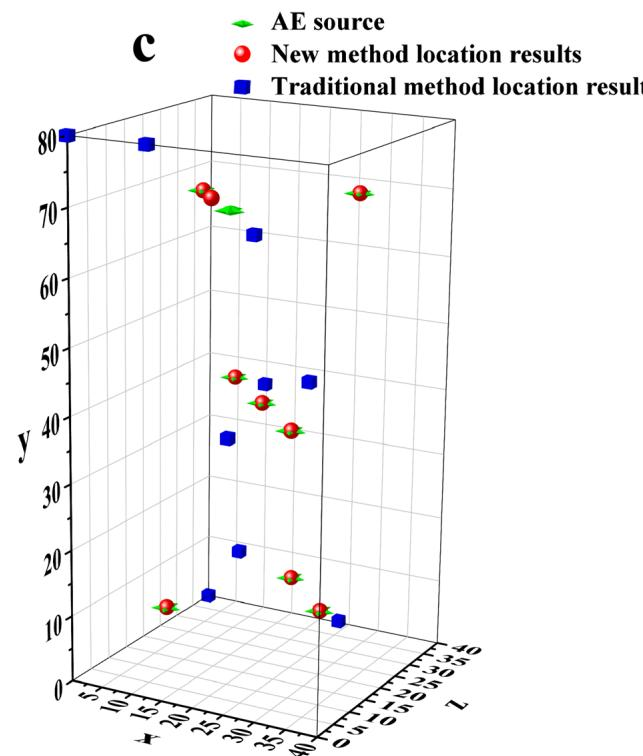

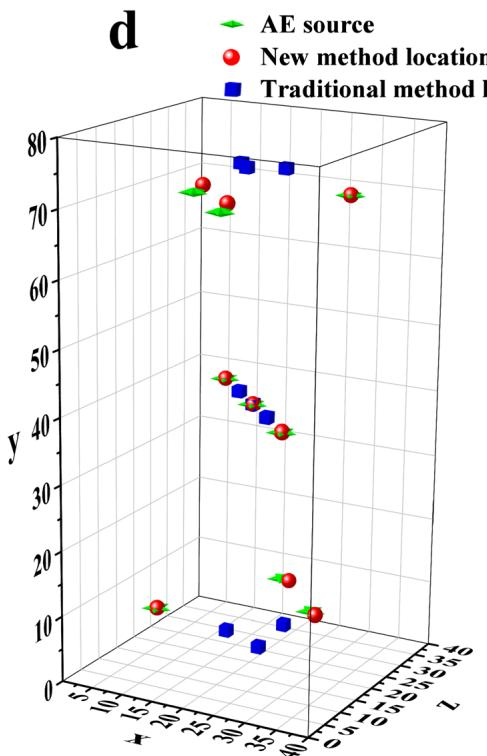  
Fig. 12 Comparison of the AE source positioning results between the proposed method and traditional method (P-wave velocity measurement error of 0%): ${ \textrm { l } } \beta = 0 ^ { \circ } , \omega = 0 ^ { \circ } ; { \textbf { b } } \beta = 3 0 ^ { \circ } , \omega = 0 ^ { \circ } ; { \textbf { c } } \beta = 6 0 ^ { \circ } , \omega = 0 ^ { \circ } ; { \textbf { d } } \beta = 9 0 ^ { \circ } , \omega = 0 ^ { \circ }$

a  
b  
d  
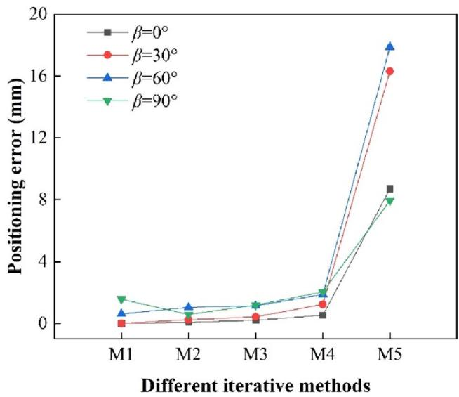  
Fig. 13 Comparison of positioning errors of diferent methods and models (M1 to M4—proposed method with P-wave velocity measurement error of 0%, 2%, 5%, and 10%, respectively; M5—traditional method)

## Example verification

In this section, the accuracy of the AE source localization method for layered rock proposed in the present research is verified by numerical analysis and true triaxial compression tests.

new positioning method and traditional method and compare the iterative results with the actual coordinates. The numerical experiments are conducted with MATLAB™.

The anisotropic P-wave velocity model used in the proposed method is Eq. (3). The isotropic P-wave velocity used in the traditional method is 1614 m/s, which is the average value of velocities in all directions calculated using Eq. (3). The adopted distance from the center of the regular tetrahedron to the four vertices is 15 mm, iterative contraction length is a third side length of the tetrahedron, and number of iterations is 100. And it is stipulated that the positioning result cannot be outside the numerical sample. When the proposed method is used to locate the AE sources, the cases of P-wave velocity measurement errors of 0%, 2%, 5%, and 10% are considered.

The location results of the four numerical samples (P-wave velocity measurement error of 0%) are demonstrated in Fig. 12, and the positioning errors (the distance between the positioning results and the actual value) of the two methods are shown in Fig. 13.

It can be seen from Figs. 12 and 13 that the positioning accuracy of the new method is much higher than that of the traditional method. In addition, the calculation of the new method is simple, when the P-wave velocity measurement error is less than 5%, it required fewer than 100 iterations to reduce the positioning error to less than 1 mm. However, to achieve this accuracy, the grid search method needs to analyze more than 40 × 40 × 80 elements (128,000 in total). For larger samples, the burden increases exponentially.

## Numerical test verification

The traditional simplex method (isotropic P-wave velocity simplex method) and the method proposed herein are used to locate the AE sources of the four numerical samples in Fig. 8, respectively. The numerical test verification method aims to obtain the coordinates of the nine AE sources given in advance (Table 4), then calculate their values through the

## True triaxial compression test verification

True triaxial compression tests for three typical layered rocks (quartz mica schist, quartz schist, and black shale) are conducted to verify the efect of the proposed method in practical application. The specimens measured 40 mm × 40 mm × 80 mm (Fig. 14). Before conducting the experiment,

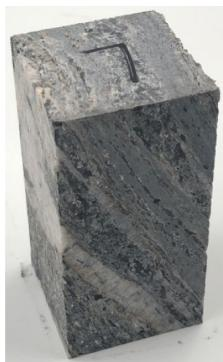

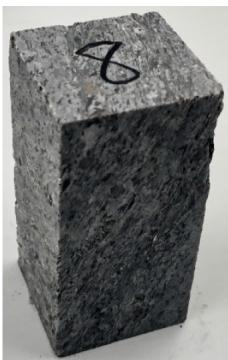

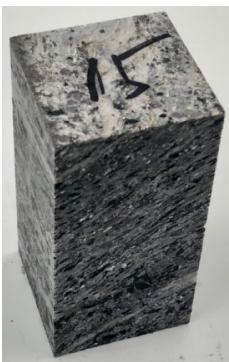

c  
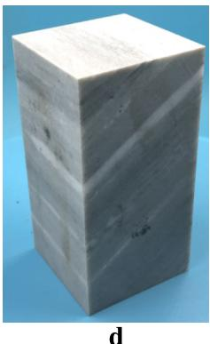

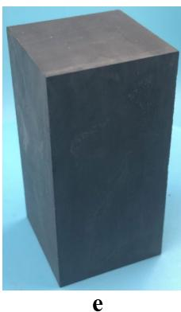  
Fig. 14 Photographs of rock samples used herein: a Quartz mica schist 1; b Quartz mica schist 2; c Quartz mica schist 3; d Quartz schist 1; e Black shale 1

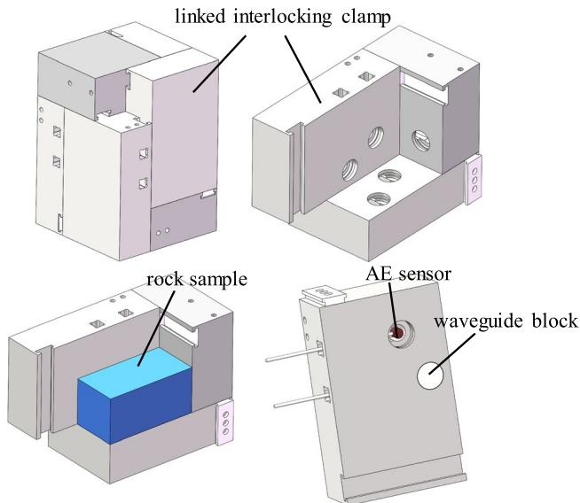  
Fig. 15 Schematic diagram of true triaxial linked interlocking clamp and placement of AE sensors (modified after Feng et al. 2023)

the P-wave velocity models of the samples should be established. First, the sample is placed in the linked interlocking clamp, and the AE sensors are placed in advance in the linked interlocking clamp, as shown in Fig. 15 (Feng et al. 2023). During the true triaxial compression test, each side of the sample must bear pressure, whereas the AE sensors cannot bear pressure, so the AE sensors contact the sample through the waveguide blocks which can bear pressure, which ensures that uniform pressure is applied to each surface of the sample. The AE sensors are only in contact with the waveguide blocks and not with the linked interlocking clamp: the waveguide blocks are in contact with the clamp through a high-pressure resistant, insulating lamellar material, which avoids the influence of the noise generated by the loading machine during the test. After the sample is placed in the clamp, a preload of 2 kN is applied in three mutually perpendicular directions through true triaxial testing apparatus. Then P-wave velocity values of the sample in diferent directions are measured, and the P-wave velocity models of the samples can be established, as listed in Table 5. The P-wave velocity models of the samples used in this paper are shown in Fig. 16. In Fig. 16, the degree of P-wave velocity anisotropy of quartz mica schist and quartz schist is high, while, the P-wave velocity anisotropy of black shale is relatively low. Possible explanations for the above phenomena can be summarized as follows: quartz mica schist and quartz schist are metamorphic rocks, which containing many flaky minerals, these minerals have a significant influence on P-wave velocity. And black shale is a sedimentary rock with very thin beddings, which have a relatively small influence on P-wave velocity.

True triaxial compression tests were performed on a rigid true triaxial apparatus for analyses of deformation and failure features of deep weak rock under excavation stress paths, which is designed and developed by Northeastern University in Shenyang, Liaoning Province, China, as shown in Fig. 17(a) (Feng et al. 2023). The loading mode of the equipment is rigid loading in all three principal loading directions. To accurately capture the deformation of rock in the true triaxial test, six grating displacement extensometers with 10-20mm ranges are used to monitor the deformation in three principal stress directions independently. During the true triaxial loading test, the hydrostatic pressure is first applied at 2.5 MPa/min until a target value of $\sigma _ { 1 } = \sigma _ { 2 } = \sigma _ { 3 }$ is obtained. Then, $\sigma _ { 3 }$ is held constant while $\sigma _ { 1 }$ and $\sigma _ { 2 }$ are simultaneously increased to the desired value of $\sigma _ { 2 }$ at 2.5 MPa/ min. Then, $\sigma _ { 2 }$ and $\sigma _ { 3 }$ remain unchanged and $\sigma _ { 1 }$ is increased until the peak strength of the sample is reached. When the rock sample is about to enter the yield state, the mode of control of $\sigma _ { 1 }$ changes from force control to deformation control and the test is ended when the sample enters its residual strength stage. Figure 18 shows the specific stress path used in the true triaxial compression tests, the $\sigma _ { 2 }$ and $\sigma _ { 3 }$ were set as 10 MPa and 5 MPa for quartz mica schist, 3 MPa and 1 MPa for quartz schist, and 5 MPa and 3 MPa for black shale.

The PCI-2 AE monitoring system (American Physical Acoustics Co., USA) is used for acquisition of AE signals as shown in Fig. 17(b). The threshold, pre-amplification, sampling frequency, and sampling length are set to 35 dB, 40 dB, 2 $\mathbf { M H z } ,$ and 2 k, respectively. During the experiment, ten Nano30 sensors are used to acquire AE signals, for which the frequency response range is 125 kHz to 750 kHz. Each sensor is equipped with a 2/4/6-AST pre-amplifier. The arrangement and coordinates of the sensors are the same as those in Fig. 3. To guarantee good reception of the AE signals by the sensors, the interfaces among the specimen, the waveguide blocks and sensors are smeared with Vaseline™ for coupling.

Table 5 Physical properties of the rock samples

<table><tr><td>Name</td><td>Density (g/cm3)</td><td>P-wave velocity model (m/s)</td></tr><tr><td>Quartz mica schist 1</td><td>2.756</td><td> $v = \left[0.1822 \cdot \left(\frac{\theta}{\theta_0}\right)^2 - 32.65 \frac{\theta}{\theta_0} + 2591\right]v_0$ </td></tr><tr><td>Quartz mica schist 2</td><td>2.779</td><td> $v = \left[0.145 \cdot \left(\frac{\theta}{\theta_0}\right)^2 - 29.66 \frac{\theta}{\theta_0} + 2483\right]v_0$ </td></tr><tr><td>Quartz mica schist 3</td><td>2.882</td><td> $v = 2292 \cdot \exp \left(-0.01013 \cdot \frac{\theta}{\theta_0}\right)v_0$ </td></tr><tr><td>Quartz schist 1</td><td>2.656</td><td> $v = \left[-0.1209 \cdot \left(\frac{\theta}{\theta_0}\right)^2 - 9.369 \frac{\theta}{\theta_0} + 3116\right]v_0$ </td></tr><tr><td>Black shale 1</td><td>2.541</td><td> $v = \left[-0.03604 \cdot \left(\frac{\theta}{\theta_0}\right)^2 - 3.36 \frac{\theta}{\theta_0} + 3325\right]v_0$ </td></tr></table>

Fig. 16 P-wave velocity models of the rock samples used herein  
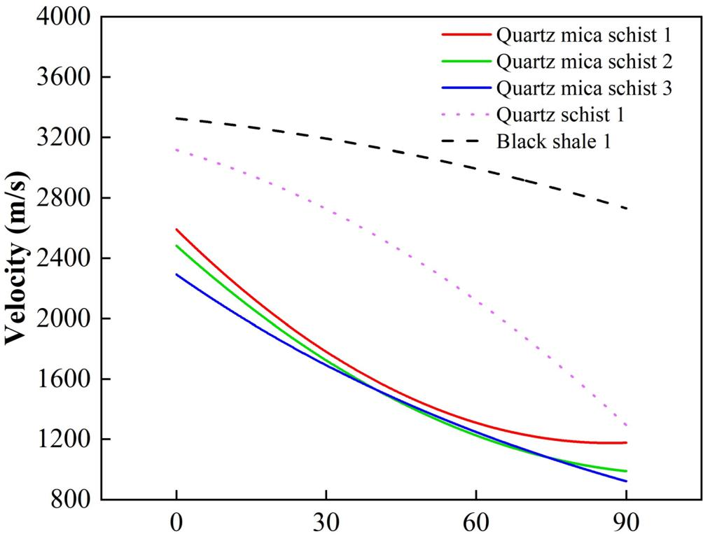

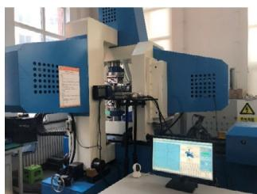  
(a)

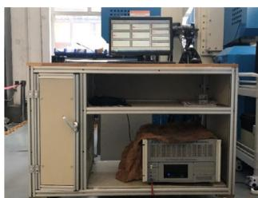  
(b)  
Fig. 17   Test apparatus: (a) True triaxial testing apparatus; (b) PCI-2 AE monitoring system

The traditional (isotropic P-wave velocity simplex method) and proposed methods are used to locate AE sources. The final failure mode of rock samples, positioning results, and complete stress–strain curves of the samples are shown in Fig. 19. The yellow dashed lines in Fig. 19 show the fracture and cracks of rock samples. It can be seen that for the black shale which P-wave velocity anisotropy is low, the accuracy of the traditional location method is almost the same as the new method. However, the accuracy of the new method for quartz mica schist and quartz schist with high anisotropy is much higher than that of the traditional method. The true triaxial compression test results show that the proposed method has high

θ(°)  
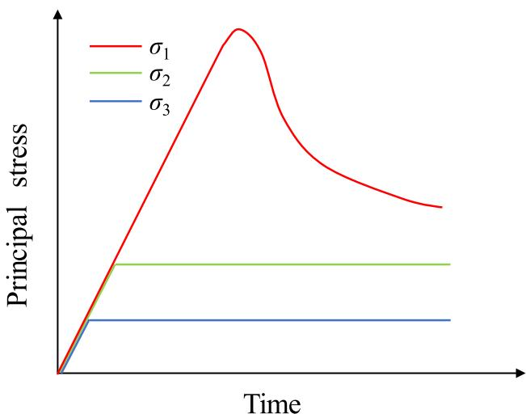  
Fig. 18 Stress path used in the true triaxial tests

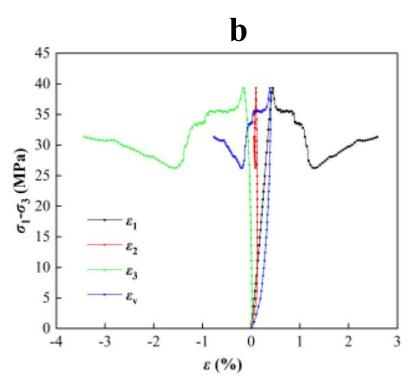

Fig. 19 Failure modes, positioning results and stress–strain curves of diferent samples: (A) Quartz mica schist 1; (B) Quartz mica schist 2; (C) Quartz mica schist 3; (D) Quartz schist 1 (E) Black shale 1 (a failure mode; b stress–strain curve; c 3-d positioning result using the proposed method; d 2-d positioning result using the proposed method; e 3-d positioning result using the traditional method; f 2-d positioning result using the traditional method)

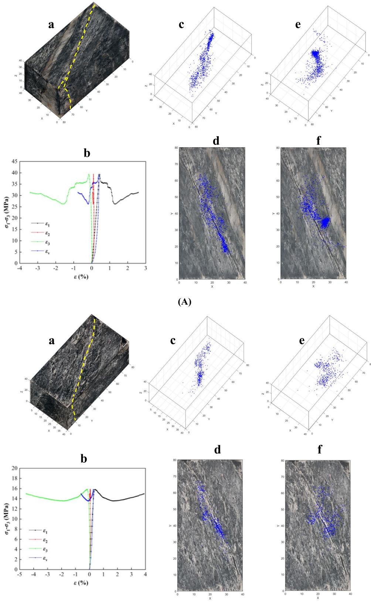

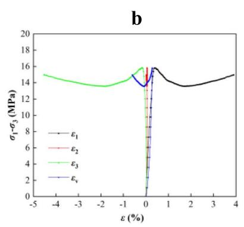  
(B)  
provides an efective way for studying the spatio-temporal evolution of layered rock fracture and its fracture mechanism under high true triaxial stress.

positioning accuracy and is suitable for AE source location of layered rock during true triaxial compression tests. Therefore, the proposed AE source-location method for layered rock

Fig. 19   (continued)  
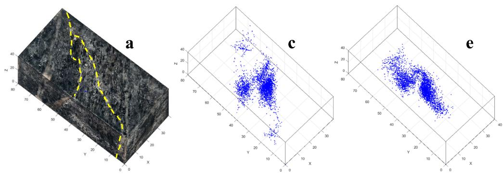

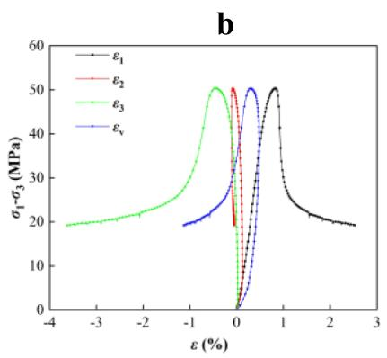

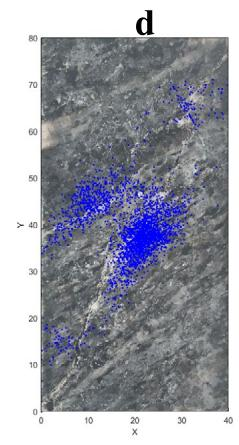

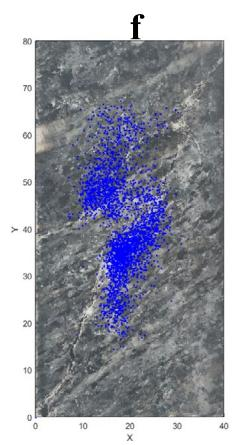

(C)  
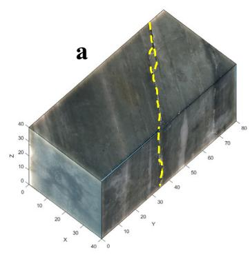

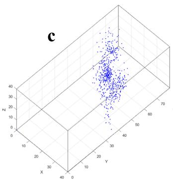

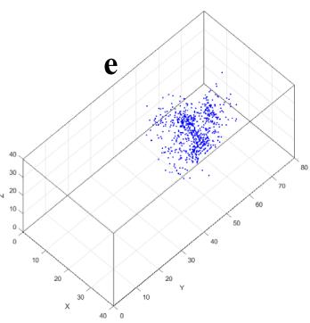

b  

d  
  
(D)

f  

Fig. 19   (continued)  

d  
  
(E)

## Discussion

A three-dimensional AE source localization method for layered rock is proposed in this paper. However, due to the restrictions of the experimental conditions or other factors, several aspects require optimization and improvement.

1. In addition to bedding planes, loading stress also has an efect on the P-wave velocity of rocks during rock mechanics tests (Davi et al. 2013; Bai et al. 2019). In a future study, AE tomography can be applied to obtain the real-time 3D P-wave velocity for the rock sample in diferent directions. And a 3D time-dependent anisotropic P-wave velocity model can be established, which will provide better location results.

2. The method proposed in this article is applicable to layered rocks with a set of parallel bedding planes. It is not applicable to rocks with multiple sets of bedding planes in diferent directions or rocks with folding bedding planes. The influence of these factors should be considered in future research.

3. Through the AE localization, the location of rock fracture and its evolution process can be determined. By analyzing the location of AE events and the time series of AE hit, higher quality forecast for layered rock failure can be achieved (Zhang and Zhou  2020; Zhang et al.

2023). The relative research can be conducted in the future.

4. This article mainly studies the AE source localization method of layered rocks in laboratory rock mechanics tests. The application of the results of this study in geotechnical projects such as deep tunnels and rock slopes should be studied in future. The instability of geotechnical projects is inherently linked to AE activity within them. When monitorable displacement occurs on the surface of deep tunnels or rock slopes, microfractures have already taken place within the rock mass. The failure of layered rock mass is significantly afected by bedding structure. And the failure location of layered rock mass is diferent from that of isotropic rock mass. By deploying AE sensors within the geotechnical projects, it is possible to continuously monitor the AE signals generated by layered rock fractures in real time and utilize localization algorithms to determine the location of the fracture source. This facilitates the timely identification of potential layered rock fracture hazards and provides a basis for taking necessary support and reinforcement measures.

## Conclusions

A three-dimensional AE source localization method for layered rock is proposed based on simplex method and the established anisotropic P-wave velocity model. The factors afecting the positioning accuracy of the method are studied. And the accuracy of the proposed method is verified by numerical analysis and true triaxial compression test. The main conclusions are drawn as follows:

1. Due to the presence of foliation planes, the P-wave velocity of layered rocks exhibits significant anisotropy. A method is proposed to establish the anisotropic P-wave velocity model of layered rock, which can accurately reflect the anisotropic propagation velocity characteristics of AE signals generated by microfracture in layered rock;

2. A three-dimensional AE source location method for layered rock is proposed based on simplex method and the established anisotropic P-wave velocity model. The iterative initial value exerts a relatively large influence on the positioning accuracy of the proposed method, while the iterative contraction length has relatively little efect on the positioning accuracy. When the distance between the vertices of the initial simplex and the center point is 1/2 of the minimum distance between any two sensors and the contraction length is about

1/3 of the original side length of the tetrahedron, the positioning efect is relatively good and stable;

3. For layered rocks with high anisotropy and heterogeneity, the location accuracy of the proposed method is much higher than that of the traditional method (isotropic P-wave velocity simplex method). In addition, this method allows rapid convergence, as the number of iterations increases, the localization error initially decreases rapidly, but the rate of decrease slows down as iterations continue. When the number of iterations reaches 100, simply increasing the number of iterations cannot further improve the accuracy of the positioning results. The computational burden is much less onerous than that of grid search method;

4. True triaxial compression test results show that the positioning results are consistent with the final failure modes of the rock samples. Therefore, the proposed AE source location method for layered rock provides an efective way of studying the spatio-temporal evolution of layered rock fracturing and its fracture mechanism under high true triaxial compression stress.

Acknowledgements This study was financially supported by the National Natural Science Foundation of China under Grant No. 52079027. The authors also thank Dr. Xu-feng Liu at Institute of Rock and Soil Mechanics, Chinese Academy of Sciences, China, for his assistance in paper revision.

Funding National Natural Science Foundation of China, 52079027, Yangyi Zhou.

Data Availability The data that support the findings of this study are available from the corresponding author.

## Declarations

Conflict of Interest The authors declare no conflict of interest.

Competing interest The authors declare that they have no known competing financial interests or personal relationships that could have appeared to influence the work reported in this paper.

## References

Bai Q, Tibbo M, Nasseri MHB, Young RP (2019) True triaxial experimental investigation of rock response around the mineby tunnel under an in situ 3D stress path. Rock Mech Rock Eng 52(10):3971–3986

Chu C, Wu S, Zhang S, Guo P, Zhang M (2020) Mechanical behavior anisotropy and fracture characteristics of bedded sandstone. J Central South Univ (science and Technology) 51(8):2232–2246

Davi R, Vavryčuk V, Charalampidou E, Kwiatek G (2013) Network sensor calibration for retrieving accurate moment tensors of acoustic emissions. Int J Rock Mech Min 62:59–67

Debecker B, Vervoort A (2011) Localization by acoustic emission in transversely isotropic slate. Adv Acous Vib 2011:1–10

Ding C, Hu D, Zhou H, Lu J, Lv T (2020) Investigations of P-wave velocity, mechanical behavior and thermal properties of anisotropic slate. Int J Rock Mech Min 127:104176

Dong L, Li X, Zhou Z, Chen G, Ma J (2015) Three-dimensional analytical solution of acoustic emission source location for cuboid monitoring network without pre-measured wave velocity. T Nonferr Metal Soc 25(1):293–302

Dong L, Hu Q, Tong X, Liu Y (2020) Velocity-free MS/AE source location method for three-dimensional hole-containing structures. Engineering 6(7):827–834

Dresen G, Stanchits S, Rybacki E (2010) Borehole breakout evolution through acoustic emission location analysis. Int J Rock Mech Min 47(3):426–435

Fedorow VV (1974) Regression problems with controllable variables subject to error. Biometrika 61:49–55

Feng X, Yu X, Zhou Y, Yang C, Wang F (2023) A rigid true triaxial apparatus for analyses of deformation and failure features of deep weak rock under excavation stress paths. J Rock Mech Geotech 15(5):1065–1075

Geiger L (1912) Probability method for the determination of earthquake epicenters from the arrival time only. Bull St Louis Unic 8:60–71

Goebel THW, Kwiatek G, Becker TW, Brodsky EE, Dresen G (2017) What allows seismic events to grow big?: insights from b-value and fault roughness analysis in laboratory stick-slip experiments Geology 45(9):815–818

Grosse CU, Ohtsu M, Aggelis DG, Shiotani T (2022) Acoustic emission testing: basics for research–applications in engineering. Springer Nature, Switzerland

Guo TY, Wong LNY (2020) Microcracking behavior of three granites under mode I loading: insights from acoustic emission. Eng Geol 278:105823

Guo TY, Wong LNY (2021) Cracking mechanisms of a mediumgrained granite under mixed-mode I-II loading illuminated by acoustic emission. Int J Rock Mech Min 145:104852

Hajzargerbashi T, Kundu T, Bland S (2011) An improved algorithm for detecting point of impact in anisotropic inhomogeneous plates. Ultrasonics 51(3):317–324

Ishida T, Labuz JF, Manthei G et al (2017) ISRM suggested method for laboratory acoustic emission monitoring. Rock Mech Rock Eng 50(3):665–674

Kundu T, Das S, Jata KV (2009) Detection of the point of impact on a stifened plate by the acoustic emission technique. Smart Mater Struct 18(3):35006

Kwiatek G, Goebel THW, Dresen G (2014) Seismic moment tensor and b value variations over successive seismic cycles in laboratory stick-slip experiments. Geophys Res Lett 41(16):5838–5846

Li BQ, Einstein HH (2017) Comparison of visual and acoustic emission observations in a four point bending experiment on Barre granite. Rock Mech Rock Eng 50(9):2277–2296

Li BQ, Gonçalves Da Silva B, Einstein H (2019) Laboratory hydraulic fracturing of granite: acoustic emission observations and interpretation. Eng Fract Mech 209:200–220

Li J, Li K, Tang S (2023) Automatic arrival-time picking of P- And S-waves of microseismic events based on object detection and CNN. Soil Dyn Earthq Eng 164:107560

Li N, Sun W, Huang B, Chen D, Zhang S, Yan M (2021) Acoustic emission source location monitoring of laboratory-scale hydraulic fracturing of coal under true triaxial stress. Nat Resour Res 30(3):2297–2315

Lin H, Sun L (2015) Searching globally optimal parameter sequence for defeating Runge phenomenon by immunity genetic algorithm. Appl Math Comput 264:85–98

Liu J, Li Y, Xu S, Xu S, Jin C (2015) Cracking mechanisms in granite rocks subjected to uniaxial compression by moment tensor analysis of acoustic emission. Theor Appl Fract Mec 75:151–159

Liu X, Feng X, Zhou Y, Sharifzadeh M (2022) Influences of foliation orientation and lateral stress diference on the deformation and fracturing of a thin-layered rock around underground excavations: insight from multi-axial loading tests. B Eng Geol Environ 81(5):171

Liu X, Feng X, Zhou Y (2023) Influences of schistosity structure and diferential stress on failure and strength behaviors of an anisotropic foliated rock under true triaxial compression. Rock Mech Rock Eng 56(2):1273–1287

Naderloo M, Moosavi M, Ahmadi M (2019) Using acoustic emission technique to monitor damage progress around joints in brittle materials. Theor Appl Fract Mec 104:102368

Nelder JA, Mead R (1965) A simplex method for function minimization. Comput J 7:308–313

Petružálek M, Vilhelm J, Rudajev V, Lokajíček T, Svitek T (2013) Determination of the anisotropy of elastic waves monitored by a sparse sensor network. Int J Rock Mech Min 60:208–216

Prugger AF, Gendzwill DJ (1988) Microearthquake location: a nonlinear approach that makes use of a simplex stepping procedure. Bull Seismol Soc Am 78(2):799–815

Shang X, Wang Y, Miao R (2022) Acoustic emission source location from P-wave arrival time corrected data and virtual field optimization method. Mech Syst Signal Pr 163:108129

Shao T, Ji S, Oya S, Michibayashi K, Wang Q (2016) Mica-dominated seismic properties of mid-crust beneath west Yunnan (China) and geodynamic implications. Tectonophysics 677–678:324–338

Wong LNY, Xiong Q (2018) A method for multiscale interpretation of fracture processes in Carrara marble specimen containing a single flaw under uniaxial compression. J Geophys Res: Solid Earth 123(8):6459–6490

Wong LNY, Guo TY, Wu Z, Xiao X (2021) How do thermally induced microcracks alter microcracking mechanisms in Hong Kong granite? Eng Geol 292:106268

Wu Z, Wang Z, Fan L, Weng L, Liu Q (2021) Micro-failure process and failure mechanism of brittle rock under uniaxial compression using continuous real-time wave velocity measurement. J Cent South Univ 28(2):556–571

Xiong Q, Hampton JC (2021) A laboratory observation on the acoustic emission point cloud caused by hydraulic fracturing, and the post-pressure breakdown hydraulic fracturing re-activation due to nearby fault. Rock Mech Rock Eng 54(12):5973–5992

Xiong Q, Lin Q, Hampton JC (2023) Structural control within flawed rock specimens under external loading as visualized through repeating nucleation on multiple sites by acoustic emission (AE). Geophys J Int 233(1):490–509

Yin S, Cui Z, Fu J, Kundu T (2019) Acoustic source localization in heterogeneous media. Ultrasonics 99:105957

Yin S, Xiao H, Cui Z, Kundu T (2021) Rapid localization of acoustic source using sensor clusters in 3D homogeneous and heterogeneous structures. Struct Health Monit 20(3):1145–1155

Zhang J, Zhou X (2020) Forecasting catastrophic rupture in brittle rocks using precursory AE time series. J Geophys Res Solid Earth 125:e2019JB019276

Zhang J, Wu W, Zhou X (2023) On the Predictability of Localization Instabilities of Quasibrittle Materials from Accelerating Rates of Acoustic Emission. Eng Fract Mech 289:109455

Zhang S, Wu S, Chu C, Guo P, Zhang G (2019) Acoustic emission associated with self-sustaining failure in low-porosity sandstone under uniaxial compression. Rock Mech Rock Eng 52(7):2067–2085

Zhang S, Wu S, Zhang G, Guo P, Chu C (2020) Three-dimensional evolution of damage in sandstone Brazilian discs by the concurrent use of active and passive ultrasonic techniques. Acta Geotech 15(2):393–408

Zhou Y, Feng X, Xu D, Fan Q (2016) Experimental investigation of the mechanical behavior of bedded rocks and its implication for high sidewall caverns. Rock Mech Rock Eng 49(9):3643–3669

Zhou Z, Zhou J, Cai X, Rui Y, Chen L, Wang H (2020) Acoustic emission source location considering refraction in layered media with cylindrical surface. T Nonferr Metal Soc 30(3):789–799

Zhou Z, Lan R, Rui Y, Dong L, Cai X (2021) A new algebraic solution for acoustic emission source localization without premeasuring wave velocity. Sensors 21(2):459

Zhu M, Wang L, Liu X, Zhao J, Peng PA (2018) Accurate identification of microseismic P- and S-phase arrivals using the multi-step AIC algorithm. J Appl Geophys 150:284–293