## 岩石各向异性波速三维全方位表征方法与声发射定位优化

苗胜军 余文轩 梁明纯 杨鹏锦 李从豪 刘泽京

Three-dimensional omnidirectional characterization methods of rock anisotropic wave velocity and acoustic emission location optimization

MIAO Shengjun, YU Wenxuan, LIANG Mingchun, YANG Pengjin, LI Conghao, LIU Zejing

引用本文:

苗胜军, 余文轩, 梁明纯, 杨鹏锦, 李从豪, 刘泽京. 岩石各向异性波速三维全方位表征方法与声发射定位优化[J]. 北科大：工程科学学报, 2025, 47(3): 454-467. doi: 10.13374/j.issn2095-9389.2024.06.12.002

MIAO Shengjun, YU Wenxuan, LIANG Mingchun, YANG Pengjin, LI Conghao, LIU Zejing. Three-dimensional omnidirectional characterization methods of rock anisotropic wave velocity and acoustic emission location optimization[J]. Chinese Journal o , 2025, 47(3): 454-467. doi: 10.13374/j.issn2095-9389.2024.06.12.002

在线阅读 View online: https://doi.org/10.13374/j.issn2095-9389.2024.06.12.002

## 您可能感兴趣的其他文章

Articles you may be interested in

埋入式水泥基球形压电传感器的制备表征及其在声发射监测中的应用

Preparation and characterization of embedded cement-based spherical piezoelectric sensors and their application in acoustic emission monitoring

工程科学学报. 2023, 45(9): 1569 https://doi.org/10.13374/j.issn2095-9389.2022.07.13.002

张拉作用下岩石破裂的声发射特性及P波初动极性

Acoustic emission features and P-wave first-motion polarity of tensile fractures in the rock

工程科学学报. 2022, 44(8): 1315 https://doi.org/10.13374/j.issn2095-9389.2021.01.16.005

不同荷载条件下低孔隙率砂岩巴西劈裂试验的声发射特性

Acoustic emission characteristics of Brazilian test for low-porosity sandstone under different load conditions

工程科学学报. 2020, 42(8): 988 https://doi.org/10.13374/j.issn2095-9389.2019.08.12.004

劈裂荷载下的岩石声发射及微观破裂特性

Acoustic emission and micro-rupture characteristics of rocks under Brazilian splitting load

工程科学学报. 2019, 41(11): 1422 https://doi.org/10.13374/j.issn2095-9389.2018.11.29.005

基于声发射信息的热损伤花岗岩单轴压缩破裂机制及破裂前兆

Fracture mechanism and precursors of thermally damaged granite uniaxial compression based on acoustic emission information 工程科学学报. 2023, 45(12): 2129 https://doi.org/10.13374/j.issn2095-9389.2022.10.21.006

基于声发射特征提取和机器学习的煤破坏状态预测

Applying feature extraction of acoustic emission and machine learning for coal failure forecasting

工程科学学报. 2023, 45(1): 19 https://doi.org/10.13374/j.issn2095-9389.2022.02.07.003工程科学学报，第 47 卷，第 3 期：454−467，2025 年 3 月Chinese Journal of Engineering, Vol. 47, No. 3: 454−467, March 2025https://doi.org/10.13374/j.issn2095-9389.2024.06.12.002; http://cje.ustb.edu.cn

# 岩石各向异性波速三维全方位表征方法与声发射定位优化

苗胜军1,2)，余文轩1,2)✉，梁明纯1,2)，杨鹏锦1,2)，李从豪1,2)，刘泽京1,2)

1) 北京科技大学城市地下空间工程北京市重点实验室，北京 100083   2) 北京科技大学资源与安全工程学院，北京 10008✉通信作者， E-mail: wxy\_15502@163.com

摘    要    为了探究岩石波速各向异性特征及其对声发射定位精度的影响，开展了大理岩与粉砂岩单轴压缩试验. 单轴压缩过程中，大理岩几乎完全处于弹性阶段，平均波速保持基本不变，水平波速始终大于斜纵向波速，说明初始状态下纵向裂隙较少. 粉砂岩在压密阶段，水平、斜纵向及平均波速均呈现增加趋势；在弹性阶段，水平波速及平均波速缓慢下降，说明该阶段岩石在纵向上已出现微小裂隙；在损伤阶段，水平、斜纵向与平均波速的快速减小表明裂隙已贯通. 根据岩石不同方向波速演化特征提出了基于罗德里格矩阵的岩石各向异性波速三维椭球体表征方法，通过统计椭球体长轴与真实裂纹分布方位角，大理岩和粉砂岩波速椭球体 77% 以上的长轴方位角与裂纹方位角分布一致，说明该方法可应用于裂纹扩展预测. 同时提出了结合各项异性波速演化特征的声发射定位方法 通过断铅试验确定该方法平均误差在大理岩中为1.89mm 在粉砂岩中为2.76 mm. 粉砂岩的定位误差大于大理岩，主要因为粉砂岩孔隙率较大、波速变化不稳定性强以及波速的各向异性更为严重在两种岩石中本文方法相较于传统单纯形法和Geiger方法定位精度均提高了 58% 以上，验证了该定位方法的准确性.

分类号    TU45

# Three-dimensional  omnidirectional  characterization  methods  of rock anisotropic  wave velocity and acoustic emission location optimization

MIAO Shengjun1,2)，YU Wenxuan1,2)✉，LIANG Mingchun1,2)，YANG Pengjin1,2)，LI Conghao1,2)，LIU Zejing1,2)

1) Beijing Key Laboratory of Urban Underground Space Engineering, University of Science and Technology Beijing, Beijing 100083, China 2) School of Resources and Safety Engineering, University of Science and Technology Beijing, Beijing 100083, China ✉Corresponding author, E-mail: wxy\_15502@163.com

ABSTRACT    Rock failure and instability have been key research topics in rock mechanics domestically and internationally. Numerous geotechnical  disasters,  such  as  rock bursts  and  slope  instability,  are  associated  with  these  phenomena.  Acoustic  emission  detection  is recognized as an effective method for monitoring rock failure and instability processes. Uniaxial compression tests were carried out on marble and siltstone to investigate the anisotropic characteristics of rock wave velocity and their influence on the accuracy of acoustic emission  location.  Prior  to  reaching  the  peak,  marble  remains  predominantly  in  the  elastic  stage,  with  the  average  wave  velocity remaining nearly constant. The horizontal wave velocity is consistently higher than the oblique longitudinal wave velocity, indicating fewer  longitudinal  cracks  in  the  initial  state.  In  the  compaction  stage  of siltstone,  horizontal,  oblique  longitudinal,  and  average  wave velocity show an increasing trend. During the elastic stage, the horizontal and average wave velocities decrease slowly, indicating the presence of small longitudinal fractures. In the damage stage, the horizontal, oblique longitudinal and average wave velocities decrease rapidly, signifying that the fractures have propagated. A 3D ellipsoid characterization method for rock anisotropic wave velocity using the Rodrigues matrix is proposed in accordance with the characteristics of rock wave velocity evolution in different directions. The long axis of the ellipsoid represents the maximum wave velocity within the rock, whereas the short axis reflects the minimum wave velocity. During the compression of marble, the maximum and minimum wave velocities in various directions remain relatively stable until the peak  stress  is  reached.  By  contrast,  for  siltstone,  the  maximum  wave  velocity  increases  during  the  compaction  phase,  whereas  th minimum wave velocity remains constant. In the damage stage, the minimum wave velocity decreases due to rock damage and crack formation, whereas the maximum wave velocity remains unaffected. The statistical results indicate that the azimuth of the wave velocity ellipsoid for marble and siltstone is over 77% consistent with the crack azimuth. This finding suggests that the method can effectively predict crack propagation. In addition, an acoustic emission location method that incorporates the anisotropic wave velocity evolution characteristics is proposed. The average error of the proposed method is determined to be 1.89 mm for marble and 2.76 mm for siltstone, as measured by the lead breaking test. The location error for siltstone is greater than that for marble due to three primary reasons. First, siltstone exhibits high porosity, resulting in unstable and noisy acoustic emission signals, which complicate the extraction of the received signals. Second, the wave velocity of siltstone varies at different stages, displaying distinct changing trends and significant amplitude fluctuations. Lastly, siltstone demonstrates stronger wave velocity anisotropy, with inconsistent variation trends observed across differen stages. Compared with traditional simplex and Geiger methods, the positioning accuracy of the proposed method improves by more than 58% in  both  rock  types,  validating  the  effectiveness  of  the  proposed  location  method.  In  addition,  this  method  is  applicable  to microseismic positioning, offering a more accurate solution for monitoring and early warning in geotechnical engineering disasters.

KEY WORDS    Lodrigues matrix；wave velocity；anisotropy；three-dimensional characterization；acoustic emission location

岩石破坏失稳一直是国内外岩石力学的重点研究对象，许多岩土工程灾害（岩爆、边坡失稳等）的发生均与岩石的破坏失稳有关，且灾害的发生往往造成巨大的经济损失与人员伤亡，因此，如何采取有效的技术手段与方法揭示岩石破坏失稳机理，并从源头对工程灾害进行防治和预警显得尤为重要[1]. 岩石受压过程中内部会发生损伤，引起岩石波速及声发射振铃计数、能量等参数的变化，通过受压过程中岩石波速与声发射参数演化特征能较好地分析裂纹孕育、萌生、扩展和贯通演化规律，揭示岩石破裂机理[2].

硬岩和软岩损伤与破裂机理有所不同，因而两者受压过程中波速演化规律也有所区别. 硬岩由于其致密结构，易发生脆性破坏，其峰前波速变化较小，峰后波速急剧下降[3]，而在受压过程中，软岩内部孔隙闭合与裂隙发育等岩石力学行为较为活跃，波速峰前峰后都呈现不同变化趋势[4−5]. 郑贵平等[6] 研究发现受压过程中花岗岩与片麻岩波速呈现先线性增加后缓慢下降最后突然下降的趋势，大理岩与砂岩波速呈现先不变后突然下降趋势； df ll 等[7] 进行了砂岩的真三轴试验，发现三个不同应力方向上纵波波速均出现先增加后衰减的特征；贾蓬等[8] 研究发现花岗岩、红砂岩和大理岩受压过程中纵、横波波速均呈现不同程度的增加. 这些研究均说明在岩石受压过程中波速会随裂纹扩展而变化，并且在不同阶段呈现不同

演化特征.

波速是影响声发射定位精度的重要因素. 传统单一初始波速定位，忽略了岩石受压过程中波速变化，容易造成定位结果误差大，结果不收敛等情况. 为了减小波速对声发射定位精度，Dong 等[9]提出采用改进 A\*算法实现了复杂结构中无需预先测速定位；Abdulaziz 等[10] 采用 Delta T 映射方法实现均质各向异性材料上无预先测速定位，均极大提高了材料静态应力下声发射定位精度 同时，众多学者还通过引入受压过程中波速变化特征来提高声发射定位的精度. Yang 等[11] 引入了粉砂岩受压过程中波速变化特征，并对不同能级的声发射源进行了修正. Zhou 等[12] 基于多层圆柱复合形折射效应提出了一种考虑折射的声发射源定位新方法. 这些方法假设岩石各方向波速一致，这与岩石本身的各向异性不相符. 因而许多学者进一步将三维空间中各向异性波速演化模型应用于声发射定位. Wu 等[13] 通过实时测量三维空间中四个方向波速，提出了考虑内部各向异性的波速模型，并应用于声发射定位. 张光等[14] 利用波速层析成像法反演出三维非均质波速模型，并将其应用于声发射定位，发现声发射事件集中出现在低速区. Song等[15] 基于各向异性纵波速度模型提出了层状岩石三维声发射定位方法. 这些方法构建了非均质岩石三维波速模型，然而均是基于层状岩石的横观各向同性简化波速模型. 该模型假设岩石介质在某个平面上是各向同性的，未能考虑岩石三维完全各向异性波速模型，同时当岩石介质的非均质性较强时以及裂缝不断发展的过程中，横观各向同性模型的适用性还存在争议. 实际工程应用中，声发射定位结果误差大容易造成岩石工程灾害预警与检测不准确，进而妨碍灾害源治理，因此亟需结合岩石压缩过程中的各向异性波速规律提高声发射定位的精度.

本文在上述研究基础上，开展了大理岩及粉砂岩单轴压缩试验，揭示了两种岩石各向异性波速演化特征，建立了适用于岩石裂纹发展过程中的三维全方位各向异性波速椭球体表征模型，通过网格搜索算法将其应用于岩石受压全程中的声发射定位，并开展断铅试验验证了结合各向异性波速进行声发射定位方法的有效性与准确性.

## 1    试验过程

## 1.1    试样制备

为全面研究硬、软岩波速的各向异性特征并验证各向异性波速优化声发射定位的可行性，本次研究选取大理岩及粉砂岩作为研究对象，试件直径 50 mm，高 100 mm，表面无明显缺陷，两端平整光滑，侧面笔直且平整度偏差保持在±0.02 mm范围内. 大理岩与粉砂岩各进行一次单轴压缩与声发射试验，粉砂岩结构较为松散，孔隙率为19.7%.主要矿物成分（均指质量分数）为石英 (79%)、长石 (7%)、云母 (5%)，其他物质 (9%). 大理岩较为致密，孔隙率 1.6%. 主要矿物成分为石英 (7%)、云母(3%)、方解石 (90%).

## 1.2   声发射采集与阵列波速测试方法

采用 MTS 815 岩石力学试验机进行单轴压缩试验，为完整获得峰前与峰后波速数据，峰前采用轴向荷载控制方式，加载速率设置为 $0 . 5 \mathrm { k N } { \cdot } \mathrm { s } ^ { - 1 } .$ 进行到峰值应力约 80% 处，切换加载速率为0.02 mm·min–1 的环向变形控制. 采用 PAC PCI Ex-press-8 声发射监测系统进行声发射信号提取、声发射事件计数与存储、纵波波形以及定位数据记录，声发射采集与单轴压缩试验同时进行. 在距离岩石上下表面 15 mm 处各设置三个声发射传感器(图 1)，能够更好地保持声发射信号的空间连续性，提供更好的定位结果[16]. 以岩样底部中心为原点建立坐标系，坐标轴单位为毫米，各个传感器坐标分别为 S1(25，0，85)，S2(–12.5，21.651，85)，S3(–12.5，–21.651， 85)， S4(12.5， –21.651， 15)， S5(12.5， 21.651，15)， S6(–25， 0， 15). 所 采 用 声 发 射 传 感 器 型 号 为PAC Nano30，采样频率为 5 MHz，谐振频率 140 kHz，带宽为 125～750 kHz，前置放大器的增益为 40 dB，门槛值 37 dB. 所采用的 6 个 Nano-30 型声发射传感器具有收–发一体功能，各声发射传感器均可作为发射器和接收器，采用 AEWin 软件中 AST 波速测量功能从 S1 到 S6 依次激发各个通道（例如当传感器作为 S1 发射器发射脉冲时，传感器 S2～S6均作为接收器，接受脉冲信号，记录发射器发射脉冲时间和接受器接收到脉冲时间，结合各传感器之间距离计算波速），每次激发时间为 10 μs，各个通道的激发间隔为10 ms，轴向荷载控制时每隔30 s测量一次波速，环向变形控制时每隔 60 s 测量一次波速.

## 2   波速演化规律与三维表征方法

## 2.1    波速动态演化特征

根据上述实验方案，在岩石单轴压缩过程中，n 个阵列传感器每次测速均会形成一个 n×n 形式的波速矩阵，则 k次测量形成的波速可用张量

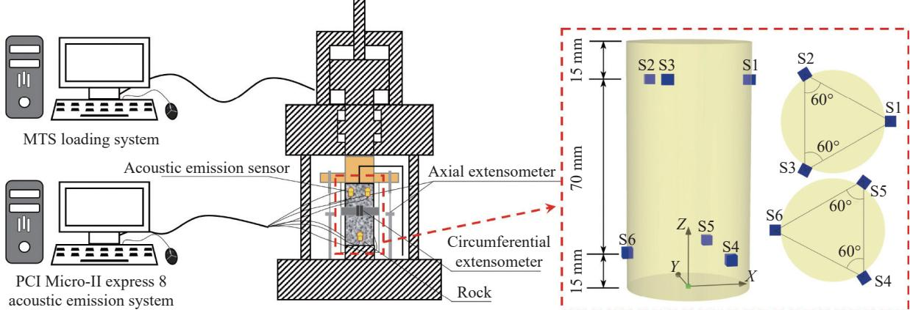  
图 1   声发射试验装置  
Fig.1    Acoustic emission experimental equipment

V 表示：

$$
\boldsymbol {V} = \left\{v _ {i j k} \right\}\tag{1}
$$

式中： $\nu _ { i j k } ( i , j { = } 1 , 2 , 3 , \cdots , n )$ 表示第 k次测量的 i 传感器到j传感器之间波速值.

由于本文中选用的为 6 个声发射传感器，则会形成 6×6 形式的波速矩阵，以大理岩和粉砂岩第一次测量的波速为例，其数据如表 1 和表 2 所示.

表 1    大理岩第一次测量的阵列波速  
Table 1    First measurement of array wave velocity in marble $\mathbf { m } { \cdot } \mathbf { s } ^ { - 1 }$

<table><tr><td rowspan="2">Signal transmission sensors</td><td colspan="6">Signal receiving sensors</td></tr><tr><td>S1</td><td>S2</td><td>S3</td><td>S4</td><td>S5</td><td>S6</td></tr><tr><td>S1</td><td>0</td><td>4565</td><td>4638</td><td>3357</td><td>3670</td><td>3884</td></tr><tr><td>S2</td><td>4638</td><td>0</td><td>4641</td><td>4770</td><td>3600</td><td>4366</td></tr><tr><td>S3</td><td>4670</td><td>4517</td><td>0</td><td>4675</td><td>3903</td><td>3953</td></tr><tr><td>S4</td><td>3340</td><td>4684</td><td>4565</td><td>0</td><td>4520</td><td>4520</td></tr><tr><td>S5</td><td>3670</td><td>3547</td><td>4025</td><td>4683</td><td>0</td><td>4628</td></tr><tr><td>S6</td><td>3903</td><td>4366</td><td>3976</td><td>4627</td><td>4627</td><td>0</td></tr></table>

表 2    粉砂岩第一次测量的阵列波速  
Table 2    First measurement of array wave velocity in siltstone $\mathbf { m } { \cdot } \mathbf { s } ^ { - 1 }$

<table><tr><td rowspan="2">Signal transmission sensors</td><td colspan="6">Signal receiving sensors</td></tr><tr><td>S1</td><td>S2</td><td>S3</td><td>S4</td><td>S5</td><td>S6</td></tr><tr><td>S1</td><td>0</td><td>2031</td><td>2031</td><td>2061</td><td>2076</td><td>2305</td></tr><tr><td>S2</td><td>2055</td><td>0</td><td>2057</td><td>2245</td><td>2090</td><td>2216</td></tr><tr><td>S3</td><td>2055</td><td>2057</td><td>0</td><td>2061</td><td>2160</td><td>2196</td></tr><tr><td>S4</td><td>2076</td><td>2230</td><td>2151</td><td>0</td><td>1963</td><td>2259</td></tr><tr><td>S5</td><td>2106</td><td>2105</td><td>2122</td><td>1963</td><td>0</td><td>2133</td></tr><tr><td>S6</td><td>2321</td><td>2216</td><td>2199</td><td>2244</td><td>2159</td><td>0</td></tr></table>

由于岩石受压过程中裂隙不断扩展，不同方向上的波速呈现不同变化趋势. 如图 2 所示，任舒波等[17] 研究发现在沿着方向 1（垂直于裂纹面）、方向 （与裂纹面成 $4 5 ^ { \circ } )$ 、方向 （平行于裂纹面）上，P 波波速（图 2 中 $V _ { \mathsf { p } } )$ 依次增大，即纵波传播速度随着裂纹与纵波传播方向的夹角变大而变小，裂纹的产生阻碍纵波的传播，因此可推断波速较小方向存在较多与波速传播方向垂直或成一定角度的裂纹.

为了更准确描述岩石受压过程中各个方向上波速变化特征，建立图 1 所示相同的坐标系，以两传感器之间单位向量为方向向量，各传感器之间测量波速值为波速向量的模，建立波速向量 v.

$$
\pmb {u} _ {i} = (x _ {i}, y _ {i}, z _ {i})\tag{2}
$$

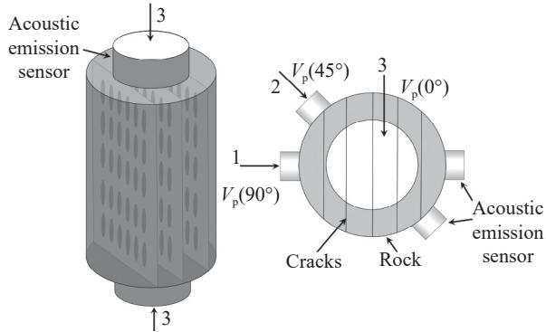  
图 2    纵波传播方向与裂纹位置关系[17]  
Fig.2     Relationship  between  P-wave  propagation  direction  and  crack location

$$
\boldsymbol {e} _ {i j} = \frac {\boldsymbol {u} _ {i} - \boldsymbol {u} _ {j}}{\left| \boldsymbol {u} _ {i} - \boldsymbol {u} _ {j} \right|}\tag{3}
$$

$$
\pmb {\nu} = v _ {i j} \cdot \pmb {e} _ {i j}\tag{4}
$$

式中： $\pmb { u } _ { i }$ 为第 i 个传感器坐标， $x _ { i } , y _ { i } , z _ { i }$ 为第 i 个传感器坐标分量， $e _ { i j }$ 为 i 传感器到j传感器方向的波速单位向量，v 为波速向量.

为了确定所建立波速向量在空间中分布形态，将波速向量分为水平向、斜纵向两大类，其分别对应着与岩石上下表面平行以及成一定夹角的波速. 如图 3(a) 所示，大理岩水平、斜纵向和平均波速呈现不变趋势，平均波速在 $4 2 2 0 \sim 4 3 5 0 \ \mathrm { m } { \cdot } \mathrm { s } ^ { - 1 }$ 之间浮动，波动幅度为 2.99%，水平方向波速约为$4 5 5 8 ~ \mathrm { m } { \cdot } \mathrm { s } ^ { - 1 }$ 1，斜纵向波速约为 $4 1 2 0 ~ \mathrm { m } { \cdot } \mathrm { s } ^ { - 1 }$ . 这是因为大理岩原始裂隙较少，结构致密，压密阶段不明显，岩石在峰值应力 $\sigma _ { \mathrm { p } }$ 前几乎完全处于弹性变形阶段，波速几乎保持不变；大理岩水平波速始终大于斜纵向波速，同时斜纵向波速与水平波速均保持基本不变，说明大理岩初始状态下纵向裂隙较少，峰前受压过程中新萌生裂纹较少.

粉砂岩内部结构疏松多孔隙，内部胶结物质承载能力弱[18]. 如图 3(b) 所示，在粉砂岩受压过程中微裂纹的闭合与起裂现象更为活跃，其平均波速和斜纵向波速呈现先增加再不变最后减小趋势，水平波速呈现先增加后缓慢减小最后加速变小趋势，在不同压缩阶段呈现不同特征. 根据梁明纯等[19] 研究方法确定粉砂岩闭合应力 $\sigma _ { \mathrm { c c } }$ 和损伤应力 $\sigma _ { \mathrm { c d } } .$ 在压密阶段，岩石初始裂隙闭合，阻碍纵波传播裂纹减少，水平、斜纵向与平均波速均呈现增加趋势；在弹性变形阶段，斜纵向波速在$2 8 0 0 \ \mathrm { m \cdot s ^ { - } }$ 1 附近上下波动，水平波速及平均波速在压密阶段之后便出现略微下降趋势，则说明在弹性变形阶段粉砂岩内部已经出现纵向细小裂纹，阻碍水平向纵波传播；进入损伤阶段，水平、斜纵向与平均波速均呈现快速下降趋势，且随着粉砂岩损伤的增加波速下降速度增加，说明岩石内部裂纹快速增加，逐渐形成贯通裂纹. 同时粉砂岩斜纵向波速始终大于水平波速，说明在纵向上裂纹扩展仍占主导地位. 从裂纹扩展角度来说，裂纹闭合是波速增加的主要原因，裂纹萌生、扩展及贯通则是波速降低的主要原因.

## 2.2   各向异性波速三维表示方法

## 2.2.1    椭球体表征方程建立

式 (2) 至 (4) 所建立波速向量中，不同方向波速均存在一定差异. 为了测试岩石各向异性波速的分布形态，并以岩石其中z=0 与y=0 两个平面为例，两种岩石这两个平面上波速分布如图 4(a) 和4(b) 所示. 岩石各向异性波速在各个平面上均呈现椭圆形形态，因而推断各向异性波速在三维上分布呈现椭球体形态.

基于两种岩石单轴压缩条件下水平波速与斜纵向波速演化特征及不同方向波速向量在三维空间中呈现类椭球体形态分布的特性，以岩石中心为原点，建立表示任意角度波速的三维椭球体表征方程，用以表示岩石全方位下各向异性波速场.其建立过程为：

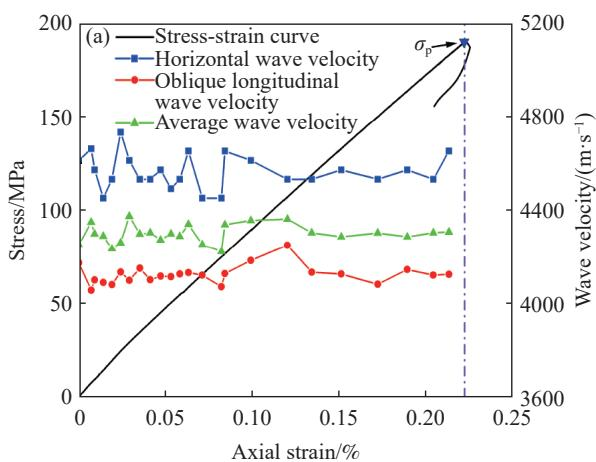

以标准椭球面参数方程为基础，表示方法为：

$$
\left\{ \begin{array}{l} x = a \sin \theta \cos \varphi \\ y = b \sin \theta \sin \varphi \\ z = c \cos \theta \end{array} \right.\tag{5}
$$

式中：a、b、c 分别为椭球面的长、中、短三个轴的长度，θ表示波速向量与 Z轴正方向的夹角，定义域为 $0 ^ { \circ } \sim 1 8 0 ^ { \circ } ,$ ，φ 为波速向量在XY平面内投影与X轴正方向的夹角，定义域为 $0 ^ { \circ } \sim 3 6 0 ^ { \circ }$

类椭球体形态与标准椭球体形态存在一定差异，为了实现不同方向波速向量的精确表示，引入罗德里格矩阵进行坐标变换. 罗德里格矩阵 R 由一个含有 3 个独立元素的反对称矩阵 S与单位阵I 组合而成，仅有三个旋转参数，计算过程无需线性化，且适用于大旋角转换，能很好地表示三维坐标的旋转变换[20].

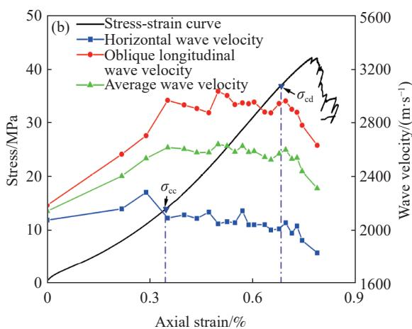  
图 3    水平、斜纵向与平均波速变化趋势. (a) 大理岩; (b) 粉砂岩

Fig.3    Variation trends of horizontal, oblique longitudinal, and average wave velocities: (a) marble; (b) siltstone  
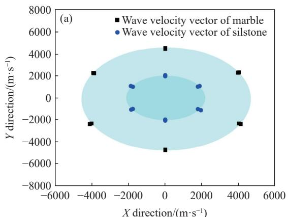

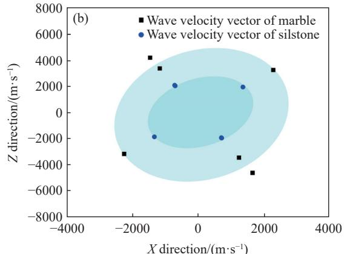  
图 4    不同平面上各向异性波速分布形态. (a) z=0 平面; (b) y=0 平面  
Fig.4    Anisotropic wave velocity distribution on different planes: (a) z = 0 plane; (b) y = 0 plane

罗德里格矩阵为：

$$
\pmb {R} = (\mathbf {I} + \pmb {S}) (\mathbf {I} - \pmb {S}) ^ {- 1}\tag{6}
$$

$$
\boldsymbol {S} = \left[ \begin{array}{c c c} 0 & - f & - e \\ f & 0 & - d \\ e & d & 0 \end{array} \right]\tag{7}
$$

式中： $d , e , f$ 为罗德里格矩阵的三个旋转参数.

其展开形式为：

$$
\begin{array}{r l} & {\pmb {R} = \frac {1}{1 + d ^ {2} + e ^ {2} + f ^ {2}} \times} \\ & {\left[ \begin{array}{c c c} 1 + d ^ {2} - e ^ {2} - f ^ {2} & - 2 f - 2 d e & - 2 e + 2 d f \\ 2 f - 2 d e & 1 - d ^ {2} + e ^ {2} - f ^ {2} & - 2 d - 2 e f \\ 2 e + 2 d f & 2 d - 2 e f & 1 - d ^ {2} - e ^ {2} + f ^ {2} \end{array} \right]} \end{array}\tag{8}
$$

设旋转前坐标为 $\scriptstyle A = ( X , Y ,$ Z)，旋转后向量坐标为 $\scriptstyle B = ( X ,$ Y', Z')，A 与 B 关系为：

$$
\boldsymbol {B} = \boldsymbol {R A}\tag{9}
$$

依据椭球体参数方程确定球坐标系下的三维坐标，可获取球坐标系下旋转后的波速向量三维表示方法：

$$
\left\{ \begin{array}{l} r ^ {\prime} = \| \boldsymbol {B} \| _ {2} \\ \theta^ {\prime} = \arccos \frac {\boldsymbol {R} _ {3 , :} \boldsymbol {A}}{\| \boldsymbol {B} \| _ {2}} \\ \varphi^ {\prime} = \arctan \frac {\boldsymbol {R} _ {2 , :} \boldsymbol {A}}{\boldsymbol {R} _ {1 , :} \boldsymbol {A}} \end{array} \right.\tag{10}
$$

式中： $r ^ { \prime } ,$ ， $\theta ^ { \prime } ,$ ， $\varphi ^ { \prime }$ 为球坐标系下表示波速向量的三个参数； $\pmb { R } _ { i , . }$ 为罗德里格矩阵 R 中第 i 行所表示的行向量.

对于不同方向波速可表示为：

$$
v _ {i} = \sqrt {(a \sin \theta^ {\prime} \cos \varphi^ {\prime}) ^ {2} + (b \sin \theta^ {\prime} \cos \varphi^ {\prime}) ^ {2} + (c \cos \theta^ {\prime}) ^ {2}}\tag{11}
$$

各向异性波速椭球体拟合方程为：

$$
\begin{array}{l} X ^ {2} - \left(a \sin \left(\arccos \frac {\boldsymbol {R} _ {3 , :} \boldsymbol {A}}{\| \boldsymbol {B} \| _ {2}}\right) \cos \left(\arctan \frac {\boldsymbol {R} _ {2 , :} \boldsymbol {A}}{\boldsymbol {R} _ {1 , :} \boldsymbol {A}}\right)\right) ^ {2} + \\ Y ^ {2} - \left(b \sin (\arccos \frac {\boldsymbol {R} _ {3 , :} \boldsymbol {A}}{\| \boldsymbol {B} \| _ {2}}) \cos \left(\arctan \frac {\boldsymbol {R} _ {2 , :} \boldsymbol {A}}{\boldsymbol {R} _ {1 , :} \boldsymbol {A}}\right)\right) ^ {2} + \\ Z ^ {2} - \left(c \cos \left(\arccos \frac {\boldsymbol {R} _ {3 , :} \boldsymbol {A}}{\| \boldsymbol {B} \| _ {2}}\right)\right) ^ {2} = 0 \end{array}\tag{12}
$$

## 2.2.2    基于粒子群算法的波速椭球体拟合

粒 子 群 优 化 算 法 (Particle  swarm  optimization，PSO) 是一种模拟鸟群觅食行为的搜索算法，它通过模拟一群粒子在解空间中的移动来寻找最优解.每个粒子代表一个潜在的解决方案，并根据自己和群体的历史最佳位置来更新自己的位置和速度.通过这种迭代的过程，粒子群逐渐集中到最优解附近[21]. PSO 算法非常适用于多目标非线性优化问题，获取全局收敛值[22]. 各向异性波速椭球体方程中参数包含 a、b、c、d、e、f，是一个典型的多项非线性拟合问题，可将其转化为寻找上述 6 个参数的全局最优解. 在迭代过程中通过全局极值和个体极值这两个极值的变化情况来更新粒子的最佳位置，以适应度函数的最小值来决策最终参数组合[23]. 具体实现流程如下.

假设在一个 M维的空间中，N个粒子为一个种群，第 i 个粒子可表示为一个M维的向量.

$$
\boldsymbol {X} (i) = \left(x _ {i 1}, x _ {i 2}, \dots , x _ {i M}\right), \left(i = 1, 2, \dots , N\right)\tag{13}
$$

第 i 个粒子的速度可表示为：

$$
\boldsymbol {V} (i) = (v _ {i 1}, v _ {i 2}, \dots , v _ {i M}), (i = 1, 2, \dots , N)\tag{14}
$$

其中每个个体所找到的最优值，即个体极值为：

$$
\boldsymbol {p} _ {\text { best }} = \left(p _ {i 1}, p _ {i 2}, \dots , p _ {i M}\right), (i = 1, 2, \dots , N)\tag{15}
$$

整个种群所找到的全局极值为：

$$
\boldsymbol {g} _ {\text { best }} = (p _ {g 1}, p _ {g 2}, \dots , p _ {g M})\tag{16}
$$

在找到相应两个极值时，更新第 k+1 次迭代时第 i 个粒子的第 $d$ 维位置与速度：

$$
\begin{array}{r} v _ {i d} (k + 1) = \omega v _ {i d} (k) + c _ {1} r _ {1} (p _ {i d} (k) - x _ {i d} (k)) \\ + c _ {2} r _ {2} (p _ {g d} (k) - x _ {i d} (k)) \end{array}\tag{17}
$$

$$
x _ {i d} (k + 1) = x _ {i d} (k) + v _ {i d} (k + 1)\tag{18}
$$

式中： $\omega$ 为权重系数， $c _ { 1 } , ~ c _ { 2 }$ 为学习因子，也称为加速常数； $r _ { 1 }$ 、 $r _ { 2 }$ 为 [0, 1] 范围内的随机数.

由于拟合数据为三维各向异性波速形态，因而以波速向量坐标值与实际值的均方差作为适应度函数，获取各向异性波速椭球体方程中最优参数组合. 适应度函数由下式给出：

$$
\mathrm{DISP} = \sqrt {\sum_ {i = 1} ^ {l _ {\max}} \frac {(x _ {i} ^ {s} - x _ {i} ^ {n}) ^ {2} + (y _ {i} ^ {s} - y _ {i} ^ {n}) ^ {2} + (z _ {i} ^ {s} - z _ {i} ^ {n}) ^ {2}}{l _ {\max}}}\tag{19}
$$

式中： $x _ { i } ^ { \mathrm { s } }$ 、 $y _ { i } ^ { \mathrm { s } }$ 、 $z _ { i } ^ { \mathrm { s } }$ 为测量阵列波速的第 i 个所对应波速向量的坐标分量； $x _ { i } ^ { \mathrm { n } }$ yn、 、 $y _ { i } ^ { \mathrm { n } }$ 为训练样本输出波速向量坐标分量； $l _ { \mathrm { m a x } }$ 为一组阵列波速矩阵中有效波速数据个数.

## 2.3    各向异性波速三维演化特征

通过 拟合得到的大理岩初始阵列波速所对应椭球体方程的参数 a、b、c、d、e、f分别为5.0928、 3.8064、 4.5016、 0.5509、 0.3087、 0.0000； 粉砂 岩 的 为 1.9709、 2.2468、 2.1767、 1.8350、 1.1634、2.0000. 两种岩石三维椭球体如图 5(a) 和 5(b) 所示.大理岩初始波速椭球体长轴为 $5 0 9 3 ~ \mathrm { m } { \cdot } \mathrm { s } ^ { - 1 }$ ，椭球体短轴为 $3 8 0 6 ~ \mathrm { { m } { ^ { - } s } ^ { - 1 } }$ ，大理岩第一次测量的阵列波速 (表 1) 中最大波速为 $4 7 7 0 \ \mathrm { m } { \cdot } \mathrm { s } ^ { - 1 }$ ，最小波速为

$3 3 4 0 ~ \mathrm { { m } { ^ { \cdot } s ^ { - 1 } } }$ ，长轴与最大波速误差为 6.77%，短轴与最小波速误差为 $1 3 . 9 5 \% \mathrm { ; }$ 粉砂岩长轴为 $2 2 4 7 \mathrm { m } { \cdot } \mathrm { s } ^ { - 1 }$ 短轴为 $1 9 7 1 ~ \mathrm { m } { \cdot } \mathrm { s } ^ { - 1 }$ ，粉砂岩第一次测量的阵列波速(表2) 中最大波速为 $2 3 2 1 \mathrm { m } { \cdot } \mathrm { s } ^ { - 1 }$ ，最小波速为 $1 9 6 3 \mathrm { m } { \cdot } \mathrm { s } ^ { - 1 }$ 长轴与最大波速误差为 3.19%，短轴与最小波速误差为 0.41%. 因而可用椭球体长轴方向表示为最大波速传播方向，短轴方向表示为最小波速方向，轴的长度代表波速值.

Shen 等[24] 指出岩石的纵波波速随传播方向与裂纹的夹角增大而减小，垂直于裂纹方向时波速最小，平行于裂纹方向时波速最大. 因而本文主要研究通过椭球体长轴、短轴反映岩石内部最大、最小波速演化规律.

大理岩与粉砂岩单轴加载过程中长、短轴演化结果见图 6. 其中大理岩长轴、短轴随应变增加基本不变，分别在 $4 9 2 4 ~ \mathrm { { m } ^ { \cdot } \mathrm { { s } ^ { - 1 } } }$ 和 $3 8 1 3 ~ \mathrm { m { ^ { - } s ^ { - 1 } } }$ 处上下波动，粉砂岩长轴随着应变增加从 $2 2 4 7 \mathrm { m } { \cdot } \mathrm { s } ^ { - 1 }$ 开始逐渐上升，后稳定在 $3 0 6 0 \mathrm { \ m ^ { \cdot } s ^ { - 1 } }$ 不变最后略微下降的趋势，短轴呈现先稳定不变最后下降的趋势.

这是因为大理岩在峰前几乎处于弹性变形阶段，无明显裂纹的闭合与产生，所以长轴和短轴均基本不变，最大、最小波速基本不变. 而粉砂岩在压密阶段原始孔隙被压缩，长轴呈现增加趋势，岩石中最大波速不断增加，此时无新裂纹生成，短轴呈现不变趋势，说明最小波速不受压密阶段影响；在弹性变形阶段，岩石原始孔隙被压密，新生裂纹较少，长轴和短轴均无明显变化，因而弹性阶段对岩石内最大、最小波速影响不大；在损伤应力之后，内部阻碍纵波传播的裂纹急剧增加，短轴呈现下降趋势，最小波速减小，长轴略微下降，对应最大波速略微减小，减小幅度小于最小波速. 因而在岩石压缩过程中，不同方向的最大、最小波速在弹性变形阶段均无太大变化，对于压密阶段与损伤阶段明显的粉砂岩，最大波速在压密阶段会增大，最小波速则不受影响；在损伤阶段受岩石损伤与裂纹影响最小波速会减小，最大波速则受影响较小.

大理岩与粉砂岩裂纹扩展如图 7 和图 8 所示，统计大理岩以及粉砂岩裂纹方位角 θ和 φ. 如图 7

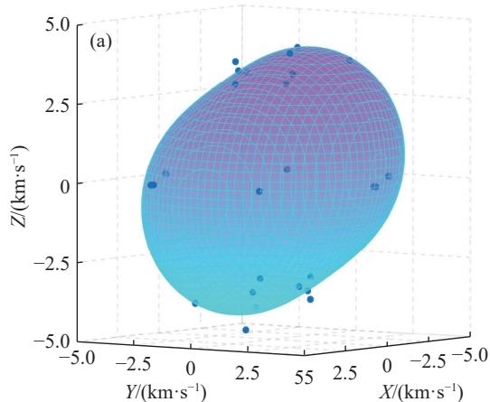

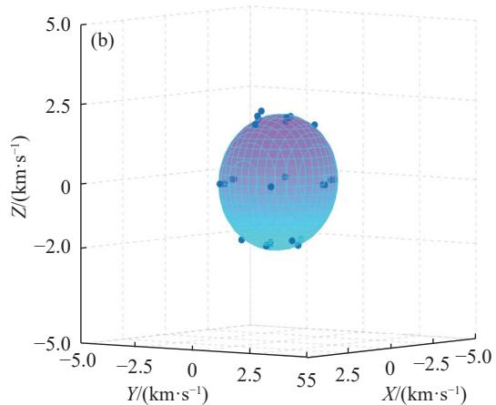  
图 5    初始阵列波速拟合结果. (a) 大理岩; (b) 粉砂岩

Fig.5    Initial array wave velocity fitting results: (a) marble; (b) siltstone  
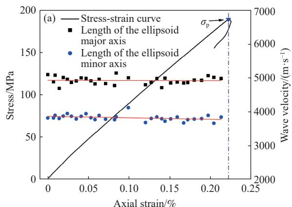

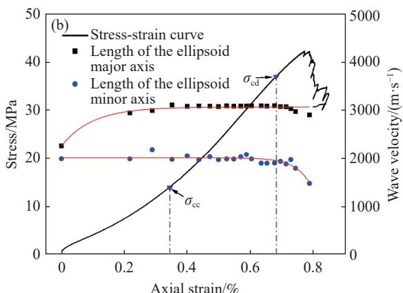  
图 6    长、短轴演变结果. (a) 大理岩; (b) 粉砂岩  
Fig.6    Long and short axis evolution results: (a) marble; (b) siltstone

(b)  
(c)  
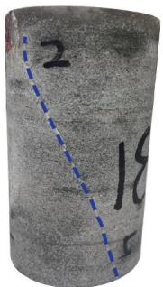  
图 7    大理岩裂纹扩展

Fig.7    Crack propagation diagrams of marble  
(a)  
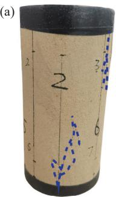

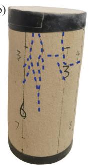

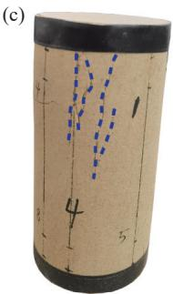  
图 8    不同方向粉砂岩裂纹扩展. (a) $2 2 0 ^ { \circ } \sim 2 6 0 ^ { \circ }$ 方向; $( \mathrm { b } ) ~ 6 0 ^ { \circ } \sim$ 100°方向; (c) 160°～200°方向  
Fig.8     Crack  propagation  of  siltstone  in  different  directions: (a) 220°–260° direction; (b) 60°–100° direction; (c) 160°–200° direction

所示，大理岩受压至破坏过程中仅有一条斜纵向剪切裂纹，由于裂纹扩展较为对称，裂纹方向角θ 在 $2 0 ^ { \circ } \sim 4 0 ^ { \circ }$ 和 $1 4 0 ^ { \circ } \sim 1 6 0 ^ { \circ } .$ 之间变化，φ 分布区间为 $1 2 0 ^ { \circ } \sim 1 6 0 ^ { \circ }$ 和 $3 0 0 ^ { \circ } \sim 3 4 0 ^ { \circ }$ . 如图 8 所示，粉砂岩裂纹分布于岩石周围多个方向，通过统计其裂纹方向角 θ处于 $0 ^ { \circ } \sim 2 0 ^ { \circ }$ 和 $1 6 0 ^ { \circ } \sim 1 8 0 ^ { \circ } .$ 之间，φ 在主要集中在 $2 2 0 ^ { \circ } \sim 2 6 0 ^ { \circ } ($ （图 8(a)）、 $6 0 ^ { \circ } \sim 1 0 0 ^ { \circ } ($ （图 8(b)）以及 $1 6 0 ^ { \circ } \sim 2 0 0 ^ { \circ } ($ 图 8(c)）区间. 大理岩裂纹呈斜纵向分布、粉砂岩裂纹多呈竖向分布的特征可与

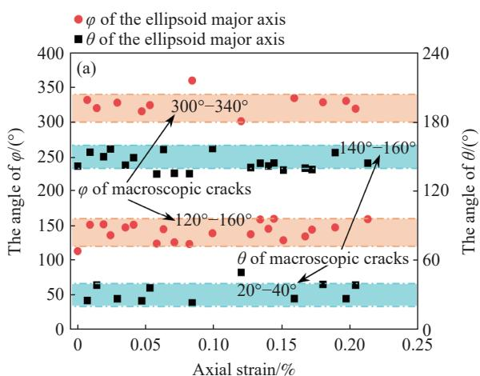

## 2.1 节中波速与裂纹关系相互印证.

Shen 等[24] 还指出裂缝更多地平行于波的传播方向，对与其平行的波的传播影响最小，因而代表裂纹方向最强的是最大波速的方向. 依据式 (5) 确定大理岩和粉砂岩椭球体长轴方向角度 θ和 φ 变化结果如图 9(a) 和 9(b) 所示. 大理岩长轴方位角中，80% 以上 θ 数据点以及 93.5% 以上 $\varphi$ 数据点和真实裂纹分布区域相同. 而粉砂岩的长轴方位角中，95% 以上数据点和真实裂纹分布区域相同，77% 以上椭球体长轴 φ 的变化与岩石真实裂纹分布相同. 由此看出长轴方位角度能与宏观裂纹面形成较好对应关系，因此本文所提出各向异性波速椭球体方程可为岩石裂纹场的反演以及裂纹扩展的预测提供一种新方法.

## 3   基于各向异性波速的声发射定位

## 3.1    声发射定位过程

## 3.1.1   声发射到时提取方法

岩石受压过程中，伴随着内部微裂纹的萌生、发展与贯通会产生瞬时弹性波，可通过声发射检测仪获取弹性波到达时间及波速，建立二者与传感器坐标的空间关系即可计算确定声发射源定位.

提取高精度的到时和获取较为准确的波速结果是提高声发射定位结果准确性的有效途径. 目前常用的到时提取方法主要有噪声阈值法[25]、长短时窗法[26] 和赤池信息准则法[27]（Akaike informationcriterion, AIC），其中噪声阈值法和长短时窗法在震源脉冲信号与外界噪声信号强度相当时拾取效果较差，AIC 准则能够有效区别外界噪声信号和震源脉冲信号分界点 准确确定 波信号传达至传感器的时间. 所以，本文采用 AIC 方法提取到时数据. 对于一段时间长度的信号，以 AIC 准则确定的 P 波到时点为：

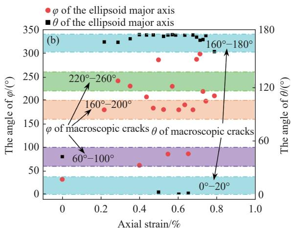  
图 9    各向异性椭球体长轴方位角. (a) 大理岩; (b) 粉砂岩  
Fig.9    Long axial azimuth of anisotropic wave velocity ellipsoid: (a) marble; (b) siltstone

$$
\begin{array}{c} \operatorname{AIC} (t) = t \lg \{\operatorname{var} [ T (1: t) ] \} + \\ (L _ {\mathrm{T}} - t - 1) \lg \{\operatorname{var} [ T (t + 1, L _ {\mathrm{T}}) ] \} \end{array}\tag{20}
$$

式中： $L _ { \mathrm { T } }$ 为选取信号片段的长度，t取值范围为 [1，$L _ { \mathrm { T } } ] , \mathrm { v a r } [ T ( 1 { : } t ) ]$ 为 T(1:t) 片段信号的样本方差函数.

AIC 到时提取原理见图 10，可根据更合理的时窗宽度及更易识别的特征函数进一步提升到时提取精度. 为保证到时提取精度，本文选取信号起始点到最大峰值点为窗宽长度 $L _ { \mathrm { T } }$

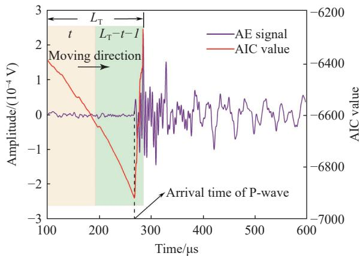  
图 10    AIC 原理示意图  
Fig.10    Schematic of the AIC principle

## 3.1.2    结合各向异性波速的网格搜索法定位

传统声发射定位方法是将岩石初始平均波速作为定位波速的，初始平均波速为式 (1) 中第 1 次测量的阵列波速的平均值，设声发射源坐标为 ${ \pmb u } _ { 0 } ( x _ { 0 } ,$ $y _ { 0 } , z _ { 0 } )$ ，声发射传感器坐标为 ${ \pmb u } _ { i } ( x _ { i } , y _ { i } , z _ { i } )$ ，则声源距离方程由式 (21) 给出[28].

$$
v (t _ {i} - t _ {0}) = \sqrt {(x _ {i} - x _ {0}) ^ {2} + (y _ {i} - y _ {0}) ^ {2} + (z _ {i} - z _ {0}) ^ {2}}\tag{21}
$$

式中： $t _ { i }$ 为声发射波到达各传感器位置的时间； $t _ { 0 }$ 为声发射源产生时间；v 为岩石初始平均波速.

目前研究中常用的声发射定位方法有单纯形法 [29]、 Geiger 定 位 算 法 [30] 和 网 格 搜 索 法 [31] 等 ， 单纯形法和 Geiger定位算法均是通过波速与时差迭代求解声发射定位点，而在计算过程中选取岩石初始平均波速，难以考虑波速的各向异性及其与时间的非均值性，且初值的选取不当容易造成局部最优解.

因而本文采用网格搜索法进行定位求解，该方法计算过程简单，运算速率快，运算过程中可以实时代入不同方向波速数据求解声发射定位点[32]，结合岩石波速的各向异性与 AIC 方法提取的到时，可有效减小定位误差.

由于每次测量波速只会形成一组阵列波速，因而假设同一时刻岩石内只存在统一的椭球体波速结构. 通过每组波速数据对应的实时各向异性波速椭球体方程获取定位过程中不同方向下的波速数据，将其应用于各时段的网格搜索法，求解对应的定位点. 步骤如下，首先定义初始网格体(图11)，确定各边搜索点数量以及坐标原点，搜索点坐标设为 $\pmb { u } ( x _ { \mathrm { s } } , y _ { \mathrm { s } } , z _ { \mathrm { s } } ) .$ . 依据式 (21)，则搜索点至第 i 个声发射传感器距离 $R _ { i }$ 为：

$$
R _ {i} = \sqrt {(x _ {i} - x _ {\mathrm{s}}) ^ {2} + (y _ {i} - y _ {\mathrm{s}}) ^ {2} + (z _ {i} - z _ {\mathrm{s}}) ^ {2}}\tag{22}
$$

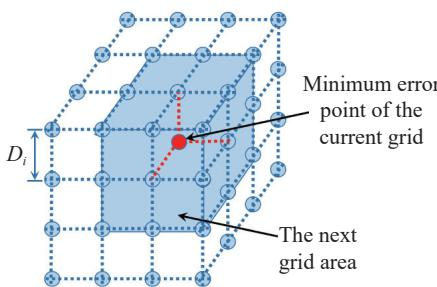  
图 11    搜索网格示意图  
Fig.11    Schematic of searching grid volume

其次代入各向异性波速椭球体方程对应的波速结果，计算搜索定位点与第 i 个传感器之间的走时 $\Delta t _ { i } \mathbf { : }$

$$
\Delta t _ {i} = \frac {R _ {i}}{v _ {i}}\tag{23}
$$

式中： $\nu _ { i }$ 为各向异性椭球体方程中搜索点至第 i 个传感器方向波速值.

搜索点到第 i 个传感器和第j个传感器之间走时时差 $\Delta t _ { i j }$ 为：

$$
\Delta t _ {i j} = \Delta t _ {i} - \Delta t _ {j}\tag{24}
$$

AIC 方法提取到时的总数为 $N ^ { \mathrm { P } } ( N ^ { \mathrm { P } } { \leqslant } 6 )$ ，其中第 i 个传感器到时为 $t _ { \mathrm { a } , i } ,$ 则 AIC 方法确定第 i 个传感器与第j个传感器到时时差为 $\Delta t _ { \mathrm { a } , i j } { = } t _ { \mathrm { a } , i } { - } t _ { \mathrm { a } , j } .$

网格搜索点走时时差与 AIC 提取到时时差之间误差绝对值：

$$
\Delta T _ {k} ^ {\mathrm{P}} = \left| \Delta t _ {i j} - \Delta t _ {\mathrm{a}, i j} \right|\tag{25}
$$

式中： $\Delta T _ { k } ^ { \mathrm { P } }$ 为第 k个网格搜索点走时时差与 AIC 提取到时时差的误差，k的最大值为 $N ^ { \mathrm { p } } { - } 1$ 1.

然后计算时间残差 $\Delta T _ { \mathrm { R M S } } { \mathrm { : } }$

$$
\Delta T _ {\mathrm{RMS}} = \sqrt {\frac {\sum_ {k = 1} ^ {N ^ {\mathrm{P}} - 1} \Delta T _ {k} ^ {\mathrm{P}}}{N ^ {\mathrm{P}} - 1}}\tag{26}
$$

以时间残差最小值所对应搜索点为下一步网格搜索区域中心点继续搜索. 下一搜索区域相邻搜索点之间距离应满足下式：

$$
D _ {i + 1} = \frac {D _ {i}}{H}\tag{27}
$$

式中： $D _ { i }$ 为第 i 个网格区域相邻搜索点间距离； H为缩放比例，为了高效而准确获取定位结果，本 文取 H=4.

为保证定位结果更加精确，结合时间残差范围对搜索范围进行限制，剔除非岩石内部定位点和残差异常定位点. 最后当最终搜索区域单位长度满足定位结果误差 $( D _ { i + 1 } { < } 0 . 0 0 1 \ \mathrm { m m } )$ ，最小时间残差对应搜索点即为声发射定位点. 重复以上步骤获取单轴压缩全过程中所有到时数据对应的定位点.

## 3.2   断铅试验的定位点精度分析

为了验证结合波速各向异性的声发射定位方法的准确性与有效性，对单轴压缩后岩样进行断铅试验. 根据 GB/T18182—2000《金属压力容器声发射试验与结果评价》中断铅实验要求，HB 铅笔芯尺寸为 0.5 mm，铅芯伸长量为 2.5 mm，与岩石试件表面成 30°夹角折断作为模拟信号. 选取频率在100～150 kHz 之间，幅度在 70～90 dB 之间的信号为有效信号. 其他声发射参数与单轴压缩试验一致.

为更全面观测各个方向波速对声发射定位影响，断铅位置设置于试件顶部与侧面 (图 12). 通过绝对距离计算方法[33] 确定断铅点与声发射定位点之间的误差：

$$
\Delta S _ {i} = \sqrt {(\Delta x _ {i}) ^ {2} + (\Delta y _ {i}) ^ {2} + (\Delta z _ {i}) ^ {2}}\tag{28}
$$

式中： $\Delta x _ { i } , \Delta y _ { i } , \Delta z _ { i }$ 为第 i 个断铅点与声发射定位点 之间坐标差值.

其中 11 个断铅点平均误差 $S _ { \mathrm { a v e } }$ 由下式给出

$$
S _ {\mathrm{ave}} = \frac {1}{1 1} \sum_ {i = 1} ^ {1 1} \Delta S _ {i}\tag{29}
$$

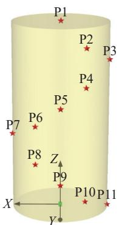  
图 12    断铅试验点  
Fig.12    Pencil-lead-break test points

断铅试验定位结果和误差数据如表 3 所示. 大理岩和粉砂岩断铅试验误差箱线图如图 13 所示.为了更直观分析定位误差，将声发射定位点与断铅试验点之间的误差定义为定位误差，定位误差与试件最小尺寸之比定义为相对误差，其他方法与本文方法定位误差之差与该方法的比值定义为精度提高值. 本文所提出方法与单纯形法和 Geige方法在大理岩定位中平均误差分别为 1.89、4.47和 7.17 mm，对于大理岩本文方法相较于传统单纯形法和 Geiger方法定位精度分别提高了 58% 和74%. 在粉砂岩定位中平均误差分别为 2.76、7.51和 10.66 mm，对于粉砂岩本文方法相较于传统单纯形法和 Geiger方法定位精度分别提高了 63%和 74%. 同时大理岩与粉砂岩中本文方法定位的相对误差分别为 3.78% 和 5.52%，由此可知，本文提出的结合各向异性波速的定位方法精度明显高于传统以各向同性平均波速进行定位的单纯形法与 Geiger方法，也验证了结合各向异性波速的网格搜索方法在声发射定位中的有效性与准确性.

三种方法的定位误差在大理岩中均小于粉砂岩，其原因有三. 其一，岩石试件的形状、尺寸、孔隙度等物理特性都会影响声发射定位的精度. 对比两种岩石，本文中控制两种岩石的形状、尺寸一致，但大理岩较为致密，孔隙度为 0.8%，粉砂岩为多孔弱胶结岩石，孔隙率为 19.7%，孔隙多导致接收的声发射信号不稳定且噪音多，造成到信号到时提取困难，从而降低定位精度. 其二，波速的不稳定性影响声发射定位的精度. 从图 3(a) 中大理岩的平均波速变化趋势可以看出，大理岩受压过程中波速变化比较稳定；从图 3(b) 中粉砂岩平均波速变化趋势可以看出，粉砂岩受压过程中波速先出现增加趋势，随后略微下降，最后急速减小，在不同阶段波速均呈现不稳定趋势，因而粉砂岩中定位误差较大. 其三，岩石波速的各向异性严重影响声发射定位精度. 从图 3(a) 中水平波速与斜纵向变化趋势可以看出，大理岩波速各向异性随着压力增大变化幅度不大；从图 3(b) 中水平波速与斜纵向变化趋势可以看出，粉砂岩波速的各向异性在不同压缩阶段存在较大差异，因而粉砂岩的定位误差大于大理岩的定位误差.

图 7 中大理岩只存在一条斜纵向贯通裂纹，图 8 中裂纹竖向较多且未形成贯通裂纹，而粉砂岩受压过程中裂纹扩展引起的波速各向异性的变化程度更大，说明裂纹数量与扩展方向是造成波速各向异性的重要因素. 图 9 分析了各向异性椭

表 3    断铅试验定位结果和误差  
Table 3    Location result and error of the lead breaking test

<table><tr><td rowspan="3">Rock</td><td rowspan="3">Number</td><td rowspan="2" colspan="3">Lead break point/mm</td><td colspan="4">Proposed method</td><td colspan="4">Simplex method</td><td colspan="4">Geiger method</td></tr><tr><td colspan="3">Location results/mm</td><td rowspan="2">Error, ΔS</td><td colspan="3">Location results/mm</td><td rowspan="2">Error, ΔS</td><td colspan="3">Location results/mm</td><td rowspan="2">Error, ΔS</td></tr><tr><td>x</td><td>y</td><td>z</td><td>x</td><td>y</td><td>z</td><td>x</td><td>y</td><td>z</td><td>x</td><td>y</td><td>z</td></tr><tr><td rowspan="11">Marble</td><td>P1</td><td>0</td><td>0</td><td>100</td><td>0.12</td><td>0.35</td><td>99.61</td><td>0.54</td><td>-1.26</td><td>1.35</td><td>97.61</td><td>3.02</td><td>2.34</td><td>3.62</td><td>97.31</td><td>5.08</td></tr><tr><td>P2</td><td>-12.5</td><td>21.651</td><td>90</td><td>-13.46</td><td>21.93</td><td>91.34</td><td>1.67</td><td>-13.68</td><td>18.45</td><td>85.24</td><td>5.86</td><td>-13.82</td><td>23.54</td><td>92.85</td><td>3.67</td></tr><tr><td>P3</td><td>-25</td><td>0</td><td>80</td><td>-24.05</td><td>-1.12</td><td>79.66</td><td>1.51</td><td>-23.42</td><td>5.52</td><td>77.17</td><td>6.40</td><td>-22.46</td><td>1.69</td><td>77.51</td><td>3.94</td></tr><tr><td>P4</td><td>-12.5</td><td>21.651</td><td>70</td><td>-12.86</td><td>21.13</td><td>68.27</td><td>1.84</td><td>-10.22</td><td>19.64</td><td>66.48</td><td>4.65</td><td>-10.48</td><td>18.12</td><td>67.14</td><td>4.97</td></tr><tr><td>P5</td><td>0</td><td>25</td><td>60</td><td>1.68</td><td>23.31</td><td>62.35</td><td>3.35</td><td>-1.28</td><td>22.38</td><td>56.87</td><td>4.28</td><td>-4.2</td><td>18.54</td><td>56.61</td><td>8.42</td></tr><tr><td>P6</td><td>12.5</td><td>21.651</td><td>50</td><td>12.6</td><td>22.55</td><td>47.29</td><td>2.86</td><td>10.46</td><td>24.8</td><td>44.6</td><td>6.58</td><td>14.21</td><td>24.91</td><td>59.34</td><td>10.04</td></tr><tr><td>P7</td><td>25</td><td>0</td><td>40</td><td>24.31</td><td>-1.62</td><td>38.96</td><td>2.05</td><td>21.69</td><td>2.57</td><td>46.16</td><td>7.45</td><td>19.26</td><td>9.52</td><td>30.57</td><td>14.58</td></tr><tr><td>P8</td><td>12.5</td><td>21.651</td><td>30</td><td>13.03</td><td>21.58</td><td>29.12</td><td>1.03</td><td>11.59</td><td>16.66</td><td>25.97</td><td>6.48</td><td>14.25</td><td>23.61</td><td>32.65</td><td>3.73</td></tr><tr><td>P9</td><td>0</td><td>25</td><td>20</td><td>-1.36</td><td>24.85</td><td>21.87</td><td>2.32</td><td>2.18</td><td>23.54</td><td>23.71</td><td>4.54</td><td>-6.81</td><td>20.51</td><td>13.42</td><td>10.48</td></tr><tr><td>P10</td><td>-12.5</td><td>21.651</td><td>10</td><td>-12.6</td><td>21.98</td><td>12.07</td><td>2.10</td><td>-14.92</td><td>20.14</td><td>11.64</td><td>3.29</td><td>-11.46</td><td>17.15</td><td>15.64</td><td>7.29</td></tr><tr><td>P11</td><td>-25</td><td>0</td><td>0</td><td>-24.68</td><td>1.28</td><td>0.85</td><td>1.57</td><td>-24.61</td><td>1.61</td><td>-0.81</td><td>1.84</td><td>-21.64</td><td>4.51</td><td>3.65</td><td>6.70</td></tr><tr><td rowspan="11">Siltstone</td><td>P1</td><td>0</td><td>0</td><td>100</td><td>0.28</td><td>0.17</td><td>98.69</td><td>1.35</td><td>4.79</td><td>2.96</td><td>92.21</td><td>9.61</td><td>-3.2</td><td>-2.85</td><td>96.21</td><td>5.72</td></tr><tr><td>P2</td><td>-12.5</td><td>21.651</td><td>90</td><td>-11.11</td><td>20.03</td><td>94.96</td><td>5.40</td><td>-11.49</td><td>20.84</td><td>95.13</td><td>5.29</td><td>-10.5</td><td>24.68</td><td>87.05</td><td>4.68</td></tr><tr><td>P3</td><td>-25</td><td>0</td><td>80</td><td>-23.05</td><td>1.88</td><td>79.26</td><td>2.81</td><td>-22.33</td><td>1.31</td><td>77.17</td><td>4.11</td><td>-22.45</td><td>-6.94</td><td>86.14</td><td>9.61</td></tr><tr><td>P4</td><td>-12.5</td><td>21.651</td><td>70</td><td>-12.09</td><td>21.33</td><td>69.24</td><td>0.92</td><td>-15.69</td><td>19.27</td><td>64.75</td><td>6.59</td><td>-19.78</td><td>23.69</td><td>76.28</td><td>9.83</td></tr><tr><td>P5</td><td>0</td><td>25</td><td>60</td><td>-1.46</td><td>24.52</td><td>60.51</td><td>1.62</td><td>1.88</td><td>23.34</td><td>57.96</td><td>3.23</td><td>-3.67</td><td>22.39</td><td>68.86</td><td>9.94</td></tr><tr><td>P6</td><td>12.5</td><td>21.651</td><td>50</td><td>11.29</td><td>19.55</td><td>47.1</td><td>3.78</td><td>18.31</td><td>16.36</td><td>43.92</td><td>9.94</td><td>5.31</td><td>12.36</td><td>59.17</td><td>14.90</td></tr><tr><td>P7</td><td>25</td><td>0</td><td>40</td><td>23.24</td><td>1.78</td><td>40.67</td><td>2.59</td><td>20.4</td><td>4.96</td><td>50.32</td><td>12.34</td><td>19.6</td><td>-6.91</td><td>55.39</td><td>17.71</td></tr><tr><td>P8</td><td>12.5</td><td>21.651</td><td>30</td><td>12.09</td><td>20.36</td><td>27.54</td><td>2.81</td><td>19.21</td><td>24.45</td><td>22.61</td><td>10.37</td><td>20.21</td><td>16.45</td><td>39.94</td><td>13.61</td></tr><tr><td>P9</td><td>0</td><td>25</td><td>20</td><td>1.68</td><td>24.67</td><td>22.36</td><td>2.92</td><td>2.07</td><td>22.64</td><td>25.69</td><td>6.50</td><td>-9.84</td><td>19.45</td><td>30.58</td><td>15.48</td></tr><tr><td>P10</td><td>-12.5</td><td>21.651</td><td>10</td><td>-12.35</td><td>20.03</td><td>11.25</td><td>2.05</td><td>-9.55</td><td>23.84</td><td>14.28</td><td>5.64</td><td>-17.93</td><td>24.84</td><td>16.28</td><td>8.89</td></tr><tr><td>P11</td><td>-25</td><td>0</td><td>0</td><td>-23.57</td><td>2.68</td><td>2.76</td><td>4.10</td><td>-22.64</td><td>-5.31</td><td>6.82</td><td>8.96</td><td>-23.94</td><td>4.26</td><td>5.34</td><td>6.91</td></tr></table>

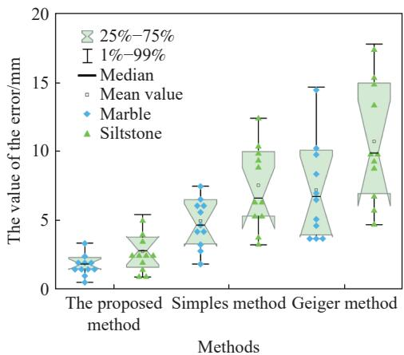  
图 13   本文方法与单纯形法和Geiger方法误差对比  
Fig.13    Error comparison of the proposed method, simplex method, and Geiger method

球体长轴与裂纹扩展角度之间的对应性，更进一步量化裂纹特征与波速各向异性之间的关系，结合波速演化特征，通过反演分析等手段重现岩石裂纹扩展过程，进而实现裂纹扩展预测. 同时图 3所分析的大理岩与粉砂岩压缩过程中的波速演化特征也表明软硬岩石的各向异性特征也存在一定差异，因而岩石波速的各向异性也可为进一步研究软硬岩差异性提供新的判据.

## 3.3    基于各向异性波速的优化声发射定位结果

传统平均波速的 Geiger方法定位与本文方法定位结果如图 14 和 15 所示，图中球体积大小表示声发射信号源幅值大小，颜色代表震源能量大小，灰色方块代表声发射传感器. 对于图 14 所对应位置，图 14(a) 中声发射事件所代表的裂纹与水平面夹角约为 75°，裂纹上部分从 2 号声发射传感器右侧开始发育，延伸至 号声发射传感器左上方，同时在 5 号声发射传感器左侧存在部分声发射事件延伸至大理岩试件底部；图 14(b) 中声发射事件所代表的裂纹与水平面夹角约为 ，裂纹上部分从2 号声发射传感器左侧开始发育，延伸至 5 号声发射传感器上方，在 5 号声发射传感器左侧同样存在部分声发射事件延伸至大理岩试件底部；图14(c)中宏观主裂纹与水平面夹角约为 63°，上部分裂纹主要位于 2 号声发射传感器左侧，延伸至 5 号声发射传感器下方大理岩试件底部；综合对比大理岩的声发射事件和宏观斜纵向裂纹，本文方法定位结果与宏观裂纹位置和角度对应性更强. 在图14(b)中声发射事件分布出现两端多中间少特征，中部出现脆性岩石常有的贯通空区现象[34].

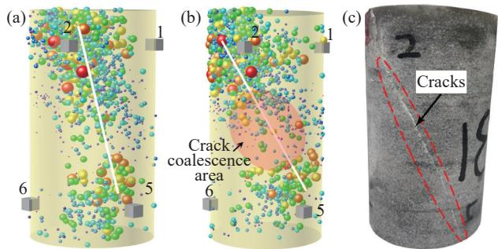  
图 14    大理岩定位结果对比. (a) Geiger 方法定位; (b) 本文方法定位; (c) 原始裂纹  
Fig.14    Comparison of acoustic emission location of marble: (a) Geiger method; (b) proposed method; (c) original cracks

图 15(a) 中在粉砂岩两端传感器附近出现明显的声发射定位点的横向集中现象，这是由于 PCI声发射监测系统对声发射传感器附近事件更为敏感，反映为岩石试件边缘事件向声发射传感器靠拢，造成声发射定位误差增大. 从图 15(b) 中可以看出，声发射事件多数分布于上下两端，粉砂岩中部事件形成较为明显的斜纵向贯通特征，说明在岩石内部已经形成相应的潜在贯通裂纹面，结合图 15(c)，在宏观上并未表现出明显的裂纹面，但此时岩石已经达到岩石的峰值承载能力. 如在工程中出现类似特征，容易在非警觉情况下引发突发性的滑坡、坍塌和岩爆等灾害，因此可以通过软硬岩声发射特征的差异性进一步研究软硬岩过渡区岩体失稳特征与裂纹扩展规律，探索不同地质环境下工程致灾机理.

(a)  
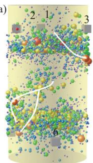

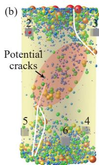

(c)  
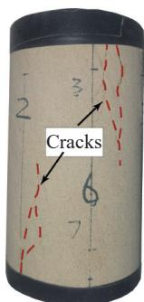  
图 15    粉砂岩定位结果对比. (a) Geiger 方法定位; (b) 本文方法定位; (c) 原始裂纹  
Fig.15     Comparison  of  acoustic  emission  location  of  siltstone: (a) Geiger method; (b) proposed method; (c) original cracks

所提出的各向异性椭球体较好地描述了三维全方位空间中岩石波速各向异性形态，为研究岩石各向异性提供一种新方法. 岩石声发射试验结果表明了本文方法声发射定位误差较小，同时该方法也可用于微震定位，为岩土工程灾害监测与预警提供一种更为精确的方法.

## 4    结论

本文分析了单轴压缩条件下大理岩与粉砂岩的各向异性波速演化特征，建立了各向异性波速三维椭球体表征方程，通过 AIC 方法提取的到时，建立了考虑各向异性波速的声发射定位优化算法.主要研究结论如下.

（1）大理岩内部结构较为致密，峰前几乎完全处于弹性阶段，平均波速基本不变；单轴压缩过程中水平波速始终大于斜纵向波速，说明大理岩初始状态下纵向裂隙较少，峰前受压过程中新萌生裂纹较少；粉砂岩由于其疏松多孔结构，在整个压缩过程中其平均波速呈现出闭合应力前先增加，弹性阶段基本不变，损伤及峰后阶段减小的趋势；而斜纵向波速始终大于水平波速，表明在纵向上裂纹扩展占主导地位.

（2）引入罗德里格矩阵进行三维坐标转换，建立了各向异性波速椭球体三维表征方程，能较好地描述三维空间中波速的各向异性；基于椭球体长、短轴变化特征与最大、最小波速关系，在大理岩压缩过程中，不同方向的最大、最小波速在峰前无太大变化. 而粉砂岩，最大波速在压密阶段会增大，最小波速则不受影响；在损伤阶段受岩石损伤与裂纹影响最小波速会减小，最大波速则不受影响. 两种岩石的裂纹扩展方向与椭球体长轴方位角基本一致，因而本文所提出的各向异性波速椭球体方程可为岩石裂纹场的反演及裂纹扩展的预测提供一种新方法.

提出了一种将实时各向异性波速椭球体方程应用于声发射定位的改进方法；通过断铅试验确定本文方法平均误差在大理岩中为 1.89 mm，在粉砂岩中为 2.76 mm. 粉砂岩的定位误差大于大理岩，主要因为粉砂岩孔隙率较大、波速不稳定性强以及波速的各向异性严重. 在两种岩石中本文方法相较于传统单纯形法和 Geiger方法定位精度均提高了 58% 以上，验证了本文定位方法的有效性和准确性. 该方法也可用于微震定位，为岩土工程灾害监测与预警提供一种更为精确的方法.

## 参    考    文    献

Du  K,  Li  X  F,  Tao  M,  et  al. Experimental  study  on  acoustic[1] emission （AE） characteristics and crack classification during rock fracture in several basic lab tests. Int J Rock Mech Min Sci, 2020, 133: 104411

Liu X L, Liu Z, Li X B, et al. Acoustic emission and micro-rupture[2]characteristics of rocks under Brazilian splitting load. Chin J Eng,2019, 41（11）: 1422（刘希灵, 刘周, 李夕兵, 等. 劈裂荷载下的岩石声发射及微观破裂特性. 工程科学学报, 2019, 41（11）：1422）

Dong  L  J,  Chen  Y  C,  Sun  D  Y,  et  al. Implications  for  rock[3] instability  precursors  and  principal  stress  direction  from  rock acoustic experiments. Int J Min Sci Technol, 2021, 31（5）: 789

Zhang  Y  B,  Yao  X  L,  Liang  P,  et  al. Fracture  evolution  and[4] localization  effect  of  damage  in  rock  based  on  wave  velocity imaging technology. J Cent South Univ, 2021, 28（9）: 2752

Li Y, Zhang K, Wu X W. Study of ultrasonic wave characteristics[5] of shale in triaxial compression tests. J Geophys Eng, 2018, 15（5）: 2183

Zheng  G  P,  Zhao  X  D,  Liu  J  P,  et  al. Experimental  study  on[6]change in acoustic wave velocity when rock is loading. J NortheastUniv （Nat Sci）, 2009, 30（8）: 1197（郑贵平, 赵兴东, 刘建坡, 等. 岩石加载过程声波波速变化规律实验研究. 东北大学学报（自然科学版）, 2009, 30（8）：1197）

Goodfellow  S  D,  Tisato  N,  Ghofranitabari  M,  et  al. Attenuation[7] properties  of  Fontainebleau  sandstone  during  true-triaxial deformation using active and passive ultrasonics. Rock Mech Rock Eng, 2015, 48（6）: 2551

Jia P, Zhu P C, Li B, et al. Characteristics of real-time ultrasonic[8]wave during uniaxial compression of rock. J Cent South Univ （SciTechnol）, 2022, 53（10）: 3967（贾蓬 祝鹏程 李博 等 单轴压缩过程中岩石的实时超声波特性. 中南大学学报（自然科学版）, 2022, 53（10）：3967）

Dong L J, Hu Q C, Tong X J, et al. Velocity-free MS/AE source[9] location  method  for  three-dimensional  hole-containing  structures. Engineering, 2020, 6（7）: 827

Abdulaziz  A  H,  McCrory  J,  Holford  K,  et  al. Acoustic  emission[10] source  location  in  composite-honeycomb  sandwich  panel. Int J Renew Energy R, 2021, 11（2）: 851

Yang P J, Miao S J, Ma Y T, et al. Multi-dimensional non-uniform[11] deformation and failure of siltstone determined using acoustic, 3Ddigital  image  correlation,  and  computed  tomography. Theor App Fract Mech, 2023, 125: 103800

Zhou Z L, Zhou J, Cai X, et al. Acoustic emission source location[12] considering  refraction  in  layered  media  with  cylindrical  surface. Trans Nonferrous Met Soc China, 2020, 30（3）: 789

[13] Wu  Z  J,  Wang  Z  Y,  Fan  L  F,  et  al. Micro-failure  process  and

failure mechanism of brittle rock under uniaxial compression using continuous  real-time  wave  velocity  measurement. J Cent South Univ, 2021, 28（2）: 556

Zhang G, Wu S C, Zhang S H, et al. P-wave velocity tomography[14]and  acoustic  emission  characteristics  of sandstone  under  uniaxialcompression. Rock Soil Mech, 2023, 44（2）: 483（张光, 吴顺川, 张诗淮, 等. 砂岩单轴压缩试验 P 波速度层析成像及声发射特性研究. 岩土力学, 2023, 44（2）：483）

Song  T  X,  Zhou  Y  Y,  Yu  X  J. Three-dimensional  acoustic[15] emission  source  localization  method  for  layered  rock  considering anisotropic P-wave velocity. Bull Eng Geol Environ, 2024, 83（5）: 185

Huang  L  Q,  Wu  X,  Li  X  B,  et  al. Influence  of sensor  array  on[16] MS/AE source location accuracy in rock mass. Trans Nonferrous Met Soc China, 2023, 33（1）: 254

Ren  S  B,  Han  T  C,  Fu  L  Y,  et  al. Pressure  effects  on  the[17]anisotropic  velocities  of  rocks  with  aligned  fractures. Chin JGeophys, 2021, 64（7）: 2504（任舒波, 韩同城, 符力耘, 等. 压力对含裂缝岩石各向异性速度的影响. 地球物理学报, 2021, 64（7）：2504）

Miao S J, Shang X F, Wang H, et al. Strength change mechanism[18]of siltstone under near fatigue strength cyclic loading. Chin J Eng,2024, 46（6）: 982（苗胜军, 尚向凡, 王辉, 等. 近疲劳强度循环荷载下粉砂岩强度变化机制. 工程科学学报, 2024, 46（6）：982）

Liang  M  C,  Miao  S  J,  Cai  M  F,  et  al. Determination  method  of[19]fatigue strength and precursors of fatigue failure of porous weaklycemented siltstone. J China Coal Soc, 2023, 48（4）: 1476（梁明纯 苗胜军 蔡美峰 等 多孔弱胶结粉砂岩疲劳强度确定方法及疲劳破坏先兆. 煤炭学报, 2023, 48（4）：1476）

Yao J L, Han B M, Yang Y X. Applications of lodrigues matrix in[20]3D coordinate transformation. Geomat Inf Sci Wuhan Univ, 2006,31（12）: 1094（姚吉利, 韩保民, 杨元喜. 罗德里格矩阵在三维坐标转换严密解算中的应用. 武汉大学学报（信息科学版）, 2006, 31（12）：1094）

Yang  D  X,  Zhao  K,  Zeng  P,  et  al.  Numerical  simulation  of[21]unknown  wave  velocity  acoustic  emission  localization  based  onparticle  swarm  optimization  algorithm. Rock Soil Mech,  2019,40（Sup 1）: 494（杨道学, 赵奎, 曾鹏, 等. 基于粒子群优化算法的未知波速声发射定位数值模拟 岩土力学 （增刊 ）： ）

Zhang L B, Zhou C G, Ma M, et al. Solutions of multi-objective[22]optimization  problems  based  on  particle  swarm  optimization. JComput Res Dev, 2004, 41（7）: 1286（张利彪, 周春光, 马铭, 等. 基于粒子群算法求解多目标优化问题. 计算机研究与发展, 2004, 41（7）：1286）

Beheshti  Z,  Shamsuddin  S  M. Non-parametric  particle  swarm[23] optimization for global optimization. Appl Soft Comput, 2015, 28: 345

[24] Shen H M, Li X Y, Li Q, et al. A method to model the effect of

pre-existing  cracks  on  P-wave  velocity  in  rocks. J Rock Mech Geotech Eng, 2020, 12（3）: 493

Li B, Ye P J, Huang L, et al. Deformation and acoustic emission[25]characteristics of dry and saturated rock fractures. Chin J GeotechEng, 2021, 43（12）: 2249（李博, 叶鹏进, 黄林, 等. 干燥与饱和岩石裂隙受压变形与声发射特性研究. 岩土工程学报, 2021, 43（12）：2249）

Li  N,  Zhang  X,  Huang  B  X,  et  al. Automatic  detection  model  of[26]acoustic  emission  events  of coal  and  rock  based  on  waveformscorrelation. J China Coal Soc, 2018, 43（7）: 1893（李楠, 张新, 黄炳香, 等. 基于波形互相关的煤岩声发射事件自动识别模型. 煤炭学报, 2018, 43（7）：1893）

Dong  L  J,  Bi  S  J,  Zhang  Y  H,  et  al. Arrival-time  detection  with[27] multiscale  wavelet  analysis  and  source  location  of  acoustic emission in rock. IEEE Sens J, 2023, 23（14）: 16313

Zhao X D, Liu J P, Li Y H, et al. Experimental verification of rock[28]locating  technique  with  acoustic  emission. Chin J Geotech Eng,2008, 30（10）: 1472（赵兴东, 刘建坡, 李元辉, 等. 岩石声发射定位技术及其实验验证. 岩土工程学报, 2008, 30（10）：1472）

[29] Nelder J A, Mead R. A simplex method for function minimization.

Comput J, 1965, 7（4）: 308

Geiger L. Probability method for the determination of earthquake[30] epicenters from the arrival time only. Bull St Louis Univ, 1912, 8: 60

Lei  X  L,  Ohuchi  T,  Kitamura  M,  et  al. An  effective  method  for[31] laboratory acoustic emission detection and location using template matching. J Rock Mech Geotech Eng, 2022, 14（5）: 1642

Zhang S H, Wu S C, Chu C Q, et al. Acoustic emission associated[32] with  self-sustaining  failure  in  low-porosity  sandstone  under uniaxial compression. Rock Mech Rock Eng, 2019, 52（7）: 2067

Xu J, Li Y, Tian A X, et al. Experimental research on size effect of[33]acoustic emission location accuracy. Chin J Rock Mech Eng, 2016,35（Sup 1）: 2826（许江, 李伊, 田傲雪, 等. 声发射定位精度尺寸效应的试验研究岩石力学与工程学报, 2016, 35（增刊 1）：2826）

Zhao  X  D,  Li  Y  H,  Yuan  R  F,  et  al. Study  on  crack  dynamic[34]propagation  process  of rock  samples  based  on  acoustic  emissionlocation. Chin J Rock Mech Eng, 2007, 26（5）: 944（赵兴东, 李元辉, 袁瑞甫, 等. 基于声发射定位的岩石裂纹动态演化过程研究. 岩石力学与工程学报, 2007, 26（5）：944）