# Real-Time Automatic Detectors of P and S Waves Using Singular Value Decomposition

by I. Kurzon,\* F. L. Vernon, A. Rosenberger, and Y. Ben-Zion

Abstract We implement a new method for automatic detection of P and S phases using singular value decomposition (SVD) analysis. The method is based on the realtime iteration algorithm of Rosenberger (2010) for the SVD of three-component seismograms. The algorithm identifies the apparent incidence angle by applying SVD and separates the waveforms into their P and S components. We apply the algorithm to filtered waveforms and then either set detectors on the incidence angle and singular values or apply signal-to-noise ratio (SNR) detectors for P and S picking on the filtered and SVD-separated channels. The Anza Seismic Network and the recent portable deployment in the San Jacinto fault zone area provide a very dense seismic network for testing the detection algorithm in a diverse setting, including events with different source mechanisms, stations with different site characteristics, and ray paths that diverge from the approximation used in the SVD algorithm. A 2–30 Hz Butterworth band-pass filter gives the best performance for a large variety of events and stations. We use the SVD detectors on many events and present results from the complex and intense aftershock sequence of the M 5.2 June 2005 event. This sequence was thoroughly reviewed by several analysts, identifying 294 events in the first hour, all located in a dense cluster around the mainshock. We used this dataset to fine-tune the automatic SVD detection, association, and location, achieving a 37% automatic identification and location of events. All detected events fall within the dense cluster, and there are no false events. An ordinary SNR detector does not exceed 11% success and has a wider spread of locations (not within the reviewed cluster). The preknowledge of the phases picked (P or S) by the SVD detectors significantly reduces the noise created by phase-blind SNR detectors.

## Introduction

Automatic detection and location of earthquakes is one of the most fundamental challenges of seismic data centers. The first detection algorithms were used to initiate recording of seismic events when data storage was extremely limited and only event segments were stored and analyzed. Nowa days, storage is not a limitation, and seismic data centers store continuous waveforms, enabling extensive processing and analysis of data using seismic events and noise correlation techniques. Extracting the events in real time, so that the most complete event catalog would be generated quickly, remains a significant challenge. The first step in such work is obtaining reliable detections.

In the most common detection algorithms (e.g., Allen, 1978), two moving time windows, a short-term average and long-term average are applied, and their ratio defines the signal-to-noise ratio (SNR). An event is detected according to a threshold SNR value and also is terminated by a detrigger threshold SNR value. These detectors may be tuned for different applications, differing in scales, frequencies, and sample rates. They also may differ in the characteristic function defining the SNR calculation; and, on that basis, many previous studies have made the efforts of improving and making their detectors more robust (e.g., Baer and Kradolfer, 1987; Sleeman and van Eck, 1999; Nippress et al., 2010; Lomax et al., 2012; Vassallo et al., 2012).

However, in all of those detectors, each channel at a site is treated independently without using information coming from the other two orthogonal collocated channels. Therefore, there is no reliable P- or S-phase recognition embedded in the detectors, making it more challenging to associate the detections and locate events. The result is that many events may be left out of the catalog or have large location and time errors. Efforts to develop efficient early warning systems (e.g., Allen and Kanamori, 2003; Zollo et al., 2006; Wurman et al., 2007; Lancieri and Zollo, 2008) rely strongly on the ability to distinguish between P and S phases.

Efficient three-component waveform processing can lead to progress in these and other issues. The idea of using three-component seismograms for the detection of seismic events was first proposed by Flinn (1965), who used particle motion to identify S-wave polarization for constraining focal mechanisms. Polarization analysis was further treated in other works and utilized for phase identification (e.g., Vidale, 1986; Jurkevics, 1988; Roberts et al., 1989; Cichowicz, 1993; Chael, 1997; Wang and Teng, 1997; Bai and Kennett, 2000). More recently, Lei (2005) treated P and S separation using a nonorthogonal seismic polarization scheme.

Measuring particle motion polarization inherently requires observation of the three-component signal over a finite time interval. Singular value decomposition (SVD) of threecomponent data provides polarization attributes solving the nonsymmetrical eigenproblem with a matrix constructed from a time window of the data. Previous studies used standard batch algorithms that compute SVD on data from a fixed temporal window and move the window in time for successive computations. Achieving adequate time resolution for the sequence of polarization attributes comes at a high computational cost in this approach. A more efficient way to track ground motion and compute polarization attributes with the same sampling rate as the input data is described in Rosenberger (2010). This method employs a recursive update SVD algorithm (compare with Moonen et al., 1992; Steward, 1992; Gu and Eisenstat, 1994; Chanderasekaran et al., 1997; Brand, 2006), which can operate on a real-time or an archived data stream. In the current study, we utilize the algorithm of Rosenberger (2010) for improving P and S detections in real time and reprocessing ofdata. In the following sections, we present and discuss different steps taken to establish high performance automatic detectors for use in real-time systems.

## Separation of P and S Waves Using SVD

The original algorithm ofRosenberger (2010) applied the SVD to three-component raw waveforms to separate the waves into their P and S phases. We tested the algorithm for stations along the San Jacinto fault zone (SJFZ), using the Anza Seismic Network (Berger et al., 1984) and the current portable SJFZ seismic deployment, for events in a time range beginning with the June 2005 $M _ { \mathrm { w } }$ 5.2 aftershock sequence and including the July 2010 $M _ { \mathrm { w } }$ 5.4 aftershock sequence. We first analyze four events with reviewed locations and arrivals and examine the performance of the SVD algorithm in challenging conditions. These include (1) short event–station distances so that the S minus P times are less than 2 s and (2) stations within and off the fault traces subjected to a large range of scattering effects and geometrical considerations that may affect the ray path, angle, and spectral content. We assume that if the SVD works under these conditions it will perform even better for less demanding conditions. For that purpose, we use 13 stations of the newly installed SJFZ project, 9 of which are part of a linear array crossing the fault trace (Fig. 1b, JF), and the other 4 are stations in between the Clark and Coyote segments (Fig. 1b, TR). The four analyzed events are from January to April 2012, originating in the southwestern block of the Clark segment, with epicentral distances of 0.5–4 km from the stations and magnitude range of M 0.8–1.24.

Figure 2 shows that by applying the SVD algorithm on raw waveforms (Rosenberger 2010), the P and S signals are separated correctly for stations that are not more than 1 km away from the epicenter (Fig. 2a, TR04). Hence, a short event– station epicentral distance does not interfere in the performance of the algorithm. We note that this conclusion could probably hold for cases in which the seismicity is deeper than 10 km, such as the analyzed events and most SJFZ earthquakes. For shallower seismicity, in which the hypocentral distances are shorter, the SVD algorithm was not tested and may or may not work. We also find that stations located in the damage zone of the fault (Fig. 2b, JFS1) show poorer performance; the algorithm identifies most of the energy coming in as S energy. A probable explanation is that the main factor controlling the separation between the P and S waveforms is the particle motion incidence angle observed at the station. The existence of lithology contrasts (e.g., Ben-Zion, 1990) and low-velocity fault zone layer (e.g., Ben-Zion and Aki, 1990) may produce smaller incidence angles due to refractions and reflections within the fault zone, along with significantly different spectral contents.

In order to improve the performance of the algorithm, we searched for the frequency band that will show the best performance for a maximum number of sites. Figure 2c–f shows the SVD separation obtained by two filters: (1) a 2–30 Hz Butterworth band-pass filter with four and five poles at the corner frequencies and (2) a 3–8 Hz Butterworth band-pass filter with four poles at each of the corner frequencies. The first filter performs very well for stations that are more than 50 m off the fault trace (Fig. 2d, JFN3) but cannot clearly identify the P and S waveforms for stations within the 50 m distance of the fault trace (Fig. 2e, JFS1). For those stations, we use the second filter with a lower and narrower spectral content (Fig. 2f, JFS1), which successfully separates P and S signals. A possible explanation is that the high frequencies reflect incoherent incidence angles due to their short wavelength interacting with the dimensions of the fault zone, whereas the lower frequencies are not affected by the fault geometry and have the expected incidence angles for P and S separation.

## From SVD Separation to SVD Detection

Given that P and S signals can be separated efficiently using SVD, P-, and S-phase detection should also be possible. In this study, we present two kinds of SVD detectors: (1) postprocessing detectors and (2) real-time detectors. We begin with the first detection prototype, which is not applicable for real-time systems but could be used for reprocessing of known events for which more picks, especially for S waves, are required. The detectors utilize the basic characteristics of the SVD, such as the singular values (SV), their time

(b)  
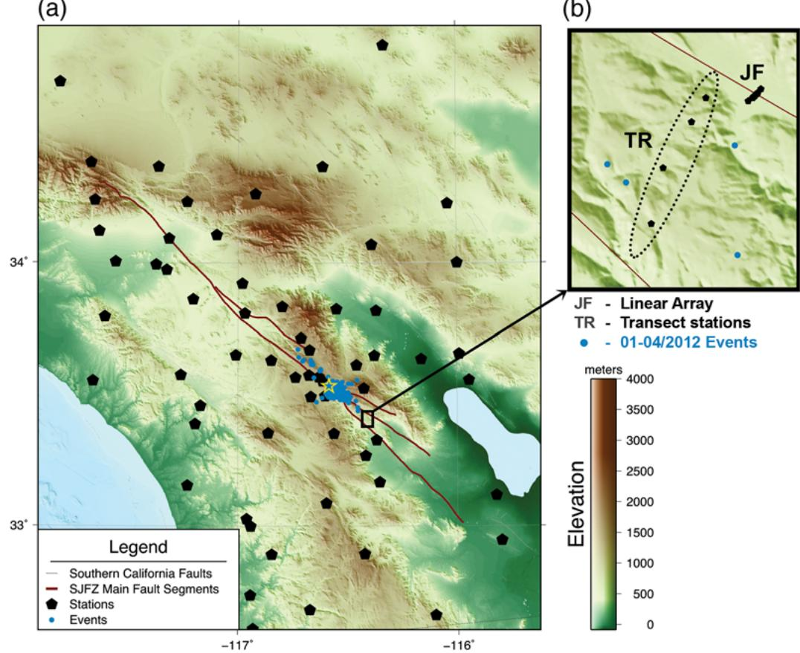  
Figure 1 Locations of the test areas within the San Jacinto fault zone (SJFZ), in which the singular value decomposition (SVD) detectors were examined. (a) The first hour of the June 2005 aftershock sequence, with 294 events and 79 recording stations; the location of the mainshock is marked by a star. This dataset was examined for the tuning of the real-time SVD detectors seen in Figures 4–10. (b) Four events (M 0.8–1.24) in the vicinity of the four transect stations and the nine JF linear array, recorded between January and April 2012. The events are at least 10 km deep and with epicentral distances of 0.5–4 km. This dataset was examined for tuning the SVD detectors in a reprocessing mode and for fault zone stations. The color version of this figure is available only in the electronic edition.

derivatives (SV′), and the cosine of the incidence angle (φ). Figure 3 illustrates how these detectors work for the same stations and event shown in Figure 2. We use the first filter, BW 2 4 30 5, for picking the first arrival of the P phase and the second filter, BW 3 4 8 4, for picking the first arrival of the S phase. We first assume that the particle motion incidence angle for P waves is close to vertical and that the S waves have a more horizontal particle motion. Therefore, cos φ 0:8 corresponds to P phases, and $\cos ( \varphi ) \le 0 . 6$ corresponds to S waves. Second, we see that when the P and S separation is successful, there are two peaks in the SV, one for the P phase and a second larger one for the S phase. We can also keep track whether the SV increases or decreases, so we can identify the earliest rise of the SV curves (SV1 for the first singular value and SV2 for the second).

To refine the detector, we combine these three variables in a simple scheme of thresholds and conditions. P detection is declared once the set of P-conditions (Table 1) are fulfilled while searching forward in time from t 0; S detection is declared once the set of S-conditions (Table 1) are fulfilled while searching backwards in time from the maximum of the SV1 curve.

A close examination reveals that, except for the station on the fault trace (Fig. 3e,f, JFS1), the other two stations could have used only the first filter (BW 2 4 30 5) to obtain good detections for both P and S (Fig. 3a–d). This is an important insight because it means that for real-time automatic detection and location, in which only one representative station per array is considered, one filter should be sufficient. For detections in linear array stations, some of which cross the fault (such as deployments for trapped waves studies; e.g., Li et al., 1994; Ben-Zion et al., 2003), two different filters are probably needed. We have used these postprocessing detectors in order to obtain more S detections in several datasets, including the ones used for the new high-resolution, tomography results of the SJFZ (Allam et al., 2014).

## Development of Real-Time SVD Detectors

The prototype P and S detectors described in the From SVD Separation to SVD Detection section provide a good tool for reprocessing event databases, in which we have prior knowledge of an approximate origin time and location. It could also be a useful tool in processing events for trapped-wave analysis within linear arrays in fault zones. However, the most acute need of efficient detection in real time requires a different approach.

(a)  
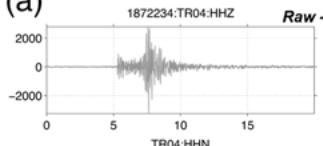

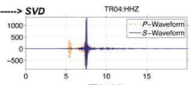  
(b)

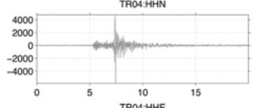

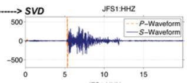

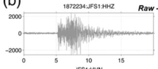

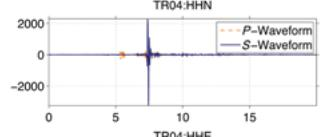

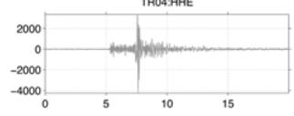

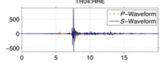

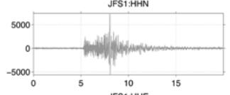

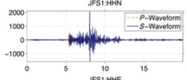

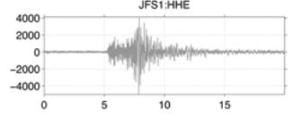

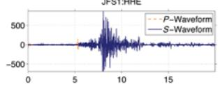

(c)  
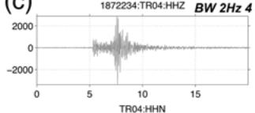

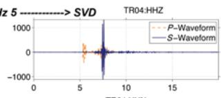  
(d)

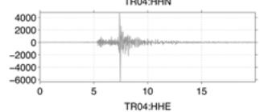

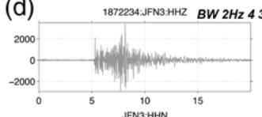

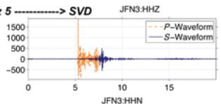

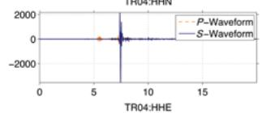

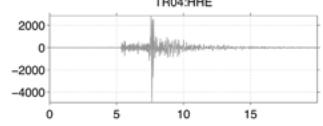

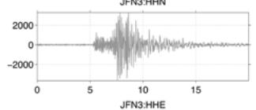

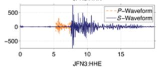

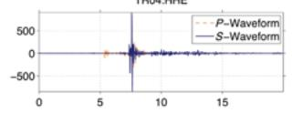

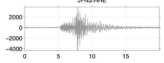

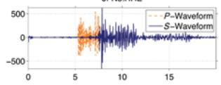

(e)  
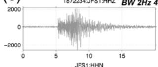

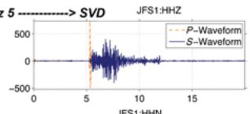

(f)  
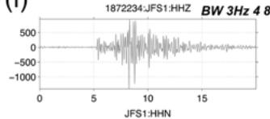

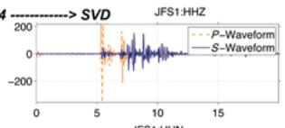

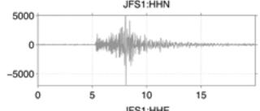

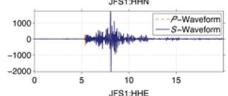

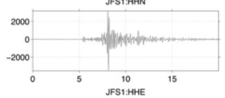

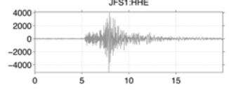

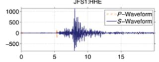

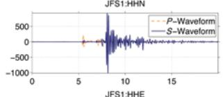

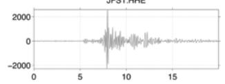

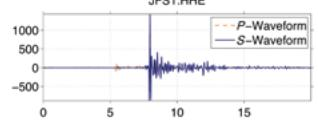  
Figure 2 SVD separation in the fault zone stations in Figure 1b, shown for an M 0.8 event. The SVD algorithm performs well even for stations in an epicentral distance of ∼1 km (TR04 in [a], with 1.06 km epicentral distance), but, for stations located in the very close vicinity of the fault trace (JFS1 in [b], with 3.49 km epicentral distance), the SVD algorithm fails to provide a valid P–S separation. By prefiltering the data in a bandpass of 2–30 Hz (see Separation of P and S Waves Using SVD section for details), the SVD separation improves and can account for stations within 100 m off the fault (JFN3 in [d], with 3.62 km epicentral distance); for the closer stations, a bandpass of 3–8 Hz is required for a valid separation (JFS1 in [f]). The color version of this figure is available only in the electronic edition.

Table 1  
P- and S-SVD Detection Scheme for Postprocessing, as Applied in Figure 3

<table><tr><td></td><td>Search Direction</td><td>cos(φ)</td><td>d[cos(φ)]/dt</td><td>SV</td><td>d(SV)/dt</td></tr><tr><td>P detector</td><td>t(0) Forward</td><td>≥0.8</td><td>&gt;0</td><td>SV1 &gt; 0.1 or SV2 &gt; 0.1</td><td>d(SV1)/dt &gt; 0.1 or d(SV2)/dt &gt; 0.05</td></tr><tr><td>S detector</td><td>t[max(SV1)] Backwards</td><td>≥0.6</td><td>&lt;0</td><td>SV1 ≤ 0.4 or SV2 ≤ 0.4</td><td>d(SV1)/dt : 0–0.4 or d(SV2)/dt : 0–0.2</td></tr></table>

For the real-time SVD detectors, we apply SNR detectors on the real-time SVD channels produced by the SVD algorithm.

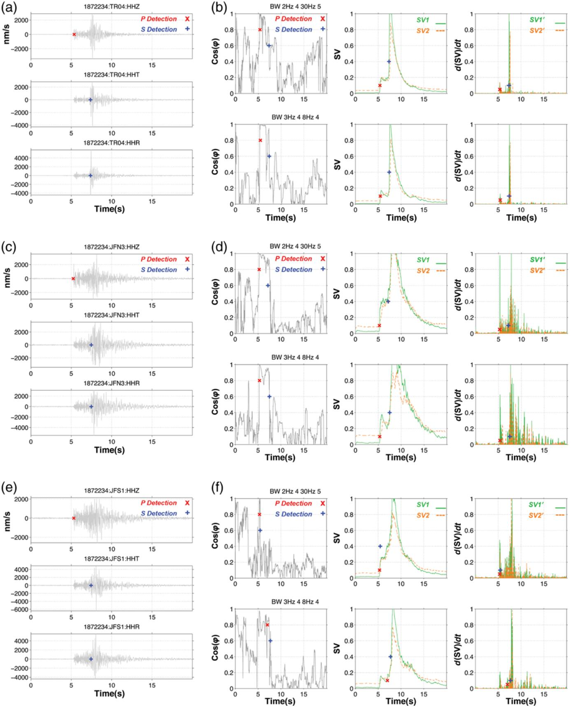  
Figure 3. Tuning the SVD detectors using the singular values (SV), their time derivatives (SV′), and the cosine of the incidence angle (φ). The P (×) and S ( ) detections on the rotated waveforms, with no filter are shown for (a) TR04, (c) JFN3, and (e) JFS1. (b, d, f) The corresponding SV, SV′, and cos φ , for the two filters used for the detections: The 2–30 Hz in the upper panels are used as the P detector, and the 3–8 Hz in the lower panels are used as the S detector. The color version of this figure is available only in the electronic edition.

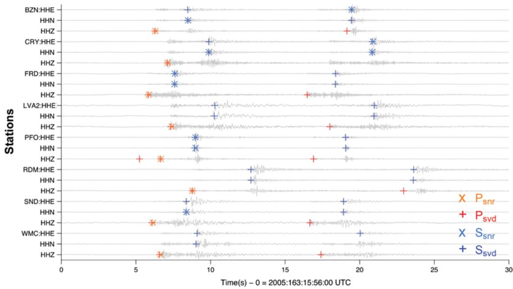  
Figure 4 The detection comparison between the real-time SNR detections and the real-time SVD detections. This is an example of two events within 30 s of the aftershock sequence. The SVD detectors show a better performance than the SNR detections, clearly obtaining more picks and detecting both events (see From Detections to Arrivals and Events section for further details). The color version of this figure is available only in the electronic edition.

The digital-seismology era has led to an exponential increase in data storage (Ahern, 2003); hence, in many cases large amounts of data is not reviewed by analysts. It is therefore necessary to develop methods that will improve the reliability of automatic processes. Many seismic datasets have the following deficiencies: (1) many small events are not detected by the regular SNR detectors, (2) the ratio of number of S picks to the number of P picks is very low, and (3) an event closely following (in time) a prior event would rarely be detected. The new SVD detectors have the potential of performing better and reducing these problems.

In a real-time process, we do not have prior knowledge of events, so the measures examined in Figure 3 (SV, SV′, and cos φ ) and utilized for tuning the detectors are not useful. In the real-time process, there is a stream of data coming through the acquisition system. One can either scan the real-time system with a delay of a few minutes, using the same detectors as shown in the From SVD Separation to SVD Detection section, or develop other measures of detection. The former possibility would probably not find many new events but might add many picks for events detected by the regular SNR detectors. The latter approach has the potential of revealing more events but might not get as many picks as the alternative.

The developed real-time SVD detectors for P and S phases follow the latter approach because adding more events to the catalog is more important than adding picks (these could be added in reprocessing using the prototype SVD detectors discussed in the From SVD Separation to SVD Detection section). The SVD separation enhances the

P and S packets, thereby cleaning a large amount of the original noise. Our real-time SVD detectors use the following process: (1) filtering the raw waveforms using the real-time 2–30 Hz band-pass filter with four poles in the lower cutoff frequency and five poles in the upper cutoff frequency, (2) applying the SVD algorithm in real time on the filtered threecomponent waveforms, and (3) running SNR detectors on the filtered SVD-processed waveform channels.

In order to examine these real-time detectors, we use continuous waveforms of a well-reviewed set of events with high rate of activity so it is hard to differentiate between events. The June 2005 $M _ { \mathrm { w } }$ 5.2 aftershock sequence (Fig. 1a) provides an appropriate test dataset. Analysts reviewed the first 80 min of data and identified 294 in the $M _ { \mathrm { L } } - 1$ to 5.6 magnitude range. This is an average of three to four events per minute. Figure 4 displays 120 s of a typical comparison between the regular SNR real-time detections on all three-components and the new SVD real-time detections. The SNR detectors use an autoregressive technique to refine the detections (Sleeman and van Eck, 1999). In this example, the SNR detectors detect eight P arrivals and seven S arrivals for the first event, and only three S arrivals for the second event. For the SNR detections in this example, P detections are identified on the HHZ channel and S detections are identified on the HHN and HHE channels. In comparison, the SVD detectors detect 8 P arrivals and 16 S arrivals for the first event, and 8 P arrivals and 14 S arrivals for the second event, with only one false P pick in the first event. This is an almost perfect performance, and there are many examples with less perfect but reasonable results. Figure 5 shows a statistical comparison between the SNR and SVD detectors (the two bar charts on the left); the number of detections for the

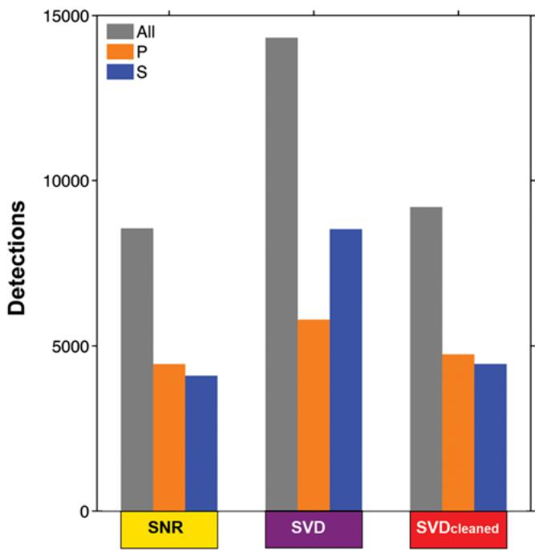  
Figure 5 Real-time detection statistics showing the increase of the number of detections when using the real-time SVD detectors instead of the real-time SNR detectors. The cleaning and reduction of the number of detections (right) are required for improving the association of the picks (see From Detections to Arrivals and Events section for further details). The color version of this figure is available only in the electronic edition.

SVD detectors is significantly larger than for the SNR detectors.

For the process of automatic event association and location, it may be preferable to have one S detection per station and event; too many picks can add noise to the process. This may be achieved by adding, as part of the detection process, a detection cleaner that scans each station in a time window of 0.5 s, picking the detection with the highest SNR. This process mainly avoids assigning S detections in places where clear P detections are seen, due to an unsuccessful SVD separation. These detections are observed in the bar chart on the right side of Figure 5, which shows a decrease in the number of detections at all levels. This reduction has a prominent effect on the steps of association and location of events.

## From Detections to Arrivals and Events

In addition to evaluating the performance ofdetections on individual sets of waveforms, they should be examined from an association point of view, namely how well the detections from different stations and channels correlate with each other. (A similar test was used by Vassallo et al., 2012, to compare the performance of several single-channel pickers.) To address this, we examine the detections after applying the association and location algorithms of the Boulder Real Time Technologies Antelope software. The Antelope association process takes all detections and uses a three-dimensional grid search to identify which sets ofdetections are consistent with a physically realizable location. Detections that satisfy the gridsearch criterion are converted to arrivals with an associated automatic source location. In real-time systems, there are a significant number of detections that are either false or valid but related to missed events; the latter would happen when there are not enough stations showing detections per event. We check under what association and location parameters the best performance is achieved, in terms of the following: (1) after association of all the detections, all the P and S arrivals are valid, and (2) the automatic locations of events, done on the basis of the declared arrivals, are valid and have good agreement with the events reviewed by analysts.

We examined several association possibilities embedded in the Antelope software. The first is identical to that used for regular SNR detections, under the assumption that the P detections are significantly more reliable than the S detections. In this case, association and location are initially done with the P detections; and, only after an initial origin was declared, the S detections are associated and considered in the relocation of the event. For the SNR, it is clear why this option is used, as the S detections are significantly fewer and less reliable than the P detections. However, for the SVD detectors, we can count on the reliability ofthe S detections, and there are more S detections than P detections (Figs. 4 and 5). Therefore, not only the P detections should be used at the initial stage of association and location, but also the S detections may (and should) be used at this stage. Table 2 summarizes the comparison between the different models and options. The SNR model, with only the P detections used for the initial association and location, located 33 events within the cluster, without false events, and with a minimum of 12 arrivals used for locating the event $( n _ { \mathrm { d e f } } = \mathrm { n u m b e r }$ of defining phases, see Table 2). The SVD-P model, which also uses only the P detections for the initial association and location, shows significantly better performance, locating 79 events within the cluster, with no false events, and with a minimum of 16 arrivals per event location. This is an improvement of∼140% more events than the SNR model. The SVD-P&S model, which uses both P and S for locating the event, locates 93 events within the cluster, with no false events, and with a minimum of 16 arrivals used for location. The fourth SVD-P&Sclean model involves the cleaning of the detections according to the SNR of a time window of 0.5 s as discussed in the From

Table 2  
Comparison between Detection, Association, and Location Models

<table><tr><td>Models</td><td>Arrivals</td><td colspan="2">Events</td><td>Defining Phases ( $n_{\text{def}}$ )</td><td>Magnitude Sensitivity</td></tr><tr><td rowspan="2">SNR</td><td>All 984</td><td rowspan="2">33</td><td rowspan="2">~11%</td><td rowspan="2">12</td><td rowspan="2">M &gt;0</td></tr><tr><td>P 492 S 492</td></tr><tr><td rowspan="2">SVD-P</td><td>All—2668</td><td rowspan="2">79</td><td rowspan="2">~27%</td><td rowspan="2">16</td><td rowspan="2">M &gt;-1</td></tr><tr><td>P 1320 S 1348</td></tr><tr><td rowspan="2">SVD-P&amp;S</td><td>All—2773</td><td rowspan="2">93</td><td rowspan="2">~31%</td><td rowspan="2">16</td><td rowspan="2">M &gt;-1</td></tr><tr><td>P 1448 S 1285</td></tr><tr><td rowspan="2">SVD-P&amp;S cleaned</td><td>All—2913</td><td rowspan="2">109</td><td rowspan="2">~37%</td><td rowspan="2">13</td><td rowspan="2">M &gt;-1</td></tr><tr><td>P 1528 S 1385</td></tr><tr><td rowspan="2">SVD-P&amp;S cleaned closest stations</td><td>All—1979</td><td rowspan="2">147</td><td rowspan="2">50%</td><td rowspan="2">5</td><td rowspan="2">M &gt;-1</td></tr><tr><td>P 897 S 1082</td></tr></table>

(a)  
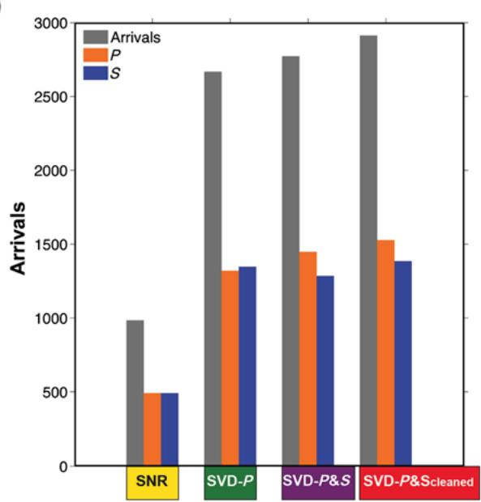

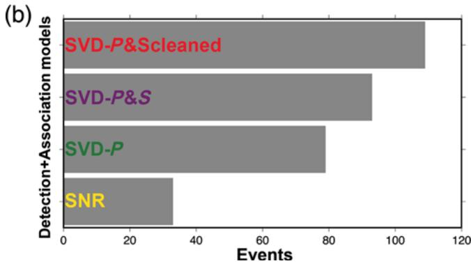  
Figure 6 Histograms of the various association models, applied after the detections have been made (a) for arrivals, and (b) for events. There is a distinct increase in the amount of arrivals and events for the SVD models (in comparison to the SNR). Within the SVD models there is an improvement as the models become more elaborated. Note that although the number of detections decreased for the SVD-P&S model, the number of events and arrivals increased significantly. The color version of this figure is available only in the electronic edition.

SVD Separation to SVD Detection section. This leads to an additional improvement of locating 109 events with a minimum of 11 arrivals per location and no false events. In summary, from a very intense aftershock sequence in the examined dataset, the original SNR detectors revealed only 10% of the events. The new SVD-P&Sclean algorithm automatically detected more than 35% of the events (Fig. 6a) and declared ∼2:5 times more detections as arrivals associated to specific events (Fig. 6b). The improved performance is also reflected in Figure 7, which shows the clusters of events for each algorithm and their spatial relation to the reviewed cluster.

Figure 8 shows an example of the arrivals revealed by several detection and association algorithms, and it corresponds with the detections comparison presented in Figure 4. Whereas Figure 4 is showing a comparison between the SNR and SVD detectors, Figure 8 shows which of those detections were declared as arrivals. The improvement from SNR to SVD-P is seen as a clear increase in the number of arrivals, including arrivals of the second event within the time window (Fig. 8a). The best performance is achieved by including the S detections in the initial association and location algorithm (Fig. 8b); and, after cleaning the detections (as discussed in the From SVD Separation to SVD Detection section), we obtain the SVD-P&S cleaned model, which identifies 26 arrivals out of a maximum of 32 possible arrivals for eight stations recording two events. Reviewing these arrivals implies that one major analyst task, after applying the automatic procedures, would be to untangle events that have the same event ID but are clearly distinct, as in Figure 8.

The numbers of events in magnitude bins for all the different methods discussed here are shown in Figure 9. In the M > 2 range, all algorithms manage to capture most of the events, with a slight preference for the SVD models. However, for lower magnitudes, the difference between the methods becomes more significant, especially the prominent improvement for the SVD detectors in comparison to the SNR detectors. While the SNR algorithm does not detect events of the M < 0 range, the SVD-based methods succeed in revealing such events. One thing to be aware of in Figure 9 is that the magnitudes used in the histogram bins are calculated on the stations with arrivals associated with a particular origin. For instance, one event has a magnitude estimate of M 3.03 for the SVD-P origin, and the same event measured with a different station distribution has a magnitude estimate of M 2.95 for the SVD-P&S origin. This in turn resulted in the event falling in the magnitude 2–3 bin for the SVD-P&S origin but in the magnitude 3–4 bin for the SVD-P origin.

## Discussion

The obtained results demonstrate that the SVD detectors perform much better than the traditional SNR detectors, with up to three times more detections. This is because a fraction of the noise is cleaned by separating the P phase to the vertical channel and the S phase to the horizontal channels. For high-rate activity, such as the June 2005 aftershock sequence, we showed that it detected only 37% of the catalog reviewed by analysts. In normal activity periods without a very high rate of events, the new detectors can identify most of the reviewed activity. The need for analysts to review the automatic procedures remains, even for a 95% success, but the nature of the review can be changed. With the new detectors, it might not be necessary to pick more phases for each event, given the high number and accuracy of the automatic picks. However, analysts should verify that event and origin IDs do not clash and untangle crossing or temporally adjacent events (e.g., Fig. 8). This will facilitate the work of analysts, providing better event coverage in a less time-consuming procedure.

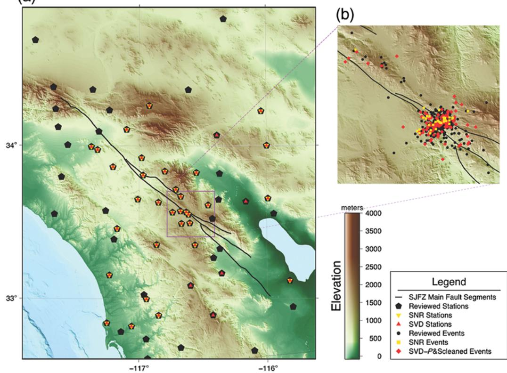  
Figure 7 Stations and events map for the first 80 min of the June 2005 M 5.2 mainshock and following aftershock sequence. (a) Shows the stations that their detections were confirmed as arrivals by the automatic association and location, in reference to the 79 events used in the reviewed dataset. While the SNR model used 34 stations, the SVD models used 39 stations. (b) Shows the comparison between the event clusters of the SNR model and SVD-P&S models in reference to the 294 reviewed events. The increase from 33 events for the SNR model to 109 events for the SVD-P&S model is a great improvement. The color version of this figure is available only in the electronic edition.

Another technique that could be applied to increase the number of events revealed by the detection–association– location procedure is to use preferentially only the stations closest to the events. This can be done in real time if the right adjustments are done within the real-time configuration (once an initial location is done, the closest stations define a subnet in which further refinements are done). In the case of the examined dataset (June 2005 aftershock sequence), we reprocessed the association and location algorithms with the closest stations to the aftershock cluster, revealing more events. This is demonstrated in Figure 10 with locations for 147 events within the aftershock cluster (50% of the reviewed events), obtained using only the 11 closest stations to calculate the association and location algorithm. Because only 11 stations are utilized, there are obviously fewer arrivals, but in this case only 5 stations are needed for the association and location process (Table 2). The magnitude sensitivity is also increased, but the stronger events clearly are underestimated due to the low number and the proximity of the stations (Fig. 10c).

It is important to note that the results shown in this study are strictly applicable for the SJFZ environment (with its local network and seismicity). The results are not expected to hold without new tuning of the algorithm for other environments or larger-scale seismic activity (regional or teleseismic) recorded by the SJFZ network. As shown in Figures 2 and 3, the general filter used for the network is not valid for stations located in the fault damage zone, requiring tuning of an additional lower band filter prior to the SVD. We also note that stations on the slow side of a fault separating different lithologies can have first-arriving fault-zone head waves (e.g., McGuire and Ben-Zion, 2005). Automatic identification and picking of the direct P phases and fault-zone head waves require careful analysis of the P waveforms with additional algorithmic components.

We suggest that before applying the detectors described in this work to other regions, researchers should tune the filters applied prior to the SVD algorithm so they capture the spectral signatures of the region. A more complex issue is enlarging the scale of the SVD detectors to regional and teleseismic events. In such cases, there are many additional phases involved, so the incidence angle might not be very successful in distinguishing between the P and S phases. It also cannot identify different P phases or different S phases from each other, which adds more complexity to the association and location procedures. These and other issues related to larger-scale applications should be addressed in a separate work.

(a)  
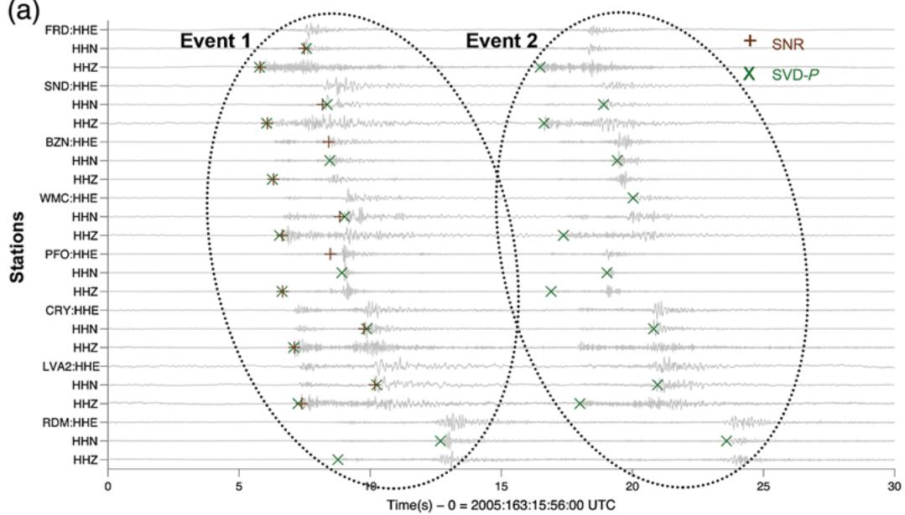

(b)  
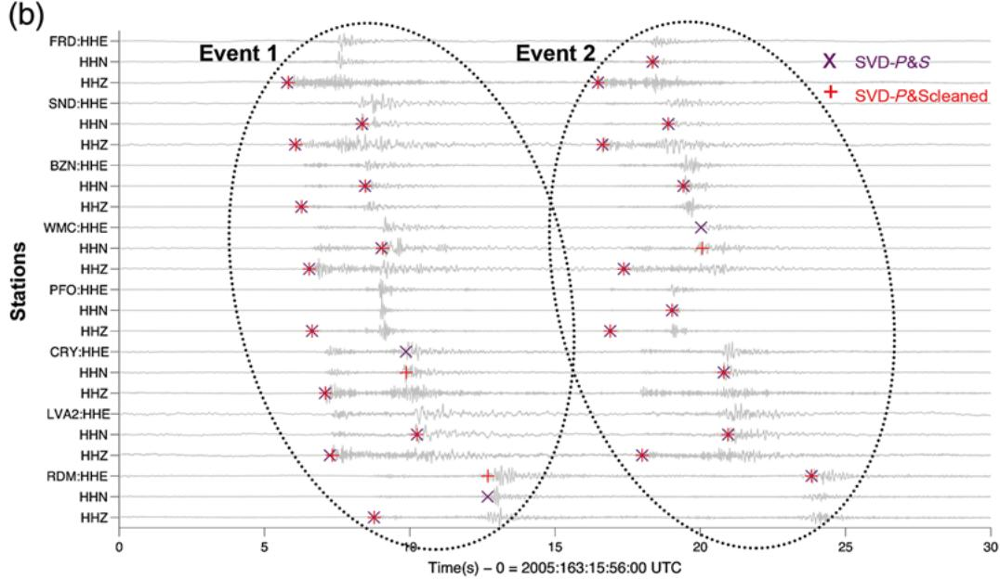  
Fig re 8 Arrivals comparison between the real-time SNR arrivals and several association models for real-time SVD arrivals. This is the same time window used in Figure 4 for the detections, showing SVD arrivals for two events within 30 s of the aftershock sequence. (a) Shifting from SNR ( ) to SVD (×) detectors, more arrivals are determined for event. (b) By improving the association model to include also S detections in the initial association, additional arrivals are declared (×). The best results ( ) are obtained when the detections are cleaned (see From Detections to Arrivals and Events section for details) prior to the automatic association and location processes. The color version of this figure is available only in the electronic edition.

## Conclusions

We demonstrate the use of an updating SVD algorithm to generate efficient and accurate automatic detection in real-time streaming of three-component waveforms. The developed SVD automatic detectors perform considerably better than the classical one-channel SNR approach. They can be tuned effectively for either reprocessing of events or for real-time detection, association, and location of seismic activity. The reprocessing SVD detectors mainly add P and S detections to the ones identified by the SNR real-time detectors. By identifying and distinguishing between P and S arrivals, the real-time SVD detectors manage to increase considerably (e.g., double to triple) the number of reliable arrivals and events for the seismic catalog.

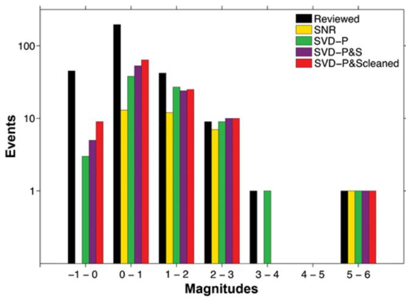  
Figure 9 Magnitude sensitivity. Comparing the different models by counting the number of events in each magnitude bin reveals the magnitude sensitivity of the automatic processes. Although the SNR model manages to reveal events down to M 0, the SVD models reveal significantly more events in the lower-magnitude range and extend down to M −1 events; this is the same sensitivity as for events reviewed by the naked eye. Magnitudes are only calculated using stations with arrivals. Different station distributions are common with the different types of processing and occasionally may result in event magnitude estimates straddling a histogram boundary. The color version of this figure is available only in the electronic edition.

With appropriate tuning, this may provide an efficient automatic phase detection platform for use in early-warning systems. To clarify this point, there is no difference in timing between this detector and any other single-channel real-time detector (e.g., SNR-based detectors). The major time constraints in early-warning algorithms are not the detectors, but rather the association scheme and the magnitude estimators. In our tests, the SVD detector runs 50–100 times faster on archived data than on real-time data. On real-time systems larger than 20 stations, a multithreaded architecture will be needed to efficiently run the SVD processes. The benefit of having an efficient P and S discriminator within the detectors, helps the association scheme to correctly associate the picks, to improve the magnitude estimators (without mixing the P and S phases), and might be of value for S-based earlywarning algorithms.

The SVD detections may be further processed for automatic association and location; their level of success depends on the association algorithm applied. In a purely automatic procedure, the SVD-P&S procedure provided the best performance due to the use of S detections at the initial association process. With an additional detection cleaner, adding a time lag of maximum 0.5 s, this performance could be further improved. In a semiautomatic process, once a spatiotemporal cluster of events has been identified, an automatic reprocessing using the closest stations can be added, thereby obtaining new detections and adding more events to the catalog.

This study focused on the local seismicity of the SJFZ region. Our new SVD detectors have been applied for reprocessing the major aftershock sequences of the SJFZ and continuous data since January 2010. They are now being implemented in the real-time processing, and the analystreview procedure is being modified as outlined in our work. For regional or teleseismic scales, the filters used here should be tested and further tuned to obtain high-performance detections. The discussed new SVD detectors and approach for reviewing seismic events have the capability to improve the efficiency and completeness of seismic catalogs in seismic data centers around the world.

## Data and Resources

Seismic data used in this study are gathered and managed by the following networks: the Anza (AZ) and the San Jacinto fault zone (SJFZ; YN) networks (operated by the Institute of Geophysics and Planetary Physics [IGPP], University of California, San Diego; http://eqinfo.ucsd.edu/; last accessed July 2013), the SCSN network (CI) (the southern California seismic network, operated by Caltech and U.S. Geological Survey; http://www.scsn.org/; last accessed July 2013); the PBO network (PB) (the Plate Boundary Observatory; operated by UNAVCO; http://www.earthscope.org/science/observatories /pbo; last accessed July 2013); and the SB network (operated by University of California, Santa Barbara; http://nees.ucsb .edu/publications; last accessed July 2013). Gaps in the data were filled by the Incorporated Research Institutions for Seismology Data Management Center (IRIS DMC; http:// www.iris.edu/dms/dmc/; last accessed November 2013).

Instrumentation for the portable seismic stations was provided by IRIS PASSCAL (http://www.passcal.nmt.edu/; last accessed May 2013).

Grids for maps were downloaded from the web tool http://www.marine‑geo.org/tools/maps\_grids.php; last accessed November 2013. We used Boulder Real Time Technologies Antelope real-time and archiving seismic software (http://www.brtt.com; last accessed November 2013).

Figures in this study were produced using a combination of several software tools: Generic Mapping Tools (http://gmt .soest.hawaii.edu/; last accessed November 2013); MATLAB (http://www.mathworks.com/products/matlab/; last accessed April 2013); Adobe Photoshop (http://www.photoshop.com/; last accessed November 2013); and Microsoft PowerPoint (http://office.microsoft.com/; last accessed April 2013).

## Acknowledgments

Ittai Kurzon would like to thank Juan Reyes and Luciana Astiz for lots of conversation and ideas and Geoff Davis for implementing the detectors into the real-time system of University of California, San Diego (UCSD), within the framework of Antelope. We also would like to thank the editor and the two reviewers for the important comments; their questions and inpu have improved this paper. The study was supported by National Science Foundation Grant EAR-0908903, and Ittai Kurzon was partly supported by a post-doctoral fellowship from the Geological Survey of Israel.

(a)  
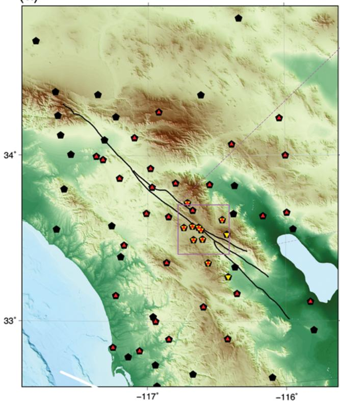

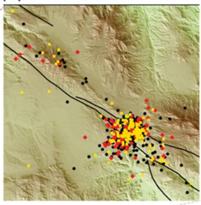

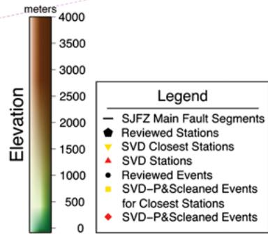

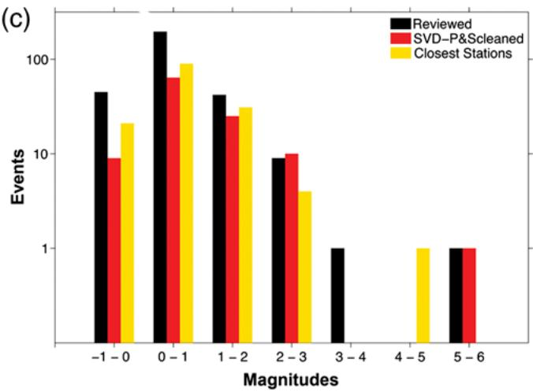  
Figure 10 The reprocessing of event clusters at closest stations. (a) The station distribution showing the 11 closest stations to the cluster revealed by the SVD-P&S cleaned model. (b) The event distribution shows the 147 events in the closest stations are more clustered than are the 109 events of the SVD-P&S cleaned distribution. (c) The magnitude sensitivity is further increased for the lower-range magnitudes but shows an underestimation of the magnitudes, especially prominent in the M > 3 range. The color version of this figure is available only in the electronic edition.

## References

Ahern, T. K. (2003). The FDSN and IRIS data management system: Providing easy access to terabytes of information, in International Handbook of Earthquake and Engineering Seismology, W. H. K. Lee, H. Kanamori, J. C. Jennings, and C. Kisslinger (Editors), Academic Press, San Diego, California, Part B., Vol. 81B, 1645–1655.

Allam, A. A., Y. Ben-Zion, F. L. Vernon, and I. Kurzon (2014). Seismic velocity structure in the Hot Springs and trifurcation areas of the San Jacinto fault zone, California, from double-difference tomography, Geophys. J. Int. doi: 10.1093/gji/ggu176.

Allen, R. (1978). Automatic earthquake recognition and timing from single traces, Bull. Seismol. Soc. Am. 68 1521–1532

Allen, R. M., and H. Kanamori (2003). The potential for earthquake early warning in southern California, Science 300 786.

Baer, M., and U. Kradolfer (1987). An automatic phase picker for local and teleseismic events, Bull. Seismol. Soc. Am. 77 no. 4, 1437–1445.

Bai, C. Y., and B. L. N. Kennett (2000). Automatic phase-detection and identification by full use of a single three-component broadband seismogram, Bull. Seismol. Soc. Am. 90 no. 1, 187–198.

Ben-Zion, Y. (1990). The response of two half spaces to point dislocations at the material interface, Geophys. J. Int. 101, 507–528.

Ben-Zion, Y., and K. Aki (1990). Seismic radiation from an SH line source in a laterally heterogeneous planar fault zone, Bull. Seismol. Soc. Am. 80 971–994.

Ben-Zion, Y., Z. Peng, D. Okaya, L. Seeber, J. G. Armbruster, N. Ozer, A. J. Michael, S. Baris, and M. Aktar (2003). A shallow fault zone structure illuminated by trapped waves in the Karadere-Duzce branch of the North Anatolian fault, western Turkey, Geophys. J. Int. 152 699–717.

Berger, J., L. N. Baker, J. N. Brune, J. B. Fletcher, T. C. Hanks, and F. L. Vernon (1984). The Anza array: A high dynamic-range, broad-band, digitally radio-telemetered seismic array, Bull. Seismol. Soc. Am. 74, 1469–1481

Brand, M. (2006). Fast low-rank modifications of the thin singular value decomposition, Lin. Algebra Appl. 415, 20–30.

Chael, E. P. (1997). An automated Rayleigh-wave detection algorithm, Bull. Seismol. Soc. Am. 87 157–163

Chanderasekaran, S., B. S. Manjunath, Y. F. Wang, J. Winkeler, and H. Zhang (1997). An eigenspace update algorithm for image analysis, Graph. Model. Image Process. 59 no. 5, 321–332.

Cichowicz, A. (1993). An automatic S-phase picker, Bull. Seismol. Soc. Am. 83 180–189.

Flinn, E. A. (1965). Signal analysis using rectilinearity and direction of particle motion, Proc. IEEE 56 1874–1876.

Gu, M., and S. C. Eisenstat (1994). A stable and efficient algorithm for the rank-one modification of the symmetric eigenproblem, SIAM J. Matrix Anal. Appl. 15 no. 4, 1266–1276.

Jurkevics, A. (1988). Polarization analysis of three-component array data, Bull. Seismol. Soc. Am. 78 no. 5, 1725–1743.

Lancieri, M., and A. Zollo (2008). A Bayesian approach to the real-time estimation of magnitude from the early P and S wave displacement peaks, J. Geophys. Res. 113 no. B12302, 1–17.

Lei, J. (2005). A method for non-orthogonal seismic polarization-vector separation, Geophys. J. Int. 162 965–974.

Li, Y. G., K. Aki, D. Adams, A. Hasemi, and W. H. K. Lee (1994). Seismic guided waves trapped in the fault zone of the Landers, California, earthquake of 1992, J. Geophys. Res. 99 11,705–11,722.

Lomax, A., C. Satriano, and M. Vassallo (2012). Automatic picker developments and optimization: FilterPicker—A robust, broadband picker for real-time seismic monitoring and earthquake early warning, Seismol Res. Lett. 83 no. 3, 531–540, doi: 10.1785/gssrl.83.3.531.

McGuire, J., and Y. Ben-Zion (2005). High-resolution imaging of the Bear Valley section of the San Andreas fault at seismogenic depths with fault-zone head waves and relocated seismicity, Geophys. J. Int. 163 152–164, doi: 10.1111/j.1365-246X.2005.02703.x.

Moonen, M., P. van Dooren, and J. Vanderwalle (1992). A singular value decomposition updating algorithm for subspace tracking, SIAM J. Matrix Anal. Appl. 13 no. 4, 1015–1038.

Nippress, S. E. J., A. Rietbrock, and A. E. Heath (2010). Optimized automatic pickers: Application to the ANCORP data set, Geophys. J. Int. 181 911–925.

Roberts, R. G., A. Christoffersson, and F. Cassidy (1989). Real-time event detection, phase identification and source location estimation using single station three-component seismic data, Geophys. J. 97 471–480.

Rosenberger, A. (2010). Real-time ground motion analysis: Distinguishing P and S arrivals in a noisy environment, Bull. Seismol. Soc. Am. 100 no. 3, 1252–1262.

Sleeman, R., and T. van Eck (1999). Robust automatic P-phase picking: An on-line implementation in the analysis of broadband seismogram recordings, Phys. Earth. Planet. In. 113 265–275.

Steward, G. W. (1992). An updating algorithm for subspace tracking, IEEE Trans. Signal Process. 40 1535–1541.

Vassallo, M., C. Satriano, and A. Lomax (2012). Automatic picker developments and optimization: A strategy for improving the performances of automatic phase pickers, Seismol. Res. Lett. 83 no. 3, 541–554, doi: 10.1785/gssrl.83.3.541.

Vidale, J. E. (1986). Complex polarization analysis of particle motion, Bull. Seismol. Soc. Am. 76 no. 5, 1393–1405.

Wang, J., and T. L. Teng (1997). Identification and picking of S phase using an artificial neural network, Bull. Seismol. Soc. Am. 87 no. 5, 1140–1149.

Wurman, G., R. Allen, and P. Lombard (2007). Toward earthquake early warning in northern California, J. Geophys. Res. 112 doi: 10.1029/ 2006JB004830.

Zollo, A., M. Lancieri, and S. Nielsen (2006). Earthquake magnitude estimation from peak amplitudes of very early seismic signals on strong motion records, J. Geophys. Res. 33 L23312, doi: 10.1029/2006GL027795.

Institute of Geophysical and Planetary Sciences Scripps Institute of Oceanography University of California, San Diego La Jolla, California 92093-0225 (I.K., F.L.V.)

Geological Survey of Canada Pacific Geoscience Center 9860 West Saanich Road Sidney, British Columbia, Canada V8L 4B2 (A.R.)

Department of Earth Sciences University of Southern California Los Angeles, California 90089 (Y.B.-Z.)

Manuscript received 20 November 2013; Published Online 22 July 2014