分类号： TP18

单位代码： 10431

学 号： 10431230608

# 硕 士 学 位 论 文

# （专业学位）

## 自训练半监督神经网络软测量模型研究及应用

作 者 姓 名 杨东哲

学 科 专 业 控制工程

所 在 学 部 电子电气与控制学部

指导教师姓名 孙 凯

专业技术职务 教 授

2026 年 06 月 10 日

A Thesis Submitted for the Application of

the Master’s Degree of Engineering

# Research and Application of Self-Training Semi-Supervised Neural Network Soft Sensing Models

Candidate: Yang Dongzhe

Specialty: Control Engineering

Supervisor: Professor Sun Kai

Qilu University of Technology, Jinan, China June, 2026

## 目 录

第1章 绪论....1
1.1 课题研究背景及意义....1
1.2 研究现状....2
1.2.1 软测量技术的研究现状....2
1.2.2 基于传统机器学习方法的软测量技术研究现状....4
1.2.3 基于神经网络的软测量技术研究现状....4
1.2.4 半监督学习的研究现状....6
1.3 软测量建模过程面临的挑战....8
1.3.1 标记样本稀缺导致建模困难....8
1.3.2 异常值影响模型稳定性....9
1.3.3 过程数据时滞性制约模型的响应能力....9
1.4 论文研究内容及章节安排....10
第2章 自训练半监督神经网络软测量建模基础....13
2.1 引言....13
2.2 面向静态软测量的前馈神经网络....13
2.3 面向动态软测量的循环神经网络....15
2.4 自训练半监督学习机制....17
2.5 本章小结....18
第3章 增量自训练随机配置网络软测量模型研究及应用....19
3.1 引言....19
3.2 增量自训练中的样本排序与伪标签质量评估....19
3.2.1 基于加权GMM的无标签样本有序标记策略....19
3.2.2 面向回归任务的伪标签质量评估算法....20
3.3 增量自训练随机配置网络软测量模型....21
3.4 实验及应用....24
3.4.1 实验设置....24
3.4.2 锅炉燃烧过程案例仿真....24
3.4.3 溢流矿浆浓度软测量预测建模....28
3.4.4 超参数敏感性分析....32
3.4.5 模型复杂度分析....33
3.4.6 消融实验....34
3.5 本章小结....35
第4章 稳健自训练随机配置网络软测量模型研究及应用....37
4.1 引言....37

4.2 广义 M 估计....37
4.3 融合广义 M 估计的自训练随机配置网络软测量模型....38
4.4 实验及应用....41
4.4.1 人工数据集仿真....41
4.4.2 磨矿工艺中溢流矿浆浓度软测量预测建模....43
4.4.3 污染率实验....47
4.5 本章小结....48
第 5 章 稳健自训练 BiLSTM 软测量模型研究及应用....51
5.1 引言....51
5.2 半监督时序建模的损失函数设计....51
5.2.1 Huber 损失....51
5.2.2 时间一致性损失....52
5.2.3 自适应损失权重....53
5.3 稳健自训练 BiLSTM 软测量模型....53
5.4 实验及应用....55
5.4.1 人工数据集仿真....55
5.4.2 浮选工艺铜品位软测量建模....57
5.4.3 超参数敏感性分析....63
5.4.4 污染率实验....64
5.4.5 消融实验....65
5.5 本章小结....65
第 6 章 总结与展望....67
6.1 总结....67
6.2 展望....68
参考文献....69

## 摘 要

在流程工业中，组分浓度、关键元素含量等指标直接关系生产安全、运行稳定与产品质量，需对其进行实时、准确的监测。软测量技术通过易测过程变量实现难测参数的在线估计，已成为流程工业智能检测的重要手段。然而，实际工业过程中，标记样本获取成本高昂，大量未标记数据未能充分利用，且采集数据常伴有异常值和时滞特性，严重影响软测量模型的预测精度与稳健性。针对上述问题，本文开展自训练半监督神经网络软测量建模研究，研究内容包括：

（1）针对过程数据标记样本稀缺问题，提出一种增量自训练随机配置网络（Incremental self-training stochastic configuration network, IST-SCN）。首先，提出基于加权高斯混合模型聚类的有序伪标记策略，根据样本与聚类中心的距离对无标记样本排序，优先选择高置信度样本进行伪标记。其次，设计伪标签置信度评估算法，通过加权距离误差量化伪标签可靠性，筛选高质量样本加入训练集。在此基础上，构建 IST-SCN，通过迭代式伪标签生成和模型更新逐步提升性能。将所提算法应用于锅炉燃烧和半自磨—球磨—破碎（Semi-autogenous ball millcrusher, SABC）系统溢流浓度软测量建模，实验结果验证了其在标记样本稀缺条件下的优越性。

（2）针对研究内容（1）中所提算法对异常值敏感问题，引入了广义 M 估计理论，提出了一种稳健的自训练随机配置网络（Incremental self-training SCN withgeneralized M-estimate, GM-IST-SCN）。首先，设计一种改进的 SCN 监督机制，采用马氏距离计算输入向量的距离信息，以度量样本偏离正常分布程度。其次，证明了该算法的收敛性。GM-IST-SCN 通过对不同离群程度的异常值进行加权，降低输入空间中异常值的影响。随后，通过具有离群值人工数据集验证所提算法的稳定性。最后，利用所提出的 GM-IST-SCN 对 SABC 系统中的溢流浓度进行预测，验证了该算法在实际工业过程中的应用效果。

（3）针对过程数据中标记样本稀缺、异常值干扰及时滞特性所带来的建模难题，提出一种 Huber 损失与融合时间一致性损失的稳健估计自训练双向长短期记忆网络。首先，引入 Huber 损失以提高模型对异常值的鲁棒性。其次，设计时间一致性损失函数对伪标签施加时序平滑性约束，并根据伪标签质量自适应调整其权重系数，从而降低低质量伪标签引入的噪声干扰。在训练过程中，所提算法通过 Huber 损失降低异常值的负面影响，同时通过时间一致性损失减少低质量伪标签的干扰。然后，通过设计具有时间连续性以及异常样本的人工数据集验证算法有效性。最后，将所提算法应用于铜矿浮选过程中的铜品位预测。实验结果表明，所提算法在准确性和鲁棒性方面均优于其他对比算法。

关键词：软测量；半监督学习；自训练；随机配置网络；双向长短期记忆网络

## ABSTRACT

In the process industry, indicators such as component concentration and key element content are directly related to production safety, operational stability, and product quality, requiring real-time and accurate monitoring. Soft sensing technology enables online estimation of difficult-to-measure parameters through easily measurable process variables and has become an essential intelligent detection method in the process industry. However, in practical industrial processes, the acquisition cost of labeled samples is high, a large amount of unlabeled data remains underutilized, and the collected data often contain outliers and time-delay characteristics, which severely affect the prediction accuracy and robustness of soft sensor models. To address the above problems, this thesis conducts research on self-training semi-supervised neural network soft sensing modeling. The research contents are as follows:

(1) To address the problem of scarce labeled samples in process data, an incremental self-training stochastic configuration network (IST-SCN) soft sensing algorithm is proposed. First, an ordered pseudo-labeling strategy based on weighted Gaussian mixture model clustering is developed. Unlabeled samples are sorted according to their distances to cluster centers, and samples with high confidence are preferentially selected for pseudo-labeling. Second, a pseudo-label confidence evaluation algorithm is designed to quantify the reliability of pseudo-labels through weighted distance errors, and high-quality samples are selected to be added to the training set. On this basis, an incremental IST-SCN is constructed to progressively improve performance through iterative pseudo-label generation and model updating. The proposed algorithm is applied to soft sensing modeling of boiler combustion and overflow concentration in a semi-autogenous ball mill crusher (SABC) system. Experimental results verify its superiority under the condition of scarce labeled samples.

(2) To address the sensitivity of the algorithm proposed in (1) to outliers, the generalized M-estimation theory is introduced, and a robust self-training stochastic configuration network (GM-IST-SCN) is proposed. First, an improved SCN supervision mechanism is designed, in which the Mahalanobis distance is used to compute the distance information of input vectors to measure the degree to which a sample deviates from the normal distribution. Second, the convergence of the proposed algorithm is proved. GM-IST-SCN reduces the influence of outliers in the input space by assigning weights to outliers according to their degrees of deviation. Subsequently, the robustness of the proposed algorithm is validated using an artificial dataset containing outliers. Finally, the GM-IST-SCN is applied to predict overflow concentration in the SABC system, demonstrating its effectiveness in real-world industrial processes.

(3) To address the modeling challenges posed by scarce labeled samples, outlier interference, and time-delay characteristics in process data, a robust self-training bidirectional long short-term memory network algorithm incorporating Huber loss and a temporal consistency loss is proposed. First, Huber loss is introduced to enhance the model's robustness against outliers. Second, a temporal consistency loss function is designed to impose temporal smoothness constraints on pseudo-labels, and an adaptive weighting scheme is developed to adjust the contribution of each pseudo-label based on its estimated quality, thereby mitigating the noise introduced by low-quality pseudolabels. During training, the proposed algorithm mitigates the negative impact of outliers via Huber loss while reducing interference from low-quality pseudo-labels via the temporal consistency loss. The effectiveness of the algorithm is then validated on artificially constructed datasets with temporal continuity and anomalous samples. Finally, the proposed algorithm is applied to predict copper grade in a copper flotation process. Experimental results show that the proposed algorithm outperforms other comparative methods in both accuracy and robustness.

Keywords: Soft sensing, semi-supervised learning, self-training, stochastic configuration network, bidirectional long short-term memory

## 第 1 章 绪论

## 1.1 课题研究背景及意义

随着“工业 4.0”和“中国制造 2025”战略的深入推进，全球制造业正经历着深刻的数字化转型。流程工业作为国民经济的支柱产业，涵盖了石油、化工、冶金、选矿等基础行业，其生产过程的智能化水平直接关系到能源消耗、产品质量和企业经济效益。实现生产过程的精准感知与实时控制是这一转型的核心环节，关键工艺指标实时准确获取，是实现过程优化、故障诊断和节能减排的前提[1]。

为满足工业过程实时监控的要求，研究人员通常需要在关键工艺位置安装硬件传感器。但在高温、高压等极端条件下，硬件传感器容易因耐受性不足而频繁失效。同时，一些关键过程变量，如浓度、反应速率和聚合物黏度，很难通过硬件传感器直接获取[2]，而专用的传感器不仅价格昂贵，维护成本也较高。这些问题严重制约了硬件传感器在复杂工况中的应用，使其难以实现对关键参数的高精度监测。

近年来，随着信息技术的进步和计算能力的提升，工业软测量作为一种先进的测量手段，得到了越来越多的关注[3]。软测量技术利用容易在线测量的辅助变量与难以直接测量的主导变量之间存在的数学模型关系，通过计算机软件运算来实现对主导变量的估算。软测量技术因其响应速度快、维护成本低、无测量滞后等优点，已成为复杂工业过程中关键指标在线检测的重要替代手段[4]。

尽管软测量技术已取得长足发展，但在实际工业应用中仍面临诸多挑战。首先，标记样本稀缺问题尤为突出。关键质量指标的获取往往依赖人工取样和实验室化验，不仅成本高昂，且耗时较长，导致可用的有标记样本数量十分有限，难以支撑复杂模型的训练需求。其次，工业现场采集的数据中普遍存在异常值干扰。受传感器故障、设备磨损或环境波动等因素影响，测量数据常包含离群点，严重影响模型的稳定性和预测精度。此外，工业过程往往具有显著的长时滞特性。受物料传输延迟、缓慢的物理化学反应以及在线分析仪检测周期等因素影响，过程变量的输入与输出之间通常存在不确定的时间延迟。时滞特性导致传统的静态模型难以准确描述过程的动态演变规律，严重影响了软测量模型的预测精度及实时性。因此，如何在建模过程中有效处理过程的长时滞特性，构建具有动态捕捉能力的软测量模型，成为提升模型预测性能的关键。

综上所述，本文针对工业过程数据中的标记样本稀缺、异常值和时滞特性等问题，开展自训练半监督神经网络软测量模型的研究，不仅具有重要的理论价值，能够丰富和发展半监督学习的理论体系，而且可应用于流程工业过程建模，为其关键参数精确监测和智能控制提供有效技术支撑，具有显著的工程应用价值。

## 1.2 研究现状

## 1.2.1 软测量技术的研究现状

软测量融合了自动控制理论、生产工艺原理及先进计算技术，属于现代检测手段[5]。该概念源于 20 世纪 70 年代 Brosillow 提出的推断控制思想，主要通过历史数据建模来预测系统输出，从而提升控制效果。其核心在于借助易于测量的过程变量，结合机理模型或数据驱动模型，间接实现对关键变量的动态估算。凭借在成本、实时性及维护便利性上的显著优势[3,6]，软测量目前已在过程监控、故障诊断及连续生产控制等领域展现出突出的应用价值[7-9]。软测量模型的设计过程如图 1.1 所示。从整体建模流程上看，实施软测量技术主要包含以下四步：选择合适的输入变量、对数据进行必要的预处理、构建软测量模型，以及后续的在线校正和模型维护。

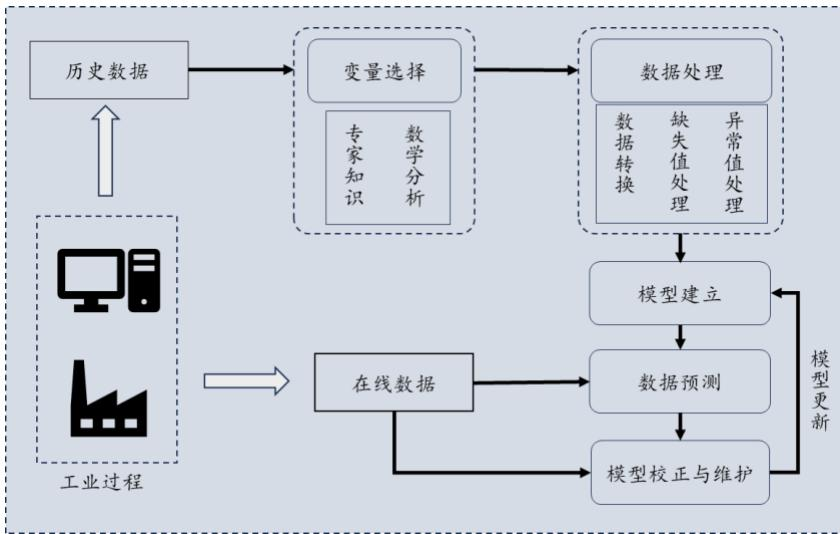  
图 1.1 软测量技术建模步骤

目前，软测量技术已从以往的经验性建模逐渐发展为基于数学统计建模以及多模型融合建模。此演进显著提升了关键工艺参数的预测精度，为生产过程的实时监控提供了更可靠的技术支撑。软测量技术的基本方法可以分为三大类：机理建模方法、数据驱动建模方法以及混合建模方法。

## （1）基于机理分析的软测量模型

机理模型驱动的软传感器是基于与所考虑过程相关的物理或化学原理推导出的方程设计的，结合质量平衡、能量平衡、流体平衡等反应定律建立的预测模型[10-12]。由于已知第一原理模型的过程背景或内部机制，因此也使用“白箱模型”一词。这类模型能够揭示过程变量之间的内在关联，预测结果具有良好的可解释性，被广泛应用于需要对过程行为进行深入分析的工业场景。文献[13]对搅拌介质磨机中矿浆、研磨介质与磨机结构之间的物理相互作用进行了机理建模，成功预测了湿式粉碎过程中的介质运动与功率消耗。Tian 等人通过建立半经验老化模型实现了对锂库存损失与电极活性材料损失的量化估计，为电池健康状态预测提供了可靠的机理建模思路[14]。

然而，机理模型在工业应用中存在一定局限性。这类模型通常基于严格的物理化学假设，主要适用于稳态运行条件，而实际工业过程往往呈现高度动态的行为特征，难以满足机理模型的理想化前提。此外，机理模型的构建需要深入的专业知识和大量实验验证，开发周期长、成本高，迁移性较差，难以单独满足工业现场对实时性与鲁棒性的要求。

## （2）基于数据驱动的软测量模型

基于数据驱动的软测量模型已成为当前过程工业中的主要发展趋势。随着各类传感器在生产线上的广泛部署以及数据存储技术的快速发展，海量的过程数据得以实时采集并长期保存，为数据驱动建模提供了坚实的基础条件[15,16]。与依赖物理化学原理的机理建模不同，数据驱动建模无需深入掌握过程的内在机理，而是直接从历史数据中挖掘输入变量与目标变量之间的映射关系。凭借其对复杂非线性关系的强大拟合能力以及对多样化工业场景的良好适应性，数据驱动方法在过程软测量中得到了广泛应用。例如，文献[17]开发了一种基于多层感知器（Multi-layer perceptron, MLP）的人工神经网络模型，并利用实验生成的二氧化硅和磁铁矿数据来预测水力旋流器的脱水性能。文献[18]提出了一种基于导数记忆长短期记忆网络的特征增强框架，通过引入微分门结构实现对过去、现在与未来动态信息的综合建模，这使得软测量模型的预测准确性获得了明显提高。文献[19]提出了一种融合门控循环单元与堆叠自动编码器的方法，能够从高维数据中提取关键特征并捕捉动态关系，并将其应用于脱丁烷塔的软测量建模。综上，数据驱动建模方法依托生产过程数据构建数学模型，不依赖机理知识，因此得到了广泛的研究与应用。

## （3）基于机理与数据驱动的软测量模型

混合软传感器方法结合了基于机制和数据驱动建模的优势，能够在保持可解释性的同时提高软传感器的准确性，并取得了显著的发展。Brunner 等人提出了一种结合机理分析和多重线性回归的软传感器混合建模方法以实现对皮奇亚发酵过程的在线监控[20]。Li 和 Yan 提出了一个动态混合模型，利用 LSTM 获得机理模型的动力学参数，以实现乙醇和糖浓度的准确预测[21]。此外，Sun 等人提出了一种融合物理知识与双向长短期记忆网络的混合模型，实现了风电功率高精度预测[22]。融合机理与数据驱动的软测量建模方法，在应对多速率采样、不确定性问题以及高实时性要求方面表现突出。可以看出，该方法能够有效实现工业过程关键参数

的在线监测与控制。

## 1.2.2 基于传统机器学习方法的软测量技术研究现状

工业过程软测量技术的核心在于建立易测辅助变量与难以实时测量的关键绩效指标之间的数学映射模型。在早期研究中，数据驱动的软测量模型主要依赖于传统的多元统计分析与机器学习方法。最具代表性的方法包括主成分回归[23]（Principal component regression, PCR）和偏最小二乘回归[24]（Partial least squaresregression, PLS）。这类线性建模方法通过降维技术提取数据的主元特征，在处理小规模、强共线性的工业数据时取得了初步成效。Zhu 等人提出了一种名为双重权重 PLS 的感应迁移回归框架，有效解决了小样本过程建模中的过拟合与域差异问题[25]。为了进一步增强载荷矩阵的稀疏性，文献[26]提出了一种联合稀疏主成分回归，克服了传统 PCR 依赖绝对约束和最小二乘损失函数的局限性。然而，上述方法均采用线性估计，难以准确提取过程变量间的非线性关系，导致其在复杂工况下的建模精度与预测性能均存在明显不足。

为了应对工业过程中的非线性特征，研究人员引入了支持向量机（Supportvector machine, SVM）[27,28]和高斯过程回归（Gaussian process regression, GPR）等基于核技巧的机器学习方法。例如，通过引入径向基核函数，SVM 能够将低维空间的非线性问题映射到高维特征空间进行线性求解，显著提升了模型的预测精度，已在工业中得到了一些应用。Hou 等人提出了一种自适应随时加权的 GPR 集成方法，通过构建不同阶段的基础预测器，并结合自适应权重分配，显著提升了单一平稳高斯过程模型在复杂退化过程中的预测精度[29]。Liu 等人将SVM 与模糊 C 均值聚类相结合，构建了用于预测水泥熟料中游离石灰含量的软测量模型[30]。然而，现代工业过程往往伴随着强烈的多变量耦合、时变性以及深度的非线性动态特征[31]。传统机器学习方法通常受限于浅层结构，特征提取能力有限，因此难以适用于日益复杂的大规模、非线性工业过程。

## 1.2.3 基于神经网络的软测量技术研究现状

随着深度学习理论的成熟，神经网络凭借其强大的非线性逼近与特征提取能力，在处理机理复杂的工业过程建模中展现出显著优势，已逐步取代传统机器学习方法成为软测量的核心范式[32]。根据实际工业数据是否存在显著的时间序列特性，当前的神经网络软测量建模主要划分为静态和动态两类。静态网络模型通常基于过程稳态假设，以前馈神经网络为代表，在处理无明显时滞的多元非线性映射时具备较高精度；而动态网络模型则以循环神经网络为核心，专注于捕获历史运行轨迹与变量间的时序演化规律。基于上述分类，下文将分别对前馈神经网络与循环神经网络的研究进展进行详细论述。

## （1）前馈神经网络的研究进展

MLP 作为前馈神经网络的典型代表，是较早被引入软测量领域的深度学习模型之一。此类网络中的信息仅沿着从输入层到输出层的单一方向流动，其结构特点使其特别适用于非时间动态的稳态过程建模[33]。在模型优化方面，该网络主要采用反向传播（Back propagation, BP）算法进行训练，具备以较高精度逼近复杂非线性连续函数的能力。目前，该方法已在化工指标预测、矿物浮选等典型工业软测量场景中取得了成功的应用。例如，Fan 等人通过引入双重最小绝对收缩与选择算子（Least absolute shrinkage and selection operator, LASSO），实现了对 MLP输入变量与隐藏层结构的同步优化，在提升非线性表征能力的同时，解决了模型结构冗余导致的过拟合问题[34]。值得注意的是，尽管基于 BP 算法训练的传统神经网络模型已获得广泛应用，但其需要大量信息参数，导致收敛速度较慢且容易陷入局部最优[35]。

为克服上述局限性，Wang 和 Li 提出了一种带有监督参数化机制的增量前馈神经网络，称为随机配置网络（Stochastic configuration network, SCN）[36]。SCN放弃了参数在固定区间内随机选择的限制，并在增量构建过程中根据其独特的监督机制随机配置隐藏节点参数，从而确保 SCN 的普遍近似性质。凭借其结构精简、参数更少、收敛性强等优势，SCN 已广泛应用于工业软测量建模[37]。例如，Li 等人改进了 SCN 的约束机制与节点选择策略，并结合 SVD 压缩模型，在污水处理氨氮浓度预测中实现了计算效率与精度的同步提升[38]。Yang 等人进一步结合梯形规则与改进 SCN，并引入窗口数据更新框架，实现了对过程温度的实时精准预报[39]。尽管前馈神经网络在处理静态数据映射方面表现优异，但实际工业过程的数据并非独立同分布，而是蕴含着强烈的动态时序依赖关系。当前的工况状态不仅取决于当前时刻的输入，还深受历史运行轨迹的影响

## （2）循环神经网络的研究进展

近年来，循环神经网络（Recurrent neural network, RNN）凭借其捕捉动态时序依赖关系的优异性能，已成为工业过程建模与软测量领域的重要方法[40,41]。然而，传统 RNN 在长序列处理中容易面临梯度消失或梯度爆炸的困扰[42]。为缓解这一问题，其衍生模型长短期记忆（Long short-term memory, LSTM）[43]借助门控机制，实现了对信息流动的精细化调节，不仅有效缓解了梯度问题，还能更好地学习流程工业中的时间延迟特征，这使得基于 LSTM 的软测量方法在过程控制领域备受关注[44]。针对工业加氢裂化过程的非线性与时序特征，文献[45]提出了基于时空注意力机制的 LSTM 模型，用于精准预测航空煤油的初沸点。文献[46]提出了一种基于 LSTM 的混合集成学习模型，通过集成剪枝与新型损失函数提升工业用电超短期峰值需求的预测精度及鲁棒性。

上述研究表明，LSTM 及其变体在处理工业过程的时间延迟特征方面具有显著优势。然而，传统 LSTM 仅能沿单一时间方向捕捉序列信息，难以充分挖掘工业数据中前后双向的时序依赖关系。双向长短期记忆（Bidirectional LSTM,i ）[47]网络通过引入前向和后向两个隐藏层，能够融合序列中过去与未来的数据，更全面地捕捉流程工业过程中变量的动态耦合关系与复杂时序特征。基于上述优势，BiLSTM 已在工业过程建模领域展现出广阔的应用前景。文献[48]通过时序卷积模块与 BiLSTM 提取多尺度特征，并结合 Kolmogorov-Arnold 网络处理非线性数据，在废水处理与烟气脱硫工艺中验证了其有效性。

然而，上述深度神经网络模型的成功应用高度依赖于充足的过程标签数据。实际工业过程中关键变量难以实时测量，导致标签样本稀缺，这极大地限制了全监督学习方法的推广。半监督学习（Semi-supervised learning, SSL）通过挖掘大量无标签数据中的潜在信息，为解决标签稀缺问题提供了新思路。

## 1.2.4 半监督学习的研究现状

半监督学习旨在利用少量有标签样本与大量无标签样本共同训练模型[49]，其核心在于如何有效地从无标签数据中挖掘有价值的信息，以辅助或增强监督学习任务。一般的，根据建模思路与数据利用方式的不同，现有半监督学习方法主要可归纳为以下四类：生成式建模、协同训练、基于图的方法以及自训练[50-53]。

## （1）生成式建模方法

生成式建模方法通常借助变分自编码器或生成对抗网络等前沿架构，通过学习真实数据的潜在分布，合成模拟带标签和未标记数据分布的虚拟样本，从而达到增强训练数据集的目的[54]。例如，在部分工业场景中，该方法被用于扩充稀缺的故障样本或极端工况数据。针对工业数据中标签缺失与数据缺失问题，Zhang 等人将 Wasserstein 生成对抗网络与增强最小门控单元相结合，实现了对不完整无标签数据的缺失值填补[55]。除了数据缺失与标签稀缺问题外，工业过程数据中蕴含的时序相关性和变量间相关性也是建模的关键。例如，文献[56]针对多传感器采集的多变量时间序列过程数据，提出了两种融合卷积神经网络的半监督深度生成模型。然而，该类方法通过生成虚拟样本增强训练集，其性能往往受限于生成器训练的稳定性以及生成样本的质量，若生成样本分布与真实分布存在偏差，反而可能引入噪声，导致模型收敛困难[57]。

## （2）协同训练方法

协同训练作为代表性的半监督学习算法之一，其核心思想是利用有限的有标签数据训练两个或多个独立的模型，并通过模型间的互相预测，从未标记数据中筛选高置信度样本以扩充训练集[58]。自 Zhou 和 Li[59]针对连续变量预测提出协同训练回归算法以来，该机制在工业软测量领域的应用引起了广泛关注。例如，Bao等人将协同训练与传统偏最小二乘法相结合，构建了能有效处理线性预测问题的协同训练 PLS 模型[60]。尽管取得了初步成效，但传统协同训练模型多为离线训练，在面对时变工况时易发生模型退化。为此，文献[61]提出了一种在线协同训练框架，通过将协同训练与递归更新机制相融合，以应对污水处理过程中因时变特性导致的模型性能下降问题。尽管协同训练的有效性高度依赖于特征空间能否自然地划分为充分且冗余的视图，但是在许多实际场景中，该前提条件难以满足[62]。

## （3）基于图的方法

基于图的半监督学习利用图的结构来描述所有样本之间的内在联系，包括标记样本和未标记样本[63]。该方法将样本视为图中的节点，样本间的相似性构成边的权重，通过标签传播机制将有限的有标签信息沿图结构扩散至无标签节点[64]。近年来，图结构也被逐步引入工业软测量建模技术中。例如，Zhao 等人将图结构与随机配置网络相结合，通过在优化目标中引入无标签样本构建的局部邻接图约束，实现了半监督软测量建模[65]。然而，图的质量直接影响标签传播的有效性。虽然流形正则化项在一定程度上缓解了这一问题并提升了泛化性，但仍难以有效处理工业过程中常见的噪声或异常值数据。为此，Deng 等人引入全局与局部约束，结合一致性正则化以增强模型在噪声环境下的鲁棒性[66]。但该方法要求标记样本数量超过隐藏神经元数，在实际工业场景中标记样本往往有限，该前提较难满足。为解决上述问题，文献[67]提出了一种新颖的稳健半监督随机配置网络以增强SCN 对噪声或易出离群值的有限标签数据在回归任务中的鲁棒性。然而，该类方法的性能高度依赖于相似度指标的合理性，若图结构定义不当，反而可能导致错误标签传播[68]。

## （4）自训练方法

自训练是最简单直观的半监督学习范式，该方法消除了多模型或复杂图结构的需求，比其他方法更简洁、更灵活[69,70]。首先使用少量有标签样本训练一个初始模型，进而对无标签样本进行预测，从中筛选出高置信度的伪标签样本加入训练集，迭代优化模型。例如，文献[71]针对批次过程中质量变量获取成本高、采样延迟大的问题，将自训练策略与偏最小二乘回归相结合，提出了一种基于阶段的自训练 PLS 模型，并在工业注塑过程中验证了其有效性。在上述流程中，如何准确评估伪标签的置信度，从而筛选出真正有效的样本，是决定自训练方法成败的关键。这是因为伪标签质量直接影响模型性能，低质量预测会在迭代过程中累积噪声，导致模型性能退化[72]。

针对伪标签质量评估这一核心问题，研究者们提出了不同的改进思路。例如，针对自训练中的确认偏误问题，文献[73]提出的基于师生网络的元自训练方法，通过元学习框架将学生在干净数据上的表现反馈给教师网络以生成更优质的伪标签。在伪标签置信度计算方面，Zheng 和 Zhao 提出了一种时空置信度度量方法，用于从无标签和伪标签数据中获取时空信息[74]。文献[75]进一步改进了置信度计算方法，使其能够基于距离进行置信度评估。

此外，部分研究尝试通过动态阈值或伪标签修正机制来优化筛选过程。Zhang等人采用蒙特卡洛方法来确定阈值[76]，而 Liu 等人则使用双阈值策略来避免过拟合问题[77]。还有研究者改进了伪标签的选择机制。文献[78]和[79]提出了主动学习半监督 Fisher 判别分析方法，其伪标签样本不是固定不变的，当发现误标注时可以对伪标签样本进行修正。Long 等人提出了两种自训练中的样本选择策略：渐进式利用机制和基于距离的采样准则[80]。此外，部分研究专注于特定类型的数据集：文献[81]重点关注含噪声数据集的处理，而文献[82]则探讨了训练阶段未出现的新故障类型数据集的应用场景。综上所述，自训练方法的改进主要围绕伪标签的生成质量、筛选策略以及特定场景的适配展开，其中如何处理噪声数据已成为当前研究的重要方向之一。

然而，上述研究主要针对分类问题展开，在回归任务中的应用仍鲜有探讨。与分类任务不同，软测量中的伪标签质量难以用置信度阈值简单衡量，且异常值和时滞特性等噪声因素对回归模型的误导更为隐蔽。这为自训练在软测量中的应用带来了新的挑战。

近年来，半监督软测量研究逐渐由传统浅层模型向深度神经网络、自训练机制和动态时序建模方向发展。一方面，深度半监督软测量方法通过结合自编码器、生成模型或多输出网络结构，有效挖掘无标记过程数据中的潜在特征信息，提升了复杂非线性工业过程的建模能力。另一方面，自训练方法因结构简洁、易与神经网络模型结合，在标记样本稀缺场景下表现出较好的适用性。然而，现有自训练软测量方法仍存在伪标签质量难以准确评估、低质量伪标签易造成误差累积、异常值干扰下模型鲁棒性不足等问题。对于具有显著时滞和动态相关性的工业过程，如何在自训练框架中同时考虑伪标签可靠性、异常值抑制和时序一致性，仍是半监督神经网络软测量建模中需要进一步解决的问题。

## 1.3 软测量建模过程面临的挑战

随着软测量技术的发展，工业过程关键参数预测理论日益成熟。然而，现代工业过程的复杂机理与动态环境仍给建模带来挑战：标记样本稀缺导致训练困难，离群值影响模型稳定性，长时滞特性制约实时响应能力。下文将围绕这些问题展开研究。

## 1.3.1 标记样本稀缺导致建模困难

在实际工业过程中，获取大量有标记样本面临着显著困难。目标变量通常需要通过人工取样和实验室化验的方式获得，这个过程不仅耗时，而且成本高昂[31]。例如，在选矿工艺中，精矿品位的化验需要经过取样、制样、化学分析等多个步骤，每天只能获得有限数量的样本。相比之下，含有有价值信息的丰富且无标记的样本更容易获得。这种的现象导致两个突出问题：仅依靠少量有标记样本训练的模型容易过拟合，泛化能力差；大量未标记数据中蕴含的过程信息未能得到充分利用，造成资源浪费。因此，如何从大量未标记数据中挖掘有用信息以辅助建模，成为软测量领域的重要研究方向。

针对标记样本稀缺问题，研究者提出了多种解决方案，如利用自训练、协同训练、生成式对抗网络或基于图的半监督回归算法，从不同角度挖掘无标记数据中的有用信息，以增强模型的泛化能力。例如，Gao 等人提出了一种基于标签传播与图卷积网络的半监督软测量建模方法，通过挖掘变量间的时空关联信息为无标记样本分配伪标签，有效解决了标记数据不足的问题[83]。此外，文献[84]提出了一种基于不确定变分自编码器的自训练框架，通过为无标签数据生成带有不确定性估计的伪标签，并结合方差引导的过采样策略，提升了模型的预测性能。然而，上述半监督方法主要关注如何利用无标记数据，对测量数据中存在的异常值问题考虑不足，当训练样本中包含离群点或噪声干扰时，伪标签的生成质量可能受到严重影响，进而降低模型的预测可靠性。

## 1.3.2 异常值影响模型稳定性

在实际工业过程监测中，由于传感器故障、通信中断、工况突变或人为操作失误等因素，采集到的过程数据往往包含多种类型的异常，如离群点、缺失值、噪声干扰等。这些异常数据会扭曲变量之间的真实关系，导致软测量模型产生偏差甚至失效[85]。因此，在处理工业数据时，必须考虑异常值的影响，采用稳健的建模方法。常见的稳健建模策略包括异常值检测与剔除、稳健损失函数、以及基于稳健统计理论的估计方法。例如文献[86]深入探讨了输入空间离群值对软测量模型的影响，并通过广义 M 估计改进了 SCN 模型的稳健性。文献[87]采用 Huber损失作为 LSTM 网络的损失函数以提高其稳健性，并将其应用于火电厂脱硫系统排放烟气的 $\mathrm { S O } _ { 2 }$ 含量预测。然而，上述方法主要面向有监督学习场景，其对异常数据的处理依赖于充足的标记样本，难以直接推广至标记样本稀缺的半监督建模任务中。因此，如何在半监督框架下有效应对测量数据异常，已成为当前软测量研究亟待深入探索的关键问题。

## 1.3.3 过程数据时滞性制约模型的响应能力

随着自动化技术的发展，工艺流程的复杂性、物料传输的物理距离以及测量仪表的响应延迟，输入变量与目标变量之间往往存在时间上的错位。时滞性的存在使得软测量建模面临特殊挑战。传统的静态模型假设当前时刻的输出仅取决于当前时刻的输入，这显然不符合动态过程的实际情况。忽略时滞特性会导致模型预测精度下降，特别是在工况变化频繁的情况下。因此，软测量建模需要充分考虑过程的动态特性，采用能够捕捉时序相关性的动态建模方法。

针对过程数据中普遍存在的时滞特性，动态建模提供了一种有效的解决途径。循环神经网络及其变体，如 LSTM 和门控循环单元，凭借其在时间序列处理上的结构优势，能够充分捕捉工业过程中变量间的动态关联与时序依赖，因而被广泛用于软测量建模。例如，文献[88]设计了一种融合时空注意力机制的 LSTM 网络，通过整合时空特征分析，同时捕获了变量之间的空间相关性与时间演化规律，显著提升了动态的预测效果。文献[89]则针对污水处理中的水质预测问题，提出了一种监督式双向 LSTM 模型，该模型借助双向信息流动机制，融合历史与未来的时序特征进行联合建模，为复杂工业过程的质量在线监测提供了新的思路。

综上所述，当前针对工业过程动态时滞特性的建模研究已较为成熟，RNN 及其变体在捕捉时序依赖方面展现了显著优势。然而，上述研究大多聚焦于时序建模与半监督学习范式的单独应用，对于实际工业数据中普遍存在的离群值干扰问题，尤其是在标记样本稀缺条件下的鲁棒建模方法，尚缺乏系统性探讨。因此，如何在动态建模过程中有效抵御离群值影响，同时充分利用少量标记样本和大量无标记数据，仍有待深入研究。

## 1.4 论文研究内容及章节安排

本文针对流程工业过程中标记样本稀缺、测量数据异常以及过程时滞等特性给软测量建模带来的挑战，开展自训练半监督神经网络软测量模型研究。通过引入稳健估计和时序约束机制，并结合半监督自训练算法，增强模型对非理想数据的适应能力，从而提高预测精度和鲁棒性。本文结构共六章，具体章节安排如图1.2 所示。

论文的章节内容安排如下：

第一章为绪论。首先阐述本课题的研究背景及意义，分析软测量技术在工业过程监测中的重要性和面临的挑战；系统综述了软测量技术、传统机器学习方法、神经网络以及半监督学习的国内外研究现状；然后深入分析软测量建模的挑战；最后给出论文的主要研究内容及章节安排。

第二章是基于神经网络的软测量算法基础。首先，介绍了静态神经网络中的MLP和SCN的基本原理、数学模型及训练过程。其次，阐述了动态神经网络 LSTM和 BiLSTM 对时序数据的建模能力。最后，详细分析了半监督自训练算法的基本原理，为后续章节改进算法的研究奠定了理论基础。

第三章提出了增量自训练随机配置网络软测量模型。首先，开发了一种加权高斯混合模型聚类（Gaussian Mixture Model, wGMM）方法，用于对未标记样本进行排序，以降低早期误标记风险。其次，提出了伪标签置信度评估（Pseudo-labelconfidence evaluation，PCE）策略，用于量化伪标签的可靠性，从而能够选择性地将高置信度样本纳入增强后的训练数据集。随后，通过将无标记样本排名和伪标签置信度评估整合进 SCN 的迭代自训练过程，引入了半监督学习框架，构建增量自训练 SCN（Incremental self-training SCN, IST-SCN）软测量算法。最终通过锅炉燃烧过程以及半自磨—球磨—破碎（Semi-autogenous ball mill crusher, SABC）系统案例验证了其有效性。

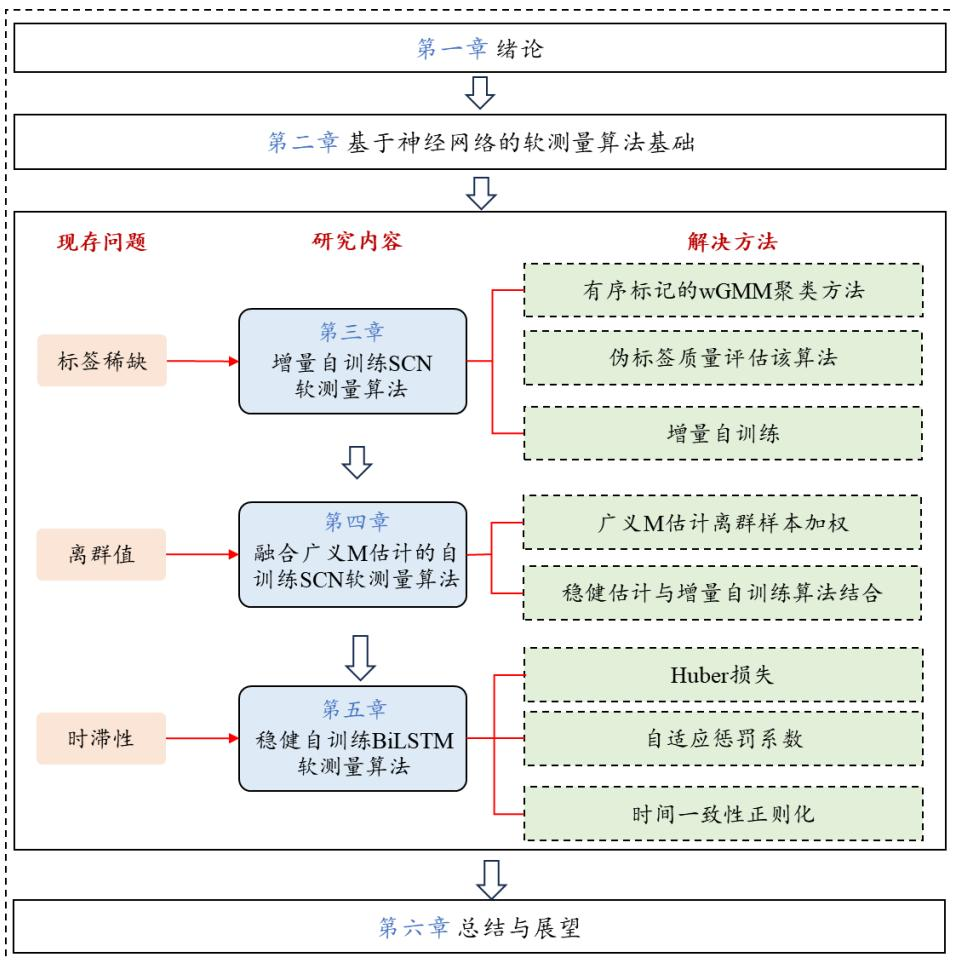  
图1.2 论文研究内容及章节安排

第四章设计了稳健的自训练随机配置软测量模型。首先，介绍广义 M 估计（Generalized M-estimate, GM）的基本原理，包括 GM 的定义、影响函数和常用权函数。其次，详细阐述 GM-IST-SCN 的算法框架，重点说明如何将广义 M 估计与自训练随机配置网络相结合，构建稳健的损失函数和样本加权机制。最后，将所提算法应用于 SABC 溢流矿浆浓度的软测量建模，实验结果验证了 GM-IST-SCN 在异常值干扰下的准确性和鲁棒性。

第五章提出了稳健自训练 BiLSTM 软测量模型。首先，介绍 Huber 损失的基本原理及其在异常值抑制中的作用，并阐述时间一致性损失（Temporal consistencyloss, TCL）的定义及自适应损失权重的设计方法。其次，详细介绍算法框架，重点介绍如何将 BiLSTM 与 Huber 损失、TCL 相结合，构建适用于动态时序数据的半监督学习模型。随后，通过人工数据集验证算法在异常值和时滞特性条件下的有效性。最后，将该方法应用于浮选工艺中铜品位的软测量建模，实验结果验证了其在处理动态时滞过程方面的优越性。

第六章为总结与展望。总结本文的主要研究工作，归纳论文的创新点和研究成果；针对研究内容的不足提出未来的研究方向和展望，包括算法理论深化、工程化实现等方面。

## 第 2 章 自训练半监督神经网络软测量建模基础

## 2.1 引言

神经网络因其强大的非线性映射与特征提取能力，被广泛应用于工业过程软测量模型的建立。本章首先依据信息传递方式的不同，详细介绍了几类典型神经网络的基本原理，包括前馈型网络中的多层感知机、随机配置网络，以及循环型网络中的长短期记忆网络和双向长短期记忆网络。此外，阐述了自训练算法的基本原理，从而为后续章节中软测量改进算法的提出与设计奠定理论基础。

## 2.2 面向静态软测量的前馈神经网络

## 2.2.1 多层感知机

MLP 是一种典型的前馈神经网络结构，由输入层、一个或多个隐藏层以及输出层组成。其基本思想是通过逐层线性变换与非线性激活函数的组合，将输入特征逐步映射到高层特征空间，从而实现对输入数据的有效表达与预测。MLP 的基本结构如图 2.1 所示。

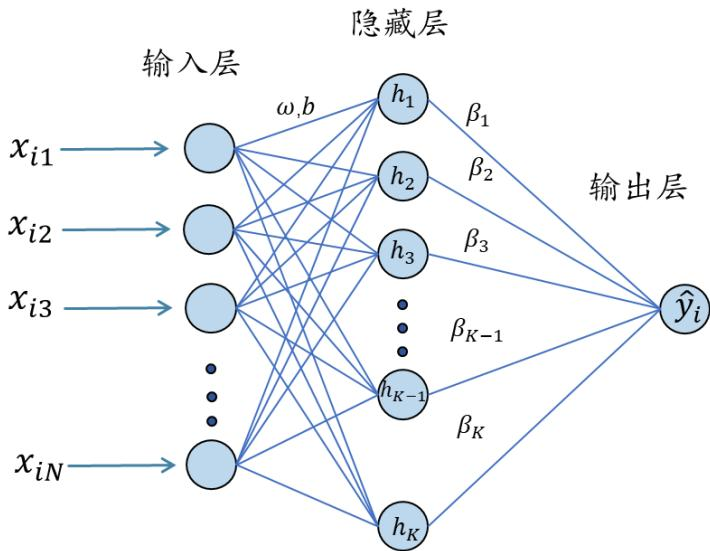  
图 2.1 三层 MLP 结构

在 MLP 网络中，各层神经元之间通常采用全连接方式进行连接。输入层数据首先通过隐藏层进行特征映射，再由输出层生成最终预测结果。假设给定一个有标记数据集 ${ \mathrm { D } } = ( X , Y ) { = } { \{ } { \left( x _ { i } , y _ { i } \right) } { \} } _ { i = 1 } ^ { N }$ ，其中N是有标记样本的数量， $\boldsymbol { x } _ { i } { = } [ x _ { i , 1 } , x _ { i , 2 } { , \ldots } ,$ ${ x _ { i , \nu } } ] ^ { T } ( i \mathrm { = } 1 , 2 , . . . . , N )$ 是一个v维的特征向量， $X \in \mathbf { R } ^ { N \times \nu }$ 代表输入数据矩阵， $Y \in \mathbf { R } ^ { N }$ 代表目标变量向量。输入矩阵X通过隐藏层和输出层的线性变换与非线性映射实现特征表示学习。设隐藏层权重矩阵和偏置向量分别为 $W _ { 1 }$ 和 $| b _ { 1 }$ ，输出层权重矩阵和偏置向量分别为 $W _ { 2 }$ 和 $| b _ { 2 }$ ，则网络的前向计算过程可表示为：

$$
H = \sigma (X W _ {1} + b _ {1})\tag{2.1}
$$

$$
\hat {Y} = \phi (H W _ {2} + b _ {2})\tag{2.2}
$$

其中，�表示隐藏层的输出特征矩阵， $\sigma ($ ⋅)表示隐藏层的激活函数，ϕ(⋅)表示输出层的激活函数， $\hat { Y } .$ 表示模型的预测输出。通过隐藏层的非线性映射，MLP 能够将输入特征映射到更高维的特征空间，从而增强模型对复杂非线性关系的表达能力。

## 2.2.2 随机配置网络

SCN 是一种前馈增量式网络，其采用监督机制来随机配置输入权重和偏置。与基于反向传播算法的 ANN 相比，SCN 具有更高的学习效率，并且能够保持通用逼近特性，网络的输出权重通过全局最小二乘法进行优化。SCN 的训练过程如图 2.2 所示，包含以下步骤。

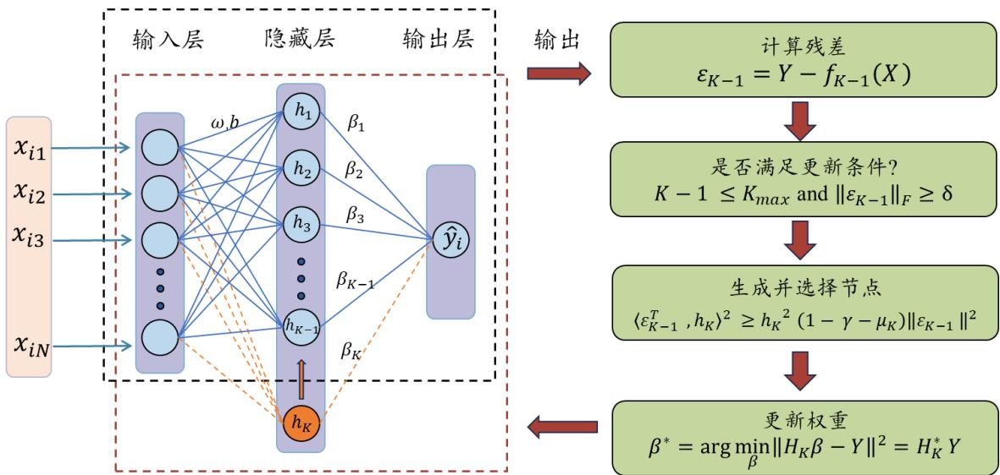  
图 2.2 SCN 训练过程

步骤 1：假设 $K _ { m a x }$ 是隐藏节点的最大数量，K-1是当前的隐藏节点数。网络输出可以表示为：

$$
f _ {K - 1} (X) = \sum_ {r = 1} ^ {K - 1} \beta_ {r} \sigma_ {r} (\omega_ {r} ^ {T} X + b _ {r})\tag{2.3}
$$

其中， $\beta _ { r }$ 表示第r个隐藏节点与输出之间的权重， $\sigma _ { r } ( \cdot )$ 代表节点r的激活函数，$\omega _ { r }$ ∈R1×t和 ${ \sf I } b _ { r }$ ∈R分别是节点r的输入权重和偏置。

步骤 2：计算当前网络的输出残差

$$
\varepsilon_ {K - 1} = Y - f _ {K - 1} (X)\tag{2.4}
$$

步骤 3：如果 $\| \varepsilon _ { K - 1 } \| > \tau$ 且 $K \mathrm { - } 1 { < } K _ { m a x }$ ，则生成 $\mathcal { Q }$ 个候选节点，其输出为 $[ h _ { K , 1 }$ $h _ { K , 2 } , . . . , h _ { K , Q } ]$ 。通过使用监督机制 $\xi _ { K }$ ，进一步获取第K个节点的输入权重和偏置，以确保‖ $\varepsilon _ { K }$ ‖2≤‖ $\varepsilon _ { K - 1 }$ ‖2且 $\operatorname* { l i m } _ { K \to \infty } \| \varepsilon _ { K }$ ‖2=0 。 设 $h _ { K }$ 代表隐藏节点K的输出，可表示为：

$$
h _ {K} = \left[ \sigma_ {K} (\omega_ {K} ^ {T} x _ {1} + b _ {K}), \dots , \sigma_ {K} (\omega_ {K} ^ {T} x _ {N} + b _ {K}) \right] ^ {T}\tag{2.5}
$$

监督机制 $\xi _ { K }$ 可表示为：

$$
\xi_ {K} = \frac {\langle \varepsilon_ {K - 1} ^ {T} , h _ {K} \rangle^ {2}}{h _ {K} ^ {T} \mathrm{h} _ {K}} - (1 - \gamma - \mu_ {K}) \| \varepsilon_ {K - 1} \| ^ {2} \geq 0\tag{2.6}
$$

其中τ代表容差误差， $\gamma \in ( 0 , 1 )$ $\left\{ \mu _ { _ K } \right\}$ 是一个非负实数序列，满足 $\operatorname* { l i m } _ { K \to \infty } \mu _ { K } { = } 0$ 和 $\lvert u _ { K } \le 1 - \gamma$ 具有最大 $\xi _ { K }$ 的候选节点被选为第K个节点。

步骤 4：通过最小二乘法优化目标函数，更新输出权重：

$$
\beta^ {*} = \arg \min _ {\beta} \| H _ {K} \beta - Y \| ^ {2} = H _ {K} ^ {*} Y\tag{2.7}
$$

其中 $H _ { K } ^ { * }$ 表示 $H _ { K } { = } [ h _ { 1 } , h _ { 2 } , . . . , h _ { K } ]$ 的 Moore-Penrose 广义逆矩阵， $H _ { K }$ 即为隐藏层输出矩阵。通过这种监督机制，SCN 在保持其通用逼近性质的前提下，展现出比经过 BP训练的网络更优越的学习效率。

## 2.3 面向动态软测量的循环神经网络

## 2.3.1 长短期记忆神经网络

LSTM 是一种专门用于处理序列数据的循环神经网络结构，能够有效建模时间序列中不同时间步之间的依赖关系。在序列数据建模过程中，传统 虽然能够利用循环结构对历史信息进行建模，但在处理长序列时容易出现梯度消失或梯度爆炸问题，从而难以有效捕获长期依赖关系。为解决这一问题， 通过引入记忆单元和门控机制，使网络能够在较长时间范围内稳定地保留和更新关键信息，从而更好地建模序列数据中的长期依赖特征。LSTM 单元结构如图 2.3 所示。

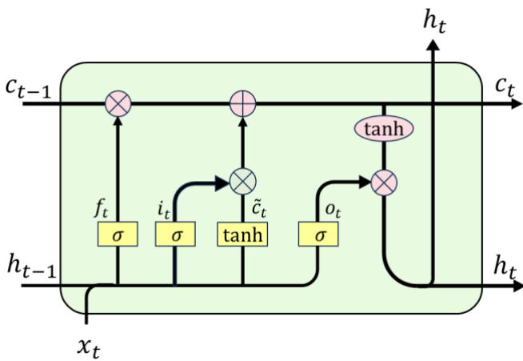  
图 2.3 LSTM 单元结构

LSTM 在每一个时间步通过三个专门的门控单元进行信息控制：遗忘门 $] f _ { t }$ 、输入门 $\rfloor _ { i _ { t } }$ 、和输出门 $\ ] o _ { t }$ ，它们分别用于决定信息的遗忘、保留以及传递。其前向计算过程可表示为：

$$
f _ {t} = \sigma (W _ {f ^ {*}} [ h _ {t - 1}, x _ {t} ] + b _ {f})\tag{2.8}
$$

$$
i _ {t} = \sigma (W _ {i} \cdot [ h _ {t - 1}, x _ {t} ] + b _ {i})\tag{2.9}
$$

$$
o _ {t} = \sigma (W _ {o} \cdot [ h _ {t - 1}, x _ {t} ] + b _ {o})\tag{2.10}
$$

$$
\tilde {c} _ {t} = \tanh (W _ {c} \cdot [ h _ {t - 1}, x _ {t} ] + b _ {c})\tag{2.11}
$$

$$
c _ {t} = f _ {t} \odot c _ {t - 1} + i _ {t} \odot \tilde {c} _ {t}\tag{2.12}
$$

$$
h _ {t} = o _ {t} \odot \tanh (c _ {t})\tag{2.13}
$$

其中， $x _ { t }$ 表示当前时间步的输入；σ(⋅)和tanh(⋅)分别表示 Sigmoid 激活函数和双曲正切激活函数； ${ { W } _ { f } } , { { W } _ { i } } , { { W } _ { o } } , W _ { c }$ 与 $b _ { f } , b _ { i } , b _ { o } , b _ { c }$ 分别表示对应门控单元的权重矩阵和偏置向量。 $h _ { t } .$ 表示隐藏状态，用于表征短期记忆； $c _ { t }$ 和 $\mathbb { I } \widetilde { c } _ { t }$ 分别表示单元状态以及等待写入长期记忆的候选状态；符号⊙表示 Hadamard 积。

## 2.3.2 双向长短期记忆神经网络

BiLSTM 在传统 LSTM 结构的基础上，通过构建双向信息传递机制，使模型能够同时利用序列的历史信息和未来信息，从而更充分地挖掘时间序列中的上下文依赖关系。具体而言，BiLSTM 由两个相互独立的 LSTM 网络组成：一个为前向 LSTM，用于按照时间顺序对输入序列进行处理；另一个为后向 LSTM，用于对反向序列进行学习。通过这种双向结构，模型能够在每个时间步同时获得来自过去和未来的特征信息，从而提升对序列数据整体结构的理解能力。

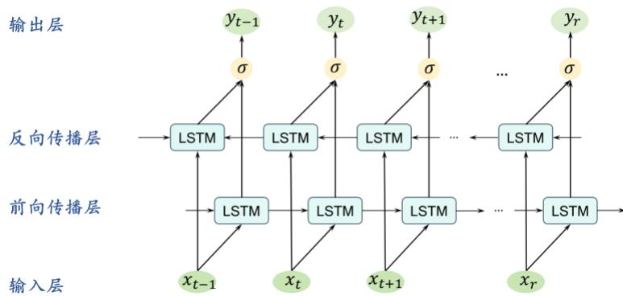  
图2.4 双向长短期记忆网络结构图

在每一个时间步t，前向 LSTM 根据当前输入 $x _ { t }$ 以及上一时刻的隐藏状态 $\vec { h } _ { t - 1 }$ 计算得到当前时刻的隐藏状态 $\cdot \overrightarrow { h _ { t } } .$ 。同时，后向 LSTM 以相反的时间顺序处理输入序列，并结合下一时刻的隐藏状态得到对应的后向隐藏表示。BiLSTM 的计算过程表示为：

$$
\overrightarrow {h} _ {t} = L S T M (x _ {t}, \overrightarrow {h} _ {t - 1})\tag{2.14}
$$

$$
\overleftarrow {h} _ {t} = L S T M (x _ {t}, \overleftarrow {h} _ {t + 1})\tag{2.15}
$$

在得到前向和后向两个方向的隐藏状态后，模型通过融合这两部分信息生成当前时刻的最终输出 $\boldsymbol { y } _ { t }$ 。其计算过程如下：

$$
y _ {t} = \sigma (U [ \overrightarrow {h _ {t}} \oplus \overleftarrow {h _ {t}} ] + b _ {U})\tag{2.16}
$$

其中， $\oplus .$ 表示逐元素相加运算（element-wise sum），U表示输出层的权重矩阵，$b _ { U }$ 为对应的偏置向量， $\sigma ($ ⋅)表示激活函数。通过融合两个方向的隐藏状态，BiLSTM能够在同一时间步综合利用来自前后时序的信息。

## 2.4 自训练半监督学习机制

自训练是一种典型的半监督学习方法，其核心思想是在少量标记样本的基础上，通过模型自身对未标记数据进行预测并生成伪标签，从而不断扩展训练数据集并逐步提升模型性能[90]。该方法利用未标记数据中潜在的信息，使模型能够在标注成本较低的情况下获得更好的学习效果。其算法流程如图 所示。

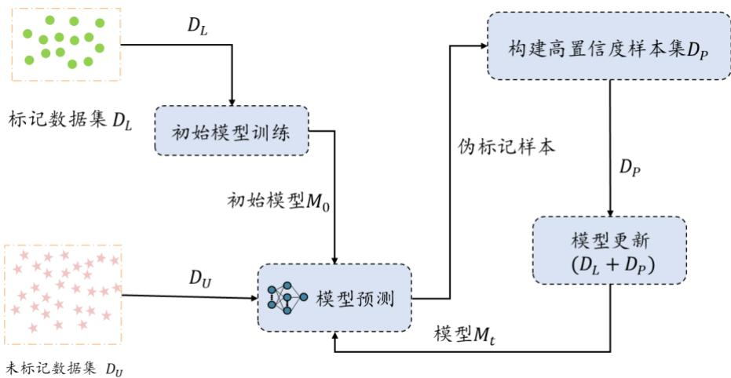  
图2.5 自训练流程图

首先，利用有限的标记数据训练初始模型。受标记样本数量限制，该模型仅能学习到基础特征，但已具备初步预测能力。

其次，将训练得到的模型用于未标记数据的预测。模型为每个未标记样本输出预测结果及置信度。通过设定置信度阈值，从中筛选出预测可靠的高置信度样本，并将其预测结果作为伪标签，构成伪标记样本集 $D _ { P }$ 。

最终，将伪标记样本集合 $D _ { P }$ 与原有的标记数据 $D _ { L }$ 进行融合，形成扩展后的训练数据集 $( D _ { L } + D _ { P } )$ 。利用该新的数据集重新训练或更新模型，使模型能够学习到更多样本中的特征信息，从而提升模型的泛化能力。

更新后的模型再次用于预测剩余的未标记数据，并继续筛选新的高置信度样本加入训练集。通过这种迭代式的训练策略，模型逐步利用未标记数据中的有效信息，实现性能的持续提升。该过程通常在达到预设迭代次数或模型性能趋于稳定时终止。

## 2.5 本章小结

本章介绍了与后续软测量改进算法相关的神经网络基础理论与方法。首先，依据信息传递方式的不同，详细阐述了前馈型网络与循环型网络的基本原理与数学表达。其次，介绍了自训练算法的基本原理。上述内容为后续章节中软测量改进算法的设计与实现奠定了理论基础。

## 第 3 章 增量自训练随机配置网络软测量模型研究及应用

## 3.1 引言

在流程工业软测量建模中，虽然生产过程积累了海量的过程数据，但由于关键指标化验成本高、周期长，能够用于模型训练的有标记样本十分有限，导致模型难以获得充分的监督信息，预测精度受限。半监督学习通过同时利用标记样本与未标记样本，成为解决这一问题的有效途径。目前主流的半监督学习为联合训练、生成建模、基于图的建模和自训练。虽然上述半监督学习方法的有效性已经在不同的场景中得到了验证，但每种算法都有其固有的局限性。协同训练依赖多个在不同特征集上训练的有监督学习器为未标记数据分配伪标签，但其有效性取决于特征能否划分为独立视图，而这一要求在许多场景中难以满足。生成式建模方法通过合成模拟标记与未标记数据分布的样本来增强训练数据，但其性能往往受到生成器不稳定性及对样本质量敏感性的影响，导致收敛困难。基于图的模型通过构建图结构来传播标签，然而，这类方法的性能严重依赖于相似性度量，因定义不当的图结构可能传播不正确的标签。相比之下，自训练方法仅依赖初始训练的模型，通过伪标签迭代扩展标记数据集。该方法无需多个模型或复杂的图结

针对上述问题，本章设计了一种增量自训练随机配置网络模型。该模型利用加权高斯混合模型聚类对无标记样本进行有序伪标记，优先选择与有标记样本分布相似的样本；同时引入伪标签置信度评估机制，通过加权距离误差量化伪标签可靠性，筛选高质量样本加入训练集，以抑制自训练过程中的误差累积。最后，将所提IST-SCN应用于锅炉燃烧过程数据集和某铜选矿厂SABC系统溢流矿浆浓度软测量建模，以验证其在标记样本稀缺条件下的有效性。

## 3.2 增量自训练中的样本排序与伪标签质量评估

## 3.2.1 基于加权 GMM 的无标签样本有序标记策略

在采用增量式自训练的半监督学习中，伪标签的质量对模型性能至关重要。准确的伪标签能够增强学习效果，而不准确的伪标签则可能通过误差传播降低模型性能。传统方法通常在每次迭代中随机选择无标记样本进行伪标记，这存在早期误差积累的风险，且这种误差会在整个训练迭代过程中不断加剧。

为解决此局限性，本章提出了一种样本优先级标记策略，即根据无标记样本被准确标记的概率对其进行排序。首先，使用 GMM 方法对有标记样本进行聚类，以获取聚类中心。然后，根据无标记样本到聚类中心的欧氏距离，按升序对其进行排序。距离聚类中心更近的无标记样本与用于初始模型训练的有标记样本具有更高的相似性，这意味着它们更有可能被模型准确地标记。

然而，标准 GMM 无法区分不同特征的重要性，对所有特征赋予相同权重。这一局限性使得不相关特征中的冗余或错误信息得以传播，从而削弱影响性特征的贡献。为解决此问题，本章提出了一种新颖的 wGMM 聚类方法，该方法根据特征的重要性自适应地为其赋予权重。其核心思想是利用特征与输出之间的相关系数作为 GMM 中的自适应权重。在机器学习中，相关系数通常用于衡量输入特征与目标变量之间的依赖关系。与目标变量具有更高绝对相关系数的特征表示更强的依赖性，因此在重要性评估中获得更大的权重。通过将相关系数转化为特征权重，模型可以在聚类过程中优先考虑更具影响力的特征，从而增强所得聚类的判别能力。基于此策略，wGMM 算法的实现步骤如下：

步骤 1：特征权重计算。对于每个特征x，其中j∈[1,v]表示特征索引，计算其 $x _ { j }$ 权重 $\lambda _ { j }$ ，该权重为 $x _ { j }$ 与输出 $Y$ 之间的相关系数。

步骤 2：数据集变换。使用对角权重矩阵 $L { = } d i a g ( \lambda _ { 1 } , \lambda _ { 2 } , . . . , \lambda _ { \nu } ) { \in } \mathrm { R } ^ { \nu \times \nu }$ ，构建一个加 权 有 标 记 数 据 集 $\widehat { D } _ { L } \mathrm { = } ( X _ { L } { \cdot } L , Y _ { L } ) \mathrm { = } \{ \left( \widehat { x } _ { i } , \widehat { y } _ { i } \right) \} _ { i = 1 } ^ { N _ { L } }$ 和 一 个 加 权 无 标 记 数 据 集$\widehat { D } _ { U } { = } X _ { U } { \cdot } L { = } \{ ( \widehat { x } _ { l } ) \} _ { l { = } 1 } ^ { N _ { U } }$ o

步骤 3：加权 GMM 聚类。 对加权有标记数据集 $\widehat { D } _ { L }$ 应用 GMM 聚类，并确定聚类中心。

步骤 4：候选样本选择。根据无标记数据 $D _ { U } \mathbb { 1 }$ 中每个样本到任一聚类中心的最小距离，按升序对其进行排序，创建一个候选列表C：

$$
C = \operatorname{argsort} \left(\left\{x _ {1}, x _ {2}, \dots , x _ {N _ {U}} \right\} \mid \min _ {k} \mathrm{d} \left(\hat {x _ {l}}, \mu_ {k}\right)\right)\tag{3.1}
$$

其中 $\mathsf { I d } \left( \widehat { x } _ { l } , \mu _ { k } \right)$ 表示样本 $\cdot \hat { x } _ { l }$ 与聚类中 $\therefore \dot { \mu } _ { k }$ 之间的欧氏距离，argsort( )表示按照括号内距离值由小到大返回样本索引，k为聚类类别数。在增量式自训练过程中，根据无标记样本与聚类中心的接近程度，优先从候选列表 C中选取接近程度高的样本进行标记。

注：所提出的加权聚类机制具有两个优势：（1）加权聚类增强了有影响力的特征在聚类过程中的贡献，同时减少了不太相关特征的干扰；（2）有序标记策略减轻了早期不准确标签的传播。

## 3.2.2 面向回归任务的伪标签质量评估算法

在增量式自训练框架中，模型性能从根本上依赖于伪标签的质量，而置信度分数则是衡量其可靠性的主要定量指标。当前用于伪标签的置信度评估方法可分为三种范式：概率输出、不确定性估计和一致性评估。然而，这些方法存在一些局限性，包括计算复杂度高、算法稳定性差以及仅适用于分类任务等。为了解决这些限制，本章引入了一种适用于回归任务的 PCE 算法，其具体实现步骤如下。

步骤 1：参考样本选择：对于每个带有伪标签的样本 $\left( x _ { p } , y _ { p } \right)$ ，计算其到所有有标记样本的加权欧氏距离。然后，选择M个最近邻样本 $\{ \grave { ( } x _ { m } , y _ { m } ) \} _ { m = 1 } ^ { M }$ 作为参考比较对象，对应的距离记为 $\{ d _ { m } \} _ { m = 1 } ^ { M }$ 。

步骤 2：距离加权误差度量：为了将空间邻近性纳入伪标签质量评估，本节提出了一种距离加权绝对误差度量 $E _ { m }$ ：

$$
E _ {m} = \omega_ {m} \left| y _ {p} - y _ {m} \right|\tag{3.2}
$$

其中

$$
\omega_ {m} = \frac {1}{(d _ {m ^ {+}} \epsilon) \cdot \sum_ {m = 1} ^ {M} (\frac {1}{d _ {m ^ {+}} \epsilon})}\tag{3.3}
$$

ϵ表示一个无穷小的正实数，用于防止分母为零的错误。公式(3.3)作为一种空间相似性度量，为与伪标记样本具有更高相似性的样本分配更高的权重。

步骤 3：置信度分数计算：伪标记样本 $( x _ { p } , y _ { p } )$ 的置信度度量计算如下：

$$
\mathrm{C} _ {p} = 1 - \frac {\exp (E _ {p})}{\sum_ {p = 1} ^ {P} \exp (E _ {p})}\tag{3.4}
$$

其中P表示伪标记样本的数量， $\begin{array} { r } { E _ { p } { = } \sum _ { m = 1 } ^ { M } E _ { m } } \end{array}$ 是 $E _ { m }$ 的累积误差，用于量化 $\left( x _ { p } , y _ { p } \right)$ 与其邻近样本之间的差异。

注：公式(3.4)采用类似 SoftMax 的归一化方式，将误差 $E _ { p }$ 转换为归一化的置信度分数 $\mathrm { \cdot } \mathrm { C } _ { p } { \in } [ 0 , 1 ]$ 。置信度分数 $\mathrm { C } _ { p }$ 随着 $E _ { p }$ 的减小而单调增加，反映了伪标签 $y _ { p }$ 具有更高的可靠性。该公式提供了一种有原则的度量来区分伪标签的质量，从而能够选择性地利用高置信度的样本。

## 3.3 增量自训练随机配置网络软测量模型

所提出的 IST-SCN 的详细流程如图 3.1 所示，该流程可分为四个步骤：初始化、伪标签生成、扩充数据集构建和模型更新。

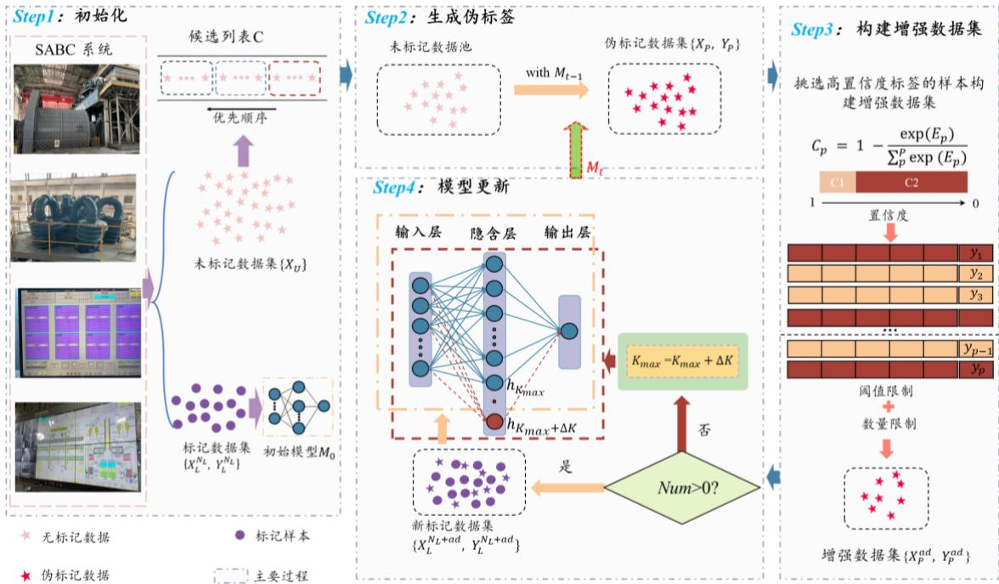  
图 3.1 增量自训练框架图

（1）初始化：首先，使用 wGMM 方法对所有无标记数据 $D _ { U }$ 进行聚类，并根据公式(3.1)生成一个候选列表C。同时，利用初始有标记数据集 $D _ { L }$ 训练一个初始SCN 模型 $M _ { 0 }$ 。

（2）伪标签生成：根据候选列表C中的排序得分，从中选取一个无标记数据子集，并将其添加至无标记数据池。随后，通过当前模型 $M _ { 0 }$ 对数据池中的无标记数据进行预测，为其标注伪标签，从而得到伪标记数据集。

（3）扩充数据集构建：按照公式(3.2)-(3.4)概述的步骤计算所有伪标记样本的置信度分数 $\mathrm { C } _ { p }$ ，并据此对其进行系统排序。仅当样本的置信度分数超过预设的置信度阈值 时，才被视为可靠样本，其总数记为 。值得注意的是，一次性引入过多的伪标记样本可能会给模型训练带来不稳定性。为解决此问题，本方法通过设置一个最大样本数 maxNum 来约束每次增量更新的规模，从而确保训练过程的稳定性。基于上述准则，后续讨论可分为三种不同的分支情况：

① 当有适量样本 $( 0 { < } N u m < m a x N u m )$ 满足置信度要求时，将这些样本纳入以构建扩充数据集 $\left\{ X _ { P } ^ { a d } , Y _ { P } ^ { a d } \right\}$

② 如果符合要求的样本数量超出容量限制（Num>maxNum），则仅保留置信度最高的前 maxNum 个样本，以构成扩充数据集 $\big \{ X _ { P } ^ { a d } , Y _ { P } ^ { a d } \big \}$

③ 如果没有样本满足置信度阈值要求（Num=0），则不生成扩充数据集。

（4）模型更新：对于①和状况②的情况，将扩充数据集 $\left\{ X _ { P } ^ { a d } , Y _ { P } ^ { a d } \right\}$ ，整合到有标记数据集 $D _ { L }$ 中，构建更新后的有标记数据集 $D _ { L } { = } \{ X _ { L } ^ { N _ { L } + a d } , Y _ { L } ^ { N _ { L } + a d } \}$ 。然后，使用更新后的 $D _ { L }$ 重新训练 SCN 模型，得到一个性能提升的新模型 $M _ { 1 }$ ，用于后续的伪标记迭代。当没有样本满足置信度阈值要求时（即③），本框架将对当前 SCN 模型执行结构微调。微调通过每次添加一个隐藏节点的方式进行，总共新增 ∆K 个节点。为防止隐藏节点无限增长，引入一个预设阈值 $K _ { t o p }$ 进行约束。随后，经过增强的 SCN 模型利用其更新后的预测能力，继续对无标记数据进行伪标记，并重复此迭代过程，直至满足状况①或状况②的条件。

表 3.1 算法 IST-SCN 的实现流程

输入:带标签数据集 $D_{L}$ 和无标签数据集 $D_{U}$

输出:更新后的 IST-SCN 模型

参数预设:容忍误差 $\tau$，最大隐层神经元数量 $K_{max}$，$K_{top}(K_{max}$ 的上限)，最大可增加样本数量 maxNum，近邻居数量 M，候选批次大小 $C_{a}$，微调节点数量 $\Delta K$，置信度阈值 T。

阶段 1: 初始化

1. 使用 $D_{L}$ 训练一个初始的 SCN 模型，其中 t=1；
2. 利用 wGMM，对带权重的带标签数据进行聚类，并根据公式(3.1)创建候选列表 $C^{(t-1)}$；
阶段 2: 增量式自训练

3. flag=1;
4. While (flag)

5. If $C^{(t-1)} \neq \emptyset$
6. 根据 $C^{(t-1)}$ 排序，将 $C_{a}$ 个无标签数据从 $C^{(t-1)}$ 移入无标签数据池，$C^{(t)} = C^{(t-1)} - C_{a}$;
7. End If

8. 使用模型 $M_{t-1}$ 对无标签数据进行标注，得到 $\{X_{P}, Y_{P}\}^{(t)}$;
9. 根据公式(3.4)计算的置信度 $C_{p}$，对样本 $\{X_{P}, Y_{P}\}^{(t)}$ 进行排序；
10. 构建增强数据集 $\{X_{P}^{ad}, Y_{P}^{ad}\}^{(t)}$，并将该数据集中的样本总数记为 Num；
11. While Num = 0 and $K \neq K_{max}$
12. $K = K + \Delta K$;
13. 更新 SCN 模型 $M_{t-1}$;
14. 使用 $M_{t-1}$ 对无标签数据进行标注，得到 $\{X_{P}, Y_{P}\}^{(t)}$;
15. 根据公式(3.4)计算的置信度 $C_{p}$，对样本 $\{X_{P}, Y_{P}\}^{(t)}$ 进行排序；
16. 构建增强数据集 $\{X_{P}^{ad}, Y_{P}^{ad}\}^{(t)}$ 并更新 Num；
17. End While

18. If Num &gt; 0
19. Num = min {Num, maxNum};
20. 将增强数据集 $\{X_{P}^{ad}, Y_{P}^{ad}\}^{(t)}$ 从无标签数据池移入带标签数据集 $D_{L}$;
21. 使用 $D_{L}$ 训练新模型 $M_{t}$;
22. End If

23. If $K = K_{max}$ and $C_{t} = \emptyset$ and Num = 0
24. flag = 0;
25. End If

26. End While

增量式自训练过程在满足以下两个条件之一时终止：（1）候选列表C中的无

标记数据被耗尽；（2）隐藏节点数 $K _ { m a x }$ 达到预设上限 $K _ { t o p }$ 且在此期间未能生成任何扩充样本。最终，使用增强后的有标记数据集 $D _ { L }$ 训练得到最终的 SCN 模型，并在测试数据集上对其性能进行评估。基于上述分析，所提出 IST-SCN 软测量算法的伪代码在表 3.1 中给出。

## 3.4 实验及应用

## 3.4.1 实验设置

本章分别以公共锅炉燃烧过程数据集和实际工业 SABC 案例为对象，开展了一系列仿真实验。为验证所提方法的有效性，本章选取了若干当前主流算法进行对比实验，包括：SCN[36]、GCG[52]、UGE-ST[53]、LPSCN[65]、LPMLP 以及 IST-MLP，其中 LPSCN 和 LPMLP 分别为结合局部保持的半监督 SCN 和半监督 MLP算法；IST-MLP 则为采用增量式自训练的半监督 MLP 算法。此外，UGE-ST 利用模型不确定性引导基于集成的自训练过程，而 GCG 是一种半监督生成对抗网络框架，通过协同训练生成器来提升学习性能。

实验环境配置如下：处理器为 12th Gen Intel Core i5-12600KF (3.70 GHz)；操作系统为 Windows 11；内存为 32 GB；软件环境为 Python 3.9。每种算法均独立重复运行十次，并采用三种评价指标进行性能评估：决定系数（Coefficient ofdetermination， $R ^ { 2 } )$ 、均方误差（Mean squared error，MSE）和平均绝对误差（Meanabsolute error，MAE）。

$$
R ^ {2} = 1 - \frac {\sum_ {i = 1} ^ {N ^ {*}} (y _ {i} - \hat {y} _ {i}) ^ {2}}{\sum_ {i = 1} ^ {N ^ {*}} (y _ {i} - \bar {y}) ^ {2}}\tag{3.5}
$$

$$
\mathrm{MSE} = \frac {1}{N ^ {*}} \sum_ {i = 1} ^ {N ^ {*}} \left(y _ {i} - \hat {y} _ {i}\right) ^ {2}\tag{3.6}
$$

$$
\mathrm{MAE} = \frac {1}{N ^ {*}} \sum_ {i = 1} ^ {N ^ {*}} \left| y _ {i} - \hat {y} _ {i} \right|\tag{3.7}
$$

其中， $N ^ { \ast }$ 表示的样本数量， $y _ { i }$ 和ŷ 分别为实际值和预测值，y̅表示 $y _ { i }$ 的均值。

## 3.4.2 锅炉燃烧过程案例仿真

本案例聚焦于锅炉燃烧过程的建模与预测。锅炉内燃料燃烧加热水产生高温高压蒸汽，进而驱动汽轮机和发电机旋转以产出电能。在此能量转换链中，锅炉燃烧环节作为能量输入的源头，其效率直接决定蒸汽品质，从而成为影响最终发电效率的关键因素。

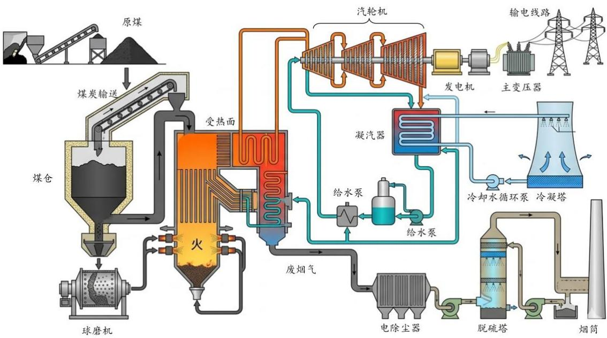  
图 3.2 锅炉燃烧流程图

实验数据来源于阿里云天池数据实验室。该数据集包含 2888 个样本，输入变量涵盖燃烧给料量、给水量、锅炉床温、锅炉床压、炉膛温度等参数。任务目标是在标记数据有限的条件下预测锅炉燃烧过程中的蒸汽产量。为验证所提算法的有效性，本节在不同标记率下采用多种算法进行了十次独立实验。标记率表示训练数据中带有标签样本的比例，例如当标记率为 1/4 时，每连续四个训练样本中仅第一个样本具有标签。

本案例将数据集前 作为训练数据，剩余 作为测试数据。为进一步模拟工业现场中目标变量标注成本高、标记样本难以充分获取的实际情况，本文设置了不同标记率下的建模实验。当标记率为 1/32 时，训练集中可直接用于监督学习的有标签样本仅约 个，其余约 个样本作为无标签数据。在极低标记率条件下，仅依靠少量有标签样本难以充分覆盖锅炉燃烧过程中的复杂工况分布，容易导致全监督模型泛化能力不足。

表 3.2 展示了不同算法的均值、标准差及最优结果。首先，半监督算法相较于标准 展现出显著性能提升，验证了半监督方法在标记样本稀缺时的有效性。其次，生成模型因生成器不稳定存在收敛波动问题，而基于图的方法易受相似性度量敏感性影响导致错误传播。相比之下，IST-SCN 通过 PCE 迭代选择高置信度子集，避免了全局伪标签噪声累积，从而提升模型性能。此外，与传统自训练方法不同，渐进式更新策略与 PCE 的结合能更有效地控制错误传播。值得注意的是，随着标记率降低，IST-SCN 与其他算法的性能差距逐渐扩大，进一步验证了本方法的优越性。图 3.3 通过标记率 1/32 下的误差分布对比直观印证了这一优势。本方法实现了更紧凑的误差分布，其四分位距更窄、异常值更少。

表 3.2 不同标记率下各方法的性能比较

<table><tr><td rowspan="2">软测量模型</td><td rowspan="2">标记率</td><td colspan="3">MSE</td><td colspan="3">MAE</td><td colspan="3"> $R^2$ </td></tr><tr><td>Mean</td><td>Std</td><td>Best</td><td>Mean</td><td>Std</td><td>Best</td><td>Mean</td><td>Std</td><td>Best</td></tr><tr><td>SCN</td><td></td><td>0.210</td><td>0.0179</td><td>0.189</td><td>0.325</td><td>0.0181</td><td>0.309</td><td>0.767</td><td>0.0198</td><td>0.791</td></tr><tr><td>LPMLP</td><td></td><td>0.183</td><td>0.0069</td><td>0.169</td><td>0.311</td><td>0.0106</td><td>0.297</td><td>0.798</td><td>0.0077</td><td>0.814</td></tr><tr><td>LPSCN</td><td></td><td>0.182</td><td>0.0163</td><td>0.163</td><td>0.300</td><td>0.0206</td><td>0.275</td><td>0.799</td><td>0.0180</td><td>0.820</td></tr><tr><td>UGE-ST</td><td>1/2</td><td>0.189</td><td>0.0144</td><td>0.176</td><td>0.306</td><td>0.0192</td><td>0.296</td><td>0.789</td><td>0.0161</td><td>0.804</td></tr><tr><td>GCG</td><td></td><td>0.187</td><td>0.0146</td><td>0.162</td><td>0.306</td><td>0.0153</td><td>0.281</td><td>0.791</td><td>0.0163</td><td>0.819</td></tr><tr><td>IST-MLP</td><td></td><td>0.177</td><td>0.0324</td><td>0.155</td><td>0.295</td><td>0.0401</td><td>0.267</td><td>0.804</td><td>0.0358</td><td>0.829</td></tr><tr><td>IST-SCN</td><td></td><td>0.161</td><td>0.0062</td><td>0.146</td><td>0.273</td><td>0.0080</td><td>0.261</td><td>0.822</td><td>0.0068</td><td>0.836</td></tr><tr><td>SCN</td><td></td><td>0.223</td><td>0.0205</td><td>0.205</td><td>0.335</td><td>0.0162</td><td>0.326</td><td>0.754</td><td>0.0227</td><td>0.774</td></tr><tr><td>LPMLP</td><td></td><td>0.196</td><td>0.0093</td><td>0.182</td><td>0.325</td><td>0.0125</td><td>0.310</td><td>0.783</td><td>0.0103</td><td>0.798</td></tr><tr><td>LPSCN</td><td></td><td>0.192</td><td>0.0143</td><td>0.167</td><td>0.305</td><td>0.0180</td><td>0.278</td><td>0.787</td><td>0.0159</td><td>0.815</td></tr><tr><td>UGE-ST</td><td>1/4</td><td>0.212</td><td>0.0175</td><td>0.185</td><td>0.325</td><td>0.0228</td><td>0.289</td><td>0.763</td><td>0.0196</td><td>0.793</td></tr><tr><td>GCG</td><td></td><td>0.182</td><td>0.0119</td><td>0.165</td><td>0.297</td><td>0.0132</td><td>0.278</td><td>0.797</td><td>0.0134</td><td>0.816</td></tr><tr><td>IST-MLP</td><td></td><td>0.182</td><td>0.0070</td><td>0.173</td><td>0.302</td><td>0.0109</td><td>0.294</td><td>0.799</td><td>0.0078</td><td>0.808</td></tr><tr><td>IST-SCN</td><td></td><td>0.162</td><td>0.0057</td><td>0.155</td><td>0.273</td><td>0.0055</td><td>0.266</td><td>0.820</td><td>0.0063</td><td>0.829</td></tr><tr><td>SCN</td><td></td><td>0.271</td><td>0.0518</td><td>0.221</td><td>0.370</td><td>0.0368</td><td>0.325</td><td>0.700</td><td>0.0573</td><td>0.756</td></tr><tr><td>LPMLP</td><td></td><td>0.231</td><td>0.0160</td><td>0.202</td><td>0.341</td><td>0.0101</td><td>0.327</td><td>0.745</td><td>0.0178</td><td>0.778</td></tr><tr><td>LPSCN</td><td></td><td>0.221</td><td>0.0207</td><td>0.197</td><td>0.330</td><td>0.0202</td><td>0.302</td><td>0.755</td><td>0.0229</td><td>0.782</td></tr><tr><td>UGE-ST</td><td>1/8</td><td>0.228</td><td>0.0206</td><td>0.212</td><td>0.326</td><td>0.0131</td><td>0.314</td><td>0.745</td><td>0.0230</td><td>0.762</td></tr><tr><td>GCG</td><td></td><td>0.207</td><td>0.0133</td><td>0.182</td><td>0.317</td><td>0.0133</td><td>0.294</td><td>0.768</td><td>0.0149</td><td>0.797</td></tr><tr><td>IST-MLP</td><td></td><td>0.196</td><td>0.0068</td><td>0.189</td><td>0.314</td><td>0.0075</td><td>0.304</td><td>0.783</td><td>0.0076</td><td>0.791</td></tr><tr><td>IST-SCN</td><td></td><td>0.170</td><td>0.0064</td><td>0.162</td><td>0.276</td><td>0.0093</td><td>0.267</td><td>0.812</td><td>0.0071</td><td>0.821</td></tr><tr><td>SCN</td><td></td><td>0.358</td><td>0.0557</td><td>0.267</td><td>0.445</td><td>0.0443</td><td>0.386</td><td>0.604</td><td>0.0616</td><td>0.705</td></tr><tr><td>LPMLP</td><td></td><td>0.255</td><td>0.0152</td><td>0.234</td><td>0.370</td><td>0.0125</td><td>0.347</td><td>0.718</td><td>0.0168</td><td>0.741</td></tr><tr><td>LPSCN</td><td></td><td>0.261</td><td>0.0599</td><td>0.228</td><td>0.374</td><td>0.0545</td><td>0.361</td><td>0.710</td><td>0.0663</td><td>0.748</td></tr><tr><td>UGE-ST</td><td>1/16</td><td>0.237</td><td>0.0233</td><td>0.187</td><td>0.347</td><td>0.0226</td><td>0.302</td><td>0.734</td><td>0.0261</td><td>0.791</td></tr><tr><td>GCG</td><td></td><td>0.224</td><td>0.0102</td><td>0.211</td><td>0.348</td><td>0.0123</td><td>0.337</td><td>0.749</td><td>0.0114</td><td>0.764</td></tr><tr><td>IST-MLP</td><td></td><td>0.202</td><td>0.0057</td><td>0.194</td><td>0.326</td><td>0.0067</td><td>0.316</td><td>0.776</td><td>0.0063</td><td>0.785</td></tr><tr><td>IST-SCN</td><td></td><td>0.179</td><td>0.0081</td><td>0.167</td><td>0.296</td><td>0.0084</td><td>0.281</td><td>0.802</td><td>0.0090</td><td>0.815</td></tr><tr><td>SCN</td><td></td><td>0.408</td><td>0.0309</td><td>0.356</td><td>0.472</td><td>0.0234</td><td>0.440</td><td>0.549</td><td>0.0341</td><td>0.607</td></tr><tr><td>LPMLP</td><td></td><td>0.257</td><td>0.0250</td><td>0.218</td><td>0.363</td><td>0.0223</td><td>0.332</td><td>0.716</td><td>0.0276</td><td>0.756</td></tr><tr><td>LPSCN</td><td></td><td>0.296</td><td>0.0458</td><td>0.211</td><td>0.397</td><td>0.0358</td><td>0.333</td><td>0.671</td><td>0.0506</td><td>0.767</td></tr><tr><td>UGE-ST</td><td>1/32</td><td>0.262</td><td>0.0334</td><td>0.216</td><td>0.367</td><td>0.0164</td><td>0.341</td><td>0.707</td><td>0.0374</td><td>0.758</td></tr><tr><td>GCG</td><td></td><td>0.237</td><td>0.0078</td><td>0.225</td><td>0.349</td><td>0.0099</td><td>0.333</td><td>0.734</td><td>0.0087</td><td>0.748</td></tr><tr><td>IST-MLP</td><td></td><td>0.236</td><td>0.0048</td><td>0.229</td><td>0.340</td><td>0.0042</td><td>0.340</td><td>0.740</td><td>0.0052</td><td>0.747</td></tr><tr><td>IST-SCN</td><td></td><td>0.206</td><td>0.0068</td><td>0.194</td><td>0.327</td><td>0.0039</td><td>0.320</td><td>0.795</td><td>0.0072</td><td>0.806</td></tr></table>

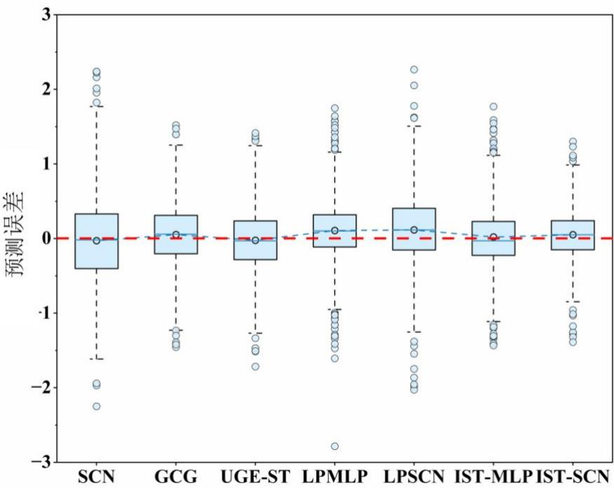  
图3.3 标记率为 1/32 时不同算法预测误差分布

在标记率为 1/32 的条件下，各算法的预测结果如图 3.4 所示。与其他算法相比，所提 IST-SCN 对目标变量动态变化的追踪更为准确，验证了其在数据稀缺场景下的有效性。

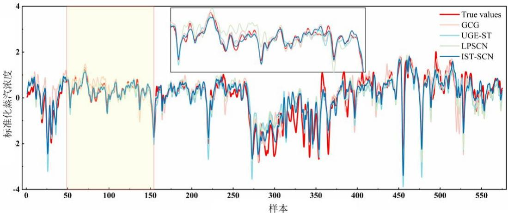  
图3.4 标记率为 1/32 时不同算法预测结果

为进一步验证 IST-SCN 的稳定性，在标记率为 1/2 的数据集上开展了对比实验。实验中，测试集比例从 0.1 到 0.5 以 0.1 为间隔逐步增加，其余实验参数保持不变。图 3.5 展示了不同方法的性能比较，表明所有算法在测试集规模增加时表现都会下降。值得注意的是，IST-SCN 在所有评估指标上均表现稳健。当测试集与训练集比例为 1:1 时，IST-SCN 仍保持良好的性能，MAE、MSE 和 R²分别为0.338、0.224 和 0.752，显示出较好的稳定性。

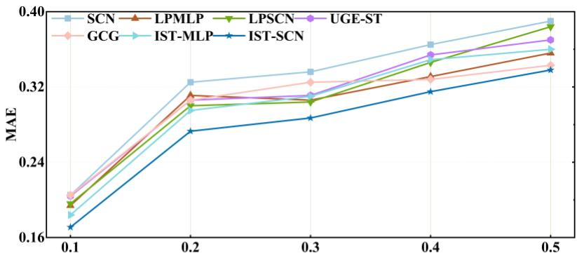

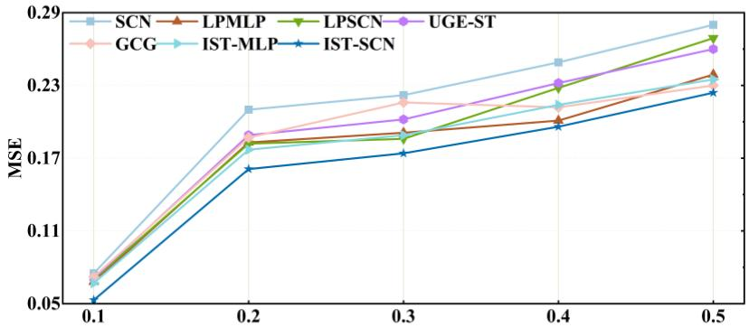

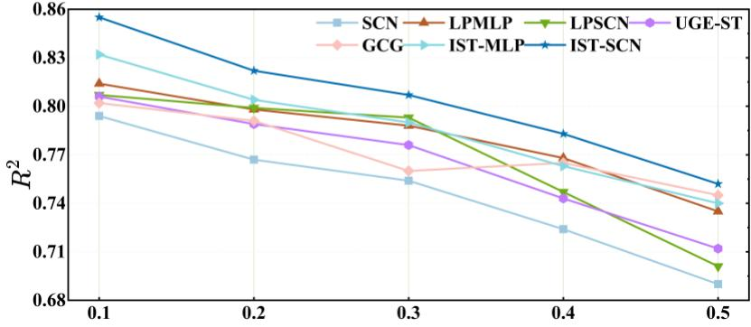  
图 3.5 不同测试集数据量下的性能对比

## 3.4.3 溢流矿浆浓度软测量预测建模

本章研究的 SABC 系统来自中国东部某铜选矿厂的磨矿过程。该 SABC 系统主要由一个半自磨机（Semi-autogenous grinding, SAG）、一个球磨机、一个破碎机以及一个用于分级的水力旋流器组构成，具体工艺流程如图 3.6 所示。

首先，原矿石通过重型板式给料机进行混合与送料，确保物料均匀分布，同时最大限度地减少颗粒分离。经处理的矿石与水分别通过 1 号至 3 号皮带输送机和给水管道按设定比例送入第一回路，在半自磨机中进行研磨。随后，研磨后的物料经振动筛输送至第二回路的泵池中形成矿浆，而难磨矿石则被返回至第一回路进行再次破碎与再磨。在第二回路中，矿浆被泵入水力旋流器进行分级。满足粒度要求的矿粒被输送至浮选工序；而未达到粒度要求的粗粒物料经旋流器底流口排出，进入球磨机进行细磨。最后，处理后的物料返回泵池，进入下一个循环。

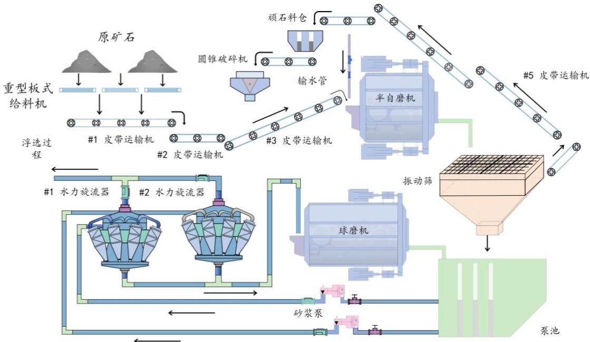  
图3.6 SABC 系统在铜矿石加工厂中的应用

对于 SABC 系统，水力旋流器的溢流浓度（Overflow slurry concentration，OSC）直接影响浮选浆液的黏度，进而影响浮选过程的回收率，因此至关重要。在现场，该变量通过安装于旋流器出口附近的在线分析仪进行连续监测。然而，此类分析仪的部署不仅成本高昂，还需定期维护，从而影响运行效率。此外，受设备限制，OSC 的采样间隔为 5 分钟，而其他过程变量通常以分钟为单位采集。这种采样频率的不一致导致大量无标记过程数据未能得到充分利用，给传统监督学习方法带来了显著挑战。

在该场景中，共获取了 1941 个现场工业样本。磨矿过程变量描述具体如表，该数据集包含 个输入变量和一个目标变量（溢流矿浆浓度）。需要说明的是，在实际工业采集过程中，磨矿过程变量通常以 1 min 为采样间隔连续记录，而溢流矿浆浓度受化验周期限制，采样间隔约为 5 min。因此，相较于连续采集的过程变量，目标变量标签数量明显不足。为模拟该多采样率条件下的标记样本稀缺问题，本文选取前 个样本作为训练集，并按照目标变量采样频率将训练集标记率设置为 。此时，训练集中仅约 个样本具有溢流矿浆浓度标签，占训练样本总数的约 20%，其余约 1226 个样本仅包含过程变量信息，标记样本与未标记样本数量比约为 1:4。该数据集包含 22 个输入变量，且磨矿过程具有多变量耦合、非线性强和工况波动明显等特点，仅依靠约 306 个有标签样本难以充分覆盖不同运行工况下输入变量与溢流矿浆浓度之间的映射关系，容易限制全监督模型的泛化能力。因此，引入半监督学习机制以利用大量未标记过程数据具有必要性。剩余样本作为测试集，且测试集全部由有标记样本构成，用于对不同模型的预测性能进行统一评估。

表 3.3 磨矿过程变量描述

<table><tr><td>序号</td><td>描述</td><td>变化范围</td><td>单位</td></tr><tr><td>1</td><td>半自磨机给水量</td><td>230-290</td><td> $m^3/h$ </td></tr><tr><td>2</td><td>1号皮带矿石给料速率</td><td>0-1480</td><td>t/h</td></tr><tr><td>3</td><td>3号皮带矿石给料速率</td><td>0-1600</td><td>t/h</td></tr><tr><td>4</td><td>5号皮带矿石给料速率</td><td>100-320</td><td>t/h</td></tr><tr><td>5</td><td>矿浆浓度</td><td>40-60</td><td>%</td></tr><tr><td>6</td><td>球磨机给矿浓度</td><td>55-80</td><td>%</td></tr><tr><td>7</td><td>水力旋流器压力 1</td><td>0.3-0.7</td><td>MPa</td></tr><tr><td>8</td><td>水力旋流器压力 2</td><td>0.3-0.6</td><td>MPa</td></tr><tr><td>9</td><td>球磨机补加水流量 1</td><td>1610-1790</td><td> $m^3/h$ </td></tr><tr><td>10</td><td>球磨机补加水流量 2</td><td>70-90</td><td> $m^3/h$ </td></tr><tr><td>11</td><td>上浆矿浆流量 1</td><td>2050-2910</td><td> $m^3/h$ </td></tr><tr><td>12</td><td>上浆矿浆流量 2</td><td>2330-3940</td><td> $m^3/h$ </td></tr><tr><td>13</td><td>水力旋流器溢流流量 1</td><td>1090-1570</td><td> $m^3/h$ </td></tr><tr><td>14</td><td>水力旋流器溢流流量 2</td><td>680-2470</td><td> $m^3/h$ </td></tr><tr><td>15</td><td>排矿口宽度</td><td>0-17</td><td>mm</td></tr><tr><td>16</td><td>半自磨机入口压力</td><td>4.6-6.0</td><td>MPa</td></tr><tr><td>17</td><td>半自磨机出口压力</td><td>4.8-5.9</td><td>MPa</td></tr><tr><td>18</td><td>球磨机入口压力</td><td>5.8-7.0</td><td>MPa</td></tr><tr><td>19</td><td>球磨机出口压力</td><td>7.0-7.3</td><td>MPa</td></tr><tr><td>20</td><td>泵池液位</td><td>58-86</td><td>%</td></tr><tr><td>21</td><td>半自磨机功率</td><td>4600-8700</td><td>kW</td></tr><tr><td>22</td><td>球磨机功率</td><td>8800-9600</td><td>kW</td></tr><tr><td>23</td><td>溢流矿浆浓度</td><td>20-36</td><td>%</td></tr></table>

表 3.4 展示了不同方法在本案例中的性能对比。结果表明，所提出的 IST-SCN算法在所有评价指标上均优于其他对比算法。其中，IST-SCN 的 MSE、MAE 和R²均值分别为 1.432、0.923 和 0.801。与 IST-MLP 相比，IST-SCN 的 MSE 降低了18.4%，MAE 降低了 12.0%，R²提升了 5.9%。

表 3.4 不同算法在该案例中的性能对比

<table><tr><td rowspan="2">软测量模型</td><td colspan="3">MSE</td><td colspan="3">MAE</td><td colspan="3"> $R^2$ </td></tr><tr><td>Mean</td><td>Std</td><td>Best</td><td>Mean</td><td>Std</td><td>Best</td><td>Mean</td><td>Std</td><td>Best</td></tr><tr><td>SCN</td><td>2.789</td><td>0.7032</td><td>2.133</td><td>1.282</td><td>0.1534</td><td>1.640</td><td>0.612</td><td>0.0980</td><td>0.703</td></tr><tr><td>LPMLP</td><td>1.887</td><td>0.3357</td><td>1.462</td><td>1.093</td><td>0.0984</td><td>0.959</td><td>0.737</td><td>0.0468</td><td>0.796</td></tr><tr><td>LPSCN</td><td>2.237</td><td>0.7188</td><td>1.456</td><td>1.189</td><td>0.1941</td><td>0.928</td><td>0.672</td><td>0.1002</td><td>0.798</td></tr><tr><td>UGE-ST</td><td>1.943</td><td>0.4383</td><td>1.502</td><td>1.080</td><td>0.1164</td><td>0.952</td><td>0.729</td><td>0.0611</td><td>0.791</td></tr><tr><td>GCG</td><td>1.911</td><td>0.2331</td><td>1.629</td><td>1.081</td><td>0.0687</td><td>1.018</td><td>0.734</td><td>0.0325</td><td>0.773</td></tr><tr><td>IST-MLP</td><td>1.754</td><td>0.2060</td><td>1.496</td><td>1.049</td><td>0.0591</td><td>0.970</td><td>0.756</td><td>0.0287</td><td>0.792</td></tr><tr><td>IST-SCN</td><td>1.432</td><td>0.1548</td><td>1.148</td><td>0.923</td><td>0.0439</td><td>0.842</td><td>0.801</td><td>0.0216</td><td>0.840</td></tr></table>

图 3.7 的误差分布分析显示，IST-SCN 算法的误差分布更为集中，其四分位距明显窄于对比算法。图 3.8 进一步对比了不同算法的目标变量拟合效果，再次验证了所提方法在工业关键指标预测方面的优越性。

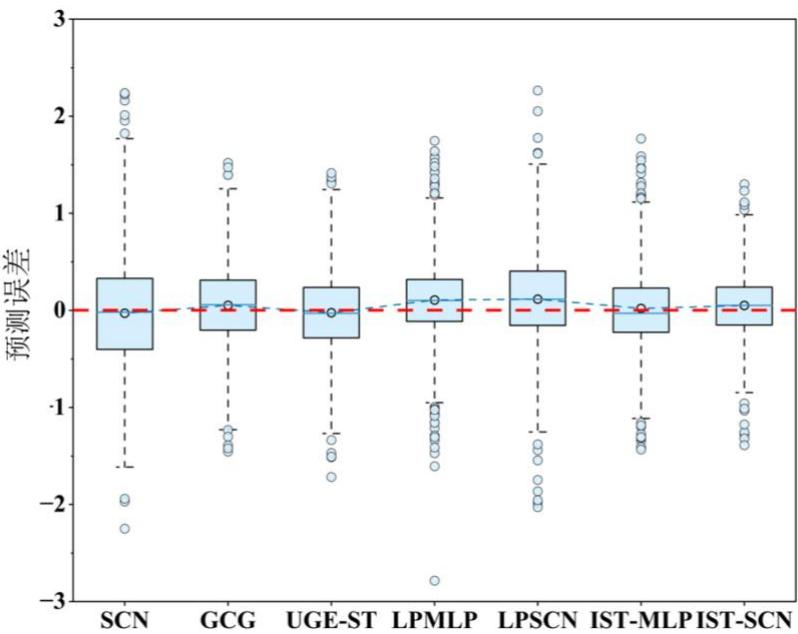  
图 3.7 不同算法预测误差分布

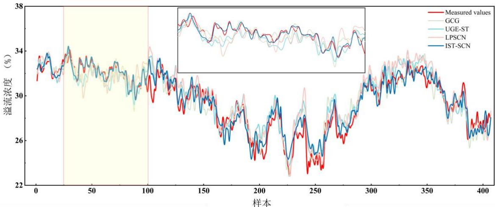  
图 3.8 不同算法的预测结果

此外，溢流矿浆浓度预测误差的正态分布参数及95%置信区间如表3.5所示，1/2其中 $\begin{array} { r } { \mathrm { M P E } { = } ( 1 / N ^ { \ast } ) \sum _ { i = 1 } ^ { N ^ { \ast } } \bigl | y _ { i } { - } \hat { y } _ { i } \bigr | } \end{array}$ 和 $\begin{array} { r } { \mathrm { S D } { = } ( ( 1 / N ^ { * } ) \sum _ { i = 1 } ^ { N ^ { * } } { [ ( y _ { i } { - } \widehat { y } _ { i } ) { - } \overline { { ( y _ { i } { - } \widehat { y } _ { i } ) } } ] } ^ { 2 } ) } \end{array}$ 分别表示平均预测误差和标准差。与其他算法相比，所提出的 算法取得了更低的 值。此外，其置信区间最为狭窄，这证实了 IST-SCN 在标记样本有限的条件下，对于溢流矿浆浓度预测具有更优的精度和稳定性。

表3.5 不同算法的预测误差置信区间

<table><tr><td>软测量模型</td><td>MPE</td><td>SD</td><td>95% 置信区间</td></tr><tr><td>SCN</td><td>-1.89</td><td>1.43</td><td>[-1.0612, -0.7188]</td></tr><tr><td>LPMLP</td><td>-1.54</td><td>1.28</td><td>[-0.8176, -0.5812]</td></tr><tr><td>LPSCN</td><td>-1.62</td><td>1.39</td><td>[-0.2539, -0.0047]</td></tr><tr><td>UGE-ST</td><td>-1.34</td><td>1.21</td><td>[-0.4545, -0.2259]</td></tr><tr><td>GCG</td><td>-1.41</td><td>1.24</td><td>[-0.5629, -0.3229]</td></tr><tr><td>IST-MLP</td><td>-1.26</td><td>1.20</td><td>[-0.6833, -0.4600]</td></tr><tr><td>IST-SCN</td><td>-0.99</td><td>1.17</td><td>[-0.2013, -0.0067]</td></tr></table>

## 3.4.4 超参数敏感性分析

PCE 算法作为 IST-SCN 的重要组成部分，其标签质量评估与筛选能力对模型性能具有重要影响。本研究基于穷举网格搜索法获得了最优超参数组合： $\scriptstyle { M = 0 . 1 N _ { L } }$ T=0.95。为探究 IST-SCN 对超参数T和M的敏感性，本章采用固定一个超参数、变化另一个超参数的方式，对比 MAE 的变化情况。具体实现方式如下：

首先，固定T=0.95，不同M取值对应的 MAE 如图 3.9 所示。实验中M分别取有标记样本数量的 5%、10%、15%、20%、40%和 60%进行测试。结果表明，当$\scriptstyle { M = 0 . 1 N _ { L } }$ 时 MAE 取得最小值，而M取值过小或过大均会导致精度显著下降。M值过小会导致参与评估的参考标记样本数量不足，算法对噪声或异常值更为敏感；M过大则会引入更多不相似的近邻样本，其标签与伪标记样本的真实标签可能存在较大差异，从而导致评分准确性下降。

其次，不同T取值对应的 MAE 如图 3.10 所示。T=0.95 时，MAE 取得最小值。具体而言，当T>0.95 时，伪标签筛选条件过于严苛，可能会丢弃部分具有潜在价值的伪标记样本，导致训练数据不足；当T <0.95 时，伪标签筛选条件较为宽松，可能会保留带有噪声的标签，导致误差在训练过程中传播。

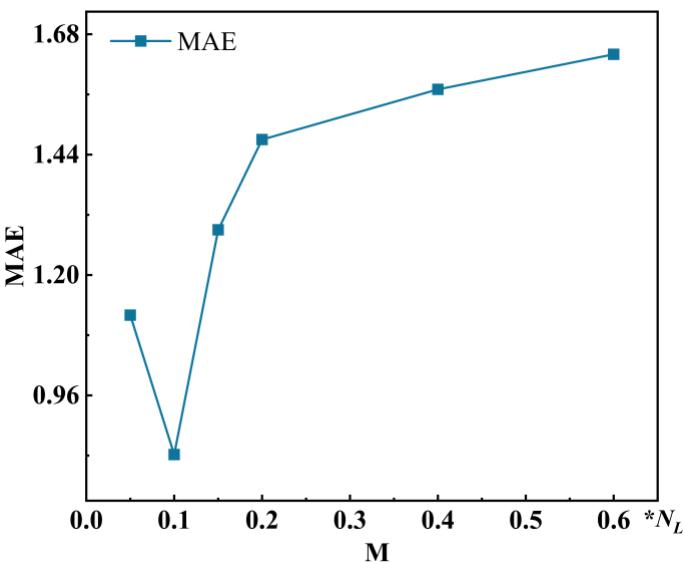  
图3.9 不同M值对应的 MAE 变化曲线

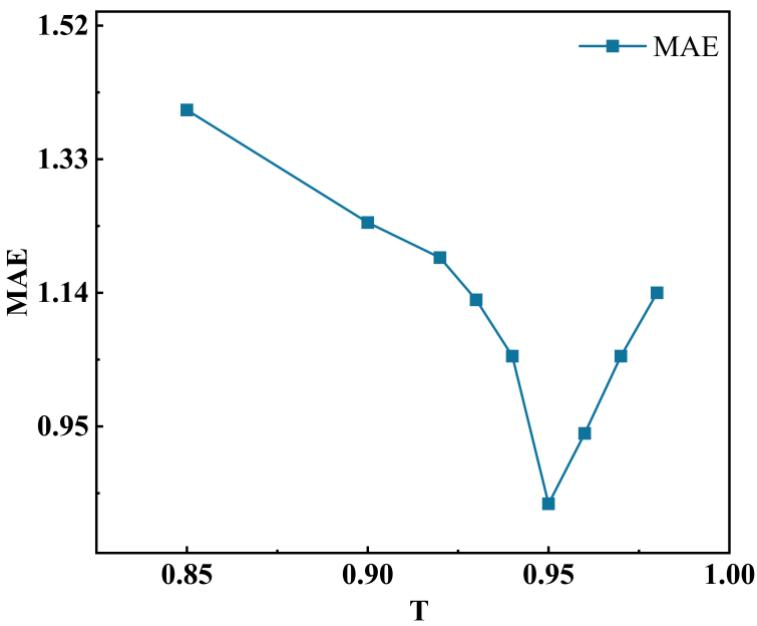  
图 3.10 不同 T值对应的 MAE 变化曲线

## 3.4.5 模型复杂度分析

构建具有K个隐藏节点、N个训练样本的 SCN，其计算复杂度为$O ( N ^ { 2 } K ^ { 2 } + N K ^ { 3 } + K ^ { 4 } )$ 。对于所提出的 IST-SCN 方法, 模型更新主要包括以下三个步骤：（1）利用 wGMM 对未标记样本进行排序，其复杂度为 $O ( N _ { U } ^ { 2 } { + } N V )$ ；（2）利用 PCE 对伪标记样本进行筛选，其复杂度为 $O ( P N _ { L } ^ { 2 } )$ )；（3）基于精炼后的训练集更新 IST-SCN 模型。因此，所提方法的总体计算复杂度可近似表示为$O ( I ( N ^ { 2 } K ^ { 2 } + N K ^ { 3 } + K ^ { 4 } + P N _ { L } ) ) + O ( N _ { U } ^ { 2 } + N V )$ ，其中I表示 IST 过程中的迭代次数。类似地，IST-MLP 方法的计算复杂度为 $O ( I ( N V K ^ { 2 } + P N _ { L } ^ { 2 } ) ) + O ( N V K ^ { 2 } + P N _ { L } ^ { 2 } )$ ，其中V表示输入变量维度。

对 于 LPSCN ， 需 要 构 建 最 近 邻 矩 阵 $L _ { p }$ ， 其 计 算 复 杂 度 为$O ( N _ { L } ^ { 2 } K ^ { 2 } + N _ { L } K ^ { 3 } + K ^ { 4 } ) + O ( N ^ { 2 } K ^ { 2 } + N ^ { 2 } V )$ 。 类 似 地 ， LPMLP 的 计 算 复 杂 度 为$O ( N ^ { 2 } K + N V K ^ { 2 } ) { + } O ( N ^ { 2 } V )$ 。UGE-ST 方法包含两个关键阶段：（1）在标记数据上训练多个 MLP 教师模型，以为未标记样本生成伪标签；（2）练学生模型，因此其总体计算复杂度为 $O ( I N _ { L } V K ^ { 2 } { + } N V K ^ { 2 } )$ 。GCG 采用双生成器进行协同训练，彼此提供高置信度伪标签，同时利用两个判别器分别从联合分布和边缘分布的角度对生成过程进行约束。因此，其计算复杂度可估计 $O ( N _ { L } V K ^ { 2 } ) { + } O ( N V K ^ { 2 } )$ 。

上述算法的计算复杂度如表 3.6 所示。与其他方法相比，本章提出的 IST-SCN由于引入了伪标签筛选和增量式自训练机制，因此具有更高的计算开销。尽管训练时间略有增加，但所提方法的模型训练可在 10s 以内完成。在实际应用中，目标变量通常以分钟级时间间隔进行采样，因此 IST-SCN 的训练时间能够充分满足

实时性要求。

表3.6 不同算法的计算复杂度分析

<table><tr><td>软测量算法</td><td>计算复杂度</td><td>训练时间</td></tr><tr><td>SCN</td><td> $O(N^{2}K^{2} + NK^{3} + K^{4})$ </td><td>0.4s</td></tr><tr><td>LPMLP</td><td> $O(N^{2}K + NVK^{2}) + O(N^{2}V)$ </td><td>6.29s</td></tr><tr><td>LPSCN</td><td> $O(N_{L}^{2}K^{2} + N_{L}K^{3} + K^{4}) + O(N^{2}K^{2}) + O(N^{2}V)$ </td><td>11.85s</td></tr><tr><td>UGE-ST</td><td> $O(IN_{L}VK^{2} + NVK^{2})$ </td><td>5.45s</td></tr><tr><td>GCG</td><td> $O(NVK^{2})$ </td><td>1.84s</td></tr><tr><td>IST-MLP</td><td> $O(I(NVK^{2} + PN_{L}^{2})) + O(N_{U}^{2})$ </td><td>6.83s</td></tr><tr><td>IST-SCN</td><td> $O(I(N^{2}K^{2} + NK^{3} + K^{4} + PN_{L}^{2})) + O(N_{U}^{2})$ </td><td>9.55s</td></tr></table>

## 3.4.6 消融实验

为评估 IST-SCN 框架中关键组件的独立贡献，本节开展了消融实验。表 3.7所给出的对比结果表明，wGMM 聚类与 PCE 算法均对模型性能具有积极作用，而移除任一组件都会导致模型性能下降。一方面，移除 PCE 对性能退化的影响更为显著，这是因为模型失去了过滤不可靠伪标签的能力，导致增量自训练过程中误差累积与传播。另一方面，wGMM 通过加权数据处理提高了聚类精度，使未标记样本能够优先按照与初始标记训练样本的相似度进行排序与标注，从而提升训练初期的标签准确性。此外，图 3.11 给出了消融实验中不同模型的收敛曲线，可以看出 IST-SCN 能够实现更快的收敛速度，进一步验证了 wGMM 与 PCE 两个模块的有效性。

除了性能指标之外，本章还比较了消融实验中各模型的计算复杂度与训练速度，结果如表 3.7 所示。与对比方法相比，IST-SCN 的计算开销虽相对较高，但其带来的性能提升更为显著，因此该开销在实际应用中是合理且可接受的。

表3.7 消融实验结果

<table><tr><td>算法</td><td>MSE MAE</td><td colspan="2"> $R^2$ </td><td>计算复杂度</td><td>训练时间</td></tr><tr><td>w/o wGMM&amp;PCE</td><td>2.94</td><td>1.34</td><td>0.59</td><td> $O(I(N^2K^2 + NK^3 + K^4)) + O(N_U^2)$ </td><td>7.33s</td></tr><tr><td>w/o PCE</td><td>2.16</td><td>1.08</td><td>0.70</td><td> $O(I(N^2K^2 + NK^3 + K^4)) + O(N_U^2 + NV)$ </td><td>8.18s</td></tr><tr><td>w/o wGMM</td><td>1.76</td><td>1.08</td><td>0.76</td><td> $O(I(N^2K^2 + NK^3 + K^4 + PN_L^2)) + O(N_U^2)$ </td><td>8.90s</td></tr><tr><td>IST-SCN</td><td>1.15</td><td>0.84</td><td>0.84</td><td> $O(I(N^2K^2 + NK^3 + K^4 + PN_L^2)) + O(N_U^2 + NV)$ </td><td>9.55s</td></tr></table>

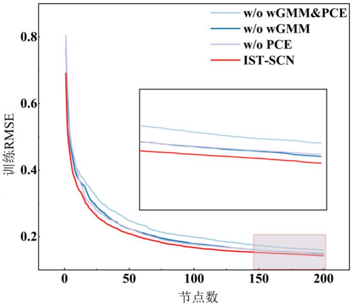  
图3.11 消融研究中不同模型的收敛曲线

## 3.5 本章小结

本章针对标记样本稀缺问题，提出了一种增量自训练随机配置网络软测量模型。该模型通过加权高斯混合模型聚类实现有序伪标记，优先选择高置信度样本；并设计了伪标签置信度评估机制，量化伪标签可靠性，确保高质量样本加入训练集。实验结果表明，IST-SCN 在 SABC 系统溢流浓度预测中具有更高的精度和更集中的误差分布，在标记样本有限条件下能够有效利用无标记数据提升模型性能。与 IST-MLP 相比，IST-SCN 的 MSE 降低了 18.4%，MAE 降低了 12.0%，R²提升了 5.9%。

然而，工业现场采集数据中常存在传感器故障、工况波动和测量误差等因素引起的异常值。当异常样本参与模型训练或伪标签生成时，可能导致模型参数估计偏移，并进一步放大自训练过程中的误差累积。因此，仅依靠伪标签筛选机制仍难以充分保证模型在异常数据干扰下的鲁棒性。基于此，下一章将在 IST-SCN框架基础上引入广义 M 估计，进一步研究异常值干扰条件下的稳健自训练软测量建模方法。

## 第 4 章 稳健自训练随机配置网络软测量模型研究及应用

## 4.1 引言

在工业过程软测量建模中，数据质量问题与标记样本稀缺问题同样突出。现场采集的工业数据不可避免地包含异常值，这些异常值主要来源于传感器故障、信号传输干扰、环境波动以及工况突变等因素。第 3 章提出的 IST-SCN 算法通过增量自训练框架有效解决了标记样本稀缺问题，但其采用的 SCN 基础学习器仍基于最小二乘准则进行输出权重求解，对异常值缺乏足够的抵抗能力。

针对此问题，本章在 IST-SCN 基础上引入广义 M 估计理论，稳健自训练随机配置网络。该算法通过构造稳健的损失函数和样本加权机制，降低异常点对模型训练的影响。首先，介绍广义 M 估计的基本原理。其次，阐述 GM-IST-SCN 的算法框架，并验证其收敛性。随后，通过人工数据集验证算法在受异常值干扰时的有效性。最后将其应用于磨矿工艺溢流浓度预测实例，检验其预测性能与鲁棒性。

## 4.2 广义 M 估计

在稳健统计领域，M 估计是一类重要的参数估计方法，其通过引入增长较慢的损失函数来降低异常值对参数估计的影响。然而，传统 M 估计主要关注输出空间的离群值处理，即针对响应变量中的异常观测进行降权或截断，但对输入空间中存在的异常情况考虑不足。当预测变量中存在杠杆点（高影响力异常点）时，仅基于输出残差的加权策略难以完全消除这些异常点带来的估计偏差，可能导致模型参数估计偏离真实值。

为克服这一局限性，研究者提出了广义 M 估计方法。与标准 M 估计仅考虑输出空间异常不同，广义 M 估计同时关注输入空间和输出空间中的异常值，通过引入基于马氏距离的样本权重系数，对偏离正常分布程度的样本进行自适应加权，从而在保留数据连续性的前提下增强模型的鲁棒性。当输入空间中存在离群值时，广义 估计为受污染样本分配较小的权重，以削弱其对模型训练的影响，使建模过程更加稳健。

马氏距离是一种考虑数据相关性的距离度量方法，能够有效衡量样本与整体分布之间的偏离程度。与欧氏距离不同，马氏距离通过引入协方差矩阵，消除了变量之间量纲和相关性带来的影响，更适合用于多变量数据中的异常点检测。针对数据在输入空间的离群值问题，Arslan 将鲁棒马氏距离 $R D ( x _ { i } )$ 定义为：

$$
\mathrm{RD} (x _ {i}) = \left(x _ {i} - \widehat {\mathfrak {S}}\right) ^ {T} \widehat {\sum} ^ {- 1} \left(x _ {i} - \widehat {\mathfrak {S}}\right), i = 1, 2, \dots , N\tag{4.1}
$$

其中， $\scriptstyle \widehat { \mathsf { I } } = \frac { 1 } { N } \sum _ { i = 1 } ^ { N } x _ { i }$ 和 $\begin{array} { r } { | \widehat { \sum } = \frac { 1 } { N + 1 } \sum _ { i = 1 } ^ { N } \left( x _ { i } - \widehat { \ b { \ b { \ b { \ b { \ b { \ b { \ b { \ b { \ b { \ b { \ b \tau } } } } } } } } } } } \right) \left( x _ { i } - \widehat { \ b { \ b { \ b { \ b { \ b { \ b { \ b { \ b { \tau } } } } } } } } } \right) ^ { T } } \end{array}$ 分别为高击穿点位置和稳健估计的散度，N为样本数， $R D ( x _ { i } )$ 越大，表明该样本偏离正常分布的程度越高，该样本为输入空间异常点的可能性也越大。

基于上述稳健马氏距离，可以构建样本权重系数，用于衡量每个样本在模型训练中的重要性。权重系数的基本设计思想是：对于偏离正常分布的样本，赋予较小的权重，以降低其对模型训练的影响；对于正常分布的样本，赋予接近 1 的权重，保持其对模型的贡献。基于稳健距离 $R D ( x _ { i } )$ 构建的权重系数表示为：

$$
\vartheta_ {i} = \min \left\{1, \frac {v}{R D (x _ {i})} \right\}\tag{4.2}
$$

式中 $v .$ 为输入变量数。 $\boldsymbol { \vartheta } _ { i }$ 的大小由样本偏离正常分布的程度决定，偏离越大的样本系数越小，偏离越小则系数越大。通过对数据集{ }中的每个样本向量乘以其对应的系数 $\mathbf { \mathcal { S } } _ { i }$ ，即可重构出一个新的数据集。在处理输入空间中存在离群值的情况下，这种加权方式能够有效提升模型训练的稳健性。

## 4.3 融合广义 M估计的自训练随机配置网络软测量模型

本节在 IST-SCN 的基础上，进一步考虑工业数据中异常值污染与标记样本不足两类实际问题，构建一种鲁棒半监督随机配置网络模型（GM-IST-SCN）。由于具有较高的学习效率和良好的逼近能力，本章选取其作为基础学习模型。针对工业采集数据中由于测量误差、传输异常或外界扰动引起的异常值污染问题，在模型训练过程中引入 GM 方法，以减弱异常样本对参数估计的影响，从而提高模型的鲁棒性。在此基础上，再结合自训练策略对未标记样本进行有效利用，以提升模型在标记样本有限条件下的预测性能。下面将分别介绍基于 GM 的稳健SCN 构建过程，以及进一步融合自训练策略形成的 GM-IST-SCN 算法。GM-SCN模型可以通过求解加权最小二乘问题来构建，即

$$
\min _ {\beta , \vartheta} \sum_ {i = 1} ^ {N} \vartheta_ {i} \left\| \sum_ {j = 1} ^ {K} \beta_ {j} \sigma (\omega_ {j}, b _ {j}, x _ {i}) - y _ {i} \right\| ^ {2}\tag{4.3}
$$

其中 $\vartheta _ { i } { \geq } 0 ( i { = } 1 , 2 { \ , } . . . , N )$ 是第i个样本的惩罚权重，表示对应样本对目标函数的贡献。∑ Kj= $\beta _ { j } \sigma ( \omega _ { j } , b _ { j } , x _ { i } )$ 为当前隐藏节点数量为K时 SCN 的输出，其中 $\sigma _ { \it . }$ 是激活函数，K为隐藏节点的数量， ， $\omega _ { j }$ $b _ { j }$ 是随机配置的输入权重和偏差， $\beta _ { j }$ 表示输出权重。一般来说，惩罚权重 $\boldsymbol { \vartheta } _ { i }$ 可根据样本的可靠性确定。针对输入空间中出现的离群样本，通过赋予较小的 $\mathcal { \vartheta } _ { i }$ 值来降低杠杆点的权重，从而提升 SCN 模型的鲁棒性。相反，对于正常样本则赋予较大的 $\boldsymbol { \vartheta } _ { i }$ ，使模型能够保留大部分有价值的信息。

此外，对所提 GM-SCN 的收敛性进行证明。令 $\cdot \beta _ { K } ^ { ^ \ast } = \arg \operatorname* { m i n } _ { \beta _ { K } } \left\| H _ { K } \beta _ { K } ^ { } \mathcal { \vartheta } \odot Y \right\| ^ { 2 }$ $\boldsymbol { \varepsilon } _ { K } ^ { * } { = } \boldsymbol { \vartheta } \odot Y { - } H _ { K } \boldsymbol { \beta } _ { K } ^ { * }$ ，其中 $H _ { K } { = } [ \mathcal { ( } \odot h _ { I } , \mathcal { \vartheta } \odot h _ { 2 } { , } { \ldots } , \mathcal { \vartheta } \odot h _ { K } ]$ ，并定义中间值 $\tilde { \beta } _ { K } = \frac { \langle \varepsilon _ { K - 1 } ^ { ~ * } , \tilde { h } _ { K } \rangle ^ { 2 } } { \tilde { h } _ { K } ^ { T } \tilde { h } _ { K } }$ $\widetilde { \varepsilon } _ { K } { = } \varepsilon _ { K - 1 } ^ { * } { - } \widetilde { \beta } _ { K } \widetilde { h } _ { K }$ 和 $\scriptstyle { | \varepsilon _ { 0 } ^ { * } = { \tilde { Y } } }$ ，其中 $\scriptstyle { { \mathfrak { i } } } _ { k } = { \mathfrak { s } } \odot { \mathfrak { h } } _ { K }$

定理 4.1：给定0<γ<1和一个非负实数序列 $\mu _ { { } _ { K } }$ ，其中 $\mu _ { \scriptscriptstyle K } { \le } 1 { - } \gamma _ { \scriptscriptstyle \cdot }$ 且 $\operatorname* { l i m } _ { K \to + \infty } \mu _ { K } = 0$ 。若生成的随机权重和偏差满足以下不等式：

$$
\frac {\langle \varepsilon_ {K - 1} ^ {*} , \tilde {h} _ {K} \rangle^ {2}}{\tilde {h} _ {K} ^ {T} \tilde {h} _ {K}} \geq \big (1 - \gamma - \mu_ {K} \big) \big \| \varepsilon_ {K - 1} ^ {*} \big \| ^ {2}\tag{4.4}
$$

则输出权重 $\boldsymbol { \beta } _ { K } ^ { * }$ 的计算公式为：

$$
\beta_ {K} ^ {*} = \arg \min _ {\beta_ {K}} \left\| H _ {K} \beta_ {K} - \vartheta \odot Y \right\| ^ {2}\tag{4.5}
$$

证明： $\tilde { \beta } _ { { } _ { K } }$ 基于未优化 SCN 的局部更新算法计算，可得：

$$
\left\| \varepsilon_ {K} ^ {*} \right\| ^ {2} \leq \| \widetilde {\varepsilon} _ {K} \| ^ {2} = \left\| \varepsilon_ {K - 1} ^ {*} - \widetilde {\beta} _ {K} \widetilde {h} _ {K} \right\| ^ {2} \leq \left\| \varepsilon_ {K - 1} ^ {*} \right\| ^ {2} \leq \| \widetilde {\varepsilon} _ {K - 1} \| ^ {2}\tag{4.6}
$$

可知：

$$
\begin{array}{l} \left\| \varepsilon_ {K} ^ {*} \right\| ^ {2} - \left\| \varepsilon_ {K - 1} ^ {*} \right\| ^ {2} \leq \| \tilde {\varepsilon} _ {K} \| ^ {2} - \left\| \varepsilon_ {K - 1} ^ {*} \right\| ^ {2} \\ = \langle \varepsilon_ {K - 1} ^ {*} - \tilde {\beta} _ {K} \tilde {h} _ {K}, \varepsilon_ {K - 1} ^ {*} - \tilde {\beta} _ {K} \tilde {h} _ {K} \rangle - \langle \varepsilon_ {K - 1} ^ {*}, \varepsilon_ {K - 1} ^ {*} \rangle \\ = \frac {- 2 \langle \varepsilon_ {K - 1} ^ {*} , \tilde {h} _ {K} \rangle^ {2}}{\left\| \tilde {h} _ {K} \right\| ^ {2}} + \frac {\langle \varepsilon_ {K - 1} ^ {*} , \tilde {h} _ {K} \rangle^ {2}}{\left\| \tilde {h} _ {K} \right\| ^ {2}} \\ = - \frac {\langle \varepsilon_ {K - 1} ^ {*} , \tilde {h} _ {K} \rangle^ {2}}{\left\| \tilde {h} _ {K} \right\| ^ {2}} <   0 \end{array}\tag{4.7}
$$

由式(4.5)可知网络残差 $\left\| \varepsilon _ { K } ^ { * } \right\| ^ { 2 }$ 单调递减并收敛

上述基于广义 M 估计的稳健 SCN 解决了输入空间异常值问题，但其仍属于监督学习范畴，无法直接利用大量无标记数据。为克服标记样本稀缺的限制，本节将稳健SCN作为基学习器引入第 3章提出的增量自训练框架，构建完整的 GM-

IST-SCN 算法，算法框架如图 4.1 所示。

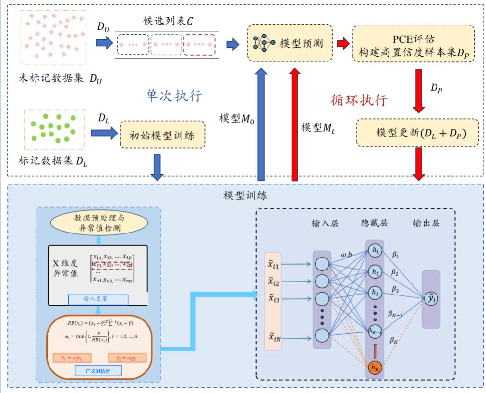  
图 4.1 GM-IST-SCN 框架图

首先，在初始模型训练阶段，利用已有的有标记样本计算输入空间的权重向量，并据此构建加权训练数据集，以训练初始稳健 SCN 模型。通过在模型建立阶段引入样本权重，可以有效降低异常样本对模型参数估计的干扰，从而使初始模型在小样本条件下仍具备一定的鲁棒性，为后续自训练过程提供稳定可靠的基础学习器。

在此基础上，利用训练得到的稳健模型对无标记样本进行预测以生成伪标签。由于基础学习器在训练过程中已通过广义 M 估计抑制了异常样本的影响，其预测结果相对稳定，从而能够在一定程度上提升伪标签的可靠性，并减少错误伪标签的产生。随后，在样本筛选阶段，引入 PCE 算法对伪标记样本进行置信度评估。由于预测结果来源于鲁棒模型，所得到的置信度评价更加可信，使得高置信度样本的筛选过程更加稳定，有助于提高伪标记样本的整体质量。

当筛选得到的高置信度伪标记样本被加入训练集后，模型进入更新阶段。此时重新基于扩展后的训练数据计算输入空间权重，并在加权数据集上重新训练GM-SCN 模型。通过在每轮迭代中更新样本权重，可以有效抑制新增样本中可能存在的噪声或异常数据，从而保证模型在自训练迭代过程中的稳定性和鲁棒性。基于上述分析，所提出 GM-IST-SCN 软测量算法的伪代码在表 4.1 中给出。

表 4.1 GM-IST-SCN 算法的实现流程

输入:带标签数据集 $D_{U}$ 和无标签数据集 $D_{U}$

输出:更新后的 GM-IST-SCN 模型

参数预设:容忍误差 $\tau$，最大隐层神经元数量 $K_{max}$，$K_{top}(K_{max}$ 的上届)，最大可增加样本数量 $maxNum$，近邻居数量 $M$，候选批次大小 $C_{a}$，微调节点数量 $\Delta K$，置信度阈值 $T$。

阶段 1: 初始化

1. 引入广义 M 估计，通过式(4.2)计算权重向量 $\vartheta$，则 $\tilde{X}_{L} = \vartheta \odot X, \tilde{Y}_{L} = \vartheta \odot Y$;

2. 使用 $\{\tilde{X}_{L}, \tilde{Y}_{L}\}$ 训练一个初始的 GM-SCN 模型，其中 $t=1$;

3. 利用 wGMM，对带权重的带标签数据进行聚类，并根据公式(3.1)创建候选列表 $C^{(t-1)}$;

阶段 2: 增量式自训练

4. flag=1;

5. While (flag)

6. If $C^{(t-1)} \neq \emptyset$

7. 根据 $C^{(t-1)}$ 排序，将 $C_{a}$ 个无标签数据从 $C^{(t-1)}$ 移入无标签数据池，$C^{(t)} = C^{(t-1)} - C_{a}$;

8. End If

9. 使用模型 $M_{t-1}$ 对无标签数据进行标注，得到 $\{X_{P}, Y_{P}\}^{(t)}$;

10. 根据公式(3.4)计算的置信度 $C_{p}$，对样本 $\{X_{P}, Y_{P}\}^{(t)}$ 进行排序；

11. 构建增强数据集 $\left\{X_{P}^{ad}, Y_{P}^{ad}\right\}^{(t)}$，并将该数据集中的样本总数记为 Num;

12. While $Num = 0$ and $K \neq K_{max}$

13. $K = K + \Delta K$;

14. 更新 GM-SCN 模型 $M_{t-1}$;

15. 使用 $M_{t-1}$ 对无标签数据进行标注，得到 $\{X_{P}, Y_{P}\}^{(t)}$;

16. 根据公式(3.4)计算的置信度 $C_{p}$，对样本 $\{X_{P}, Y_{P}\}^{(t)}$ 进行排序；

17. 构建增强数据集 $\left\{X_{P}^{ad}, Y_{P}^{ad}\right\}^{(t)}$ 并更新 Num;

18. End While

19. If $Num &gt; 0$

20. $Num = min\{Num, maxNum\}$;

21. 将增强数据集 $\left\{X_{P}^{ad}, Y_{P}^{ad}\right\}^{(t)}$ 从无标签数据池移入带标签数据集 $D_{L}$;

22. 通过式(4.2)重新计算权重向量 $\vartheta$，则 $\tilde{X}_{L} = \vartheta \odot X_{P}^{ad}, \tilde{Y}_{L} = \vartheta \odot Y_{P}^{ad}$

23. 使用 $\{\tilde{X}_{L}, \tilde{Y}_{L}\}$ 训练新模型 $M_{t}$;

24. End If

25. If $K = K_{max}$ and $C_{t} = \emptyset$ and $Num = 0$

26. flag = 0;

27. End If

28. End while

## 4.4 实验及应用

## 4.4.1 人工数据集仿真

为模拟复杂工业过程的非线性特征，本实验基于 Friedman[91]数据基础上设计了一组具有 5 个输入变量 $[ x _ { 1 } , \ x _ { 2 } , . . . , \ x _ { 5 } ]$ 和一个目标变量y 的人工数据集。仿真函数如下所示：

$$
y = 1 0 \sin (\pi x _ {1} x _ {2}) + 2 0 (x _ {3} - 0. 5) ^ {2} + 1 0 (x _ {4}) ^ {2} + 5 x _ {5}\tag{4.8}
$$

其中，自变量x 从区间(0, 1)的均匀分布中随机取样，并根据生成 2000 组样本。为模拟工业场景中传感器故障或随机干扰引发的异常值，以一定污染率随机挑选部分样本进行污染。同时，通过叠加上服从正态分布的高斯噪声��，使得数据集更具有符合真实工业环境。在半监督实验设置方面，前 1600 个样本用于模型训练，后 400 个样本用于性能测试。在训练集中，进一步设定标记样本的比例为 1/5，即有标签样本数量为 320 个，其余 1280 个样本作为无标签数据参与半监督学习过程。

为验证所提方法的有效性，本章选取了若干当前主流算法进行对比实验，包括：SCN[36]、GCG[52]、UGE-ST[53]、IST-SCN 以及结合广义 M 估计的增量式自训练 MLP（GM-IST-MLP）。实验设定污染率为 10%，不同方法在人工数据集上的结果如表4.2所示。所提方法GM-IST-SCN在所有评价指标上均取得了最优结果，显著优于其他对比方法。具体而言，与 SCN 相比，半监督学习策略提升了模型的性能。相比于 UGE-ST、GCG 和 IST-SCN，广义 M 估计的引入避免了异常值在训练过程中的干扰。同时，相比于 MLP，SCN 的网络结构本身具有更强的非线性拟合能力，使 GM-IST-SCN 在精度与鲁棒性上更具优势。

表 4.2 不同方法在人工数据集上的性能对比

<table><tr><td rowspan="2">软测量模型</td><td colspan="3">MSE</td><td colspan="3">MAE</td><td colspan="3"> $R^2$ </td></tr><tr><td>Mean</td><td>Std</td><td>Best</td><td>Mean</td><td>Std</td><td>Best</td><td>Mean</td><td>Std</td><td>Best</td></tr><tr><td>SCN</td><td>10.134</td><td>0.9625</td><td>8.567</td><td>2.397</td><td>0.1368</td><td>2.198</td><td>0.603</td><td>0.0377</td><td>0.664</td></tr><tr><td>UGE-ST</td><td>8.235</td><td>0.2787</td><td>7.709</td><td>2.172</td><td>0.0441</td><td>2.090</td><td>0.677</td><td>0.0109</td><td>0.698</td></tr><tr><td>GCG</td><td>7.166</td><td>0.6140</td><td>5.605</td><td>2.039</td><td>0.0970</td><td>1.824</td><td>0.719</td><td>0.0240</td><td>0.780</td></tr><tr><td>IST-SCN</td><td>5.915</td><td>0.8118</td><td>4.047</td><td>1.812</td><td>0.1182</td><td>1.543</td><td>0.768</td><td>0.0317</td><td>0.841</td></tr><tr><td>GM-IST-MLP</td><td>4.008</td><td>0.9761</td><td>2.488</td><td>1.481</td><td>0.1694</td><td>1.231</td><td>0.843</td><td>0.0382</td><td>0.902</td></tr><tr><td>GM-IST-SCN</td><td>1.929</td><td>0.3828</td><td>1.493</td><td>1.062</td><td>0.0815</td><td>0.967</td><td>0.924</td><td>0.0149</td><td>0.942</td></tr></table>

图 4.2 展示了采用本章所提算法在人工数据集上得到的预测值与实际测量值的对比结果。预测值与实测值之间误差较小，表明该算法具有较高的预测精度。这一结果进一步验证了所提算法在存在离群值的数据中的稳健性和有效性。

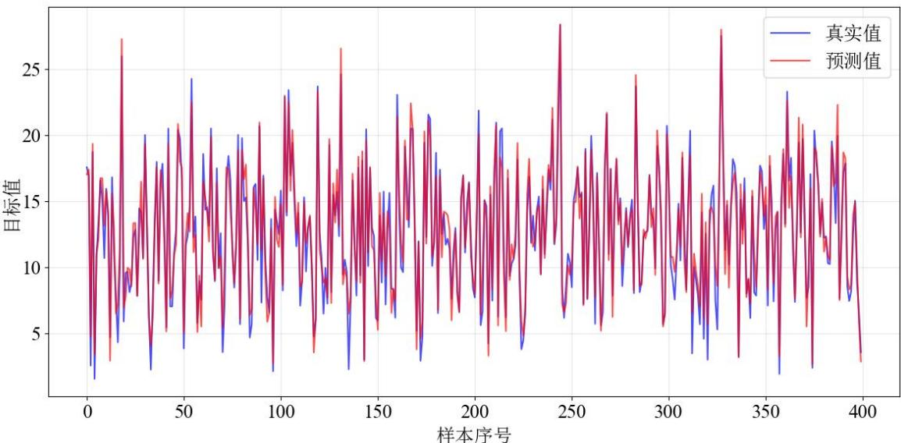  
图 4.2 真实值与预测结果对比

从图 4.3 展示的误差分布来看，不同算法之间的差异比较明显。GM-IST-SCN的箱线图明显比其他算法更加紧凑，中位数也最接近零。这表明该算法的预测误差更小、更集中，整体预测效果更可靠。

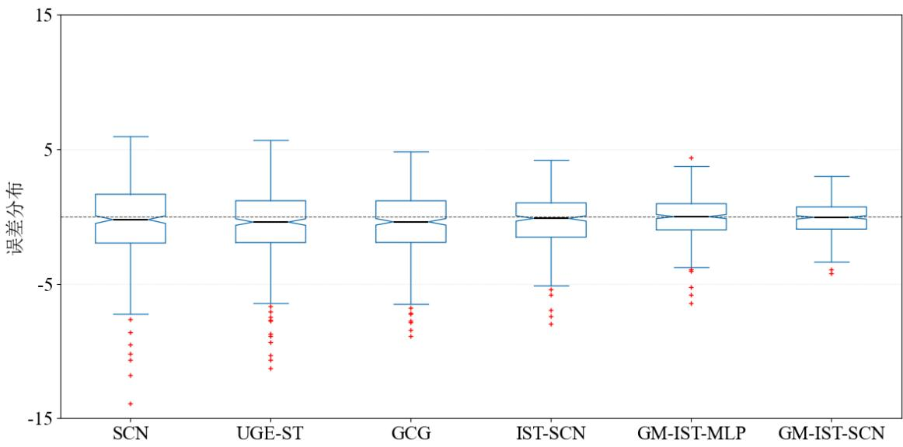  
图4.3 不同算法预测误差的箱线图

## 4.4.2 磨矿工艺中溢流矿浆浓度软测量预测建模

## 4.4.2.1 数据分析

本章采用与第三章相同的磨矿过程数据，并在其基础上进行异常值检测。为有效识别输入空间中的异常样本，本章采用局部离群因子（Local outlier factor，LOF）方法进行离群检测。该方法通过比较样本的局部密度与其邻域样本平均密度之间的差异，定量评估样本的离群程度。LOF 值越大，表明样本在其局部空间中的密度越低，被判定为离群样本的可能性也就越高。在本研究中，通过计算训练样本的 LOF 值来量化样本在输入空间中的异常程度，并进一步将其转化为样本权重，用于构建 GM-SCN 的加权训练模型。

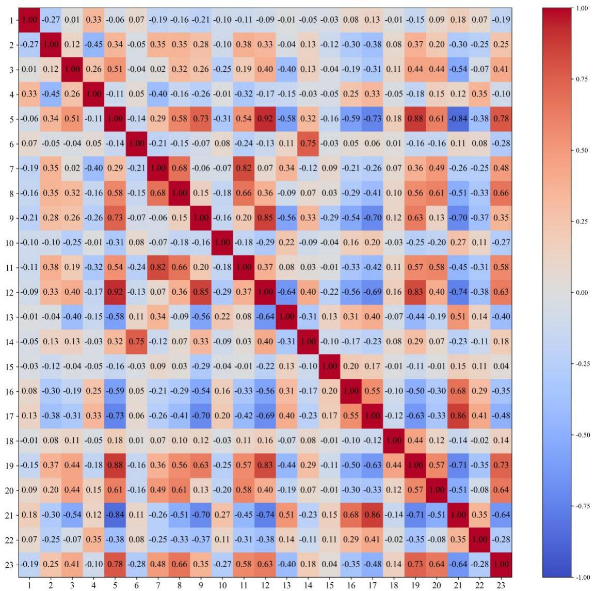  
图4.4 数据的最大信息系数热图

最大信息系数用于评估不同变量间的潜在关联强度，相关分析结果如图 4.4所示，图中第 列对应溢流浓度指标。分析表明，共有 个输入变量与目标变量的 MIC 值高于 0.5。为直观展示离群检测结果，本章对这些变量进行两两组合，并逐一计算其二维LOF值。从图4.5展示的所有组合分析结果来看，变量7与11、变量 8 与 12 这两组组合在输入空间中表现出了较为显著的异常样本分布特征。

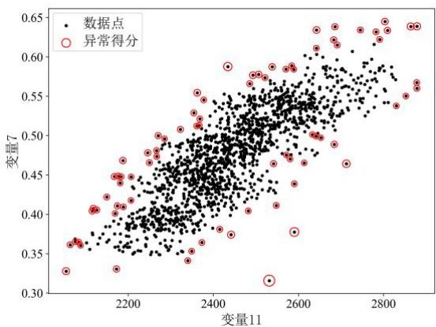

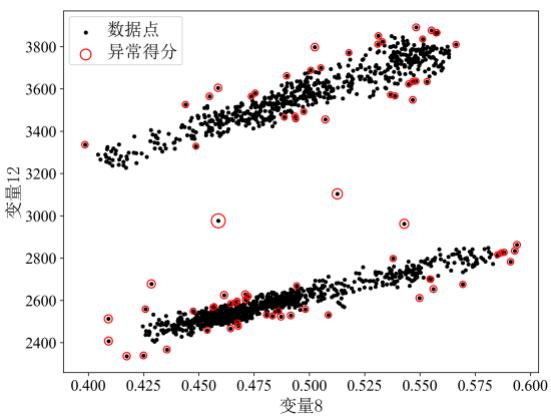  
图 4.5 输入空间杠杆点检测

## 4.4.2.2 实验结果

本节将所提算法应用于实际磨矿过程中的矿浆溢流浓度预测。实验设置与第三章保持一致，包括数据集划分、标记比例、评价指标及运行环境。不同算法的十次运行的平均和最佳实验结果如表 4.3 所示。其中，SCN 作为基准模型，其预测精度相对较低，而后续引入的各种改进策略均有效提升了模型性能。UGE-ST 和GCG 两种半监督学习方法相较于 SCN 均取得了明显的性能提升，二者的预测误差和拟合优度指标相当，表明这两种方法能够有效利用无标记样本信息，增强模型的泛化能力。IST-SCN 模型进一步提升了预测精度，其误差指标较前几种模型显著降低，决定系数 $R ^ { 2 }$ 均值达到 0.8 以上，显示出增量学习策略在半监督场景下的优势。GM-IST-MLP 模型在 IST-SCN 基础上略有波动，这可能是由于多层感知机在有限标记样本条件下的拟合能力受限所致。而 GM-IST-SCN 模型在所有对比方法中表现最佳，其 MSE 均值降至 1.286，MAE 均值降至 0.864，R²均值达到0.828，与 IST-SCN 相比，GM-IST-SCN 的 MSE 降低 10.2%，MAE 降低 6.4%，R²提升 3.4%，充分验证了所提 GM 策略与增量学习机制在随机配置网络框架下的有效性。综合来看，基于 SCN 的改进模型普遍优于传统 MLP 结构，表明随机配置网络更适合处理工业过程中的半监督学习任务。

表4.3 不同方法在该案例中的性能对比

<table><tr><td rowspan="2">软测量模型</td><td colspan="3">MSE</td><td colspan="3">MAE</td><td colspan="3"> $R^2$ </td></tr><tr><td>Mean</td><td>Std</td><td>Best</td><td>Mean</td><td>Std</td><td>Best</td><td>Mean</td><td>Std</td><td>Best</td></tr><tr><td>SCN</td><td>2.789</td><td>0.7032</td><td>2.133</td><td>1.282</td><td>0.1534</td><td>1.640</td><td>0.612</td><td>0.0980</td><td>0.703</td></tr><tr><td>UGE-ST</td><td>1.943</td><td>0.4383</td><td>1.502</td><td>1.080</td><td>0.1164</td><td>0.952</td><td>0.729</td><td>0.0611</td><td>0.791</td></tr><tr><td>GCG</td><td>1.911</td><td>0.2331</td><td>1.629</td><td>1.081</td><td>0.0687</td><td>1.018</td><td>0.734</td><td>0.0325</td><td>0.773</td></tr><tr><td>IST-SCN</td><td>1.432</td><td>0.1548</td><td>1.148</td><td>0.923</td><td>0.0439</td><td>0.842</td><td>0.801</td><td>0.0216</td><td>0.840</td></tr><tr><td>GM-IST-MLP</td><td>1.512</td><td>0.1685</td><td>1.238</td><td>0.951</td><td>0.0521</td><td>0.871</td><td>0.785</td><td>0.0253</td><td>0.823</td></tr><tr><td>GM-IST-SCN</td><td>1.286</td><td>0.1287</td><td>1.032</td><td>0.864</td><td>0.0382</td><td>0.791</td><td>0.828</td><td>0.0189</td><td>0.871</td></tr></table>

各种算法的最佳回归结果如图 4.6 所示。图中给出了不同模型预测值与实际测量值之间的回归关系，其中散点表示测试样本的预测结果，蓝色直线表示线性回归拟合曲线，灰色直线表示理想参考线Y=T。各模型预测值均在一定程度上能够反映铜品位变化趋势，但不同模型在拟合精度和数据分布紧密程度上存在明显差异。与其他先进算法相比，GM-IST-SCN 模型的散点分布更加集中于参考线附近，回归拟合曲线与理想参考线更加接近，说明该模型在预测精度和拟合能力方面具有更好的表现。这表明 GM-IST-SCN 模型能够更加准确地捕捉浮选过程中的非线性关系，从而为浮选过程铜品位的在线监测与控制提供更加可靠的参考依据。

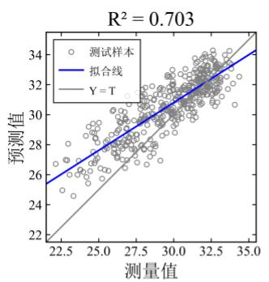  
(a) SCN

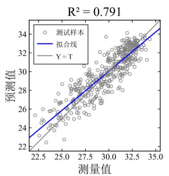  
(b) UGE-ST

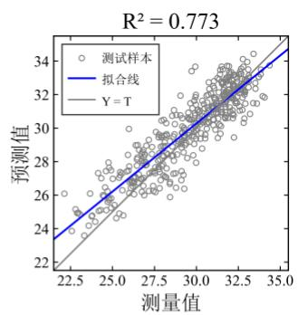  
(c) GCG

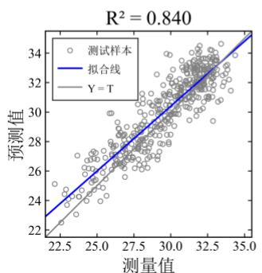  
(d) IST-SCN

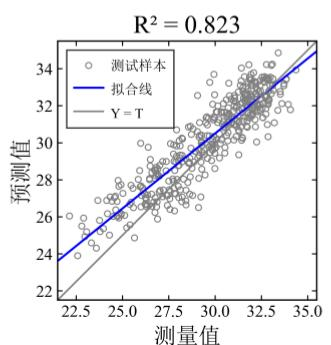  
(e) GM-IST-MLP

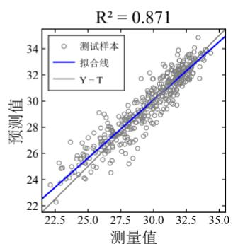  
(f) GM-IST-SCN  
图 4.6 不同模型预测值与真实值的回归散点图

图 展示了不同模型预测误差的频率分布情况，通过对各模型预测误差进行统计分析，可以直观地反映模型预测结果的稳定性与可靠性。所提出的SCN 模型的误差分布相较于其他模型更加集中，其直方图主要集中在零误差附近，同时正态分布拟合曲线呈现出更加陡峭的形态，说明预测误差整体波动范围较小。其实现了最低的误差标准差 1.146，这表明该模型在不同样本上的预测结果更加稳定，具有较好的鲁棒性和泛化能力。相比之下，其余模型的误差分布相对分散，部分模型还出现较为明显的偏移现象，说明其预测结果在部分样本上存在较大的误差波动。

为了进一步定量分析不同模型的预测性能，表 4.4 列出了各模型预测误差的统计特性参数以及对应的 95%置信区间。GM-IST-SCN 模型在所有模型中具有最小的 MPE 和 SD 值，同时其 95%置信区间范围为[-0.1395, -0.0239]，实现了最窄置信区，说明该模型不仅预测偏差最小，而且误差波动范围也最小，具有更高的预测精度和稳定性。

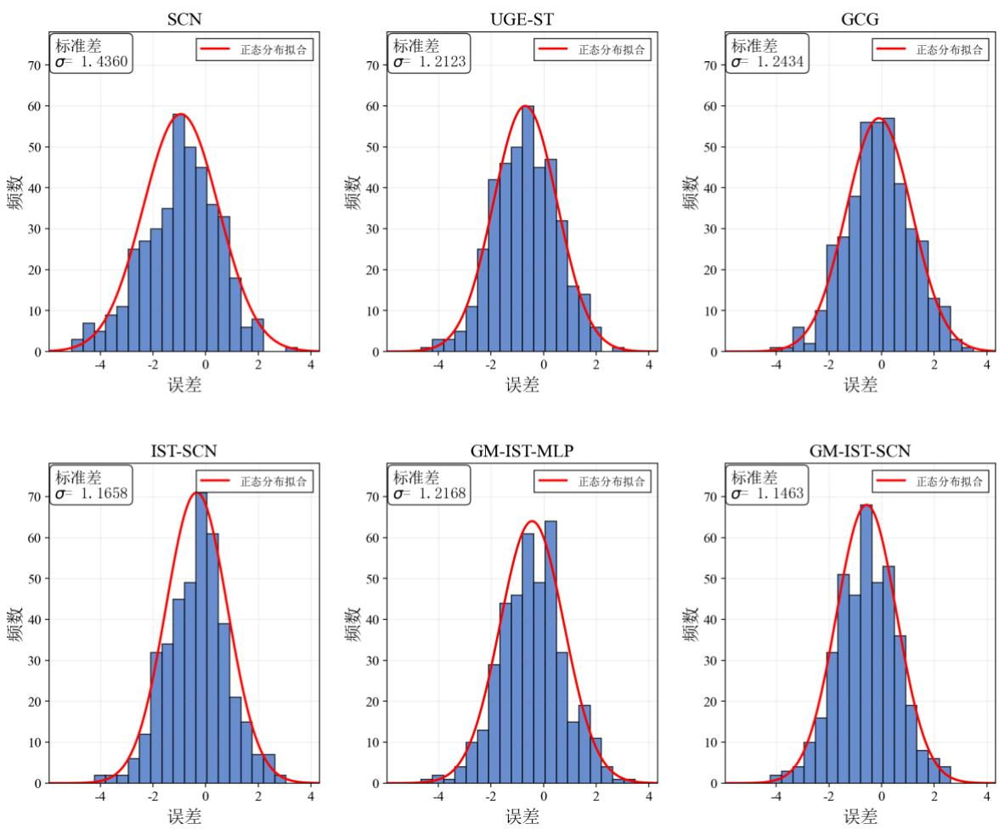  
图4.7 不同模型的预测误差频率分布

表4.4 不同算法预测误差的可信区间

<table><tr><td>软测量模型</td><td>MPE</td><td>SD</td><td>95%置信区间</td></tr><tr><td>SCN</td><td>-1.89</td><td>1.43</td><td>[-1.0612, -0.7188]</td></tr><tr><td>UGE-ST</td><td>-1.34</td><td>1.21</td><td>[-0.4545, -0.2259]</td></tr><tr><td>GCG</td><td>-1.41</td><td>1.24</td><td>[-0.5629, -0.3229]</td></tr><tr><td>IST-SCN</td><td>-0.99</td><td>1.17</td><td>[-0.2013, -0.0067]</td></tr><tr><td>GM-IST-MLP</td><td>-1.23</td><td>1.22</td><td>[-0.3833, -0.1600]</td></tr><tr><td>GM-IST-SCN</td><td>-0.77</td><td>1.14</td><td>[-0.1395, -0.0239]</td></tr></table>

## 4.4.3 污染率实验

为检验所提鲁棒策略的有效性，本节通过在数据集中添加不同程度的噪声来模拟实际干扰。噪声水平设为 至 ，步长为 ，其余参数在对比实验中保持不变。图 4.8 给出了各方法的性能变化曲线。随着噪声增强，所有模型的预测效果均出现不同程度的下降。相比之下，GM-IST-SCN 在各个指标上始终处于领先地位，且性能衰减最为平缓。尤其在强噪声环境下（如噪声比例达到 0.5），该方法的优势更加突出，依然能够保持较高的预测精度。这说明 GM-IST-SCN 对噪声数据具有更强的适应能力与抗干扰性能。

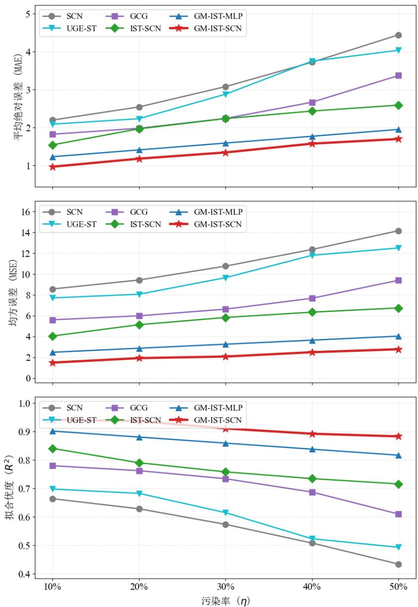  
图4.8 不同污染率下的模型性能对比

## 4.5 本章小结

本章针对工业数据中的异常值干扰问题，在 IST-SCN 基础上引入广义 M 估计理论，提出 GM-IST-SCN。首先，系统介绍了广义 M 估计的基本原理及其对输入输出空间异常的双重抑制机制；其次，将其与 SCN 相结合，构建稳健损失函数和样本加权机制，提升基学习器对异常值的抵抗能力；最后，将稳健 SCN 作为基学习器引入增量自训练框架，形成完整的GM-IST-SCN算法。在溢流浓度预测中，该算法在异常值条件下具有更高的预测精度和更强的鲁棒性，与 IST-SCN 相比，所提方法在 MAE、MSE、 $R ^ { 2 }$ 的均值上分别提升了 6.4%、10.2%和 3.4%。另外，通过污染率试验，随着噪声水平增加，所有模型性能均下降。但 GM-IST-SCN 在各噪声强度下均保持最优性能，且下降趋势最为平缓，尤其在强噪声时优势显著，验证了其优异的抗干扰能力。

然而，GM-IST-SCN 仍然属于静态前馈建模方法，主要关注输入变量与目标变量之间的静态非线性映射关系。对于具有明显时间滞后和动态演化特性的流程工业过程，仅利用当前时刻变量难以完整刻画过程状态变化。因此，下一章将在稳健自训练思想基础上进一步引入时序建模结构，并结合 Huber 损失和时间一致性约束，研究面向动态时滞过程的半监督软测量建模方法。

## 第 5 章 稳健自训练 BiLSTM 软测量模型研究及应用

## 5.1 引言

在实际工业过程中，数据通常具有显著的动态特性和时滞特性。以浮选工艺为例，精矿品位不仅受当前工况影响，还与历史给矿条件、矿浆停留时间等因素密切相关，这就要求建模方法具备捕捉时间依赖关系的能力。然而，传统前馈神经网络无法有效利用历史信息，难以处理此类时序建模问题。

针对这一问题，本章提出一种融合时间一致性损失与 Huber 损失的稳健估计自训练 BiLSTM。首先介绍 Huber 损失、时间一致性损失的基本原理以及自适应损失权重。其次给出 HTC-IST-BiLSTM 的算法框架；随后通过人工数据集验证算法在异常值和时滞条件下的有效性。最后将其应用于浮选工艺铜品位预测，验证其在动态时滞过程中的优越性。

## 5.2 半监督时序建模的损失函数设计

## 5.2.1 Huber 损失

Huber 估计作为 M 估计中的经典方法，通过融合二次损失与线性损失，具备了较强的鲁棒性与自适应能力。针对数据中显著的离群值问题，本研究拟将其引入作为神经网络的损失函数，具体形式如下所示：

$$
\rho (y, \hat {y}) = \left\{ \begin{array}{l} \frac {1}{2} (y - \hat {y}) ^ {2}, \quad | \hat {y} - y | \leq \delta \\ \delta | \hat {y} - y | - \frac {1}{2} \delta^ {2}, | \hat {y} - y | > \delta \end{array} \right.\tag{5.1}
$$

其中参数 δ 用于调节 Huber 损失在二次与线性形式之间的切换点。平方误差部分会对较大的残差施加更重的惩罚，适用于误差服从正态分布的情形。然而，当数据中存在非高斯噪声或离群值时，平方项会显著偏离真实估计。相比之下，线性部分基于绝对残差，对非高斯噪声和离群值表现出较低的敏感性。超参数 δ 可通过数据驱动的交叉验证方法确定。图 5.1 展示了 δ=1 时 Huber 损失随残差变化的特性，其中图(a)为损失函数曲线，图(b)为其一阶导数曲线。在此设定下，当残差绝对值小于 1 时，损失呈现二次增长；当残差绝对值大于等于 1 时，损失转为线性增长。这种机制在维持可微性的同时，有效削弱了大残差对模型估计的干扰。Huber 损失将二者融合于同一表达式，既保证了全局可微，又增强了对离群值的稳健性。

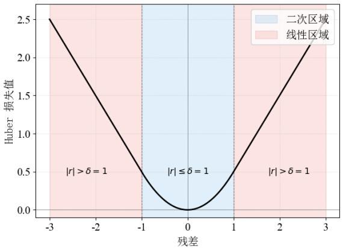  
(a) Huber 损失函数

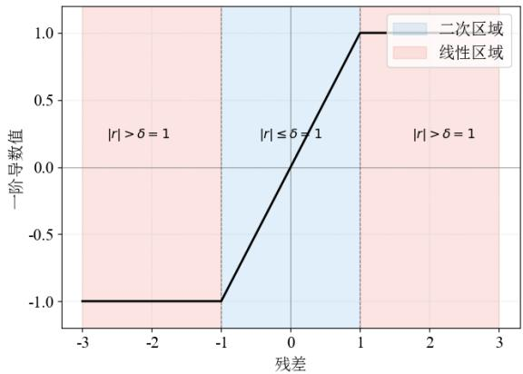  
(b) Huber 损失的导数  
图 5.1 HTC-IST-BiLSTM 算法框架

## 5.2.2 时间一致性损失

在半监督学习领域，一致性正则化是一类重要的学习策略，其基本思想是对于相似或仅经过轻微扰动的输入样本，模型应产生一致或相近的预测结果。该思想基于平滑性假设，即数据分布在输入空间中通常呈现连续变化的结构，相邻样本往往具有相似的输出标签。因此，通过约束模型在相似输入下保持预测一致性，可以有效利用未标记数据的信息，从而提升模型的泛化能力。

对于工业过程建模中的时序数据而言，一致性不仅体现在输入空间的局部平滑性，还体现在时间维度上的连续变化特性。由于工业生产过程通常受到物理和化学规律的约束，其过程变量往往随时间呈现出较为平滑的动态变化特征。因此，在时间上相邻的样本之间通常具有较强的相关性，其对应的输出变量也应当具有连续、平滑的变化趋势，而不应出现明显的突变或剧烈波动。如果模型在相邻时刻的预测结果存在较大的跳变，往往意味着模型未能正确捕捉过程的动态演化规律，或者受到了噪声数据和伪标签误差的干扰。

基于上述考虑，本章将一致性正则化思想引入到时序数据建模中，并通过在时间维度上构建一致性约束来利用未标记数据的时序信息。假设未标记样本序列为 $X _ { u } = \{ x _ { u } ( t ) \} _ { t = 1 } ^ { N _ { u } }$ ，其在时间t和t-1的模型预测输出分别为 ${ | \hat { y } _ { u } ( t ) }$ 和 $\hat { y } _ { u } ( t { - } 1 )$ )。由于相邻时刻的系统状态通常变化较为平缓，其预测结果也应具有一定的连续性。因此，为了抑制相邻时刻预测值之间的不合理波动，本章引入时间一致性损失。该损失函数通过最小化相邻时刻未标记样本预测结果之间的差异，引导模型学习符合工业过程动态特性的平滑预测结果，其基本形式可定义为：

$$
L _ {T} = \frac {1}{N _ {u} - 1} \sum_ {t = 2} ^ {N _ {u}} \left\| \hat {y} _ {u} (t) - \hat {y} _ {u} (t - 1) \right\| ^ {2}\tag{5.2}
$$

通过将 $. L _ { T }$ 作为正则化项加入到整体目标函数中，模型在拟合有标签数据的同时，还能够利用未标记数据所蕴含的时间结构信息。该约束能够有效减少由于测量噪声、异常样本或伪标签误差所导致的预测波动，使模型在时间维度上保持更加稳定和平滑的预测结果，从而提高模型在实际工业过程中的可靠性与鲁棒性。

## 5.2.3 自适应损失权重

在传统的半监督一致性学习中，一致性损失的权重通常被设置为固定常数或随迭代次数线性增加。然而，在自训练过程中，模型生成的伪标签质量参差不齐。如果对所有未标记样本的一致性约束赋予相同的权重，低质量的伪标签可能会通过时间一致性约束将误差传播给相邻时刻的预测结果，导致误差累积。

为此，本章设计了一种基于伪标签样本质量的自适应损失权重策略，利用模型对未标记样本的预测置信度来动态调整一致性约束的强度。设第t时刻未标记样本的伪标签质量置信度为c(t)：

$$
c (t) = 1 - \frac {\exp (E _ {t})}{\sum_ {t = 1} ^ {p} \exp (E _ {t})}\tag{5.3}
$$

P表示伪标签的数量， $\begin{array} { r } { E _ { t } { = } \sum _ { m = 1 } ^ { M } E _ { m } } \end{array}$ 是 $E _ { t }$ 的累积误差，用于量化 $( x _ { t } , y _ { t } )$ 与其邻近样本之间的差异。自适应时间一致性损失可修正为：

$$
L _ {T} = \frac {1}{N _ {u} - 1} \sum_ {t = 2} ^ {N _ {u}} w (t) \left\| \hat {y} _ {u} (t) - \hat {y} _ {u} (t - 1) \right\| ^ {2}\tag{5.4}
$$

自适应权重 $w ( t )$ 由相邻两时刻的伪标签质量共同决定，取最小值：

$$
w (t) = \min (c (t), c (t - 1))\tag{5.5}
$$

采用该自适应机制后，当相邻样本的伪标签置信度均较高时，系统施加强烈的时间一致性约束；当某一时刻预测不可靠时，自适应权重减小，从而切断或减弱误差在时间维度上的传递，保证了网络优化的稳健性。

## 5.3 稳健自训练 BiLSTM 软测量模型

本节将 Huber 损失、时间一致性损失、自适应权重以及双向长短期记忆网络相结合，构建 HTC-IST-BiLSTM。该模型在利用少量标记样本进行监督学习的基础上，通过自训练机制挖掘未标记时序数据中的潜在信息，并利用时间一致性约束增强预测结果在时间维度上的平滑性与稳定性。其算法框架如图 5.2 所示，具体实现步骤如下：

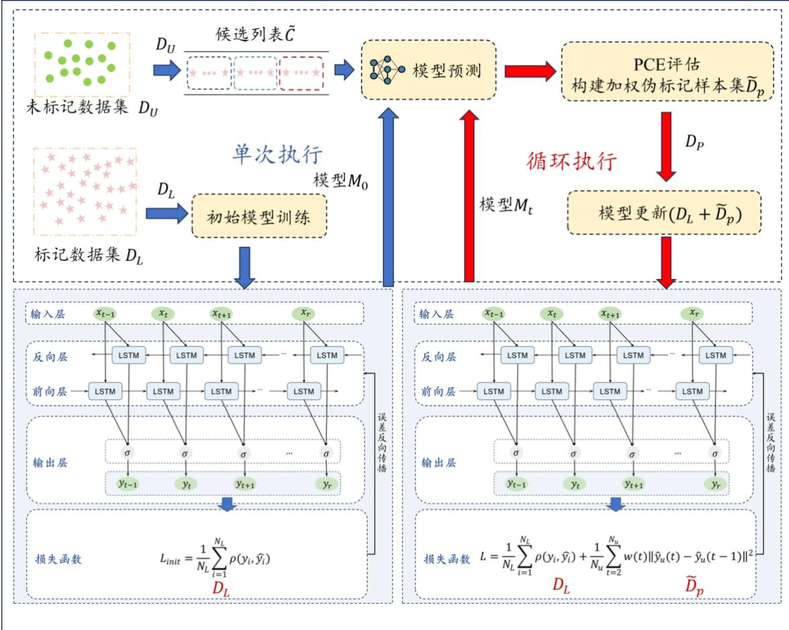  
图 5.2 HTC-IST-BiLSTM 算法框架

（1）候选列表构建：为保持数据在时间维度上的连续性与平稳性，根据无标记数据 $D _ { U }$ 中每个样本到标记样本的时间位置，按升序对其进行排序，创建一个候选列表C̃。在增量式自训练过程中，候选列表C̃根据无标记样本与标记样本的接近程度，优先对这些样本进行标记。

（2）初始模型构建：利用少量带有真实标签的样本数据集 $D _ { \mathrm { { L } } } { = } \{ X _ { L } , Y _ { L } \}$ ，训练初始的 BiLSTM 模型。此时目标函数仅包含 Huber 损失:

$$
L _ {i n i t} = \frac {1}{N _ {L}} \sum_ {i = 1} ^ {N _ {L}} \rho (y _ {i}, \widehat {y} _ {i})\tag{5.6}
$$

（3）伪标签生成与加权：由于这些样本与标记数据在分布上更为接近，其伪标签通常具有更高的可靠性。在此基础上，结合 PCE，对伪标签样本的置信度进行量化，并根据置信度赋予权重 $w ( t )$ ，构建加权伪标记数据集 $\widetilde { D } _ { p }$ 。

（4）模型更新：在得到 $\widetilde { D } _ { p }$ 后，结合 $D _ { L }$ 对 BiLSTM 进行更新。在训练过程中，优化目标由监督损失与自适应时间一致性损失共同组成：

$$
\mathrm{L} = \frac {1}{N _ {L}} \sum_ {i = 1} ^ {N _ {L}} \rho (y _ {i}, \hat {y} _ {i}) + \frac {1}{N _ {u}} \sum_ {t = 2} ^ {N _ {u}} w (t) \left\| \hat {y} _ {u} (t) - \hat {y} _ {u} (t - 1) \right\| ^ {2}\tag{5.7}
$$

其中 $\begin{array} { r } { \frac { 1 } { N _ { L } } \sum _ { i = 1 } ^ { N _ { L } } \big \| \rho ( y _ { i } , \widehat { y _ { i } } ) \big \| ^ { 2 } } \end{array}$ 为监督损失， $\begin{array} { r } { \frac { 1 } { { N } _ { u } } \sum _ { t = 2 } ^ { { N } _ { u } } w ( t ) \left\| \hat { y } _ { u } ( t ) - \hat { y } _ { u } ( t - 1 ) \right\| ^ { 2 } } \end{array}$ 为时间一致性损失。

在上述目标函数约束下，采用反向传播算法对 BiLSTM 网络参数进行优化更新。随后，利用更新后的模型重新生成未标记样本的伪标签，并重复伪标签筛选与模型更新过程，形成迭代式自训练机制。该过程持续进行，直至满足停止条件。基于上述分析，所提出 HTC-IST-BiLSTM 软测量算法的伪代码在表 5.1 中给出。

## 表 5.1 算法 HTC-IST-BiLSTM 的实现流程

输入:带标签数据集 $D_{L}$ 和无标签数据集 $D_{U}$

输出:更新后的 HTC-IST-BiLSTM 模型

参数预设:训练轮数E，学习率 $\eta$，近邻居数量M，候选批次大小 $C_{a}$，微调节点数量 $\Delta K$，Huber 损失参数 $\delta$。

阶段 1：初始化

1. 使用 $D_{L}$ 训练一个初始的 Huber-BiLSTM 模型，此时只有监督损失；
2. 根据无标记数据 $D_{U}$ 中每个样本到标记样本的时间位置，按升序对其进行排序，创建候选列表 $\widetilde{C}$；
阶段 2：增量式自训练

3. flag=1;
4. While (flag)
5. If $C^{(t-1)} \neq \emptyset$
6. 根据 $C^{(t-1)}$ 排序，将 $C_{a}$ 个无标签数据从 $C^{(t-1)}$ 移入无标签数据池，$C^{(t)} = C^{(t-1)} - C_{a}$;
7. End If
8. 使用模型 $M_{t-1}$ 对无标签数据进行标注，得到 $\{X_{P}, Y_{P}\}^{(t)}$;
9. 根据公式(5.3)计算的置信度 $c(t)$，并根据公式(5.5)计算自适应权重，构建加权伪标记数据集 $\widetilde{D}_{p}$;
10. 结合 $D_{L}$ 和 $\widetilde{D}_{p}$ 对 BiLSTM 进行更新，此时损失函数为公式(5.7);
11. If $C_{t} = \emptyset$
12. flag = 0;
13. End If
14. End while

## 5.4 实验及应用

## 5.4.1 人工数据集仿真

为验证所提算法的有效性，本节在带有污染数据的人工数据集上进行了实验，以评估其在模拟复杂工业环境中的综合性能。本节基于 Friedman[91]数据集构建了一个人工时间序列数据集，共包含 2000 个样本与 5 个输入变量。各输入变量均在区间[0,1]上服从均匀分布。输出变量由正弦项、二次项、线性项组合生成，其表

达式为：

$$
y (t) = 1 0 \sin (\pi x _ {1} (t) x _ {2} (t)) + 2 0 (x _ {3} (t) - 0. 5) ^ {2} + 1 0 x _ {4} (t) + 5 x _ {5} (t)\tag{5.8}
$$

其中 $x _ { 4 } ( t )$ 用于在输入数据中引入时间序列特征，其当前值由前五个时刻的取值通过线性加权得到，各项系数反映了不同时间步对当前值的影响程度，具体形式为：

$$
x _ {4} (t) = 0. 7 x _ {4} (t - 1) + 0. 9 x _ {4} (t - 2) + 1. 2 x _ {4} (t - 3) + 0. 7 x _ {4} (t - 4) + 0. 8 x _ {4} (t - 5)\tag{5.9}
$$

本章数据的噪声添加方式、实验设置（包括训练/测试集划分、标记样本比例）以及实验环境均与第四章 4.2 节所述一致。为评估所提算法的性能，本研究选取五种代表性模型作为对比模型，包括 SCN[36]、LSTM[43]、BiLSTM[47]、Huber-BiLSTM、GM-IST-SCN。其中污染率 $\eta = 1 0 \%$ 。实验结果如表 5.2 所示。首先 SCN在该时间序列建模任务中性能明显落后于 LSTM 模型，反映了前馈神经网络在时序特征数据建模任务中存在一定不足。其次，BiLSTM 的表现优于 LSTM，说明双向结构能够更充分地提取时序数据中的前后向特征。在此基础上，Huber-BiLSTM 进一步提升了预测精度，表明 Huber 损失函数对工业数据中的异常值具有较好的抑制作用。相比之下，GM-IST-SCN 的效果优于 Huber-BiLSTM，验证了广义 M 估计在自训练机制下的有效性。最终，HTC-IST-BiLSTM 模型在所有对比方法中取得了最优结果，验证了 Huber 损失、时间一致性损失与自训练策略的联合使用，在处理标记数据不足、离群值干扰及时间序列特性等问题上的综合优势。

真实值与预测结果对比如图 5.3 所示，所提算法的预测曲线能够较好地追踪真实值的变化趋势。这说明该算法能够有效学习数据中的时空动态特性，从而保证其在复杂时序预测任务中的准确性与可靠性。

表 5.2 不同方法在人工数据集上的性能对比

<table><tr><td rowspan="2">软测量模型</td><td colspan="3">MSE</td><td colspan="3">MAE</td><td colspan="3"> $R^2$ </td></tr><tr><td>Mean</td><td>Std</td><td>Best</td><td>Mean</td><td>Std</td><td>Best</td><td>Mean</td><td>Std</td><td>Best</td></tr><tr><td>SCN</td><td>14.681</td><td>7.627</td><td>10.261</td><td>3.047</td><td>0.859</td><td>2.717</td><td>0.679</td><td>0.167</td><td>0.702</td></tr><tr><td>LSTM</td><td>12.889</td><td>3.453</td><td>9.311</td><td>2.804</td><td>0.338</td><td>2.452</td><td>0.717</td><td>0.075</td><td>0.796</td></tr><tr><td>BiLSTM</td><td>10.701</td><td>2.579</td><td>8.348</td><td>2.572</td><td>0.074</td><td>2.307</td><td>0.765</td><td>0.056</td><td>0.817</td></tr><tr><td>Huber-BiLSTM</td><td>8.851</td><td>0.414</td><td>8.222</td><td>2.336</td><td>0.062</td><td>2.472</td><td>0.806</td><td>0.009</td><td>0.819</td></tr><tr><td>GM-IST-SCN</td><td>6.429</td><td>0.101</td><td>6.317</td><td>2.018</td><td>0.024</td><td>2.003</td><td>0.859</td><td>0.002</td><td>0.861</td></tr><tr><td>HTC-IST-BiLSTM</td><td>3.126</td><td>0.137</td><td>2.153</td><td>1.347</td><td>0.273</td><td>1.115</td><td>0.932</td><td>0.030</td><td>0.953</td></tr></table>

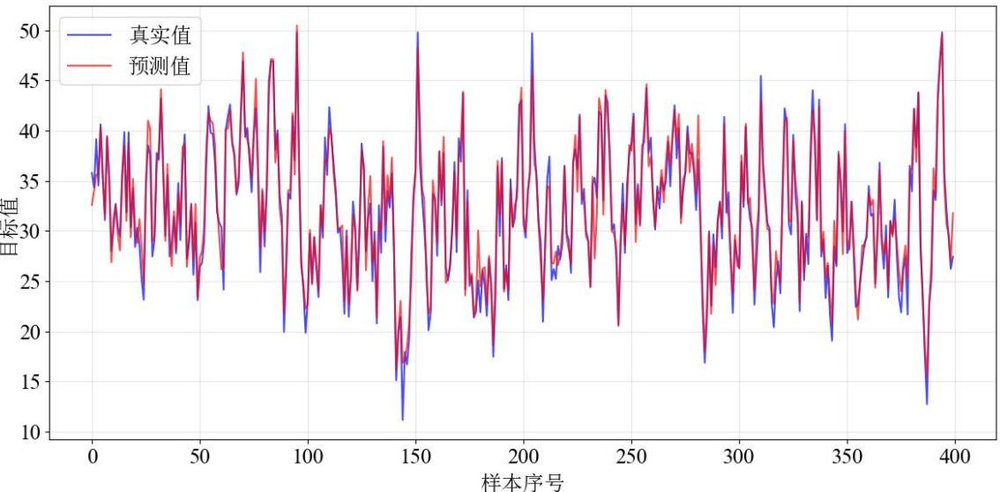  
图 5.3 真实值与预测结果对比

图5.4展示了各算法在真实值与预测值间的误差分布。与其他算法相比，HTC-IST-BiLSTM 的箱线图分布最为紧凑，且中位数最接近零，表明该算法在人工数据集建模中具有更高的预测精度。

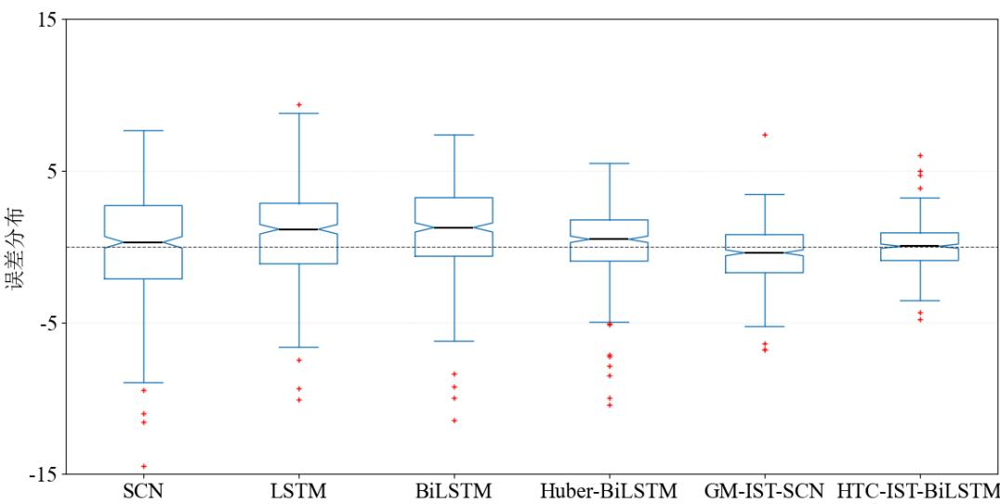  
图5.4 不同算法预测误差的箱线图

## 5.4.2 浮选工艺铜品位软测量建模

## 5.4.2.1 工艺描述

本章研究的浮选工艺流程来自于中国东部某铜矿加工过程。其过程如图 5.5所示，该流程包括磨矿系统、浮选系统和浓缩脱水系统，以生产成品。该流程首先将破碎后的铜矿石通过磨矿系统研磨至一定细度，随后进入浮选系统，与水混合形成矿浆。在浮选槽中，通过添加表面活性剂与发泡剂，并辅以持续机械搅拌，使空气弥散形成大量气泡。在药剂作用下，目标铜矿物颗粒表面疏水化，选择性地附着于气泡，并随气泡上浮至矿浆表层，聚积为泡沫精矿层。泡沫精矿经刮出后输送至浓缩-脱水系统，经过进一步固液分离，最终获得铜精矿成品。未能上浮的非目标矿物则作为尾矿从浮选槽底部排出。

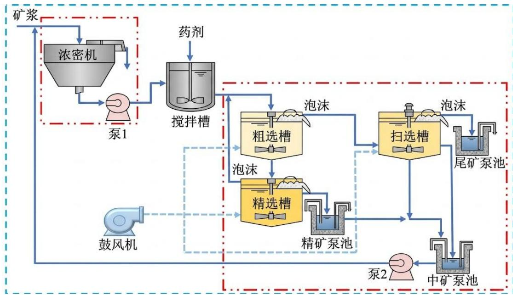  
图5.5 浮选工艺流程

在此过程中，最终产品的铜品位（Copper grade of final product, CGFP）是衡量浮选效果与成品质量的关键工艺指标，直接影响企业的经济效益与资源利用效率。因此，对 CGFP 进行实时、准确的监测与调控具有重要的工业价值。然而，目前选矿现场的品位检测主要依赖人工采样与实验室分析，普遍采用碘量法进行测定。该方法基于铜与碘离子反应生成碘化亚铜的原理进行定量分析，虽结果可靠，但操作复杂、耗时较长，且需每 15 分钟由现场操作人员进行一次采样和送检，导致人力成本高、检测频次受限，难以满足实时过程控制的需求。

针对上述问题，开发一种能够实现 CGFP 快速、准确预测的软测量方法，不仅可有效降低人工检测负担，也有望实现铜浮选过程的实时监控与优化控制，对提升选矿自动化水平与资源综合利用效率具有重要的理论与工程应用意义。

## 5.4.2.2 数据分析

本章所用数据采集自现场分布式控制系统，共包含 28 个输入变量，其中 860个标记样本、 个未标记样本。各过程变量的仪器信息、范围及单位如表所示。其中，变量 1-6 来自磨矿系统，变量 7-23 来自浮选系统，变量 24-28 来自最终产品。浮选过程中的过程变量可由现场 DCS 系统连续采集，而最终产品铜品位需要通过人工采样和实验室分析获得，检测周期相对较长。过程变量以 1 min 为采样间隔记录，而铜品位约每 15 min 获取一次，则目标变量标签数量明显少于过程变量数据量，这也是训练集中标记样本与未标记样本数量差异较大的主要原因。具体而言，训练集中仅有688个样本具有铜品位标签，占训练样本总数的约6.7%，其余 9632 个样本仅包含过程变量信息。对于包含 28 个输入变量且具有显著时序相关性和工况波动特征的浮选过程而言，仅依靠 688 个有标签样本难以充分覆盖不同药剂制度、矿浆状态和浮选运行条件下的动态变化规律，容易限制全监督时序模型的泛化能力。因此，引入自训练半监督机制以利用大量未标记时序数据，对于提高铜品位软测量模型的预测精度和稳定性具有必要性。

表 5.3 浮选过程变量描述

<table><tr><td>序号</td><td>描述</td><td>变化范围</td><td>单位</td></tr><tr><td>1</td><td>矿石进料率</td><td>0-300</td><td>t/h</td></tr><tr><td>2</td><td>溢流的颗粒大小</td><td>50-70</td><td>%</td></tr><tr><td>3</td><td>粗加工液位</td><td>200-45</td><td>mm</td></tr><tr><td>4</td><td>原矿中铜的比例</td><td>0.3-1.2</td><td>%</td></tr><tr><td>5</td><td>原矿中硫的比例</td><td>4-12</td><td>%</td></tr><tr><td>6</td><td>硫铜比</td><td>5-20</td><td>%</td></tr><tr><td>7</td><td>泥浆的pH值</td><td>10-12</td><td></td></tr><tr><td>8</td><td>泡沫在X-axis上的流动速度</td><td>10-120</td><td>mm/s</td></tr><tr><td>9</td><td>泡沫在Y-axis上的流动速度</td><td>10-120</td><td>mm/s</td></tr><tr><td>10</td><td>大气泡的数量</td><td>10-60</td><td></td></tr><tr><td>11</td><td>中气泡的数量</td><td>30-180</td><td></td></tr><tr><td>12</td><td>小气泡的数量</td><td>60-360</td><td></td></tr><tr><td>13</td><td>大气泡的面积</td><td>2000-20000</td><td> $mm^2$ </td></tr><tr><td>14</td><td>中气泡的面积</td><td>2000-17000</td><td> $mm^2$ </td></tr><tr><td>15</td><td>小气泡的面积</td><td>2000-12000</td><td> $mm^2$ </td></tr><tr><td>16</td><td>黄色气泡饱和度</td><td>0.37-1.26</td><td></td></tr><tr><td>17</td><td>绿色气泡饱和度</td><td>0.9-1.2</td><td></td></tr><tr><td>18</td><td>红蓝饱和度比</td><td>1.3-2.2</td><td>%</td></tr><tr><td>19</td><td>原矿分离后的铜含量</td><td>2.5-6.0</td><td>%</td></tr><tr><td>20</td><td>原矿分离后的硫含量</td><td>4-30</td><td>%</td></tr><tr><td>21</td><td>精矿中的硫含量</td><td>0.4-2.0</td><td>%</td></tr><tr><td>22</td><td>精矿中的铜含量</td><td>4-10</td><td>%</td></tr><tr><td>23</td><td>石灰浆</td><td>2-10</td><td>L/min</td></tr><tr><td>24</td><td>尾矿中的铜含量</td><td>0.1-0.3</td><td>%</td></tr><tr><td>25</td><td>尾矿中的硫含量</td><td>0.5-2.8</td><td>%</td></tr><tr><td>26</td><td>铜精矿中的硫含量</td><td>30-40</td><td>%</td></tr><tr><td>27</td><td>硫精矿中的铜含量</td><td>0.1-0.5</td><td>%</td></tr><tr><td>28</td><td>硫精矿中的硫含量</td><td>40-50</td><td>%</td></tr><tr><td>29</td><td>CGFP</td><td>0-50</td><td>%</td></tr></table>

选择与目标变量相关性最高的四个输入变量，在不同的时延进行相关性分析，结果如图 5.6 所示。显然，相关性随着时延的变化而发生显著变化，并且呈现出不同的趋势。这表明不同输入变量对目标变量的影响存在时滞差异，且时滞大小各不相同。因此，选择合适的基础学习器来有效地从不确定的时间序列数据中获取有价值的信息是至关重要的。

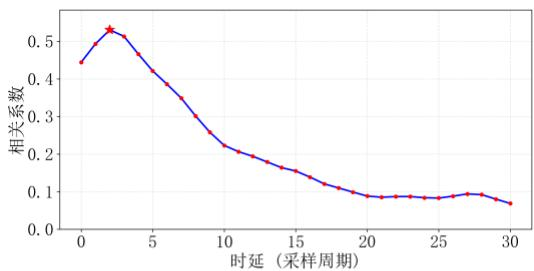  
(a) 变量4

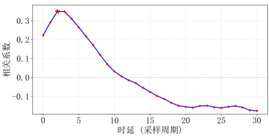  
(b) 变量9

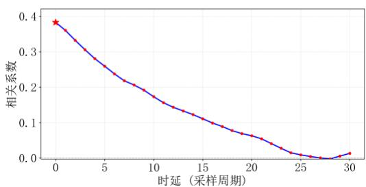  
(c) 变量18

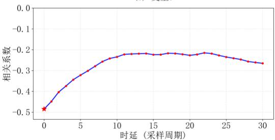  
(d) 变量25  
图5.6 关键输入变量与不同时延输出之间的相关性

此外，数据质量也是影响模型性能的关键因素。本研究使用异常检测工具包对数据集中的离群值进行检测。选择与目标变量相关性最高的前三个输入变量以及目标变量本身进行异常值分析，具体步骤如下：

（1）利用滑动窗口遍历历史数据，在每个窗口之后一个数据点上求该点的数据值减去对应窗口内统计量得到的新的一列数据形成一个新的时间序列 S1。

（2）将 S1 箱线图的上下边界作为正常范围。其中，箱线图的上边界为$\it { Q 3 + 1 . 5 times I Q R }$ ，下边界为 $ { Q 1 - 1 . 5 \times I Q R } ~ (  { Q 1 }$ 和 分别为第一和第三四分位数，$I Q R = Q 3 - Q 1 ~ )$ 。位于该区间内的差值被视为正常，超出该区间的差值则被判定为异常。准则属于箱线图中常用的 1.5 倍四分位距离群点判别方法，能够在不假设数据服从特定分布的情况下识别突变点，适合用于工业过程数据的初步异常波动分析。

通过 ADTK 标准检测数据集中的离群值，结果如图 5.7 所示。从图中可以看出，在输入变量和输出变量中都存在不同程度的异常值，这些异常值可能源于传感器故障、数据记录错误或工况突变等因素。异常值的存在会干扰模型对正常数据模式的学习，降低模型的泛化能力和稳健性。因此，必须提高模型对异常值的抵抗能力，以增强模型的鲁棒性。

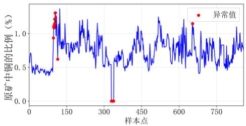  
(a) 输入变量 4

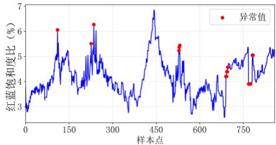  
(b) 输入变量 18

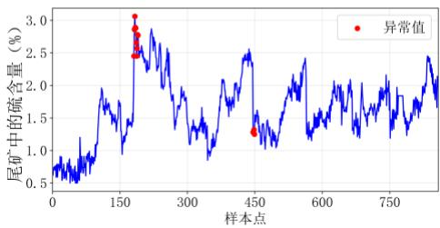  
(c) 输入变量 25

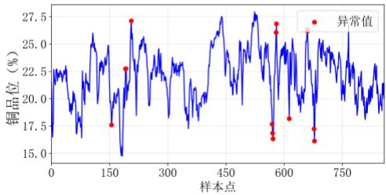  
(d) 目标变量  
图5.7 输入变量和目标变量的异常值分布

## 5.4.2.3 实验结果

表5.4给出了实验结果，BiLSTM的预测结果好于LSTM和SCN，说明BiLSTM对工业过程中的不确定时间序列具有更好的捕捉能力。在此基础上，引入鲁棒损失函数的 Huber-BiLSTM 进一步提升了预测精度和稳定性。GM-IST-SCN 通过自训练迭代机制与稳健算法相结合，增强了模型对噪声数据的适应能力，从而在原始 SCN 基础上实现了显著的性能提升。HTC-IST-BiLSTM 在融合 Huber 损失的基础上，进一步引入自训练策略与一致性损失，不仅能够更有效地处理异常值和复杂时序模式，还具备利用未标记数据挖掘潜在特征的能力。相比于 GM-IST-SCN，HTC-IST-BiLSTM 的 MSE 降低 14.2%，MAE 降低 8.8%，R²提升 6.1%，在所有对比方法中取得了最佳的预测效果，展现出最强的拟合能力和鲁棒性，验证了该模型在工业软测量任务中的优越性。

表5.4 不同方法在该案例中的性能对比

<table><tr><td rowspan="2">软测量模型</td><td colspan="3">MSE</td><td colspan="3">MAE</td><td colspan="3"> $R^2$ </td></tr><tr><td>Mean</td><td>Std</td><td>Best</td><td>Mean</td><td>Std</td><td>Best</td><td>Mean</td><td>Std</td><td>Best</td></tr><tr><td>SCN</td><td>2.876</td><td>0.721</td><td>2.265</td><td>1.315</td><td>0.162</td><td>1.701</td><td>0.578</td><td>0.112</td><td>0.672</td></tr><tr><td>LSTM</td><td>2.011</td><td>0.455</td><td>1.587</td><td>1.183</td><td>0.124</td><td>1.056</td><td>0.695</td><td>0.071</td><td>0.758</td></tr><tr><td>BiLSTM</td><td>1.986</td><td>0.248</td><td>1.704</td><td>1.031</td><td>0.074</td><td>0.997</td><td>0.701</td><td>0.038</td><td>0.741</td></tr><tr><td>Huber-BiLSTM</td><td>1.502</td><td>0.168</td><td>1.231</td><td>0.958</td><td>0.048</td><td>0.883</td><td>0.769</td><td>0.026</td><td>0.806</td></tr><tr><td>GM-IST-SCN</td><td>1.583</td><td>0.183</td><td>1.316</td><td>0.988</td><td>0.057</td><td>0.913</td><td>0.753</td><td>0.031</td><td>0.790</td></tr><tr><td>HTC-IST-BiLSTM</td><td>1.358</td><td>0.141</td><td>1.112</td><td>0.901</td><td>0.042</td><td>0.831</td><td>0.799</td><td>0.023</td><td>0.840</td></tr></table>

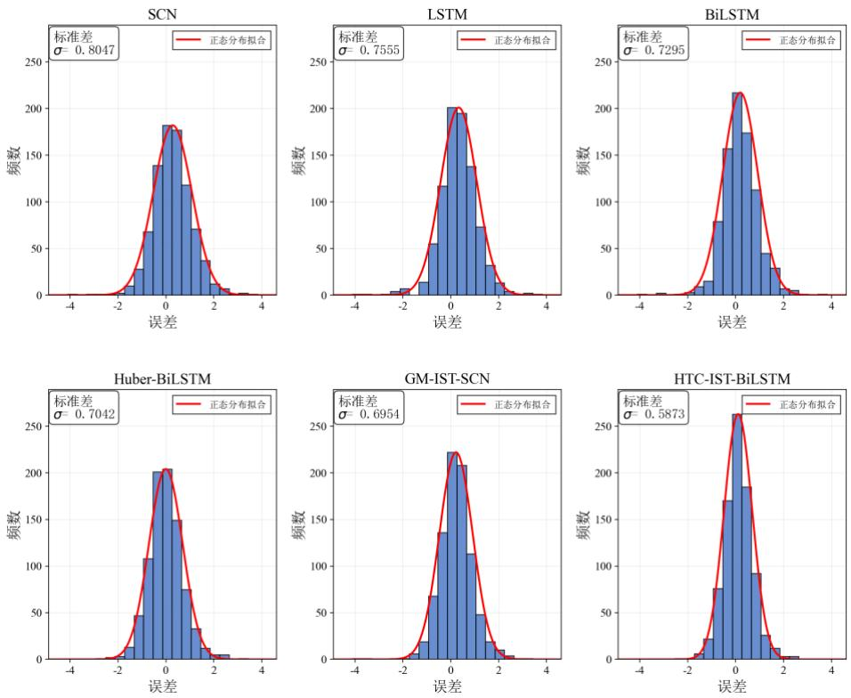  
图 5.8 不同模型预测误差的频率分布图

图 5.8 展示了不同模型预测误差的频率分布。由图可见，所提模型的误差分布较其他模型更为集中，其误差标准差仅为 0.5873，为所有模型中最小。这一结果说明该模型具有更优越的鲁棒性。

图 5.9 展示了 HTC-IST-BiLSTM 对铜精矿品位的预测结果。由图可见，所提算法能够有效跟踪目标变量的动态变化。

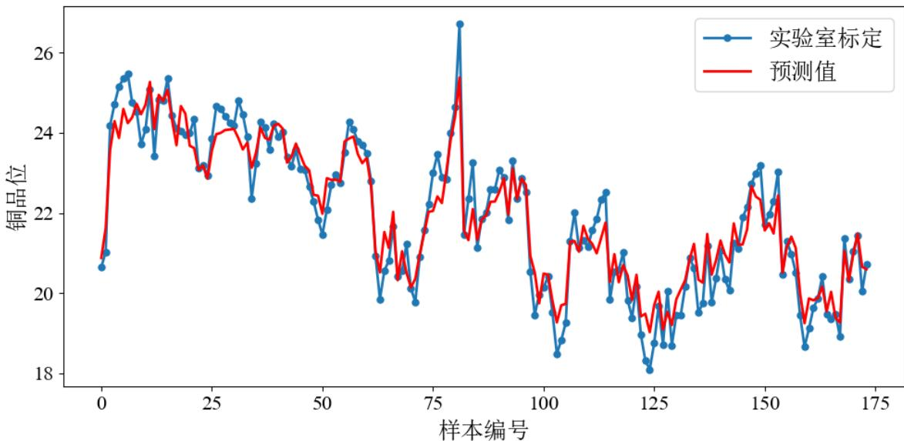  
图 5.9 真实值与预测结果对比

不同算法预测误差的 MPE、SD 和 95%置信区间如表 5.5 所示，所提模型具有最小的平均预测误差 MPE 和SD，以及最窄的置信区间。这些结果进一步证明了所提出的 HTC-IST-BiLSTM 模型具有优越的预测性能和稳定性。

表5.5 不同算法预测误差的可信区间

<table><tr><td>软测量模型</td><td>MPE</td><td>SD</td><td>95%置信区间</td></tr><tr><td>SCN</td><td>1.25</td><td>0.80</td><td>[ 0.3876, 0.6169]</td></tr><tr><td>LSTM</td><td>0.64</td><td>0.76</td><td>[ 0.4317, 0.6496]</td></tr><tr><td>BiLSTM</td><td>0.41</td><td>0.73</td><td>[ 0.2360, 0.4494]</td></tr><tr><td>Huber-BiLSTM</td><td>0.38</td><td>0.70</td><td>[-0.1919, -0.0042]</td></tr><tr><td>GM-IST-SCN</td><td>0.34</td><td>0.70</td><td>[ 0.0350,- 0.2045]</td></tr><tr><td>HTC-IST-BiLSTM</td><td>0.06</td><td>0.59</td><td>[-0.0488, 0.1039]</td></tr></table>

## 5.4.3 超参数敏感性分析

Huber 损失函数中的超参数 δ 关重要，它决定了 MSE 和 MAE 两种损失之间的切换阈值，直接影响了模型对异常值的敏感度和整体拟合性能。具体来说，当δ 取值过大时，Huber 损失会无限接近于 MSE。这表明着模型会将大多数样本都当作平方损失来处理，导致异常值对梯度的贡献被放大，模型为了迎合这些离群点而牺牲整体拟合效果，最终降低预测精度和鲁棒性。反之，当 δ 取值过小时，Huber 损失则近似于 MAE，模型对所有样本的梯度贡献趋于恒定，虽然能够有效抑制异常值的干扰，但对于正常样本的拟合能力会有所下降，收敛速度变慢，难以达到最优的预测精度。

图 5.10 给出了不同 δ 取值下所开发算法的预测 MSE。结果表明，δ 的取值对模型性能有着显著影响，当 δ=0.5 时，算法获得了最小的均方根误差，表明此时Huber 损失在 MSE 与 MAE 之间达到了最佳平衡，在利用正常样本精确拟合的同时，有效抑制了异常值的不利影响，从而实现最优预测性能。

  
图 5.10 HTC-IST-BiLSTM 软测量模型在不同 δ 的预测 RMSE

## 5.4.4 污染率实验

为验证鲁棒策略的有效性，本节在数据集中引入不同强度的噪声，在比较实验中，噪声比例系统性地从 0.1 到 0.5 以 0.1 为增量调整，而其他实验参数在各试验间保持不变。图 5.11 展示了不同方法的性能比较，表明所有算法在测试集规模增加时表现都会下降。值得注意的是，所提议的 HTC-IST-BiLSTM 在所有评估指标上均保持优异表现，性能下降幅度明显小于对比模型，特别是在高噪声条件下，HTC-IST-BiLSTM 具有更强的鲁棒性仍能保持相对较高的精度，表明其在处理噪声数据时表现出了更好的稳定性和抗干扰能力。

  
图5.11 不同污染率下的模型性能对比

## 5.4.5 消融实验

为评估HTC-IST-BiLSTM框架中关键组件的独立贡献，本节开展了消融实验。消融实验结果如表 5.6所示Huber损失与时间一致性损失 TCL 均对模型性能具有积极作用，而移除任一组件都会导致模型性能下降。特别地，移除 Huber 损失对性能退化的影响更为显著，这是因为模型失去了对异常值的鲁棒性，使得训练过程受到离群样本的干扰，导致模型泛化能力下降，从而在增量自训练过程中产生误差累积与传播。与此同时，TCL 通过对伪标签施加时序平滑性约束，并根据伪标签质量自适应调整损失权重，有效降低了低质量伪标签引入的噪声干扰，使模型能够更准确地从未标记样本中学习时序特征，从而在训练过程中提升了标签的一致性与准确性。

表 5.6 消融实验结果

<table><tr><td>算法</td><td>MSE</td><td>MAE</td><td> $R^2$ </td></tr><tr><td>w/o TCL&amp;Huber</td><td>2.43</td><td>1.21</td><td>0.70</td></tr><tr><td>w/o TCL</td><td>1.74</td><td>1.12</td><td>0.75</td></tr><tr><td>w/o Huber</td><td>1.52</td><td>0.94</td><td>0.79</td></tr><tr><td>HTC-IST-BiLSTM</td><td>1.11</td><td>0.83</td><td>0.84</td></tr></table>

## 5.5 本章小结

本章针对工业过程中的时滞特性和动态相关性，提出HTC-IST-BiLSTM模型。该模型通过 BiLSTM 捕捉时序双向依赖关系，引入 Huber 损失提高模型对异常值的鲁棒性，并设计时间一致性损失对未标记样本的预测平滑性进行约束，同时通过自适应权重机制动态调整约束强度以降低低质量伪标签的噪声干扰。人工数据集实验与浮选工艺铜品位预测实验结果表明，该算法在各项评价指标上均优于对比方法，能够有效利用未标记时序数据提升模型性能。在浮选工艺铜品位预测中，HTC-IST-BiLSTM 的 MSE、MAE 和 R²均值分别为 1.358、0.901 和 0.799。与 GM-IST-SCN 相比，MSE 降低 14.2%，MAE 降低 8.8%，R²提升 6.1%。此外，在不同污染率设置下的人工数据集实验验证了该算法的稳定性。消融实验进一步验证了Huber 损失、时间一致性约束和自适应权重机制的有效性。

## 第 6 章 总结与展望

## 6.1 总结

本论文针对流程工业过程中普遍存在的标记样本稀缺、测量数据异常以及过程数据时滞等特性给软测量建模带来的严峻挑战，以磨矿和浮选工艺为具体应用背景，深入开展了自训练半监督神经网络软测量模型的研究。论文通过将自训练半监督学习框架与先进的神经网络结构相结合，并引入稳健估计和时序约束机制，旨在充分利用工业过程中大量易获取的未标记数据，同时增强模型对非理想数据的适应能力，从而提升软测量模型的预测精度和鲁棒性。论文的主要研究工作和成果总结如下：

（1）针对标记样本稀缺及未标记数据分布复杂的问题，提出了一种增量自训练随机配置网络软测量模型，即 IST-SCN。该模型首次将有序伪标记策略引入自训练过程，抑制了早期误差的累积。同时，设计了适用于回归任务的伪标签置信度评估算法，确保只有高质量样本才能扩充标记集。在磨矿工艺溢流矿浆浓度预测的工业实例中，与 IST-MLP 相比，IST-SCN 的 MSE 降低了 18.4%，MAE 降低了 12.0%，R²提升了 5.9%，取得了更高的预测精度和更集中的误差分布，验证了其在利用未标记数据提升模型性能方面的有效性。

（2）针对工业数据中普遍存在的异常值问题，在 IST-SCN 的基础上，引入了广义 M 估计理论，以增强模型对异常数据的稳健性。该算法通过构建稳健损失函数和样本加权机制，从而增强基学习器对异常值的抵抗能力，并将其嵌入增量自训练框架以充分利用无标记样本信息。在含异常值人工数据集及磨矿过程数据上的实验结果表明，GM-IST-SCN 在预测精度和鲁棒性上均优于 IST-SCN 及其他对比算法，相比于IST-SCN，所提方法的MAE和MSE均值分别降低6.4%和10.2%，R²均值提升 3.4%。进一步通过不同污染率的实验验证，该算法在强噪声干扰下仍能保持较优性能，展现了良好的抗干扰能力。

（3）针对过程数据中标记样本稀缺、异常值干扰及时滞特性所带来的建模难题，本文提出了一种基于 Huber 损失与融合时间一致性损失的稳健估计自训练双向长短期记忆网络软测量模型。该模型通过引入 Huber 损失增强模型对异常值的鲁棒性，并设计时间一致性损失函数对伪标签施加时序平滑性约束，同时根据伪标签质量自适应调整权重系数以降低噪声干扰。随后，将该算法应用于铜矿浮选过程中的铜品位预测，实验结果表明，与 GM-IST-SCN 相比，所提算法的 MSE 降低了 14.2%，MAE 降低了 8.8%，R²提升了 6.1%，在预测准确性和鲁棒性方面均优于对比方法，为工业过程建模提供了一种有效解决方案。此外，不同污染率下的实验验证了该算法在强噪声干扰下仍能保持较优性能。

## 6.2 展望

本文针对实际工业过程软测量建模中普遍存在的非线性特性、标记样本匮乏、异常值干扰以及数据长时滞等问题，提出了基于稳健估计的神经网络软测量建模方法，取得了较为理想的预测效果。尽管如此，当前软测量技术仍有进一步拓展的空间。基于本文方法的局限性，现对后续研究进行展望，以期推动软测量技术在更广泛场景中的应用与完善。

（1）软测量模型的在线更新机制。在实际工业应用中，环境波动与设备老化常导致过程数据的统计特性发生漂移，进而使离线训练的软测量模型出现性能退化。现有方法主要依赖固定工况下的离线建模，在运行条件稳定的场景下表现良好。然而，当生产环境、原料配比或工艺方案发生变化时，过程往往呈现出多模态特征，原有模型的预测精度将显著下降。针对这一问题，后续研究应着力发展在线学习或增量学习机制，以实现模型对工况变化的自适应更新。

（2）本文所提出的软测量模型在工业场景中验证了其优异的鲁棒性、高预测精度及低计算复杂度，为基于稳健估计的神经网络软测量方法奠定了理论与应用基础。在此基础上，可将该软测量模型作为核心感知单元嵌入模型预测控制框架之中。利用软测量模型提供的关键变量估计值来构建预测模型并在线求解控制律，从而实现对工业过程的闭环优化与精准控制。最终目标是形成一套集感知、预测、决策与控制于一体的智能系统，以保障算法在实际工业环境中的高效稳定运行。

## 参考文献

[1] 汤健, 夏恒, 余文, 等. 城市固废焚烧过程智能优化控制研究现状与展望[J].自动化学报, 2023, 49(10): 1-41.

[2] Li D, Yang C, Li Y, et al. A deep semi-supervised learning framework towards multioutput soft sensors development and applications in wastewater treatment processes[J]. Journal of Water Process Engineering, 2024, 57: 104654.

[3] Sun Q, Ge Z. A survey on deep learning for data-driven soft sensors[J]. IEEE Transactions on Industrial Informatics, 2021, 2021, 17(9): 5853-5866.

[4] 赵安, 刘辉, 陈甫刚. 基于FCM-WPPCR协同度量的转炉炼钢终点碳温软测量方法[J]. 控制理论与应用, 2025, 42(5):1026-1038.

[5] 邵伟明, 韩文学, 宋伟, 等. 基于分布式贝叶斯隐马尔可夫回归的动态软测量建模方法[J]. 化工学报, 2023, 74(6): 2495-2502.

[6] Jiang Y, Yin S, Dong J, et al. A review on soft sensors for monitoring, control and optimization of industrial processes[J]. IEEE Sensors Journal, 2021, 21(11): 12868- 12881.

[7] Farahani H S, Fatehi A, Nadali A, et al. Domain adversarial neural network regression to design transferable soft sensor in a power plant[J]. Computers in Industry, 2021, 132: 103489.

[8] Wang J, Shao W, Zhang X, et al. Dynamic variational bayesian student's t mixture regression with hidden variables propagation for industrial inferential sensor development[J]. IEEE Transactions on Industrial Informatics, 2021, 17(8): 5314- 5324.

[9] Zhao Y, Ding B, Zhang Y, et al. Online cement clinker quality monitoring: A soft sensor model based on multivariate time series analysis and CNN[J]. ISA Transactions, 2021, 117: 180-195.

[10] 王蓓蓓, 仇知, 丛小涵, 等. 基于两阶段随机优化建模的新能源电网灵活性资源边际成本构成的机理分析[J]. 中国电机工程学报, 2021, 41(4): 1348-1359.

[11] 李华怡, 刘炜. 基于主成分分析的磨矿旋流器机理模型[J]. 上海交通大学学报, 2012, 46(12): 1936-1939.

[12] 张开萍, 高明明, 龙江, 等. 生物质直燃式循环流化床锅炉燃烧系统建模及预测研究[J]. 动力工程学报, 2023, 43(4): 452-460.

[13] Larsson S, Plsson B I, Parian M, et al. A novel approach for modelling of physical interactions between slurry, grinding media and mill structure in wet stirred media

mills[J]. Minerals Engineering, 2020, 148: 106180.

[14] Tian J, Xu R, Wang Y, et al. Capacity attenuation mechanism modeling and health assessment of lithium-ion batteries[J]. Energy, 2021, 221: 119682.

[15] Dai W, Chai T, Yang S X. Data-driven optimization control for safety operation of hematite grinding process[J]. IEEE Transactions on Industrial Electronics, 2015, 62(5): 2930-2941.

[16] Jiang Y, Fan J, Chai T, et al. Data-driven flotation industrial process operational optimal control based on reinforcement learning[J]. IEEE Transactions on Industrial Informatics, 2017, 14(5): 1974-1989.

[17] Mohanty S, Das S K, Majumder A K. Artificial neural network modeling and experimental investigation to characterize the dewatering performance of a hydrocyclone[J]. Mineral Processing and Extractive Metallurgy, 2021, 130(4): 396-408.

[18] Zhu X, Xu J, Fu Z, et al. Novel dynamic data-driven modeling based on feature enhancement with derivative memory LSTM for complex industrial process[J]. Neurocomputing, 2025, 626: 129619.

[19] Tian Y, Xu Y, Zhu Q X, et al. Novel stacked input-enhanced supervised autoencoder integrated with gated recurrent unit for soft sensing[J]. IEEE Transactions on Instrumentation and Measurement, 2022, 71: 1-9.

[20] Li J, Wang J, Sui E, et al. Soft sensor development based on hybrid modeling with ensemble learning for multimode batch processes[J]. IEEE Sensors Journal, 2025, 25(9): 15588-15597.

[21] Li X, Yan X. Dynamic hybrid modeling of LSTM-boosted mechanism and adversarial generation for industrial fuel ethanol fermentation process[J]. Journal of Process Control, 2023, 131: 103093.

[22] Sun K, Yang D, Wang D, et al. Development of a physics-guided bidirectional long short-term memory for wind power forecasting[J]. Engineering Applications of Artificial Intelligence, 2026, 167(2): 113798.

[23] Agarwal A, Shah D, Shen D, et al. On robustness of principal component regression[J]. Journal of the American Statistical Association, 2021, 116(536),1731-1745.

[24] Mehmood T, Liland K H, Snipen L, et al. A review of variable selection methods in partial least squares regression[J]. Chemometrics & Intelligent Laboratory Systems, 2012, 118: 62-69.

[25] Zhu B, Ren S, Wang P, et al. An inductive transfer regression framework for small

sample modeling in power plants[J]. Chemical Engineering Research & Design, 2024: 210: 112-129.

[26] Qi K, Tu J, Yang H. Joint sparse principal component regression with robust property[J]. Expert Systems with Applications, 2021, 187(1): 115845.

[27] Meng Y, Lan Q, Qin J, et al. Data-driven soft sensor modeling based on twin support vector regression for cane sugar crystallization[J]. Journal of Food Engineering, 2019, 241: 159-165.

[28] 李锦冰, 韩冰, 冯守渤, 等. 基于分块核主成分分析和支持向量机的故障检测[J]. 控制理论与应用, 2020,37(4):847-854.

[29] Hou W, Peng Y. Adaptive ensemble gaussian process regression-driven degradation prognosis with applications to bearing degradation[J]. Reliability Engineering & System Safety, 2023, 239: 109479.

[30] Liu X, Jin J, Wu W, et al. A novel support vector machine ensemble model for estimation of free lime content in cement clinkers[J]. ISA Transactions, 2020, 99: 479-487.

[31] Wu X, Sun K, Cao M. A semi-supervised learning and robust bidirectional long short-term memory network for industrial soft sensor[J]. IEEE Transactions on Instrumentation and Measurement, 2025, 74: 1-13.

[32] Sun K, Yang D, Jia K, et al. A semi-supervised stochastic configuration network with ordered incremental self-training and pseudo-label confidence evaluation for industrial soft sensor[J]. Control Engineering Practice, 2025, 165: 106552.

[33] Sun K, Wu X, Xue J, et al. Development of a new multi-layer perceptron based soft sensor for SO2 emissions in power plant[J]. Journal of Process Control, 2019, 84: 182-191.

[34] Fan Y, Tao B, Zheng Y, et al. A data-driven soft sensor based on multilayer perceptron neural network with a double LASSO approach[J]. IEEE Transactions on Instrumentation and Measurement, 2020, 69(7): 3972-3979.

[35] Scardapane S, Wang D. Randomness in neural networks: An overview[J]. Wiley Interdisciplinary Reviews, 2017, 7(2): e1200.

[36] Wang D, Li M. Stochastic configuration networks: Fundamentals and algorithms[J]. IEEE Transactions on Cybernetics, 2017, 47(10): 3466-3479.

[37] Dai W, Zhou X, Wang ZX. Hybrid parallel stochastic configuration networks for industrial data analytics[J]. IEEE transactions on Industrial Informatics, 2022, 18(4): 2331-2341.

[38] Li K, Yang C, Wang W, et al. An improved stochastic configuration network for

concentration prediction in wastewater treatment process[J]. Information Sciences, 2023, 622: 148-160.

[39] Yang C, Li P, Ai M, et al. Temperature prediction in discrete-continuous hybrid tin chemical process using trapezoidal rule and improved stochastic configuration networks[J]. IEEE Transactions on Industrial Electronics, 2025,72(9): 9444-9453.

[40] Chang S, Chen X, Zhao C. Flexible clockwork recurrent neural network for multirate industrial soft sensor[J]. Journal of Process Control, 2022, 119: 86-100.

[41] 杨丽, 吴雨茜, 王俊丽, 等. 循环神经网络研究综述[J]. 计算机应用, 2018,38(2): 1-6.

[42] 孟安波, 陈顺, 王陈恩, 等. 基于混沌CSO优化时序注意力GRU模型的超短期风电功率预测[J]. 电网技术, 2021, 45(12): 4692-4700.

[43] Xu B, Pooi C, Tan KM, et al. A novel long short-term memory artificial neural network (LSTM)-based soft-sensor to monitor and forecast wastewater treatment performance[J]. Journal of Water Process Engineering, 2023, 54: 104041.

[44] Yao L, Ge Z. Dynamic features incorporated locally weighted deep learning model for soft sensor development[J]. IEEE Transactions on Instrumentation and Measurement, 2021, 70:1-11.

[45] Yuan X, Li L, Shardt Y, et al. Deep learning with spatiotemporal attention-based LSTM for industrial soft sensor model development[J]. IEEE Transactions on Industrial Electronics, 2021, 68(5): 4404-4414.

[46] Tan M, Yuan S, Li S, et al. Ultra-short-term industrial power demand forecasting using lstm based hybrid ensemble learning[J]. IEEE Transactions on Power Systems, 2020, 35(4): 2937-2948.

[47] Lui CF, Liu Y, Xie M. A supervised bidirectional long short-term memory network for data-driven dynamic soft sensor modeling[J]. IEEE Transactions on Instrumentation and Measurement, 2022, 71: 1-13.

[48] Sun H, Liu W, Zeng F, et al. A temporal convolutional-based kolmogorov-arnold network for industrial soft sensor modeling[J].IEEE Transactions on Instrumentation and Measurement, 2025, 74: 1-13.

[49] Gao H, Shi J, et al. Semi-supervised and unsupervised extreme learning machines[J]. IEEE Transactions on Cybernetics, 2014, 44(12): 2405-2417.

[50] Zhang M, Xu B, Zhou H L. A novel bidirectional long short-term memory network with weighted attention mechanism for industrial soft sensor development[J]. IEEE Sensors Journal, 2024, 24(11): 18546-18555.

[51] Wang P, Peng J, Pedersoli M, et al. Self-paced and self-consistent co-training for

semi-supervised image segmentation[J], Medical Image Analysis, 2021, 73: 102146.

[52] Zhang X, Zou Y, Li S. Semi-supervised generative adversarial network with guaranteed safeness for industrial quality prediction[J]. Computers & Chemical Engineering, 2021, 153: 107418.

[53] Zhang Y, Gong Z, Yao W. Uncertainty guided ensemble self-training for semisupervised global field reconstruction[J]. Complex & Intelligent Systems, 2024, 10(1): 469-483.

[54] 朱松豪 赵. 基于半监督生成式对抗网络的异常行为检测[J]. 南京邮电大学学报：自然科学版, 2020, 40(4): 50-56.

[55] Zhang C, Peng K, Dong J, et al. A robust fault classification method for streaming industrial data based on wasserstein generative adversarial network and semisupervised ladder network[J]. IEEE Transactions on Instrumentation and Measurement, 2023, 72: 1-9.

[56] Ko T, Kim H. Fault classification in high-dimensional complex processes using semi-supervised deep convolutional generative models[J]. IEEE Transactions on Industrial Informatics, 2020, 16(4): 2868-2877.

[57] Saad MM, O'reilly R, Rehmani MH. A survey on training challenges in generative adversarial networks for biomedical image analysis[J]. Artificial Intelligence Review, 2024, 57(2): 62.

[58] 王娇, 罗四维, 曾宪华. 基于随机子空间的半监督协同训练算法[J]. 电子学报, 2008, 36(12): 60-65.

[59] Zhou Z, Li M. Semi-supervised regression with co-training[J]. Morgan Kaufmann Publishers Inc., 2007, 19(11): 1479-1493.

[60] Bao L, Yuan X, Ge Z. Co-training partial least squares model for semi-supervised soft sensor development[J]. Chemometrics & Intelligent Laboratory Systems, 2015, 147: 75-85.

[61] Wang M, Emailprotected, Emailprotected E, et al. Modeling an adaptive hybrid soft sensor with co-training learning toward applications in wastewater treatment[J]. Industrial and Engineering Chemistry Research, 2023, 62(41): 16841-16853.

[62] Grolman E, Cohen D, Frenklach T, et al. How and when to stop the co-training process[J]. Expert Systems with Application, 2022, 187: 115841.

[63] Chong Y, Ding Y, Yan Q, et al. Graph-based semi-supervised learning: A review[J]. Neurocomputing, 2020, 408: 216-230.

[64] Sheikhpour R, Sarram M A, Gharaghani S, et al. A survey on semi-supervised

feature selection methods[J]. Pattern Recognition, 2017, 64: 141-158.

[65] Zhao Y, Deng X, Li S. A nonlinear industrial soft sensor modeling method based on locality preserving stochastic configuration network with utilizing unlabeled samples[J]. ISA Transactions, 2023, 139: 548-560.

[66] Deng X, Zhao Y, Zhang J, et al. A holistic global-local stochastic configuration network modeling framework with antinoise awareness for efficient semisupervised regression[J]. Information Science, 2024, 661: 120132.

[67] Ding S, Zhang Z, Xu L, et al. A novel robust semi-supervised stochastic configuration network for regression tasks with noise[J]. Information Sciences, 2025, 703: 121933.

[68] Sawant S S, Prabukumar M. A review on graph-based semi-supervised learning methods for hyperspectral image classification[J]. Egyptian Journal of Remote Sensing and Space Science, 2018, 23(2): 243-248.

[69] Che Y, Stroe D I, Hu X, et al. Semi-supervised self-learning-based lifetime prediction for batteries[J]. IEEE Transactions on Industrial Informatics, 2023, 19(5): 6471-6481.

[70] 呼浩, 杨利, 马汀山, 等. 结合主动学习与自训练半监督学习的引风机故障检测方法[J]. 2025,43(2):149-154.

[71] Ge Z, Song Z, Gao F. Self-training statistical quality prediction of batch processes with limited quality data[J]. Industrial & Engineering Chemistry Research, 2013, 52(2): 979-984.

[72] Wang X, Yuan Y, Guo D, et al. SSA-Net: Spatial self-attention network for covid-19 pneumonia infection segmentation with semi-supervised few-shot learning[J]. Medical Image Analysis, 2022, 79: 102459.

[73] Pu X, Li C. Meta-self-training based on teacher-student network for industrial labelnoise fault diagnosis[J]. IEEE Transactions on Instrumentation and Measurement, 2023, 72: 1-11.

[74] Zheng S, Zhao J. A self-adaptive temporal-spatial self-training algorithm for semisupervised fault diagnosis of industrial processes[J]. IEEE Transactions on Industrial Informatics, 2022, 18(10): 6700-6711.

[75] Zheng S, Zhao J. High-fidelity positive-unlabeled deep learning for semisupervised fault detection of chemical processes[J]. Process Safety & Environmental Protection, 2022, 165: 191-204.

[76] Yan K, Zhong C, Ji Z, et al. Semi-supervised learning for early detection and diagnosis of various air handling unit faults[J]. Energy and Buildings, 2018, 181:

75-83.

[77] Liu Q, Wang X, Yang Y, et al. FSR-SSL: A fault sample rebalancing framework based on semi-supervised learning for PV fault diagnosis[J]. IET Renewable Power Generation, 2022, 16(12): 2667-2681.

[78] Yin L, Wang H, Fan W, et al. Combining active learning and fisher discriminant analysis for the semi-supervised process monitoring[J]. IFAC-PapersOnLine, 2018, 51(21): 147-151.

[79] Yin L, Wang H, Fan W, et al. Incorporate active learning to semi-supervised industrial fault classification[J]. Journal of Process Control, 2019, 78: 88-97.

[80] Long J, Chen Y, Yang Z, et al. A novel self-training semi-supervised deep learning approach for machinery fault diagnosis[J]. International Journal of Production Research, 2023, 61(23): 8238-8251.

[81] Nie X, Xie G. A two-stage semi-supervised learning framework for fault diagnosis of rotating machinery[J]. IEEE Transactions on Instrumentation and Measurement, 2021, 70: 1-12.

[82] Fan C, Liu Y, Liu X, et al. A study on semi-supervised learning in enhancing performance of AHU unseen fault detection with limited labeled data[J]. Sustainable Cities and Society, 2021, 70: 102874.

[83] Gao S, Li T, Dong X. Graph semi-supervised soft sensor modeling based on label propagation algorithm[J]. Measurement Science & Technology, 2024, 35(12): 125104.

[84] Wang H, Chen L, Hao K, et al. A novel self-training framework for semi-supervised soft sensor modeling based on indeterminate variational autoencoder[J]. Information Sciences, 2025, 690: 121565.

[85] Huang K, Wen H, Hu G S. Outlier detection for process monitoring in industrial cyber-physical systems[J]. IEEE Transactions on Automation Science and Engineering, 2022, 19(3): 2487-2498.

[86] Sun K, Zhao L, Tian P, et al. Prediction of X-ray fluorescence copper grade using regularized stochastic configuration networks[J]. Information Science, 2024, 659: 120098.

[87] Zhao L, Guo J, Sun K. A new regularized and robust LSTM learning algorithm for industrial soft sensors[J]. Journal of Intelligent & Fuzzy Systems, 2023, 45(1): 323- 343.

[88] Vijayalakshmi B, Ramar K, Jhanjhi N Z, et al. An attention-based deep learning model for traffic flow prediction using spatiotemporal features towards sustainable

smart city[J]. International Journal of Communication Systems, 2021, 34(3): e4609.

[89] Bi J, Chen Z, Yuan H, et al. Accurate water quality prediction with attention-based bidirectional LSTM and encoder-decoder[J]. Expert Systems with Applications, 2024, 238: 121807.

[90] Amini M R, Feofanov V, Pauletto L, et al. Self-training: A survey[J]. Neurocomputing, 2025, 616: 128904.

[91] Friedman J H. Multivariate adaptive regression splines[J]. Annals of Statistics, 1991, 19(1): 1-67.