doi：10.3969/j.issn.1002-3550.2026.09.001

# 不同应力损伤声发射信号传播特性研究

虞爱平 1，刘 涛 1，马晓鹏 1，陈 涛 3，王俊鹏 1，虞小平 2

（1.广西绿色建材与建筑工业化重点实验室，广西 桂林 541004；2.桂林理工大学南宁分校，广西 崇左 5321003.中冶城市投资控股有限公司，广东 广州 510000）

摘 要： 混凝土不同应力损伤对声发射信号传播具有不同的影响。为明确不同应力损伤下声发射信号的传播特性，开展了标准混凝土立方体试件不同应力损伤声发射信号传播试验。通过波形、FFT、特征参数、WPT 分析了不同应力损伤下声发射信号的传播特性。结果表明 接收信号波形的电压值变化较小，波包数量变化较大 频域信号的主频会发生偏移，偏移大小约为±10 kHz 能量和振铃计数在应力比为 时都表现为逐渐降低 分析小波包能量发现，各应力状态下接收信号的小波包能量基本与激发信号一致。不同应力损伤下接收信号的波形失真严重，说明声发射技术监测混凝土结构时接收的波形需经过一定的处理才能正确反映混凝土内部的损伤演化状况。应力比在 时的能量和振铃计数变化说明，随着空隙的增多，能量耗散也会相应增大。不同应力损伤对声发射信号的频域特征和小波包能量影响较小，进一步说明了声发射技术监测混凝土结构时信号的频域分析和小波包能量分析的必要性和准确性。

关键词： 混凝土 应力损伤 波形 FFT 特征参数 WPT

中图分类号： TU528.07

文献标志码： A

文章编号： 1002-3550（2026）09-0001-06

# Study on propagation characteristics of acoustic emission signals at different stress levels

YU Aiping1 , LIU Tao1 , MA Xiaopeng1 , CHEN Tao3, WANG Junpeng1 , YU Xiaoping （1.Guangxi Key Laboratory of Green Building Materials and Construction Industrialization，Guilin 541004，China； 2.Guilin University of Technology at Nanning，Chongzuo 532100，China； 3.MCC Urban Investment Holding Co.，Ltd.，Guangzhou 510000，China）

Abstract: Different stress damage of concrete has different effects on acoustic emission signal propagation.In order to determine the propagation characteristics of acoustic emission signals under different stress damage conditions，the propagation tests of acoustic emission signals under different stress damage conditions of standard concrete cubes were carried out.The propagation characteristics of AE signal under different stress damage were analyzed by waveform，FFT，characteristic parameters and WPT.The results show that the voltage value of the received signal waveform changes little，and the number of wave packets changes greatly.The main frequency of the signal in the frequency domain will be offset，and the offset size is about ±10 kHz.The energy and ringdown counts decrease gradually when the stress ratio is between 0.2 and 0.9.By analyzing the wavelet packet energy，it is found that the wavelet packet energy of the received signal is basically consistent with the excited signal under each stress state.The waveform distortion of the received signal under different stress damage is serious，which indicates that the received waveform can reflect the damage evolution of the concrete correctly after some processing when the acoustic emission technology monitors the concrete structure.The change of energy and ringdown counts when the stress ratio is between 0.2 and 0.9 indicates that the energy dissipation will increase with the increase of voidage.Different stress damage has little influence on the frequency domain characteristics and wavelet packet energy of AE signals，which further explains the necessity and accuracy of frequency domain analysis and wavelet packet energy analysis of AE signals when monitoring concrete structures

Keywords: concrete；stress damage；waveform；FFT；characteristic parameter；WPT

## 0 引言

混凝土结构在外界荷载和各种不利条件下会出现损伤，不同等级的应力损伤会影响混凝土结构的可靠性[1-3]。声发射技术作为一种可靠的无损检测技术在混凝土结构中应用日渐广泛[4-5]。在外力或内力作用下，因材料内部发生变形或断裂而释放能量并产生瞬时弹性波的现象称为声发射（ ， ）[6-7]。声发射监测技术能实时[8]、动态[9]地监测混凝土结构内部的损伤发展情况，并且在监测过程中不会对结构造成损伤。但因混凝土材料是一种非均质性和不连续性材料[10]，声发射波在其中传播时，会经历散射[11]、折射[12]、绕射[13]等复杂的演化，故探明不同应力损伤下声发射信号的传播机理对声发射监测混凝土结构损伤状态具有重要意义。

基于声发射技术对混凝土结构损伤过程进行监测，可以实时、动态地了解混凝土结构内部的真实状态。刘恒杰等[14]通过对不同含水率的三点弯曲梁破坏过程进行声发射监测，研究了不同含水率对混凝土断裂过程力学性能的影响规律 范向前等[15]基于声发射技术对不同加载速率下CFRP 加固混凝土梁的动态力学性能进行了研究；易宏健等[16]通过声发射参数分析和 ABQUS有限元模拟相结合的方式，分析了混凝土受剪损伤演化过程。通过声发射技术监测混凝土结构损伤演化过程虽是一种高效的方法，但不同应力损伤下声发射信号的传播特性还有待深入研究，这关乎动态监测过程接收信号的准确性。

前人研究主要是对混凝土损伤过程中产生的声发射信号进行分析，这可能导致该区域损伤信号与其他区域损伤信号结合形成新的损伤信号，不利于结构健康检测。并且混凝土损伤产生的信号波形和频率并不固定，这可能对不同损伤阶段信号分析造成较大误差，故采用一种特定频率的信号研究不同应力损伤阶段信号传播特性是必要的。本研究通过任意波形发生器模拟特定频率的声发射信号（激发信号），从接收信号的波形特征、快速傅里叶变换（Fast FourierTransform，FFT）后的频域特征、参数变化、信号的小波包能量（Wavelet Packet Transform，WPT）4 个方面分析了不同应力损伤对信号传播特性的影响，为混凝土结构损伤信号识别提供了有力依据。

## 1 试验概况

## 1.1 材料及配合比

本研究制备了强度为 C40 的标准立方体混凝土试件5 个，尺寸为 150 mm×150 mm×150 mm，配合比为水泥∶砂∶石子∶水 =495∶548∶1 019∶235。水泥品种为 P·O 42.5 级，砂石产自桂林市祥久沙场。试块均采用钢模具浇筑，在试件浇筑完成24 h后，进行脱模处理，然后将其置于标准养护环境中。该养护环境的温度维持在 20 ℃，湿度保持在 95%。在这样的条件下，对试件进行为期28 d的养护，养护期满后，进行试验。

## 1.2 试验装置

试验装置主要由力学加载系统、AWG系统以及声发射监测系统组成。力学加载系统为上海三思纵横 WAW-3000系列电液伺服万能试验机，规格为 3 000 kN，本试验采用分级加载形式进行，力学加载系统参数见表 1。试验所使用的声发射监测系统是由美国物理声学公司生产的 16 通道第三代全数字化系统 SensorHighway3，为减少环境噪声影响，测试了试验现场的环境噪声，经测试发现环境噪声的幅值都在35 dB以下，故设置声发射仪器的阈值为35 dB几乎可以滤除所有环境噪声，其余参数设置见表 1。AWG系统采用 ARB-1410任意波形发生器（AWG），所用软件为WaveGen，该软件可以控制AWG系统发射不同频率的信号，通过测试发现，频率为 150 kHz 的 AWG 信号相比其他频率的AWG信号更加稳定，故选择频率为150 kHz的 AWG信号作为特定频率声发射信号（激发信号），该信号的时域和频域波形如图 1所示。

## 1.3 试验程序

试验前使用砂纸对试件粘贴传感器的面进行打磨，然后使用专用耦合剂将声发射传感器紧贴于试件表面，试件左侧设置 1 个 AWG 传感器用于激发信号，右侧设置 4 个AE 传感器用于接收信号。加载设备每完成一级加载和卸载过程后等待 60 s，当试件内信号趋于完整后，使用 AWG系统发射5次激励信号，通过声发射仪器观察信号的接收情况。重复上述步骤直至加载结束。为方便描述，将声发射传感器接收到的信号统一描述为接收信号。试件在不同荷载下的损伤程度用应力比表示，应力比计算式如下

$$
A = \frac {Q}{Q _ {\max}}\tag{1}
$$

式中 $: A$ ——应力比；

Q——试件实时承受的压力值；

$Q _ { \mathrm { m a x } }$ 试件发生破坏时所承受的压力值。

试验完成后，取 AE Sensor3接收的信号进行分析。

表 1 试验参数设置

<table><tr><td>门槛值/dB</td><td>前置放大器增益/dB</td><td colspan="2">采样频率/MHz</td><td>采样长度/k</td><td>峰值定义时间(PDT)/μs</td></tr><tr><td>35</td><td>40</td><td colspan="2">1</td><td>1</td><td>250</td></tr><tr><td>撞击定义时间(HDT)/μs</td><td colspan="2">撞击闭锁时间(HLT)/μs</td><td>传感器数量</td><td>加载速率/(kN/s)</td><td>每级荷载/kN</td></tr><tr><td>500</td><td colspan="2">600</td><td>5</td><td>1</td><td>30</td></tr></table>

## 2 原始信号波形及其快速傅里叶变换

## 2.1 原始信号分析

声发射传感器接收到的信号波形是激发信号穿透混凝土介质后所受扰动程度最直观的体现。混凝土作为一种三相复合材料，信号在介质中传播时会因波振面增大、介质吸收、散射等因素发生衰减，根据文献 的结果，信号在150 mm 以内衰减不大，信号中所包含的主要信息并没有完全丧失，故后续描述中不再对信号衰减进行单独讨论。试件在加载过程中，会经历内部空隙压实、微裂纹稳定发展、微裂纹不稳定发展 个阶段。信号由于无法穿透混凝土内部裂纹，故只能通过折射、绕射、散射等方式进行传播。经历折射、绕射、散射后的波会相互融合形成新的信号，这干扰了我们对原始信号的识别。为研究不同加载阶段激发信号和接收信号的区别，选取应力比0.1、0.3、0.5、0.7、0.9、1.0（临近破坏）时的信号进行分析，各应力比接收信号如图 2所示。

由图 可知，激发信号在穿透混凝土介质被声发射传感器接收时，发生了较大的畸变，已较难从中区分出激发信号。产生这种现象的主要原因是混凝土自身的非均质性、骨料填充的随机性和裂纹的发育。随着应力比的增加，试件内部微裂纹逐渐发展，对接收信号的影响也逐渐变大。从图 2中可以直观地看出，应力比为 0.1、0.3、0.5、0.7、0.9 时，接收信号的电压值基本集中于-0.1 mV 和 0.1 mV 之间，说明在混凝土没有发生宏观破坏前，信号在不同损伤阶段传播的电压值所受的影响是有限的。值得注意的是，不同损伤阶段接收信号的波包数量是完全不同的。在经历折射、绕射、散射后的波会相互融合形成新的信号，但由于折射、绕射、散射的程度不一，故融合形成的新信号波包数量也会发生相应变化。在应力比达到 （临近破坏）时，接收信号的电压骤降至 0.02 mV 以下，且波包数量更多，说明信号在传播时发生了更为剧烈的折射、绕射、散射现象，散射衰减严重，信号几乎完全失真。

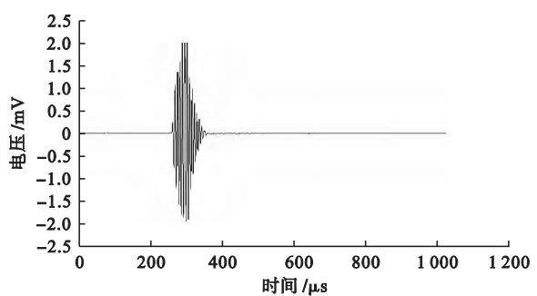  
(a)时域信号

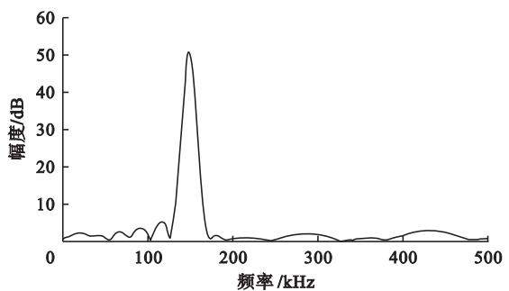  
(b)频域信号

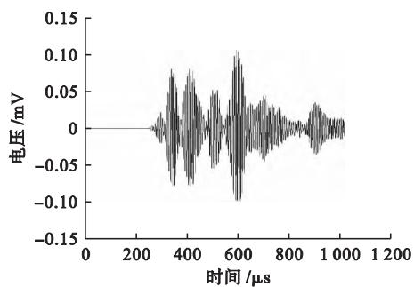  
(a)应力比0.1

图 1 激发信号  
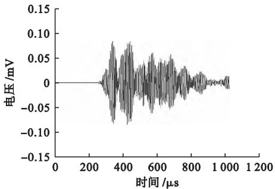  
(b)应力比0.3

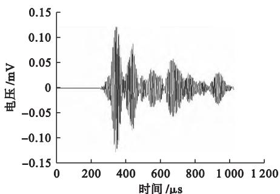  
(c)应力比0.5

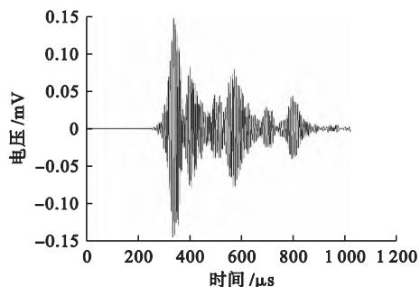  
(d)应力比0.7

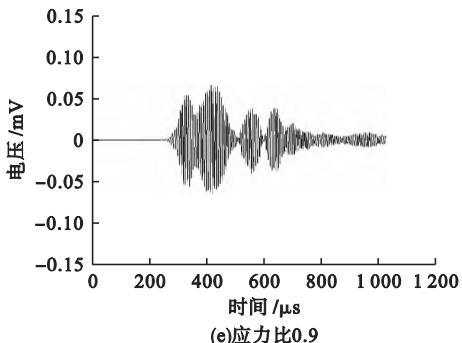  
图 2 不同应力比的原始信号波形

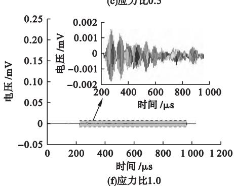

综上来看，不同应力损伤接收信号波形的区别主要集中于电压值和波包的数量的不同，影响因素包括混凝土自身的非均质性、骨料填充的随机性、裂纹的发育以及接收信号组成成分的不确定性。明确信号传播特征及其影响因素，对声发射技术监测混凝土结构裂缝发育过程具有重要意义。

## 2.2 快速傅里叶变换

原始信号为时域信号，主要反映信号电压随时间的变化情况，并且因为多种因素的影响导致信号明显失真，为进一步分析不同应力损伤下的信号特征，利用快速傅里叶变换对原始信号进行处理，将时域信号转换到频域进行分析。应力比 0.1、0.3、0.5、0.7、0.9、1.0（临近破坏）时的信号作快速傅里叶变换如图 3所示。

从图 4可以直观地看到，各应力损伤的信号都表现为双主频，即1个主频和1个次主频，并且主频和次主频相距极近。例如 应力比为0.1时，接收信号的主频为 141.6 kHz，次主频为 148.44 kHz 应力比为 1.0时，接收信号的主频为142.58 kHz，次主频为 154.3 kHz。相较于激发信号，接收信号的主频发生了一定幅度的偏移，偏移的大小约为±10 kHz，应力比 0.1、0.3、0.5、0.7、0.9、1.0（临近破坏）时的主频分别为141.6 kHz、144.53 kHz、145.51 kHz、145.51 kHz、147.46 kHz、154.3 kHz，主频的偏移大小分别为-8.4 kHz、-5.47 kHz、-4.49 kHz、-4.49 kHz、-2.54 kHz、4.3 kHz。产生这种现象的主要原因是激发信号在传播过程中由于折射、绕射、散射等分解成不同的波，这些波在传播过程中发生频散，并且经过介质传播后合成新信号被传感器接收，而合成新信号的波都是由激发信号折射、绕射、散射形成的，故都带有激发信号的特性，而激发信号的频率为 k ，则折射、绕射、散射形成的信号频率也会在 150 kHz附近波动。不同频率的信号合成新信号后，各合成新信号的波的特征都可以从接收信号的主频上体现出来，故接收信号会表现为双主频

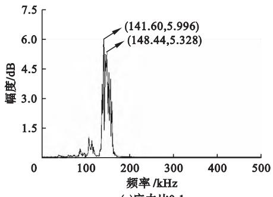  
(a)应力比0.1

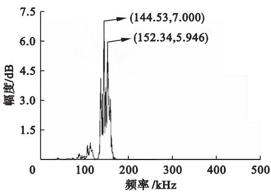  
(b)应力比0.3

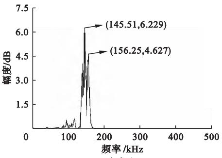  
(c)应力比0.5

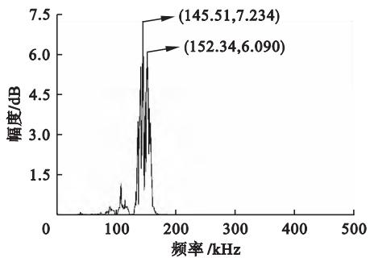  
(d)应力比0.7

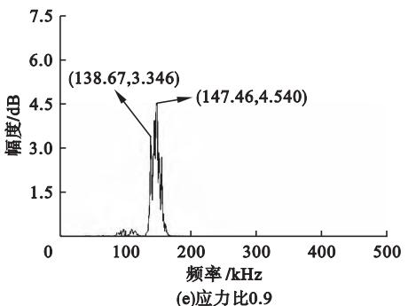

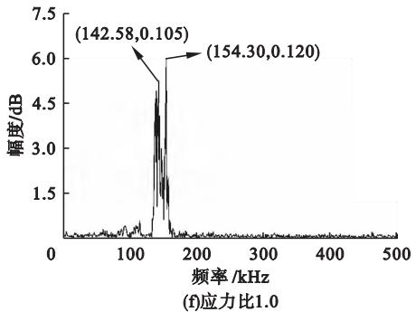

图 3 不同应力比的原始信号快速傅里叶变换  
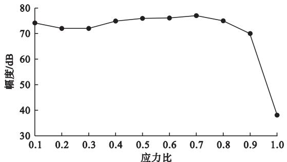  
(a)幅值随应力比增加的变化过程

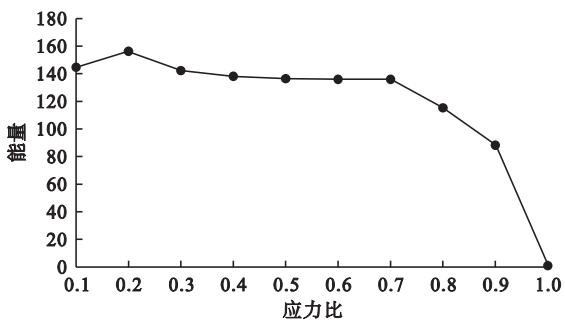  
(b)能量随应力比增加的变化过程

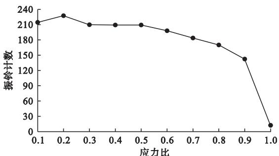  
(c)振铃计数随应力比增加的变化过程  
图 4 特征参数随应力比增加的变化过程

甚至多主频。值得注意的是，当应力比达到 0.9 以后，次主频从主频右侧转移到了左侧，并且主频幅度大幅降低，临近破坏时主频幅度降低到 。这种现象可以解释为应力比达到0.9后，试件内部微裂纹不稳定发展，激发信号在较多微裂纹或宏观裂纹上会发生更严重的折射、绕射、散射现象，折射波、绕射波、散射波的能量耗散严重，甚至一部分被传播速度较慢的剪切波代替，这就导致次主频前移，信号幅度值下降。

## 3 信号特征参数及小波包能量分析

## 3.1 信号特征参数分析

声发射特征参数是对声发射信号时域或频域波形中不能直观看出的重要特征进行提取，其能在一定程度上反映不同应力损伤下接收信号的变化情况。幅值参数[18]、能量参数[19]和振铃计数参数[20]是评价混凝土声发射信号常用的参数，故本节选取幅值参数、能量参数和振铃计数参数对不同应力损伤下接收信号的变化情况进行分析。幅值参数、能量参数和振铃计数参数随应力比增加的变化过程如图 4所示。

声发射幅值是指声发射波形的最大幅度值，其一定程度上反映了波源的强度以及波源受扰动的程度。由图 4（a）可知，应力比小于 时，幅值在 d 内波动，波动幅度较小，应力比大于0.9时，幅值发生了突变，从70 dB降至，变化幅度较大。发生这种变化的原因是应力比在0.9\~1.0（临近破坏）时，混凝土内的微裂纹相互贯通，即将形成宏观裂纹，此时混凝土内部裂纹分布复杂，由于声发射信号无法穿透空气介质传播，故信号在穿透混凝土时会经历复杂的折射、绕射、散射现象，在这个过程中，信号受裂缝扰动大，能量耗散较快，所以会发生幅值大幅降低的情况。

声发射能量是指声发射信号时域包络线下的面积，其大小反映了信号的强度，能量越大，信号越强，反之则信号越弱。由图 （）可知，能量大小随应力比的增加整体大致呈下降趋势。值得注意的是，在应力比为 时，能量有大幅度提升，这是因为，此时混凝土经历了局部压实，混凝土内部的微裂纹减少，信号在传播过程中介质吸收作用降低，能量耗散减小，所以此时的接收信号能量较大。应力比为0.2\~0.7时能量下降较缓，此时混凝土内部微裂纹稳定发展，并且发展并不剧烈。应力比达到 0.7\~0.9时，混凝土内部微裂纹剧烈发展，接收信号能量下降明显。在应力比为 1.0（临近破坏）时，微裂纹贯通，宏观裂纹出现，激发信号在穿透混凝土时发生剧烈的能量耗散，导致此时接收信号的能量极低。

声发射振铃计数是指在一次撞击中，超过阈值的信号的总数，常用来评估声发射信号的活动性。和能量类似，接收信号的振铃计数随应力比增加也大致呈下降趋势，并且在应力比为 0.2 时也出现了增长，此处增长的原因是混凝土被压实，信号的活动性较强，超过阈值的次数增多。应力比在 0.5\~0.9时，振铃计数呈现出稳定下降的趋势，信号超过阈值的次数逐渐减少，信号的活动性开始减弱。值得注意的是，振铃计数在应力比大于 0.5后表现为加速下降，而能量在应力比大于 0.7 后表现为加速下降。出现这种差异和接收信号成分的复杂性有关，接收信号本身就是由激发信号所形成的一系列折射波、绕射波、散射波合成，而这些波本身都具有不同的性质，当其合成接收信号后能量和振铃计数并不会同步。也就是说，较大的能量并不一定对应较大的振铃计数，应从材料性质、信号传播机制以及材料损伤发育程度等多方面考虑。

## 3.2 小波包能量分析

为深入了解不同应力损伤下声发射信号的传播特性，引入小波包变换对不同应力比下采集的接收信号进行处理。

进行小波包变换时，选择不同的小波基对信号处理会产生不同的效果。根据文献[21]所述，小波基函数及小波包分解层数可根据范数熵（Lp）判断最优解，故此处做小波包变换时选择的小波基为 Daubechies 小波，使用其中的 db6小波对不同应力损伤下的接收信号做小波包变换，研究不同应力损伤下接收信号各频带的能量占比情况。在小波包算法中，对时域信号进行3层小波包分解，会得到相应的8个小波包。声发射采样频率为1 MHz，则其奈奎斯特（Nyquist）频率为f/2，即 500 kHz，小波包划分频带带宽为 62.5 kHz。各频带段划分见表 。

表 2 频带段划分

<table><tr><td>频带</td><td>频带范围 /kHz</td><td>频带</td><td>频带范围 /kHz</td></tr><tr><td>1</td><td>0~62.5</td><td>5</td><td>250~312.5</td></tr><tr><td>2</td><td>62.5~125</td><td>6</td><td>312.5~375</td></tr><tr><td>3</td><td>125~187.5</td><td>7</td><td>375~437.5</td></tr><tr><td>4</td><td>187.5~250</td><td>8</td><td>437.5~500</td></tr></table>

应力比 0.1\~1.0（临近破坏）接收信号和激发信号的各频带段能量占比如图5所示。接收信号和激发信号的中低频带能量都主要集中于频带2和频带3，高频带能量主要集中于频带 。接收信号频带 能量占比为 ，频带 能量占比为 ，频带 能量占比为1.27%，激发信号频带 2能量占比为 17.41%，频带 3能量占比为 ，频带 能量占比为 ，接收信号和激发信号的高、中、低频带能量差别较小，并且随着混凝土的损伤加剧，这种情况基本没有发生变化。

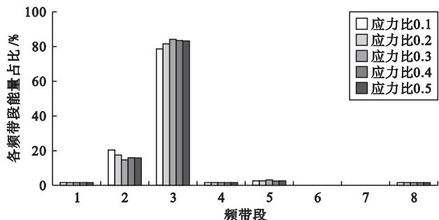  
(a)应力比0.1\~0.5接收信号各频带段能量占比

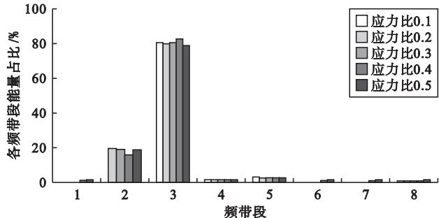  
(b)应力比0.6\~1.0接收信号各频带段能量占比

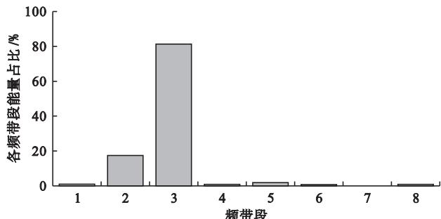  
(c)激发信号各频带段能量占比  
图 5 激发和接收信号各频带段能量占比

通过接收信号和激发信号的频带能量占比可以得出，激发信号在经过混凝土不同损伤等级的区域时，频域信号所受影响较小，这与 2.2章节中描述的观点一致。故可以得出的结论是，在无其余信号干扰的情况下，混凝土损伤对声发射信号的频域特征影响较小。说明小波包能量分析也可以作为一种用于混凝土结构声发射信号处理的可靠手段。

## 4 结论

以标准混凝土立方体试件为研究对象，通过波形、 、特征参数、WPT，分析了不同应力损伤下声发射信号的传播规律，主要结论如下

（1）激发信号穿透混凝土介质被声发射传感器接收时，已发生了较大的畸变。不同应力下接收信号的电压值变化幅度较小，只在发生宏观破坏时才有突变，但信号的波包数量变化较大，说明接收信号受混凝土介质影响较大。

（2）对信号进行 FFT 后发现，接收信号会出现 1 个次主频。接收信号相较于激发信号，其主频发生了一定幅度的偏移，偏移的大小约为 ，说明不同应力损伤对信号频域特征影响较小。故声发射信号的频域特征是声发射监测混凝土结构时信号分析的 1个可靠指标。当声发射信号第一作者： 虞爱平（1981—），男，博士，教授，主要研究方向为土木工程耐久性和工程材料。

在微裂纹不稳定发展阶段传播时，信号的次主频会移动至主频前面，说明信号在较多微裂纹或宏观裂纹中传播时，其次主频会受到一定程度的扰动。

（3）分析信号的特征参数发现，幅值、能量、振铃计数在应力比 0.9\~1.0（临近破坏）时，都会发生突变，说明声发射信号在较多微裂纹或宏观裂纹中传播时，信号失真严重。而在应力比小于 0.9时，幅值变化幅度较小，说明幅值参数受应力损伤影响较小。能量和振铃计数在混凝土压密阶段（应力比 0.2）都会增长，说明内部空隙越密实，信号传播过程中的能量耗散越小。能量和振铃计数在应力比 0.2\~0.9都表现为逐渐降低，说明逐渐增多的空隙会形成越来越大的能量损耗，振铃计数也会受到影响。

（4）将信号进行小波包变换分解成 8 个频带后发现，各应力状态下接收信号的小波包能量占比变化较小，基本与激发信号一致。说明小波包能量分析可以作为一种用于混凝土结构声发射信号处理的可靠手段。

## 参考文献：

[1] 姚国文，刘汶朋，邸小勇，等.应力状态对 RC 梁混凝土碳化损伤及承载力的影响[J].科学技术与工程，2023，23（34）：14750-14759.

[ 2 ] Zhang S Q，Zhang Y，Lei Q R，et al.Acoustic emission character－istics of damage evolution of multi-scale fiber reinforced rubber －ized concrete under uniaxial compression and tension after beingsubjected to high temperatures[J].Frontiers of Structural and CivilEngineering，2024，18（8）：1237-1266.

[3] 王瑰玫，廖棱，张森华，等.应力历史影响下混凝土应力的激光超声检测[J].科学技术与工程，2021，21（34）：14734-14741.

[4] 罗玲，汪建平，周丽娜，等 玄武岩纤维沙漠砂混凝土本构关系及损伤特性研究[J].混凝土，2024（5）：15-20

[ 5 ] Soltangharaei V，Anay R，Assi L，et al.Analyzing acoustic emissiondata to identify cracking modes in cement paste using an artificialneural network[J].Construction and Buildin Materials，2021，267（18）：121047.

[6] 刘鑫锦，苏国韶，李小玉，等.中间主应力对花岗岩双轴压缩破坏过程的声发射演化特征影响 J 河南科技大学学报（自然科学版），2024，45（1）：79-87，97.

[ 7 ] Alipujiang J，Wang S H，Tae-Min O，et al.Detection of source lo－cations in RC columns usin machine learnin with acoustic e －mission data[J].En ineerin Structures，2021，246（1）：112992.

[ 8 ] Van V，Yunwoo L，Jinyeong B，et al.Damage localization using a－coustic emission sensors via convolutional neural network andcontinuous wavelet transform [J].Mechanical S stems and Si nalProcessing，2023，204：110831.

[ 9 ] Yu A P，Chen Z H，Zhang L，et al.Study on AE characteristics of concrete with different W/C ratio under uniaxial compression [J].

Structures，2023，58：105443.

[10] 高帅.非均质混凝土基复合桥面抗爆炸性能试验研究[J].混凝土，2022（3）：20-24.

[11] 韩聪，姜广义，刘曈，等.声发射信号在带筋结构中的传播特性[J]振动.测试与诊断，2024，44（1）：153-158，204.

[12] 李军伟，徐飞，王兵，等.混凝土不同骨料粒径对声发射检测的影响[J].山东大学学报（工学版），2021，51（5）：84-90.

[13] 虞爱平，丁俊业，陈哲涵，等.混凝土骨料粒径对声发射信号衰减特性影响[J].河南科技大学学报（自然科学版），2023，44（3）：54-60.

[14] 刘恒杰，李宗利，谭聪，等.不同含水率混凝土断裂过程声发射试验研究[J].工程科学与技术，2020，52（6）：153-161.

[15] 范向前，刘决丁，胡少伟，等.不同加载速率下 CFRP 加固混凝土梁动态力学性能试验研究[J].建筑结构学报，2020，41（7）：201-206.

[16] 易宏健，陈卓异，柯红军，等.基于声发射技术的混凝土剪切损伤研究[J] 铁道科学与工程学报，2024（10）：4214 4225

[17] 虞爱平，陈哲涵，吴晓蔓，等.混凝土强度等级对声发射波传播特征的影响[J].河南科技大学学报（自然科学版），2023，44（6）：70-76.

[18] Li X J，Hu Y S，Zhang G J，et al.Study on granite damage andfracture behavior and theoretical model based on pre-peak constantamplitude cyclic loading test combined with acoustic emissiontechnology[J].Russian Journal of Nondestructive Testing，2023，59（5）：524-536.

[19] 张玉良，吴必胜，赵高峰.基于声发射监测的岩石热损伤实时演化研究[J].中南大学学报（自然科学版），2021，52（8）：2945-2958.

[20] Xiang H，Chen L X，Yang B，et al.The crack-healing performanceof asphalt mixture based on acoustic emission system[J].Construc －tion and Building Materials，2024，411：134787.

[21] Yu A P，Liu X T，Fu F，et al.Acoustic emission si nal denoisin ofnridge structures using SOM neural network machine learning[J].Journal of Performance of Constructed Facilities，2023，37（1）：1-14.

联系地址： 广西壮族自治区桂林市七星区建干路 12 号 桂林理工大学土木工程学院（541000）

联系电话： 18177378109

通信作者： 虞小平（1983—），男，硕士，讲师，主要从事土木工程方面的教学和研究工作。

联系电话： 13457871320