分类号 U447

单位代码 10618

密 级 公开

学 号 622230970095

# 专业硕士学位论文

## 基于弹性波实时波速场的声发射源定位方法研究

研 究 生 姓 名： 黄翔

导师姓名及职称： 刘思孟 (教授)

申请学位类别 土木水利硕士 学科名称 土木水利

2026 年 6 月

# Research on Acoustic Emission Source Localization Method Based on Real-Time Elastic Wave Velocity Field

A Dissertation Submitted for the Degree of Master

Candidate：Huang Xiang

Supervisor：Prof. Liu Simeng

Chongqing Jiaotong University, Chongqing, China

## 摘 要

混凝土结构在受载过程中伴随微裂纹萌生、扩展与贯通，其损伤演化将直接影响结构安全性与耐久性。声发射技术作为一种重要的无损监测手段，能够实时感知材料内部损伤活动，在混凝土结构健康监测中具有良好的应用前景。然而，受混凝土介质非均质性、传播模型失配以及加载过程中波速场与源坐标动态耦合等因素影响，声发射源定位结果易出现离散性大、误差高等问题，制约了其工程应用效果。为此，本文围绕信号质量控制、传播介质建模修正及动态联合反演三个关键环节，构建了面向混凝土损伤演化过程的声发射精细定位方法体系。

（1）针对多通道 Hit 信号质量不一致引起的定位离散问题，提出了基于小波包局部能量分布特征的 Hit 筛选方法。通过构建高低频能量比指标表征同源多通道Hit的局部特征一致性，并以组内离散度最小为准则筛选最优Hit子集。断铅（PLB）试验结果表明，该方法可有效抑制异常定位点，均方根误差由 13.303mm 降至6.471mm，误差小于 1cm 的定位结果占比由 37.5%提高至 80.4%。

（2）对于传统均匀波速假设难以反映混凝土内部实际传播特性的问题，建立了基于波速场实时重建的定位修正模型。借鉴 CT成像思想，采用射线追踪与 ART算法重建试件内部网格慢度场，并结合源点摄动搜索模型对初始定位结果进行二次修正。结果表明，非均匀波速场修正后平均绝对误差由 12.467mm 降至 4.798mm，定位精度明显优于传统非迭代未知波速法。

（3）针对受载过程中声发射事件持续产生、介质波速场动态演化及源坐标与波速场耦合误差显著的问题，提出了面向声发射事件簇的波速场—源坐标交替迭代联合反演方法。通过构建“阶段外层递推+阶段内交替迭代”的双层求解框架，实现了损伤演化背景下波速场动态变化与源坐标的协同更新。单轴压缩试验结果表明，随着荷载增加，试件平均波速由 3740m/s 衰减至2248m/s，低波速异常区逐步演化为连续低速带，较好表征了混凝土内部由微裂纹萌生到宏观裂缝贯通的损伤过程。相比传统算法，本文方法所得定位点云分布更集中且与最终裂缝路径更一致，定位误差总体降低约 26%，有效削弱了由损伤演化引起的系统性定位偏差。

综上，本文从输入信号质量控制、传播介质建模修正到损伤过程动态联合反演三个层面展开研究，系统提升了混凝土声发射源定位的精度与稳定性，并增强了对损伤时空演化过程的表征能力，为混凝土结构的声发射源定位提供了新的解决方案和思路。

关键词：混凝土，源定位，Hit 筛选，波速场重建，动态反演

## ABSTRACT

The damage evolution of concrete structures under loading, accompanied by the initiation, propagation, and coalescence of microcracks, directly affects their structural safety and durability. Acoustic emission (AE) technology, as a crucial non-destructive monitoring method, can sense internal damage activities in real time, exhibiting promising application prospects in the structural health monitoring of concrete. However, influenced by factors such as the heterogeneity of the concrete medium, propagation model mismatch, and the dynamic coupling between the wave velocity field and source coordinates during the loading process, AE source localization results often suffer from high dispersion and significant errors, restricting its engineering application. Therefore, focusing on three key aspects—signal quality control, propagation medium modeling and correction, and dynamic joint inversion—this thesis constructs a refined AE source localization methodology tailored to the damage evolution process of concrete. (1) Aiming at the localization dispersion caused by the inconsistent quality of multichannel Hit signals, an AE Hit filtering method based on the local energy distribution characteristics of wavelet packets is proposed. A high-to-low frequency energy ratio index is constructed to characterize the local feature consistency of homologous multi-channel Hits, and the optimal Hit subset is selected based on the principle of minimum intra-group dispersion. Pencil lead break (PLB) test results demonstrate that this method can effectively suppress anomalous localization points. The root mean square error (RMSE) is reduced from 13.303 mm to 6.471 mm, and the proportion of localization results with an error of less than 1 cm increases from 37.5% to 80.4%. (2) To address the issue that the traditional uniform wave velocity assumption struggles to reflect the actual internal propagation characteristics of concrete, a localization correction model based on the real-time reconstruction of the wave velocity field is established. Drawing on computed tomography (CT) concepts, ray tracing and the Algebraic Reconstruction Technique (ART) algorithm are utilized to reconstruct the internal grid slowness field of the specimen, and a source perturbation search model is combined to perform secondary correction on the initial localization results. The results indicate that after the non-uniform wave velocity field correction, the mean absolute error (MAE) decreases from 12.467 mm to 4.798 mm, and the localization accuracy is significantly superior to that of the traditional non-iterative unknown velocity method. (3) Targeting the continuous generation of AE events, the dynamic evolution of the medium's wave velocity field, and the significant coupling errors between source coordinates and the wave velocity field during the loading process, an alternating iterative joint inversion method of the wave velocity field and source coordinates oriented towards AE event clusters is proposed. By establishing a dual-layer solving framework of "outerlayer stage recurrence + inner-layer alternating iteration," the synergistic updating of the dynamic wave velocity field and source coordinates under the background of damage evolution is achieved. Uniaxial compression test results show that as the load increases, the average wave velocity of the specimen continuously attenuates from 3740 m/s to 2248 m/s, and the low-velocity anomaly zone gradually evolves into a continuous low-velocity band, which well characterizes the internal damage process of concrete from microcrack initiation to macroscopic crack coalescence. Compared with traditional algorithms, the localized point cloud obtained by this method is more concentrated and more consistent with the final crack path. The overall localization error is reduced by approximately 26%, effectively mitigating the systematic localization bias caused by damage evolution.

In summary, this thesis conducts research from three levels: input signal quality control, propagation medium modeling and correction, and dynamic joint inversion of the damage process. It systematically improves the accuracy and stability of AE source localization in concrete, enhances the capability to characterize the spatiotemporal evolution of damage, and provides new solutions and insights for AE source localization in concrete structures.

KRYWORDS: Concrete, Source localization, Hit filtering, Wave velocity field reconstruction , Joint inversion

## 目 录

第1章 绪论....1
1.1 课题研究背景及意义....1
1.2 国内外研究动态及现状....3
1.2.1 声发射定位技术发展现状....3
1.2.2 基于时频分析的声发射信号识别与筛选研究现状....6
1.2.3 考虑波速场或非均匀介质的声发射定位研究现状....8
1.2.4 现有研究的不足与本文研究的切入点....11
1.3 研究内容....11
1.4 技术路线....12
第2章 声发射定位基本理论与研究方法....14
2.1 声发射信号产生机理与传播特性....14
2.2 声发射信号的时频分析基础....15
2.3 弹性波波速场与走时层析基本概念....18
2.4 声发射源定位基本原理....20
2.4.1 基于绝对到达时间的定位思想....20
2.4.2 基于到时差的定位原理....20
2.4.3 声发射定位的基本假设与误差来源....21
2.4 本章小结....22
第3章 基于小波包能量分布特征的声发射 Hit 筛选方法....23
3.1 声发射信号局部时频特征表征....23
3.1.1 首波到时确定与局部时窗截取....23
3.1.2 局部时窗信号的小波分解....24
3.1.3 高低频能量特征构建....26
3.2 基于能量一致性的多通道 Hit 筛选模型....28
3.2.1 基于能量比一致性的 Hit 子集筛选方法....28
3.2.2 Hit 筛选规则与流程....29
3.3 基于小波包能量筛选断铅试验 Hit 的结果分析....29
3.3.1 断铅实验....30
3.3.2 有效范围设定....31
3.3.3 定位误差分析....32
3.4 本章小结....37
第4章 基于走时层析的非均匀波速场重建及声发射源定位优化....38
4.1 走时正演建模....39
4.1.1 试件区域的网格离散....39

4.1.2 基于慢度参数化的走时积分模型....39
4.1.3 路径长度矩阵的构建....40
4.2 基于 ART 的正则化慢度场反演方法....41
4.2.1 反演问题的数学描述与特性分析....41
4.2.2 正则化目标函数构建与动态参数策略....42
4.2.3 ART 迭代更新公式与求解格式....43
4.2.4 波速场重建算法流程....44
4.3 基于重建波速场的声发射源定位优化....45
4.3.1 基于重建波速场的走时残差目标函数....45
4.3.2 空间摄动搜索策略与步长更新规则....46
4.3.3 源定位优化算法的终止准则....48
4.4 结果验证与对比分析....49
4.4.1 重建波速场下的定位误差分析....49
4.4.2 波速场重建结果分析....54
4.5 本章小结....58
第 5 章 面向声发射事件簇的波速场-源坐标交替迭代联合反演....60
5.1 声发射主次事件簇的时空特征提取与识别....60
5.1.1 声发射中主次事件定义....60
5.1.2 基于异常检测的主事件识别方法....61
5.1.3 基于主事件邻域约束的次事件筛选与事件簇划分....62
5.1.4 真实主次事件簇的确定及其物理意义....62
5.2 交替迭代反演总体思路....63
5.2.1 初始定位误差与波速场重建的耦合机理....63
5.2.2 面向加载过程的分阶段递推反演思路....63
5.2.3 时空聚类—交替迭代联合反演框架....64
5.3 基于有效事件簇的波速场—源坐标耦合反演模型....65
5.3.1 联合反演变量定义与走时观测方程....65
5.3.2 交替约束下的慢度场—源坐标分步更新模型....66
5.4 交替迭代求解算法实现与数值稳定性分析....67
5.4.1 分阶段递推与阶段内交替迭代的求解流程....67
5.4.2 多重收敛判据与算法终止准则....67
5.5 基于混凝土轴压实验的定位方法验证....68
5.5.1 试验目的....68
5.5.2 混凝土试件设计与制作....69
5.5.3 试验设备及布置....70
5.5.4 试验流程与加载方案....73
5.5.5 试验结果分析....75
5.6 本章小节....84

第6章 结论与展望....85
6.1 本文主要研究结论....85
6.2 本文创新点....86
6.3 研究展望....87
参考文献....90

## 第 1 章 绪论

## 1.1 课题研究背景及意义

随着城市化进程的加快和经济的发展，基础设施建设在各个领域得到了前所未有的扩展。建筑物、桥梁、隧道等基础设施成为了现代社会赖以生存和发展的重要支撑。然而，伴随基础设施数量增加和使用年限的增长，建筑物的老化、结构损伤等问题日益显现。国家和社会对于建筑结构的安全性、耐久性以及健康状态的重视程度逐渐加深，确保建筑物的正常使用和安全运行成为重要课题。国家在相关政策中也明确指出了加强基础设施健康监测的重要性。近年来，针对建筑物及基础设施的检测和管理，政府陆续出台了相关文件，提出了推动建筑物耐久性、健康性检测技术的发展，确保城市基础设施的长久稳定运行。相关政策的发布，正是基于近年来建筑损坏事件频发所带来的社会安全问题和经济损失，为了应对这些挑战，相关检测技术的研究与发展成为建筑结构安全保障中的关键一环。近年来，国内建筑结构破坏事件频繁发生，这些事件不仅造成了严重的人员伤亡和经济损失，也对社会和政府敲响了建筑安全的警钟。

2022年4月29 日，湖南省长沙市望城区金山桥街道金坪社区盘树湾组发生一起特别重大居民自建房倒塌事故，造成 54人死亡、9人受伤，直接经济损失 9077.86万元。2022年7月 23日，黑龙江省齐齐哈尔市第三十四中学体育馆发生一起屋顶坍塌事故，导致11 名师生死亡。2023年11 月24日，永鑫铁路专用线集运站建设项目配煤系统原料煤棚 2 号机头房在浇筑混凝土过程中，发生模架支撑体系坍塌事故，造成7人死亡，直接经济损失约 1946.71 万元。2024年2月20 日，辽宁省大连市大连国际会展中心拆除工程发生一起结构坍塌事故，造成 4 人不幸身亡。事故发生后，住建部要求辽宁省住房和城乡建设厅做好后续相关工作。相关事故如图 1.1 所示

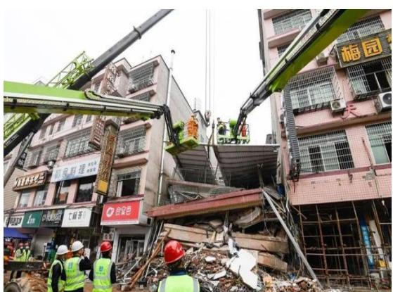  
(a)居民自建房倒塌示意图

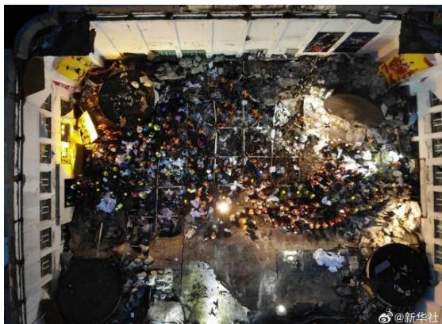  
(b)体育馆屋顶坍塌示意图

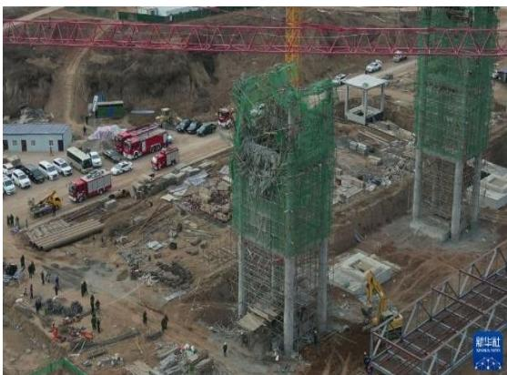  
(c)永鑫通海铁路物流坍塌示意图

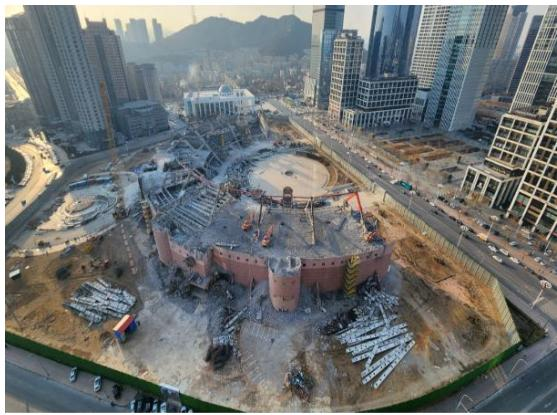  
(d)国际会展中心拆除工程结构坍塌示意  
图 1.1 混凝土建筑事故示意图

这些建筑结构破坏事件反映了建筑物在长期使用过程中，可能因为自然环境、荷载变化、材料老化等多方面原因导致结构性能下降，从而引发安全隐患。为确保混凝土结构在其整个使用寿命期间的安全性、稳定性及耐久性，并为后续的建筑结构维护保养工作提供精确的强度参数和其他关键设计依据，对结构状态的实时监测至关重要。这包括准确探测结构损伤的具体位置、规模及性质，并进一步评估这些损伤对结构整体力学性能的影响。因此，对混凝土结构实施健康监测，以及时预警潜在的结构破坏并准确评估损伤状态，显得尤为重要。

声发射（Acoustic Emission, AE）技术是一种典型的被动式无损检测与结构健康监测方法。当材料内部发生裂纹扩展、界面滑移、纤维断裂、骨料破碎或摩擦等局部能量快速释放现象时，会激发瞬态弹性波并被布设在结构表面的传感器阵列接收[1]。与传统静态检测方法相比，声发射技术能够在结构受载过程中实时感知内部损伤活动，具有动态监测、灵敏度高、可连续在线工作和适用于大型结构等优点，因此在混凝土损伤识别、断裂演化分析和安全预警等领域得到了广泛关注[2]。近年来，国内外关于混凝土损伤声发射分析方法的研究持续深入，研究重点已从单纯依赖计数、能量、振铃等特征参数，逐步拓展至波形分析、源机制识别和空间定位等更高层次的应用[3]。

在声发射监测体系中，源定位是连接“感知信号”与“解释损伤行为”的核心环节。只有获得较为准确的源空间坐标，才能进一步识别裂缝萌生区、追踪裂缝扩展路径、分析损伤聚集区的演化特征，并为结构剩余承载能力评估和预警决策提供依据。尤其对于混凝土结构而言，裂缝演化往往表现为空间上的局部集中和时间上的连续发展，因此声发射定位结果的可靠性直接影响后续损伤判读的准确性[4]。

然而，混凝土中的声发射定位仍面临若干关键难题。首先，混凝土是典型的非均质、多相复合介质，弹性波在传播过程中会受到骨料尺寸分布、孔隙缺陷、界面散射和已有裂纹等因素影响，导致波速在空间上并不均匀，且随着加载损伤演化还可能发生动态变化。传统定位方法通常假定波在试件中以恒定波速沿直线路径传播，这一假设在金属等均匀材料中近似成立，但对于混凝土往往会引入明显误差。已有研究表明，采用固定波速模型时，裂缝、损伤区及应力状态变化都会显著影响定位精度；将波速衰减或空间变化纳入考虑后，定位结果能够得到明显改善[5]。

声发射首波到时识别的不确定性会进一步放大定位误差。混凝土中的声发射信号通常信噪比较低、波形畸变明显，且不同传感器接收到的信号可能包含不同占优的波动成分。若直接将来自同一声源、但波形组成差异较大的信号统一用于定位求解，容易造成到时拾取失真和方程组构建不一致。近年来，围绕首波到时自动识别、P 波到时校正以及时频分析辅助识别等问题已有不少研究，说明“信号筛选—到时识别—定位求解”之间具有紧密耦合关系[6]。

## 1.2 国内外研究动态及现状

本节将从四个方面对国内外相关研究现状进行综述：一是声发射定位技术发展现状；二是基于时频分析的声发射信号识别与筛选研究；三是考虑波速场或非均匀介质条件下的声发射定位研究；四是在上述研究综述的基础上，总结现有研究存在的不足，从而引出本文的研究内容。

## 1.2.1声发射定位技术发展现状

## （1）国外研究现状

1962 年，Kiyoo M[7]开展了一项开创性研究，重点考察了异质材料断裂过程中产生的弹性冲击波特性及其与地震现象的关联性。该研究基于已知的波速参数，通过系统比较一维和二维空间下采用不同数量通道对岩石材料进行定位的效果，发现该方法在定位精度方面存在明显局限性。

1985 年，Thurber H.C [8]提出了一种创新的地震定位理论体系，并通过实际案例验证了其有效性。该理论通过考虑地质介质的非线性特性，突破了传统定位方法的局限性，显著提高了震源定位的精确度。这一理论突破为地震学研究及地震监测实践提供了更加准确和高效的解决方案。

2009 年，Li J 与 Qi G[9]共同提出了一种改进复杂结构声发射源定位精度的方法。研究团队系统分析了声发射信号在复杂结构中的传播特性，并据此开发了新型定位算法。该算法通过优化信号处理流程，有效提高了工程复杂环境下微小裂纹与缺陷的检测灵敏度及定位准确性。同年，Scholey J.J. [10]开发了一套基于多传感器数据融合的声发射源定位技术。该技术通过对多传感器采集的声发射信号进行空间相关性优化分析，显著提升了定位精度，为工程材料结构健康监测与损伤评估提供了有效的技术手段。

2014 年，Gongnan X 等研究者[11]系统研究了高性能计算技术在复杂工程优化问题中的应用。虽然该研究主要方向并非针对声发射源定位，但其提出的高性能计算方法为解决大规模数据处理和复杂算法运行问题提供了重要技术支持。这些计算技术在声发射源定位领域同样具有重要应用价值，特别是在提升数据处理效率和优化算法性能方面展现出显著优势。

2015年，Kundu T 等研究者[12] 提出了一种创新的两步定位技术，该技术能够在未知材料属性的情况下，实现各向异性结构中声源的准确定位。该方法通过结合理论建模与实验验证，为复杂结构内部声发射源定位提供了新的解决方案，特别适用于材料参数未知的工程场景。同期，Kalafat S 与 Sause G.M.[13]采用人工神经网络技术，通过训练网络识别声发射信号特征，实现了声发射源的高精度定位。该研究将机器学习方法引入声发射定位领域，不仅显著提高了定位效率，还提升了复杂信号条件下的定位准确性。

2018 年，Zilong Z 研究团队[14]系统研究了多层介质环境下的声发射源折射路径定位方法。通过精确分析声波在介质层间的折射传播路径，该方法显著提高了声发射源的定位精度，为多层结构材料的健康监测与性能评估提供了有效的技术手段。

2023年，Tong L 团队[15]开发了一种基于时间差矩阵原理的新型声发射源定位技术，专门用于发动机故障检测。该方法通过精确分析发动机不同部位声发射信号的时间差异，显著提高了故障源定位精度，为汽车维修和故障诊断领域提供了有效的技术手段。同期，Lei W等人[16]针对含随机夹杂物的非均质岩石材料，研究了基于PRM 波速模型的声发射源定位方法。该研究充分考虑岩石内部非均匀特性，提出的新型定位模型有效提升了此类复杂岩体中的声发射源定位精度，对岩土工程稳定性评估和地质勘探具有重要应用价值。

## （2）国内研究现状

2001 年，杨建波等人[17]采用模态声发射技术，结合互相关分析原理和小波变换方法，实现了声发射信号到达时间的精确计算，并在此基础上完成了声发射源的精确定位。该方法显著提高了声发射源定位的精确度。

2003 年，李晓梅等人[18]提出了一种基于小波包分析的声发射源定位方法。该方法首先对接收信号进行小波包分解，随后在多个频段对衰减信号实施增益补偿，并通过小波包重构恢复信号。最后利用互相关技术精确计算时间差，实现声发射源定位。实验结果表明，该方法有效降低了定位误差，显著提高了定位精度。

2006 年，来兴平等人[19]通过声发射定位实验结合支持向量机方法，系统分析了煤岩破裂过程中的声发射信号特征。该研究证实声发射技术是揭示岩石破坏微观机理的有效手段，为采空区煤岩破裂的定量预测提供了重要的科学依据。

2007 年，龚斌和金志浩等人[20]系统研究了波速误差对定位精度的影响，并提出了一种适用于各向同性材料的新型定位方法。该方法通过增加传感器数量构建方程组，采用消元法将波速参数整合到方程求解过程中，实现了无需直接测量波速的声发射源定位。

2008 年，王岩[21]针对传统穷举法在声发射源定位中计算效率低下的问题，提出了一种基于信号到达顺序的优化方法。该方法通过分析传感器接收信号的先后时序，有效缩小了潜在声发射源的搜索范围。实验验证表明，改进后的算法在保证定位精度的同时，显著提高了计算效率和数据利用率。

2011 年，董陇军等研究人员[22]针对传统微震定位技术受波速预测误差影响的问题，创新性地提出了三种无需预先测量波速的震源定位数学模型，包括到达时间法（TT）、到达时间差法（TD）和到达时间差商法（TDQ）。研究结果表明，TD方法在数学模型上较 TT 和 TDQ 方法更具优势，特别是在处理波速波动引起的误差时，表现出更高的定位精度和更好的稳定性。

2014 年，李健[23]在综合分析传统单纯形算法和常规速度模型误差的基础上，提出了一种新型速度模型。该模型无需预先测定或反演波速，并对传统单纯形法进行了相应改进。实验结果表明，这种改进方法有效避免了传统速度反演过程中的模型误差和现场测量误差。

2019 年，姜天琪等人[24]提出了一种融合网格搜索与牛顿迭代法的反演算法。该方法采用稀疏网格划分技术确定监测区域，先通过网格搜索获取初始定位解，再运用牛顿迭代法进行精确定位计算。对比实验表明，该算法在定位精度、数值稳定性和计算效率等方面均具有显著优势。同年，王剑锋、李天斌、马春驰等研究者[25]针对深埋隧道围岩微震源定位难题，引入引力搜索算法（GSA）进行优化。通过与粒子群算法（PSO）及单纯形法的对比研究发现，在双速度及三速度模型条件下，GSA在收敛速度和定位精度上均优于其他方法，成功将微震源定位误差控制在 10米范围内。

2023年，黄麟淇等人[26]系统研究了传感器阵列布局对岩石微震(MS)和声发射(AE)源定位精度的影响。该研究重点分析了传感器阵列作为数据采集的关键环节对信号源定位的重要作用，总结了传感器阵列配置导致定位误差的主要研究成果，并深入探讨了传感器数量、空间分布及其与震源相对位置三大因素对定位精度的影响机制。通过工程案例和实验室测试数据的综合分析，研究提出了一套优化传感器阵列布局的指导原则，以有效降低定位误差。

2025 年，陈楚敏与李明[27]等人系统研究了应力波在含裂纹樟子松木材中的传播特性。通过声发射传感器采集数据并进行时频分析，结合离散小波分析构建了能量衰减模型并基于该模型可有效识别裂纹区域，其定位结果与实际裂纹位置具有

良好一致性。

综合上述国内外研究进展可以看出，声发射源定位技术经历了从早期基于简单波速模型的几何定位、到考虑介质非均匀性的修正方法、再到融合现代信号处理与智能算法的演进过程。其发展脉络可归纳为三个主要阶段：

第一阶段（1960s–1990s）以 Kiyoo M、Thurber H.C.等为代表，建立了基于波速和到达时间差的基础定位框架，初步实现了岩石、金属等材料中声发射源的定位，但受限于波速假设和介质简化，定位精度较低。

第二阶段（2000s–2015 年） 研究者从信号处理和建模两个方向进行改进：一方面引入小波变换、互相关分析、模态声发射等技术提高到达时间拾取精度；另一方面发展无需预先测量波速的定位方法，一定程度上摆脱了波速误差对定位的制约。同期，Kundu、Kalafat 等人尝试将人工神经网络等机器学习方法引入定位算法，开启了数据驱动定位的新思路。

第三阶段（2016 年至今） 研究重点转向复杂工程环境下的鲁棒定位。针对多层介质、非均质岩石、高噪声环境等实际场景，研究者发展了折射路径校正、随机介质波速模型、阵列布局优化以及网格搜索-牛顿迭代混合算法等多种策略。国内学者近年来在智能优化算法和基于应力波衰减模型的裂纹区域识别方面也取得了积极进展。

## 1.2.2基于时频分析的声发射信号识别与筛选研究现状

## （1）国外研究现状

国外关于声发射信号时频分析的研究起步较早，研究重点经历了由波形解析到损伤识别，再到智能分类与定位辅助的发展过程。

1996 年，Suzuki 等研究者[28]较早将小波变换引入声发射信号分析，指出声发射信号具有显著的瞬态和非平稳特性，传统频谱分析难以同时反映时间局部性与频率局部性，而小波变换能够在多尺度上刻画信号突变特征，为后续声发射波形识别提供了新的分析工具。这一工作奠定了时频分析在声发射领域中的基础地位。

2002 年，Godin 等研究者[29]进一步研究了小波方法在声发射信号调理中的应用，重点分析了噪声抑制、特征保留和突变识别问题，认为小波分析在复杂背景噪声下对有效声发射信息具有更好的提取能力。

2011年，Aggelis[30]针对混凝土模型受压破坏中的声发射信号开展研究，利用小波变换分析不同破坏阶段的声发射波形变化，指出混凝土破坏过程中声发射信号的时频分布与裂纹扩展行为之间存在显著对应关系。这些研究说明，时频分析不仅可以用于信号去噪，还可以反映材料损伤演化过程。

2013 年，Pomponi 等研究者[31]在复合材料损伤监测中对声发射信号进行了系统的时频分析，研究表明不同损伤模式对应的频带分布、主频区间和能量演化具有明显差异，时频特征能够有效支撑不同损伤源的分类识别。这一阶段的研究特点是：将时频特征与材料内部具体损伤模式建立联系，为后续基于波形成分差异进行信号筛选提供了理论依据。

2019 年前后，随着复合材料和板壳结构监测研究的发展，一些学者开始关注波传播过程中的模态转换、频散和传播衰减对时频特征的影响。例如，Barile等研究者[32]利用小波方法分析 CFRP 板中声发射信号传播规律，指出同一事件在不同传播路径上的时频图像会因模态混叠和路径效应而表现出差异。这说明，即使来源相同，传感器接收到的波形也并非完全一致，因而不能简单地将所有通道信号无差别用于定位。

2020年以来，国外研究逐步将时频图与深度学习结合。Sikdar[33]将连续小波变换图像作为卷积神经网络输入，用于损伤源识别、裂纹模式分类和定位辅助，显著提升了复杂波形分类精度。2023 年，Machorro-Lopez 等人[34]在混凝土梁结构损伤检测中研究了小波处理后的声发射信号，证明经过时频特征增强后，结构损伤识别效果明显改善。2025 年，Huang[35]进一步提出基于物理机理约束的时频分类方法，强调应把传播机理、模态差异与数据驱动方法结合起来，以提高模型的可解释性。

总体来看，国外在该方向上的研究已经形成了较为清晰的发展路径：先解决信号非平稳分析问题，再拓展到损伤模式分类，最后走向时频图像智能识别。

## （2）国内研究现状

国内关于基于时频分析的声发射信号识别与筛选研究起步稍晚，但发展路径较清晰：早期主要聚焦于小波/Gabor小波的时频表征与到时识别，随后逐步转向频带能量特征、损伤模式识别，近 5年则明显扩展到自适应降噪、机器学习分类和时频图深度学习识别。

2005 年，焦敬品等人[36]基于模态声发射理论，研究了声发射信号在结构传播过程中的频散特性和多模态现象。该团队采用 Gabor 小波变换技术，在时频域内精确识别特定频率下模态导波的到达时间，结合数值模拟获得的群速度信息，实现了声发射源的精确定位。通过薄板声发射线性源定位实验，验证了该定位算法的可靠性和准确性。同年，王强等人[37]提出了一种改进的钻孔破坏点定位方法。该方法结合声发射信号传播特性，通过小波包分解将管道两端传感器信号分解至不同频段，选取能量集中的小波包进行重构和相关分析，从而确定时间延迟并精确定位破坏点。

2008 年，廖传军等学者[38]首次系统利用小波包按任意时频分辨率分解 AE 信号，从强噪声、宽频带信号中提取特征频段信息，并将其用于轴承损伤类型识别，证明了小波包特征提取对 AE有效信息分离的可行性。

2014年，赖于树等研究者[39]通过FFT和小波包变换分析混凝土单轴受压全过程AE波形，揭示了不同破坏阶段的频率分布和频带能量演化规律，推动国内研究从单纯参数分析转向基于频带能量的损伤识别。

2017 年，刘祥鑫等[40]对岩石 AE 信号进行分频处理，提出“前兆优势频段”识别思路，并用小波能量占比与主频突变规律刻画临近破裂前的频段响应特征，说明频带筛选已经开始服务于破裂前兆识别。

2020 年，史慧扬等[41]改进的广义 S 变换能够改善非平稳 AE 信号的时频聚焦能力，并结合信息熵等指标提升早期损伤识别效果，标志着国内研究由常规小波分析向高分辨率时频分析拓展。

2021 年，齐添添等[42]提出“小波包特征向量+BP 神经网络”的识别框架，用于从大量接收信号中区分有效 AE信号和噪声信号，在玻璃钢复合材料实验中识别准确率达到97.5%，这类工作已明显转向“面向筛选”的自动识别。同年，赵奎等[43]针对岩石 AE 信号低信噪比、强随机性和非平稳性，提出 EEMD 与单通道盲源分离结合的去噪方法，并指出传统小波阈值法容易造成频域信息失真，而新方法在滤除噪声的同时更能保留 AE频域特征。

2022 年，赵云阁等[44]利用声发射参数筛选和 SVM 模型，将岩石压缩破坏过程划分为不同阶段并进行识别，在波速差异较小时3个阶段识别准确率均超过96%，体现出国内研究已开始把 AE特征筛选与分类模型直接结合。

2023年，杨智中等[45]提出CEEMDAN与小波包自适应阈值联合方法，对循环荷载下混凝土AE信号进行降噪，结果表明该方法能够更有效保留混凝土 AE特征信息，为后续裂纹扩展和损伤演化识别提供更可靠的输入信号。

2024年，李丹等[46]先对AE信号进行小波变换构造时频图，再用 CNN和迁移学习进行损伤分类，现场试验表明三类工况识别准确率超过 94%，说明国内研究已从“人工提取时频特征”迈向“时频图像智能识别”。

总体来看，国内研究已经形成了从小波/Gabor 小波时频分析、到频带能量与损伤模式识别、再到自适应降噪、神经网络分类和时频图深度学习的发展脉络。现有成果为声发射信号识别提供了良好基础，但多数研究仍偏向去噪或损伤分类本身。

## 1.2.3考虑波速场或非均匀介质的声发射定位研究现状

## （1）国外研究现状

早期声发射定位研究多建立在均匀介质、直线路径与恒定波速假设之上。Gorman[47]等较早将各向异性复合板的弹性常数和主声轴引入定位求解，指出复合材料中传统等速三角定位会产生系统性偏差，必须显式考虑材料各向异性；此后，Kundu[48]等进一步面向层状/各向异性板开展二维声发射源定位研究，说明波在层状介质中的传播路径、群速度方向与到时关系并不满足传统均匀板模型，为后续“分层介质—方向相关波速—路径修正”研究奠定了基础。

随着工程对象由均质金属板扩展到混凝土、岩体与复合材料，国外学者开始从“已知常速模型”转向“未知或空间变化波速模型”。2017年，GollobS 等[49]提出基于非均匀速度场的多段路径分析方法，认为在混凝土等非均匀材料中，波前传播往往偏离源—传感器直线最短路径，若仍采用单一波速和直线路径假设，将显著放大定位误差。

2018 年，Brantut[50]在岩石试验研究中提出了时间分辨声发射层析方法，利用实验过程中不断产生的声发射事件重建样品内部 P 波速度结构，并将速度变化与压密、裂纹扩展等过程联系起来。该研究的重要意义在于，它首次较清晰地展示了介质速度结构并非静态不变，而是会随破裂过程持续演化。

2019年，Yin S 等[51]系统讨论了异质介质中无需预知各组成材料参数的声源定位思路，表明通过结构训练或响应映射可以绕开传统速度先验不足的问题。

2020年，Li等研究者[52]针对混凝土裂缝定位问题研究了声发射波速衰减规律，提出考虑传播距离影响的波速修正方法，并将其应用于裂缝定位，结果表明相较于传统恒速假设，修正后的定位结果更接近真实位置。同年，Zhang、Pahlavan 等[53]对混凝土结构中声发射源定位精度进行了评估，指出初至拾取误差、传感器布置和波速假设误差是影响定位精度的主要因素；Boniface[54]等人则对混凝土三维声发射定位精度进行了实验研究，分析了在机械损伤监测中定位误差的来源。这些研究从不同侧面说明：提高混凝土中定位精度，核心仍在于更真实地描述波传播。

2021 年后，国外相关研究明显加速，研究重点从“静态速度修正”转向“动态波速场更新”与“复杂结构智能定位”。Shang[55]等在小尺度结构中发现各传感器存在稳定的P波到时系统误差，提出基于到时校正数据和虚拟场优化的定位方法，证明仅修正到时偏置即可显著改善传统模型在小结构中的失真问题。与此同时，MirgalP 等[56]将Delta-T映射用于混凝土在线定位，尝试通过实验标定替代单一理论速度，从而缓解混凝土非均匀性造成的到时—距离关系失配。

2022年，LongjunD等研究者[57]指出，在复杂应力条件下，花岗岩破裂导致的波速变化本身就是定位精度波动的关键来源，因此需要对迭代波速进行动态修正。

2023 年以来，岩石力学和压裂监测领域中出现了更多将速度层析与定位联合考虑的研究。Ming L 等人[58]开展了三轴条件下结合速度层析的协同定位研究。JieC 等人[59]提出AE/MS源位置和速度场联合反演方法。这些成果表明，国际研究正在从“速度修正”逐步走向“位置与速度联合反演”。

2024 年，Song[60]等进一步面向层状岩体提出三维声发射源定位方法，将各向异性 P 波速度显式纳入分层岩石定位模型，突破了以往多停留在二维条件下处理层状各向异性介质的局限。

综合上述国外研究进展，声发射定位中关于波速场与非均匀介质的处理经历了从均匀常速假设、到显式考虑各向异性与分层介质、再到动态波速场更新与位置-速度联合反演的演进过程。早期研究揭示了复合材料和层合板中传统等速三角定位的系统性偏差，提出必须将材料各向异性和传播路径修正纳入模型。此后针对混凝土、岩体等非均匀材料，研究指出单一波速和直线路径假设会显著放大定位误差，并逐渐发展出基于声发射事件的动态速度层析方法，证实波速场随破裂过程演化。近年来研究重心转向动态波速场更新与联合反演，通过校正到时系统偏差、动态修正破裂过程中的波速变化，以及开展速度层析与定位的协同反演，将各向异性波速显式纳入三维层状介质定位模型。

## （2）国内研究现状

2008年，赵兴东等[61]基于含预制裂纹和完整岩样的单轴压缩试验，采用 Geiger算法对岩石破裂过程中的 AE事件进行三维定位。文章明确指出，岩石本身是典型的非均匀脆性材料，声发射定位能够较好反映微裂纹孕育、萌生和扩展的空间演化过程，为后续从“均匀介质定位”走向“非均匀介质修正定位”提供了实验基础。

2009 年，刘培洵等[62]针对岩石力学实验中 AE 三维定位精度偏低的问题，指出即便在波速较均匀的试样中，随机误差和离群点也是导致定位失准的重要原因，并采用最小绝对偏差法代替传统最小二乘法，提高了异常数据条件下的定位稳健性。这一研究虽然仍建立在近似均匀波速框架内，但已经明确提出：仅靠固定波速假设不足以解释复杂介质中的定位误差。

2017 年，姚旭龙等研究者[63]从岩石内部区域相关、非均匀与各向异性出发，构建了离散化的速度场描述与分量速度场矩阵，提出了超声探伤成像—声发射同步监测的一体化方法。该研究的重要意义在于，它不再把试样简化为单一等速体，而是尝试以空间分区速度场来表征复杂介质，从而为考虑非均匀波速场的 AE定位提供了更贴近实际的思路。

2018 年，邓绪彪等人[64]通过 AE 事件时空分布识别岩石加载全过程的不同阶段，并指出岩石内部裂隙构形的尺度、方位和结构差异会显著影响 AE 空间集聚特征。虽然该文重点不在定位算法本身，但它从反面说明：若忽略岩石结构构造和传播差异，仅以统一波速进行定位，会掩盖真实的裂纹空间演化规律。

2020 年，王亚飞等人[65]将地震学中的双差定位思想引入岩石 AE 定位，通过红砂岩单轴压缩试验，联合数字散斑相关方法对变形场进行观测。结果表明，双差定位得到的AE事件区域与变形集中区走向基本一致。该研究的价值在于通过事件间走时差的构造，弱化了传播路径中共同误差和速度模型误差的影响，是国内将“相对定位”思想用于复杂岩石介质 AE定位的重要代表。

2021 年，郑强强等人[66]在 AE 监测基础上结合延时双差层析成像技术，反演不同加载阶段内砂岩的速度结构演化，发现速度结构随加载经历“先小幅增加、后逐渐减小、最终迅速降低”的过程。该文的重要推进在于把 AE事件与动态速度结构反演结合起来，说明定位精度提升不能只依赖更复杂的求解器，更关键的是要同时获得随加载演化的真实波速场。

总体来看，国内这一方向已形成三条较清晰的技术路线：其一是在固定波速模型框架内通过稳健估计、双差定位等方法降低误差；其二是通过分区速度场、各向异性速度模型和离散速度场提高复杂岩石中的定位可信度；其三是将 AE定位与速度结构层析成像结合，实现定位—成像—损伤演化分析的一体化。

## 1.2.4现有研究的不足与本文研究的切入点

通过对上述三类研究的梳理可以看出，国内外在声发射信号分析、定位方法和速度场修正方面已经取得了较多成果，但仍存在以下不足。

第一，在基于时频分析的信号处理研究中，现有成果大多停留在去噪、裂纹模式识别或损伤分类层面，较少将时频分析结果进一步用于筛选同一声源在不同传感器上的同质信号，并据此提升定位方程组的构建质量。因此，如何围绕波形一致性建立信号筛选模型，仍有待研究。

第二，在考虑波速场的定位研究中，已有研究已充分说明恒定波速假设难以满足混凝土等非均质介质中的高精度定位需求，但多数工作仍采用静态波速场或一次性修正方式，较少在已有初始定位结果基础上，结合波速场建立声发射源精定位的优化模型。

基于上述不足，本文从三个层面展开研究：首先，利用时频分析方法构建信号筛选模型，筛选性质相当的信号用于定位；其次，基于 PLB 实验和 CT 原理求解试件内部弹性波波速场，并通过偏移优化提高单个声发射源定位精度；最后，构建基于弹性波实时波速场的声发射事件簇更新模型，通过事件簇与波速场的迭代更新实现更稳定、更准确的源定位。

## 1.3 研究内容

针对混凝土声发射源定位中存在的多通道 Hit 信号差异大、均匀波速假设失配以及损伤演化过程中定位结果易受动态传播条件影响等问题，本文从信号筛选、波速场重建修正和波速场—源坐标联合反演三个方面展开研究，以提高混凝土声发射源定位的精度与稳定性。

（1）基于弹性波在混凝土试件中的传播特性，通过时频分析技术对波的组成成分进行解析。利用压缩波（ 波）与剪切波（ 波）等不同成分的波在频率上的显著差异，针对相同源发出而被不同传感器接收的信号进行分类。从分类中筛选性质相当的信号用于构建定位方程组，从而提升单个声发射源的定位精度。

（2）利用断铅实验（Pencil Lead Breakagetests, PLB）数据，基于计算机断层

扫描（ComputedTomography，CT）原理，研究求解试件内部弹性波波速场的方法。

利用已有的定位算法，计算声发射源的初始坐标。对初始坐标引入偏移量和偏移方向矢量，考虑试件内的弹性波波速场，以偏移后源到所有传感器的飞行时间之和与实测总飞行时间之间的残差最小为目标函数建立并求解优化模型，以提升单个声发射源的定位精度。

（3）对于实际结构加载过程中产生的声发射信号，利用已有算法定位信号源，以获得源的初始坐标 C0。基于时空域性质将多个声发射源归入同一个簇 G，以获得多个在时间和空间上具有相关性的声发射源，再基于 CT原理求解试件内部弹性波初始波速场F0。基于初始波速场 F0，利用 1.2节的方法计算簇G 中每个源的空间坐标得 C1，从而更新声发射事件簇 G。基于更新后的声发射事件簇，重新计算新的波速场F1；利用 F1，更新簇中各源的空间坐标 C2。通过上述迭代过程，使声发射事件簇和波速场收敛于稳定状态，从而获得最终的源定位结果。

## 1.4 技术路线

基于已有研究成果，本文从三个方面入手，使用理论推导、试验验证等手段进行研究分析。

（1）基于弹性波在混凝土试件中的传播特性，通过小波包分解对波的高低频能量进行解析，筛选性质相当的信号用于构建定位方程组，从而提升单个声发射源的定位精度。

（2）基于层析成像原理求解试件内部弹性波波速场，引入偏移量和偏移方向矢量，以残差最小为目标函数建立并求解优化模型，进一步提升单个声发射源的定位精度。

（3）建立一个动态的迭代优化框架，该框架结合了声发射信号处理、波速场反演和声发射事件簇坐标更新，以实现对声发射源的精确定位，通过混凝土轴压试验测试的方法验证该方法的有效性。

本文的技术路线图，如图1.2所示。

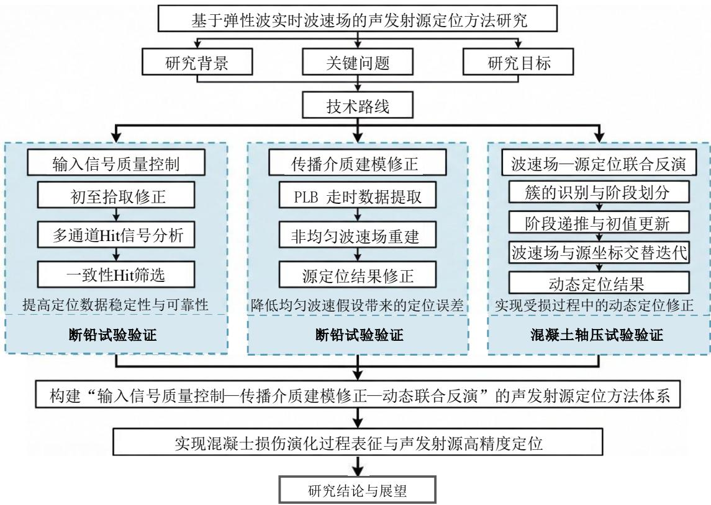  
图1.2 技术路线示意图

## 第2 章 声发射定位基本理论与研究方法

本章主要对声发射源定位所涉及的基本理论进行概述，包括声发射信号的产生机理与传播特性、非平稳信号的时频分析方法、常规定位原理以及波速场与事件聚类的基本概念。相关内容旨在为后续章节中信号筛选模型、波速场修正方法及迭代更新模型的建立提供必要的理论基础。

## 2.1 声发射信号产生机理与传播特性

声发射（Acoustic Emission, AE）是指材料在受载过程中，由于内部微观结构变化而释放瞬态弹性波的现象。在混凝土等脆性材料中，声发射信号主要来源于微裂纹的萌生、扩展及相互贯通，以及界面摩擦与滑移等过程[67]。当局部应力超过材料强度极限时，裂纹快速扩展并释放能量，从而激发弹性波向外传播。

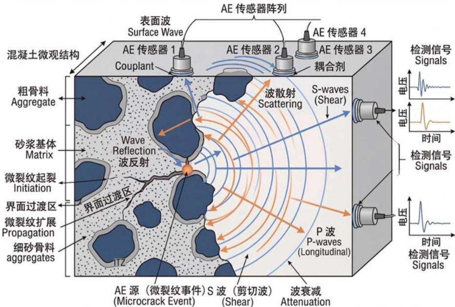  
图 2.1 声发射产生与传播机理示意图

在混凝土等典型脆性材料中，声发射信号的产生主要与微观损伤的形成与演化密切相关。如图 所示，在外荷载作用下，材料内部首先发生微裂纹的萌生；随着应力水平的提高，微裂纹逐渐扩展，并在应力集中区域发生快速失稳扩展；最终，多条裂纹相互贯通形成宏观裂缝。在这一过程中，裂纹尖端附近的应变能被瞬时释放，并以弹性波形式向周围介质辐射。此外，骨料与砂浆之间的界面过渡区（Interfacial Transition Zone, ITZ）往往是应力集中区域，其界面脱粘、摩擦滑移及局部压碎等行为同样会产生显著的声发射信号。因此，声发射活动在时间和空间上的分布能够有效表征混凝土内部损伤的演化过程[30]。

从波动传播角度来看，声发射信号在固体介质中主要以弹性波形式传播，其基本类型包括纵波（P 波）和横波（S 波）。纵波的质点振动方向与波传播方向一致，传播速度较快，通常为最先到达传感器的波型；横波的质点振动方向垂直于传播方向，传播速度较慢。除体波之外，在结构边界或自由表面附近，还可能产生瑞利波（Rayleighwave）等表面波，其能量沿表面传播且衰减较慢。在实际工程结构中，由于几何边界复杂及材料非均匀性，上述波型往往相互叠加，并伴随模式转换现象，使得接收到的声发射信号具有较强的复杂性。

混凝土作为一种多相非均质复合材料，其内部由粗骨料、细骨料、水泥砂浆及界面过渡区共同组成，各组分在弹性模量、密度及阻抗等方面存在显著差异。这种结构特征导致弹性波在传播过程中会经历一系列复杂物理过程，包括散射、反射、折射、衰减及模态转换等。一方面，高频成分由于波长较短，更容易受到骨料尺寸及界面不连续性的影响，从而发生强烈散射并迅速衰减，导致信号频谱向低频方向迁移；另一方面，不同传播路径上的介质组成及几何距离不同，使得波速及传播时间存在差异，从而引起信号到达时间、幅值及波形特征的显著变化[68]。

此外，声发射信号在传播过程中还受到材料内部阻尼及能量耗散机制的影响，其幅值随传播距离呈指数衰减。环境噪声、传感器耦合条件及边界反射等因素也会进一步影响信号的识别与提取。因此，在实际应用中，需要结合波传播特性对声发射信号进行合理处理与分析，以提高损伤识别的准确性与源定位的可靠性。

## 2.2 声发射信号的时频分析基础

声发射信号是材料内部裂纹萌生、扩展、摩擦滑移等局部损伤行为所释放的瞬态弹性波，其产生过程具有突发性和短时性，信号在时域上通常表现为脉冲式波形，在频域上则呈现较宽的频带分布。由于声发射源机制复杂，且信号在传播过程中还会受到衰减、散射、反射及模态转换等因素影响，因此其频率成分并非固定不变，而是随时间不断演化，表现出显著的非平稳特征。对于这类信号，若仅采用传统频域分析方法，往往难以全面表征其传播和演化规律。

传统傅里叶变换能够将时域信号映射到频域，从而揭示信号整体的频率组成。设时域信号为x(t)，其傅里叶变换可表示为。

$$
X (f) = \int_ {- \infty} ^ {+ \infty} x (t) e ^ {- j 2 \pi f t} d t\tag{2.1}
$$

傅里叶变换的优势在于能够较清晰地给出信号的全局频谱信息，便于分析主要频率范围及能量分布。然而，该方法的本质是对整个时间历程进行统一变换，所得结果仅反映所有时刻的频率平均特征，而无法区分某一频率成分具体出现在何时。因此，对于声发射这类典型的非平稳信号，仅依赖傅里叶频谱难以揭示首波到达、波形转换及局部频率突变等重要信息，在实际分析中存在明显局限[69]。如图

2.2所示，时域波形能够反映信号幅值随时间的变化，频域谱图可表征整体频率组成，而时频图则能够同时揭示不同频率成分在时间轴上的演化过程，更适用于分析声发射信号的非平稳特性。

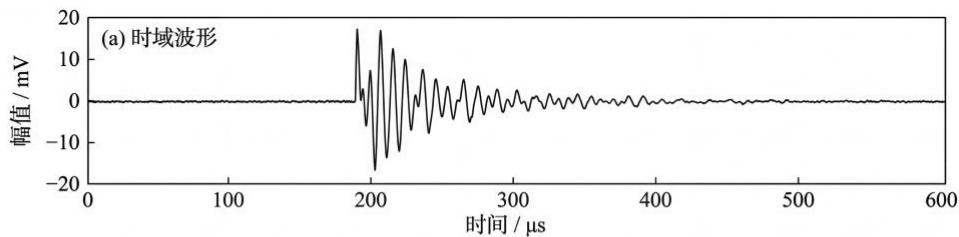

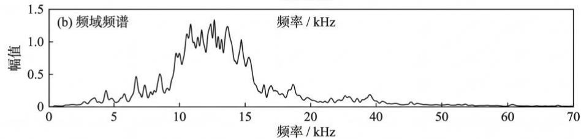

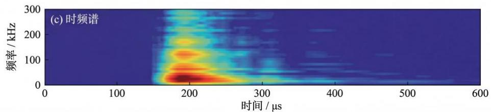  
图 2.2 声发射信号在时域、频域及时频域中的典型表征

为克服传统频域分析在时间分辨能力上的不足，通常引入时频分析方法，对信号的时间信息和频率信息进行联合表征。时频分析的基本思想是在保留频率分布特征的同时，进一步刻画不同频率成分随时间的变化规律，从而获得更符合声发射信号传播机理的描述结果。常用于声发射分析的时频方法主要包括短时傅里叶变换和小波变换。

短时傅里叶变换（Short-Time Fourier Transform, STFT）是在傅里叶变换基础上的局部化推广，其核心思想是在时间轴上引入长度有限的滑动窗口，通过对窗口内局部信号进行傅里叶变换，得到不同时间位置处的局部频谱。其数学表达式为

$$
S T F T _ {x} (\tau , f) = \int_ {- \infty} ^ {+ \infty} x (t) w (t - \tau) e ^ {- j 2 \pi f t} d t\tag{2.2}
$$

式中： $\tau { \mathrm { \Omega } }$ 表示窗函数在时间轴上的位置， $f { \mathrm { : } }$ 表示频率。

通过不断移动分析窗口，可获得信号在整个时间历程上的局部频谱变化。与传统傅里叶变换只能反映全局频谱特征不同，STFT 能够同时给出“某一时刻附近包含哪些频率成分”，因此更适合用于分析声发射信号这类具有明显瞬态性和非平稳性的信号。对于声发射研究而言，STFT 能够较直观地展示首波到达前后频率成分的变化情况以及能量集中区域，便于从整体上观察信号时频分布规律。需要指出的是，STFT 采用固定窗长进行分析，其时间分辨率和频率分辨率之间存在一定折中：窗长较小时时间定位能力较强，但频率分辨率下降；窗长较大时频率分辨率提高，但时间分辨率减弱。因此，在处理持续时间较短、频率变化较快的声发射信号时，STFT 更适合作为整体时频特征的表征工具[70]。

与 STFT 不同，小波包分解（Wavelet Packet Decomposition, WPD）是在小波分析基础上的进一步拓展，其不仅对低频部分继续分解，也对高频部分同步分解，因此能够对信号进行更精细的多尺度频带划分。与传统小波变换相比，小波包分解在整个频率范围内具有更均衡的分辨能力，尤其适用于频率成分复杂、局部特征明显的非平稳信号分析。通过逐层分解，原始信号可被表示为不同频带子信号的组合，从而实现对信号频带结构和能量分布特征的细致刻画。对于声发射信号而言，由于其具有突发性强、持续时间短、频带宽且受传播路径影响显著等特点，小波包分解能够较好地揭示不同频段能量的分布规律，为识别瞬态突变、局部奇异点及不同波组成分之间的差异提供有效手段。需要指出的是，小波包分解的分析结果与小波基函数及分解层数的选取密切相关，不同参数设置可能导致频带划分效果和特征表达能力存在差异，因此在具体应用中应结合信号特点进行合理选择[71]。

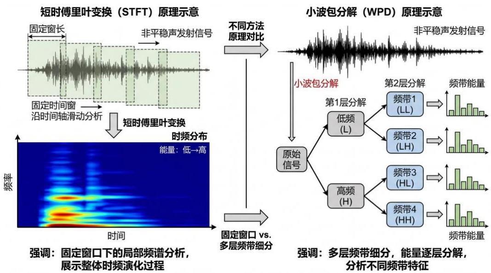  
图2.3 短时傅里叶变换与小波包分解的时频分析原理示意

如图2.3所示，短时傅里叶变换采用固定时间窗对信号进行局部频谱分析，而小波包分解则通过多层频带细分实现对信号在不同尺度下的精细表达，因此二者在时频分析机制上存在明显差异。从方法适用性来看，短时傅里叶变换更适合用于展示声发射信号整体时频分布规律，便于观察主要频带在时间轴上的演化过程；小波包分解则更适用于表征复杂非平稳信号在不同频带内的能量分布特征，尤其在分析频率成分丰富、局部变化显著的信号时具有明显优势。对于混凝土声发射信号，由于其波形复杂、传播路径多样且不同通道之间存在较大差异，单纯依靠时域波形或整体频谱往往难以准确识别信号特征，而引入时频分析和频带分解方法后，能够同时反映信号频率成分的整体分布及局部能量特征，因此更适合用于后续首波识别、波组成分判别及多通道一致性分析。

在声发射研究中，时频分析的一个重要作用是为特征参数提取提供依据。通过对时频图及小波包各频带能量分布、主频变化、频带宽度和局部能量集中区进行分析，可以构建一系列能够表征波形特征的参数，例如主频、峰值频率、频带能量占比、谱重心以及谱熵等[72]。这些参数不仅能够刻画单个信号的传播特征，还能够反映不同传感器接收信号之间的一致性和差异性，为信号分类与筛选提供定量基础。尤其是在多通道声发射监测中，同一事件到达不同传感器后的波形可能因传播距离、传播方向和介质状态不同而表现出差异，通过对时频特征及频带能量特征的对比分析，有助于识别具有相似波组成分和传播特征的有效信号，提高定位输入数据的可靠性。

时频分析及小波包分解并非单纯的信号可视化或分解手段，而是连接声发射传播机理与特征参数构建的重要桥梁。通过引入时频分析和频带能量表征方法，可以从时间、频率及多尺度频带分布等多个维度对信号进行更为细致的刻画，为后续基于时频特征和频带能量特征的信号筛选模型构建提供理论依据，也为提高声发射源定位精度奠定数据基础。

## 2.3 弹性波波速场与走时层析基本概念

在实际工程材料中，弹性波的传播速度通常不是固定常数，而会随着材料内部结构、缺陷分布及损伤状态的变化发生改变。对于混凝土这类典型非均质材料而言，骨料、砂浆和孔隙在空间上的分布并不均匀，不同区域的力学性质存在差异，因此弹性波在结构内部的传播速度也具有明显的空间变化特征。随着受载过程中微裂纹的萌生和扩展，局部介质刚度进一步退化，波速分布还会随损伤演化而不断改变。为描述这种传播特性的空间差异性，通常引入波速场的概念，即将介质中各位置的波速视为空间变化的函数，用以表征结构内部弹性波传播能力的分布状态[73]。

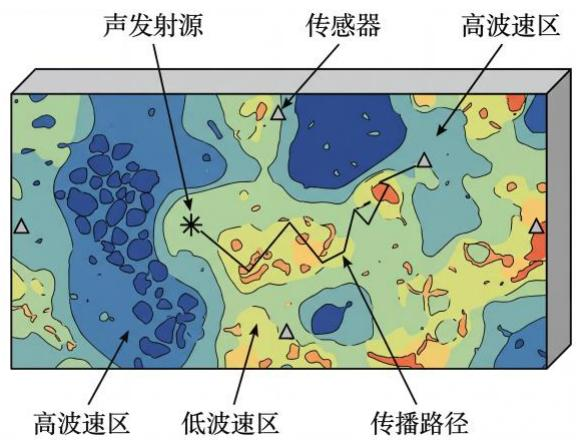  
图 2.4 混凝土内部弹性波波速场空间分布示意

从物理意义上看，波速场能够反映介质内部不同区域对弹性波传播的响应差异。一般而言，波速较高的区域通常对应材料较为致密、完整或损伤较轻的部位，而波速较低的区域则往往与孔隙集中、裂纹发育或局部劣化有关。因此，在混凝土声发射分析中，波速场不仅是传播模型中的重要参数，也在一定程度上反映了结构内部状态的变化特征。如图 2.4 所示，弹性波从声发射源传播至传感器的过程中，往往会穿过多个性质不同的区域，其传播时间实际上受到沿路径各部分波速共同影响。由此可见，若仍采用统一波速描述整个结构中的传播过程，往往难以准确反映真实情况。

走时层析成像是一种基于波传播时间信息反演介质内部参数分布的方法，其基本思想是：利用多条传播路径上的实测走时数据，结合传播路径在研究区域内的空间分布关系，反推出介质内部波速的变化特征。在实际处理中，通常将研究区域划分为若干单元，并将每条传播路径与各单元之间的关系进行离散表达，通过综合多条路径的走时信息，对整个区域的波速分布进行重建。其本质是利用“路径走时—内部波速分布”之间的对应关系，将不可直接观测的内部传播特性转化为可求解的反演问题[74]。

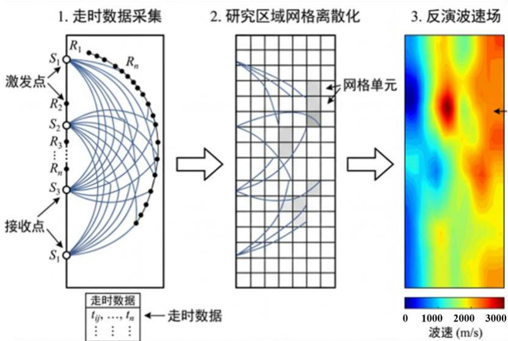  
图 2.5 走时层析反演波速场的基本过程示意

如图2.5所示，走时层析的基本过程包括走时数据采集、区域离散化建模以及波速场反演三个环节。首先，通过多个激发点和接收点之间的传播时间获取不同路径上的走时信息；其次，将研究区域划分为若干网格单元，以建立传播路径与内部单元之间的对应关系；最后，综合所有路径数据进行反演，得到介质内部波速场的近似分布。通过这种方式，可以较为直观地揭示结构内部传播特性的空间差异，为后续定位模型中传播参数的修正提供依据。

## 2.4 声发射源定位基本原理

声发射源定位的基本思想是利用弹性波从源点传播至各传感器所对应的时间信息，结合传感器的空间位置关系，反推出声发射源在结构中的位置。按照时间信息获取方式的不同，声发射源定位方法通常可分为基于绝对到达时间（Time ofArrival, TOA）的定位方法和基于到时差（Time Difference ofArrival, TDOA）的定位方法。前者需要获得弹性波从源点发射的绝对起始时刻，后者则仅依赖不同传感器之间的到达时间差，因此在实际声发射监测中应用更为广泛。

## 2.4.1基于绝对到达时间的定位思想

设声发射源坐标为 第�个传感器坐标为 $P _ { i } ( x _ { i } , y _ { i } , z _ { i } )$ ,若弹性波在介质中的传播速度为 $\mathbf { \alpha } _ { | v \mathbf { \alpha } }$ ，声发射事件发生时刻为 $\scriptstyle { { \cal I } } t _ { 0 }$ ，第�个传感器接收到信号的时刻为 $\textstyle I t _ { i }$ ，则有

$$
t _ {i} - t _ {0} = \frac {d _ {i}}{v}
$$

式中： $d _ { i }$ 为声发射源到第�个传感器的传播距离，即

$$
d _ {i} = \sqrt {(x - x _ {i}) ^ {2} + (y - y _ {i}) ^ {2} + (z - z _ {i}) ^ {2}}\tag{2.3}
$$

因此，可得到基于绝对到达时间的定位方程：

$$
\sqrt {(x - x _ {i}) ^ {2} + (y - y _ {i}) ^ {2} + (z - z _ {i}) ^ {2}} = v (t _ {i} - t _ {0}), \quad i = 1, 2, \dots , n\tag{2.4}
$$

对于三维定位问题，未知量通常包括源点坐标 $( x , y , z )$ 及源事件发生时刻 $t _ { 0 }$ ，因此理论上至少需要4 个传感器才能完成求解；对于二维平面定位问题，未知量为 $\iota ( x ,$ y)和 $t _ { 0 }$ ，理论上至少需要 3个传感器。由于该方法需要准确获取声发射源的起始发射时刻，而实际监测中这一时刻通常难以直接测得，因此其工程应用受到一定限制。

## 2.4.2基于到时差的定位原理

与绝对到达时间定位相比，到时差定位方法不需要已知源事件的发射时刻，而是通过不同传感器接收信号的时间差建立定位方程，更适用于声发射在线监测。

设声发射源坐标为 $S ( x , y , z )$ ，选取第 1 个传感器作为参考传感器，其坐标为$P _ { 1 } ( x _ { 1 } , y _ { 1 } , z _ { 1 } )$ 其接收信号时刻为 $\mathrm { t } _ { 1 }$ 。其余第�个传感器的坐标为 $P _ { i } ( x _ { i } , y _ { i } , z _ { i } )$ 接收信号时刻为 $t _ { i }$ ，则第 个传感器相对于参考传感器的到时差为

$$
\Delta t _ {i 1} = t _ {i} - t _ {1}\tag{2.5}
$$

记声发射源到第 个传感器的传播距离为 $d _ { i }$ ，到参考传感器的传播距离为 $d _ { \mathrm { { \scriptscriptstyle 1 } } }$ ，则有

$$
d _ {i} - d _ {1} = v \Delta t _ {i 1}\tag{2.6}
$$

式中：�为弹性波在介质中的传播速度，但在此不预先设定为已知常数，而作为待求参数参与定位计算。各传播距离分别表示为

$$
d _ {i} = \sqrt {(x - x _ {i}) ^ {2} + (y - y _ {i}) ^ {2} + (z - z _ {i}) ^ {2}}\tag{2.7}
$$

$$
d _ {1} = \sqrt {(x - x _ {1}) ^ {2} + (y - y _ {1}) ^ {2} + (z - z _ {1}) ^ {2}}\tag{2.8}
$$

因此，可以建立未知波速条件下基于到时差的非线性定位方程组：

$$
\begin{array}{l} \sqrt {(x - x _ {i}) ^ {2} + (y - y _ {i}) ^ {2} + (z - z _ {i}) ^ {2}} - \sqrt {(x - x _ {1}) ^ {2} + (y - y _ {1}) ^ {2} + (z - z _ {1}) ^ {2}} = v \Delta t _ {i 1}, \\ (i = 2, 3, \dots , n) \end{array}\tag{2.9}
$$

由式（2.9）可见，在未知波速条件下，定位问题的未知量不仅包括声发射源坐标 $( x , y , z )$ ，还包括传播速度�。因此，相较于已知波速的 TDOA 定位，未知波速模型增加了一个待估参数，对传感器数量和空间布设提出了更高要求[75]。在三维定位中，为保证方程组具有可解性，通常至少需要 5个传感器参与联合求解[22]。

上述方程表明，到时差定位实质上是通过多个“距离差约束”确定源点位置。在二维空间中，每一组传感器与参考传感器形成的距离差方程对应一条双曲线，声发射源位于若干双曲线的交点附近；在三维空间中，相应约束曲面则表现为双曲面，源点位置由多个双曲面的交汇区域确定。因此，到时差定位又常被称为双曲定位方法。当传播速度未知时，求解过程实际上是在满足双曲面约束的同时，进一步确定与之相容的波速参数。

与TOA方法相比，未知波速 TDOA方法同样消除了未知发射时刻 $t _ { 0 }$ 对定位求解的影响，从而降低了建模难度，提高了工程适用性。同时，该方法避免了对波速先验值的强依赖，更适用于波速存在波动或难以准确标定的复杂结构场景。但应指出的是，该方法对到时提取精度较为敏感，且由于模型本质上属于非线性联合求解问题，在某些情况下可能出现多个候选解，因此通常需要结合波速合理范围、空间边界约束及残差最小原则对结果进行进一步筛选。

## 2.4.3声发射定位的基本假设与误差来源

为便于理论分析，传统声发射定位模型通常建立在以下基本假设之上：

（1）介质均匀且各向同性，弹性波以恒定速度传播；

（2）传播路径可近似视为源点与传感器之间的直线；

（3）不同传感器所接收的信号来自同一波组成分，且首波到时可被准确识别；

（4）传感器位置准确已知，且耦合状态一致。

在混凝土等非均质材料中，传统定位模型所依据的若干理想假设往往难以严格成立，从而使声发射源定位结果产生偏差。其中，波速取值误差是最为突出的影响因素之一。常规定位方法通常将波速视为常数，但混凝土内部骨料、砂浆、孔隙及初始缺陷分布复杂，不同区域的材料性质存在明显差异，且随着受载损伤的发展，局部波速还会进一步发生变化。因此，弹性波在不同传播路径上的实际速度并不相同，若仍采用统一波速进行计算，理论传播时间与真实传播过程之间便会出现偏离，进而影响定位结果的准确性。与此同时，到时提取误差同样会直接传递至定位计算中。声发射信号本身具有突发性强、持续时间短、波形复杂等特点，在传播过程中又常伴随衰减、散射及模态转换，使首波起跳点的识别变得更加困难。尤其在多通道测试条件下，不同传感器接收到的波形在幅值、频率成分和起跳特征上往往并不一致，若简单采用阈值法或人工判读确定到时，容易引入较大的时间误差。除此之外，传感器布置方式及安装坐标偏差也会对定位稳定性产生影响；当传感器空间分布不合理时，定位方程对局部误差会表现出较强敏感性，而安装位置的微小偏差也可能在求解过程中被放大。另一方面，传统模型通常默认弹性波沿源点至传感器之间的直线路径传播，但在非均质介质及损伤演化条件下，波的实际传播路径可能发生弯折或绕行，这也会进一步削弱理想定位模型的适用性。总体来看，波速空间变化与到时识别不确定性是影响混凝土声发射定位精度的两个关键问题，也是后续开展信号筛选与波速场修正研究的主要出发点。

## 2.4 本章小结

本章对声发射源定位研究所涉及的基本理论进行了简要阐述，主要包括声发射信号的产生机理与传播特性、声发射信号的时频分析基础、弹性波波速场与走时层析的基本概念以及声发射源定位的基本原理。首先，从材料损伤过程中声发射信号的产生出发，分析了弹性波在混凝土等非均质介质中的传播特点，指出散射、衰减及模态转换等现象会导致不同传感器接收信号之间存在明显差异。其次，说明了时频分析方法在描述声发射非平稳特性方面的优势，强调其在信号特征提取、波组成分识别及多通道信号一致性分析中的重要作用。进一步结合波速场和走时层析的基本思想，揭示了混凝土内部传播特性的空间差异性及其对传播时间计算的影响；同时指出传统定位方法通常采用统一波速和理想传播路径假设，难以准确反映实际介质中的波传播过程。最后，在声发射源定位基本原理分析的基础上，归纳了影响定位精度的主要因素，表明信号一致性不足和波速取值偏差是制约混凝土声发射定位精度的关键问题。鉴于此，本文后续将围绕声发射信号一致性筛选、波速场修正及定位结果动态更新等内容展开研究，以期为提高混凝土结构声发射源定位精度提供理论依据和方法支撑。

## 第3 章 基于小波包能量分布特征的声发射 Hit 筛选方法

## 3.1 声发射信号局部时频特征表征

## 3.1.1首波到时确定与局部时窗截取

确定声发射信号的真实到达时间是后续声发射源定位与特征分析的先决条件。传统的阈值法直接将信号幅值首次越过预设阈值的时刻作为初至到时（如图3.1 所示）。然而，受混凝土等非均质材料的高频散、高衰减特性及背景噪声影响，信号首波的初始微起伏极易被淹没。阈值法拾取的到时通常滞后于信号的真实初至时刻，这种系统性的拾取误差会直接导致后续定位方程组的解算产生 偏差。

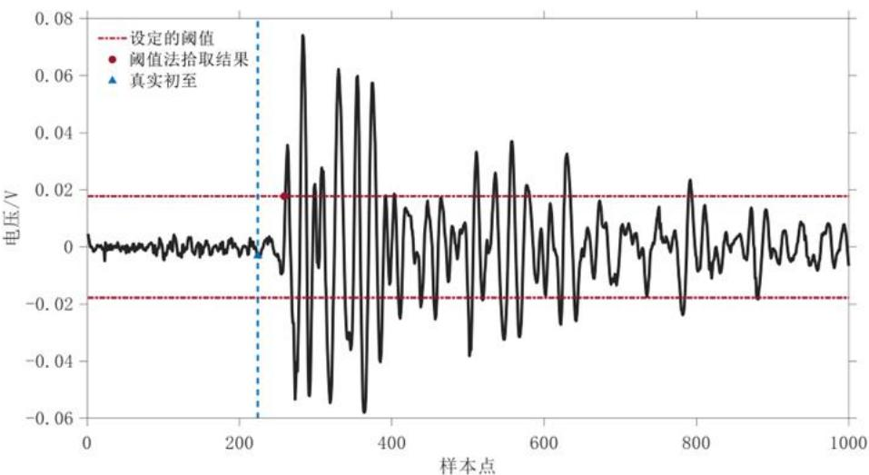  
图 3.1 阈值法到时拾取

为了消除阈值拾取带来的迟滞误差，本章引入赤池信息量准则（AkaikeInformation Criterion,AIC）对信号初至进行二次精确拾取。AIC 算法的核心在于通过比较信号序列在不同分割点前后统计特性的变化，确定噪声段与有效信号段的最佳分界位置，从而实现初至到时的精确识别。由于声发射信号在初至时刻前后具有截然不同的统计特征，可将包含信号的一段离散时间序列视为由纯噪声过程与“噪声+信号”过程拼接而成的两段具有不同方差的自回归（AR）过程。

根据最大似然估计原理，AIC 准则的基本定义可表示为：

$$
A I C = 2 k - 2 \ln (L)\tag{3.1}
$$

式中：k为模型自由参数的数量；L 为该模型的最大似然函数值。

针对声发射离散时间序列，Maeda[76]将上述原理转化为基于信号方差的直接计算模型。设选取包含预估到时的一段长度为N的信号序列x(i)，通过设定滑动分割点k（1≤k≤N），将其分为前后两部分。则离散信号的 AIC 函数可简化为：

$$
A I C (k) = k \ln (\operatorname{var} (x _ {1: k})) + (N - k) \ln (\operatorname{var} (x _ {k + 1: N}))\tag{3.2}
$$

式中： $\mathrm { v a r } ( x _ { 1 : k } )$ 与 $\mathrm { v a r } ( x _ { k + 1 : N } )$ 分别表示分割点 k前后两段数据序列的方差。

遍历该序列计算对应的 AIC(k)值，该函数出现全局极小值的时刻即为时间序列统计特性的最佳分割点，也就是声发射信号的精确初至时刻 $t _ { a r r i \nu a l }$ ,如图 3.2所示。

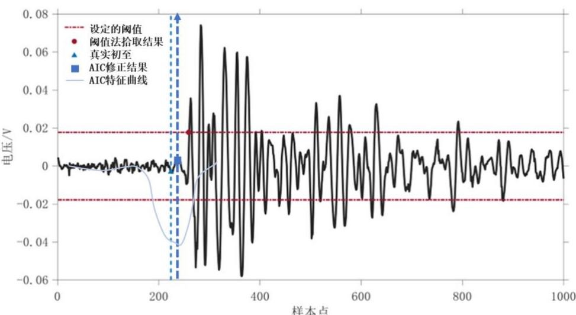  
图3.2AIC 修正到时示意图

在获取精确的首波到时后，需以此为基准截取局部时窗用于后续频带能量分析。由于声发射首波（P 波）包含波源最原始的激发信息，而后续的 S 波及尾波受介质边界反射、散射以及模态转换的污染严重。因此，本章以精确之后的到时 $t _ { a r r i \nu a l }$ 为起点，向后截取 100 个样本点长度的数据段作为局部分析时窗。在本研究试件尺寸、采样频率及典型波形条件下，取精确到时后 100个样本点作为局部分析时窗，可较完整覆盖首波初始振荡过程，并在一定程度上减弱后续反射波和散射波的影响。本章后续的小波频带能量计算与特征提取，均严格限定在该局部时窗段内完成。

## 3.1.2局部时窗信号的小波分解

在完成局部时窗截取后，为进一步表征声发射首波初始响应段的频带分布特征，本文引入小波分析方法对局部时窗信号进行分解。声发射信号属于典型的瞬态非平稳信号，其频率成分随时间快速变化。传统傅里叶变换虽然能够给出整体频谱分布，但难以反映信号局部时间范围内的频率演化规律。相比之下，小波分析具有良好的时频局部化能力，能够在不同尺度下对信号进行分层展开，因此尤为适用于局部时窗内首波成分的频带解析。

设经首波精确到时确定后截取得到的局部时窗离散信号为 $x _ { \scriptscriptstyle w } ( n )$ ，其中$n = 1 , 2 , . . . , N _ { _ w }$ ， $N _ { \mathrm { w } }$ 为局部时窗长度。本文中局部时窗长度设定为 100。对该信号进行小波分解，其本质是通过一组具有伸缩和平移性质的基函数，对原始信号在不同尺度空间上进行投影表示。连续小波变换的一般表达式为：

$$
W (a, b) = \frac {1}{\sqrt {| a |}} \int_ {- \infty} ^ {+ \infty} x (t) \psi \left(\frac {t - b}{a}\right) d t\tag{3.3}
$$

式中： $a$ 为尺度因子，用于控制小波函数的伸缩； 为平移因子，用于控制小波函数在时间轴上的位置； $\psi ( \cdot )$ 为母小波函数。尺度越小，对应的频率越高，时间分辨率越高，尺度越大，对应的频率越低，频率分辨率越高，借助这一特性，可以实现对局部时窗信号中不同频率成分的有效分离。

考虑到本文研究对象为离散采样信号，实际计算中采用离散小波分析框架。离散小波分解可通过一对正交滤波器组实现：信号经低通滤波器后得到低频近似分量，经高通滤波器后得到高频细节分量。其单层分解过程可表示为：

$$
\begin{array}{l} A _ {1} (k) = \sum_ {n} x _ {w} (n) h (2 k - n) \\ D _ {1} (k) = \sum_ {n} x _ {w} (n) g (2 k - n) \end{array}\tag{3.4}
$$

式中： $A _ { 1 } ( k )$ 为第一层分解得到的近似分量， $D _ { 1 } ( k )$ 为第一层分解得到的细节分量；$h ( \cdot )$ 和 $g ( \cdot )$ 分别表示低通滤波器与高通滤波器；符号 表示经过二倍抽取后的离散序列索引。

通过逐层递归分解，可将信号展开到不同尺度层级，从而获得局部时窗信号在多分辨率下的频带表示。

与普通离散小波变换仅对低频近似分量继续分解不同，小波包分解（WaveletPacket Decomposition, WPD）不仅对低频部分继续分解，也对高频部分同步分解，因此能够获得更均匀、更精细的频带划分。对于声发射局部时窗信号而言，这种处理方式更有利于描述首波初始振荡过程中的频率组成。设分解层数为 ，则经 层小波包分解后，原始频率区间 $\left[ 0 , f _ { s } / 2 \right]$ 将被均匀划分为 $2 ^ { j }$ 个子频带，每个子频带的带宽为：

$$
\Delta f = \frac {f _ {s} / 2}{2 ^ {j}} = \frac {f _ {s}}{2 ^ {j + 1}}\tag{3.5}
$$

其中， $f _ { s }$ 为采样频率。本文实验系统的采样频率设定为 1MHz，取小波包分解层数 $j = 3$ ，因此奈奎斯特频率范围 0\~500kHz 被划分为 8 个子频带，每个子带宽度为 62.5kHz。对应的 8 个子频带依次为：[0,62.5]、[62.5,125]、[125,187.5]、[187.5,250]、[250,312.5]、[312.5,375]、[375,437.5]、[437.5,500]kHz。如图 3.3 所示，由此可见，3层小波包分解能够将局部时窗信号映射到一组互不重叠的窄带频率区间中，为后续频带能量计算提供明确的频率分区基础。

在小波基的选取上，本文采用 小波族中的 小波。该小波具有较好的紧支撑性、正交性和时频局部化能力，对声发射信号中的瞬态突变和短时振荡具有出色的表征效果。同时，db4小波在工程信号处理中应用广泛，非常适合用于混凝土声发射局部波形的多尺度分析。局部时窗信号经 3 层小波包分解后，可表示为各终端节点重构子信号之和，即：

$$
x _ {w} (n) = \sum_ {i = 1} ^ {2 ^ {j}} x _ {i} ^ {(j)} (n)\tag{3.6}
$$

式中： $x _ { i } ^ { ( j ) } ( n )$ 表示第j层第 个节点（即第i个子频带）重构后的时域信号。

为量化局部频带特征，需进一步计算各子带的能量 $E _ { i }$ ，其计算公式为：

$$
E _ {i} = \sum_ {n = 1} ^ {N _ {w}} | x _ {i} ^ {(j)} (n) | ^ {2}\tag{3.7}
$$

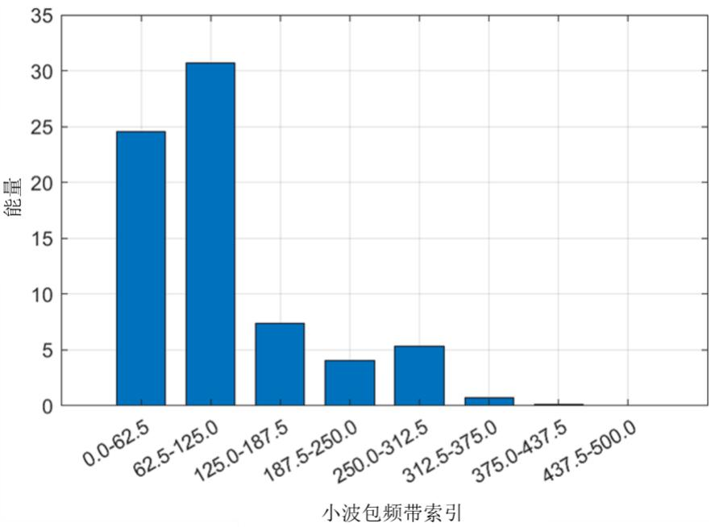  
图 3.3 局部时窗信号的小波包子带能量分布图

## 3.1.3高低频能量特征构建

在完成局部时窗信号的小波包分解并获取 8 个子带能量后，需进一步构造能够表征波形一致性的量化特征，以为后续的 Hit 筛选提供依据。

## （1）频带重组与特征量构造

根据前述典型声发射波形（Hit）的频谱分析结果可知，混凝土试件中的有效声发射能量主要集中在较低频段，而高频范围内能量通常较弱。若直接将全部 8个子带简单划分为“前 4个低频、后4个高频”，高频部分可能因绝对能量过低而导致特征区分能力不足。因此，本文结合实际信号频谱分布，对前 4个有效子带进行重组，将较低频段与相对较高频段分别定义为：

$$
\begin{array}{l} E _ {L} = E _ {1} + E _ {2} \\ E _ {H} = E _ {3} + E _ {4} \end{array}\tag{3.8}
$$

式中： $E _ { \scriptscriptstyle L }$ 表示低频能量，对应频带范围为 0\~125kHz； $E _ { H }$ 表示高频能量，对应频

带范围为 125\~250kHz。

据此，构造局部时窗信号的高低频能量比特征 ：

$$
R = \frac {E _ {H}}{E _ {L} + \varepsilon}\tag{3.9}
$$

式中，加入极小正数 是为了避免 $E _ { L }$ 趋近零时导致分母过小引发数值不稳定。

（2）能量比特征的物理意义对局部时窗信号提取能量比特征的本质，在于从首波到达后的短时响应中提取与传播特性相关的频带能量信息。对于相同源发出的声发射事件，理想情况下不同传感器接收的信号应具有相近的传播模式；但在实际混凝土试件中，由于介质的非均匀性及微裂纹的散射，不同传播路径会导致频带能量分布产生偏移。

特征 准确反映了局部时窗信号在相对高频与低频区域之间的能量分配关系。当同一声发射源被不同传感器接收时，若若干个 Hit 的R值较为接近，则说明其局部时频结构更为一致，受介质非均匀性畸变的影响较小。与直接使用整段波形的时域特征相比，该特征具有以下优势：

1.能够突出首波到达后的主要有效成分，有效降低后续反射波和尾波的干扰；

2.在有限时长内提取多频带能量信息，兼顾时域瞬态特征和频域分布特征；

3.便于定量比较不同 Hit 之间的一致性。

## （3）面向Hit 筛选的特征输入

对于同一声发射事件，其对应 8 个传感器接收的 Hit 信号分别经过初至拾取、局部时窗截取和小波包分解后，可得到 8个能量比特征值 $R _ { 1 } , R _ { 2 } , . . . R _ { 8 }$ 。后续可基于这些特征值的离散程度构造一致性评价指标，对这 8个Hit 进行组合筛选，选取时频特征最接近的5个信号用于最终的定位计算，如图3.4。此举可减少异常或畸变较强Hit 对定位方程组的干扰，从而提高声发射源定位结果的稳定性与精度。

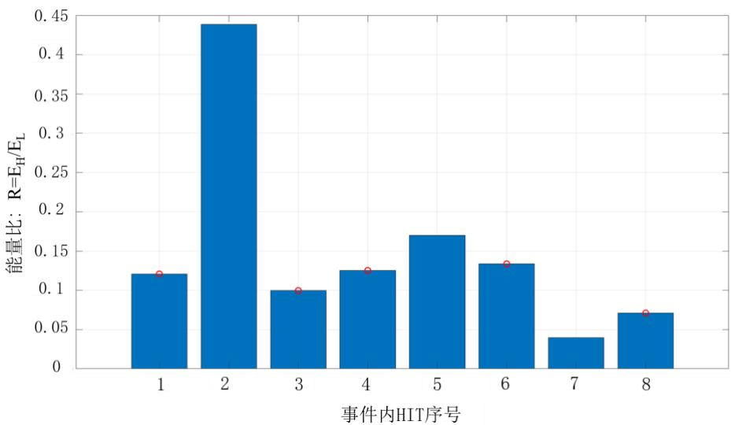  
图 3.4 同一声发射事件不同Hit的能量比特征对比图

## 3.2 基于能量一致性的多通道Hit筛选模型

如上节所述，局部时窗信号经小波包分解后可提取高低频能量比特征�，用于表征声发射首波初始响应段的频带能量分布。对于同一声发射事件，不同传感器接收到的Hit 信号会因传播路径差异、介质非均质性及传感器耦合状态不同而表现出一定的离散性。为减弱异常 Hit 对后续定位结果的影响，本文构建基于能量一致性的多通道Hit 筛选模型，从同一事件触发的多个 Hit 中选取局部时频特征更为一致的信号子集参与定位解算。

## 3.2.1基于能量比一致性的 Hit 子集筛选方法

对于某一特定的声发射事件，设其对应的 8 个通道的高低频能量比特征集合为： $C = \{ R _ { 1 } , R _ { 2 } , \cdots , R _ { 8 } \}$

由于空间三维声发射源定位至少需要 5 个有效传感器的初至到时信息，本文以5个Hit 作为定位解算的最小有效子集，并在 8个候选Hit 中进行组合寻优。设任意选取的一个候选子集记为 $S _ { k }$ ，其包含的 5个特征值表示为：

$$
S _ {k} = \{R _ {k 1}, R _ {k 2}, R _ {k 3}, R _ {k 4}, R _ {k 5} \}\tag{3.10}
$$

则整个组合空间内包含的候选组合总数为：

$$
C _ {8} ^ {5} = 5 6
$$

为客观衡量候选子集内各 Hit 能量比特征的一致性，本文采用组内方差作为离散度的评价指标。对于任意候选子集 $S _ { k }$ ，其组内特征的算术平均值为：

$$
\overline {{R}} _ {k} = \frac {1}{5} \sum_ {i = 1} ^ {5} R _ {k i}\tag{3.11}
$$

对应的组内方差（离散度）定义为：

$$
J _ {k} = \frac {1}{5} \sum_ {i = 1} ^ {5} (R _ {k i} - \overline {{R}} _ {k}) ^ {2}\tag{3.12}
$$

式中， $J _ { k }$ 值越小，说明该子集内 5个Hit 的高低频能量比越接近，其局部时频结构的一致性越高。基于此，可将该声发射事件的一致性最优 Hit 子集 $S _ { b e s t }$ 定义为使目标函数 $J _ { \boldsymbol { k } }$ 最小化的组合，即：

$$
S _ {b e s t} = \arg \min \{J _ {k} \}, \quad k = 1, 2, \dots , 5 6\tag{3.13}
$$

通过遍历全部 56 种组合并求解全局极小值，该方法将传统的“异常值剔除”转化为“一致性最优子集搜索”。从物理机制上看，若多个通道接收到的同源首波在传播过程中受路径扰动较小，其局部时窗内的频带能量分布应具备高度相似性；反之，遭受强散射、反射干扰或初至拾取存在较大偏差的 Hit，其能量比特征必然偏离群体。因此，通过最小化组内方差来框定最优子集，不仅有效剥离了异常干扰，也使整个筛选过程具备了严密的数学依据，避免了人为设置经验阈值的主观盲目性。

## 3.2.2Hit 筛选规则与流程

在上述一致性寻优评价方法的基础之上，本文构建了面向定位解算的多通道Hit 严密筛选流程，具体步骤及流程图3.5如下：

步骤1：有效Hit 预筛选与质量把控。对同一声发射事件触发的各通道信号进行初步核验，若某一 Hit 无法通过 AIC 算法完成有效的初至拾取，或其局部时窗信号的信噪比不满足特征提取要求，则直接将该 Hit 标记为无效并剔除。若预筛选后剩余的有效Hit 数量不足 5个，则判定该事件不具备三维定位的基础条件，整体予以舍弃。

步骤 2：局部时频特征提取。对通过预判的各个高质量 Hit，严格按照前文确定的局部时窗长度进行截取，并利用3层小波包分解计算其高低频能量比特征 。

步骤 3：候选组合空间生成。对于有效 Hit 数量 $N \geq 5$ 的事件，从中枚举所有的5元组合，生成候选子集空间。

步骤4：一致性评价与全局寻优。计算每一个候选子集的组内方差 $J _ { \boldsymbol { k } }$ ，并从中选取使 $J _ { k }$ 达到最小值的组合，将其锁定为该事件的一致性最优子集 $S _ { b e s t }$

步骤5：定位输入参数输出。保留最优子集 $S _ { b e s t }$ 中5个传感器对应的精确初至到时数据，将其作为高可靠性输入参数代入后续的非线性定位方程组求解；未被选中的其余Hit 则予以屏蔽，不参与该事件的坐标解算。

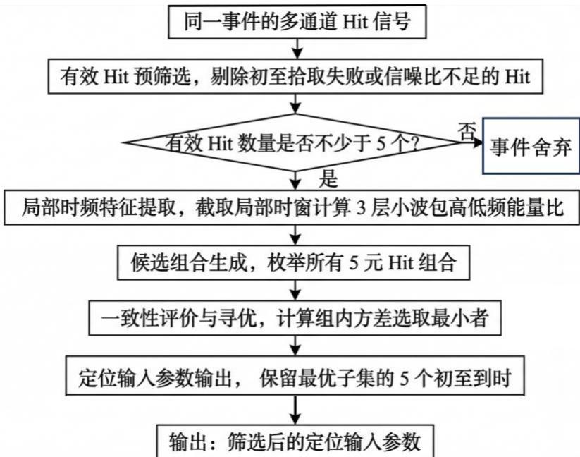  
图 3.5 Hit 筛选流程图

## 3.3 基于小波包能量筛选断铅试验Hit的结果分析

为了验证本文所提出 Hit 筛选方法的有效性并展示其在声发射源定位中的优势，本节对非迭代未知波速算法与结合Hit 筛选策略后的定位方法在定位精度上的表现通过断铅试验进行比较。传统非迭代未知波速算法虽然能够在波速未知条件下实现声发射源位置求解，且计算过程相对简洁，但在实际混凝土试件中，由于多通道接收信号受传播路径差异、介质非均质性、边界反射及波形畸变等因素影响，若直接利用全部Hit 参与定位，往往会导致定位误差增大、结果稳定性下降。相比之下，本文方法在非迭代未知波速算法的基础上，进一步引入首波精确到时拾取、局部时窗小波包分解、高低频能量比特征提取以及基于能量一致性的多通道 Hit 筛选策略，从同一声发射事件触发的多个 Hit 中筛选出局部时频特征更为一致的优选信号子集，再用于后续定位计算，从而提高了定位输入数据的可靠性与方程求解的稳定性。本研究通过绘制定位结果分布图及误差对比图，对两种方法在不同空间位置下的定位表现进行分析，并基于筛选前后定位结果的对比，验证本文所提出方法在提升未知波速条件下混凝土声发射源定位精度与可靠性方面的有效性。

## 3.3.1 断铅实验

作为一种验证声发射定位算法可靠性的实验方法，断铅实验通过铅笔芯的断裂产生突发型声发射模拟信号，再用各种算法分析信号、推断断铅的位置。该信号具有稳定性、宽频谱、良好的可重复性和易于实现等特点，因此成为模拟声发射源的主要手段之一。因此，本研究采用密度更高的超高性能混凝土（UHPC）小梁进行断铅实验，并通过分析测得的声发射信号来进行定位处理。

本研究使用尺寸为 550\*150\*100mm 的超高性能混凝土 UHPC 小梁作为试件，其中钢纤维含量为 1%。以顶面网格左下角试件边缘处为原点，在顶面 240\*80 的区域内划分大小为 20mm\*20mm 正方形网格，并建立了以横向 x 轴、纵向 y 轴和竖向 z 轴构成的直角坐标系。在该区域范围内共划分了 13 列 5 行，总计 65 个断铅点。实验中按照从左往右、从上往下的顺序进行断铅操作，每次断铅位置位于网格线交点处。采用了 0.5mm 石墨铅笔芯，并将其伸长 2.5mm 进行断铅操作，使得断铅角度与试件表面呈 30度夹角。此外，设置了 8个传感器（见表 3.1）。为降低实验过程中人为误差及系统误差对结果产生影响，每个断铅点进行了 5 次重复实验。如图3.6展示了传感器布置和断铅网格以及具体的断铅实验现场情况。

表 3.1 传感器坐标

<table><tr><td>传感器编号</td><td>1</td><td>2</td><td>3</td><td>4</td><td>5</td><td>6</td><td>7</td><td>8</td></tr><tr><td>X坐标(m)</td><td>0.155</td><td>0.255</td><td>0.355</td><td>0.205</td><td>0.305</td><td>0.185</td><td>0.285</td><td>0.385</td></tr><tr><td>Y坐标(m)</td><td>0.140</td><td>0.140</td><td>0.140</td><td>0.075</td><td>0.075</td><td>0.010</td><td>0.010</td><td>0.010</td></tr><tr><td>Z坐标(m)</td><td>0.100</td><td>0.100</td><td>0.100</td><td>0.000</td><td>0.000</td><td>0.100</td><td>0.100</td><td>0.100</td></tr></table>

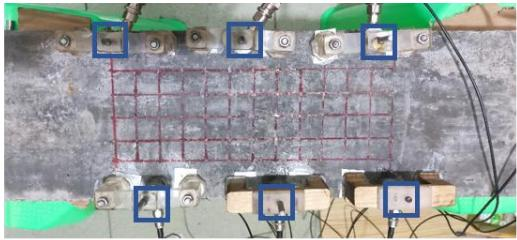

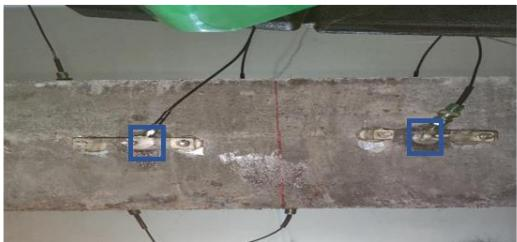

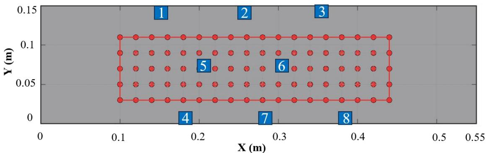

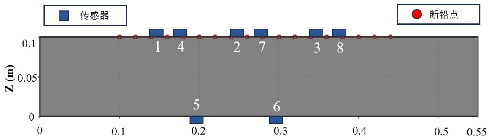  
图 3.6 断铅实验网格及传感器布置图

## 3.3.2有效范围设定

为合理评价非迭代未知波速算法及本文所提出基于小波包能量分布特征的声发射 筛选方法 下文简称 筛选方法 的定位性能，有必要首先对定位结果的有效分析范围进行设定。由于混凝土声发射定位过程中不可避免地受到测量误差、首波到时提取误差、材料非均质性以及边界反射等因素影响，部分定位结果可能明显偏离真实声源位置。若直接将全部定位点纳入误差统计，容易造成评价结果失真，难以客观反映定位方法在试件有效测试区域内的实际表现。因此，在进行筛选前后定位精度对比分析之前，需结合试验中铅芯断裂激励点的真实分布范围，对定位结果的有效区域进行统一界定。

本研究共布置65 个铅芯断裂模拟声源点，其空间分布主要位于试件内部预设测试平面内。各激励点的真实坐标范围为：X=155∼395 mm、Y=35∼115 mm，且 Z坐标固定为100mm。考虑到定位结果相对于真实点可能存在一定程度的空间离散，为避免因边界附近小幅偏移而将合理定位结果误判为异常点，本文在真实激励点分布区域的基础上，向四周适当扩展一定裕度，定义定位有效分析范围为：

X=[145,405]mm，Y=[5,145]mm，Z=[70,100]mm。

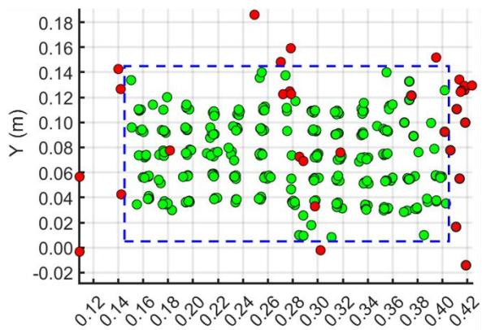  
X (m)

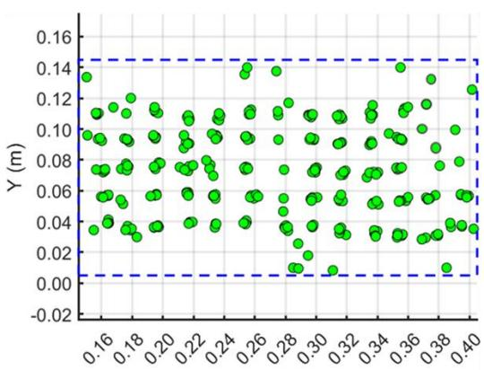  
X (m)  
图 3.7 断铅试验定位有效范围

上述有效范围如图 3.7 所示，图中蓝色虚线框表示定位结果的有效分析区域。位于该区域内的定位点视为有效定位结果，区域外的定位点则认为偏离真实激励区域较大，在后续误差统计与方法对比分析中不予纳入。该处理方式能够在保留大多数合理定位结果的同时，降低少量明显异常定位点对整体误差评价的干扰。

从图中可以看出，未经过 Hit 筛选时，部分定位点在试件平面边界外侧存在明显离散，说明在全部 Hit 直接参与定位的情况下，个别异常到时信息会对未知波速定位结果产生较大扰动。相比之下，经过有效范围约束后，可更加清晰地反映定位点在真实激励区域附近的聚集情况，为后续开展筛选前后定位误差对比分析提供统一的评价基础。

## 3.3.3定位误差分析

在完成定位有效范围设定后，可进一步对非迭代未知波速算法与 Hit 筛选方法的定位结果进行误差分析，以评价本文方法对定位精度和结果稳定性的改善效果。由图3.8和图3.9可以看出，两种方法在空间分布形态上已表现出较为明显的差异；结合各方向误差统计结果及误差分布图，能够更加清晰地揭示 Hit 筛选策略对定位结果的改善作用。

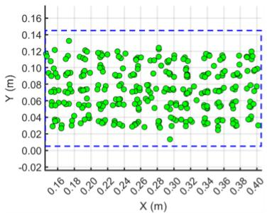  
(a)

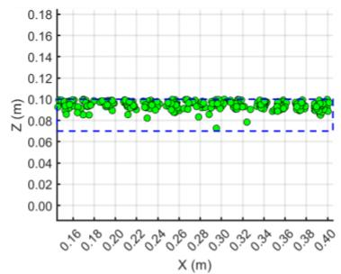  
(b)

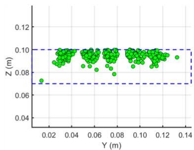  
(c)

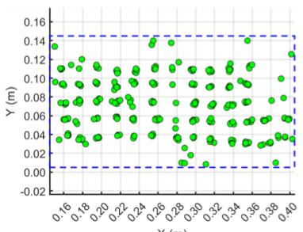  
(d)

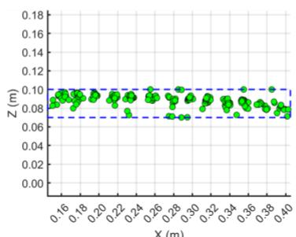  
(e)

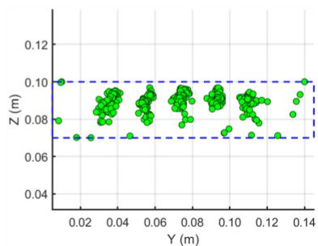  
(f)  
图3.8Hit筛选法(a-c)与非迭代未知波速算法(d-f)定位结果

从有效定位源数量来看，非迭代未知波速算法在有效范围内共得到 288 个定位结果，而 Hit 筛选方法得到 311 个定位结果，较前者增加了 23 个。说明在相同试验条件下，经过局部时频特征一致性筛选后，更多事件能够获得落入有效区域内的有效定位结果。这一现象表明，部分原始 i 中确实存在对定位求解不利的异常到时信息，而将其剔除后，定位解更容易收敛到真实激励点附近。

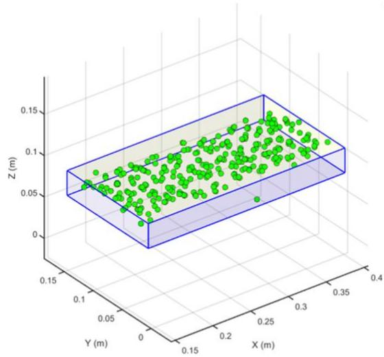  
(a) HIT筛选法

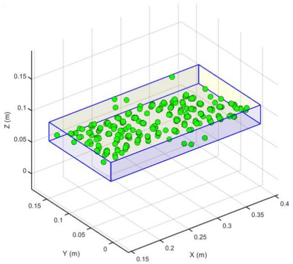  
(b)非迭代未知波速算法  
图 3.9Hit筛选法(a)与非迭代未知波速算法(b)三维定位结果对比

误差区间分布能够更加直观地反映两种方法在定位精度上的差异，如表 所示。非迭代未知波速算法中，误差小于 1cm 的定位源共有 108 个，占有效定位结果的37.5%；误差位于 1–2cm 区间的有146 个，占50.7%；误差大于 2cm 的共有34 个，占 11.8%。相比之下，Hit 筛选方法中误差小于 1cm 的定位源达到 250 个，占80.4%；误差位于 1–2cm 区间的有59个，占 19.0%；误差位于 2–5cm 区间的仅有 2 个，占 0.6%。这说明经过 Hit 筛选后，定位结果大幅向高精度区间集中，中等误差及较大误差事件明显减少，定位结果的集中性和可靠性均得到提升。

表 3.2 定位误差对比

<table><tr><td colspan="2">误差指标</td><td>非迭代未知波速法</td><td>Hit 筛选法</td></tr><tr><td rowspan="2">X方向误差(mm)</td><td>误差范围</td><td>[-4.432, 11.578]</td><td>[-4.355, 7.365]</td></tr><tr><td>平均误差</td><td>1.263</td><td>0.723</td></tr><tr><td rowspan="2">Y方向误差(mm)</td><td>误差范围</td><td>[-7.303, 10.192]</td><td>[-5.462, 4.667]</td></tr><tr><td>平均误差</td><td>-0.745</td><td>-0.402</td></tr><tr><td rowspan="2">Z方向误差(mm)</td><td>误差范围</td><td>[-28.120, -4.519]</td><td>[-11.074, -3.208]</td></tr><tr><td>平均误差</td><td>-11.447</td><td>-4.301</td></tr><tr><td rowspan="3">误差范围</td><td>误差在0-1cm</td><td>108 (37.5%)</td><td>250 (80.4%)</td></tr><tr><td>误差在1-2cm</td><td>146 (50.7%)</td><td>59(19.0%)</td></tr><tr><td>误差&gt;2cm</td><td>34 (11.8%)</td><td>2 (0.6%)</td></tr><tr><td rowspan="3">总体误差指标</td><td>平均绝对误差(mm)</td><td>12.467</td><td>6.499</td></tr><tr><td>最大误差(mm)</td><td>31.394</td><td>16.352</td></tr><tr><td>RMSE(mm)</td><td>13.303</td><td>6.471</td></tr></table>

图 3.8 给出了两种方法在 XY、XZ 和 YZ 三个投影平面内的定位结果分布情况，其中图 3.8(a)～(c)为非迭代未知波速算法结果，图 3.8(d)～(f)为 Hit 筛选方法结果。由图可见，未知波速方法虽然能够总体反映铅芯断裂源的大致分布区域，但在 平面内仍存在一定数量的离散点，尤其在边界附近定位点散布较为明显；在XZ 和 YZ 投影中，定位结果在深度方向上呈现出较大的下偏趋势，不少点偏离理论高度较远。相比之下，Hit 筛选方法得到的定位点在三个投影平面内均表现出更高的聚集性。XY平面中的点云分布更加紧凑，边界外侧异常散点明显减少；XZ与YZ平面中，大部分点均集中在理论高度附近，说明筛选后的定位结果在深度方向上的波动得到了有效抑制。

图3.9进一步展示了两种方法的三维定位结果。由图3.9可见，非迭代未知波速方法所得定位点虽然大体位于有效区域内部，但空间分布较为松散，局部区域仍可见一定程度的异常偏移；Hit 筛选方法的三维点云则更加集中，定位结果整体更贴近真实激励点所在平面，且在厚度方向上的偏离显著减小。这与图 3.8中的二维投影分析结论一致，说明本文所提出的 Hit 筛选策略能够有效改善三维空间内定位

点的整体约束效果。

从各坐标方向的误差统计来看，Hit 筛选方法在 X、Y、Z 三个方向上均表现出更好的误差控制能力。非迭代未知波速算法在 X 方向的误差范围为[−4.432,11.578]，平均误差为 1.263mm；Hit 筛选方法在 X 方向的误差范围收窄为[−4.355,7.365]mm，平均误差减小为 0.723mm。说明筛选后定位结果在 X 方向上的离散程度有所降低，正向偏差得到了控制。Y方向上，非迭代未知波速方法的误差范围为[−7.303,10.192]mm，平均误差为-0.745mm，而 Hit 筛选方法的误差范围减小为[−5.462,4.667]mm，平均误差为-0.402mm，表明其在平面横向方向上的波动幅度同样有所减弱。

深度方向的改善最为明显。非迭代未知波速算法在 Z 方向的误差范围为[−28.12,−4.519]mm，平均误差为-11.447mm，表现出较为显著的系统性负偏差；Hit筛选方法在 Z 方向的误差范围缩小为[−11.074,−3.208]mm，平均误差减小为-4.301mm。说明筛选后的定位结果在深度方向更加接近试验设定的理论高度，原有的下偏趋势被明显削弱。图 3.11(c)中的 Z 方向误差直方图也反映了这一点：未知波速方法的误差分布范围较宽，且整体偏向较大负误差区间；Hit 筛选方法的误差分布则更集中于较小的负偏差范围内，表明其在深度方向上的稳定性明显提高。

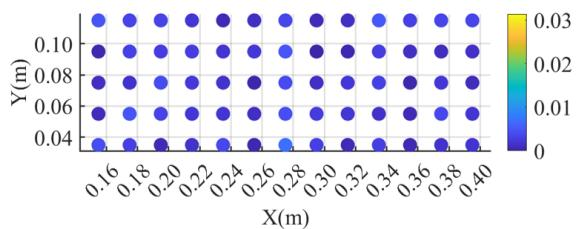  
(a) X方向误差

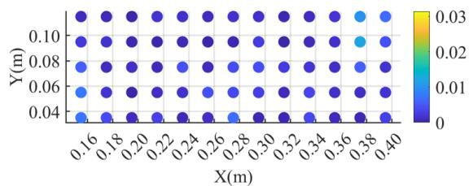  
(d) X方向误差

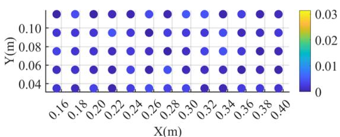  
(b) Y方向误差

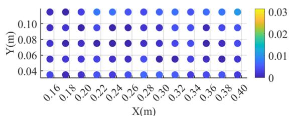  
(e) Y方向误差

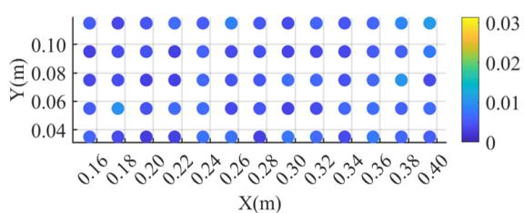  
(c) Z方向误差

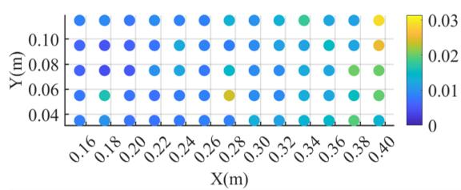  
(f) Z方向误差  
图 3.10Hit筛选法(a-c)与非迭代未知波速算法(d-f)在不同维度误差对比

图3.10给出了不同测点位置上的误差空间分布情况。由图3.10 可以看出，非迭代未知波速算法在部分边界区域和局部测点处出现了较高误差值，颜色分布相对离散；Hit 筛选方法的误差分布则更加均匀，多数测点误差保持在较低水平，仅在个别区域出现相对较高误差。这说明本文方法不仅降低了整体误差水平，同时也改善了不同空间位置下定位精度的不均衡问题，使定位结果在测试区域内具有更好的稳定性。

图3.11进一步对两种方法在 X、Y、Z三个方向上的误差分布进行了直方图比较。图 3.11(a)和图 3.11(b)表明，Hit 筛选方法在 X 与 Y 方向上的误差分布更加集中，误差峰值主要分布在靠近零误差的位置附近，极端偏差出现频率较低。图 3.11(c)则显示，非迭代未知波速方法在 Z方向存在更长的负误差尾部，而 Hit 筛选方法的分布明显向较小误差区间收缩。这与前述误差范围统计结果是一致的，也进一步说明深度方向是Hit 筛选策略改善最显著的方向。

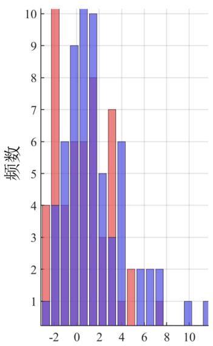  
X方向定位误差(mm)

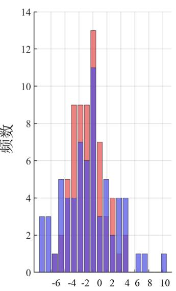  
Y方向定位误差(mm)

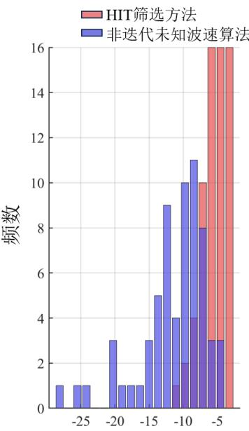  
Z方向定位误差(mm)  
图3.11 误差分布直方图

总体误差指标同样验证了这一规律。未知波速到时差定位算法的平均绝对误差为 12.467mm，最大误差为 31.394mm，RMSE 为 13.303mm；Hit 筛选方法的平均绝对误差降低至 6.499mm，最大误差降低至16.352mm，RMSE 降低至 6.471mm。可以看出，Hit 筛选方法不仅显著减小了平均误差水平，而且对大误差点具有更强的抑制作用。尤其是最大误差由 31.394mm 降至 16.352mm，表明异常定位点得到了有效控制；RMSE 由13.303mm 降至6.471mm，则说明整体误差波动幅度明显减小，定位结果的一致性更好。

综合图3.8～图 3.11及各项统计结果可以看出，非迭代未知波速定位算法能够在波速未知条件下实现声发射源定位，但当全部 Hit 直接参与定位时，结果容易受到异常到时信息和复杂传播效应的影响，导致平面离散点增多、深度方向偏差明显。本文提出的基于小波包能量分布特征的声发射 Hit 筛选方法，通过优先保留频带能量分布更为一致的Hit 子集，使定位结果在有效定位数量、误差区间分布、各方向误差控制及空间聚集性等方面均得到明显改善，表明该方法能够有效提升混凝土声发射源定位的精度与稳定性。

## 3.4 本章小结

本章围绕混凝土声发射源定位过程中多通道 Hit 信号质量不一致、异常 Hit 易导致定位结果离散的问题，构建了基于小波包局部能量分布特征的多通道 Hit 筛选方法，并通过断铅试验对该方法的有效性进行了验证。主要结论如下：

（1）针对声发射信号首波到时识别精度直接影响后续特征提取结果的问题，采用阈值法与 AIC 准则相结合的方式确定首波精确到时，并以此为基准截取局部分析时窗。在此基础上，对局部时窗信号进行小波包分解，建立了适用于混凝土声发射首波初始响应段的局部时频特征表征方法。

（2）结合典型声发射事件的频谱分布特征，对局部时窗信号各子频带能量进行重组，构建了高频与低频能量比特征。该特征能够较好反映不同通道接收信号在局部频带能量分布上的差异，为同源多通道 Hit 的一致性评价提供了有效依据。

（3）在高低频能量比特征提取的基础上，提出了基于能量一致性的多通道 Hit筛选模型。通过对同一声发射事件触发的多个 Hit 进行组合遍历，并以组内能量比离散度最小为准则，筛选出局部时频特征更为一致的最优 Hit 子集。该方法能够在一定程度上剔除受复杂传播路径、介质非均质性及波形畸变影响较大的异常 Hit，从而提高定位输入数据的稳定性。

（4）断铅试验结果表明，基于小波包局部能量分布特征的 Hit 筛选方法能够有效提高声发射源定位结果的可靠性与精度。与未知波速到时差定位算法直接利用全部Hit 进行求解相比，筛选后的有效定位源数量由 288个增加至 311 个；误差小于1cm 的定位结果占比由 37.5%提高至80.4%，而大误差定位点显著减少。与此同时，筛选后定位结果在 X、Y、Z三个方向上的误差范围均有所收窄，尤其在深度方向上改善更为明显；最大误差由 31.394mm 降低至 16.352mm，均方根误差由13.303mm 降低至6.471mm。由平面投影图、三维分布图及误差统计结果可见，筛选后的定位点在空间上更接近真实激励源位置，异常离散点明显减少，说明所提出方法能够有效提升混凝土声发射源定位的精度与稳定性。

## 第4 章 基于走时层析的非均匀波速场重建及声发射源定位优化

本章主要研究了基于弹性波波速场反演的声发射源定位精度提升方法。针对传统声发射源定位过程中普遍采用均匀波速模型、难以准确描述混凝土内部复杂传播特性，从而导致定位误差较大的问题，基于断铅实验获取的走时数据，借鉴计算机断层成像思想，构建了试件内部弹性波波速场反演模型。首先，将试件区域离散为有限网格单元，建立走时与单元慢度之间的离散映射关系；随后，采用射线追踪方法计算传播路径及其在各单元中的穿越长度，构建路径长度矩阵，并结合 ART算法与正则化约束实现非均匀波速场的稳定求解。在此基础上，将反演得到的波速场引入声发射源定位过程中，以已有初始定位结果为起点，通过源点摄动搜索不断修正源坐标，以理论走时与实测走时残差平方和最小为目标，获得更优的源位置估计。最后，通过对比分析反演前后源定位结果的变化，验证所建方法在提高声发射源定位精度方面的有效性。本章技术路线如图4.1所示。

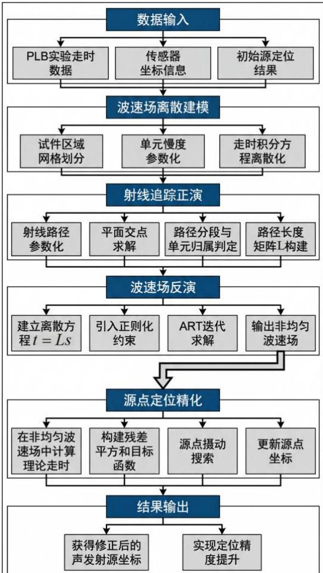  
图 4.1 源定位优化技术路线图

## 4.1 走时正演建模

波速场反演的前提，是将连续介质中的波传播过程表示为离散模型下的可计算问题。为此，本文首先对试件区域进行规则网格离散，将内部介质参数由连续分布转化为单元尺度下的离散表示；随后，以单元慢度为基本未知量，建立弹性波传播走时的离散表达式；进一步结合射线在网格中的传播特征，构建反映路径几何关系的路径长度矩阵。经过上述建模处理，实测走时数据与待求介质参数之间可建立明确的离散映射关系，从而为后续反演算法的求解奠定基础。

## 4.1.1试件区域的网格离散

为开展试件内部弹性波波速场反演，需首先明确研究区域的空间范围，并建立对应的离散计算模型。本文所采用的断铅实验试件为长方体结构，整体尺寸为$5 5 0 { \times } 1 5 0 { \times } 1 0 0 0 \mathrm { m m } ^ { 3 }$ 。考虑到断铅激励位置及主要传播分析区域集中于试件局部，且波速场重建重点在于表征该区域内部介质参数的空间变化，本文选取尺寸为$2 4 0 { \times } 8 0 { \times } 1 0 0 \mathrm { m m } ^ { 3 }$ 的区域作为反演计算区域。该区域在保证研究针对性的同时，有助于控制待反演参数规模，提高后续求解的稳定性与计算效率。

为将连续介质中的波速分布转化为可计算的离散模型，本文采用规则网格对反演区域进行划分。具体地，将该区域离散为边长均为 10mm 的正方体单元，即每个网格单元的尺寸为 $1 0 { \times } 1 0 { \times } 1 0 \mathrm { m m } ^ { 3 }$ 。按照上述划分方式，反演区域共划分得到1920个网格单元。离散后，连续变化的波速场可表示为各网格单元内分段常值的参数场，从而为走时正演计算和反演建模提供空间离散基础。

在网格划分完成后，本文进一步对单元及节点进行统一编号，以便后续射线追踪过程中判定传播路径与网格单元的空间对应关系，并统计射线在各单元中的穿越长度。通过上述处理，试件内部复杂的连续传播问题可转化为离散网格上的参数反演问题，为后续路径长度矩阵构建及波速场重建奠定基础

## 4.1.2基于慢度参数化的走时积分模型

在完成反演区域的网格离散后，还需进一步建立弹性波传播走时与介质参数之间的定量关系，以实现由观测走时反演内部波速场的目标。对于给定震源与传感器之间的一条传播路径，弹性波的传播时间取决于其沿路径所经过各位置处的局部波速分布。为便于建立反演模型，本文不直接以波速作为待求参数，而采用慢度作为介质参数表征，即定义慢度 为波速 的倒数：

$$
s (\mathbf {x}) = \frac {1}{v (\mathbf {x})}\tag{4.1}
$$

式中：x表示介质中的空间位置。

对于第 条射线，其从源点传播至第 个传感器的理论走时可表示为

$$
t _ {i} = \int_ {L _ {i}} \frac {1}{v (\mathbf {x})} d s = \int_ {L _ {i}} s (\mathbf {x}) d l\tag{4.2}
$$

式中： $L _ { \phantom { } _ { i } }$ 表示第�条射线的传播路径， $d l$ 为沿传播路径的微元长度， $t _ { i }$ 为对应的理论走时。

该式表明，走时本质上是慢度场沿传播路径的累积结果。也就是说，某一区域波速越低，对应慢度越大，则该区域对总传播时间的贡献越显著。

由于实际反演过程中研究区域已被离散为有限个规则网格单元，且本文假定每个单元内部的介质参数近似为常值，因此连续慢度场可进一步表示为离散单元上的分段常值函数。设第�个网格单元的波速为 $\nu _ { j }$ ，其对应慢度记为

$$
s _ {j} = \frac {1}{v _ {j}}, \quad j = 1, 2, \dots , N\tag{4.3}
$$

式中：�为网格单元总数。

若第�条射线在第�个单元内的穿越长度为 $l _ { i j }$ ，则该射线的理论走时可近似写为

$$
t _ {i} \approx \sum_ {j = 1} ^ {N} l _ {i j} s _ {j}\tag{4.4}
$$

该式表明，第�条射线的总走时可视为其在各穿越单元内传播时间的累加，其中每一项 $l _ { i j } s _ { j }$ 表示射线在单元�内的局部传播时间贡献。当射线未穿过某一单元时，有 $l _ { i j } = 0$ 。将所有射线的走时关系统一写成矩阵形式，可得

$$
t = L s\tag{4.5}
$$

式中： $t \in \mathbb { R } ^ { M \times 1 }$ 为走时向量，�为射线总数； $s \in$ 为单元慢度向量； $\boldsymbol { L } \in \mathbb { R } ^ { M \times N }$ 为路径长度矩阵，其元素表示第�条射线在第�个单元内的穿越长度。

至此，连续介质中的走时积分问题被转化为离散网格上的线性代数问题，为后续路径长度矩阵构建及基于 ART的慢度反演奠定了数学基础。

## 4.1.3路径长度矩阵的构建

可知，路径长度矩阵�是连接射线传播路径与单元慢度参数的核心矩阵。该矩阵用于描述各条射线在离散网格中的空间分布特征，其元素取值直接决定了各单元慢度对观测走时的贡献大小。因此，路径长度矩阵的合理定义是建立离散反演模型的关键环节。

由于反演区域共划分为�个网格单元，射线总数为�，则路径长度矩阵定义为

$$
\mathbf {L} = \left[ \begin{array}{c c c c} l _ {1 1} & l _ {1 2} & \dots & l _ {1 N} \\ l _ {2 1} & l _ {2 2} & \dots & l _ {2 N} \\ \vdots & \vdots & \ddots & \vdots \\ l _ {M 1} & l _ {M 2} & \dots & l _ {M N} \end{array} \right] \in \mathbb {R} ^ {M \times N}\tag{4.6}
$$

式中：矩阵元素 $l _ { i j }$ 表示第�条射线在第�个网格单元中的传播长度。

若第�条射线未经过第�个单元，则对应元素 $0 .$ 。由此，路径长度矩阵完整反映

了射线与网格单元之间的几何对应关系。

从矩阵结构上看，路径长度矩阵的每一行对应一条射线在全部网格单元中的路径长度分布，用于表征该射线的传播轨迹；每一列对应某一网格单元被全部射线穿越的情况，用于反映该单元在整体观测中的覆盖程度。因此，路径长度矩阵既是走时正演模型中的系数矩阵，也刻画了离散网格条件下传播路径对介质参数的几何敏感性。

需要指出的是，由于单条射线仅穿过有限数量的网格单元，路径长度矩阵通常具有稀疏特征，即矩阵中大量元素为零。该特征不仅反映了射线传播的局部性，也为后续 ART 迭代求解提供了计算上的便利。至于矩阵元素 $l _ { i j }$ 的具体求取过程，本质上取决于射线在规则网格中的路径追踪与穿越长度统计方法，相关内容将在下一节中详细讨论。

## 4.2 基于ART的正则化慢度场反演方法

在完成离散正演模型构建后，可得到观测走时向量与单元慢度参数之间的线性关系式。由于路径长度矩阵通常具有高维稀疏、病态性较强等特点，直接求解易导致结果不稳定。为此，本节采用代数重建技术（ART）结合正则化约束，对试件内部慢度场进行迭代反演，以获得稳定的非均匀波速场重建结果。

## 4.2.1反演问题的数学描述与特性分析

基于前文建立的离散化前向模型，波速场反演的核心任务是利用边界观测得到的弹性波走时数据 ，逆向推算反演区域内各网格单元的慢度分布 。该过程在数学上可归结为公式 1.27 的求解问题。结合声发射层析成像的实验条件与物理背景，该方程组展现出以下显著的计算特性：

## （1）矩阵的高度稀疏性与计算效率需求

由于声波传播的局部性，单条射线仅穿过反演区域内极少数的网格单元，这使得路径长度矩阵 呈现出典型的高度稀疏特征。针对此类大规模稀疏方程组，采用代数重建技术（ART）这类行处理迭代算法，能够逐行利用观测信息进行局部修正，不仅避免了直接求逆带来的巨大计算开销，还具有良好的收敛效率和内存经济性。

## （2）射线覆盖的不均匀性与解的适定性

在声发射实验中，受限于传感器布置位置以及试件内部声源分布的随机性，射线在空间上的覆盖往往不完全对称。这种覆盖特征可能导致部分网格单元的约束信息相对匮乏，使得方程组表现出一定的欠定性。为了从有限且分布不均的观测数据中获得物理意义合理的波速图像，需要在反演模型中引入先验约束，通过正则化手段引导解向平滑且连续的方向收敛。

## （3）观测噪声对求解稳定性的要求

实际采集的走时数据中不可避免地包含拾取误差。此外，本文在走时正演建模中采用了直线射线假设。尽管该简化有效降低了计算复杂度，并在整体上满足了波速场重建与定位修正的需求，但混凝土作为一种多相复合材料，其内部骨料、微裂缝等导致的强非均质性会使得弹性波在传播过程中不可避免地发生散射与绕射效应。根据费马原理，声波总是倾向于沿着走时最短的路径传播，在遇到局部强低速异常区时，真实的波传播路径往往会发生弯曲以“绕开”低速区。因此，直线射线追踪在局部强非均质区域可能会引入一定的系统误差：它通常会使得反演算法低估低速区的波速异常幅度，或导致异常体位置发生轻微的几何畸变。为了确保反演结果不被拾取噪声与直线射线假设带来的系统误差所主导，必须在求解过程中采取稳定化策略。通过引入正则化项对解的范数及梯度进行限制，可以有效平衡数据拟合度与结果稳定性之间的关系，提高波速场重建的保真度。针对直线射线假设带来的局限性，在后续或未来的深入研究中，可考虑引入基于程函方程（EikonaEquation）的快速推进法（Fast Marching Method, FMM）等弯曲射线追踪模型[77, 78]，以进一步减小建模残差，提升强非均质区域的重建精度。。

综上所述，结合上述数学特性与工程实际需求，本文选择构建基于 ART算法的正则化反演框架。该方法通过迭代投影实现对稀疏系统的快速求解，并结合正则化约束确保了在噪声干扰下的反演稳定性，从而为后续声发射源的精准定位提供可靠的非均匀波速。

## 4.2.2正则化目标函数构建与动态参数策略

针对4.2.1节所述的反演问题特性，为了在满足观测数据约束的同时抑制噪声干扰并获得物理上合理的解，本文引入 Tikhonov 正则化框架，构建如下目标函数：

$$
\Phi (\mathbf {s}) = \left\| \mathbf {L} \mathbf {s} - \mathbf {t} \right\| _ {2} ^ {2} + \lambda R (\mathbf {s})\tag{4.7}
$$

式中：第一项 $\mathbf { L s } - \mathbf { t } \| _ { 2 } ^ { 2 }$ 为数据拟合项，用于衡量重构模型与实测走时数据之间的匹配程度；第二项 $R ( s )$ 为正则化项，用于对解的先验信息进行约束； 为正则化参数，起到平衡数据保真度与模型平滑度的权重作用。

考虑到混凝土介质内部波速分布通常具有局部连续性，本文采用平滑正则化约束，即通过限制慢度场的空间梯度来抑制数值解的剧烈振荡。此时， 具体表示为：

$$
R (\mathbf {s}) = \left\| \mathbf {D} \mathbf {s} \right\| _ {2} ^ {2}\tag{4.8}
$$

则最终的优化目标函数可表示为：

$$
\Phi (\mathbf {s}) = \left\| \mathbf {L} \mathbf {s} - \mathbf {t} \right\| _ {2} ^ {2} + \lambda \left\| \mathbf {D} \mathbf {s} \right\| _ {2} ^ {2}\tag{4.9}
$$

式中： 为离散差分算子，其物理意义是约束相邻网格单元之间慢度变化的平滑程度。

通过最小化该目标函数，可以使反演出的波速场在拟合观测走时的同时，保持

良好的空间连续性。

此外，为了进一步优化迭代求解过程，本文引入了动态正则化参数策略。在ART迭代过程中， 的取值随迭代步数 按指数规律衰减：

$$
\lambda^ {(n)} = \lambda_ {0} \alpha^ {n}, 0 <   \alpha <   1\tag{4.10}
$$

式中： $\lambda _ { 0 }$ 为初始正则化参数， 为当前迭代轮数， $\alpha$ 为衰减系数。

该动态策略的逻辑在于：在迭代初期，施加较强的正则化约束（较大的 ）以增强算法抗噪能力，确保慢度场在大框架上的数值稳定性；随着迭代的深入，逐渐减小约束强度，使得算法能够更充分地挖掘观测数据中的高频细节，从而在保证收敛稳定的前提下，逐步提高波速场重构的空间分辨率。

## 4.2.3ART迭代更新公式与求解格式

在4.2.2节中，构建了包含数据拟合项和平滑约束项的正则化目标函数，用以描述非均匀慢度场反演的整体优化问题。然而，由于路径长度矩阵 具有高维、稀疏及病态等特征，若采用对全局方程组直接求逆的求解方式，不仅计算开销极大，而且极易受观测噪声影响，导致反演结果产生数值振荡。为此，本文采用代数重建技术（ART）对慢度场进行逐射线的迭代更新，并在标准 ART 的基础上引入正则化阻尼项，以提高求解过程的鲁棒性。

对于第 条射线，在第 次迭代下，由当前慢度场估计值 $s ^ { ( k ) }$ 计算得到的理论走时为：

$$
\hat {t} _ {i} ^ {(k)} = \sum_ {j = 1} ^ {N} l _ {i j} s _ {j} ^ {(k)}\tag{4.11}
$$

则对应的走时残差可表示为实测走时与理论走时之差：

$$
\boldsymbol {r} _ {i} ^ {(k)} = \boldsymbol {t} _ {i} - \hat {\boldsymbol {t}} _ {i} ^ {(k)} = \boldsymbol {t} _ {i} - \sum_ {j = 1} ^ {N} l _ {i j} s _ {j} ^ {(k)}\tag{4.12}
$$

式中： $t _ { i }$ 为第 条射线的实测走时； $l _ { i j }$ 表示射线 在网格单元 内的穿越长度； ${ S } _ { j } ^ { ( k ) }$ 表示第k次迭代时单元 的慢度值。

为抑制局部异常修正和噪声放大现象，本文在标准 ART更新格式的分母项中引入动态正则化参数 $\lambda ^ { ( k ) }$ ，从而得到改进的正则化 ART迭代更新公式：

$$
s _ {j} ^ {(k + 1)} = s _ {j} ^ {(k)} + \mu \frac {t _ {i} - \sum_ {j = 1} ^ {N} l _ {i j} s _ {j} ^ {(k)}}{\sum_ {j = 1} ^ {N} l _ {i j} ^ {2} + \lambda^ {(k)}} l _ {i j}\tag{4.13}
$$

式中：为松弛因 $\vec { \mathrm { \Delta } }$ ，用于控制单次迭代的修正幅度，本文取值0.6，以兼顾算法的收敛速度与数值稳定性。

由上式可知，标准 ART的单步修正量主要受射线残差和路径长度分布共同控制。当某条射线在局部区域内的穿越长度较短，或观测数据中存在一定噪声扰动时，常规ART极易产生幅值过大的局部修正，进而导致重建结果出现非物理振荡。引入 $\lambda ^ { ( k ) }$ 后，相当于为单步迭代增加了阻尼约束，该机制可有效削弱异常残差对局部更新量的放大作用，显著提高反演过程的稳定性。

同时，结合前文设定的动态衰减策略，正则化参数 $\lambda ^ { ( k ) }$ 随迭代步数逐渐减小。这使得算法在迭代初期侧重于全局平滑约束，在迭代后期则逐步增强对局部细节特征的拟合能力。因此，该方法能够在保证反演过程稳定收敛的基础上，最大程度保留并刻画非均匀波速场的空间分辨特征。

## 4.2.4波速场重建算法流程

综合前文所述的反演区域离散化、走时正演模型构建以及正则化 ART迭代策略，本文建立了非均匀波速场重建的整体求解流程。该流程主要包括参数初始化、路径长度矩阵构建、逐射线迭代修正、动态正则化衰减、收敛性判定及结果输出等步骤，具体如下。

首先，根据试件尺寸及反演精度要求，对目标区域进行网格划分，并初始化全体网格单元的慢度向量 $s ^ { ( 0 ) }$ 。初始慢度通常依据试件均匀介质假设下的参考波速确定。同时，设置松弛因子 、初始正则化参数 $\lambda _ { 0 }$ 、衰减系数 以及最大迭代次数 $K _ { \mathrm { m a x } }$

其次，根据断铅实验中已知的震源坐标与传感器位置，采用射线追踪方法计算各条传播路径在不同网格单元中的穿越长度 $l _ { i j }$ ，进而构建全局路径长度矩阵 $L$ 。

在迭代求解阶段，为减弱固定更新顺序对收敛路径的影响，本文在每轮迭代开始前对射线集合进行随机重排。随后逐条抽取射线，基于当前慢度场计算理论走时$\hat { \mathbf { \chi } } _ { t _ { i } } ^ { }$ ，并与实测走时 $t _ { i }$ 比较得到走时残差 $r _ { i }$ 。再根据式 4.13对当前射线路径所穿越单元的慢度参数进行同步修正。

当完成一轮全部有效射线的更新后，按照式 4.10对正则化参数进行动态衰减，以逐步降低平滑约束强度，增强模型对局部非均匀特征的表达能力。

为判断算法是否收敛，本文采用整体走时残差的均方根误差作为评价指标，即

$$
\mathrm{RMSE} ^ {(k)} = \sqrt {\frac {1}{M} \sum_ {i = 1} ^ {M} \left(t _ {i} - \hat {t} _ {i} ^ {(k)}\right) ^ {2}}\tag{4.14}
$$

式中： 为参与反演的射线总数。

当 $R M S E ^ { ( k ) }$ 小于预设容差阈值，或迭代次数达到 $K _ { \mathrm { m a x } }$ 时，认为反演过程收敛并终止计算；否则继续进入下一轮迭代。

迭代结束后，提取最终收敛得到的慢度向量 $s$ ，并依据

$$
v _ {j} = \frac {1}{s _ {j}}\tag{4.15}
$$

将各网格单元慢度转换为波速值，从而获得试件内部三维非均匀波速场分布，波速场反演流程见图 4.2。

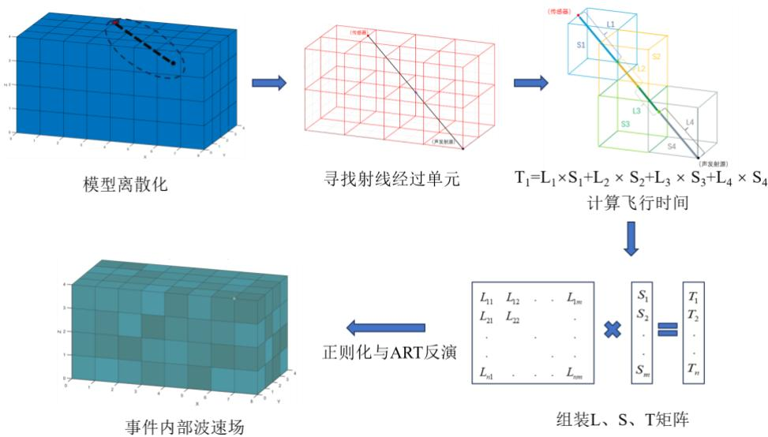  
图 4.2 波速场反演流程示意图

## 4.3 基于重建波速场的声发射源定位优化

在获得试件内部非均匀波速场后，传统均匀波速模型下得到的初始声发射源定位结果仍可能存在一定误差。为进一步提高定位精度，本文在重建波速场基础上构建了以走时残差平方和最小化为目标的源定位优化模型，并采用空间摄动搜索策略对初始定位结果进行迭代修正。其基本思想是：在结构有效空间内不断调整候选源点坐标，利用重建波速场重新计算源点至各传感器的理论传播走时，通过最小化理论走时与实测走时之间的残差，实现声发射源位置的优化求解。

## 4.3.1基于重建波速场的走时残差目标函数

在求得试件非均匀波速场之后，声发射源定位问题可进一步表述为结构有效空间内的约束最小化问题，即在可行区域Ω内寻找使目标函数达到最小的最优源点坐标�∗。其数学表达式为

$$
\mathbf {x} ^ {*} = \arg \min _ {\mathbf {x} \in \Omega} E (\mathbf {x})\tag{4.16}
$$

式中： $\boldsymbol { x } = ( x , y , z )$ 为待优化的声发射源空间坐标， 为用于衡量候选源点定位误差的目标函数。

需要指出的是，在实际声发射监测过程中，事件的真实起始发射时刻通常难以准确获取。若直接采用各传感器记录的绝对到时构建目标函数，则需要在震源空间坐标之外额外引入未知发射时刻作为待求参数，从而增加模型复杂度并影响优化稳定性。为避免这一问题，本文采用相对到时差的形式构建目标函数，即选取最先接收到声发射信号的传感器作为参考传感器，并以其到时作为基准，计算其余传感器相对于该参考通道的观测到时差。

对于给定候选源点 x，定义第 个传感器对应的目标函数残差项为观测到时差

与理论到时差之间的偏差，则整体目标函数可写为

$$
E (\mathbf {x}) = \sum_ {i = 2} ^ {n} \left[ t _ {\text { calc }} ^ {(i)} (\mathbf {x}) - t _ {\text { obs }} ^ {(i)} \right] ^ {2}\tag{4.17}
$$

式中：n为参与定位的传感器总数； $t _ { o b s } ^ { ( i ) }$ 表示第�个传感器相对于首达传感器的观测到时差； $t _ { o b s } ^ { ( i ) } ( \mathbf { x } )$ 表示在重建波速场条件下，由候选源点�到第�个传感器相对于首达传感器的理论传播到时差。

相应地，理论到时差可表示为

$$
t _ {c a l c} ^ {(i)} (\mathbf {x}) = T _ {c a l c} ^ {(i)} (\mathbf {x}) - T _ {c a l c} ^ {(1)} (\mathbf {x})\tag{4.18}
$$

式中： $T _ { c a l c } ^ { ( i ) } ( \mathbf { x } )$ 与 $T _ { c a l c } ^ { ( 1 ) } ( \mathbf { x } )$ 分别表示假设源点位于 x 时，该源点到第�个传感器及首达传感器的理论传播到时。

上述理论到时由重建非均匀波速场中的射线追踪算法计算得到，因此能够较真实地反映复杂介质条件下弹性波的传播特性。

与基于均匀波速模型的传统定位方法相比，上述目标函数直接利用重建波速场提供的局部传播信息，将源点位置与各传感器之间的相对到时关系统一纳入同一优化框架中。其本质是通过比较“候选源点在当前波速场下所预测的传播时序”与“传感器实际记录到的到达时序”之间的一致程度，对候选源点进行筛选和修正。

此外，采用残差平方和作为优化指标还具有两方面优势：一方面，平方和形式能够避免不同传感器通道残差的正负抵消，从而更准确地表征候选源点对应的整体拟合误差；另一方面，较大的残差项在平方运算后将获得更高权重，使优化过程对不合理候选点更加敏感，有利于增强后续摄动搜索的方向性与收敛稳定性。因此，声发射源定位问题最终可转化为在结构有效空间 Ω 内求解目标函数 $E ( x )$ 最小值的优化问题。

## 4.3.2空间摄动搜索策略与步长更新规则

针对上述非线性最小化问题，本文采用空间摄动搜索策略进行迭代求解。该方法以前述初始定位结果作为搜索起点，在当前最优位置附近构造多个候选点，并通过比较各候选点的目标函数值，逐轮更新源点坐标。

设初始源点坐标为 $\mathbf { X } _ { 0 }$ ，其由前述定位算法给出；设初始摄动步长为 ，最大迭代次数为 $K _ { \mathrm { m a x } }$ ，收敛阈值为 ，并令迭代计数器 $k = 0$ 。在第 次迭代中，以当前最优坐标 $x _ { k }$ 为中心，沿 M 个预设方向生成候选点集。本文取 $M { = } 1 8$ ，以兼顾三维空间不同方向上的搜索能力。则第j 个候选点可表示为

$$
\mathbf {x} _ {\text {candidate}} ^ {(j)} = \mathbf {x} _ {k} + \Delta \cdot \mathbf {d} ^ {(j)}, j = 1, 2, \dots , M\tag{4.19}
$$

其中， $d ^ { ( j ) }$ 为第 个摄动方向向量，覆盖三维空间中的主要方向，包括坐标轴正负方向及其组合方向如图4.3。

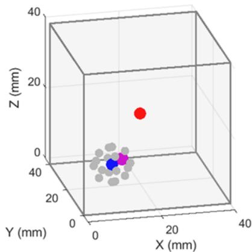  
图 4.3 候选点生成示意图

对于每一个候选点 $\mathbf { X } _ { c a n d i d a t e } ^ { ( j ) }$ ，均基于重建波速场执行射线追踪计算，得到该候选点至各传感器的理论传播到时差，并进一步代入目标函数，计算其对应的残差平方和，即

$$
E ^ {(j)} = E \left(\mathbf {x} _ {\text {candidate}} ^ {(j)}\right) = \sum_ {i = 2} ^ {n} \left[ t _ {\text {calc}} ^ {(i)} \left(\mathbf {x} _ {\text {candidate}} ^ {(j)}\right) - t _ {\text {obs}} ^ {(i)} \right] ^ {2}\tag{4.20}
$$

由此可得到当前迭代轮次中全部候选点的误差评价结果。随后，对所有候选点的目标函数值进行比较，选取其中残差平方和最小的点作为下一轮迭代的搜索中心，即

$$
\mathbf {x} _ {k + 1} = \mathbf {x} _ {\text { candidate }} ^ {(j ^ {*})}, \quad j ^ {*} = \arg \min _ {j = 1, 2, \dots , M} E ^ {(j)}\tag{4.21}
$$

该更新方式属于一种局部邻域搜索过程，即在当前最优点附近不断寻找目标函数更小的候选位置，并据此逐步修正源点坐标，如图图4.4。

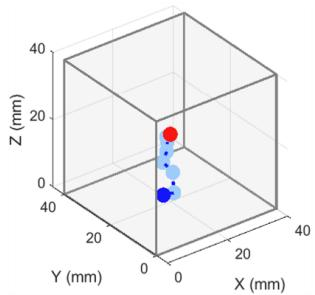  
(a) 3D 视图

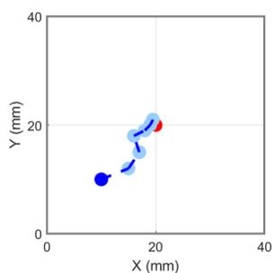  
(b) XY 面投影

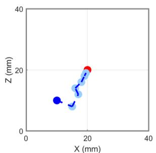  
(c) XZ 面投影

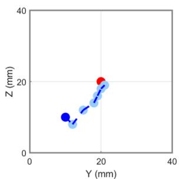  
(d) YZ 面投影  
图 4.4 源点位置估计在摄动优化过程中的收敛轨迹

为兼顾局部搜索精度与全局搜索能力，本文在迭代过程中引入步长动态调整策略。当当前迭代使目标函数明显减小时，说明当前搜索方向有效，此时可适当减小步长 ，以提高局部邻域内的搜索分辨率；反之，若目标函数下降不明显，则表明当前搜索可能陷入局部停滞，可通过保持步长不变或适当增大步长的方式扩展搜索范围，从而增强算法跳出局部最优区域的能力。该策略能够在保证计算效率的同时，提高优化过程的稳定性和搜索灵活性。

## 4.3.3源定位优化算法的终止准则

为保证算法在有限计算代价下获得稳定可靠的定位结果，本文设置了多重终止准则。当满足以下任一条件时，即认为当前摄动优化过程结束：

（1）残差阈值准则：若当前最优候选点对应的目标函数值已小于预设阈值�，即

$$
E (\mathbf {x} _ {k + 1}) <   \varepsilon\tag{4.22}
$$

则说明理论到时差与实测到时差之间已达到较高匹配程度。

（2）收敛停滞准则：若相邻两次迭代之间目标函数的相对改善率低于容差�，即

$$
\frac {\left| E \left(\mathbf {x} _ {k}\right) - E \left(\mathbf {x} _ {k + 1}\right) \right|}{E \left(\mathbf {x} _ {k}\right)} <   \delta\tag{4.23}
$$

则认为当前优化过程已基本收敛，继续迭代所带来的改进有限。

（3）最大迭代次数准则：若迭代次数达到预设上限 $K _ { \mathrm { m a x } }$ ，即

$$
k + 1 \geq K _ {\max}\tag{4.24}
$$

则停止搜索，以控制整体计算成本。

若上述终止条件均未满足，则令 $k = k + 1$ ，并根据预设规则对步长 进行调整后进入下一轮迭代。最终，当算法满足任一终止条件时，将当前最优坐标 ${ \bf X } _ { k + 1 }$ 记为声发射源的最终优化定位结果 $\mathbf { x } ^ { * }$ 。

从算法结构上看，整个摄动优化过程可概括为“候选点生成—目标函数评价—最优点筛选—终止条件判定”的循环迭代框架。其本质是在重建波速场约束下，通过不断修正候选源点位置，使理论传播时序逐步与实测传播时序相匹配，从而实现声发射源定位精度的进一步提升具体流程见图4.5。

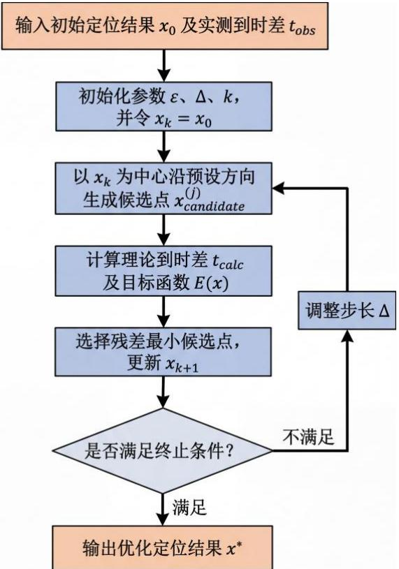  
图4.5 基于非均匀波速场的声发射源摄动搜索方法流程图

## 4.4 结果验证与对比分析

本章同样利用断铅试验数据对基于非均匀波速场的声发射源摄动搜索方法(下文简称摄动搜索法)与前文方法进行比较验证。

## 4.4.1重建波速场下的定位误差分析

由图4.6可以看出，两种方法在 XY、XZ 和YZ三个投影平面上的定位点分布具有明显差别。非迭代未知波速算法在 XY 平面内虽然能够大体反映铅芯断裂源的分布范围，但局部区域仍存在一定数量的离散点，尤其在测试区边缘及右侧区域，定位点相对分散。对应的 XZ和YZ投影进一步表明，该方法在深度方向上的偏移较为明显，不少定位点明显低于理论高度平面。相比之下，摄动搜索法在三个投影平面中的定位结果均表现出更好的聚集性：XY平面内定位点更加紧凑，边界外侧异常散点明显减少；XZ 与 YZ 投影中，大多数定位点均集中在理论高度附近，说明摄动搜索法能够对三维坐标尤其是深度方向进行更有效的约束。

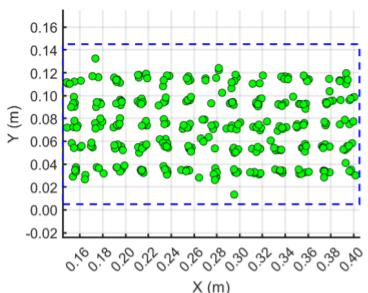  
(a)

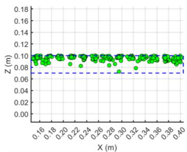  
(b)

  
(c)

  
X (m)  
(d)

  
X (m)  
(e)

  
(f)  
图 4.6 摄动搜索法(a-c)与非迭代未知波速算法(d-f)定位结果

图4.7给出的三维定位结果进一步验证了这一结论。非迭代未知波速算法所得点云虽然整体处于有效区域内部，但空间分布相对松散，局部仍可见明显偏离真实分布区域的点；摄动搜索法得到的三维点云则更加集中，且整体更贴近预设的断铅激励平面。这说明，在考虑非均匀波速场修正后，定位解算结果与真实传播过程之间的匹配程度有所提高，空间离散性得到明显抑制。

  
(a) 摄动搜索法

  
(b)非迭代未知波速算法  
图 4.7 摄动搜索法(a)与非迭代未知波速算法(b)三维定位结果对比

图4.8展示了不同测点位置上的误差空间分布。由图中颜色分布可以看出，非迭代未知波速算法在测试区域内的误差水平并不均匀，在局部边缘区域及右侧部分测点处出现了更高的误差值；摄动搜索法的误差分布则更加平缓，多数测点的误差保持在较低水平，仅在个别区域出现相对较高误差。这说明，摄动搜索法不仅降低了整体误差水平，也改善了定位精度在空间分布上的不均衡性，使不同区域内的定位结果更加稳定。

  
(a)

  
(d)

  
(b)

  
(e)

  
(c)

  
(f)  
图4.8 摄动搜索法(a-c)与非迭代未知波速算法(d-f)在不同维度误差对比

图4.9进一步可视化了两种方法之间精度差异的空间模式。在每一个铅断点位置处，圆形标记被划分为左右两个半圆，其中左半圆表示参考方法的绝对误差，右半圆表示迭代方法的绝对误差，圆圈大小则随该点误差改进幅度的变化而变化。由图可见，测试区右侧及周边区域的标记明显大于内部区域，说明非迭代未知波速算法在这些位置的误差更大，而摄动搜索法在这些区域的修正效果尤为显著。相比之下，测试区内部区域的标记整体较小，表明这些位置原始定位结果已经相对稳定，摄动搜索带来的改进幅度相对有限。这种空间模式与射线覆盖条件是一致的：内部区域通常具有较好的几何约束，定位解本身较为稳定；而边缘区域受传播路径数量较少、约束较弱等因素影响，更容易受到波速场非均匀性的干扰，因此摄动搜索法在这些区域的优化作用更加突出。这也说明，在数据约束较弱的边缘区域，考虑非均匀波速场修正对于提升定位精度具有更重要的意义

  
图4.9 位置误差的空间分布比较

图4.10中的误差直方图从另一个角度说明了两种方法之间的差异。在 X和Y两个方向上，摄动搜索法的误差分布更加集中于零值附近，较大偏差出现的频率明显降低，说明该方法在平面内定位结果上具有更好的稳定性。Z方向误差直方图的差异更为突出：非迭代未知波速算法的分布范围较宽，且整体呈现较明显的负偏态，说明深度方向存在系统性下偏；摄动搜索法的分布则明显向小误差区间收缩，误差集中程度更高，表明其在深度方向上的修正效果更加显著。

  
(a)

  
(b)

  
(c)  
图4.10 误差分布直方图  
由表 4.1 可见，三种方法在误差区间分布上呈现出较为清晰的递进改善关系。

非迭代未知波速算法中，误差小于1cm的定位源共有108个，占有效结果的37.5%；误差位于 1–2cm 区间的有 146 个，占 50.7%；误差大于 2cm 的共有 34 个，占11.8%。在引入 Hit 筛选后，误差小于 1cm 的定位源增加至 250 个，占比提高到80.4%，说明通过剔除局部时频特征偏离较大的异常 Hit，定位结果已明显向高精度区间集中；对应地，1–2cm 区间的定位源减少为 59个，占19.0%，大于2cm 的定位源仅剩2个，占 0.6%。在此基础上，摄动搜索法进一步将误差小于 1cm 的定位源提升至 277 个，占比达到 88.5%，1–2cm 区间的定位源进一步减少为 34 个，占10.9%，而大于2cm 的定位源仍维持在 2 个，占0.6%。这一结果说明，Hit 筛选已能够显著改善定位输入数据质量，而摄动搜索法则在此基础上进一步提高了高精度定位结果的比例，使整体误差分布继续向小误差区间收缩。

表 4.1 三种方法定位误差对比

<table><tr><td colspan="2">误差指标</td><td>非迭代未知波速法</td><td>Hit 筛选法</td><td>摄动搜索法</td></tr><tr><td rowspan="2">X方向误差(mm)</td><td>误差范围</td><td>[-4.355, 7.616]</td><td>[-4.355, 7.365]</td><td>[-4.694, 4.822]</td></tr><tr><td>平均误差</td><td>1.263</td><td>0.723</td><td>0.325</td></tr><tr><td rowspan="2">Y方向误差(mm)</td><td>误差范围</td><td>[-7.764, 10.652]</td><td>[-5.462, 4.667]</td><td>[-5.511, 6.849]</td></tr><tr><td>平均误差</td><td>-0.745</td><td>-0.402</td><td>-0.326</td></tr><tr><td rowspan="2">Z方向误差(mm)</td><td>误差范围</td><td>[-28.773, -4.268]</td><td>[-11.074, -3.208]</td><td>[-11.008, -1.237]</td></tr><tr><td>平均误差</td><td>-11.447</td><td>-4.301</td><td>-3.036</td></tr><tr><td rowspan="3">误差范围</td><td>误差在0-1cm</td><td>108 (37.5%)</td><td>250 (80.4%)</td><td>277 (88.5%)</td></tr><tr><td>误差在1-2cm</td><td>146 (50.7%)</td><td>59(19.0%)</td><td>34 (10.9%)</td></tr><tr><td>误差&gt;2cm</td><td>34 (11.8%)</td><td>2 (0.6%)</td><td>2 (0.6%)</td></tr><tr><td rowspan="3">总体误差指标</td><td>平均绝对误差(mm)</td><td>12.467</td><td>6.499</td><td>4.798</td></tr><tr><td>最大误差(mm)</td><td>31.394</td><td>16.352</td><td>11.564</td></tr><tr><td>RMSE (mm)</td><td>13.303</td><td>6.471</td><td>4.792</td></tr></table>

各坐标方向上的统计结果同样反映出这种由“输入优化”到“模型修正”的改善过程。在X方向上，非迭代未知波速算法的误差范围为[−4.355,7.616]mm，平均误差为 1.263mm；Hit 筛选后，误差范围变化为[−4.355,7.365]mm，平均误差减小至0.723mm，表明单纯通过筛除异常 Hit，已能够在一定程度上抑制平面内的正向偏差。进一步采用摄动搜索法后，X方向误差范围收敛为[−4.694,4.822]mm，平均误差减小至 0.325mm，说明摄动搜索法不仅继续压缩了误差区间，而且使误差均值进一步接近于零，从而实现了更高水平的横向定位修正。

在 Y 方向上，非迭代未知波速算法的误差范围为[−7.764,10.652]mm，平均误差为-0.745mm；Hit 筛选后，误差范围明显缩小为[−5.462,4.667]mm，平均误差减小为-0.402mm，表明经过一致性筛选后，平面横向方向的误差波动已得到较好控制。摄动搜索法在此基础上将误差范围控制在[−5.511,6.849]mm，平均误差进一步减小为-0.326mm。尽管其在 Y 方向上的区间上限略有回升，但误差均值继续向零逼近，说明摄动搜索法仍然在整体上提高了该方向的定位稳定性，只是这种改善更多体现在误差中心位置的修正上，而并非单纯的区间收缩。

深度方向的差异最为显著，也是三种方法区分最明显的方向。非迭代未知波速算法在 Z 方向上的误差范围为[−28.773,−4.268]mm，平均误差为-11.447mm，表现出明显的系统性负偏差；Hit 筛选后，误差范围大幅收窄为[−11.074,−3.208]mm，平均误差减小至-4.301mm，说明通过改善参与定位的 Hit 质量，深度方向误差已经得到显著削弱。进一步引入摄动搜索法后，Z 方向误差范围为[−11.008,−1.237]mm，平均误差继续减小至-3.036mm。由此可见，Hit 筛选首先明显改善了深度方向的异常偏差，而摄动搜索法则在此基础上进一步补偿了非均匀波速场带来的系统误差，使定位结果在厚度方向上更加接近试验设定的理论高度。

总体误差指标更能反映三种方法综合性能的逐步提升。非迭代未知波速算法的平均绝对误差为 12.467mm，最大误差为 31.394mm，RMSE 为 13.303mm；经过Hit 筛选后，平均绝对误差降低至 6.499mm，最大误差降至 16.352mm，RMSE 降至 6.471mm，说明仅通过输入信号质量优化，已能够显著降低整体误差水平并抑制极端偏差点。摄动搜索法在此基础上进一步将平均绝对误差降低至 4.798mm，最大误差降低至 11.564mm，RMSE 降低至 4.792mm。可以认为，Hit 筛选方法主要解决了异常通道和不一致到时信息对定位解算的干扰问题，而摄动搜索法则进一步针对传播模型与波速场非均匀性进行了修正，因此能够在平均误差、极值控制和整体稳定性方面取得更优结果。

综合图4.6～图 4.10及表4.1可以看出，摄动搜索法相较于非迭代未知波速算法，能够更有效地提高高精度定位结果比例，降低各方向误差范围，削弱深度方向系统偏差，并在测试区边缘和周边等约束较弱区域表现出更显著的修正能力。由此说明，针对混凝土材料中非均匀波速场条件下的声发射源定位问题，摄动搜索法能够在传统未知波速定位基础上实现更高水平的定位优化。

## 4.4.2波速场重建结果分析

为验证本文所提出基于非均匀波速场的摄动搜索方法的有效性，有必要对波速场重建结果进行分析。波速场重建是摄动搜索整套算法中的关键环节，其结果不仅反映了模型对混凝土试件内部传播特性的刻画能力，也直接影响后续声发射源定位精度。结合迭代过程中残差变化规律、不同迭代步下波速场分布的演化特征以及射线覆盖条件对结果稳定性的影响，可以较为全面地评价该方法的合理性。

由残差随迭代次数变化曲线可以看出，摄动搜索算法在波速场重建过程中表现出较为清晰的收敛特征。图 4.11 分别给出了平均绝对残差与平均相对残差的变化情况。可以看到，在初始阶段采用均匀波速场作为先验模型时，残差水平较高，说明均匀波速假设难以真实反映混凝土试件内部复杂的传播条件。随着迭代的推进，两类残差在前几次迭代中迅速下降，表明算法能够依据观测到时差数据持续修正初始模型，使理论传播时间逐步逼近实测结果。到第 6次迭代附近，残差变化已明显趋于平稳，之后仅表现为小幅调整，说明此时波速场模型已基本进入稳定收敛阶段，后续更新主要集中在局部细节修正与模型优化上。由此可见，摄动搜索方法能够从初始均匀波速模型出发，逐步构建出与试件实际传播条件更加一致的非均匀波速场。

  
图4.11 残差随迭代变化示意图

从波速场分布的演化过程来看，模型经历了由均匀到非均匀、由简单到复杂的逐步重建过程。图 给出了第 、 、 次迭代对应的波速场分布结果。可以看出，在经历前几次修正之后，试件内部波速场已明显偏离初始均匀状态，不同区域之间开始形成较为清晰的波速差异与梯度变化，表明算法已经能够根据断铅试验数据识别混凝土内部传播介质的空间非均匀性。继续比较第 7 次和第 8 次迭代结果可发现，整体波速场形态已基本一致，仅局部区域仍存在小幅微调，说明到第 8次迭代时模型已接近最终稳定解。该过程表明，摄动搜索算法中的波速场重建并非简单地给出一个静态速度参数，而是通过迭代不断引入结构信息，使波速场从均匀假设逐步演化为具有物理意义的空间非均匀分布。

  
图 4.12 第6、7、8次迭代对应波速场

从最终重建得到的波速取值范围来看，波速主要分布在3900～4700m/s之间。该范围与普通结构混凝土中弹性波传播速度的典型区间较为一致，说明重建结果在量值上具有较好的物理合理性。同时，波速场中未出现明显失真的异常高值或异常低值区域，表明整个重建过程在数值上保持了较好的稳定性。换言之，最终得到的波速场不仅实现了残差收敛，而且在物理意义上能够较合理地反映试件内部传播介质的非均匀特征。

(a)  
  
(b)  
图 4.13 射线覆盖范围示意图

需要指出的是，波速场重建质量与射线覆盖条件密切相关。摄动搜索方法的波速场更新依赖于传播路径对试件内部区域的有效约束，因此射线覆盖密度直接影响局部区域反演结果的可信度。图 4.13(a)展示了由各断铅模拟源点到传感器之间形成的射线分布情况。可以看出，由于传感器布置方式及断铅激励点分布的共同作用，试件中央区域形成了较为密集的射线交叉网络，来自多个方向的传播路径在该区域充分汇聚，因此中央区域具有更高的数据约束能力。相比之下，试件边缘及周边区域的射线分布明显稀疏，说明这些区域在波速场重建过程中所受到的约束相对不足。这样的覆盖差异意味着，试件中心区域的波速场结果通常更稳定、更可靠，而边缘区域由于传播路径数量较少且方向单一，其结果不确定性相对更大。

图 4.13(b)进一步给出了参与反演的单元覆盖情况。可以看出，被射线有效穿过的单元主要集中分布于试件内部核心区域，形成较连续的高覆盖区，而边缘区域被覆盖单元数量明显减少，且分布较为零散。这表明试件内部不同区域所获得的“照射”程度并不均衡，中心区域相当于获得了更充分的观测支撑，而周边区域则处于相对弱约束状态。由此可以理解，最终波速场虽然整体上能够反映混凝土内部的非均匀传播特征，但其局部重建精度仍受到射线覆盖条件的制约，中心区域的结果通常优于边缘区域。

为进一步定量表征不同区域波速场重建结果的可靠性，本文将射线覆盖次数和累计路径长度作为慢度解不确定性的间接评价指标。对于第j 个网格单元，其累计路径长度可表示为：

$$
L _ {j} = \sum_ {i = 1} ^ {M} l _ {i j}\tag{4.25}
$$

式中，M 为参与反演的有效射线总数， $l _ { i j }$ 为第�条射线在第�个网格单元内的穿越长度。当射线未穿过该单元时， $l _ { i j } { = } 0$ 。进一步定义归一化覆盖度指标：

$$
C _ {j} = \frac {L _ {j}}{\max (L _ {j})}\tag{4.26}
$$

并据此构建相对不确定性指标：

$$
U j = \frac {1}{C j + \varepsilon}\tag{4.27}
$$

其中， $\varepsilon _ { \scriptscriptstyle + }$ 为避免分母为零而引入的微小常数。 $C _ { j }$ 越大，说明该单元受到的射线约束越充分，慢度解可靠性越高； $U _ { j }$ 越大，则表示该单元射线覆盖较弱，波速场重建结果的不确定性越高。需要说明的是， $U _ { j }$ 并非严格统计意义上的置信区间，而是基于射线覆盖条件建立的相对不确定性评价指标。结合图 4.13 可知，试件中央区域射线覆盖密集，重建结果可信度较高；边缘及角部区域射线覆盖稀疏，慢度解不确定性相对较大。因此，后续源定位结果的可靠性应结合局部射线覆盖程度进行判断。

  
图 4.14 断铅点与源定位结果均值对比

射线覆盖条件的空间差异也进一步反映到最终定位结果上。图 4.14 对比了实际断铅位置与摄动搜索方法得到的定位结果平面分布。可以看出，在射线覆盖较为密集的区域，定位结果与真实断铅位置偏差较小；而在试件边缘及周边等射线覆盖较弱区域，定位结果偏差较中心区域更大。这一现象说明，波速场重建质量与最终定位精度之间具有直接联系：当局部区域能够获得更充分的传播路径约束时，重建得到的波速场更可靠，对后续定位结果的支撑作用也更明显；反之，在数据约束较弱区域，定位结果仍会受到一定影响。

综合以上分析可以认为，本文所构建的波速场重建过程具有较好的收敛性与物理合理性。残差在前几次迭代中快速下降并逐渐趋于平稳，说明模型能够不断修正初始均匀波速假设，并逐步逼近与实测传播特性相一致的非均匀波速分布；不同迭代步下波速场分布逐步收敛，最终结果在数值范围和空间形态上均符合混凝土材料内部波速变化的基本特征。同时，射线覆盖密度对波速场重建结果具有显著影响，中心高覆盖区域的重建效果明显优于边缘弱覆盖区域。

## 4.5 本章小结

本章围绕混凝土声发射源定位中均匀波速假设难以反映试件内部实际传播特性、进而影响定位精度的问题，开展了基于 PLB 走时数据的波速场重建与源点定位修正研究。主要结论如下：

（1）基于PLB 试验走时数据，借鉴CT 成像思想，将试件区域离散为规则网格单元，并以单元慢度作为反演参数，建立了走时观测与波速场之间的离散映射关系，为后续波速场求解提供了数学基础。

（2）采用射线追踪方法计算传播路径及其在各网格单元中的穿越长度，构建了路径长度矩阵，并结合 ART迭代算法与正则化约束实现了试件内部非均匀波速场的稳定重建。结果表明，随着迭代进行，走时残差逐渐减小并趋于稳定，最终重建波速主要分布在 3900–4700m/s 范围内，与混凝土材料中弹性波传播速度的常见取值基本一致，说明反演结果具有较好的物理合理性。

（3）在获得非均匀波速场后，构建了基于重建波速场的源点摄动搜索模型。该方法以初始定位结果为起点，在重建波速场中重新计算理论走时，并以理论走时与实测走时残差平方和最小为目标，对源点坐标进行二次修正，从而提高定位结果与实际传播条件的一致性。

（4）断铅试验结果表明，基于重建波速场的摄动搜索法能够进一步提高声发射源定位精度。与非迭代未知波速法相比，平均绝对误差由 12.467mm 降低至4.798mm，最大误差由 31.394mm 降低至 11.564mm，RMSE 由 13.303mm 降低至4.792mm；与第三章 Hit 筛选法相比，平均绝对误差由 6.499mm 降低至 4.798mm，RMSE 由 6.471mm 降低至 4.792mm，说明在信号筛选基础上进一步引入非均匀波速场修正后，定位结果得到进一步改善。

（5）从误差分布来看，摄动搜索法中误差小于1cm的定位结果占比达到88.5%，高于非迭代未知波速法的 37.5%和Hit 筛选法的 80.4%；误差大于 2cm 的定位点仅占0.6%。同时，该方法在 X、Y、Z三个方向上的平均误差均有所减小，尤其对深度方向误差的改善更为明显，表明重建波速场对修正复杂介质条件下的传播模型失配具有明显作用。

（6）进一步从射线覆盖角度对波速场重建结果的不确定性进行了分析。通过引入累计路径长度、归一化覆盖度及相对不确定性指标，说明中央高覆盖区域的慢度解可靠性较高，而边缘及角部弱覆盖区域的不确定性相对较大。因此，基于重建波速场的源定位结果应结合局部射线覆盖程度进行置信度评价，后续可进一步采用蒙特卡洛扰动或 Bootstrap 重采样等方法对慢度解的变异系数和置信区间进行更严格的量化分析。

（7）本章在构建弹性波传播的正演模型时采用了直线射线假设，该简化在保证计算效率的同时，实现了试件内部波速场的有效重建与声发射源定位精度的显著提升。然而，由于混凝土内部存在强非均质特征（如骨料界面、微裂纹等），弹性波在实际传播中会发生散射和绕射，真实射线往往呈弯曲路径。直线射线假设在局部强非均质区域可能会引入一定的建模系统误差。在未来的研究中，可进一步引入弯曲射线追踪技术（如快速推进法等更精细的走时计算模型），以期在更为复杂的介质环境中获得更高分辨率的波速场结构与更精确的定位结果

## 第5 章 面向声发射事件簇的波速场-源坐标交替迭代联合反演

上一章在给定初始源位置的条件下，建立了非均匀波速场重建与单次源定位修正方法，证明了利用空间慢度信息能够在一定程度上降低传统均匀介质假设带来的定位误差。然而，混凝土受载过程中声发射事件持续产生、波速场随裂纹萌生与扩展不断演化，且不同加载阶段形成的事件在时空上具有明显差异，若仍采用基于单组初始事件的单次解耦修正方式，既难以及时反映介质状态变化，也容易因混合不同阶段事件而削弱定位结果的稳定性与准确性。基于此，本章提出一种面向声发射事件簇的“时空聚类—交替迭代”联合反演方法：首先利用5.1 节建立的主次事件簇识别方法，从连续加载过程中筛选出与局部损伤演化密切相关的高置信度事件簇；随后在阶段递推框架下，以上一阶段稳定波速场为当前阶段初始背景，结合新识别事件簇构建波速场与源坐标的交替更新机制，通过“阶段递推+阶段内交替迭代”的双层求解策略，实现对混凝土损伤演化过程中波速场动态变化与声发射源空间位置及其分布的协同表征。

## 5.1 声发射主次事件簇的时空特征提取与识别

## 5.1.1声发射中主次事件定义

在混凝土受载损伤过程中，内部微裂纹的萌生、扩展与贯通并非连续均匀发生，而通常表现为局部损伤累积、突发释放和随后应力再分配交替出现的非平稳演化过程。相应地，声发射事件在时间和空间上也往往呈现明显的丛集特征，即在某一短时间段内出现能量突增，并在空间上集中分布于特定损伤区域。

该现象与地震活动序列中前震、主震和余震的组织形式具有一定相似性。类比地震活动序列，可将混凝土内部损伤累积阶段中产生的低能量声发射事件视为“次事件”；当局部裂纹扩展达到临界状态并释放出显著高能量信号时，可将该事件视为“主事件”；而在主事件发生后，由于局部应力重新分布和邻近损伤区继续调整，往往还会在其前后伴随出现一系列相关的低能量次事件，如图5.1所示。由此，声发射主次事件结构通常具有以下两个特征：

其一，在时间域上，主事件发生前后常伴随若干次事件相继产生，形成短时段内的能量异常峰值；

其二，在空间域上，主事件及其关联次事件的源位置通常分布在一定局部范围内，表现出明显的空间聚集性。

  
图 5.1 主事件与次事件时空分布特征

因此，从大量原始声发射事件中识别具有代表性的主事件，并进一步提取与其空间关联的事件簇，有助于从复杂背景噪声中分离出与宏观裂纹扩展密切相关的高置信度数据，为后续波速场—源坐标联合反演提供更可靠的输入。

## 5.1.2基于异常检测的主事件识别方法

基于上述主次事件结构特征，本文以声发射事件能量作为主事件识别的主要依据，构建基于异常检测的 3Sigma主事件识别方法。该方法通过对声发射事件序列进行逐次遍历，从统计意义上识别出能量显著高于常规水平的异常事件，并将其作为候选主事件。

设声发射事件按发生时间顺序排列，第�个事件的特征量记为 $X _ { i }$ 。本文取每个声发射事件第一个hit 的能量参数作为分析对象。对于第 n+1个事件，首先利用其前n个事件的能量值计算样本均值 $\mu _ { n }$ 与标准差 $\sigma _ { n }$ ：

$$
\mu_ {n} = \frac {1}{n} \sum_ {i = 1} ^ {n} X _ {i}\tag{5.1}
$$

$$
\sigma_ {n} = \sqrt {\frac {1}{n - 1} \sum_ {i = 1} ^ {n} (X _ {i} - \mu_ {n}) ^ {2}}\tag{5.2}
$$

依据3Sigma准则，当第 n+1个事件满足

$$
X _ {n + 1} > \mu_ {n} + 3 \sigma_ {n}\tag{5.3}
$$

认为该事件的能量水平显著偏离已有事件的统计分布，可判定为主事件。该识别机制能够有效检测出那些能量显著高于背景波动水平的突发事件，从而实现主事件的自动提取。与固定阈值法相比，3Sigma 方法能够根据已有事件序列的统计特征动态调整判别标准，更适合处理混凝土加载过程中声发射活动强度随时间不断变化的非平稳过程。

在识别出全部主事件后，本文进一步以相邻主事件之间的时间间隔为依据，对事件序列进行初步分段。具体地，取相邻两个主事件之间时间间隔的一半作为分界界限，将其间的相关事件划归至相应主事件的邻域范围内，为后续次事件筛选和事件簇划分奠定基础。

## 5.1.3基于主事件邻域约束的次事件筛选与事件簇划分

在时间域完成主事件识别后，还需进一步在空间域中识别与主事件相关联的次事件，从而形成具有明确物理意义的主次事件簇。与基于密度的通用聚类算法不同，本文采用一种围绕主事件逐步筛选的邻域约束策略，根据主事件与次事件在空间上的接近程度完成事件簇划分。

设已识别出的某一主事件位置为 $P _ { m } ( x _ { m } , y _ { m } , z _ { m } )$ ，某一候选次事件位置为$P _ { j } ( x _ { j } , y _ { j } , z _ { j } )$ ，则二者之间的空间距离定义为

$$
d \left(P _ {m}, P _ {j}\right) = \sqrt {\left(x _ {m} - x _ {j}\right) ^ {2} + \left(y _ {m} - y _ {j}\right) ^ {2} + \left(z _ {m} - z _ {j}\right) ^ {2}}\tag{5.4}
$$

对于同一主事件时间邻域内的所有候选次事件，计算其到该主事件的距离分布特征，并据此建立空间筛选阈值。若某一候选事件与主事件之间的距离小于设定阈值，则认为该事件在空间上与主事件具有较强关联，可归入该主事件对应的次事件集合；反之，则视为不属于该局部损伤演化区域的无关事件。

该方法的核心思想是：主事件对应于局部损伤区域内较大规模的能量释放，而与其相关的次事件通常分布在该区域附近，不会脱离主事件形成过大的空间偏移。因此，通过主事件—候选事件之间的距离约束，可将空间上真正相关的事件筛选出来。与直接使用通用聚类方法相比，该策略更突出主事件在事件簇形成过程中的主导作用，也更符合本文对“主次事件簇”这一物理概念的定义。

在实际操作中，可结合主事件与候选次事件距离的统计分布，采用均值、最小距离或标准差等指标确定阈值范围，并对明显偏离该范围的事件进行剔除。经过上述处理后，便可获得围绕每个主事件形成的空间次事件集合，进而完成主次事件簇的初步划分。

## 5.1.4真实主次事件簇的确定及其物理意义

在完成时间域主事件识别和空间邻域筛选后，还需进一步对初步划分得到的事件簇进行校核与修正，以获得具有更高可信度的真实主次事件簇。

具体而言，本文综合考虑主事件与次事件之间的时间邻接关系、空间距离关系以及3Sigma异常检测结果，对不满足主事件邻域特征的离散事件进行剔除。最终保留下来的事件集合既包含局部损伤突变过程中最具代表性的主事件，也包含与其在时间和空间上均保持一致性的次事件。由此构成的主次事件簇可视为混凝土内部某一局部损伤区域在特定时间段内的声发射活动集合。

与原始声发射事件集相比，真实主次事件簇具有以下特点：其一，能够突出损伤演化过程中的关键能量释放事件，减少背景噪声对分析结果的干扰；其二，能够保留与主事件具有明确时空关联的局部事件群，从而更真实地反映裂纹扩展区域的演化特征；其三，可为后续波速场重建与源坐标交替迭代提供更高质量的输入数据，提高联合反演的稳定性与物理可解释性。

综上，本文提出的基于异常检测与主事件邻域约束的主次事件簇识别方法，不依赖预设簇数，也不依赖通用密度聚类算法，而是直接围绕混凝土损伤过程中“主事件—次事件”这一物理结构展开分析。该方法兼顾了声发射事件的时间突发性与空间局部性，为后续联合反演模型的建立提供了基础。

## 5.2 交替迭代反演总体思路

## 5.2.1初始定位误差与波速场重建的耦合机理

在声发射走时反演问题中，波速场分布与源空间坐标均以传播走时为共同观测约束，因此二者在求解过程中存在显著的耦合关系。

对于波速场反演而言，路径长度矩阵的构造依赖于源点与传感器之间的空间几何关系。当初始源坐标存在偏差时，所计算得到的传播路径将偏离真实情况，由此带来的几何误差会直接进入正演方程，并进一步传递至慢度场求解过程中，使反演结果产生畸变。换言之，源位置误差不仅会影响单个事件的定位精度，还会通过路径计算污染整个波速场的空间分布。

对于源定位而言，理论走时的计算又依赖于当前波速场。若波速场本身已受到前述误差影响，则由其计算得到的理论走时将出现系统性偏差，进一步导致源坐标优化朝错误方向收敛。此时，即便采用局部寻优策略，所得结果也可能仅是建立在失真波速场上的局部最优解，而非真实损伤区域对应的有效定位结果。

因此，源位置误差与波速场误差并不是彼此独立的，而是在求解过程中相互传递、相互放大。第 4 章所采用的单次解耦修正策略虽然能够在一定条件下改善定位结果，但在复杂损伤工况下，仍难以充分削弱这类耦合误差。尤其是在连续加载条件下，试件内部波速场并非固定不变，而是随损伤累积不断变化，若仍将某一时刻得到的波速场视为全程有效，则会使后续事件定位持续建立在过时介质模型基础之上。基于此，有必要构建一种能够同时体现时间递推特征与参数交替修正机制的联合反演方法，以逐步压缩两类参数之间的误差传播。

## 5.2.2面向加载过程的分阶段递推反演思路

混凝土结构受加载过程中，声发射事件并非一次性产生，而是随着荷载增加持续出现。不同加载阶段对应的内部损伤状态不同，因而其波速场分布也具有明显时变性。与此同时，由 5.1 节提取出的高置信度事件簇也会随着加载推进不断更新：

在较早阶段，事件簇主要对应于局部微裂纹萌生区域；在后续阶段，随着裂纹扩展和损伤带形成，新的事件簇将逐步出现在新的空间区域。因此，本章的联合反演不应被理解为对全体事件的一次性求解，而应理解为一种面向加载全过程的分阶段递推求解过程。

设整个加载过程按时间顺序划分为 个阶段，记为

$$
\mathrm{T} _ {1}, \mathrm{T} _ {2},..., \mathrm{T} _ {Q}\tag{5.5}
$$

在第�个阶段 $\mathrm { T } _ { m }$ 内，利用上节的方法，从该阶段新采集的声发射事件中提取有效事件簇，并形成当前阶段的初始坐标集。随后，以上一阶段收敛得到的稳定波速场作为当前阶段的初始背景介质模型，在此基础上结合当前阶段事件簇执行交替迭代更新。待第 m 阶段收敛后，得到该阶段的稳定波速场与源坐标结果，并将该稳定波速场继续传递给第 m+1阶段 $T _ { m + 1 }$ 作为初始值。

这一策略体现了两个层面的连续性：其一，波速场的演化具有历史继承性，即当前阶段的介质状态是在上一阶段基础上进一步发展而来；其二，源坐标修正具有阶段依赖性，即不同阶段的定位应建立在相应阶段的介质模型背景之下，而不应混用不同损伤阶段的波速信息。由此，波速场与源坐标的求解不再是单阶段、静态的解耦修正问题，而是一个随加载过程逐步推进的动态递推反演问题。

## 5.2.3时空聚类—交替迭代联合反演框架

针对上述问题，本章提出“时空聚类—交替迭代”联合反演框架。该框架由两个层次构成：外层为面向加载过程的阶段递推，内层为单阶段内的波速场—源坐标交替迭代。

在外层阶段递推中，首先依据5.1节的方法提取高置信度事件簇，将加载全过程划分为若干时间阶段，每一阶段对应于一个事件簇。该步骤的作用在于从持续接收的大量声发射信号中筛选出与当前阶段损伤演化密切相关的有效事件，从而避免将不同阶段、不同损伤区域以及低置信度孤立事件混合输入同一反演过程中。

在内层交替迭代中，以当前阶段提取出的有效事件簇为研究对象，复用第 4章建立的正则化ART 波速场反演模型与空间摄动源定位优化策略，构造波速场与源坐标的交替更新机制。具体而言，在每一轮迭代中，首先固定当前事件簇坐标集，对阶段性慢度场进行更新；随后在已更新的慢度场条件下，对事件簇内各声发射源的位置进行局部优化，如此循环直至两者都收敛。通过上述“固定一类参数、更新另一类参数”的交替求解过程，使当前阶段的波速场与事件簇坐标逐步趋于一致。

因此，本章方法并非将所有事件置于同一目标函数中进行一次性求解，而是在外层阶段递推与内层交替迭代的双重约束下，逐步完成波速场和源坐标的协同修正。该框架保留了第 4 章反演模型与定位修正策略的算法基础，进一步适应了连续加载条件下波速场动态演化和事件簇持续更新的实际特征，具体流程如图 所

示。

  
图 5.2 面向声发射事件簇的波速场-源坐标交替迭代联合反演流程图

## 5.3 基于有效事件簇的波速场—源坐标耦合反演模型

## 5.3.1联合反演变量定义与走时观测方程

基于 5.2 节提取出的高置信度事件簇，本文在第 个加载阶段 $\mathrm { T } _ { m }$ 内构建波速场—源坐标交替迭代反演模型。设研究区域离散后共包含�个网格单元，则该阶段待求慢度场参数记为

$$
\mathbf {s} _ {m} = [ s _ {m, 1}, s _ {m, 2}, \dots , s _ {m, N} ] ^ {\mathrm{T}} \in \mathbb {R} ^ {N}\tag{5.6}
$$

式中： $S _ { m , k }$ 表示第m 阶段第k个网格单元的慢度。

设当前阶段识别得到的有效事件簇中共包含 $M _ { m }$ 个声发射事件，则其源坐标集合记为为

$$
\mathbf {X} _ {m} = \{x _ {m, 1}, x _ {m, 2}, \dots , x _ {m, M _ {m}} \}\tag{5.7}
$$

式中： $x _ { m , i } = ( x _ { m , i } , y _ { m , i } , z _ { m , i } )$ 表示第�个事件的空间坐标。

于是，可将联合反演变量集表示为

$$
\Theta_ {m} = \{\mathbf {s} _ {m}, \mathbf {X} _ {m} \}\tag{5.8}
$$

对于第 i 个声发射事件和第 个传感器，其实测走时记为 $t _ { m , i j } ^ { o b s }$ 。在当前慢度场与源坐标条件下，对应的理论走时可表示为

$$
t _ {m, i j} ^ {\text { calc }} = \sum_ {k \in \text { path } (x _ {m, i}, \text { sensor } _ {j})} l _ {m, i j k} s _ {m, k}\tag{5.9}
$$

式中： $l _ { m , i j k }$ 表示第�个事件至第 个传感器的传播路径在第 个网格单元中的路径长度。

由此可得该观测对的走时残差为

$$
r _ {m, i j} = t _ {m, i j} ^ {o b s} - t _ {m, i j} ^ {c a l c} = t _ {m, i j} ^ {o b s} - \sum_ {k \in \text { path } (x _ {m, i}, \text { sensor } _ {j})} l _ {m, i j k} s _ {m, k}\tag{5.10}
$$

由上式可知，理论走时同时依赖于路径长度与慢度分布，而路径长度又受源坐标影响。因此，源坐标与慢度场并非独立参数，而是通过走时观测共同耦合于反演模型中。为便于后续表达，可将第 m阶段全部观测写成矩阵形式：

$$
\mathbf {t} _ {m} ^ {o b s} = \mathbf {L} _ {m} (\mathbf {X} _ {m}) \mathbf {s} _ {m}\tag{5.11}
$$

式中： $t _ { m } ^ { o b s }$ 为实测走时向量， $L _ { m } ( \Chi _ { m } )$ 为由当前事件坐标集合 X 决定的路径长度矩阵。

该式构成了当前阶段慢度场更新与源坐标优化的统一观测方程。

## 5.3.2交替约束下的慢度场—源坐标分步更新模型

由于联合变量 $\boldsymbol { \Theta } _ { _ { m } } = \{ \mathbf { s } _ { m } , \mathbf { X } _ { m } \}$ 在走时方程中存在非线性耦合，若直接对其进行整体求解，将面临求解规模大、病态性强以及数值不稳定等问题。为此，本文采用交替约束的分步更新策略，将当前阶段的耦合反演问题分解为两个相互衔接的子问题，即固定源坐标条件下的慢度场更新，以及固定慢度场条件下的源坐标局部优化。

在第 m 阶段的第 k 次内迭代中，首先固定当前事件簇坐标集合 $\mathrm { X } _ { m } ^ { ( k ) }$ 。此时，路径长度矩阵

$$
\mathbf {L} _ {m} ^ {(k)} = \mathbf {L} _ {m} (\mathbf {X} _ {m} ^ {(k)})\tag{5.12}
$$

可视为已知量，耦合问题退化为固定源坐标条件下的慢度场反演问题，其目标函数可写为

$$
\min _ {\mathbf {s} _ {m} ^ {(k + 1)}} \left\| \mathbf {t} _ {m} ^ {\boldsymbol {o b s}} - \mathbf {L} _ {m} ^ {(k)} \mathbf {s} _ {m} ^ {(k + 1)} \right\| _ {2} ^ {2} + \lambda R \left(\mathbf {s} _ {m} ^ {(k + 1)}\right)\tag{5.13}
$$

式中： 为正则化参数， $R ( \cdot )$ 为慢度场正则化项，用于抑制非物理振荡并提高求解稳定性。

由于当前阶段所采用的事件数据已经经过 5.2节提纯处理，输入路径更集中于该阶段实际损伤活跃区域，且噪声点比例更低，因此有利于提高慢度场对局部损伤区的表征能力。该子问题的求解仍沿用第 4 章建立的正则化ART反演方法。

在获得更新后的慢度场 ${ S } _ { m } ^ { ( k + 1 ) }$ 后，将其视为当前阶段已知背景介质，进一步对事件簇内各声发射源坐标进行局部优化。对于第 i 个事件，其坐标修正目标可写为

$$
\min _ {x _ {m, i} ^ {(k + 1)}} \sum_ {j = 1} ^ {n _ {s}} \left[ t _ {m, i j} ^ {\text { abs }} - t _ {m, i j} ^ {\text { calc }} \left(x _ {m, i} ^ {(k + 1)}, \mathbf {s} _ {m} ^ {(k + 1)}\right) \right] ^ {2}\tag{5.14}
$$

式中： $n _ { s }$ 为参与定位的传感器数量。

本文采用第4章提出的空间摄动搜索策略，以当前坐标 $x _ { m , i } ^ { ( k ) }$ 为中心，在其邻域内构造有限个候选扰动点，并逐点计算理论走时与实测走时之间的残差，取残差最小者作为新的坐标估计 $x _ { m , i } ^ { ( k + 1 ) }$ 。对当前阶段事件簇内全部事件重复上述过程，可得到更新后的坐标集合

$$
\mathbf {X} _ {m} ^ {(k + 1)} = \{x _ {m, 1} ^ {(k + 1)}, x _ {m, 2} ^ {(k + 1)}, \dots , x _ {m, M _ {m}} ^ {(k + 1)} \}\tag{5.15}
$$

由此，完成当前阶段内一轮“固定源坐标更新慢度场—固定慢度场优化源坐标”的交替更新。

除阶段内的交替迭代外，本章模型还具有阶段间的递推关系。对于第 m 个阶段，其初始慢度场不再采用统一固定值，而是取上一阶段收敛后的稳定结果，即

$$
\mathbf {s} _ {m} ^ {(0)} = \mathbf {s} _ {m - 1} ^ {*} (m \geq 2)\tag{5.16}
$$

于是，在每一阶段内，通过若干次交替迭代可得到该阶段的稳定解

$$
(\mathbf {s} _ {m} ^ {*}, \mathbf {X} _ {m} ^ {*})\tag{5.17}
$$

并将 $s _ { m } ^ { * }$ 继续作为下一阶段的初始背景。由此，整个受载过程中的波速场演化与声发射源的位置及分布便可通过阶段递推方式逐步构建起来。

## 5.4 交替迭代求解算法实现与数值稳定性分析

## 5.4.1分阶段递推与阶段内交替迭代的求解流程

基于上节建立的耦合反演模型，本文采用“外层阶段递推—内层交替迭代”的双层求解策略。其核心思想是：在加载全过程中，按时间阶段逐步推进波速场更新；在每一阶段内部，再通过波速场与簇坐标的交替优化实现当前阶段的稳定收敛。

首先对原始声发射事件进行初始定位，获得全部事件的初始空间分布。随后依据5.2节所提出的主次事件簇识别方法，将连续加载过程划分为多个时间阶段，并在每一阶段内提取与当前损伤演化对应的高置信度事件簇，形成该阶段的初始坐标集合 $\mathrm { X } _ { m } ^ { ( 0 ) }$

对于第一个加载阶段 $\mathrm { T } _ { 1 }$ ，给定初始慢度场 $s _ { 1 } ^ { 0 }$ 后，进入阶段内交替迭代：先固定 $\mathrm { X } _ { 1 } ^ { ( k ) }$ ，利用正则化 ART更新慢度场 $S _ { 1 } ^ { ( k + 1 ) }$ ；再固定 $S _ { 1 } ^ { ( k + 1 ) }$ ，对簇内各事件执行空间摄动搜索，更新坐标集合 $\mathbf { X } _ { 1 } ^ { ( k + 1 ) }$ 。当该阶段满足收敛条件后，输出稳定结果 $( s _ { 1 } ^ { * } , X _ { 1 } ^ { * } )$

对于后续第 m 个阶段 $\mathrm { T } _ { m }$ ，以上一阶段的稳定慢度场 $s _ { m - 1 } ^ { * }$ 作为当前阶段的初始背景，即令 $S _ { m } ^ { ( 0 ) } = S _ { m - 1 } ^ { * }$ 。然后，在当前阶段新提取出的事件簇 $\mathrm { X } _ { m } ^ { ( 0 ) }$ 约束下，重复执行与上一阶段相同的交替迭代过程，直至得到当前阶段的稳定解 $( s _ { m } ^ { * } , X _ { m } ^ { * } )$ 。如此逐阶段推进，最终实现对整个加载过程中波速场时空演化与声发射源分布变化的连续表征。

## 5.4.2多重收敛判据与算法终止准则

为避免仅依赖单一指标判断算法是否收敛，本文分别从慢度场变化、坐标集变化和整体走时残差三个方面构建多重收敛判据，以综合评估阶段内交替迭代的稳定性。

首先，定义第m 阶段第k次内迭代的慢度场变化率为

$$
\delta_ {s, m} ^ {(k)} = \frac {\left| \left| \mathbf {s} _ {m} ^ {(k + 1)} - \mathbf {s} _ {m} ^ {(k)} \right| \right| _ {2}}{\left| \left| \mathbf {s} _ {m} ^ {(k)} \right| \right| _ {2}}\tag{5.18}
$$

当 $\delta _ { s , m } ^ { ( k ) } < \varepsilon _ { s }$ 时，认为当前阶段慢度场更新已趋于稳定，其中 $\delta _ { s }$ 为预设阈值。其次，定义当前阶段事件簇坐标集的平均变化量为

$$
\delta_ {x, m} ^ {(k)} = \frac {1}{M _ {m}} \sum_ {i = 1} ^ {M _ {m}} \left\| x _ {m, i} ^ {(k + 1)} - x _ {m, i} ^ {(k)} \right\| _ {2}\tag{5.19}
$$

当 $\delta _ { x , m } ^ { ( k ) } < \varepsilon _ { x }$ 时，认为当前阶段簇内事件源坐标整体变化已足够小，其中 $\varepsilon _ { x }$ 为坐标稳定阈值。

最后，为从观测层面考察当前阶段反演结果的拟合程度，定义该阶段整体走时均方根误差为

$$
\mathrm{RMSE} _ {m} ^ {(k)} = \sqrt {\frac {1}{Q _ {m}} \sum_ {i = 1} ^ {M _ {m}} \sum_ {j = 1} ^ {n _ {s}} \left(t _ {m , i j} ^ {a b s} - t _ {m , i j} ^ {c a l c , (k)}\right) ^ {2}}\tag{5.20}
$$

式中： $Q _ { m } = M _ { m } \times n _ { s }$ 为第m阶段总观测数。

当 $R M S E _ { m } ^ { ( k ) }$ 随迭代进行不再显著下降，或其变化幅度低于预设阈值时，可认为当前阶段走时拟合已基本达到稳定状态。

综合上述三个指标，本文采用并行收敛判据作为阶段内算法终止条件，即当

$$
\delta_ {s, m} ^ {(k)} <   \varepsilon_ {s}, \quad \delta_ {x, m} ^ {(k)} <   \varepsilon_ {x}\tag{5.21}
$$

且 $R M S E _ { m } ^ { ( k ) }$ 基本趋于平稳时，停止当前阶段迭代并输出稳定解 $( \boldsymbol { s } _ { m } ^ { * } , \boldsymbol { X } _ { m } ^ { * } )$ 。另一方面，为防止个别异常情况下算法陷入过长循环，本文同时设置当前阶段最大迭代次数 $K _ { \mathrm { m a x } }$ 。当 $k \geq K _ { \operatorname* { m a x } }$ 时，无论是否完全满足上述条件，算法均终止当前阶段计算。

## 5.5 基于混凝土轴压实验的定位方法验证

## 5.5.1 试验目的

本研究针对素混凝土试件开展单轴压缩试验，综合运用力学加载系统与声发射监测技术，连续采集试件从初始受载、损伤累积直至最终破坏全过程中的声发射信号，并同步记录试验过程中的应力—应变响应。基于获取的试验数据，结合前文提出的主次事件簇识别方法及波速场—源坐标交替迭代联合反演方法，对混凝土损伤演化过程开展验证分析。试验目的主要包括以下三个方面：

（1）获取混凝土单轴压缩全过程中的声发射时空演化信息，提取不同加载阶段内与局部损伤演化密切相关的高置信度声发射事件簇，为后续阶段性波速场重建与源定位修正提供可靠数据基础。

（2）基于不同加载阶段提取的有效事件簇，验证本文提出的波速场—源坐标交替迭代联合反演方法在混凝土损伤演化分析中的适用性，揭示试件内部波速场随加载过程逐步变化的空间分布特征，并结合各阶段声发射源三维坐标的演化规律，表征混凝土内部损伤区域的形成、扩展与贯通过程。

（3）通过将本文交替迭代联合反演得到的声发射源定位结果与试件最终宏观裂缝分布进行对比，并与非迭代未知波速定位算法的结果进行比较，验证本文方法在提高声发射源定位精度、增强定位结果与实际裂缝路径一致性方面的有效性。

## 5.5.2混凝土试件设计与制作

试验所用的试件为素混凝土矩形短柱，规格为 $1 0 0 \mathrm { m m } \times 1 0 0 \mathrm { m m } \times 4 0 0 \mathrm { m m }$ 如图5.3所示。混凝土试件采用 C40 强度等级的水泥、砂、石和水进行配比，以确保材料的力学性能稳定，其配制比例见表5.1

表 5.1 混凝土试件配合比及强度值

<table><tr><td>强度等级</td><td>水(kg/m3)</td><td>水泥(kg/m3)</td><td>砂(kg/m3)</td><td>碎石(kg/m3)</td><td>减水剂/%</td></tr><tr><td>C40</td><td>168</td><td>432</td><td>558</td><td>1242</td><td>1</td></tr></table>

  
图 5.3 混凝土试件平、立面尺寸示意图

首先，清理试验所用塑料模具内的残存杂质，并在模具侧面均匀涂抹脱模剂，同时在底部小孔处放置过水油纸，以防混凝土黏附在模具上，确保试件能够完整脱模。将材料按上述配比依次加入搅拌机中，充分搅拌至均匀。搅拌完成后，将混凝土倒入模具内，并将模具放置在振动台上进行振捣，确保试件内无明显气泡，达到良好的密实性。振捣完成后，对试件表面进行磨平处理，待试件静置 24小时以凝固成型后即可脱模。最后，脱模后的试件在标准养护条件下固化 28天。养护期间，试件保持在温度 $2 0 { \pm } 2 ^ { \circ } \mathrm { C }$ 和相对湿度95%以上，并定期进行浇水养护，以保证试件的强度达到设计要求。养护结束后，对混凝土试件进行外观检查，确保无裂缝、气孔等明显缺陷，符合试验要求，如图5.4所示。

  
图5.4 试件浇筑与养护

## 5.5.3 试验设备及布置

（1）本试验采用 DNS300 微机控制全自动压力试验机对混凝土短柱进行单轴压缩测试。该设备能够精确实现对混凝土试件的单轴压缩加载，最大量程为 30T，足以满足压缩试验需求。试验机配备了高精度的加载控制系统，能够精准控制加载速率和荷载量，从而保证加载过程的稳定性。构件加载过程中，应变数据的采集主要通过JM3812 多功能静态应变仪和 Bx120-80AA型号的应变片进行。图5.5为试验机与应变片示意图。

  
图5.5 试验设备示意图

为监测混凝土试件在加载过程中的声发射信号，本试验使用了八通道声发射MISTRAS 系统，该系统设备由美国 PAC 公司生产，包括声发射传感器、主机系统、前置放大器、低噪音导线、声发射采集卡以及配套的声发射采集软件 AEWin。该系统能够实时采集和分析声发射信号的波形数据，包括信号的滤波处理、波形分析、特征参数提取和数据统计等功能。传感器型号为 R6�型混凝土声发射传感器，主要工作频率范围为 0\~120KHz，峰值频率为 50-120kHz。采集卡的核心采用 PIC总线和DMA存储计算，主机内置了四张采集卡，共计八个通道。图 5.6为本次试验所使用的声发射设备。

  
(a)传感器

  
(b) 前置放大器

  
(c)硬件

  
(d)软件  
图 5.6 声发射信号采集设备示意图

## （2）试验设备布置

为了全面监测混凝土试件在加载过程中的损伤演化，并尽可能保证声发射系统接收到高质量的信号，本试验采用了八通道声发射传感器的布置方法，布置方式为三维布局。传感器分别安装在试件的四个侧面，每个侧面布置两个传感器，以确保能够全方位捕捉混凝土内部的声发射信号。传感器布置坐标详见表 5.2。根据圣维南原理，构件承载面上的不均匀竖向应力分布和总和为零横向应力，在试件两端影响范围约为试件宽度的局部范围，试件中间区域的受力状态较为稳定，因此，在试件四个侧面的中间位置布置了八片应变片，用于收集试件加载过程中的应变数据。声发射传感器以及应变片的布置位置如图5.7所示。现场试验时，为使试件端面受力均匀，于加载系统与试件之间插入了钢垫板，并在混凝土试件顶面和底面铺设薄层细砂。

表 5.2 传感器布置点坐标

<table><tr><td rowspan="2">坐标轴(mm)</td><td colspan="8">传感器编号</td></tr><tr><td>R1</td><td>R2</td><td>R3</td><td>R4</td><td>R5</td><td>R6</td><td>R7</td><td>R8</td></tr><tr><td>X坐标</td><td>30</td><td>70</td><td>100</td><td>100</td><td>70</td><td>30</td><td>0</td><td>0</td></tr><tr><td>Y坐标</td><td>0</td><td>0</td><td>30</td><td>50</td><td>100</td><td>100</td><td>50</td><td>300</td></tr><tr><td>Z坐标</td><td>280</td><td>120</td><td>280</td><td>100</td><td>280</td><td>120</td><td>300</td><td>120</td></tr></table>

  
正面

  
背面

  
左侧

  
右侧  
图 5.7 传感器及应变片布置图

## （3）声发射系统参数设置

在混凝土结构的声发射监测实验中，声发射系统的参数设置是确保实验数据准确性和可靠性的重要环节。合理的参数设置能够有效捕捉结构在加载过程中产生的高质量声发射信号。合适的门槛值是提高信噪比的关键，门槛设置过低会采集到大量噪声信号，而过高则可能会滤除有效的低幅值信号。因此，为了确定一个合适的门槛值，需要在试验前对试验环境的噪声进行采集分析，并根据分析结果来调整系统的内部增益和门槛电压值。此外，声发射系统还需设置三个重要的时间参数，包括峰值鉴别时间(PDT)、撞击鉴别时间(HDT)、撞击锁闭时间(HLT)。其中，峰值鉴别时间参数旨在确定信号波形的真正峰值，避免高速、低幅度的前沿波被误认为是声发射信号波。撞击鉴别时间参数使得系统能够准确测定信号的撞击结束时间，从而停止测量并存储检测到的特征数据。通常，撞击鉴别时间应至少是峰值鉴别时间的两倍。撞击锁闭时间参数用于抑制声发射信号的反射波和迟到的信号，避免连续撞击信号在系统中被重复采集，从而确保每个撞击事件得到独立且准确的分析。表5.3中详细展示了声发射系统中需要设置的主要参数，包括前置放大器、传感器滤波和波形设置、时间参数设置、波形流设置。

表 5.3 声发射系统参数设置

<table><tr><td rowspan="3">前置放大器设置</td><td rowspan="2">声发射通道</td><td colspan="10">前置放大器</td></tr><tr><td colspan="3">类型</td><td colspan="4">内部增益(dB)</td><td colspan="3">门槛电压(dB)</td></tr><tr><td>1~8</td><td colspan="3">RXXL</td><td colspan="4">40</td><td colspan="3">40</td></tr><tr><td rowspan="3">滤波与波形设置</td><td rowspan="2">声发射通道</td><td rowspan="2">传感器</td><td colspan="3">模拟滤波器</td><td colspan="4">数字滤波器</td><td colspan="2">模波形设置</td></tr><tr><td colspan="2">上限</td><td>下限</td><td colspan="2">下限</td><td colspan="2">上限</td><td>采样率</td><td>长度</td></tr><tr><td>1~8</td><td>8</td><td colspan="2">1KHz</td><td>3KHz</td><td colspan="2">None</td><td colspan="2">None</td><td>1MHz</td><td>1k</td></tr><tr><td rowspan="3">时间参数设置</td><td rowspan="2">声发射通道</td><td colspan="2">PDT</td><td colspan="3">HDT</td><td colspan="3">HLT</td><td colspan="2">最大持续时间</td></tr><tr><td colspan="2">微秒(μs)</td><td colspan="3">微秒(μs)</td><td colspan="3">微秒(μs)</td><td colspan="2">毫秒(ms)</td></tr><tr><td>1~8</td><td colspan="2">200</td><td colspan="3">800</td><td colspan="3">1000</td><td colspan="2">100</td></tr><tr><td rowspan="3">波形流设置</td><td rowspan="2">声发射通道</td><td rowspan="2">采样率</td><td colspan="2">预触发</td><td colspan="3">记录长度</td><td rowspan="2" colspan="2">允许波形流</td><td rowspan="2">输出文件前缀名</td><td rowspan="2">撞击触发</td></tr><tr><td>毫秒</td><td>K采样点</td><td colspan="2">毫秒</td><td>K采样点</td></tr><tr><td>1~8</td><td>1MHZ</td><td>1.024</td><td>1</td><td colspan="2">32.768</td><td>32</td><td colspan="2">√</td><td>STREAIV</td><td>√</td></tr></table>

## 5.5.4试验流程与加载方案

## （1）试验流程

本试验通过声发射监测技术对混凝土试件单轴压缩全过程中的损伤演化进行实时跟踪，并结合加载过程中同步获取的应力—应变数据，对试件内部损伤发展特征进行分析，为后续高置信度声发射事件簇提取、阶段性波速场重建以及声发射源定位结果验证提供试验基础。试验采用位移控制加载方式，并通过合理的设备调试、试件表面处理及传感器布置，保证声发射信号采集和力学测试结果的准确性与可靠性。试验的主要流程包括试验设备准备、试件表面处理、传感器安装、声发射系统参数设置、加载准备以及全过程数据采集等步骤，具体如下：

1.试验仪器准备与平台搭建。正式试验开始前，首先对试验仪器进行全面检查，确保所有设备符合试验标准。所用仪器包括：单轴压缩试验机、应变采集系统、声发射系统等。在搭建试验平台时，根据试验要求组装各仪器，并确保设备之间的连

接正常。

2.试件表面处理与传感器布置。为确保传感器与试件表面充分接触并确保其固定稳定性，首先使用砂轮机打磨试件表面的凸出部分，使其平整。随后，使用砂纸对传感器和应变片的布置位置进行平整处理，并用酒精喷雾清洁表面，确保无油污或灰尘，避免影响传感器的粘接。在试件表面，根据设计要求布置应变片和传感器的位置。为确保传感器与试件之间紧密贴合，采用磁铁固定夹具进行安装，并确保夹具位置与传感器布置坐标一致。最后，使用 AB 胶将应变片粘贴在试件指定位置。

3.声发射系统参数设置。根据表 5.2中的数据进行声发射系统的参数设置，特别是传感器布置和采集系统的参数配置。具体包括声发射系统的布置、采样率、阈值设置等。

4.加载设备校准。在试件上下底面加装钢垫板，以保证加载过程中的试件端面均匀受力，并在试件顶面和底面铺薄层细砂。试验前，调整压力机液压底座的工作范围，确保加载装置能够均匀地施加压缩荷载。

5.加载过程监控与记录。正式加载时，校对压力机、应变采集系统和声发射系统，确保三者的时间同步。试验过程中，及时观察并记录混凝土试件的宏观变化情况，如开裂、脱落等，确保试验数据的准确性。同时，实时监控加载设备的工作状态，确保压力机正常加载，声发射系统处于采集状态。

## （2）加载方案

试验加载方案参照《混凝土物理力学性能试验方法标准》(GB/T50081-2019)执行。为确保采集到充足的声发射数据，试验采用较低的加载速率，并通过位移控制加载过程。具体方案为：预加载阶段，加载速率设定为 10mm/min，加载至 2kN后，进入持荷阶段；在持荷阶段，保持加载荷载五分钟，确保试件在稳定荷载下得到充分响应；进入正式加载阶段，加载速率为 0.075mm/min，持续加载直至试件完全破坏。

为了确保试件破坏时不会出现碎块飞出的危险，避免对人员或设备造成伤害，加载压力机设置了极限荷载。当试验反力降至最大荷载的 40%或位移变化率超过5mm 时，压力机会自动停止加载。图5.8展示了混凝土柱现场加载的示意图。

  
图 5.8 混凝土短柱加载示意图

## 5.5.5 试验结果分析

为验证本文所提出的面向声发射事件簇的波速场—源坐标交替迭代联合反演方法在混凝土轴压损伤过程中的适用性与有效性，基于单轴压缩试验获取的声发射数据，对试件内部波速场演化规律及声发射源定位结果进行了分析，并与非迭代未知波速定位算法的结果进行了对比。现有结果主要包括不同加载阶段的波速场重建云图、各阶段对应的声发射源三维坐标分布，以及定位结果与试件最终裂缝形态的对应关系。

在波速场重建过程中，为提高内部介质表征的空间分辨率，首先将短柱试件离散为边长为1cm 的立方体单元。由于试件尺寸为 $1 0 0 \mathrm { m m } \times 1 0 0 \mathrm { m m } \times 4 0 0 \mathrm { m m }$ ，因此在离散后共得到40 个纵向层，每层包含 $1 0 \times 1 0$ 个格网，总计4000 个单元。该离散方式既能够满足层析重建对空间分辨率的要求，也便于后续沿试件高度方向分析波速场的阶段性演化。

## （1）不同加载阶段波速场的重建结果与演化特征

图5.9给出了由连续递推反演得到的 8个典型加载阶段波速场重建结果，其中包括三维波速场云图及其纵向切片分布。整体来看，随着外部载荷逐步增加，试件内部波速分布呈现出显著的退化演化特征：体素单元平均波速持续下降，低波速异常区由早期的局部弱波动逐渐发展为中后期明显的连续低速带，反映了混凝土内部损伤由局部萌生向整体扩展直至贯通破坏的发展过程。

  
图 典型加载阶段试件内部波速场重建结果

1.早期加载阶段（10%–30%最大应力）

在加载初期，试件整体受力尚处于弹性阶段，内部结构相对完整，高波速背景占据主导，波速场整体表现出较强的连续性与均匀性。

当加载达到10%最大应力，即 45kN时，试件内部平均波速为 3740m/s。此时波速分布总体较为均匀，仅在局部位置出现微弱的低速波动。这类弱异常主要与混凝土材料本身的初始非均质性有关，如原始孔隙、骨料—砂浆界面差异及局部微小缺陷等，尚不能反映明显的受载损伤发展。

当荷载提高至15%最大应力，即64kN时，平均波速下降至 3542m/s；继续增加到20%最大应力，即 87kN时，平均波速进一步降至 3437m/s。在这两个阶段中，虽然整体高波速背景仍占主导，但局部低波速区域较 10%阶段已有所增强，说明试件内部在外荷载持续作用下已经发生了更活跃的微裂纹萌生过程，局部介质刚度开始出现轻微退化。

当加载达到30%最大应力，即132kN时，平均波速进一步降低至 3263m/s。此时试件中下部已开始显现较为清晰的局部低波速区，说明内部微裂纹已不再是完全随机、孤立的零星萌生，而是开始在某些受力敏感区域内集中发展，并导致局部弹性模量下降和波传播速度减小。与更低荷载阶段相比，此时波速场已由“原始非均质性主导”逐步过渡到“载荷损伤效应开始显现”的状态。

总体而言，10%–30%最大应力阶段对应于试件内部损伤的萌生和早期积累阶段。波速场变化的主要特征是平均波速持续下降，低波速异常从弱小、离散逐渐向局部集聚发展。虽然这一阶段尚未形成显著的连续损伤带，但已经为后续裂纹扩展提供了初始损伤基础。

2.中后期及破坏阶段（55%–100%最大应力）

当荷载进入中后期阶段后，试件内部损伤发展明显加快，波速场退化程度显著增强，低波速区的面积、强度及连通性均表现出明显增加，说明材料内部裂纹扩展已由萌生积累阶段进入加速演化阶段。

在 55%最大应力阶段，即 236kN 时，平均波速已降至 2690m/s。与 30%阶段相比，此时低波速异常区明显扩大，且主要集中于试件中下部区域，局部已经呈现出由点状、团块状向片状发展过渡的特征，说明内部损伤活动区正在逐渐形成较明确的空间集中区域。

当加载达到70%最大应力，即301kN时，平均波速进一步下降至 2502m/s。这一阶段中下部低速区继续向周围扩展，空间范围更大，局部区域的波速梯度增大，说明裂纹扩展速率和损伤累积程度都在进一步提高。波速场中的异常分布已不再仅表现为局部弱化，而更明显地体现为沿主损伤区周围发展的扩展态势。

在85%最大应力阶段，即 365kN时，平均波速降至 2419m/s。此时低波速异常区在空间上表现出由局部分散向连通扩展的发展趋势，不同弱化区域之间的边界逐渐模糊，局部低速区开始相互贯连，显示出损伤由多处局部扩展向主导性损伤通道集中的演化特点。

当加载达到100%最大应力，即428kN时，试件进入最终破坏阶段，平均波速下降至最低值2248m/s。此时波速场中的低速带已经表现出明显的整体性和贯通特征，说明试件内部弹性模量发生了显著退化，主裂纹扩展路径已经基本形成甚至贯通，材料内部由局部损伤累积转变为宏观失稳破坏。

综上，55%–100%最大应力阶段是试件内部损伤加速演化并最终形成主导性破坏通道的关键时期。波速场结果清晰表明，随着荷载持续增加，试件内部低波速区不断增强并趋于连通，材料波传播能力持续下降，这与混凝土内部微裂纹扩展、连接及贯通的物理过程具有良好一致性。

从全过程角度看，8个典型阶段的结果共同说明：试件内部平均波速由初始阶段的3740m/s 持续下降至破坏阶段的 2248m/s，降幅显著；与此同时，低波速异常区由早期的弱局部扰动逐渐发展为中后期明显的连续损伤带。该结果表明，本文提出的阶段递推波速场反演方法能够较好表征混凝土受压过程中内部介质性质的渐进退化规律。

## （2）声发射源空间演化特征及其与最终裂缝的对应关系

评价本文方法对损伤空间演化过程的表征能力，进一步对各典型加载阶段的声发射源三维坐标演化过程进行了追踪，并将本文提出的交替迭代联合反演方法与非迭代未知波速定位算法进行了对比。如图 5.10 给出了两种方法在不同加载阶段下的声发射源三维坐标分布结果。

(a)  

100%最大应力  

  
(b)

55%最大应力  

  
(c)

55%最大应力  

  
(d)

100%最大应力  
  
图5.10 不同阶段源点三维坐标分布（a、c为非迭代未知波速算法结果，b、d为本文结果）

## 1.声发射源不同阶段的空间演化规律

从全过程来看，声发射源在空间中的分布随加载推进表现出由局部萌生到贯通成带的动态演化过程，这与前述波速场中低波速异常区的发展规律相互印证。

在早期加载阶段（10%–30%最大应力），声发射事件数量相对较少，源点主要集中于试件中下部，并呈较为零散的空间分布。这说明在受载初期，试件内部的损伤活动仍主要表现为随机微裂纹的局部萌生，其空间集聚性尚不显著。随着荷载从10%增加到30%，点源数量逐步增多，但总体上仍以局部散点状分布为主。

当试件进入 55%最大应力阶段后，源点数量明显增加，试件中下部与上部区域逐渐形成两个相对独立的损伤活动集中区。与早期阶段相比，这一时期的声发射活动已不再是单纯分散的局部萌生，而是开始在多个主要损伤敏感区域内呈现较为稳定的聚集分布，表明裂纹扩展活动已进入较明显的发展阶段。

当荷载继续提高至 70%–100%最大应力阶段时，上下两个局部损伤区之间的源点持续增密，点云空间分布由相对分离逐渐向连接发展。特别是在接近峰值的100%最大应力阶段，源点在三维空间中已形成具有明显连续性的损伤带，说明试件内部裂纹活动已由局部聚集进一步演化为贯通性的整体破坏过程。

因此，从源定位结果来看，试件内部损伤并不是在某一单一位置突然发生，而是经历了“早期零散萌生—局部聚集增强—多区发展—连通贯通”的渐进过程。本文方法能够较清晰地重现这一动态演化特征。

2.两种定位算法的整体裂缝对应性对比

如图 5.11 给出了两种定位方法在试件整体高度范围内的点云分布及其与最终裂缝路径的对应关系以及试件最终裂缝照片作为外部参照。从整体结果来看，非迭代未知波速定位算法虽然能够在宏观上反映损伤主要集中于试件中部区域，但其点云分布范围较宽，沿裂缝主路径两侧均存在较多离散点，尤其在裂缝弯折和局部偏移位置附近，点云散布更明显，难以清楚地勾勒出裂缝真实发展轨迹。

相比之下，本文交替迭代联合反演方法得到的点云分布明显更加集中，源点主要围绕试件最终裂缝主发展路径分布，且在整体高度范围内具有更好的连续性。从图中可以看出，本文方法不仅在空间上更接近试件最终裂缝的整体形态，而且对裂缝局部弯折、偏转和扩展方向的响应也更为敏感。这说明在考虑波速场空间非均匀性并进行阶段递推优化后，源定位结果能够更准确地反映真实损伤活动区的位置及其演化路径。

  
非迭代未知波速  
(a)

  
(b)

  
试件破坏照片  
(c)  
图 5.11 两个方法定位结果与试件最终裂缝形态对照

## （3）分高度区段裂缝对应关系及定位误差评价

为定量评价定位精度，如图 5.12 所示，将试件总高度 400mm 划分为三个区段：顶部区段（400–300mm）、中部区段（300–150mm）和底部区段（150–0mm）。分别将各区段内的定位点源与对应裂缝形态进行对比，并结合点源到裂缝曲线最短距离的概率密度分布，对两种方法的定位效果进行分析。

顶部段，2541个事件；定位改善率:26.9%  
  
(a)

中部段，6061个事件；定位改善率:26.5%  
  
(b)

底部段，3360个事件：定位改善率:25.9%  
  
(c)  
图 5.12 不同高度区段点源到裂缝曲线最短距离的概率密度分布

顶部区段（400–300mm）共包含 2541 个点源。由图 5.12(a)可见，裂缝整体偏向左侧发展。非迭代未知波速定位算法得到的点源虽总体位于左侧，但横向离散范围较大；相比之下，本文方法得到的点源分布更为集中，并与顶部核心损伤区具有更好的一致性。

中部区段（300–150mm）共包含 6061 个点源。该区段裂缝弯折特征较为明显。由图5.12(b)可见，非迭代算法在300–200mm范围内点云分布较宽，且在200–150mm 区间难以反映裂缝的急剧转向；本文方法所得点源则形成更窄、更连续的分布带，能够较好沿实际裂缝路径延展，与裂缝形态具有更高空间一致性。

底部区段（150–0mm）共包含 3360 个点源。由图 5.12(c)可见，实际损伤呈现由中部向右侧扩展的趋势。非迭代算法所得点源仍主要偏于左侧，未能反映该发展方向；而本文方法则较清晰地呈现出点云由中部向右侧迁移的特征，与实际破坏扩展路径更为吻合。

图 5.12 右侧的概率密度分布进一步给出了定量结果。对于每个声发射事件，分别采用两种方法独立计算源点位置，并统计其到实际裂缝曲线的最短距离分布。可以看出，本文方法对应的概率密度曲线均表现出更尖锐的主峰，且峰值位置更靠近零距离轴，说明更多点源被定位在距离实际裂缝更近的位置附近。

从平均最短距离统计结果来看，顶部区段中，该值由 23.08mm 降低至 16.86mm，降幅为 26.9%；中部区段中，由 14.52mm 降低至 10.67mm，降幅为 26.5%；底部区段中，由 11.21mm 降低至 8.31mm，降幅为 25.9%。三个区段的误差降幅均接近26%，表明本文提出的交替迭代联合反演方法能够有效修正介质非均匀性及损伤演化引起的波速场失真，从而显著提高声发射源定位精度。

## （4）算法收敛效率与实时更新能力分析

在验证定位精度的同时，本文进一步对交替迭代联合反演方法的收敛效率和实时更新能力进行了分析。本文所称“实时波速场”主要是指在连续加载过程中，随着声发射事件簇的不断产生，利用当前阶段新获得的走时信息对波速场进行阶段递推更新，使源定位计算能够基于与当前损伤状态相匹配的介质模型，而非始终采用固定初始波速或静态波速场。因此，该方法的实时性主要体现在波速场能够随损伤演化过程进行动态修正和递推更新。

从计算过程来看，交替迭代联合反演的计算量主要受事件簇规模、网格单元数量、阶段内迭代次数以及源点摄动搜索候选点数量等因素影响。本文试件被离散为边长1 cm 的立方体单元，共包含 4000个网格单元，并针对 10%至100%最大应力区间内的 8 个典型加载阶段开展递推反演。各阶段计算结果表明，阶段内交替迭代能够在有限次数内达到稳定收敛，前几次迭代中走时残差、慢度场变化量和源坐标变化量下降较快，随后逐渐趋于平稳，说明该方法具有较好的收敛稳定性。在当前计算条件下，处理单个典型加载阶段内事件簇的平均迭代次数为 7 次，平均计算时间约为245s，各阶段均能在设定最大迭代次数内完成收敛。

需要指出的是，在实际工程长期监测中，若事件数量显著增加、网格划分更加精细或传感器通道数进一步增多，算法计算量也会相应增加。因此，后续仍需围绕工程在线应用需求进一步提升计算效率，例如通过并行计算、GPU 加速、稀疏矩阵存储、事件簇增量更新和自适应网格划分等方式，缩短单阶段波速场更新与源坐标优化所需时间。通过上述改进，可进一步增强本文方法在实际工程连续监测中的实时处理能力和应用适应性。

## 5.6 本章小节

针对混凝土受载过程中声发射事件持续产生、介质波速场随损伤动态演化，以及源坐标与波速场之间存在显著耦合误差等问题，本章提出了一种面向声发射事件簇的波速场—源坐标交替迭代联合反演方法。区别于前文基于给定初始源的单次重构思路，本章立足连续加载全过程，引入事件簇筛选、阶段递推与交替更新机制，实现了对波速场动态变化与声发射源空间分布的协同表征。

依托主次事件簇识别方法，本章从连续加载序列中提取反映局部损伤演化的高置信度事件簇，并构建了“阶段外层递推+阶段内交替迭代”的双层求解框架。该模型以上一阶段的稳定波速场作为初始背景场，通过固定源坐标更新慢度场、固定波速场优化源坐标的解耦策略进行交替更新，并辅以慢度及坐标变化量、走时残差等收敛准则。

基于混凝土单轴压缩试验的声发射数据，本章对 10%至100%最大应力区间的8个典型加载阶段展开了系统分析。反演结果表明，随外部荷载增大，试件平均波速由3740m/s 持续衰减至 2248m/s，低波速异常区由局部微弱波动逐渐演变为连续低速带，清晰映射了微裂纹萌生至宏观裂缝贯通的损伤全过程。同时，声发射源分布呈现出由零散萌生、局部聚集再到最终贯通成带的演化规律。相较于传统非迭代未知波速算法，本文方法反演的定位点云更集中，且高度契合试件最终裂缝路径；定量统计显示，试件顶、中、底部的平均定位误差分别降低 26.9%、26.5%和25.9%（总体降幅约26%），充分证实了该联合反演方法能有效削弱介质非均匀性及损伤演化引起的系统性定位偏差。此外，计算效率分析表明，本文交替迭代联合反演方法能够在典型加载阶段内实现稳定收敛，具备随损伤演化过程动态更新波速场的能力。面向实际工程连续在线监测时，后续仍可通过并行计算、事件簇增量更新和自适应网格划分等策略进一步提高计算效率和实时处理能力。

## 第 6 章 结论与展望

## 6.1 本文主要研究结论

本文围绕混凝土声发射源定位中存在的多通道 Hit 信号质量不一致、介质波速空间非均匀以及受载损伤演化过程中波速场与源坐标耦合误差显著等关键问题，系统开展了源定位方法研究。针对传统定位方法在复杂混凝土介质中易出现定位结果离散、深度方向误差较大、难以适应动态损伤演化等不足，本文分别从多通道有效Hit 筛选、非均匀波速场重建修正以及波速场—源坐标联合反演三个层面进行了研究，并通过断铅试验与单轴压缩试验验证了所提方法的有效性。主要研究结论如下。

（1）围绕混凝土声发射源定位中异常 Hit 易导致定位输入失真的问题，提出了基于小波包局部能量分布特征的多通道 Hit 筛选方法。首先，采用阈值法与 AIC准则相结合的方式确定首波精确到时，并以首波附近局部时窗作为分析对象；随后利用小波包分解提取局部频带能量分布特征，并构建高低频能量比指标，用于表征同一声发射事件在不同通道响应中的一致性差异；在此基础上，建立了以组内能量比离散度最小为准则的多通道 Hit 最优子集筛选模型。断铅试验结果表明，该方法能够有效剔除受复杂传播路径、介质非均质性及波形畸变影响较大的异常 Hit，显著提高定位结果的稳定性与可靠性。筛选后的有效定位源数量由 288 个增加至311个，误差小于1cm 的定位结果占比由 37.5%提升至80.4%，最大误差和均方根误差分别由 31.394mm 和 13.303mm 降低至 16.352mm 和 6.471mm，说明基于局部时频一致性的Hit 筛选能够为后续精确定位提供更加稳定的数据基础。

（2）针对传统均匀波速假设难以准确描述混凝土内部实际传播特性的不足，提出了基于PLB走时数据的波速场重建与源点定位修正方法。借鉴CT成像思想，将试件离散为规则网格单元，以单元慢度为反演参数，建立了走时观测与波速场之间的离散映射模型；进一步结合射线追踪算法计算传播路径及其在各网格中的穿越长度，构建路径长度矩阵，并通过 ART迭代算法与正则化约束实现试件内部非均匀波速场的稳定重建。在获得波速场后，构建了基于重建波速场的源点摄动搜索模型，以理论走时与实测走时残差平方和最小为目标，对初始定位结果进行二次修正。断铅试验表明，重建波速场能够有效修正复杂介质条件下传播模型失配带来的定位偏差。与非迭代未知波速法相比，平均绝对误差由 12.467mm 降低至 4.798mm，最大误差由 31.394mm 降低至 11.564mm，RMSE 由 13.303mm 降低至 4.792mm；相较于第三章的 Hit 筛选法，平均绝对误差与 RMSE 也进一步降低，说明在提高信号输入质量的基础上引入非均匀波速场修正，可进一步提升声发射源定位精度，

尤其在深度方向上的改善更为明显。

（3）针对混凝土受载过程中声发射事件持续产生、介质波速场随损伤动态演化以及源坐标与波速场之间存在显著耦合误差的问题，提出了一种面向声发射事件簇的波速场—源坐标交替迭代联合反演方法。该方法突破了前文基于给定初始源单次重构的思路，立足连续加载全过程，引入主次事件簇识别、阶段递推与交替更新机制，建立了“阶段外层递推+阶段内交替迭代”的双层求解框架。具体而言，以上一阶段的稳定波速场作为初始背景场，在阶段内采用“固定源坐标更新慢度场—固定波速场优化源坐标”的解耦交替策略，并通过慢度变化量、坐标变化量及走时残差等收敛准则实现波速场与源坐标的协同更新。基于混凝土单轴压缩试验数据的分析结果表明，随着荷载由 10%最大应力逐步增加至 100%最大应力，试件平均波速由3740m/s 持续衰减至 2248m/s，低波速异常区由局部微弱波动逐渐演化为连续低速带，较为清晰地表征了混凝土内部由微裂纹萌生、扩展至宏观裂缝贯通的全过程；与此同时，声发射源分布也呈现出由零散萌生、局部聚集到最终贯通成带的空间演化规律。与传统非迭代未知波速算法相比，本文方法所得定位点云更加集中，且与最终裂缝路径具有更高一致性，试件顶部、中部和底部的平均定位误差分别降低 26.9%、26.5%和 25.9%，总体降幅约 26%，说明该联合反演方法能够有效削弱介质非均匀性和损伤演化所引起的系统性定位误差。

本文围绕“输入信号质量控制—传播介质建模修正—动态联合反演”这一技术主线，逐步建立了适用于混凝土复杂损伤环境下的声发射源定位分析框架。第三章从源定位输入端出发，通过筛选局部时频特征一致的有效 Hit，提升了到时数据的可信度；第四章从传播模型层面出发，通过波速场重建修正了均匀波速假设带来的模型偏差；第五章进一步面向受载损伤演化过程，实现了波速场与源坐标的动态协同反演。不但提高了定位精度，而且增强了定位结果对混凝土内部损伤时空演化过程的表征能力，为混凝土结构的声发射源定位提供了新的解决方案和思路。

## 6.2 本文创新点

本文针对混凝土声发射源定位中多通道 Hit 信号质量不一致、介质波速空间非均匀以及受载损伤演化过程中波速场与源坐标耦合误差显著等问题，从定位输入信号质量控制、非均匀波速场修正和动态联合反演三个方面开展研究，主要创新点如下。

（1）提出了基于局部时频一致性的多通道 Hit 筛选方法。

针对同一声发射事件在不同传感器通道中易受传播路径、介质非均质性、传感器耦合及波形畸变影响，导致 Hit 信号质量不一致、异常 Hit 参与定位计算并降低定位精度的问题，本文将小波包局部能量分布特征引入多通道 Hit 筛选过程。通过提取首波附近局部时窗内的频带能量分布特征，构建高低频能量比指标，并以组内能量比离散度最小为准则筛选有效 Hit 子集，从定位输入端提高了到时数据和波形响应的一致性。该方法区别于已有研究中主要将时频分析用于信号去噪、裂纹模式识别或损伤分类的思路，进一步将局部时频特征用于定位输入数据质量控制，为提高复杂混凝土介质中的声发射源定位稳定性提供了新的方法。

（2）建立了基于非均匀波速场重建的声发射源定位修正方法。

针对传统声发射定位中采用单一等效波速难以准确描述混凝土内部非均匀传播特性的问题，本文借鉴 CT 成像思想，基于 PLB 走时数据构建了混凝土试件内部波速场反演模型。通过将试件离散为规则网格单元，以单元慢度为反演参数，结合射线追踪、路径长度矩阵构建及 ART 迭代算法，实现了非均匀波速场的重建。在此基础上，进一步建立基于重建波速场的源点摄动搜索模型，以理论走时与实测走时残差平方和最小为目标对初始定位结果进行二次修正。该方法将空间非均匀波速场显式引入声发射源精定位过程，能够从传播模型层面减小均匀波速假设带来的系统性误差。

（3）构建了面向受载损伤演化过程的波速场—源坐标交替迭代联合反演方法。

针对混凝土受载过程中声发射事件持续产生、波速场随损伤演化动态变化以及源坐标与波速场之间存在耦合误差的问题，本文提出了基于声发射事件簇的波速场—源坐标交替迭代联合反演方法。该方法引入主次事件簇识别、阶段递推和交替更新机制，建立了“阶段外层递推+阶段内交替迭代”的双层求解框架，通过“固定源坐标更新慢度场—固定波速场优化源坐标”的解耦交替策略，实现波速场与声发射源坐标的协同更新。该方法突破了静态波速场或单次修正定位的思路，能够在连续加载过程中动态表征波速场退化与声发射源空间演化之间的关系，为混凝土损伤全过程声发射定位和裂纹演化识别提供了新的分析框架。

## 6.3 研究展望

尽管本文在混凝土声发射源定位的信号筛选、波速场重建和动态联合反演方面取得了一定成果，但受试验条件、模型假设及数据规模等因素限制，相关研究仍有进一步深化和拓展的空间。未来可从以下几个方面开展深入研究。

（1）进一步提升多通道 Hit 筛选方法的自适应性与泛化能力。

本文提出的基于小波包局部能量分布特征的 Hit 筛选方法，在断铅试验中取得了较好的效果，但其特征构造与筛选准则仍主要基于特定试件、传感器布置和信号频带分布特征。未来可考虑引入更多反映波形一致性与传播特征的信息，如包络形态、相位特征、频谱重心、互相关系数等，构建多特征融合的 Hit 质量评价体系；同时结合机器学习或深度学习方法，建立异常 Hit 自动识别模型，以提高该方法在不同混凝土配比、不同尺度试件及复杂工况下的鲁棒性和适应性。

（2）完善波速场重建模型，增强对复杂传播机理的描述能力。

本文在波速场重建中采用了基于射线理论的走时反演方法，能够较好表征宏观尺度上的波速空间差异，但对波在混凝土内部传播过程中存在的散射、绕射、多路径效应以及骨料—砂浆—孔隙多相结构引起的复杂波动行为仍考虑不足。后续研究可在更精细的尺度上引入弯曲射线、各向异性介质建模、有限频带敏感核或波动方程约束反演等方法，以提高对复杂介质传播特征的刻画能力；同时可探索融合超声成像、CT、数字图像相关等多源信息，提高波速场反演结果的真实性与可解释性。

（3）加强波速场—源坐标联合反演的实时性与稳定性研究。

本文提出的交替迭代联合反演方法能够较好适应受载过程中损伤演化导致的波速场变化，但在大规模连续事件处理和工程实时监测场景下，仍面临计算效率、参数敏感性和收敛稳定性等问题。未来可进一步研究事件簇的快速筛选机制、阶段划分的自适应策略以及更高效的迭代求解算法，降低联合反演的计算成本；同时，从正则化参数选取、初值设置、收敛判据优化等方面增强算法稳定性，为其在长期连续监测中的在线应用奠定基础。

（4）开展关键参数敏感性与不同混凝土类型下的泛化性研究。

本文所提方法在特定混凝土试件、传感器布置及试验条件下取得了较好的定位效果，但算法中部分关键参数仍可能对定位结果产生影响。例如，小波包分解层数和局部时窗长度会影响首波附近局部频带能量特征的表达能力，进而影响有效Hit 筛选结果；ART 迭代过程中的松弛因子、迭代次数和正则化参数会影响波速场重建的稳定性与收敛速度；源点摄动搜索步长和搜索范围则会影响定位修正的计算效率与最优解精度。因此，后续研究有必要针对上述参数开展系统敏感性分析，明确不同参数对定位误差、波速场重建质量和算法稳定性的影响规律，并建立参数自适应选取或推荐准则。另一方面，不同骨料粒径、级配特征、强度等级及损伤程度的混凝土，其内部非均质性、波速分布、衰减特性和声发射信号频带特征可能存在差异，进而影响Hit 筛选模型和波速场反演模型的适用性。未来可结合不同配合比、不同强度等级及不同尺度试件开展对比试验，进一步验证本文方法在多类型混凝土材料中的泛化能力和适用边界。

（5）加强实际工程高噪声环境下的适用性验证。

本文方法主要基于断铅试验和混凝土单轴压缩试验数据进行验证，试验条件下传感器布设、加载过程、边界条件及环境噪声相对可控，因此所得结果主要反映了所提方法在室内试验条件下对声发射源定位精度的改善效果。相比之下，实际工程结构中的声发射监测环境更加复杂，施工扰动、机械振动、电磁干扰、传感器耦合状态变化、复杂边界反射、多源事件重叠及信号强衰减等因素，均可能影响首波到时识别、有效Hit 筛选、波速场重建和联合反演的稳定性。在高噪声环境下，有效声发射信号可能被背景噪声掩盖，异常 i 也可能被误判为有效信号，从而降低定位结果的可靠性。因此，本文方法在实际工程中的应用效果仍需结合现场监测数据进一步验证。后续研究将面向实际工程高噪声环境，从噪声抑制、自动到时识别、传感器阵列优化、信号质量评价、多源事件分离及波速场动态更新等方面对方法进行完善，以提高其在混凝土结构长期健康监测中的适用性和鲁棒性。

（6）进一步明确方法适用的混凝土损伤范围。

本文方法主要适用于混凝土由微裂纹萌生、扩展至裂缝逐渐贯通过程中的声发射源定位分析。在损伤初期和中期，声发射事件数量相对充足，波形质量较好，波速场变化具有一定连续性，本文提出的多通道 Hit 筛选、波速场重建及波速场—源坐标联合反演方法能够较好发挥作用。对于损伤极早期，由于声发射事件数量较少、信号能量较弱，可能导致有效 Hit 不足，影响定位稳定性；而在损伤后期或宏观裂缝快速贯通阶段，信号重叠、波形畸变、强衰减及局部介质破坏加剧，可能降低首波到时识别和波速场反演的可靠性。因此，本文方法更适用于具有一定声发射活动、裂纹逐步演化且信号可有效识别的损伤阶段。后续研究将结合不同损伤程度、不同裂缝发展阶段及现场监测数据，进一步量化该方法的适用边界和精度变化规律。

## 参考文献

[1] Jierula A, Wu C, Kali A，et al. A Review of Acoustic Emission Source Localization Techniques in Different Dimensions [J]. Applied Sciences, 2024, 14(19): 8684.

[2] Ongpeng J M C, Oreta A W C, Hirose S. Monitoring Damage Using Acoustic Emission Source Location and Computational Geometry in Reinforced Concrete Beams [J]. Applied Sciences, 2018, 8(2): 189.

[3] 段进涛, 仇培云, 刘建勇，等. 混凝土结构损伤声发射分析方法研究进展[J]. 科学技术与工程, 2023, 23(11): 4487-501.

[4] Mirgal P, Pal J, Banerjee S. Online acoustic emission source localization in concrete structuresusing iterative and evolutionary algorithms[J]. ULTRASONICS, 2020, 108: 106211.

[5] Li X, Miao T, Liu T，et al. Acoustic emission evaluation and localization correction of concrete damage considering stress levels[J]. Case Studies in Construction Materials, 2025, 22(000).

[6] Shang X, Wang Y, Miao R. Acoustic emission source location from P-wave arrival time corrected data and virtual field optimization method [J]. Mechanical Systems and Signal Processing, 2022, 163(7): 108129.

[7] Kiyoo M. Study of Elastic Shocks Caused by the Fracture of Heterogeneous Materials and its Relations to Earthquake Phenomena [J]. 東京大學地震研究所彙報, 1962, 40(1): 125-73.

[8] Thurber C H. Nonlinear earthquake location: Theory and examples [J]. Bullseismolsocamer, 1985, 75(3): 779-90.

[9] Li J, Qi G. Improving Source Location Accuracy of Acoustic Emission in Complicated Structures [J]. Journal of Nondestructive Evaluation, 2009, 28(1): 1-8.

[10] Schole J J, Wilcox R D, Wisnom R R，et al. A generic technique for acoustic emission source location[J]. Journalofacousticemission, 2009, 27(jan.-dec.): p.291-8.

[11] Raghavan, Balaji, Rokni ， et al. High-Performance Computing Strategies for Complex Engineering Optimization Problems[J]. Mathematical Problems in Engineering Theory Methods & Applications, 2014.

[12] Kalafat S, Sause M G R. Acoustic emission source localization by artificial neural networks [J]. Structural Health Monitoring, 2015, 14(6): 633-47.

[13] Kundu T, Yang X, Nakatani H，et al. A two-step hybrid technique for accurately localizing acoustic source in anisotropic structures without knowing their material properties[J]. ULTRASONICS, 2015, 56: 271-8.

[14] Zhou Z, Rui Y, Zhou J，et al. Locating an Acoustic Emission Source in Multilayered Media Based

on the Refraction Path Method [J]. IEEE ACCESS, 2018: 1-.

[15] Tong L, Cong H, Lin W Q，et al. A method of acoustic emission source location for engine fault based on time difference matrix [J]. Structural Health Monitoring, 2023, 22(1): 621-38.

[16] Lei W, Zhijun W, Zhiyang W，et al. Acoustic Emission Source Localization in Heterogeneous Rocks with Random Inclusions Using a PRM-Based Wave Velocity Model[J]. ROCK MECHANICS AND ROCK ENGINEERING, 2023, 56(5): 3301-15.

[17] 杨建波, 高虹,马羽宽. 小波变换用于声发射波波达时间的研究[J]. 无损检测, 2001, (11):482-4.

[18] 李晓梅, 孙秦明. 基于小波包分析的声发射源定位方法[J]. 武汉理工大学学报, 2003, (02):91-4.

[19] 来兴平, 张海燕, 刘叶玲，等. 支持向量机在岩石破裂失稳声发射定位实验中的应用[J].金属矿山, 2006, (12): 61-3+82.

[20] 龚斌, 金志浩, 齐辉，等. 无须测量声速的声发射源定位方法研究[J]. 仪器仪表学报, 2007,(01): 185-8.

[21] 王岩, 吴胜兴, 周继凯，等. 基于穷举法的三维声发射源定位算法[J]. 无损检测, 2008, (06):348-52.

[22] 董陇军, 李夕兵, 唐礼忠，等. 无需预先测速的微震震源定位的数学形式及震源参数确定[J]. 岩石力学与工程学报, 2011, 30(10): 2057-67.

[23] 李健, 高永涛, 谢玉玲，等. 基于无需测速的单纯形法微地震定位改进研究[J]. 岩石力学与工程学报, 2014, 33(07): 1336-46.

[24] 姜天琪, 裴烁瑾. 基于网格搜索-牛顿迭代法的微震震源定位算法[J]. 矿业科学学报, 2019,4(06): 480-8.

[25] 王剑锋, 李天斌, 马春驰，等. 基于引力搜索法的隧道围岩微震定位研究[J]. 岩土力学,2019, 40(11): 4421-8+76.

[26] 黄麟淇, 吴欣, 李夕兵，等. 传感器阵列对岩体微震/声发射源定位精度的影响（英文）[J].TRANSACTIONS OF NONFERROUS METALS SOCIETY OF CHINA, 2023, 33(01): 254-74.

[27] 陈楚敏, 李明, 方赛银，等. 基于声发射技术研究木材表面裂纹对应力波能量衰减特性的影响[J]. 森林工程, 2025, 41(01): 40-9.

[28] Suzuki H, Kinjo T, Hayashi Y，et al. Wavelet transform of acoustic emission signals [J]. Journal of Acoustic Emission, 1996, 14: 69-84.

[29] Huguet S, Godin N, Gaertner R，et al. Use of acoustic emission to identify damage modes in glass fibre reinforced polyester [J]. Composites Science and Technology, 2002, 62(10): 1433-44.

[30] Aggelis D G. Classification of cracking mode in concrete by acoustic emission parameters [J]. Mechanics Research Communications, 2011, 38(3): 153-7.

[31] Pomponi E, Vinogradov A. A real-time approach to acoustic emission clustering [J]. Mechanical Systems and Signal Processing, 2013, 40(2): 791-804.

[32] Barile C, Casavola C, Pappalettera G，et al. Experimental wavelet analysis of acoustic emission signal propagation in CFRP [J]. ENGINEERING FRACTURE MECHANICS, 2019, 210: 400- 7.

[33] Sikdar S, Liu D, Kundu A. Acoustic emission data based deep learning approach for classification and detection of damage-sources in a composite panel[J]. Composites Part B: Engineering, 2022, 228: 109450.

[34] M. M J, A. H J, J. C F，et al. Analysis of Acoustic Emission Signals Processed with Wavelet Transform for Structural Damage Detection in Concrete Beams [J]. MATHEMATICS, 2023, 11(3): 719-.

[35] Huang X, Elshafiey O, Han M，et al. Physics-informed interpretation and classification of acoustic emission signals using explainable deep convolutional neural networks [J]. NDT & E International, 2025, 156: 103487.

[36] 李江全, 何存富,吴斌. 基于小波变换和模态声发射的管道中导波传播特性的试验研究[J].管道技术与设备, 2005, (04): 14-6+39.

[37] 王强，周泽魁,黄翼虎. 基于声发射的输油管线破坏点定位方法研究[J]. 浙江大学学报(工学版), 2005, (03): 8-11+5.

[38] 廖传军, 罗晓莉, 李学军. 小波包在声发射信号特征提取中的应用[J]. 电子测量与仪器学报, 2008, (04): 79-85.

[39] 赖于树, 熊燕, 程龙飞. 受载混凝土破坏全过程声发射信号频带能量特征[J]. 振动与冲击, 2014, 33(10): 177-82.

[40] 刘祥鑫, 张艳博, 梁正召，等. 岩石破裂失稳声发射监测频段信息识别研究[J]. 岩土工程学报, 2017, 39(06): 1096-105.

[41] 史慧扬, 李海洋, 王召巴，等. 广义 S 变换评价材料早期疲劳损伤的声发射信号处理技术[J]. 振动与冲击, 2020, 39(16): 244-53.

[42] 齐添添, 陈尧, 何才厚，等. 损伤声发射信号小波包神经网络特征识别方法[J]. 北京邮电大学学报, 2021, 44(01): 124-30.

[43] 赵奎, 杨道学, 曾鹏，等. 基于EEMD-SCBSS的岩石声发射信号去噪方法[J]. 振动与冲击,2021, 40(05): 179-85+210.

[44] 赵云阁, 黄麟淇, 李夕兵. 岩石损伤强度及峰值强度前后阶段的声发射识别[J]. 岩土工程学报, 2022, 44(10): 1908-16.

[45] 杨智中, 林军志, 汪魁，等. 基于CEEMDAN-小波包自适应阈值混凝土声发射信号降噪研究[J]. 振动与冲击, 2023, 42(03): 139-49.

[46] 李丹, 沈鹏, 贺文宇，等. 基于声发射信号时频图深度学习的桥梁钢桁架焊接节点损伤程度识别[J]. 振动与冲击, 2024, 43(01): 107-15+22.

[47] Castagnède B. Acoustic Emission Source Location in Anisotropic Composite Plates [M]//Vautrin A, Sol H. Mechanical Identification of Composites. Dordrecht; Springer Netherlands. 1991: 433- 41.

[48] He X, Zhu X. Two-dimensional acoustic emission source localization on layered engineered wood by machine learning: a case study of laminated veneer lumber plate structure [J]. Structural Health Monitoring, 2024, 23(4): 20.

[49] Gollob S, Kocur G K, Schumacher T，et al. A novel multi-segment path analysis based on a heterogeneous velocity model for the localization of acoustic emission sources in complex propagation media [J]. ULTRASONICS, 2017, 74: 48-61.

[50] Brantut N. Time-resolved tomography using acoustic emissions in the laboratory, and application to sandstone compaction[J]. GEOPHYSICAL JOURNAL INTERNATIONAL, 2018, 213(3): 2177-92.

[51] Yin S, Cui Z, Fu J ， et al. Acoustic source localization in heterogeneous media [J]. ULTRASONICS, 2019, 99: 105957.

[52] Li D, Yang K, He Z，et al. Acoustic Emission Wave Velocity Attenuation of Concrete and Its Application in Crack Localization [J]. SUSTAINABILITY, 2020, 12(18): 7405.

[53] Zhang F, Pahlavan L, Yang Y. Evaluation of acoustic emission source localization accuracy in concrete structures[J]. Structural Health Monitoring, 2020, 19(6): 147592172091562.

[54] Boniface A, Saliba J, Sbartaï Z M，et al. Evaluation of the acoustic emission 3D localisation accuracy for the mechanical damage monitoring in concrete[J]. ENGINEERING FRACTURE MECHANICS, 2020, 223: 106742-.

[55] Shang X, Wang Y, Miao R. Acoustic emission source location from P-wave arrival time corrected data and virtual field optimization method [J]. Mechanical Systems and Signal Processing, 2022, 163: 108129.

[56] Mirgal P, Pal J, Banerjee S. Online acoustic emission source localization in concrete structures using iterative and evolutionary algorithms[J]. ULTRASONICS, 2020, 108: 106211.

[57] Longjun D, Longbin Y, Yongchao C. Acoustic Emission Location Accuracy and Spatial Evolution Characteristics of Granite Fracture in Complex Stress Conditions [J]. ROCK MECHANICS AND ROCK ENGINEERING, 2022, 56(2): 1113-30.

[58] Ming L, Ying T, Ju M，et al. Cooperative acoustic emission locating with velocity tomography in true triaxial experiment[J]. ENGINEERING FRACTURE MECHANICS, 2023, 292.

[59] Chen J, Chen J, Rui Y ， et al. Joint Inversion of AE/MS Sources and Velocity with Full

Measurements and Residual Estimation[J]. ROCK MECHANICS AND ROCK ENGINEERING, 2024, 57(9): 7371-86.

[60] Tianxiang S, Yangyi Z, Xiaojun Y. Three-dimensional acoustic emission source localization method for layered rock considering anisotropic P-wave velocity[J]. BULLETIN OF ENGINEERING GEOLOGY AND THE ENVIRONMENT, 2024, 83(5).

[61] 赵兴东, 刘建坡, 李元辉，等. 岩石声发射定位技术及其实验验证[J]. 岩土工程学报, 2008,(10): 1472-6.

[62] 刘培洵, 刘力强, 黄元敏，等. 声发射定位的稳健算法[J]. 岩石力学与工程学报, 2009,28(S1): 2760-4.

[63] 姚旭龙, 张艳博, 孙林，等. 基于区域相关性的岩石损伤声发射探测与成像方法研究[J].岩石力学与工程学报, 2017, 36(09): 2113-23.

[64] 邓绪彪, 刘远征, 邢矿，等. 基于声发射时空演化的岩石全应力–应变曲线阶段特征分析[J]. 岩石力学与工程学报, 2018, 37(S2): 4086-99.

[65] 王亚飞, 柴文革, 宋义敏. 双差定位法在岩石声发射中的应用[J]. 无损检测, 2020, 42(08):25-9.

[66] 郑强强, 徐颖, 胡浩，等. 单轴荷载作用下砂岩的破裂与速度结构层析成像[J]. 岩土工程学报, 2021, 43(06): 1069-77.

[67] Ohtsu, M. The history and development of acoustic emission in concrete engineering [J]. Magazine of Concrete Research, 1996, 48(177): 321-30.

[68] Philippidis T P, Aggelis D G. Experimental study of wave dispersion and attenuation in concrete [J]. ULTRASONICS, 2005, 43(7): 584-95.

[69] Gabor D. Theory of communication [J]. Iee Proc London, 1946, 93(73): 58.

[70] Allen, J. Short term spectral analysis, synthesis, and modification by discrete Fourier transform [J]. Acoustics Speech & Signal Processing IEEE Transactions on, 1977.

[71] Coifman R R, Wickerhauser M V. Entropy-based algorithms for best basis selection [J]. IEEE Trans Inform Theory, 1992, 38(2): 713-8.

[72] Wang Z, Ding K, Ren H，et al. Quantitative acoustic emission investigation on the crack evolution in concrete prisms by frequency analysis based on wavelet packet transform [J]. Structural Health Monitoring, 2022, 21(3): 1046-60.

[73] Aki K, Lee W H K. Determination of three-dimensional velocity anomalies under a seismic array using first P arrival times from local earthquakes: 1. A homogeneous initial model [J]. Journal of Geophysical Research, 1976, 81(23): 4381-99.

[74] Dines K A, Lytle R J. Computerized geophysical tomography [J]. Proc IEEE, 1979, 67(7): 1065- 1073.

[75] Dong L, Hu Q, Tong X，et al. Velocity-Free MS/AE Source Location Method for Three-Dimensional Hole-Containing Structures [J].工程（英文）, 2020, 006(007): P.827-834.

[76] Maeda N. A Method for Reading and Checking Phase Time in Auto-Processing System of Seismic Wave Data [J]. Zisin (Journal of the Seismological Society of Japan 2nd ser), 1985, 38(3): 365-379.

[78]Nicolas B. Time-resolved tomography using acoustic emissions in the laboratory, and application to sandstone compaction [J]. GEOPHYSICAL JOURNAL INTERNATIONAL, 2018, (3): 3.

[77] Sethian, J. A. Fast Marching Methods [J]. SIAM Review, 1999, 41(2): 199-235.