中图分类号：V233.7

论文编号：1028702 17-S060

学科分类号：082502

# 硕士学位论文

# 航空发动机退化状态参数估计与控制技术研究

研究生姓名 徐田镇

学科、专业 航空宇航推进理论与工程

研 究 方 向 航空发动机故障诊断与控制

指 导 教 师 张海波 教授

南京航空航天大学研究生院 能源与动力学院二 О 一七年一月

Nanjing University of Aeronautics and Astronautics The Graduate School College of Energy and Power Engineering

# Research on Degradation Aero-engine’s Parameters Estimation and Control Technology

## A Thesis in Aerospace Propulsion Theory and Engineering

by Xu Tianzhen

Advised by

Professor Zhang Haibo

Submitted in Partial Fulfillment

of the Requirements

for the Degree of

Master of Engineering

January, 2017

## 承诺书

本人郑重声明：所呈交的学位论文，是本人在导师指导下，独立进行研究工作所取得的成果。尽我所知，除文中已经注明引用的内容外，本学位论文的研究成果不包含任何他人享有著作权的内容。对本论文所涉及的研究工作做出贡献的其他个人和集体，均已在文中以明确方式标明。

本人授权南京航空航天大学可以有权保留送交论文的复印件，允许论文被查阅和借阅,可以将学位论文的全部或部分内容编入有关数据库进行检索，可以采用影印、缩印或其他复制手段保存论文。

(保密的学位论文在解密后适用本承诺书)

作者签名：

日 期：

## 摘 要

为了保证航空发动机始终处于健康状态，使得发动机在飞行过程中始终安全、可靠和可用，本文围绕发动机气路部件和传感器故障问题以及性能恢复问题，开展了航空发动机退化状态参数估计与控制技术的研究，并进行了数字仿真验证。

论文首先介绍了涡扇发动机部件数学模型的建模过程，并基于该部件级模型开展了上述的研究。分析了航空发动机各部件性能退化机理，通过设置部件退化参数的方法建立了包含退化状态的涡扇发动机数学模型，并通过该模型仿真了不同部件性能退化对涡扇发动机性能参数的影响，结果表明该方法能准确反应部件退化对发动机的影响。

其次，针对航空发动机气路传感器故障问题，采用在线贯序极端学习机算法对涡扇发动机各气路传感器建立故障诊断系统；为提高算法的实时性，采用选择策略以泛化能力为判定依据，对算法的输出权值选择性的更新；针对故障传感器的信号会影响算法预测精度的问题，建立了一种基于“预学习”思想的故障隔离系统，将故障传感器信号从预测算法的输入中剔除，以提高该故障诊断系统的鲁棒性。通过仿真表明，该气路传感器故障诊断系统能够有效的对不同数目和不同类型的传感器故障进行快速诊断和隔离。

再者，针对航空发动机气路部件故障问题，建立所研究包线范围内不同稳态工作点处的发动机线性状态变量模型，结合改进卡尔曼滤波器，根据当前飞行高度、马赫数和燃油在飞行区域内，通过三维线性插值的方法估计出当前工作点的部件退化参数；根据估计的部件退化参数并结合当前飞行状态，基于 MRR-LSSVR算法估计出退化状态下的发动机推力等性能参数。针对发动机实际可安装传感器数量少于发动机退化参数个数的问题，分别基于SVD-KF和虚拟传感器的方法，解决了可安装传感器不足的情况下发动机部件退化参数的估计问题。

最后，针对退化状态下发动机重要性能参数-推力偏离额定状态的问题，开展了性能恢复控制技术的研究。针对退化发动机设计了基于 MRR-LSSVR 算法的推力估计器，采用增广 LQR的方法设计了内环控制器；并设计基于简单专家PI的外环控制器来自适应调节内环转速控制指令。仿真结果表明，该性能恢复控制系统能够使退化发动机的推力恢复到额定状态，充分挖掘了退化发动机的潜在性能。

关键词：航空发动机，气路部件故障，传感器故障，参数估计，性能恢复，支持向量机

## ABSTRACT

In order to ensure the aircraft engine remaining health, safe, reliable and available state in the process of fight, this paper around the problem of engine gas path and sensor failure and performance recovery, we developed study for the degradation aero-engine’s parameters estimation and control technology. Furthermore, a digital simulation was carried out.

Firstly, this paper introduced the mathematical model of turbofan engine’s modeling process, and all of the interrelated research was based on this nonlinear component level model. The various components of engine’s degradation mechanism were analyzed and the method of setting degradation parameter was used to indicate the turbofan engine’s degradation state. The effect of different component performance degradation on the performance parameters of turbofan engine was simulated, the digital simulation shows that the effect of component deterioration on the engine could be accurately indicated by this model.

Secondly, for the problem of the aero-engine gas path sensor fault, this paper designed turbofan engine’s gas path sensor fault diagnosis system which was based on online sequential extreme learning machine algorithms. In order to reduce the fault diagnosis time, the selection strategy was adopted which the output layer weight vector was updated selectively based on generalization capability. For the problem of using fault sensor’s measurement signal as the input of the algorithms which could lead the diagnosis system chaos and collapse, the fault isolation system was designed which was based on the prediction learning, through the isolation system which can remove the fault sensor signal from the inputs information, it can improve the diagnostic system’s robustness. The digital simulation shows that the sensor diagnosis system can fast locate fault sensor and isolate the sensor’s signal whether it happened single sensor failure or multiple-sensor failures.

Moreover, for the problem of the aero-engine gas path components fault, this paper established different static working point‘s linear component level model in the study of fight envelope, and then combined with the improved Kalman filter, according to current altitude, Mach and fuel flow, used 3d-interpolation method to estimate the current working point’s component degradation parameters. According to degradation parameters and the current flight status, MRR-LSSVR algorithm was used to estimate the engine performance parameters such as thrust. In view of the contradiction that actual aero-engine sensors’ number less than degradation parameters, the method of SVD-KF and virtual sensor was used to solved this problem.

Finally, for the problem that the degradation engine’s important parameter-thrust deviated from the rated condition, performance recovery control technology was studied in this paper. The degradation engine’s thrust estimators based on MRR-LSSVR was designed, and the augmented LQR was used as the inner loop controller. Furthermore, expert PI controller was designed as the outer loop controller to adaptively control inner loop controller’s rotate speed. The simulation results show that the performance recovery control system could recovery the degradation engine’s thrust to the rated condition, fully extracting the potential performance of the degenerate engine.

Key words: aero-engine sensor fault performance recovery, support vector machine, gas component fault, parameter estimation.

## 目 录

第一章 绪论....1
1.1 研究的背景和意义....1
1.2 航空发动机气路传感器故障诊断研究现状....2
1.3 航空发动机气路部件故障诊断研究现状....3
1.4 航空发动机性能恢复控制技术研究现状....4
1.5 本文主要工作及结构安排....5
第二章 航空发动机性能退化数学模型的研究....7
2.1 概述....7
2.2 涡扇发动机部件级数学模型....7
2.3 涡扇发动机部件性能退化模型....10
2.3.1 部件性能退化的原因及影响分析....10
2.3.2 部件性能退化模型的建立....11
2.4 部件性能退化的仿真结果分析....12
2.4 本章小结....15
第三章 航空发动机气路传感器故障诊断....16
3.1 概述....16
3.2 发动机传感器的故障类型及其模拟仿真....16
3.3 在线贯序极端学习机算法的介绍....17
3.3.1ELM 算法简介....17
3.3.2OS-ELM 算法简介....19
3.4 涡扇发动机的传感器故障诊断系统和故障隔离逻辑的设计....20
3.4.1 基于 OS-ELM 法的传感器故障诊断系统的设计....20
3.4.2 单传感器故障诊断系统的隔离逻辑....22
3.4.3 多传感器故障诊断系统的隔离逻辑....23
3.5 诊断系统数字仿真验证....24
3.5.1 发动机部件无退化时的仿真....24
3.5.2 发动机部件退化时的仿真....27
3.6 本章小结....31
第四章 航空发动机部件退化参数及性能参数的估计....32

4.1 概述 …… 32
4.2 发动机线性状态变量模块 …… 33
4.2.1 建立发动机状态变量模型 …… 33
4.2.2 改进拟合法求解状态变量模型 …… 34
4.2.3 状态变量模型精度的验证 …… 36
4.3 卡尔曼滤波器的设计模块 …… 39
4.3.1 常规卡尔曼滤波器的原理 …… 39
4.3.2 改进卡尔曼滤波器的设计及其离散化 …… 39
4.4 扩大诊断包线的研究 …… 41
4.4.1 包线的适应性 …… 41
4.4.2 三维线性插值原理 …… 42
4.5 基于 MRR-LSSVR 性能参数映射模块 …… 43
4.5.1 MRR-LSSVR 算法原理 …… 43
4.5.2 基于 MRR-LSSVR 对性能参数的映射 …… 45
4.6 数字仿真验证 …… 47
4.6.1 亚音速区域的数字仿真验证 …… 47
4.6.超音速区域的数字仿真验证 …… 48
4.7 本章小结 …… 50
第五章 基于 SVD-KF 和虚拟传感器的发动机退化参数估计 …… 51
5.1 概述 …… 51
5.2 基于 SVD-KF 的方法 …… 51
5.2.1 奇异值分解 SVD …… 51
5.2.2 模型降维后的 KF 设计 …… 53
5.2.3 数字仿真验证 …… 54
5.3 基于虚拟传感器法 …… 56
5.3.1 虚拟传感器设计 …… 56
5.3.2 数字仿真验证 …… 57
5.4 本章小结 …… 58
第六章 航空发动机退化状态性能恢复控制技术的研究 …… 59
6.1 概述 …… 59
6.2 内环控制 …… 60
6.2.1 增广 LQR 鲁棒控制算法 …… 60

6.2.2 发动机增广 LQR 控制器的设计....61
6.3 外环控制....62
6.3.1 推力估计器....62
6.3.2 外环控制器....64
6.4 数字仿真验证....67
6.4.1 亚音速状态下的数字仿真验证....67
6.4.2 超音速状态下的数字仿真验证....69
6.5 本章小结....70
第七章 总结与展望....71
7.1 本文工作总结....71
7.2 本文工作展望....72
参考文献....73
致 谢....78
在学期间的研究成果及发表的学术论文....79

## 图标清单

图1.1全文各章节的逻辑关系....5  
图2.1涡扇发动机截面示意图....8  
图2.2航发动机数学模型稳态计算流程....8  
图2.3发动机部件性能退化特性线....10  
图2.4部件性能退化 $2\%$ 时测量参数的相对偏差....14  
图3.1典型的单隐含层前馈神经网络结构....18  
图3.2基于OS-ELM算法的传感器故障诊断系统结构图....21  
图3.3涡扇发动机传感器故障诊断流程图....22  
图3.4地面标准状态下 $\mathrm{T}_{3}$ 传感器偏置故障的诊断效果....25  
图3.5地面标准状态下 $\mathrm{T}_{3}$ 传感器漂移故障的诊断效果....26  
图3.6地面标准状态下 $\mathbf{N}_2$ 传感器偏置故障 $\mathrm{T}_{46}$ 漂移故障的诊断效果....27  
图3.7高空退化状态下 $\mathbf{N}_1$ 传感器偏置故障的诊断效果....28  
图3.8高空退化状态下 $\mathbf{N}_2$ 传感器漂移故障的诊断效果....29  
图3.9高空退化状态下 $\mathbf{N}_1$ 传感器偏置故障的诊断效果....30  
图4.1发动机气路故障诊断原理图....32  
图4.2涡扇发动机退化参数及性能参数估计示意图....33  
图4.3主燃烧室供油量小阶跃非线性模型和线性模型的动态响应....36  
图4.4尾喷管喉道面积小阶跃下非线性模型和线性模型的动态响应....37  
图4.5风扇效率小阶跃下非线性模型和线性模型的动态响应....37  
图4.6压气机流量小阶跃下非线性模型和线性模型的动态相应....37  
图4.7主燃烧室效率小阶跃下非线性模型和线性模型的动态相应....38  
图4.8高压涡轮效率小阶跃下非线性模型和线性模型的动态响应....38  
图4.9低压涡轮流量小阶跃下非线性模型和线性模型的动态响应....38  
图4.10飞行包线的划分示意图....41  
图4.11工作点M所在飞行子区域....42  
图4.12性能参数跟踪模块映射结构图....45  
图4.13MRR-LSSVR训练误差图....46  
图4.14MRR-LSSVR测试误差图....46  
图4.15 $Ma = 0.72,H = 9.1Km,W_{fb} = 0.73kg / s$ 退化量估计效果....47

图 4.16 亚音速区域内性能参数估计效果.....48
图 4.17 Ma=1.25,H=10.5,Wfb=0.75 退化量估计效果.....49
图 4.18 超音速包线内性能参数估计效果.....50
图 5.1 压气机流量退化 2% 的估果.....55
图 5.2 燃烧室效率退化 1.5% 估计效果.....55
图 5.3 燃烧室退化 1.5% 低压涡轮退化 2% 估计效果.....55
图 5.4 虚拟传感器网络结构.....56
图 5.5 虚拟传感器的训练精度测试精度.....57
图 5.6 基于虚拟传感器的退化参数估计结果.....57
图 6.1 退化发动机性能恢复控制系统结构图.....59
图 6.2 增广 LQR 控制结构图.....61
图 6.3 亚音速区推力估计模型精度.....63
图 6.4 超音速区推力估计模型精度.....63
图 6.5 亚音速区推力跟踪效果图.....64
图 6.6 超音速区推力跟踪效果图.....64
图 6.7 简单专家 PI 控制器的结构图.....65
图 6.8 典型的推力恢复响应曲线.....66
图 6.9 亚音速状态下单部件退化的仿真.....68
图 6.10 亚音速状态下多部件退化的仿真.....68
图 6.11 超音速状态下单部件退化的仿真.....69
图 6.12 超音速状态下多部件退化的仿真.....70

表 3.1 诊断系统 A 中映射模块的的输入.....22
表 3.2 诊断系统 B 中映射模块的的输入.....23
表 3.3 预学习模型中对应的输入关系.....23
表 3.4 诊断系统 C 中映射模块的的输入.....24
表 3.5 地面标准状态下传感器故障的最大相对误差.....27
表 3.6 高空退化状态下传感器故障的最大相对误差.....30
表 4.1 亚音速包线内其它工作点的估计结果.....48
表 4.2 超音速包线内其它工作点的估计结果.....49
表 5.1 发动机可安装传感器量和退化量.....54

## 注释表

<table><tr><td>SLFNS</td><td>单隐含层前馈神经网络</td><td> $D_{f}$ </td><td>风扇效率退化参数 /%</td></tr><tr><td>ELM</td><td>极端学习机</td><td> $D_{c}$ </td><td>压气机流量退化参数 /%</td></tr><tr><td>OS-ELM</td><td>在线贯序极端学习机</td><td> $D_{cb}$ </td><td>燃烧室效率退化参数 /%</td></tr><tr><td>SVD</td><td>奇异值分解</td><td> $D_{ht}$ </td><td>高压涡轮效率退化参数 /%</td></tr><tr><td>KF</td><td>卡尔曼滤波器</td><td> $D_{lt}$ </td><td>低压涡轮流量退化参数 /%</td></tr><tr><td>LQR</td><td>线性二次型调节器</td><td> $z_{f}$ </td><td>风扇压比系数</td></tr><tr><td>LSSVR</td><td>最小二乘支持向量回归机</td><td> $z_{c}$ </td><td>压气机压比系数</td></tr><tr><td>MRR</td><td>多输出迭代约简</td><td> $XWG_{41c}$ </td><td>41截面换算流量初猜值</td></tr><tr><td>H</td><td>飞行高度/km</td><td> $XWG_{45c}$ </td><td>45截面换算流量初猜值</td></tr><tr><td>Ma</td><td>飞行马赫数</td><td>Real</td><td>真实值</td></tr><tr><td>PLA</td><td>油门杆角度</td><td>HPF</td><td>风扇功率</td></tr><tr><td> $A_{8}$ </td><td>尾喷管喉道面积/m2</td><td>HPC</td><td>压气机功率</td></tr><tr><td> $W_{fb}$ </td><td>主燃油流量/(kg·s-1)</td><td> $T_{i}$ </td><td>发动机i截面总温/K</td></tr><tr><td>F</td><td>发动机输出推力/N</td><td> $P_{i}$ </td><td>发动机i截面总压/Pa</td></tr><tr><td> $N_{1}$ </td><td>风扇相对换算转速/%</td><td>SML</td><td>风扇喘振裕度/%</td></tr><tr><td> $N_{2}$ </td><td>压气机相对换算转速/%</td><td>SMH</td><td>压气机喘振裕度/%</td></tr></table>

缩略词

<table><tr><td>缩略词</td><td>英文全称</td></tr><tr><td>SLFNS</td><td>Single-hidden layer feedforward neural-networks</td></tr><tr><td>ELM</td><td>Extreme Learning Machine</td></tr><tr><td>OS-ELM</td><td>Online Sequential-ELM</td></tr><tr><td>SVD</td><td>Singular Value Decomposition</td></tr><tr><td>BP</td><td>Back Propagation</td></tr><tr><td>LSSVR</td><td>Least Squares Support Vector Regression</td></tr><tr><td>MRR-LSSVR</td><td>Multi-output Recursive Reduced-LSSVR</td></tr><tr><td>LQR</td><td>Linear Quadratic Regulartor</td></tr><tr><td>PLA</td><td>Power Lever Angle</td></tr><tr><td>KF</td><td>Kalman Filter</td></tr><tr><td>PI</td><td>Proportion Integral</td></tr></table>

## 第一章 绪论

## 1.1 研究的背景和意义

近年来，随着我国将航空发动机列为重大专项后，对航空发动机的科研投入正在逐渐提高，同时对发动机的安全性和稳定性也提出了更高的要求。航空发动机在服役过程中，需要长时间在高空中工作，其发动机核心部件不可避免的会由于自然磨损、污垢以及腐蚀的作用而发生退化[1]。而气路部件是航空发动机的核心系统，主要有压气机、燃烧室以及涡轮等五大部件，发动机的一些性能参数的变化可以通过气路部件的热力参数来表示，但是当气路部件发生退化时，其部件的流通能力和工作效率也将发生变化，进而引起发动机气路的气动热力等参数发生变动，使得其工作状态偏离额定值。相关研究表明，由气路部件退化所导致的发动机故障占发动机总故障的90%以上，其维护费用占其总体费用的60%以上[2,3]，因此有必要对发动机的气路部件故障进行监视。虽然发动机发生的故障种类很多，但是大部分故障都会造成气路性能参数的变化，如部件的出口温度、转子转速以及部件的压比等变化，因此可以对发动机的一些性能参数以及部件退化量进行实时的监视和评估，当监视系统发现部件性能参数偏离额定状态出现异常时，可以及时向机组人员告警并据此对故障进行定位定量，可以大大提高机组人员对故障的诊断效率，使得对故障的诊断手段实现由定时诊断到定情诊断的跨越[4]。

目前对气路监视系统应用的方法主要有两大类：一类是基于发动机线性模型的方法，主要有小偏差方程、参数估计、卡尔曼滤波等；另一类是基于数据驱动的方法，主要有遗传算法、神经网络、模糊逻辑、支持向量机等[5]。其本质都是通过传感器采集发动机气路各部件的运行参数，如各部件的出口压力和温度等，将采集到的数据通过上述的故障诊断算法进行数据分析，进而对航空发动机的故障进行诊断。因此准确可靠的传感器测量参数是进行发动机气路部件故障诊断的前提。但是传感器大都在高温、高压、强振动的恶劣环境中工作，容易出现各种故障，因此有必在开展发动机气路部件故障诊断前首先对发动机气路传感器进行故障诊断，以确保气路传感器的测量信号正确可靠，并对故障传感器的测量信号进行及时的隔离，利用准确的预测值替代故障信号，为准确估计出发动机气路部件退化参数及其性能参数做准备。

众所周知，航空发动机最主要的作用是为飞机提供推力的动力装置，在一定的飞行状态下，油门杆角度PLA、被控参数(压比或转速)和推力之间的关系是固定的，飞行员可以通过PLA指令为飞机提供相应的推力[6]，但是发动机气路部件发生退化引起部件流通能力和工作效率降低后，被控参数(压比或转速)和推力的关系发生变化，导致发动机提供的推力不能满足正常飞行需求，如果飞行员手动调节PLA指令来满足正常飞行的需求，这不但会增加飞行员的操作负担[6]，同时对于安装多台发动机的飞机，当多台发动机部件同时发生退化时，其每一台发动机需要的PLA指令也是不同的，常规控制会造成飞机合力或合力矩不平衡，发生偏航等额外动作。因此，为了保证飞机安全飞行，必须对退化发动机的性能参数进行恢复控制技术的研究[7,8]。在线估计发动机部件退化参数的基础上，通过性能恢复控制技术，在保证发动机安全工作状态下，最大限度的挖掘发动机的工作潜能，使得退化发动机的推力恢复至期望值。

## 1.2航空发动机气路传感器故障诊断研究现状

国外早在上个世纪 70 年代就开始对航空发动机传感器故障问题开展了一系列的研究，Wallhagen 等人[9]首先提出利用传感器解析余度技术来提高发动机控制系统的可靠性。W.R.Wells 等人[10]将贝叶斯假设方法应用与发动机传感器故障诊断中，并且首次在涡轮发动机中应用解析余度技术。Spang 等人[11]基于机载自适应模型与卡尔曼滤波器算法，根据阈值来判别传感器的故障，并用滤波器估计的值代替故障传感器测量值。80 年代初，美国NASA Levis研究中心围绕传感器故障诊断、隔离与重构开展了ADIA 的研究计划，并且在F110 发动机上成功进行了全包线验证[12]，Leininger 等人[13]应用广义似然比法（Generalized Likelihood Ratio, GLA），将故障传感器测量信号与模型输出值的偏差作为 GLA 的输入，对航空发动机传感器故障进行诊断并在QCSEE发动机中进行了仿真验证。Merril等人[14]在F100 发动机数字电子控制系统中应用解析冗余技术实现传感器故障定位，并且确定了传感器故障的最小可检测幅值。从 90 年代开始，随着计算机技术的发展，很多智能算法都被运用到传感器故障诊断当中；Jaw 等人[15]利用自联想神经网络建立传感器故障诊断系统，并在涡轮风扇发动机上已经得到了应用；Aretakis等人[16]基于模式识别技术建立发动机传感器故障诊断系统，他们将故障传感器测量信号输入到发动机自适应模型中，通过估计部件特性修正系数来对传感器故障进行诊断并利用几何模式识别技术隔离故障传感器，解决了传感器漂移故障和模型不匹配的问题。

国内的研究尚处于理论仿真研究阶段，黄向华等人[17]提出基于自联想神经网络的发动机传感器的故障诊断与重构方案。刘小雄等人[18]基于径向神经网络提出一种智能解析余度的容错飞行控制方法。鲁峰等人[19]提出了一种改进的粒子群算法训练的支持向量机，并利用融合机制将其应用于传感器的故障诊断中，并应用于融合诊断机制中，实现了单个或多个传感器故障的准确估计。但是上述诊断方法大部分都是在离线的状态下，对诊断系统进行训练的，只能代表发动机的某些特定工作状态。赵永平等人[20,21] 提出了在线学习算法 OPLS-SVR(OnlineParsimonious least support vector regression)并进行了传感器故障诊断，通过在线采集发动机数据，基于阈值对支持向量机不断进行更新训练，并采用滑动窗技术限定支持向量的数量。赵成伟等人[22]基于一簇卡尔曼滤波器的算法也对传感器故障进行了快速实时在线仿真。由于实时性的限制，上述在线诊断方法仅对单个传感器进行了仿真研究。

为了适应实际发动机复杂的运行工况，针对常见的传感器故障以及不同故障类型交错发生的情况，极端学习机(Extreme Learning Machine，ELM)[23]因为其出色的训练速度脱颖而出。为适应在线诊断故障传感器，Huang 等人[24]又提出了在线贯序极端学习机 OS-ELM(OnlineSequential Extreme Learning Machine)，该方法基于上一步得到的网络权值，以系统当前的工作状态为根据，利用递推算法计算得到当前的网络权值。为了进一步提高OS-ELM算法的实时性，李叶波等人[25]通过选择策略有选择的更新网络的权值，提出了一种改进的 OS-ELM（ImprovedOS-ELM，ImOS-ELM）算法。本文即利用在线训练极端学习机技术 OS-ELM 的针对某型涡扇发动机的传感器设计故障诊断系统。当多个传感器发生故障后，对此故障传感器建立一种“预学习”的故障隔离算法。应用此故障隔离算法，在多个传感器连续发生故障时，也能够实时准确地诊断出故障传感器。

## 1.3航空发动机气路部件故障诊断研究现状

国外早在上个世纪 80 年代，美国 NASA(National Aeronautics and Space Administration)中心最早开展了多项关于航空发动机健康管理系统技术的研究，其中就包含关于航空发动机气路部件故障诊断方面的研究[26]。英国MoD(Ministry of Defense)也开始研发发动机使用情况的监视系统，并开发出机载单元诊断系统[27]，R.H.Luppold 等人[28]提出根据航空发动机五个主要气路部件参数的偏差来衡量发动机的退化信息，并且将五大部件的偏差值增广到状态量，设计了卡尔曼滤波器来估计退化参数。Kobayashi 等人[29]采用卡尔曼滤波器估计的方法，得到系统的故障信号，并且通过故障信号变化趋势检测故障。Rob.Luppold 等人[30]利用神经网络的数据驱动的方法建立发动机的机载实时自适应校正模型，可以在线估计出发动机的退化量。Volponi等人[31]将基于神经网络的数据驱动方法与基于卡尔曼滤波器的模型方法相结合，建立了发动机自适应模型，并对其气路部件退化参数进行了准确估计。针对传感器数量少于退化量的情况，Kobayashi等人[32]利用 SVD (Singular Value Decomposition) )的降维卡尔曼估计器实现基于模型的发动机部件退化量估计。

国内相关研究相对于国外起步较晚，李松林等人[33]基于卡尔曼滤波器估计航空发动机的可测输出偏离量，并通过神经网络建立可测输出偏离量和不可测输出偏离量之间的映射关系。袁春飞等人[34]将卡尔曼滤波器和遗传算法相结合，并在模型发动机模型中很好的实现了性能参数的监控。周剑波等人[35]将一种基于灰色关联分析的两层诊断方法应用于模型涡扇发动机模型的气路故障诊断中，并取得了很好的仿真结果。张海波等人[36]设计了一种基于机载非线性发动机模型的自适应模型，利用改进大卡尔曼滤波器估计故障发动机的退化参数。针对传感器数量少于退化量的情况，鲁峰、黄金泉等人[37]基于卡尔曼滤波器的机载自适应模型，利用自适应遗传算法变换矩阵的方法对模型进行降维变化，并且分别利用卡尔曼滤波估计器和支持向量回归机算法对部件退化参数进行估计，最后通过量子粒子群寻优进行策级融合诊断[38]。李业波、李秋红等人[39]针对待估计的健康参数大于可测传感器数目的问题，也开展了发动机气路部件故障融合诊断。孙竹[40]利用 SVD方法对模型进行降维，根据降维后的模型设计Kalman 滤波器估计出解调向量，最后通过矩阵变换得到气路部件的健康参数。

通过借鉴上述文献的方法，本文采用基于数据驱动和基于模型相互结合的方法对发动机气路故障进行诊断。针对发动机气路部件退化参数的估计，本文采用基于模型的 Kalman 滤波器的方法进估计，在飞行包线中，结合当前飞行状态的高度、马赫数以及燃油采用三维线性插值的方法进行估计。并对传感器数量少于退化量的情况并采用SVD的降维Kalman 估计器。针对发动机性能参数的估计以及虚拟传感器的估计本文采用基于数据驱动的方法进行估计；基于数据驱动的映射算法，目前比较流行的主要有BP(Back Propagation)神经网络和最小支持向量回归机 LSSVR(Least Squares Support Vector Regression)两种方法，考虑到神经网络的泛化能力低和过学习的缺陷，而支持向量机是通过统计学理论为基础的机器学习方法能有效克服神经网络的缺陷，因此本文采用后一种方法来实现对性能参数及虚拟传感器的映射。但是传统的 LSSVR方法将所有的训练样本都作为支持向量[41]，在训练样本大的时候其精度、实时性都不好，为此赵永平等人[42]提出了迭代约简最小二乘支持向量回归机 RR-LSSVR(Recursive Reduced LSSVR)，成功的解决了这个问题，但是该算法仅仅适用于单输出情况，对于多输出的情况只能通过多个RR-LSSVR单独实现，导致不同的输出对应不同的样本，这不但会增加样本数量且不能考虑到所选样本对全部输出值的联系，为了实现对多个性能参数的预测，王建康等人在文献[42]的基础 上 设 计 一 种 多 输 出 迭 代 约 简 最 小 二 乘 支 持 向 量 回 归 机 MRR-LSSVR(Muti-outputRR-LSSVR)[43]，本文即是采用王建康等人研究的算法进行映射估计。

## 1.4航空发动机性能恢复控制技术研究现状

上世纪80年代，随着计算机技术的发展，航空发动机的控制系统从传统的机械液压式控制转向数字电子控制，但其主要工作都是在改进控制设备和操作装置上，随着新一代战机对控制系统的要求的提高，美国NASA 研究中心与控制动力组以及美国航空工业学术界的人士在一次交流大会上[44]，提出了关于智能发动机控制的概念，而性能缓解恢复控制技术作为智能发动机控制的一个重要分支也得到重视。而推力作为发动机最重要的性能参数，当发动机发生退化的情况时，有必要对推力设计性能恢复控制。随后 Litt J S 等人[45]通过设计精度较高的推力估计器在性能退化缓解控制技术中取得一定进展。李秋红等人[46]通过增益矩阵和灵敏度分析方法对控制系统输出参数进行了选择，并设计了 $H _ { \infty }$ 控制器实现了推力的多变量直接控制，并仿真验证了采用输出选择的推力控制系统具有良好的恢复效果。虽然将推力直接作为控制指令的方法可以满足飞机对推力的要求，但是不同于传统的直接控制指令转速，短时间内很难被飞行员所适应。因此发动机退化缓解控制技术目前得到重视。

发动机性能恢复控制技术，即是不改变原有的控制系统，通过额外增加外环控制系统以对原有的控制指令进行修正，最终通过原有控制系统达到性能恢复的目的。国内方面，周骁，程登等人[47] [48]分别基于于BP 神经网络和支持向量机准确估计了发动机退化推力，并在常规控制模式的基础上设计了一个基于模糊PI控制器的外环控制回路，通过自适应实时修正常规控制的转速指令的方法，达到退化发动机推力恢复的目的。李业波等人[49]基于卡尔曼滤波器准确的估计了退化发动机的推力，利用抗积分饱和的PI控制器作为外环控制器，实现性能恢复控制。本文即是在上述文献的基础上对外环控制和内环控制开展了一系列的研究；通过基于数据驱动的智能算法精确估计出退化发动机的推力，外环控制中的先进PI控制器：基于神经网络、模糊规则以及卡尔曼滤波器的PI控制器，虽然能够满足工程需求，但是这些方法的算法比较复杂，软硬件成本较高，为此外环控制器本文采用简单专家PI控制器[50]，仅仅需要设置几条简单的控制规则既可，并且内环控制采用增广LQR控制器；通过内外环的控制最终使得退化发动机的推力恢复到额定状态，并且在某型涡扇发动机模型中进行了仿真验证。

## 1.5 本文主要工作及结构安排

本文针对航空发动机故障诊断问题，分别开展了退化涡扇发动机部件级模型、气路传感器故障诊断、气路部件退化参数以及发动机性能参数估计和性能参数恢复控制技术的相关研究，论文的各个章节的逻辑结构关系如图1.1所示。章节的主要内容安排如下：

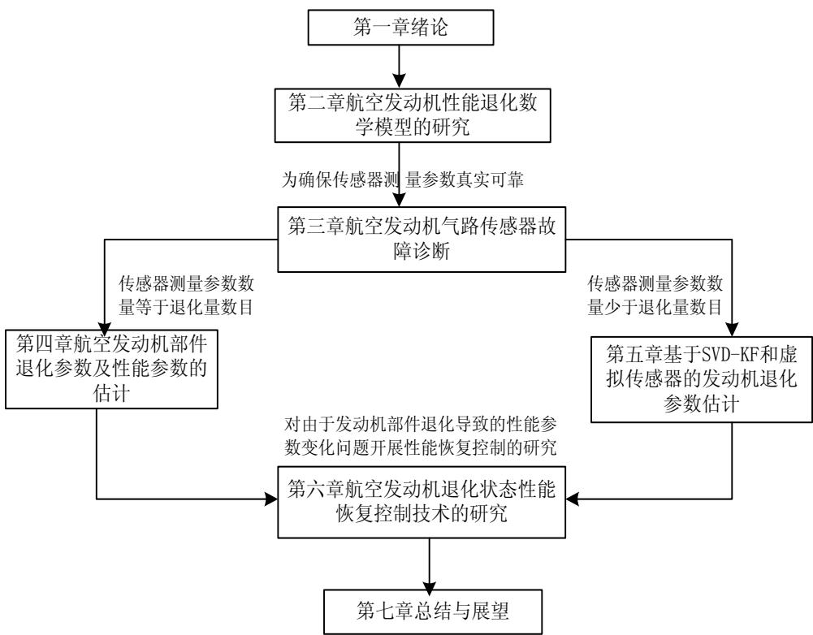  
图1.1 全文各章节的逻辑关系

第一章 绪论：简述了航空发动机退化状态参数估计、与性能恢复控制技术的研究背景、意义以及研究的必要性，并分析了国内外相关研究的现状，最后给出文本的研究内容和章节安排。

第二章 航空发动机性能退化数学模型的研究：以涡扇发动机为研究对象，介绍了涡扇发动机部件级数学模型的建立过程，分析了发动机部件退化原因和对其性能的影响，并通过设置部件退化参数的方法来模拟发动机的退化状态，验证了其可行性，并选择出与退化参数相关性强的一组气路传感器。

第三章 航空发动机气路传感器故障诊断：为解决发动机气路传感器易发生故障的问题，采用在线极端学习机方法，建立了传感器故障诊断系统。针对多个传感器发生故障的问题，建立基于预学习的故障隔离系统。

第四章 航空发动机部件退化参数及性能参数的估计：分别在亚音速和超音速包线内，通过改进的最小二乘拟合法建立了不同稳态工作点处的发动机线性状态变量模型，并在每个飞行稳态点处设计改进卡尔曼滤波器。研究表明，通过三维插值方法可估计亚音速和超音速包线内任意点的发动机退化参数，并通过智能算法估计出发动机推力等性能参数。

第五章 基于 SVD-KF 和虚拟传感器的发动机退化参数估计：针对航空发动机实际可安装传感器数量少于退化量数目的问题，分别采用两种方法对其退化参数进行了估计。一种为基于奇异值分解的降维卡尔曼滤波器的方法；另一种为采用智能算法虚拟一个传感器，通过虚拟传感器，使得传感器个数与待估计退化参数个数一致，进而采用全维卡尔曼滤波器对退化参数进行了估计。

第六章 航空发动机退化状态性能恢复控制技术的研究：为发动机分别设计了内环控制器、外环推力估计器和基于简单专家PI的外环控制器，并对常规控制和性能恢复控制做了数字仿真验证，并且进行了对比分析。

第七章 总结与展望：系统的总结本文的主要工作内容以及创新点，对本文的不足之处和今后需进一步开展的研究内容进行了展望。

## 第二章 航空发动机性能退化数学模型的研究

## 2.1 概述

任何系统的分析、设计和控制以及对未来行为的预测，都是在已知系统的数学模型的基础上进行的[51]。因此，建立描述发动机系统的数学模型就成了本文研究发动机故障诊断以及控制系统的理论基础。目前航空发动机的数学模型的建立方法有试验法和解析法。试验法是根据发动机的输入、输出试车数据，经过数据加工处理，辨识出发动机系统的动态特性，从而建立发动机的动态数学模型。但是这种方法需要设计一个合理的试车试验，需要投入巨额的资金和消耗巨大能源，以获取发动机系统所含的最大信息量，通过试验法获取发动机特性的方法目前没有广泛应用。解析法通过分析系统的运行规律，根据发动机内部的物理过程，运用一些已知的定律、定理和原理并根据发动机部件结构数据推导出其数学模型[52]，随着计算机仿真的精度和运行速度的不断提高，运用解析法建立发动机模型的方法已经越来被广泛运用。

在发动机长时间的工作过程中，各个部件会受到污垢和腐蚀的作用而发生退化，导致部件特性参数效率和流量发生变化，因此建立一个能反应航空发动机退化状态的数学模型对于发动机故障诊断、视情维修等研究具有十分重要的意义。造成气路部件性能退化的因素较多，而且发动机各部件气路之间相互影响，本章通过设置退化参数的方法建立了退化发动机的数学模型，通过设置不同部件退化参数，分析其对涡扇发动机性能参数的影响并进行了仿真分析，根据仿真结果选择出与部件退化量相关性最强的传感器测量参数。

## 2.2 涡扇发动机部件级数学模型

本文研究对象为某型涡扇发动机，发动机控制输入为主燃油流量 $W _ { f }$ 以及尾喷口面积 $A _ { \delta } { \mathrm { : } }$ ，闭环运行定义油门杆角度为PLA；根据发动机气动热力学工作过程，将整台发动机划分为工作相对独立的几大部件：进气道，压气机，高、低压涡轮，燃烧室，掺混室或是加力燃烧室以及尾喷管等部件。

图 2.1为其特征截面图。1截面为发动机进口，2截面为风扇进口，22 截面为风扇出口，13截面为外涵道进口，23截面为内涵道进口，25 截面为压气机进口，3 截面为压气机出口，4截面为燃烧室出口，42截面为高压涡轮出口，45截面为低压涡轮进口，46截面为低压涡轮出口，16和6截面分别为外涵道和内涵道出口，7截面为加力燃烧室进口，75截面为加力燃烧室出口，8截面为尾喷管喉道截面，9截面为尾喷管出口。

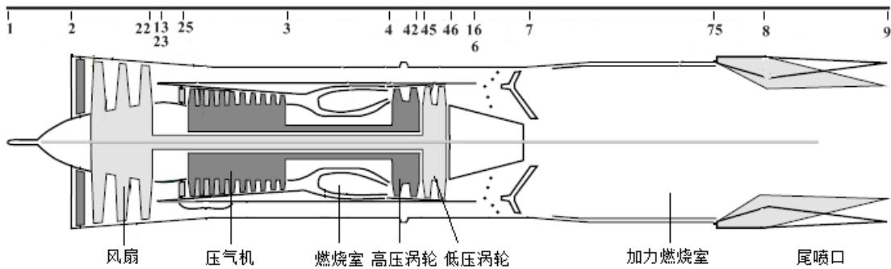  
图2.1涡扇发动机截面示意图

基于发动机部件解析法建模的主要思想是根据发动机气动热力学原理，依据所获得的部件特性，按照发动机工作原理逐一建立各部件的气动热力学方程。每个部件的气动参数由其特性曲线和气动方程共同决定，并用相应的气动参数取代发动机真实工作部件。对于发动机其它未知参数的求取，通过设定初始猜值，根据发动机各部件之间的气动热力学联系和转子动力学平衡关系将各个部件进行串联组成共同工作方程，通过求解共同工作方程组，既可以得到各个部件之间的气动热力学参数，这些参数即可以代表真实发动机工作情况。所建立的发动机共同工作平衡方程和发动机部件模型的计算流程图如下：

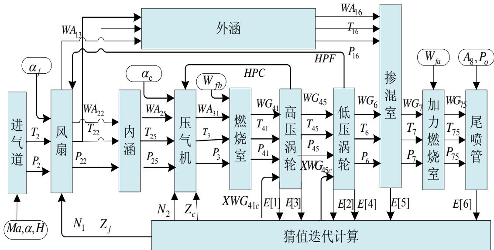  
图2.2航发动机数学模型稳态计算流程

（1） 高压涡轮进口截面流量连续方程：

$$
E [ 1 ] = \frac {X W G _ {4 1 c}}{W G _ {4 1}} - 1\tag{2-1}
$$

其中， $X W G _ { 4 1 c }$ 为初猜流量， $W G _ { 4 1 }$ 为根据高压涡轮流量特性曲线计算出来的流量。

（2） 低压涡轮进口截面流量连续方程：

$$
E [ 2 ] = \frac {X W G _ {4 5 c}}{W G _ {4 5}} - 1\tag{2-2}
$$

其中， $X W G _ { 4 5 c }$ 为初猜流量， $W G _ { 4 5 }$ 为根据低压涡轮流量特性曲线计算出来的流量。

（3） 高压转子功率平衡方程：

$$
E [ 3 ] = \frac {\eta_ {H T} H P T}{H P C + H P _ {E X T}} - 1\tag{2-3}
$$

其中，η 为高压转子传动效率，HPT为高压涡轮产生的功率，HPC为压气机消耗的功率， $\eta _ { _ { H T } }$ $H P _ { E X T }$ 为高压轴抽功量。

（4） 低压转子功率平衡方程：

$$
E [ 4 ] = \frac {\eta_ {L T} H P L}{H P F} - 1\tag{2-4}
$$

其中， $\eta _ { _ { L I } }$ 为低压转子传动效率，HPL为低压涡轮产生的功率，HPC为风扇消耗的功率。

（5） 外涵出口静压平衡方程：

$$
E [ 5 ] = \frac {P _ {S 1 6}}{P _ {S 6}} - 1\tag{2-5}
$$

其中， $P _ { s 6 }$ 为发动机内涵出口静压， $P _ { s 1 6 }$ 为发动机外涵出口静压，两者在掺混室进口处应满足静压平衡。

（6） 尾喷口出口压力平衡方程：

$$
E [ 5 ] = \frac {P _ {C 8}}{P _ {8}} - 1\tag{2-6}
$$

其中， $P _ { C 8 }$ 为由根据流量连续算的尾喷口出口总压， $P _ { 8 }$ 为环境背压，两者在尾喷管出口处应满足压力相等。

发动机处于动态过程时，其高、低压转子功率不再平衡，即平衡方程E[3]、E[4]不再成立，取而代之的是如下两个转子动力学方程：

$$
\frac {d N _ {1}}{d t} = \frac {H P T - H P C}{N _ {c} J _ {h}} \left(\frac {3 0}{\pi}\right) ^ {2}\tag{2-7}
$$

$$
\frac {d N _ {2}}{d t} = \frac {H P L - H P F}{N _ {f} J _ {l}} \left(\frac {3 0}{\pi}\right) ^ {2}\tag{2-8}
$$

$J _ { { } _ { F } }$ $J _ { c }$ 分别为高低、压转子的转动惯量， $N _ { \mathfrak { l } }$ 为风扇转速， $Z _ { f }$ 为风扇压比系数， $N _ { 2 }$ 为压气机转速， $Z _ { c }$ 为压气机压比系数， $X W G _ { 4 \ o { 1 } c }$ 为高压涡轮进口流量， $X W G _ { 45 c }$ 为低压涡轮进口流量，其中 $N _ { 1 }$ $Z _ { f }$ $N _ { 2 }$ $Z _ { c }$ $X W G _ { 4 \ o { 1 } c }$ $X W G _ { 45 c }$ 六个参数为发动机初始猜值，由上述平衡方程求得。对发动机稳态时共同工作方程的求解采用牛顿迭代法，在动态过程中采用牛顿一次通过算法求解发动机未知参数。

通过以上过程既可以求解得到所有发动机参数，从而模拟真实发动机工作特性。但是发动机的气动热力学需要大量的微分和代数方程来描述，为了减小部件级数学建模的工作量，有必要在保证发动机不失逼真度的情况下，对其进行合理的简化假设，从而降低求解数学模型方程组的难度，进而提高发动机数学模型运算的实时性。这些假设如下：

(1) 只考虑发动机转子惯性对发动机动态性能的影响，忽略高温燃气与结构部件的热交换。

(2) 忽略燃气与空气流量的差别以及燃烧的延时。

(3) 动态过程中发动机部件效率及流量退化参数保持不变。

(4) 向主燃烧室和加力燃烧室供油的燃油泵不经过发动机带动。

基于发动机的如上基本假设下，所建立的发动机各个部件的气动热力学方程以及建模过程本文不在说明，详述参见文献[54]。通过建立的涡扇发动机部件级数学模型，为模拟发动机退化状态的特性提供了模型的研究基础。

## 2.3 涡扇发动机部件性能退化模型

上述所建立的发动机数学模型是根据发动机在额定状态下所建立的，但是随着发动机使用时间逐渐增加，受到污垢和腐蚀的影响，发动机的部件特性也必然发生不同程度的退化，导致发动机部件特性参数效率和流量发生变化，本节即针对如何模拟发动机退化状态的特性问题进行了研究。

## 2.3.1部件性能退化的原因及影响分析

涡扇发动机不同部件性能退化的原因并不完全相同。对压气机部件而言，压气机的侵蚀主要是由于来自外力（例如发动机吞入较大颗粒的沙石、飞鸟、冰雹）的磨损和大气中硫化物或水蒸气的侵蚀，以及来自燃烧室的气流对其的烧蚀，导致叶片型面变形，流路面积增大，一部分气体不经过叶片压缩而从叶梢间隙流出，使有用气流减少，导致压气机的效率降低，流量增加，最终导致其特性曲线向右下方偏移；压气机的污垢主要来流经压气机的外部气体，在压气机中气体进行增压压缩，气流中的尘土在压缩过程中发生推积，导致叶片发生变形，流通面积减小，压缩气体的流量减小，压气机的效率降低，最终导致其工作特性曲线向左下方偏移[53],不同因素对压气机部件特性线的影响如图 2-3(a)。

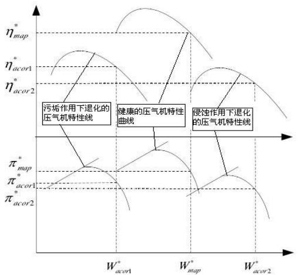  
(a) 压气机性能退化特性线

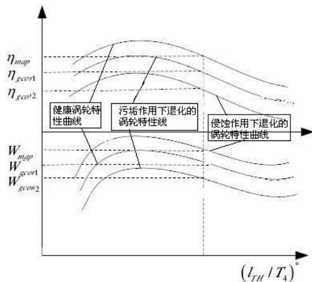  
(b) 涡轮性能退化特性线  
图 2.3发动机部件性能退化特性线

对于高、低压涡轮而言，其退化的主要原因是污垢和侵蚀，涡轮的侵蚀的主要来自于高温气流的烧蚀、叶尖的摩擦和金属的氧化，其后果是叶尖间隙增大，喷嘴环烧蚀，叶片各级间泄漏增大，流通面积增加，从而导致涡轮效率降低[53]。涡轮的污垢主要来自于气流中的灰尘以及燃烧残留物的堆积，导致涡轮叶片变形，流通面积减小，涡轮大的工作效率降低，不同因素对涡轮部件特性线的影响如图 2-3(b)。

对于燃烧室而言，火焰筒经过长时间燃烧后由于烧蚀的原因导致其变形、裂纹以及积碳，同时喷油嘴的烧蚀和积碳也会造成燃油的雾化效果变差，最终使得燃烧室的总压恢复系数减小，燃烧效率降低[53]。

## 2.3.2部件性能退化模型的建立

在计算机仿真中，对部件性能退化的仿真一般而言有两种方法：第一种是通过流场计算的方法，通过改变退化部件的形状，基于计算机软件中的流场计算程序来实现部件退化后的仿真；第二种方法是对部件设置退化参数方法来模拟部件的退化，即在发动机部件级数学模型的基础上，在其部件的流量和效率表达式中乘以一个系数来模拟其退化特性。

若仅仅通过发动机流场计算的方法改变发动机部件尺寸通过退化特征的仿真，通过在 2.3.节中对发动机不同部件退化的原因及其影响分析可知，造成发动机气路部件性能退化的因素较多，而且各部件气路之间也相互影响，因此通过第一种改变退化部件尺寸的方法很难进行退化仿真。因此本文把由于污垢和侵蚀而导致的部件性能退化的影响因素综合起来考虑，通过设定部件退化参数的方法进行仿真研究，其中,部件退化参数定义为效率与特性图上值的绝对差以及换算流量和特性图上的相对差值。

对航空发动机来说，能表示其部件退化的参数有很多，目前主要有风扇、压气机、高低压涡轮部件的流量和效率的特性参数；但如果每个退化参数都需要进行设置研究的话，其计算量巨大，考虑到不同部件之间的流量有气动联系，且流量和效率又具有耦合关系，因此选取所有的参数进行研究是不必要的[55]，本文发动机性能退化参数最终选定为：风扇效率退化参数 $D _ { f }$ 压气机流量退化参数 $D _ { c }$ ,燃烧室效率退化参数 $D _ { c b }$ 高压涡轮效率退化参数 $D _ { h t }$ ,低压涡轮流量退化参数 $D _ { l t }$ ，通过以上五个退化参数近似的表达发动机的性能退化，以下为这五个退化参数的定义。

$$
\begin{array}{c} D _ {f} = 1 - \frac {\eta_ {f , r e l}}{\eta_ {f , m a p}}, \quad D _ {c} = 1 - \frac {w _ {c , r e l}}{w _ {c , m a p}}, \quad D _ {c b} = 1 - \frac {\eta_ {b , r e l}}{\eta_ {b , m a p}}, \\ D _ {h t} = 1 - \frac {\eta_ {h , r e l}}{\eta_ {h , m a p}}, \quad D _ {l t} = 1 - \frac {w _ {l , r e l}}{w _ {l , m a p}} \end{array}
$$

其中 $\eta _ { f , m a p } \ , \quad w _ { c , m a p } \ , \quad \eta _ { b , m a p } \ , \quad \eta _ { h , m a p } \ , \quad w _ { l , m a p }$ ，依次为发动机额定状态下风扇的绝热效率，压气机的换算流量，燃烧室效率，以及高压涡轮的绝热效率和低压涡轮的换算流量。 $\eta _ { f , r e l } ~ , ~ w _ { c , r e l } ~ , ~ \eta _ { b , r e l } ~ :$

$\eta _ { h , r e l }$ $w _ { l , r e l }$ 为对应各个部件退化时相应的值。

## 2.4 部件性能退化的仿真结果分析

以涡扇发动机部件级数学模型为基础，利用前面定义的部件退化参数，建立涡扇发动机的部件性能退化模型；并且利用该退化模型，通过设置不同部件退化参数，分析其对涡扇发动机性能参数的影响。

在分析部件退化对发动机性能参数的影响时，首先要选出发动机中合适的传感器测量参数，可以选取的传感器测量参数众多，以选取出的传感器测量参数之间的相关性应该尽量小，且对部件退化参数敏感程度高为原则。考虑以上因素，并参考文献[56]，本小节选择了风扇出口温度 $T _ { 2 2 }$ 和压力 $P _ { 2 2 }$ ，压气机出口温度 $T _ { 3 }$ 和压力 $P _ { 3 }$ ，燃烧室出口温度 $T _ { 4 }$ 和压力 $P _ { 4 }$ ，低压涡轮出口温度 $T _ { 4 6 }$ 和压力 $P _ { 4 6 }$ ，尾喷管出口温度 $T _ { 8 }$ ，以及风扇转速 $N _ { 1 }$ 和压气机转速 $N _ { 2 }$ 。通过分析这 11个传感器测量值的相对偏差来分析发动机部件退化对发动机整体性能的影响，传感器测量值的相对偏差用以下形式表示。

$$
\Delta y = \frac {y - y _ {d}}{y _ {d}} \times 100 \%\tag{2-9}
$$

式中y 为所选传感器在发动机部件退化后的测量值， $y _ { d }$ 为发动机额定状态下的传感器测的量值，y为测量参数的相对偏差值。

图 2.4(a)-(e)和图 2.5(a)-(e)分别为发动机处于开环状态下，在高度 H=0km，Ma=0 地面状态下和H=10km，Ma=0.8高空状态下，风扇、压气机、燃烧室、高、低压涡轮退化参数分别设置为0.02时的仿真图，纵坐标为传感器测量参数的相对偏差值。

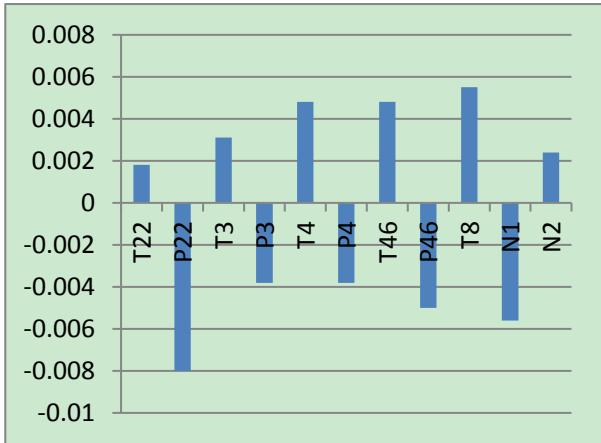  
(a)风扇效率退化的影响

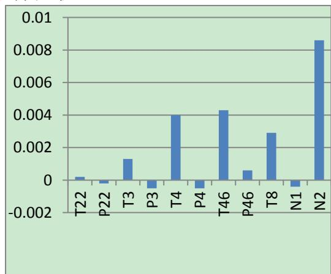  
(b)压气机流量退化的影响

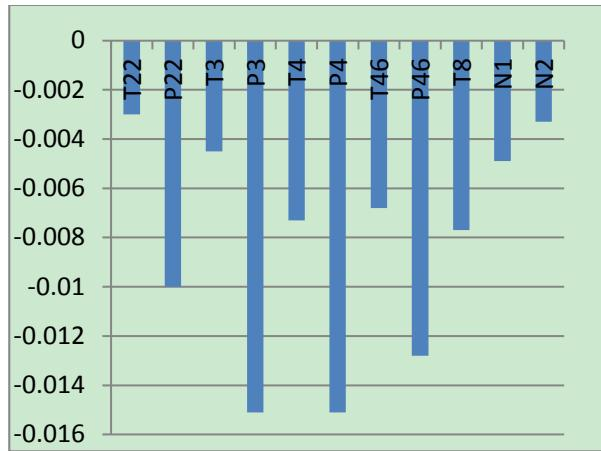  
(c)燃烧室退化的影响

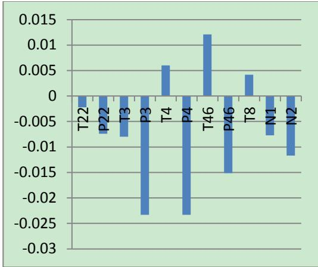

(d)高压涡轮退化的影响  
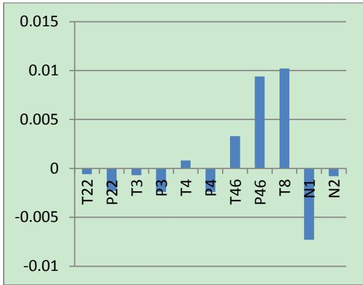  
(e)低压涡轮退化的影响

图 2.4地面状态下各部件性能退化 2%时测量参数的相对偏差  
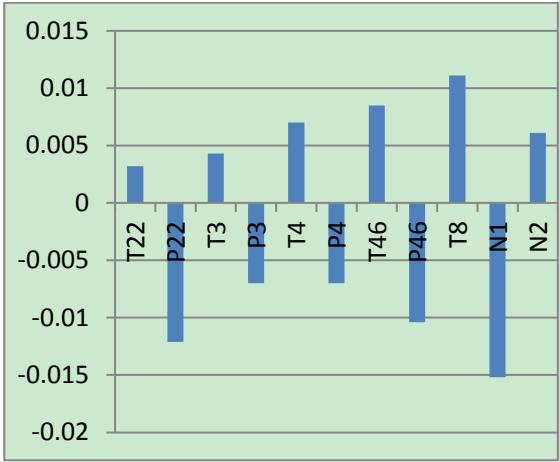  
(a)风扇效率退化的影响

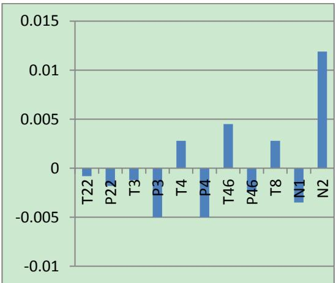  
(b)压气机流量退化的影响

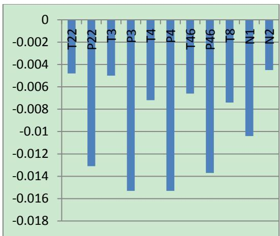  
(c)燃烧室退化的影响

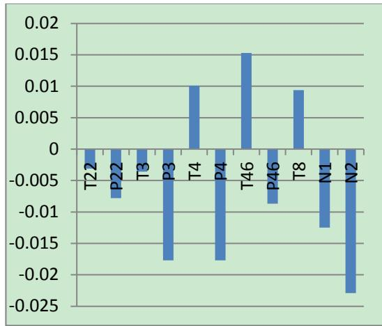  
(d)高压涡轮退化的影响

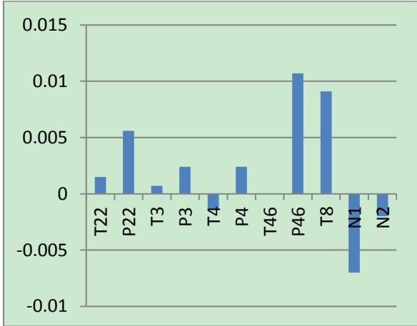  
(e)低压涡轮退化的影响  
图2.5高空状态下各部件性能退化 2%时测量参数的相对偏差

以图2.4(a)的分析为例，由于风扇的效率退化，导致风扇增压比减小，因此风扇出口后的压力 $P _ { 2 2 }$ 减小，效率的降低同时导致流过风扇的气流量减少，因此流过风扇后级压气机的流量也相应的减少，导致压气机的增压比减小，因此压气机的出口压力 $P _ { 3 }$ 减少，同理高压涡轮进口 $P _ { 4 }$ 低压涡轮出口压力 $P _ { 4 6 }$ 也减少。但是由于燃油流量 $W _ { f b }$ 恒定，空气流量减少导致单位燃气热焓增加，故涡轮进口和出口温度 $T _ { 4 }$ 、 $T _ { 4 6 }$ 和尾喷口温度 $T _ { 8 }$ 升高，由于气流的热交换，风扇出口温度 $T _ { 3 }$ 也随之升高，通过平衡方程的计算最终风扇转速 $N _ { 1 }$ 减小，压气机转速 $N _ { 2 }$ 增加。类似于图 2.4(a)，其它部件退化仿真图的分析不在一一列举。通过以上分析部件退化对其性能参数的影响，其变化原因均符合涡扇发动机的工作原理，因此通过引入退化参数的方法建立的发动机退化模型是合理的。

从图2.4和图2.5 还可以看出，发动机不同部件退化对传感器测量参数的影响程度也不同，有的部件退化对某些测量参数影响较大，而对另外一些参数影响较小，影响大的这个传感器的测量参数就应该和该部件退化参数联系在一起。例如， $P _ { 2 2 }$ 和 $N _ { 1 }$ 受风扇效率退化的影响比较大，$T _ { 4 6 }$ $N _ { 2 }$ 受压气机流量的退化的受影响比较大，燃烧室效率的退化对 $P _ { 3 }$ 和 $P _ { 4 }$ 影响最大，高压涡轮效率的变化对 $P _ { 3 }$ 和 $P _ { 4 6 }$ 影响较大，低压涡轮流量退化对传感器 $T _ { 8 }$ 和 $N _ { 1 }$ 的影响比较大。考虑到传感器测量参数之间的相关性，例如 $P _ { 3 }$ 和 $P _ { 4 }$ 对多数部件退化反应灵敏，特别是针对高压涡轮效率和燃烧室效率的退化，但是这两个传感器测量参数的变化趋势都相同，因此只需选取一个测量参数即可。此外在所有主要的气路部件中，压气机的性能对发动机的整体性能影响比较大，也是最容易发生退化的部件， $T _ { 3 }$ 也常常被选取为气路故障诊断测量参数[50]。考虑传感器实际的测量环境，例如涡轮前温度 $T _ { 4 }$ 由于温度太高一般不容易测量， $T _ { 8 }$ 由于受到外界环境的影响测量结果不准确，此外参考文献[57]中基于支持向量机的特征选择方法，综合以上分析和考虑，本文最终选择了 $N _ { 1 }$ 、 $N _ { 2 }$ 、 $P _ { 3 }$ 、 $T _ { 3 }$ 和 $P _ { 4 6 }$ 传感器作为气路部件故障诊断的测量参数。为后续应用一些基于模型的方法精确估计出发动机退化参数做准备。

## 2.5 本章小结

引入了涡扇发动机部件级数学模型，并对部件性能退化状态进了建模，以作为本文的研究对象，主要内容包括：

1）介绍了涡扇发动机部件级数学模型的建立方法及各部件的计算流程；

2）介绍了部件性能退化的原因和影响，并通过设置部件退化参数的方法对发动机退化状态进行了模拟。仿真表明，通过设置部件退化参数的方法能够正确表征部件的退化状态，并且符合涡扇发动机工作原理。

3）通过对部件性能退化仿真分析，并结合工程实际经验，选择出与退化参数相关性最强的传感器测量参数。

## 第三章 航空发动机气路传感器故障诊断

## 3.1 概述

航空发动机气路部件退化参数的估计以及性能退化缓解控制技术中，都需要传感器采集发动机各部件的运行参数作为输入，因此可靠的传感器测量值是进行上述研究的基础。但是发动机中传感器大都在高温、高压、强振动的恶劣环境中工作，容易出现各种故障。因此很有必要对发动机气路传感器进行故障诊断的研究，并对故障传感器进行隔离及信号重构，以保证后续对发动机部件退化参数估计值的准确性和性能恢复控制的可靠性。

目前，为了解决传感器故障问题，常采用传感器余度技术，其中应用最广泛的余度技术主要有硬件余度和解析余度[58]。硬件余度技术采用多个传感器测量同一个发动机参数的方法来保证测量值的可靠性，但是此种方法会增加系统的复杂性和重量，对于某些发动机参数，常常由于传感器安装困难而不能实现，因而限制了硬件余度法的适用范围。而解析余度方法是利用各个测量参数的解析关系，通过智能算法在线估计出某些发动机参数的值，当对应的传感器测量参数不能正常工作时，即可将该传感器的估计值作为余度信息替换其错误的测量值[59]。显然，随着智能算法等现代软件计算技术的快速发展，相比硬件余度，解析余度技术更宜于工程化，因而具有更加重要的研究价值。

近年来，国内已有很多学者将一系列的智能算法应用到航空发动机的传感器故障诊断上，但是大部分都是基于离线训练完成的或是仅仅针对单个传感器故障，只能在训练样本的泛化范围内针对发动机某些特定的工作状态起作用。为了适应在全包线范围内发动机的强非线性以及参数多变的特性和多个传感器故障以及不同故障类型交错发生的情况，本章设计了一种基于在线贯序极端学习机(OS-ELM)的传感器在线诊断算法，并且针对故障传感器设计了故障隔离系统。其核心是在诊断出某一个传感器故障之后，对此故障传感器建立一种“预学习”的信号重构，应用此故障隔离算法，在多个传感器连续发生故障时，也能够实时、准确的定位故障传感器，并能在线重构各传感器信号；为了提高OS-ELM算法的在线实时性，本章同时结合了选择策略[25]，减少了传感器故障诊断的时间。

## 3.2 发动机传感器的故障类型及其模拟仿真

发动机传感器可能发生的故障比较复杂，为了便于对其进行故障诊断的研究, 研究人员从不同的分类角度对这些故障进行了多种分类。本文以故障程度大小为分类依据，将传感器故障分为硬故障和软故障两个大类[59]。硬故障是指传感器由于结构损坏、发动机电路系统短路、断路或受到强干扰的原因而造成测量结果发生突变，其幅值变化一般较大，具体细化又分为开路故障、短路故障、偏置故障等；软故障是指由于部件老化、零点漂移等原因所造成的结果，其变化过程缓慢、变化幅值比较小，具体又可以细化分为漂移故障、冲击故障、周期性干扰等。本章主要考虑传感器硬故障和软故障中最为常见的的偏置故障和漂移故障。为了进行仿真研究，需要首先获取故障传感器数据，根据故障信号的特点建立合适的数学模型。

传感器发生偏置故障时，其时域特征为：传感器在某一时刻的测量值突然发生较大的幅值偏差。因此，可由以下方式来模拟偏置故障信号：

$$
d (k) = \left\{ \begin{array}{l l} d _ {r e a l} (k) & (k <   t _ {0}) \\ d _ {r e a l} (k) + n. d _ {r e a l} (k) & (k \geq t _ {0}) \end{array} \right.\tag{3.1}
$$

其中， $d ( k )$ 表示k时刻传感器的实际测量值， $d _ { r e a l } ( k )$ 表示k时刻发动机参数的真实值，t 表示 $t _ { O }$ 发生故障的时刻， n表示偏置百分率。

传感器在某一时刻发生漂移故障时，表现为传感器的测量值随着时间以某一速率缓慢偏离对应发动机参数的真实值，其中m 为计算机采样步长时间内故障漂移速率，漂移故障信号的模拟方式如下：

$$
d (k) = \left\{ \begin{array}{l} d _ {r e a l} (k) \qquad (k <   t _ {0}) \\ d _ {r e a l} (k) + m. (k - t _ {0}). d _ {r e a l} (k) (k \geq t _ {0}) \end{array} \right.\tag{3.2}
$$

由于不同种类传感器所测量的发动机参数的数量级相差很大，为了使每一个传感器在诊断过程中有相同的权重，将不同参数的测量值根据公式(3.3)进行归一化处理。

$$
d _ {n o r m} (k) = \frac {2 d (k) - d _ {m a x} - d _ {m i n}}{2 \left(d _ {m a x} - d _ {m i n}\right)} + \frac {3}{2}\tag{3.3}
$$

其中 $d _ { n o r m } ( k )$ 为k时刻传感器测量值信号处理后的值， $d _ { \mathrm { m a x } }$ 和 $d _ { \mathrm { m i n } }$ 分别表示传感器信号的最大值和最小值。

## 3.3 在线贯序极端学习机算法的介绍

极端学习机(ELM)算法是一种简单易用、有效的单隐含层前馈神经网络（SLFNS）。相对于传统的网络算法，ELM法极大地提高了训练速度，并能有效避免过拟合现象[23]。为了获得在线学习的能力，文献[24]在 ELM 算法的基础上经过改进提出了一种在线贯序极端学习机（OS-ELM），以下将进行详细的介绍。

## 3.3.1ELM 算法简介

ELM 算法是一种结构简单易用、有效的单隐含层前馈神经网络（SLFNS）算法。2006 年由新加坡南洋理工大学的黄广斌副教授提出，并且给出相应的定理，典型的单隐含层前馈神经网络结构图如下所示：

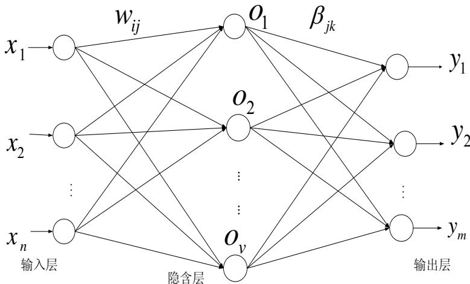  
图3.1典型的单隐含层前馈神经网络结构

该网络的组成由输入层、隐含层、和输出层所组成，每一层之间的神经元完全相互连接，在此结构图中，输入层的 n 个神经元对应 n 个输入变量；隐含层的神经元个数为 v;输出层有m个输出对应 m 个输出变量。设隐含层神经元的阀值 $\pmb { b } = [ b _ { 1 } , b _ { 2 } , . . . , b _ { \nu } ] _ { 1 \times \nu }$ ,设输入层与隐含层之间的连接权值 $w$ ，以及隐含层与输入层之间的连接权值 $\beta$ 为：

$$
\boldsymbol {w} = \left[ \begin{array}{c c c c} w _ {1 1} & w _ {1 2} & \dots & w _ {1 n} \\ w _ {2 1} & w _ {2 2} & \dots & w _ {2 n} \\ \vdots & \vdots & \ddots & \vdots \\ w _ {v 1} & w _ {v 2} & \dots & w _ {v n} \end{array} \right] _ {v \times n}, \boldsymbol {\beta} = \left[ \begin{array}{c c c c} \beta_ {1 1} & \beta_ {1 2} & \dots & \beta_ {1 m} \\ \beta_ {2 1} & \beta_ {2 2} & \dots & \beta_ {2 m} \\ \vdots & \vdots & \ddots & \vdots \\ \beta_ {v 1} & \beta_ {v 2} & \dots & \beta_ {v m} \end{array} \right] _ {v \times m}
$$

其中 $w _ { i j }$ 表示为输入层第j个神经元与隐含层第 i个神经元之间的连接权值。 $\beta _ { j k }$ 表示为隐含层第j个神经元与输出层第 k个神经 $\mathcal { \vec { T } }$ 之间的连接权值。

设具有 $Q$ 个数据样本的训练集输入矩阵X 和对应的输出矩阵 $Y$ 分别为：

$$
\boldsymbol {X} = \left[ \begin{array}{c c c c} x _ {1 1} & x _ {1 2} & \dots & x _ {1 Q} \\ x _ {2 1} & x _ {2 2} & \dots & x _ {2 Q} \\ \vdots & \vdots & \ddots & \vdots \\ x _ {n 1} & x _ {n 2} & \dots & x _ {n Q} \end{array} \right] _ {n \times Q}, \boldsymbol {Y} = \left[ \begin{array}{c c c c} y _ {1 1} & y _ {1 2} & \dots & y _ {1 Q} \\ y _ {2 1} & y _ {2 2} & \dots & y _ {2 Q} \\ \vdots & \vdots & \ddots & \vdots \\ y _ {m 1} & y _ {m 2} & \dots & y _ {m Q} \end{array} \right] _ {m \times Q}
$$

设隐含层的神经元激活函数为 $g \left( x \right)$ ,则由网络结构图可以得含有v个隐含层节点的ELM数学模型的输出值T 的表达式为：

$$
\boldsymbol {T} = \left[ t _ {1}, t _ {2}, \dots t _ {Q} \right] _ {m \times Q}, \boldsymbol {t} _ {j} = \left[ \begin{array}{l} y _ {1 j} \\ y _ {2 j} \\ \vdots \\ y _ {m j} \end{array} \right] _ {m \times v} = \left| \begin{array}{l} \sum_ {i = 1} ^ {v} \beta_ {i 1} g (w _ {i} x _ {j} + b _ {i}) \\ \sum_ {i = 1} ^ {v} \beta_ {i 2} g (w _ {i} x _ {j} + b _ {i}) \\ \vdots \\ \sum_ {i = 1} ^ {v} \beta_ {i m} g (w _ {i} x _ {j} + b _ {i}) \end{array} \right| _ {m \times v}, j = 1, 2, \dots , Q\tag{3.4}
$$

其中， $\pmb { w } _ { i } = \left[ w _ { i 1 } , w _ { i 2 } , . . . w _ { i n } \right]$ $\pmb { x } _ { i } = [ x _ { 1 j } , x _ { 2 j } , . . . x _ { n j } ]$ 则公式(3.4)式可以表示为：

$$
\boldsymbol {H} \boldsymbol {\beta} = \boldsymbol {T} ^ {\prime}\tag{3.5}
$$

其中， $\pmb { T } ^ { ' }$ 为矩阵T的转置；H 为神经网络的隐含层输出矩阵，具体表达式为：

$$
\boldsymbol {H} (w _ {1}, w _ {2},..., w _ {v}, b _ {1}, b _ {2},..., b _ {v}, x _ {1}, x _ {2},..., x _ {Q}) = \left[ \begin{array}{c c c c} g (\boldsymbol {w} _ {1} \boldsymbol {x} _ {1} + \boldsymbol {b} _ {1}) & g (\boldsymbol {w} _ {2} \boldsymbol {x} _ {1} + \boldsymbol {b} _ {2}) & \dots & g (\boldsymbol {w} _ {v} \boldsymbol {x} _ {1} + \boldsymbol {b} _ {v}) \\ g (\boldsymbol {w} _ {1} \boldsymbol {x} _ {2} + \boldsymbol {b} _ {1}) & g (\boldsymbol {w} _ {2} \boldsymbol {x} _ {2} + \boldsymbol {b} _ {2}) & \dots & g (\boldsymbol {w} _ {v} \boldsymbol {x} _ {2} + \boldsymbol {b} _ {v}) \\ \vdots & \vdots & \ddots & \vdots \\ g (\boldsymbol {w} _ {1} \boldsymbol {x} _ {Q} + \boldsymbol {b} _ {1}) & g (\boldsymbol {w} _ {2} \boldsymbol {x} _ {Q} + \boldsymbol {b} _ {2}) & \dots & g (\boldsymbol {w} _ {v} \boldsymbol {x} _ {Q} + \boldsymbol {b} _ {v}) \end{array} \right] _ {Q \times v}\tag{3.6}
$$

根据文献[23]提出的关于 SLFN 的定理：任意给定个数为 Q 的不同样本 $\left( { { x } _ { i } } , { { t } _ { i } } \right)$ ,其中$\pmb { x } _ { i } = [ x _ { 1 j } , x _ { 2 j } , . . . x _ { n j } ] ^ { T } \in R ^ { n } , t _ { i } = [ t _ { i 1 } , t _ { i 2 } , . . . t _ { i m } ] \in R ^ { m }$ ,给定一个任意小的误差 $\varepsilon { \big ( } \varepsilon > 0 { \big ) }$ 和一个在任意区间内无限可微的激活函数 $g : R  R$ ，则一定会存在一个含有 $K \ ( K { \leq } Q )$ 个隐含层神经元的 SLFN，在任意赋值 $\pmb { w } _ { i } \in R ^ { n }$ 和 $b _ { i } \in R$ 的情况下，有 $\left\| \pmb { H } _ { N \times M } \pmb { \beta } _ { M \times m } - \pmb { T } ^ { ' } \right\| < \varepsilon$ 。因此，当选定的激活函数 $g \left( x \right)$ 无限可微的时候，SLFN 的参数并不需要全都进行调整，w和b在初始化过程中可以任意给定一个随机值，并且在此后的运算过程中保持数值不变，只需要求解神经网络的训练速度而隐含层与输出层之间的连接权值 $\beta$ ，因此大大提高了算法的运算速度，根据以上定理求解 $\beta$ 可以表达如下最优化问题：

$$
\min _ {\boldsymbol {\beta}} \left\| \boldsymbol {H} \boldsymbol {\beta} - \boldsymbol {T} ^ {\prime} \right\|\tag{3.7}
$$

设 $Q \geq \nu$ 且 $r a n k ( \pmb { H } ) = \nu$ $\pmb { H } ^ { T }$ 为 $H$ 的广义逆矩阵，则由表达式(3.7)可以得 $\beta$ 的最小二乘估计为：

$$
\boldsymbol {\beta} = \left(\boldsymbol {H} ^ {T} \boldsymbol {H}\right) ^ {- 1} \boldsymbol {H} ^ {T} \boldsymbol {T}\tag{3.8}
$$

但是任何矩阵求逆矩阵的过程中会遇到病态矩阵或是奇异值矩阵的情况，当影响系数矩阵为病态矩阵或是奇异值矩阵，此时影响系数矩阵 $( \pmb { H } ^ { T } \pmb { H } ) ^ { - 1 } \pmb { H } ^ { T }$ 的条件 $c o n d ( ( { \pmb H } ^ { T } { \pmb H } ) ^ { - 1 } { \pmb H } ^ { T } )$ 是一个较大的数值或为无穷，此时计算出的 $\beta$ 数值稳定性差、准确度低，针对此情况目前的解决方法主要是岭估计或是奇异值分解过滤掉矩阵中特别小的奇异值。本文主要采用HOERL于 1962年提出的岭估计的方法来解决矩阵的病态或是奇异的情况。采用岭估计的表达式表示为：

$$
\boldsymbol {\beta} = \left(\boldsymbol {H} ^ {T} \boldsymbol {H} + \lambda \boldsymbol {I}\right) ^ {- 1} \boldsymbol {H} ^ {T} \boldsymbol {T} ^ {\prime} = \boldsymbol {L H} ^ {T} \boldsymbol {T} ^ {\prime}\tag{3.9}
$$

式中 为正实数，在此处取 $\lambda = 1 0 ^ { - 6 }$ ，I是单位矩阵， $\pmb { L } = ( \pmb { H } ^ { T } \pmb { H } + \lambda \pmb { I } ) ^ { - 1 }$ ，通过增加系数 $\lambda$ ,修改后的影响系数矩阵 $( \pmb { H } ^ { T } \pmb { H } + \lambda \pmb { I } ) ^ { - 1 } \pmb { H } ^ { T }$ 的条件数将会明显的降低，求得的 $\beta$ 满足要求。

## 3.3.2OS-ELM 算法简介

对于OS-ELM算法，即是利用前一步计算的网络权值，通过递推的方式来更新当前网络权值[24], $\pmb { \beta } _ { k }$ 表示第k组输入数据所对应的输出权值矩阵， $\pmb { h } _ { k }$ 表示第k组输入数据所对应的输出层矩阵，则k+1组数据所对应的权值矩阵的计算公式如下：

$$
\left\{ \begin{array}{l} \boldsymbol {L} _ {k + 1} ^ {- 1} = \left(\boldsymbol {L} _ {k} + \boldsymbol {h} _ {k + 1} \boldsymbol {h} _ {k + 1} ^ {T}\right) ^ {- 1} = \boldsymbol {L} _ {k} ^ {- 1} - \boldsymbol {L} _ {k} ^ {- 1} \boldsymbol {h} _ {k + 1} \left(\boldsymbol {I} + \boldsymbol {h} _ {k + 1} ^ {T} \boldsymbol {L} _ {k} ^ {- 1} \boldsymbol {h} _ {k + 1}\right) ^ {- 1} \boldsymbol {h} _ {k + 1} ^ {T} \boldsymbol {L} _ {k} ^ {- 1} \\ \boldsymbol {\beta} _ {k + 1} = \boldsymbol {\beta} _ {k} + \boldsymbol {L} _ {k + 1} ^ {- 1} \boldsymbol {h} _ {k + 1} \left(\boldsymbol {\iota} _ {k + 1} ^ {T} - \boldsymbol {h} _ {k + 1} ^ {T} \boldsymbol {\beta} _ {k}\right) \end{array} \right.\tag{3.10}
$$

令 $\pmb { M } _ { k + 1 } = \pmb { L } _ { k + 1 } ^ { - 1 }$ 1并带入公式(3.10)得：

$$
\left\{ \begin{array}{l} \boldsymbol {M} _ {k + 1} = \boldsymbol {M} _ {k} - \boldsymbol {M} _ {k} \boldsymbol {h} _ {k + 1} (\boldsymbol {I} + \boldsymbol {h} _ {k + 1} ^ {T} \boldsymbol {M} _ {k} \boldsymbol {h} _ {k + 1}) ^ {- 1} \boldsymbol {h} _ {k + 1} ^ {T} \boldsymbol {M} _ {k} \\ \boldsymbol {\beta} _ {k + 1} = \boldsymbol {\beta} _ {k} + \boldsymbol {M} _ {k + 1} \boldsymbol {h} _ {k + 1} \left(\boldsymbol {t} _ {k + 1} ^ {T} - \boldsymbol {h} _ {k + 1} ^ {T} \boldsymbol {\beta} _ {k}\right) \end{array} \right.\tag{3.11}
$$

为了提高故障诊断系统的实时性，本文采用选择策略[25]，其工作原理是根据下式的判断条件对 $\pmb { M } _ { k }$ 进行选择更新：

$$
\boldsymbol {M} _ {k + 1} = \left\{ \begin{array}{c c} \boldsymbol {M} _ {k} - \boldsymbol {M} _ {k} \boldsymbol {h} _ {k + 1} \left(\boldsymbol {I} + \boldsymbol {h} _ {k + 1} ^ {T} \boldsymbol {M} _ {k} \boldsymbol {h} _ {k + 1}\right) ^ {- 1} \boldsymbol {h} _ {k + 1} ^ {T} \boldsymbol {M} _ {k} & e \geq \varepsilon \\ \boldsymbol {M} _ {k} & e <   \varepsilon \end{array} \right.\tag{3.12}
$$

其中， $e = \left| ( \widehat { \pmb { t } } _ { k + 1 } - \pmb { t } _ { k + 1 } ) / \widehat { \pmb { t } } _ { k + 1 } \right|$ 为算法的预测值与传感器真实值之间的相对误差，ε为更新判定阈值。当 $e$ 小 $\mathcal { F } ^ { \varepsilon }$ ，说明对当前采样步长内数据的预测精度较高，算法原系统具有足够的泛化能力来精确预测当前输出值，因此没有必要对 $M _ { k }$ 进行递推更新，否则根据公式(3.11)更新当前的 $M _ { k + 1 }$ 并且计算得到相应的权值矩阵 $\pmb { \beta } _ { k + 1 }$ 。这种有选择的更新方法大大的提高了网络的运行速度，从而能满足在线诊断系统对实时性的要求。

最终结合选择更新权值方法的OS-ELM的学习步骤如下所示：

1）在算法初始化时，给定一个任意区间无限可微的激活函数 $\mathbf { g } ( \mathbf { x } )$ ,确定隐含层神经元的个数 $\nu ,$ 并且随机任意给输入层与隐含层之间的权值矩阵 $W _ { i }$ 和隐含层神经元阀值 $b _ { i }$ 赋值，$i = 1 , 2 , \cdots \tilde { N }$ ；

2）基于所采集数据的第一组训练样本，计算初始隐含层矩阵 ${ \pmb { H } } _ { 1 } = [ { \pmb { h } } _ { 1 } ] ^ { T }$ $\pmb { h } _ { 1 } = [ g ( \pmb { w } _ { 1 } \pmb { x } _ { 1 } + b _ { 1 } ) , . . . , g ( \pmb { w } _ { \tilde { N } } \pmb { x } _ { 1 } + b _ { \tilde { N } } ) ] ^ { T }$ 。并且利用公式(3.10)计算初始隐含层权值矩阵 $\pmb { \beta } _ { 1 }$ ；

3）求出第 $k { + 1 }$ 组训练样本数据 $\boldsymbol { x } _ { k + 1 }$ 对应 $\pmb { h } _ { k + 1 }$ ，并根据公式(3.4)估计出输出的预测值 $\widehat { \pmb { t } } _ { k + 1 } :$

4）利用步骤三中的预测值与当前真实值进行比较，利用更新策略式(3.12)判断 $M _ { k + 1 }$ 是否需要更新，并利用更新后的 $M _ { k + 1 }$ 根据公式式(3.11)更新 $\pmb { \beta } _ { k + 1 }$ ；

5）令k=k+1，判断是否结束程序，不结束转至第三步；

6) 结束。

## 3.4 涡扇发动机的传感器故障诊断系统和故障隔离逻辑的设计

## 3.4.1基于OS-ELM 法的传感器故障诊断系统的设计

为便于说明，对第二章中所选择的五个和部件退化参数关联最强的传感器分别编号1到5，其对应的测量值分别为风扇转速 $\left( \Nu _ { 1 } \right)$ ，压气机转速 $( \Nu _ { 2 } )$ ，压气机出口总温 $\left( \mathrm { T } _ { 3 } \right)$ ，压气机出口总压$\left( \mathsf { P } _ { 3 } \right)$ 、低压涡轮出口总温 $\left( \mathrm { T } _ { 4 6 } \right)$

为了充分利用传感器的测量值，提高传感器映射模块的动态预测精度，考虑到发动机动态模型可以简化为一个二阶数学系统，因此在所设计的传感器故障诊断系统中，将前两时刻的传感器测量值信号也作为系统的输入，最终可描述为如下表达式：

$$
\hat {d} _ {k} ^ {i} = f _ {i} \left(\mathbf {y} _ {(k - 2)} ^ {i}, \mathbf {y} _ {(k - 1)} ^ {i}, \mathbf {u} _ {(k - 2)}, \mathbf {u} _ {(k - 1)} \mathbf {u} _ {(k)}\right), i = 1, 2, \dots , 5\tag{3.13}
$$

其中， $\hat { d } _ { k } ^ { i }$ 为OS-ELM法对第i个传感器在当前 k时刻的预测估计值，y( )k 为当前k时刻1到 5号传感器的测量值， ${ \bf y } _ { ( k - 2 ) } ^ { i } , { \bf y } _ { ( k - 1 ) } ^ { i }$ 为剔除第i个传感器测量信号后剩余传感器在 k-1、 k-2时刻的测量值，u为发动机的控制输入量，对涡扇发动机 $\pmb { \operatorname { \cal U } } { = } [ W _ { f } \ , A \ s ] ^ { \operatorname { T } }$ o

接下来，对于1到5号传感器可分别设计基于OS-ELM法的诊断系统，所设计的诊断结构图如下所示：

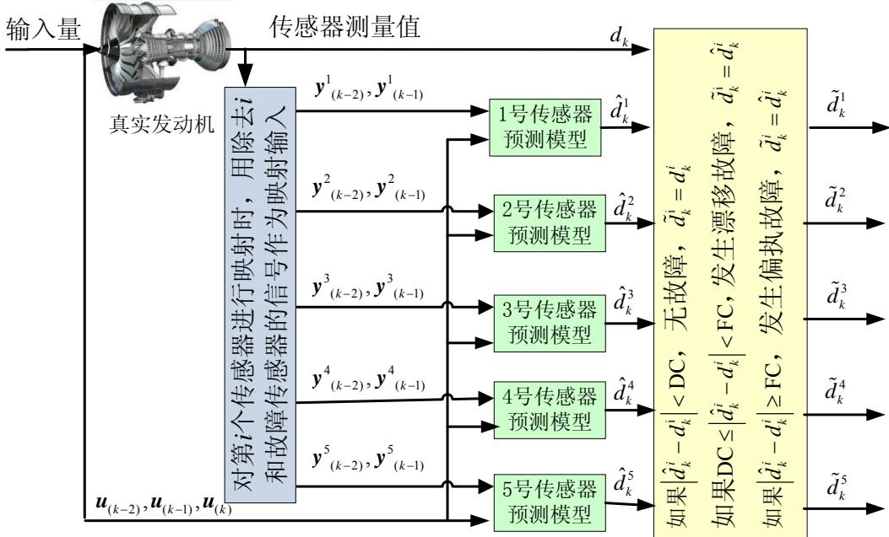  
图 3.2基于OS-ELM算法的传感器故障诊断系统结构图

当传感器发生故障时，根据故障判定阈值，在判断出某一传感器发生故障后，若将此测量信号继续作为映射模块的输入，由于此时诊断系统引入了错误信息，从而会导致整个诊断系统出现混乱甚至崩溃。针对此问题，对于传感器故障信号设计了隔离系统，其传感器故障诊断过程如图 3.3 所示。其中，传感器未发生故障时的映射系统记作诊断系统 A。发生故障的传感器信号从映射模型的输入中剔除，用剩余健康传感器信号作为输入重新训练预测模型，记作诊断系统 B。当传感器再次故障时，将发生故障的传感器继续从映射模块输入中剔除，用剩余健康传感器信号作为输入重新训练预测模型，记作诊断系统 C。对于所剔除故障传感器信号的重构，采用本文所提出的“预学习”诊断系统。

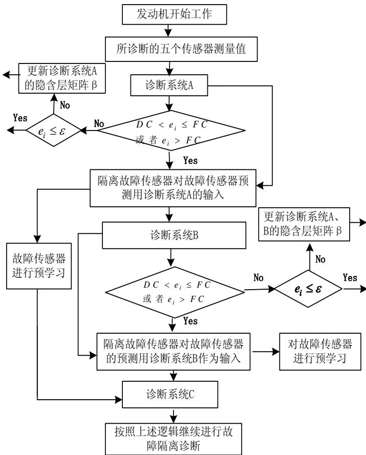  
图3.3涡扇发动机传感器故障诊断流程图

以下详细说明基于OS-ELM法传感器故障诊断系统的诊断过程和故障隔离的工作原理，不失一般性，仅以1号、2号传感器发生单、双故障的情形为例。

## 3.4.2单传感器故障诊断系统的隔离逻辑

表3.1诊断系统A对应的输入-输出关系

<table><tr><td>传感的预测值</td><td>基于 OS-ELM 法映射模型的输入</td></tr><tr><td> $\hat{d}_{k}^{1}$ </td><td> $y_{(k-2)}^{1},y_{(k-1)}^{1},u_{(k-2)},u_{(k-1)},u_{(k)}$ </td></tr><tr><td> $\hat{d}_{k}^{2}$ </td><td> $y_{(k-2)}^{2},y_{(k-1)}^{2},u_{(k-2)},u_{(k-1)},u_{(k)}$ </td></tr><tr><td> $\hat{d}_{k}^{3}$ </td><td> $y_{(k-2)}^{3},y_{(k-1)}^{3},u_{(k-2)},u_{(k-1)},u_{(k)}$ </td></tr><tr><td> $\hat{d}_{k}^{4}$ </td><td> $y_{(k-2)}^{4},y_{(k-1)}^{4},u_{(k-2)},u_{(k-1)},u_{(k)}$ </td></tr><tr><td> $\hat{d}_{k}^{5}$ </td><td> $y_{(k-2)}^{5},y_{(k-1)}^{5},u_{(k-2)},u_{(k-1)},u_{(k)}$ </td></tr></table>

当 1 号传感器单独发生故障时，其测量值与其预测值进行比较，根据图 3.2 的诊断逻辑判断出故障传感器后，在其它传感器预测模型中将 1 号故障传感器的测量值从模型的输入中剔除，重新进行在线训练，即为诊断系统B。

1 号故障传感器的估计沿用诊断系统 A 中相应的输入，此时每个传感器的映射模型中都不含有故障传感器1的信息，可以实现发动机控制系统在传感器发生故障后，仍然能够正常工作。

故障诊断系统B 中，映射模型具体的输入、输出对应关系如下表所示：

表3.2诊断系统B对应的输入-输出关系

<table><tr><td>传感的预测值</td><td>基于 OS-ELM 法映射模型的输入</td></tr><tr><td> $\hat{d}_{k}^{1}$ </td><td> $\mathbf{y}_{(k-2)}^{1},\mathbf{y}_{(k-1)}^{1},\mathbf{u}_{(k-2)},\mathbf{u}_{(k-1)},\mathbf{u}_{(k)}$ </td></tr><tr><td> $\hat{d}_{k}^{2}$ </td><td> $\mathbf{y}_{(k-2)}^{1,2},\mathbf{y}_{(k-1)}^{1,2},\mathbf{u}_{(k-2)},\mathbf{u}_{(k-1)},\mathbf{u}_{(k)}$ </td></tr><tr><td> $\hat{d}_{k}^{3}$ </td><td> $\mathbf{y}_{(k-2)}^{1,3},\mathbf{y}_{(k-1)}^{1,3},\mathbf{u}_{(k-2)},\mathbf{u}_{(k-1)},\mathbf{u}_{(k)}$ </td></tr><tr><td> $\hat{d}_{k}^{4}$ </td><td> $\mathbf{y}_{(k-2)}^{1,4},\mathbf{y}_{(k-1)}^{1,4},\mathbf{u}_{(k-2)},\mathbf{u}_{(k-1)},\mathbf{u}_{(k)}$ </td></tr><tr><td> $\hat{d}_{k}^{5}$ </td><td> $\mathbf{y}_{(k-2)}^{1,5},\mathbf{y}_{(k-1)}^{1,5},\mathbf{u}_{(k-2)},\mathbf{u}_{(k-1)},\mathbf{u}_{(k)}$ </td></tr></table>

## 3.4.3多传感器故障诊断系统的隔离逻辑

如前所述，在线传感器故障诊断系统大都针对单个传感器故障进行设计的研究，而实际上，多个不同传感器发生故障或是不同故障类型交错发生的情况也是常见的。为了避免在多个传感器发生故障时引起误诊，在诊断出单传感器（假设为 1 号传感器）故障后，对 1 号传感器的信号重构进行“预学习”。由于当前时刻下一次发生故障的传感器未知，因此需预先去除可能发生故障的每一个传感器测量值，分别建立映射模型，并行地预测第一次发生故障的 1 号传感器。具体的预学习映射模型的输入、输出对应关系如下表 3.3所示。

表3.3预学习系统中对应的输入-输出关系

<table><tr><td>故障传感器的预测值</td><td>基于 OS-ELM 法映射模型的输入</td></tr><tr><td> $\hat{d}_{k}^{1}$ </td><td> $\mathbf{y}_{(k-2)}^{1,2}, \mathbf{y}_{(k-1)}^{1,2}, \mathbf{u}_{(k-2)}, \mathbf{u}_{(k-1)}, \mathbf{u}_{(k)}$ </td></tr><tr><td> $\hat{d}_{k}^{1}$ </td><td> $\mathbf{y}_{(k-2)}^{1,3}, \mathbf{y}_{(k-1)}^{1,3}, \mathbf{u}_{(k-2)}, \mathbf{u}_{(k-1)}, \mathbf{u}_{(k)}$ </td></tr><tr><td> $\hat{d}_{k}^{1}$ </td><td> $\mathbf{y}_{(k-2)}^{1,4}, \mathbf{y}_{(k-1)}^{1,4}, \mathbf{u}_{(k-2)}, \mathbf{u}_{(k-1)}, \mathbf{u}_{(k)}$ </td></tr><tr><td> $\hat{d}_{k}^{1}$ </td><td> $\mathbf{y}_{(k-2)}^{1,5}, \mathbf{y}_{(k-1)}^{1,5}, \mathbf{u}_{(k-2)}, \mathbf{u}_{(k-1)}, \mathbf{u}_{(k)}$ </td></tr></table>

当有其它传感器发生叠加故障，假设为 2号传感器发生故障。显然，通过故障诊断系统B，可以定位 2 号传感器故障，此时应选择“预学习”模型中不包含故障传感器 2 的一组，对 1 号故障传感器进行预测。其它传感器预测模型中将1、2号故障传感器的测量值从模型的输入中去除，重新进行在线训练，实现对 3至5号传感器参数的预测。对 2 号故障传感器的预测仍延用诊断系统 B 中相应的输入，最终诊断系统 C 中各传感器映射模型的输入-输出对应关系如下表 3.4所示。

表3.4诊断系统C对应的输入-输出关系

<table><tr><td>故障传感器的预测值</td><td>基于 OS-ELM 法映射模型的输入</td></tr><tr><td> $\hat{d}_{k}^{1}$ </td><td> $y_{(k-2)}^{1,2},y_{(k-1)}^{1,2},u_{(k-2)},u_{(k-1)},u_{(k)}$ </td></tr><tr><td> $\hat{d}_{k}^{2}$ </td><td> $y_{(k-2)}^{1,2},y_{(k-1)}^{1,2},u_{(k-2)},u_{(k-1)},u_{(k)}$ </td></tr><tr><td> $\hat{d}_{k}^{3}$ </td><td> $y_{(k-2)}^{1,2,3},y_{(k-1)}^{1,2,3},u_{(k-2)},u_{(k-1)},u_{(k)}$ </td></tr><tr><td> $\hat{d}_{k}^{4}$ </td><td> $y_{(k-2)}^{1,2,4},y_{(k-1)}^{1,2,4},u_{(k-2)},u_{(k-1)},u_{(k)}$ </td></tr><tr><td> $\hat{d}_{k}^{5}$ </td><td> $y_{(k-2)}^{1,2,5},y_{(k-1)}^{1,2,5},u_{(k-2)},u_{(k-1)},u_{(k)}$ </td></tr></table>

通过以上设计的故障诊断隔离系统，在传感器发生单故障或是多故障的情况下，均能够将映射模型中的故障传感器信号从输入信息中剔除，保障了所设计的故障诊断系统的鲁棒性、减少了误诊率。类似地，其它传感器故障均可以按照相同的故障隔离逻辑实现故障传感器的诊断与信号的预测重构。

## 3.5 诊断系统数字仿真验证

以某型涡扇发动机为研究对象，在地面标准状态和高空状态下，发动机油门杆角度 PLA，5s 时由 $3 0 ^ { \circ }$ 变化到 $7 0 ^ { \circ }$ ，在 20s 由 $7 0 ^ { \circ } .$ 变化到 $3 0 ^ { \circ }$ ，在35s时由 $3 0 ^ { \circ }$ 变化到 $7 0 ^ { \circ }$ 。针对传感器发生偏置或漂移故障情况进行仿真分析。设置OS-ELM 法隐含层的激励函数为 sigmoid，隐含层节点数设置为50，图中的纵坐标是经式(3.3)处理后的结果。

由于发动机在动态过程中传感器测量参数变化速率大，导致预测模型的估计精度比其在稳态过程中低，为了降低误诊率，在仿真过程中根据发动机的燃油变化率来动态调整故障判定的阈值，使发动机动态时其故障诊断系统的判定阈值大于稳态时的阈值[60]。经过调试仿真时故障判定阈值根据下式进行更新。

$$
\begin{array}{l} \varepsilon = 0. 0 0 2 + C _ {1} \cdot \Delta \dot {W} _ {\mathrm{f}} \\ \mathrm{DC} = 0. 0 1 6 + C _ {2} \cdot \Delta \dot {W} _ {\mathrm{f}} \\ \mathrm{FC} = 0. 0 2 5 + C _ {3} \cdot \Delta \dot {W} _ {\mathrm{f}} \end{array}\tag{3.14}
$$

$\Delta \dot { W _ { \mathrm { f } } }$ 为涡扇发动机燃油流量当前的变化率，根据以往的经验调整系数选为 $C _ { 1 } = 0 . 1 1$ $C _ { 2 } = 0 . 1 0 2 , C _ { 3 } = 0 . 2 0 8$ ,此时故障诊断系统的诊断效果较好。

## 3.5.1发动机部件无退化时的仿真

模拟发动机健康状态下，对在过渡态运行过程中 $\mathrm { T } _ { 3 }$ 传感器发生偏置故障的情况进行仿真分析。图3.4为发动机在 $3 5 \mathrm { s } { \cdot } 4 0 \mathrm { s }$ 过渡态运行过程中， $\mathrm { T } _ { 3 }$ 传感器发生偏置故障时的仿真结果，其中传感器的偏置故障幅度为 3.5%。从中可以看出，当 $\mathrm { T } _ { 3 }$ 传感器发生偏置故障时，传感器测量值偏离其真实值，此时诊断系统的输出值并没有跟随故障传感器的测量值，而是等于映射模块的预测值，最大相对误差为1.95%，对其它健康传感器的预测值精度也较高。

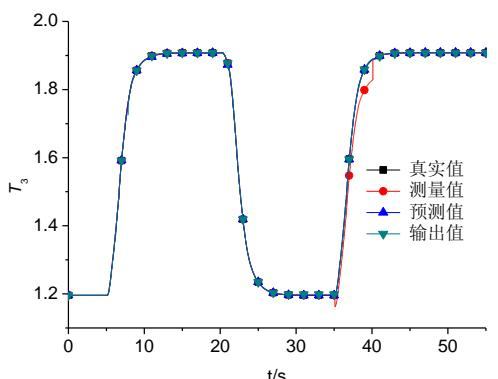

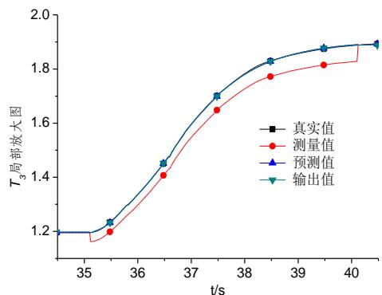

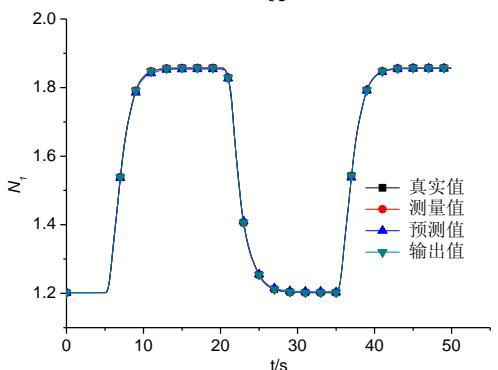

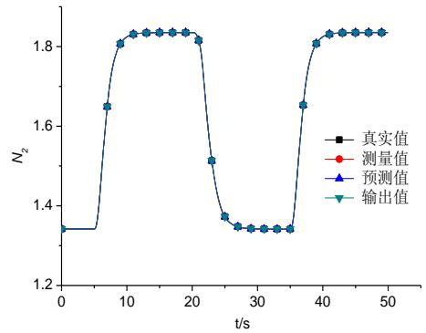

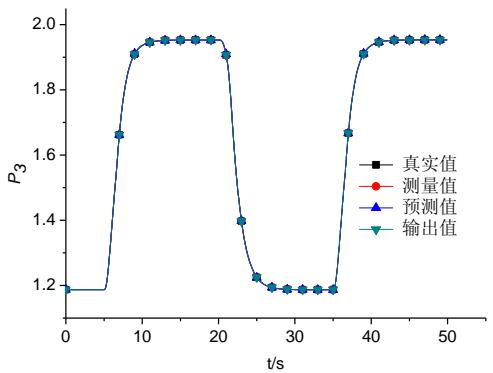

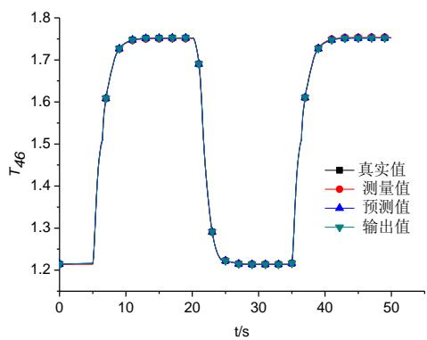  
图3.4地面标准状态下 $\mathrm { T } _ { 3 }$ 传感器偏置故障的诊断效果

图3.5为传感器发生漂移故障时的仿真结果，其中漂移速率为每个采样周期 20ms内负向漂移0.04%，持续时间为 1s。当35s-35.8s传感器发生漂移故障时，由于没有超过判定阈值，并未被诊断出故障，诊断系统的输出值跟随了故障传感器的测量值，当漂移故障幅度超过判定阈值时，诊断系统的输出值等于其预测值，最大相对误差为 3.72%。同时对其他无故障的传感器仍然具有较准确的预测精度。

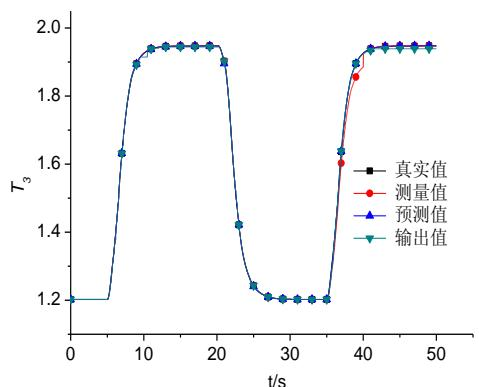

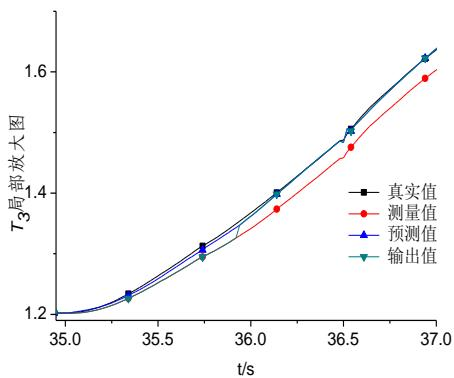

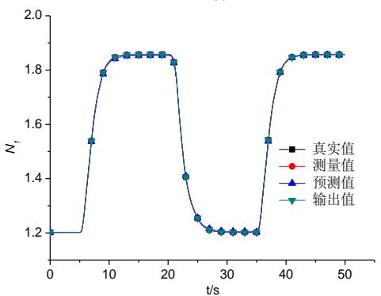

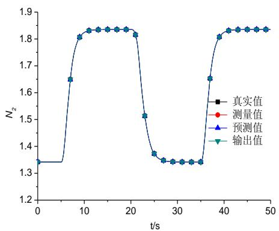

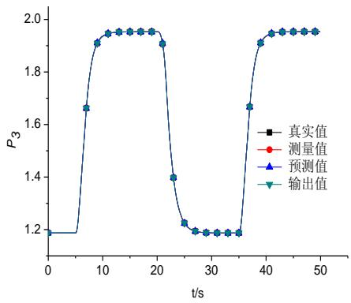

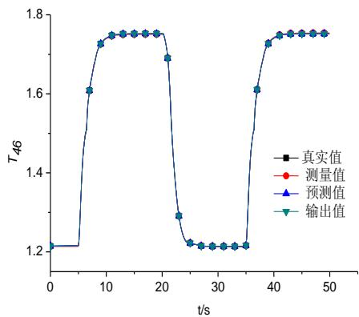  
图 3.5地面标准状态下 $\mathrm { T } _ { 3 }$ 传感器漂移故障的诊断效果

图 3.6 模拟 $\mathrm { T } _ { 4 6 }$ 传感器与 $\Nu _ { 2 }$ 传感器发生多传感器故障的情况，其中在发动机过渡态运行过程中 $\mathrm { T } _ { 4 6 }$ 传感器发生漂移故障，在发动机稳态过程中叠加 $\Nu _ { 2 }$ 传感器偏置故障。其故障偏置幅度、漂移速率及持续时间与前同。在 t=37s处发动机处于过渡态时， $\mathrm { T } _ { 4 6 }$ 传感器发生漂移故障时，其结果与图3.5基本一致，经故障诊断系统后，其输出值并没有再跟随 $\mathrm { T } _ { 4 6 }$ 传感器的测量值，而是替代为映射模块输出的预测值。

为模拟叠加故障，在 $4 2 \mathrm { s }$ 处 $\Nu _ { 2 }$ 设置偏置故障，同样可以看到，诊断系统的输出值没有再跟随故障传感器的测量值，而是很好地跟踪了其真实值，最大相对误差为 2.81%。且从图中还可看到，在对 $\Nu _ { 2 }$ 传感器偏置故障进行重构的同时， $\mathrm { T } _ { 4 6 }$ 传感器以及其它无故障传感器的重构没有受到影响。

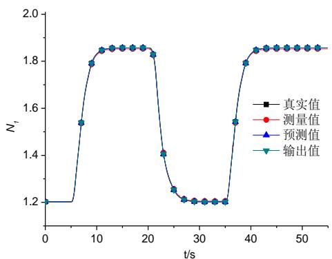

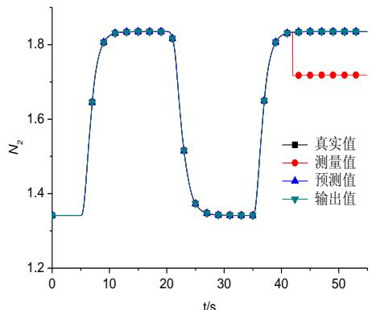

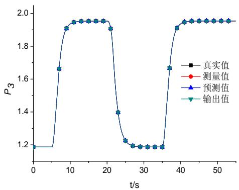

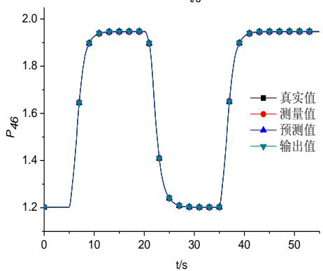

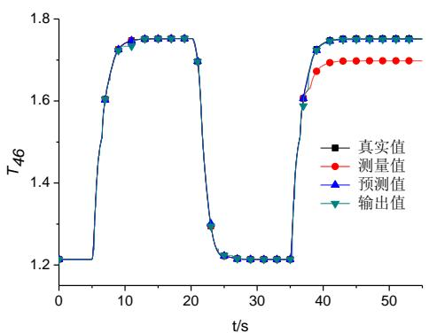

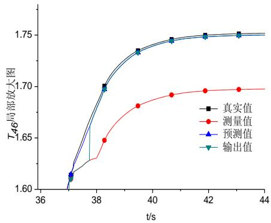  
图3.6地面标准状态下 $\Nu _ { 2 }$ 传感器偏置故障 $\mathrm { T } _ { 4 6 }$ 漂移故障的诊断效果

从图 3.4、3.5、3.6 可明显看出，无论是单传感器故障还是双传感器故障，该系统均能够迅速对故障传感器进行定位，并且隔离故障传感器测量信号，诊断系统的输出值没有跟随发生故障的传感器测量值，而是精确反映了涡扇发动机对应参数的真实值，各个传感器的诊断结果误差见表3.5。

表 3.5地面标准状态下传感器故障的最大相对误差

<table><tr><td>传感器故障</td><td> $N_1$ </td><td> $N_2$ </td><td> $T_3$ </td><td> $P_3$ </td><td> $T_{46}$ </td></tr><tr><td> $T_3$ 偏置</td><td>0.0064</td><td>0.0081</td><td>0.0195</td><td>0.0133</td><td>0.0098</td></tr><tr><td> $T_3$ 漂移</td><td>0.0028</td><td>0.0101</td><td>0.0372</td><td>0.0076</td><td>0.0082</td></tr><tr><td> $N_2$ 偏置 $T_{46}$ 漂移</td><td>0.0075</td><td>0.0081</td><td>0.0069</td><td>0.0039</td><td>0.0463</td></tr></table>

## 3.5.2发动机部件退化时的仿真

为了进一步验证本章所设计的传感器故障诊断系统在涡扇发动机部件发生退化时的诊断效果，设置发动机风扇、压气机、高低压涡轮的退化参数分别为2%，在高度 7km,马赫数 0.8，对$\Nu _ { 1 }$ 传感器在过渡态运行过程中发生偏置的情况进行仿真分析。图 3.7 为发动机在 35s-40s 过渡态运行过程中， $\Nu _ { 1 }$ 传感器发生偏置故障时的仿真结果，其中传感器的偏置故障幅度为 3.5%。从中可以看出，当 $\mathrm { N } _ { 1 }$ 传感器发生偏置故障时，此时诊断系统的输出值并没有跟随故障传感器的测量值，最终输出的结果是预测值，且预测值能很好的跟随发动机的真实值，其最大相对误差为2.53%。通过故障隔离系统将其故障信号 $\Nu _ { 1 }$ 剔除后，OS-ELM对其它健康传感器的预测值精度较高，健康传感器的预测并未受故障传感器的影响。

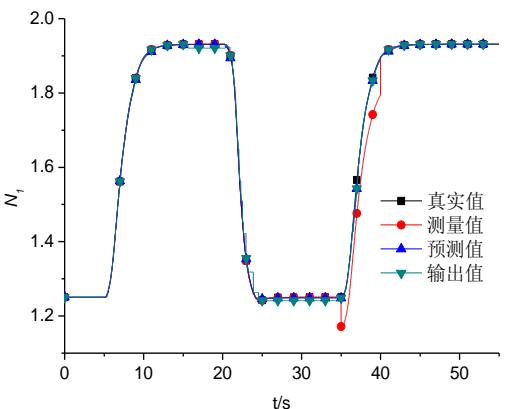

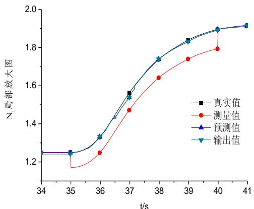

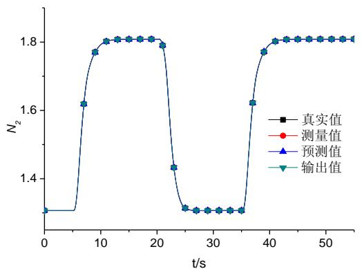

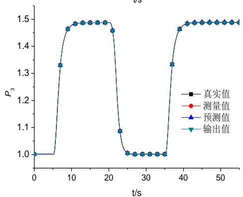

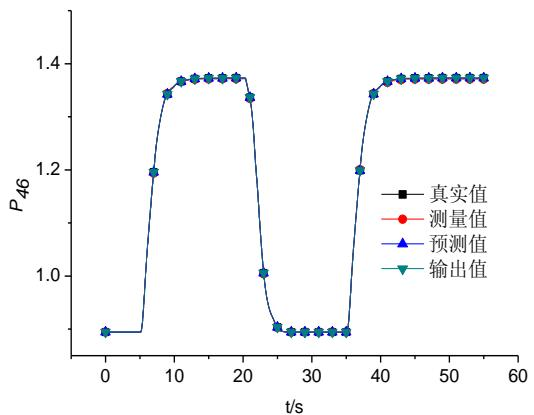

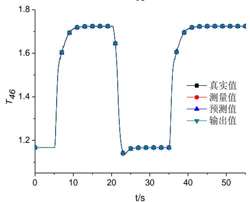  
图 3.7高空退化状态下 $\Nu _ { 1 }$ 传感器偏置故障的诊断效果

图 3.8 为传感器发生漂移故障时的仿真结果，其中漂移速率和持续时间为与 3.5.1 节相同。从仿真图中可以看出，算法的预测值都能比较准确的跟踪上涡扇发动机传感器信号的真实值，当传感器的预测值与其测量值之间的绝对偏差值超过漂移故障阈值，系统的输出值不在是故障传感器测量值而是其预测值，实现了对故障传感器的定位与隔离。

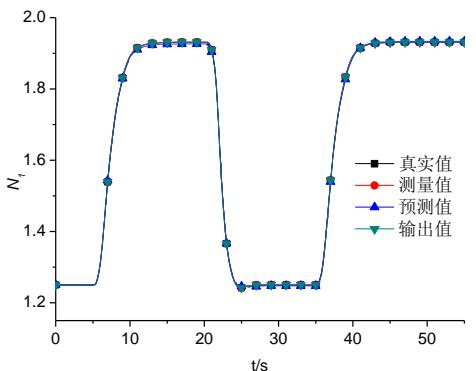

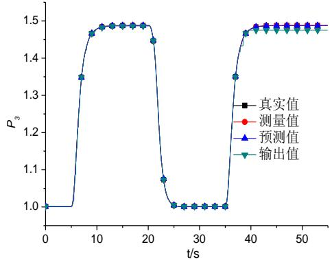

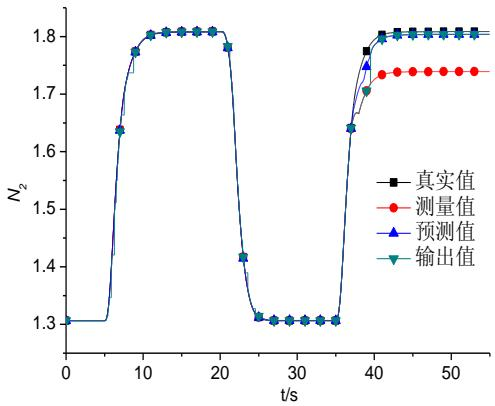

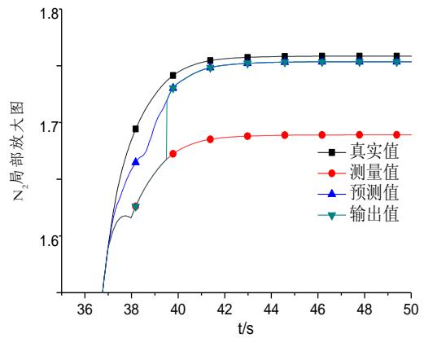

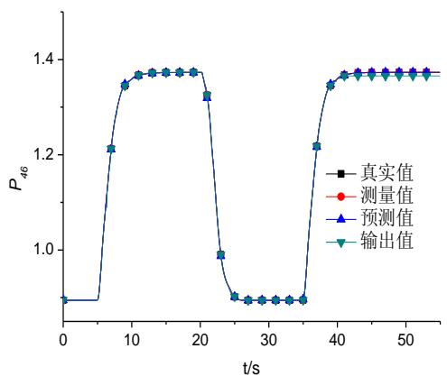

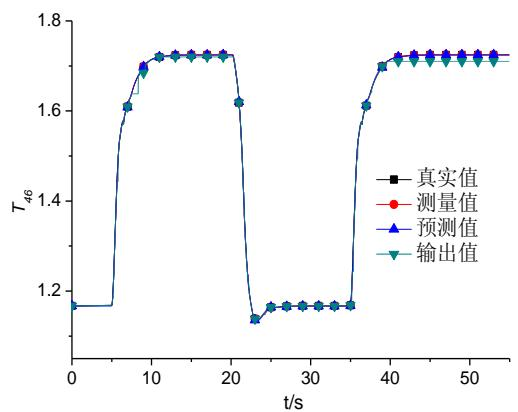  
图 3.8高空退化状态下 $\Nu _ { 2 }$ 传感器漂移故障的诊断效果

图3.9为发动机在 37s时，对 $\mathrm { P } _ { 3 }$ 传感器设置向下偏置3.5%的故障，在40s时，叠加 $\Nu _ { 1 }$ 传感器向下偏置3.5%的故障；从诊断仿真图可以看出，在 $\mathrm { P } _ { 3 }$ 传感器首先发生偏置故障时，诊断系统能够准确的诊断并定位， $\Nu _ { 1 }$ 传感器再次发生偏置故障时，引入了“预学习”思想的诊断系统依然具有很好的诊断能力，对其他健康传感器的预测效果良好。实现了对双传感器故障的准确诊断。同时可以发现采用动态阈值策略，虽然在发动机动态和稳态过程中，偏置故障判定阈值随燃油变化率的不同而不同，并未影响传感器的预测精度，都能够对真实值进行很好的跟踪。

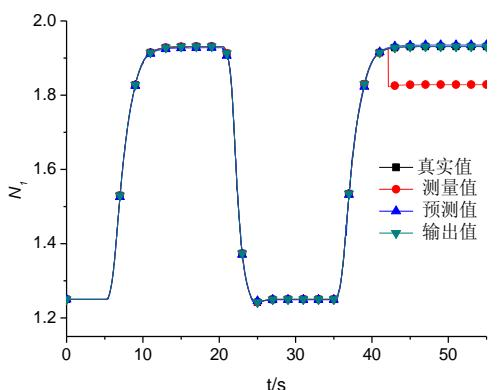

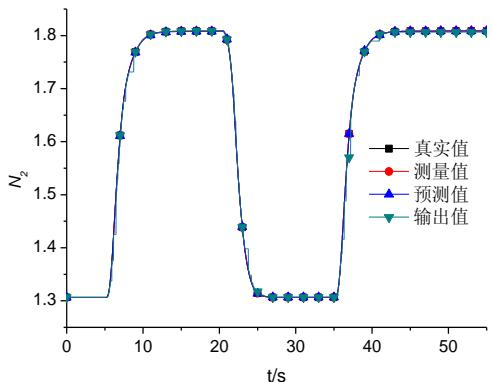

  
图 3.9高空退化状态下 $\Nu _ { 1 }$ 传感器偏置故障的诊断效果

图3.7、图3.8、图 3.9中各个传感器的诊断结果最大相对误差见表3.6：  
表3.6高空退化状态下传感器故障的最大相对误差

<table><tr><td>传感器故障</td><td> $N_1$ </td><td> $N_2$ </td><td> $T_3$ </td><td> $P_3$ </td><td> $T_{46}$ </td></tr><tr><td>N1 偏置故障</td><td>0.0253</td><td>0.0069</td><td>0.0186</td><td>0.0092</td><td>0.0053</td></tr><tr><td>N2 漂移故障</td><td>0.0069</td><td>0.0301</td><td>0.0102</td><td>0.0153</td><td>0.0182</td></tr><tr><td>N1 偏置 P3 偏置</td><td>0.0275</td><td>0.0086</td><td>0.0102</td><td>0.0149</td><td>0.0063</td></tr></table>

上述仿真实验均在 ${ \mathrm { V C } } { + } { + } 6 . 0$ 环境下完成，计算电脑主频 3.30GHz，内存3.46GB。为了验证算法的实时性，在地面健康状态下，计算机从发动机部件级模型采集2500组数据，分别通过未采用选择策略和采用选择策略的OS-ELM算法预测这些数据，调用VC++中的 clock()函数统计总的时间。结果显示未采用选择策略的平均预测时间为 1.2451ms,采用选择策略的平均预测时间为0.8302ms, 由于通过选择策略对输出层权值进行了选择性的更新，使得OS-ELM算法在实时性上有了明显的改善。因此更适用于进行传感器故障的在线诊断。

## 3.6 本章小结

为解决涡扇发动机气路传感器故障问题，提高发动机控制系统的可靠性，基于 OS-ELM算法对气路传感器建立了故障诊断系统，主要工作包括:

(1)介绍了发动机传感器的故障类型和故障原因，并对其主要的传感器故障类型建立了数学仿真模型。

(2)建立基于OS-ELM算法的传感器故障诊断系统，通过传感器真实值与预测值之间的偏差与所设定的故障判定阈值来判定故障，为提高诊断系统的准确性，并根据燃油变化率的不同，采用了动态的判定阈值。

(3)建立了针对故障传感器的隔离系统，将传感器的故障信号从基于OS-ELM法映射模型的输入中剔除，保证其他传感器预测结果的准确性。

(4)分别对发动机在地面健康状态和高空部件退化状态下，发动机发生单传感器故障和双传感器故障进行了仿真分析，并列出了相应的诊断误差和预测平均时间。

仿真结果表明，基于OS-ELM算法建立的传感器故障诊断系统，在全包线内实现了在线诊断的能力，并且具有较高的重构精度，为后续对气路部件退化参数的估计和性能恢复控制系统提供了可靠的测量信号。

## 第四章 航空发动机部件退化参数及性能参数的估计

## 4.1 概述

航空发动机在服役过程中，随着使用时间逐渐增加，由于污垢和腐蚀的影响，导致发动机的部件特性也必然发生不同程度的退化，导致气路部件的工作效率和流量发生变化，这些性能参数的变化使得发动机传感器测量参数如温度、压力、转速等发生变化。因此对发动机气路部件故障诊断主要通过测量参数的变化去估计部件退化参数，然后通过分析退化参数对故障进行定位[61]。发动机气路故障诊断的具体思想如图4.1所示：

  
图4.1发动机气路故障诊断原理图

目前对发动机气路部件的故障诊断主要有三类：基于数据、基于先验知识和基于模型的方法，前两种方法需要大量发动机的故障数据和先验知识，而基于模型的方法相比前两种方法，其不需要太多的故障数据，因此获得了广泛的研究。

通过第二章对部件退化的原因分析可知，气路部件的退化如叶片磨损或污垢的堆积都是逐渐发生的，因此可以采用小偏差的方法对发动机系统进行线化建模，从而利用基于线性模型的一些小偏差的故障诊断方法；目前基于模型的方法中，以基于线性卡尔曼滤波算法和发动机线性模型的诊断方法最为成熟，且计算量较小[62]。但发动机是一个复杂的非线性系统，在飞行包线范围内，需要对其不同的工作状态分别建立分段线性化状态模型，并设计相应的卡尔曼滤波器。本文根据飞行高度、马赫数、燃油流量，对飞行包线进行划分,结合当前飞行状态，采用三维插值的方法，估计出当前工作点的部件退化参数，并通过基于数据驱动的映射模块来估计发动机推力、喘振裕度等性能参数。具体的诊断结构如图 4.2所示，以下将对每一个模块进行详细的介绍。

  
图4.2涡扇发动机退化参数及性能参数估计示意图

## 4.2发动机线性状态变量模块

## 4.2.1建立发动机状态变量模型

设某型号涡扇发动机的非线性数学模型如下：

$$
\left\{ \begin{array}{l} \dot {\boldsymbol {x}} = f (\boldsymbol {x}, \boldsymbol {u}) \\ \boldsymbol {y} = g (\boldsymbol {x}, \boldsymbol {u}) \end{array} \right.\tag{4.1}
$$

式中， $\pmb { x } \in R ^ { n }$ 为发动机状态变量， $\pmb { u } \in R ^ { r }$ 为发动机控制变量， $\boldsymbol { y } \in \boldsymbol { R } ^ { m }$ 为发动机输出量。在发动机某稳态给工作点 $( \pmb { x } _ { 0 } , \pmb { u } _ { 0 } , \pmb { y } _ { 0 } )$ 进行泰勒展开，忽略 $( \pmb { x } _ { 0 } , \pmb { u } _ { 0 } )$ 领域内高阶无穷小的响应得：

$$
\left\{ \begin{array}{l} \dot {\boldsymbol {x}} = f (\boldsymbol {x}, \boldsymbol {u}) \approx f \left(\boldsymbol {x} _ {0}, \boldsymbol {u} _ {0}\right) + \frac {\partial f}{\partial \boldsymbol {x}} \mid_ {\left(x _ {0}, u _ {0}\right)} \left(\boldsymbol {x} - \boldsymbol {x} _ {0}\right) + \frac {\partial f}{\partial \boldsymbol {u}} \mid_ {\left(x _ {0}, u _ {0}\right)} \left(\boldsymbol {u} - \boldsymbol {u} _ {0}\right) \\ \boldsymbol {y} = g (\boldsymbol {x}, \boldsymbol {u}) \approx g \left(\boldsymbol {x} _ {0}, \boldsymbol {u} _ {0}\right) + \frac {\partial g}{\partial \boldsymbol {x}} \mid_ {\left(x _ {0}, u _ {0}\right)} \left(\boldsymbol {x} - \boldsymbol {x} _ {0}\right) + \frac {\partial g}{\partial \boldsymbol {u}} \mid_ {\left(x _ {0}, u _ {0}\right)} \left(\boldsymbol {u} - \boldsymbol {u} _ {0}\right) \end{array} \right.\tag{4.2}
$$

令 $\Delta x = x - x _ { 0 } , \ \Delta u = u - u _ { 0 } , \ \Delta y = y - y _ { 0 } = g \left( x , u \right) - g \left( x _ { 0 } , u _ { 0 } \right) , \ A = \hat { \mathcal { O } } f / \hat { \omega } x \vert _ { \left( x _ { 0 } , u _ { 0 } \right) } , \ B = \hat { \mathcal { O } } f / \hat { \omega } u \vert _ { \left( x _ { 0 } , u _ { 0 } \right) }$ •${ \pmb { C } } = \partial g / \partial { \pmb { x } } \mid _ { ( { \pmb { x } } _ { 0 } , { \pmb { u } } _ { 0 } ) }$ ${ \pmb { D } } = \partial g / \partial { \pmb { u } } | _ { ( { \pmb { x } } _ { 0 } , { \pmb { u } } _ { 0 } ) }$ ，则发动机在稳态点 $( \pmb { x } _ { 0 } , \pmb { u } _ { 0 } , \pmb { y } _ { 0 } )$ 的标准状态变量模型为：

$$
\left\{ \begin{array}{l} \Delta \dot {\boldsymbol {x}} = \boldsymbol {A} \Delta \boldsymbol {x} + \boldsymbol {B} \Delta \boldsymbol {u} \\ \Delta \boldsymbol {y} = \boldsymbol {C} \Delta \boldsymbol {x} + \boldsymbol {D} \Delta \boldsymbol {u} \end{array} \right.\tag{4.3}
$$

本文选择 $\pmb { x } = [ N _ { 1 } , N _ { 2 } ] ^ { T }$ 为状态量， $\pmb { u } = [ W _ { f b } , A _ { 8 }$ ]T为控制量， $\mathbf { y } = [ N _ { 1 } , N _ { 2 } , T _ { 3 } , T _ { 4 6 } , P _ { 3 } ] ^ { T }$ 为输出量，即状态量为风扇和压气机转速 $N _ { 1 }$ 、 $N _ { 2 }$ ，控制量为主燃油流量 $W _ { f b }$ 和尾喷口面积 $A _ { 8 }$ ，输出量为压气机出口温度 $T _ { 3 }$ 和压力 $P _ { 3 }$ ，低压涡轮进口温度 $T _ { 4 6 }$ 以及风扇和压气机转速 $N _ { 1 }$ 、 $N _ { 2 }$ 。采用实际物理参数求解状态变量模型，由于各物理量之间的数量级相差很大，导致求解的系数矩阵AB C D中各数值的数量级也相差很大，导致系数矩阵接近病态，进而影响线性模型的精度。因此本文根据发动机设计点参数，对各物理量进行如下归一化处理：

$$
\begin{array}{l l} \bar {N} _ {1} = N _ {1} / N _ {1 d s} \times 100 \% & \bar {N} _ {2} = N _ {2} / N _ {2 d s} \times 100 \% \\ \bar {T} _ {3} = T _ {3} / T _ {3 d s} \times 100 \% & \bar {T} _ {4 6} = T _ {4 6} / T _ {4 6 d s} \times 100 \% \\ \bar {P} _ {3} = P _ {3} / P _ {3 d s} \times 100 \% & \bar {W} _ {f b} = W _ {f b} / W _ {f b d s} \times 100 \% \\ \bar {A} _ {8} = A _ {8} / A _ {8 d s} \times 100 \% & \end{array}\tag{4.4}
$$

式中，下标 $d s$ 表示涡扇发动机设计点参数值。通过归一化参数处理的某稳态工作点 $( \pmb { x } _ { 0 } , \pmb { u } _ { 0 } , \pmb { y } _ { 0 } )$ 的状态变量模型为：

$$
\left[ \begin{array}{c} \Delta \dot {\overline {{N}}} _ {1} \\ \Delta \dot {\overline {{N}}} _ {2} \end{array} \right] = \left[ \begin{array}{c c} a _ {1 1} & a _ {1 2} \\ a _ {2 1} & a _ {2 2} \end{array} \right] \left[ \begin{array}{c} \Delta \overline {{N}} _ {1} \\ \Delta \overline {{N}} _ {2} \end{array} \right] + \left[ \begin{array}{c c} b _ {1 1} & b _ {1 2} \\ b _ {2 1} & b _ {2 2} \end{array} \right] \left[ \begin{array}{c} \Delta \overline {{W}} _ {f b} \\ \Delta \overline {{A}} _ {8} \end{array} \right]
$$

$$
\left[ \begin{array}{l} \Delta \overline {{N}} _ {1} \\ \Delta \overline {{N}} _ {2} \\ \Delta \overline {{T}} _ {3} \\ \Delta \overline {{T}} _ {4 6} \\ \Delta \overline {{P}} _ {3} \end{array} \right] = \left[ \begin{array}{c c} 1 & 0 \\ 0 & 1 \\ c _ {3 1} & c _ {3 2} \\ c _ {4 1} & c _ {4 2} \\ c _ {5 1} & c _ {5 2} \end{array} \right] \left[ \begin{array}{l} \Delta \overline {{N}} _ {1} \\ \Delta \overline {{N}} _ {2} \end{array} \right] + \left[ \begin{array}{c c} 0 & 0 \\ 0 & 0 \\ d _ {3 1} & d _ {3 2} \\ d _ {4 1} & d _ {4 2} \\ d _ {5 1} & d _ {5 2} \end{array} \right] \left[ \begin{array}{l} \Delta \overline {{W}} _ {f b} \\ \Delta \overline {{A}} _ {8} \end{array} \right]\tag{4.5}
$$

上述所建立的线性状态变量模型(SVM)仅仅针对发动机额定工作状态，但是实际中发动机部件退化、环境噪声等都会造成发动机偏离额定工作状态，为了能真实描述发动机的线性状态变量模型，本文将部件退化参数以及环境噪声考虑进去，最终表示为：

$$
\begin{array}{l} \Delta \dot {x} = A \cdot \Delta x + B \cdot \Delta u + L \cdot \Delta \eta + \omega \\ \Delta y = C \cdot \Delta x + D \cdot \Delta u + M \cdot \Delta \eta + v \end{array}\tag{4.6}
$$

其中， $\Delta \eta = \left[ D _ { _ f } , D _ { _ c } , D _ { _ c b } , D _ { _ { h t } } , D _ { _ { l t } } \right]$ ，即第二章中设定的部件退化参数：风扇效率退化参数 $D _ { f }$ ,压气机流量退化值 $D _ { c }$ ，燃烧室效率退化值 $D _ { c b }$ 高压涡轮效率退化值 $D _ { h t }$ ，低压涡轮流量退化值 $D _ { l t }$ 。$\omega$ 为系统噪声矩阵， $\upsilon$ 为测量噪声矩阵，对于系统噪声和测量噪声在大多数工程情况下都可设定为零均值且符合正态分布的高斯白噪声，其协方差矩阵分别为 $\varrho$ 和 $\pmb { R }$ ；根基文献[63]，选取Q$\mathbf { \Lambda } = 0 . 0 0 2 ^ { 2 } I \ , R = 0 . 0 0 2 ^ { 2 } I$ 0

从公式(4.6)可以看出，u、 对于发动机状态变量模型的作用是相同的，因此可以将 $\Delta \eta$ 增广到控制量 $\Delta u$ 中，在求取系数矩阵的过程中，可以将 中的五个部件退化参数依次进行阶跃，变化后的状态变量模型如下：

$$
\begin{array}{l} \Delta \dot {x} = \boldsymbol {A} ^ {\prime} \cdot \Delta x + \boldsymbol {B} ^ {\prime} \cdot \Delta u ^ {\prime} \\ \Delta y = \boldsymbol {C} ^ {\prime} \cdot \Delta x + \boldsymbol {D} ^ {\prime} \cdot \Delta u ^ {\prime} \end{array}\tag{4.7}
$$

试中： $\Delta u ^ { ' } = [ \Delta u ^ { T } \Delta \eta ^ { T }$ ] , A' = A, B =[B L],C' = C ,D' =[D M]。

## 4.2.2改进拟合法求解状态变量模型

目前求解发动机状态模型系数矩阵的方法主要有偏导数法和最小二乘拟合法，偏导数法又称小扰动法实现过程虽然简单，但在在求解系数矩阵过程中，对某个控制量小扰动时必须强制其他控制量或是状态量不变，在实际过程中是很难实现的，因此导致其拟合精度不高。最小二乘拟合法根据状态变量模型在各控制量做小阶跃响应即线性动态响应，然后采集同样小阶跃响应的非线性动态相应数据，使二者的偏差在时域范围内满足最小二乘条件，由于发动机在时域上是非线性的方程组，求解该方程组都是用迭代的方法来完成的，因此迭代的初始值至关重要，尤其在模型阶次高的时候直接关系到计算效率。

在本文所研究的飞行包线中，通过高度、马赫数和燃油流量对其划分多个工作点，此时传统的最小二乘拟合法工作量巨大且计算效率低下，耗费的计算时间也较大，因此需要对其进行改进，设计一个计算效率更高的拟合方法即改进的最小二乘拟合方法[64]；改进的最小二乘法直接根据状态变量模型中各变量的线性关系进行简单的矩阵运算，得到接近最终解的迭代值，无需反复迭代求解状态变量模型的微分方程组，其基本原理如下：

以线性方程 $\pmb { Y } = \pmb { K } \pmb { X }$ 拟合某一非线性方程 ${ \bar { Y } } = f ( X )$ 其中X是 $n \times p$ 矩阵，Y为 $m \times p$ 矩阵，$\bar { Y }$ 是 $m \times n$ 矩阵 $X = \left[ \boldsymbol { x } _ { I } , \boldsymbol { x } _ { 2 } , . . . . \boldsymbol { x } _ { N } \right] , \quad Y = \left[ \boldsymbol { y } _ { I } , \boldsymbol { y } _ { 2 } , . . . \boldsymbol { y } _ { N } \right] , \quad \bar { Y } = [ \bar { \boldsymbol { y } _ { I } } , \bar { \boldsymbol { y } _ { 2 } } , . . . \bar { \boldsymbol { y } _ { N } } ]$ 。两者的差方和为：

$$
I = (\bar {Y} - Y) ^ {T} (\bar {Y} - Y) = (\bar {Y} - K X) ^ {T} (\bar {Y} - K X) = \sum_ {i = 1} ^ {p} \left(\bar {y} _ {i} - K x _ {i}\right) ^ {T} \left(\bar {y} _ {i} - K x _ {i}\right)\tag{4.8}
$$

当公式(4.8)满足最小二乘条件时，有

$$
\frac {\partial \boldsymbol {I}}{\partial \boldsymbol {K}} = \sum_ {i = 1} ^ {p} 2 (\overline {{\boldsymbol {Y}}} _ {i} - \boldsymbol {K} x _ {i}) (- x _ {i}) ^ {T} = - 2 (\overline {{\boldsymbol {Y}}} - \boldsymbol {K X}) \cdot \boldsymbol {X} ^ {T} = 0 \Rightarrow \boldsymbol {K X X} ^ {T} = \overline {{\boldsymbol {Y}}} \boldsymbol {X} ^ {T}\tag{4.9}
$$

当X 满秩时，则 $X X ^ { T }$ 是可逆的，所以：

$$
\boldsymbol {K} = \bar {\boldsymbol {Y}} \boldsymbol {X} ^ {T} (\boldsymbol {X} \boldsymbol {X} ^ {T}) ^ {- 1}\tag{4.10}
$$

以求解发动机状态变量系数A B为例，当系统稳定时，模型的稳态变量之间满足线性关系且与时间无关，即当状态变化量 $\dot { x } _ { \infty } = 0$ 时。稳态变量满足如下线性关系：

$$
\dot {\boldsymbol {x}} = \boldsymbol {A} \mathbf {x} + \boldsymbol {B} \boldsymbol {u} \Rightarrow \boldsymbol {x} _ {\infty} = - \boldsymbol {A} ^ {- 1} \boldsymbol {B} \boldsymbol {u} _ {\infty}\tag{4.11}
$$

其中 $\displaystyle \boldsymbol { x } _ { \infty }$ 为非线性模型在 $\pmb { u } _ { \infty }$ 稳态输入下的状态值，令 $\pmb { K } = - \pmb { A } ^ { - I } \pmb { B }$ 则：

$$
\boldsymbol {x} _ {\infty} = \boldsymbol {K} \boldsymbol {u} _ {\infty} \Rightarrow \boldsymbol {K} = \boldsymbol {x} _ {\infty} \boldsymbol {u} _ {\infty} ^ {T} (\boldsymbol {u} _ {\infty} \boldsymbol {u} _ {\infty} ^ {T}) ^ {- 1}\tag{4.12}
$$

在发动机模型稳态时， $\mathbf { \delta } _ { x _ { \infty } , u _ { \infty } }$ 数值不变则K确定可以求出，则A B 矩阵满足如下关系：

$$
\boldsymbol {B} = - \boldsymbol {A K}\tag{4.13}
$$

假设系统的稳态模型已经建立，中间过渡态过程公式(4.11)可以表述为：

$$
\dot {x} = A x + B u \Rightarrow \dot {x} = A x - A K u = A (x - K u)\tag{4.14}
$$

设 $\dot { \pmb X } = [ \dot { \pmb x } _ { I } , \dot { \pmb x } _ { 2 } , \dot { \pmb x } _ { 3 } \dots ]$ ${ \pmb X } _ { d } = [ { \pmb x } _ { 1 } - { \pmb K } { \pmb u } _ { 1 } , { \pmb x } _ { 2 } - { \pmb K } { \pmb u } _ { 2 } , . . . ]$ ，其中 $\dot { \mathbf { \sigma } } _ { { \boldsymbol { x } } _ { i } }$ 为 i时刻非线性对象的状态变化量， $\pmb { x } _ { i }$ 为状态量， $\pmb { u } _ { i }$ 输入量，令线性模型在各状态点 $\pmb { x } _ { i } ( i = 1 , 2 , 3 , \dots )$ 的导数与非线性模型的状态导数两者之间的偏差满足最小二乘的条件，根据推导公式(4.10)的原理，则求解的系数矩阵为：

$$
\left\{ \begin{array}{l} \boldsymbol {A} = \dot {\boldsymbol {X}} \boldsymbol {X} _ {d} ^ {T} \left(\boldsymbol {X} _ {d} \boldsymbol {X} _ {d} ^ {T}\right) ^ {- 1} \\ \boldsymbol {B} = - \boldsymbol {A} \boldsymbol {K} = - \dot {\boldsymbol {X}} \boldsymbol {X} _ {d} ^ {T} \left(\boldsymbol {X} _ {d} \boldsymbol {X} _ {d} ^ {T}\right) ^ {- 1} \boldsymbol {x} _ {\infty} \boldsymbol {u} _ {\infty} ^ {T} \left(\boldsymbol {u} _ {\infty} \boldsymbol {u} _ {\infty} ^ {T}\right) ^ {- 1} \end{array} \right.\tag{4.15}
$$

但实际上线性模型各状态点的导数与非线性模型的状态导数在时域上并不满足最小二乘条件，但是随着拟合对象的线性增强，式(4.15)解的结果会趋于最小二乘的解，此种方法求解的矩阵A几乎接近最终解的迭代值，极大减少了传统最小二乘法的迭代次数，提高了计算效率，同理可以求解出C D 矩阵。

## 4.2.3状态变量模型精度的验证

以飞行包线中的一个工作点 $H { = } 1 0 K m$ $\mathit { M a } { = } 0 . 8$ $W _ { \it f b } { = } 0 . 7 k g / s$ $\scriptstyle A _ { \mathit { s } } = 0 . 2 5 9 7 { \mathrm { m } } ^ { 2 }$ 为例，以某型涡扇发动机为研究对象，对部件级数学模型的增广控制量依次作一个小阶跃扰动，即 $W _ { f b } \setminus A _ { 8 }$ $D _ { f } \setminus D _ { c } \setminus D _ { c b } \setminus D _ { h t } \setminus D _ { l t }$ 依次阶跃+2%，以20ms为周期采集发动机部件模型的动态响应数据，采用上述描述的改进的最小二拟合乘法求解的该稳态工作点的系数矩阵为：

$$
\begin{array}{r l} A ^ {\prime} & = \left[ \begin{array}{c c} - 2. 2 9 6 7 & 1. 2 3 8 1 \\ - 0. 5 0 7 8 & - 0. 8 5 7 5 \end{array} \right] C ^ {\prime} = \left[ \begin{array}{c c} 1 & 0 \\ 0 & 1 \\ 0. 2 8 9 8 & 0. 3 3 2 8 \\ - 0. 3 1 7 9 & - 0. 3 0 0 7 \\ 0. 3 4 0 2 & 0. 3 4 5 8 \end{array} \right] \\ B ^ {\prime} & = \left[ \begin{array}{c c c c c c c} 0. 2 3 3 5 & 0. 6 0 7 3 & - 0. 7 4 2 2 & - 0. 6 0 7 2 & - 0. 3 2 1 2 & - 0. 0 6 9 8 4 & - 0. 6 5 3 2 \\ 0. 2 1 2 0 & 0. 1 3 3 7 & 0. 0 1 5 6 & 0. 4 8 5 7 & - 0. 2 5 2 7 & - 0. 6 4 5 9 & 0. 2 9 4 6 \end{array} \right] \\ D ^ {\prime} & = \left[ \begin{array}{c c c c c c c} 0 & 0 & 0 & 0 & 0 & 0 & 0 \\ 0 & 0 & 0 & 0 & 0 & 0 & 0 \\ 0. 0 9 2 3 & - 1. 2 2 8 2 & 0. 2 2 2 7 & - 0. 1 0 7 6 & - 0. 1 0 3 6 & - 0. 0 8 7 5 & 0. 0 2 4 9 2 \\ 0. 3 6 8 6 & \text {   } \quad \text {   } \quad \text {   } \quad \text {   } \quad \text {   } \quad \text {   } \quad \text {   } \quad \text {   } \quad \text {   } \quad \text {   } \quad \text {   } \quad \text {   } \quad \text {   } \quad \text {   } \quad \text {   } \quad \end{array} \right] \\ D ^ {\prime} & = \left[ \begin{array}{c c c c c c c} - \frac {1}{2} + \frac {1}{2} + \frac {1}{2} + \frac {1}{2} + \frac {1}{2} + \frac {1}{2} + \frac {1}{2} + \frac {1}{2} + \frac {1}{2} + \frac {1}{2} + \frac {1}{2} + \frac {1}{2} + \frac {1}{2} + \frac {3}{2} + \frac {3}{2} + \frac {3}{2} + \frac {3}{2} + \frac {3}{2} + \frac {3}{2} + \frac {3}{2} + \frac {3}{2} + \frac {3}{2} + \frac {3}{2} + \frac {3}{2} + \frac {3}{2} + \frac {3}{2} \\ - \frac {1}{2} + \frac {1}{2} + \frac {1}{2} + \frac {1}{2} + \frac {1}{2} + \frac {1}{2} + \frac {1}{2} + \frac {1}{2} + \frac {1}{2} + \frac {1}{2} + \frac {1}{2} + \frac {1}{2} + \frac {\text {   }}{\text {   }} + \frac {\text {   }}{\text {   }} + \frac {\text {   }}{\text {   }} + \frac {\text {   }}{\text {   }} + \frac {\text {   }}{\text {   }} + \frac {\text {   }}{\text {   }} + \frac {\text {   }}{\text {   }} + \frac {\text {   }}{\text {   }} + \frac {\text {   }}{3}. \\ - \frac {\text {   }}{\text {   }} + \frac {\text {   }}{\text {   }} + \frac {\text {   }}{\text {   }} + \frac {\text {   }}{\text {   }} + \frac {\text {   }}{\text {   }} + \frac {\text {   }}{\text {   }} + \frac {\text {   }}{\text {   }} + \frac {\text {   }}{\mathrm{~}} + \frac {\text {~}}{\mathrm{~}} + \frac {\text {~}}{\mathrm{~}} + \frac {\text {~}}{\mathrm{~}} + \frac {\text {~}}{\mathrm{~}} + \frac {\text {~}}{\mathrm{~}} + \frac {\text {~}}{\mathrm{~}} + \frac {\text {~}}{\mathrm{~}} + \frac {\text {~}}{\mathrm{~}} + \frac {- \text {~}}{\mathrm{~}} + - \frac {\text {~}}{\mathrm{~}} + - \frac {\text {~}}{\mathrm{~}} + - \frac {\text {~}}{\mathrm{~}} + - \frac {\text {~}}{\mathrm{~}} + - \frac {\text {~}}{\mathrm{~}} + - \frac {\text {~}}{\mathrm{~}} + - \frac {\text {~}}{\mathrm{~}} + - - - - - - - - - - - - - - - - - - - - - - - - - - - - - - - - - - - - - - - - - - - - - - - - - - - - - - - - - - - - - - - - - - - - - - - - - - - - - - - - - - - - - - - - - - - - - - - - \\ D ^ {\prime} & = [ D ^ {\prime} ] ^ {-} (D ^ {\prime}) ^ {-}, \\ D ^ {\prime} & = [ D ^ {\prime} ] ^ {-}, \\ D ^ {\prime} & = [ D ^ {\prime} ] ^ {-}, \\ D ^ {\prime} & = [ D ^ {\prime} ] ^ {-}, \\ D ^ {\prime} & = [ D ^ {\prime} ] ^ {-}, \\ D ^ {\prime} & = [ D ^ {\prime} ] ^ {-}, \\ D ^ {\prime} & = [ D ^ {\prime} ] ^ {-}, \\ D ^ {\prime} | _ {-} ^ {-}, \\ D ^ {\prime} | _ {| |}, \\ D ^ {\prime} | _ {| |}, \\ D ^ {\prime} | _ {| |}, \\ D ^ {\prime} | _ {| |}, \\ D ^ {\prime} | _ {| |}, \\ D ^ {\prime} | _ {| |}, \\ D ^ {\prime} | _ {| |}, \\ D ^ {\prime} | _ {| |}, \\ D ^ {\prime} | _ {| |}, \\ D ^ {\prime} | _ {| |}. \\ D ^ {\prime} | _ {| |}. \\ D ^ {\prime} | _ {| |}. \\ D ^ {\prime} | _ {| |}. \\ D ^ {\prime} | _ {| |}. \\ D ^ {\prime} | _ {| |}. \\ D ^ {\prime} | _ {| |}. \\ D ^ {\prime} | _ {| |}. \\ D ^ {\prime} | _ {| |}. \\ D ^ {\prime} | _ {| |}.    [ D ^ {\prime} ] ^ {-}, \\ D ^ {\prime} | _ {| |}. \\ D ^ {\prime} | _ {| |}. \\ D ^ {\prime} | _ {| |}. \\ D ^ {\prime} | _ {| |}. \\ D ^ {\prime} | _ {| |}. \\ D ^ {\prime} | _ {| |}. \\ D ^ {\prime} | _ {| |}. \\ D ^ {\prime} | _ {| |}. \\ D ^ {\prime} | _ {| |}.
\end{array}
$$

求得线性状态变量模型系数矩阵后，再次对线性状态变量模型的控制量和非线性模型作相同的阶跃，图4.3\~4.9为该稳态工作点处输出变量的仿真曲线，图中实线代表非线性模型的动态响应，虚线代表线性模型的动态响应。

  
图4.3主燃烧室供油量小阶跃非线性模型和线性模型的动态响应

  
图4.4尾喷管喉道面积小阶跃下非线性模型和线性模型的动态响应

  
图4.5风扇效率小阶跃下非线性模型和线性模型的动态响应

  
图4.6压气机流量小阶跃下非线性模型和线性模型的动态相应

  
图4.7主燃烧室效率小阶跃下非线性模型和线性模型的动态相应

  
图4.8高压涡轮效率小阶跃下非线性模型和线性模型的动态响应

  
图4.9低压涡轮流量小阶跃下非线性模型和线性模型的动态响应

从图4.3\~4.9可以看到，采用改进的最小二乘拟合方法求解线性状态变量模型时，在提高了计算效率的同时也保证了线性模型的拟合精度，为下一节精确求解卡尔曼滤波增益矩阵奠定了基础。

## 4.3 卡尔曼滤波器的设计模块

## 4.3.1常规卡尔曼滤波器的原理

在 4.2.1节中建立的考虑了退化参数和缓解噪声后的实际发动机的状态变量模型中，退化参数作为控制量只能反应输出量和状态量的变化，为了估计得到退化参数的变化，需要将其增广到状态变量x中，利用全维状态观测器—卡尔曼滤波器估计出退化参数的变化，则发动机的增广状态变量模型为：

$$
\begin{array}{l} \left[ \begin{array}{c} \Delta \dot {\boldsymbol {x}} \\ \Delta \dot {\boldsymbol {\eta}} \end{array} \right] = \boldsymbol {A} _ {a u g} \boldsymbol {x} _ {a u g} + \boldsymbol {B} _ {a u g} \boldsymbol {u} + \boldsymbol {w} = \left[ \begin{array}{c c} \boldsymbol {A} & \boldsymbol {L} \\ \boldsymbol {0} & \boldsymbol {0} \end{array} \right] \left[ \begin{array}{c} \Delta \boldsymbol {x} \\ \Delta \boldsymbol {\eta} \end{array} \right] + \left[ \begin{array}{c} \boldsymbol {B} \\ \boldsymbol {0} \end{array} \right] \Delta \boldsymbol {u} + \boldsymbol {\omega} \\ \Delta \mathbf {y} = \boldsymbol {C} _ {a u g} \boldsymbol {x} _ {a u g} + \boldsymbol {D} \boldsymbol {u} + \boldsymbol {v} = \left[ \begin{array}{c c} \boldsymbol {C} & \boldsymbol {M} \end{array} \right] \left[ \begin{array}{c} \Delta \boldsymbol {x} \\ \Delta \boldsymbol {\eta} \end{array} \right] + \boldsymbol {D} \Delta \boldsymbol {u} + \boldsymbol {v} \end{array}\tag{4.16}
$$

利用卡尔曼滤波器，根据式(4.16)得到的全维状态观测器方程如下：

$$
\left\{ \begin{array}{l} \left[ \begin{array}{l} \Delta \dot {\tilde {x}} \\ \Delta \dot {\tilde {\eta}} \end{array} \right] = \left(\left[ \begin{array}{c c} \boldsymbol {A} & \boldsymbol {L} \\ 0 & 0 \end{array} \right] - \boldsymbol {K} [ \boldsymbol {C} & \boldsymbol {M} ]\right) \left[ \begin{array}{l} \Delta \tilde {x} \\ \Delta \tilde {\eta} \end{array} \right] + \left(\left[ \begin{array}{l} \boldsymbol {B} \\ 0 \end{array} \right] - \boldsymbol {K} [ \boldsymbol {C} & \boldsymbol {M} ]\right) \Delta u + \boldsymbol {K} \Delta y \\ \Delta \tilde {y} = [ \boldsymbol {C} & \boldsymbol {M} ] \left[ \begin{array}{l} \Delta \tilde {x} \\ \Delta \tilde {\eta} \end{array} \right] + \boldsymbol {D} \Delta u \end{array} \right.\tag{4.17}
$$

式中，上标\~表示估计值， $\pmb { K } = \pmb { P } [ \pmb { C } \quad \pmb { M } ] ^ { T } \pmb { R } ^ { - I }$ 表示卡尔曼滤波器的增益矩阵， $\tilde { \Delta y }$ 表示退化发动机的输出y和自适应模型的输出 $\tilde { y }$ 的偏差，其中P 是如下Riccati方程的解：

$$
\left[ \begin{array}{l l} A & L \\ 0 & 0 \end{array} \right] P + P \left[ \begin{array}{l l} A & L \\ 0 & 0 \end{array} \right] ^ {T} - P \left[ \begin{array}{l l} C & M \end{array} \right] ^ {T} R ^ {- 1} \left[ \begin{array}{l l} C & M \end{array} \right] P + Q = 0\tag{4.18}
$$

上述即是针对某一稳态工作点设计的常规卡尔曼的建立过程，但是仅仅能在该稳态点附近小包线范围内估计出退化参数，为了能扩大诊断包线范围，大多数的做法都是在飞行包线范围内尽可能多的采集不同工作点处发动机的工作参数，然后离线获取不同工作点处发动机线性模型的系数矩阵和相应的卡尔曼增益矩阵，然后进行在线的插值计算；但是由于数据储存的局限性，并且发动机具有强非线性，常规的卡尔曼滤波器并不能很好的估计出发动机的退化参数，因此需要对常规卡尔曼滤波器进行改进。

## 4.3.2改进卡尔曼滤波器的设计及其离散化

这里采用了在输入端加积分补偿的改进的卡尔曼估计器，充分利用常规卡尔曼滤波器对各估计观测回路的初步解耦，然后进一步在各观测回路的输入端增加输出误差积分再一次进行激励[36]，对常规卡尔曼滤波器的输入端进行不断的积分修正，从而能消除稳态误差，其改进后的

卡尔曼滤波器方程如下：

$$
\left\{ \begin{array}{l} {\left[ \begin{array}{l} \Delta \dot {\tilde {x}} \\ \Delta \dot {\tilde {\eta}} \end{array} \right] = \left(\left[ \begin{array}{l l} A & L \\ 0 & 0 \end{array} \right] - K [ C M ]\right) \left[ \begin{array}{l} \Delta \tilde {x} \\ \Delta \tilde {\eta} \end{array} \right] + \left(\left[ \begin{array}{l} B \\ 0 \end{array} \right] - K [ C M ]\right) \Delta u + K (\Delta y + \Delta y ^ {\prime})} \\ \Delta \tilde {y} = \left[ \begin{array}{l l} C & M \end{array} \right] \left[ \begin{array}{l} \Delta \tilde {x} \\ \Delta \tilde {\eta} \end{array} \right] + D \Delta u \end{array} \right.\tag{4.19}
$$

在输出偏差 $\Delta y$ 和偏差积分环节 $\Delta y ^ { ' }$ 共同作用下，最终使得自适应模型的输出等于退化发动机的输出，即： $\tilde { y } = y$ o

本文为了将式(4.19)描述的卡尔曼滤波器应用于基于计算机平台建立的部件级模型中，需要对连续的方程进行离散化，对于连续的状态变量模型

$$
\left\{ \begin{array}{l} \dot {\boldsymbol {x}} = \boldsymbol {A} \boldsymbol {x} + \boldsymbol {B} \boldsymbol {u} \\ \boldsymbol {y} = \boldsymbol {C} \boldsymbol {x} + \boldsymbol {D} \boldsymbol {u} \end{array} \right.\tag{4.20}
$$

设计算机的采用周期为 T，则有 $\Delta { \pmb u } ( t ) = \Delta { \pmb u } ( k ) \ ( k T \leq t \leq ( k + 1 ) T )$ ，连续系统(4.20)的状态方程表示为：

$$
\boldsymbol {x} (t) = \Phi (t, t _ {0}) \boldsymbol {x} _ {0} + \int_ {0} ^ {1} \Phi (t, \tau) d \tau \times \boldsymbol {B u}\tag{4.21}
$$

令t = (k +1)T , $t _ { 0 } = 0$ ，则状态方程可描述为为：

$$
\begin{array}{l} \boldsymbol {x} (k + 1) = \Phi ((k + 1) T, 0) \boldsymbol {x} _ {0} + \int_ {0} ^ {(k + 1) T} \Phi ((k + 1) T, \tau) \boldsymbol {u} (\tau) d \tau \times \boldsymbol {B} \\ = \Phi ((k + 1) T, k T) [ \Phi (k T, 0) \boldsymbol {x} _ {0} + \int_ {0} ^ {k T} \Phi (k T, \tau) \boldsymbol {u} (\tau) d \tau \times \boldsymbol {B} ] + [ \int_ {k T} ^ {(k + 1) T} \Phi ((k + 1) T, \tau) d \tau \times \boldsymbol {B} ] \boldsymbol {u} (k) \\ = \boldsymbol {G x} (k) + \boldsymbol {F u} (k) \end{array}\tag{4.22}
$$

输出方程不变仍然为: $\mathbf { y } ( k ) = \pmb { C } \pmb { x } ( k ) + \pmb { D } \pmb { u } ( k )$ ，最终得到的离散化系统模型表达式如下：

$$
\left\{ \begin{array}{l} \boldsymbol {x} (k + 1) = \boldsymbol {G x} (k) + \boldsymbol {F u} (k) \\ \boldsymbol {y} (k) = \boldsymbol {C x} (k) + \boldsymbol {D u} (k) \end{array} = \left\{ \begin{array}{l} \boldsymbol {x} _ {k + 1} = \boldsymbol {G x} _ {k} + \boldsymbol {F u} _ {k} \\ \boldsymbol {y} _ {k} = \boldsymbol {C x} _ {k} + \boldsymbol {D u} _ {k} \end{array} \right. \right.\tag{4.23}
$$

式中，系数矩阵 $\pmb { G } = \Phi _ { _ { k + 1 , k } } = e ^ { \pmb { A } T }$ $\pmb { F } = \int _ { k T } ^ { ( k + 1 ) T } \Phi _ { k + 1 , \tau } d \tau \times \pmb { B } = ( \int e ^ { A t } d t ) \times \pmb { B }$ ，为符合离散方程的习惯标记，将 记作G $\pmb { \phi }$ ， $\pmb { F }$ 记作 $\pmb { B }$ ， $c$ 记作 ，并考虑系统的动态误差和测量噪声，最终发动机离H散化后的系统方程可描述为：

$$
\left\{ \begin{array}{l} \boldsymbol {x} _ {k + 1} = \boldsymbol {\Phi} \boldsymbol {x} _ {k} + \boldsymbol {B} \boldsymbol {u} _ {k} + \boldsymbol {w} _ {k} \\ \boldsymbol {y} _ {k} = \boldsymbol {H} \boldsymbol {x} _ {k} + \boldsymbol {D} \boldsymbol {u} _ {k} + \boldsymbol {v} _ {k} \end{array} \right.\tag{4.24}
$$

由上述的离散化理论分析可知，则改进的卡尔曼表达式(4.19)的离散结果应为：

$$
\begin{array}{l} \Delta \hat {\boldsymbol {X}} (k + 1) = \boldsymbol {\Phi} ^ {\prime} \Delta \hat {\boldsymbol {X}} (k) + \boldsymbol {B} ^ {\prime} \Delta u (k) + \boldsymbol {K} \left(\Delta y (k) + \Delta y ^ {\prime} (k) - \Delta \hat {y} (k)\right) \\ \Delta \hat {\mathbf {y}} (k) = \boldsymbol {H} ^ {\prime} \Delta \hat {\boldsymbol {X}} (k) + \boldsymbol {D} ^ {\prime} \Delta u (k) \end{array}\tag{4.25}
$$

其 中 ， 上 标 表 示 的 是 估 计 值 ， $\Delta \mathbf { X } = \left\lfloor \Delta \mathbf { x } ^ { T } \quad \Delta \pmb { d } ^ { T } \right\rfloor ^ { T }$ $\pmb { \phi } ^ { \prime } = e ^ { \big ( \pmb { A } _ { a } - \pmb { K } \cdot \pmb { C } _ { a } \big ) T }$ ${ \pmb B } ^ { \prime } = ( \int e ^ { { \pmb A } t } d t ) \times ( { \pmb B } _ { a } - { \pmb K } { \pmb C } _ { a } )$ $\pmb { H } ^ { \prime } = \pmb { C } _ { a }$ ${ \pmb D } ^ { \prime } = { \pmb D } _ { a }$ 。在 Matlab中编程实现上述线性卡尔曼滤波器的求解，可以求出卡尔曼滤波增益矩阵K 。

## 4.4 扩大诊断包线的研究

通过 4.2\~4.3 节建立的发动机线性模型和设计的卡尔曼滤波器，仅仅适用于所研究稳态点附近小包线范围的动态特性的研究，为了适应发动机的飞行包线，有必要进行扩大诊断包线的研究。

## 4.4.1包线的适应性

为了适应对发动机包线范围内的部件退化参数估计，首先需要对飞行包线进行划分，影响包线划分的主要原则有：飞行包线划分的形状和包线内标称点的选取[65]。对飞行包线划分的形状主要有：根据发动机进口气流总温总压参数、按照动压等高线等进行的划分。在此处为了便于数据管理和搜索调用，将划分的包线用于标记发动机的不同稳态工作点，可以简单的将飞行包线划分为规则的形状，比如矩形。为了尽可能的覆盖飞行工作范围同时减少划分区域的数量，由于飞机从亚音速Ma=0.9跨越到超声速Ma=1.1 穿越音速时会出现颤振等特性，发动机受的气动力呈现极强的非线性特性，在此跨声速范围通常单独划分出去采用其他方法研究[66]，这里仅考虑飞机执行任务最多的飞行高度H：9-12Km，马赫数 Ma：0.6-0.9的亚音速和 1.2-1.5 的超音速包线的范围。

  
(a)亚音速包线的划分

  
(b)超音速包线的划分  
图4.10飞行包线的划分示意图

对包线内标称点的选取问题，大部分根据 H和 Ma将飞行包线划分为规则的形状，选取所划分飞行子区域的中心点或是非线性最强的一点作为标称点，在此标称点建立线化模型来替代此区域内的非线性模型，将不同的飞行标称点在标准大气条件下根据相似转换原理转化到地面工作点后，根据当前飞行工作点转换到地面点的燃油为索引，以相邻燃油流量划分点线性分段进行插值估计得到当前工作点处的退化参数[51]。考虑到在飞行包线内的实际情况，相似理论的应用受到相似准则苛刻的限制[46]，实际应用效果差的情况，本章根据当前高度、马赫数、燃油流量 $W _ { f b }$ ，将飞行空间划分为长方体的子区域 $( W _ { f b }$ 范围考虑为 0.6kg/s-1.0kg/s）如图 4.10 所示，然后选取子区域长方体的每一端点为标称点，离线获得每一个端点的线性模型和卡尔曼增益，最后通过H，Ma， $W _ { f b }$ 三维线性插值的方法，来精确估计出当前发动机稳态工作点处的退化参数，以下将详细介绍。

## 4.4.2三维线性插值原理

在 MATLAB 中根据 4.2\~4.3 节的描述，求解所划分的亚音速区和超音速区包线内共计160个稳态工作点的状态变量模型，将其相应的线性卡尔曼滤波器的增益矩阵K和相应的状态变量模型系数矩阵A，B，C，D，L，M储存起来；根据当前高度H，马赫数Ma，和燃油 $W _ { f b }$ 为索引，确定当前发动机工作状态所在的飞行子区域，假设已经判定当前飞行工作点M所在飞行子区域图4.11所示。飞行子区域的稳态端点为 $Q _ { I I } { = } ( H _ { I } , M a _ { I } , W _ { f b I } ) , ~ Q _ { I 2 } { = } ( H _ { 2 } , M a _ { 2 } , W _ { f b 2 } )$

$\begin{array} { r } { Q _ { I 3 } = ( H _ { 3 } , M a _ { 3 } , W _ { j b 3 } ) , ~ Q _ { I } d = ( H 4 , M a _ { \phi } , W _ { j b d } ) , ~ Q _ { 2 I } = ( H _ { 5 } , M a _ { 5 } , W _ { j b 5 } ) , ~ Q _ { 2 2 } = ( H _ { 6 } , M a _ { 6 } , W _ { j b 6 } ) , ~ Q _ { 2 3 } = ( H _ { 7 } , M a _ { 7 } , M a _ { 7 } , M a _ { 8 } , M a _ { 7 } , M a _ { 8 } ) , ~ Q _ { 1 2 } = ( H 4 , M a _ { 7 } , M a _ { 8 } , M a _ { 7 } , M a _ { 8 } ) . ~ } \end{array}$ $W _ { f b 7 } ) , ~ Q _ { 2 4 } { = } ( H _ { 8 } , M a _ { 8 } , W _ { f b 8 } )$ ，每一个稳态点根据其相应的状态变量模型系数矩阵和卡尔曼增益矩阵，通过4.3节讲述的改进卡尔曼滤波器分别估算出每一个端点的退化参数，即： $f ( Q _ { I I } ) . f ( Q _ { I 2 } )$ $f ( Q _ { I 3 } ) \setminus f ( Q _ { I 4 } ) \setminus f ( Q _ { 2 I } ) \setminus f ( Q _ { 2 2 } ) \setminus f ( Q _ { 2 3 } ) \setminus f ( Q _ { 2 4 } ) , f ( M )$ 表示当前工作点的退化参数。

  
图4.11工作点M所在飞行子区域

首先根据当前工作点的马赫数 $M a$ 进行线性插值，估计得到 $R _ { 1 } , R _ { 2 } , R _ { 3 } , R _ { 4 }$ 四各端点的部件退化参数值:

$$
\left\{ \begin{array}{l} f (R _ {1}) \approx \frac {M a - M a _ {1}}{M a _ {5} - M a _ {1}} f (Q _ {1 1}) + \frac {M _ {5} - M}{M a _ {5} - M a _ {1}} f (Q _ {2 1}) \\ f (R _ {2}) \approx \frac {M a - M a _ {2}}{M a _ {6} - M a _ {2}} f (Q _ {1 2}) + \frac {M _ {6} - M}{M a _ {6} - M a _ {2}} f (Q _ {2 2}) \\ f (R _ {3}) \approx \frac {M a - M a _ {3}}{M a _ {7} - M a _ {3}} f (Q _ {1 3}) + \frac {M _ {7} - M}{M a _ {7} - M a _ {3}} f (Q _ {2 3}) \\ f (R _ {4}) \approx \frac {M a - M a _ {4}}{M a _ {8} - M a _ {4}} f (Q _ {1 4}) + \frac {M _ {8} - M}{M a _ {8} - M a _ {4}} f (Q _ {2 4}) \end{array} \right.\tag{4.26}
$$

再根据当前燃油流量 $W _ { f b }$ 线性插值，得到 $Y _ { 1 } , Y _ { 2 }$ 两点的部件退化参数：

$$
\left\{ \begin{array}{l} f (Y _ {1}) \approx \frac {W _ {f b} - W _ {f b 3}}{W _ {f b 1} - W _ {f b 3}} f (R _ {3}) + \frac {W _ {f b 1} - W _ {f b}}{W _ {f b 1} - W _ {f b 3}} f (R _ {1}) \\ f (Y _ {2}) \approx \frac {W _ {f b} - W _ {f b 4}}{W _ {f b 2} - W _ {f b 4}} f (R _ {4}) + \frac {W _ {f b 2} - W _ {f b}}{W _ {f b 2} - W _ {f b 4}} f (R _ {2}) \end{array} \right.\tag{4.27}
$$

最后根据当前高度H的值进行线性插值，最终得到当前飞行工作点M的退化参数估计值：

$$
f (M) \approx \frac {H - H _ {1}}{H _ {2} - H _ {1}} f (Y _ {1}) + \frac {H _ {2} - H}{H _ {2} - H _ {1}} f (Y _ {2})\tag{4.28}
$$

## 4.5 基于 MRR-LSSVR 性能参数映射模块

随着发动机气路部件的气流的流通能力和工作效率的变化，导致其工作状态偏离额定状态，其重要的性能参数不可避免的会发生变化， $\overrightarrow { j } ^ { \vert \nu \vert }$ 重时会导致发动机出现喘振和熄火现象，因此有必要对退化发动机的重要性能参数进行实时的跟踪预测。在 4.1节设计的自适应模型中，发动机部件级模型作为基线模型，根据当前控制量来计算发动机在额定状态下的输出数据，所以不能直接通过部件级模型来获得退化发动机的这些性能参数，因此本章通过添加 MRR-LSSVR映射模块来估计发动机的性能参数。

## 4.5.1MRR-LSSVR 算法原理

对于一组多输入多输出的训练数据 $\left\{ \left( \boldsymbol { x } _ { i } , \boldsymbol { y } _ { i } ^ { ( j ) } \right) \right\} _ { i = 1 , j = 1 } ^ { N , M }$ ，其中 $\pmb { x } _ { i } \in R ^ { n } , ~ \pmb { y } _ { i } \in R ^ { m }$ ， 为训练样本的N大小， 为输出变量数量，其最小二乘支持向量回归机数学模型为：M

$$
\begin{array}{l} \min _ {\boldsymbol {w} _ {j}, e _ {i, j}} J ^ {(M)} \left(\boldsymbol {w} _ {j}, e _ {i, j}\right) = \frac {1}{2} \sum_ {j = 1} ^ {M} \boldsymbol {w} _ {j} ^ {T} \boldsymbol {w} _ {j} + \frac {\gamma}{2} \sum_ {j = 1} ^ {M} \sum_ {i = 1} ^ {N} e _ {i, j} ^ {2} \\ s. t. \quad \boldsymbol {y} _ {i} ^ {(j)} = \boldsymbol {w} _ {j} ^ {T} \varphi_ {j} \left(x _ {i}\right) + b _ {j} + e _ {i, j} \end{array}\tag{4.29}
$$

式中： $i = 1 , 2 , \cdots , { \cal N } ; j = 1 , 2 , \cdots , { \cal M } ; e _ { i , j }$ 为模型的真实输出与预测值之间的误差； ${ \pmb w } _ { j }$ 为高维特征空间权矩阵； $\gamma \in R ^ { + }$ 为惩罚因子； $\varphi ( \cdot )$ 为把输入空间转化为高维特征空间中的非线性变换映射，式(4.29)描述的最优化问题的 Lagrange函数可表示为：

$$
L ^ {(M)} \left(\boldsymbol {w} _ {j}, b _ {j}, e _ {i, j}, \alpha_ {i, j}\right) = J ^ {(M)} - \sum_ {j = 1} ^ {M} \sum_ {i = 1} ^ {N} \alpha_ {i, j} \left\{\boldsymbol {w} _ {j} ^ {T} \varphi_ {j} \left(\boldsymbol {x} _ {i}\right) + b _ {j} + e _ {i, j} - \boldsymbol {y} _ {i} ^ {(j)} \right\}\tag{4.30}
$$

式中 $b _ { j }$ 为偏置量, $\alpha _ { i , j }$ 为 Lagrange 乘 $\vec { \mathrm { \Delta } }$ ，公式(4.30)满足的 KKT(Karush-Kuhn-Tucker)条件为:

$$
\left\{\begin{array}{l l}\frac {\partial L}{\partial \boldsymbol {w} _ {j}} = 0 \rightarrow \boldsymbol {w} _ {j} = \sum_ {i = 1} ^ {N} \alpha_ {i, j} \varphi_ {j} (\boldsymbol {x} _ {i})&\frac {\partial L}{\partial e _ {i , j}} = 0 \rightarrow \alpha_ {i, j} = \gamma e _ {i, j}\\\frac {\partial L}{\partial b _ {j}} = 0 \rightarrow \sum_ {i = 1} ^ {N} \alpha_ {i, j} = 0&\frac {\partial L}{\partial \alpha_ {i , j}} = 0 \rightarrow \boldsymbol {w} _ {j} ^ {T} \varphi_ {j} (\boldsymbol {x} _ {i}) + b _ {j} + e _ {i, j} - \boldsymbol {y} _ {i} ^ {(j)} = 0\end{array}\right.\tag{4.31}
$$

联立式(4.31)中的方程组，消去 $e _ { i , j }$ 和 ${ \pmb w } _ { j }$ 后，可得如下线性系统方程：

$$
\left[ \begin{array}{c c} 0 & \vec {\mathbf {1}} ^ {T} \\ \vec {\mathbf {1}} & \boldsymbol {K} + \boldsymbol {I} \cdot \boldsymbol {\gamma} ^ {- 1} \end{array} \right] \left[ \begin{array}{c} \boldsymbol {b} ^ {(M)} \\ \boldsymbol {\alpha} ^ {(M)} \end{array} \right] = \left[ \begin{array}{c} \vec {\boldsymbol {0}} \\ \boldsymbol {Y} ^ {(M)} \end{array} \right]\tag{4.32}
$$

$$
\boldsymbol {Y} ^ {(M)} = \left[ \boldsymbol {Y} _ {1} \dots \boldsymbol {Y} _ {M} \right] = \left[ \begin{array}{c c c} y _ {1, 1} & \dots & y _ {1, M} \\ \vdots & \vdots & \vdots \\ y _ {N, 1} & \dots & y _ {N, M} \end{array} \right], \vec {\boldsymbol {0}} = \left[ 0 _ {1}, \dots , 0 _ {M} \right], \quad \boldsymbol {\alpha} ^ {(M)} = \left[ \boldsymbol {\alpha} _ {1} \dots \boldsymbol {\alpha} _ {M} \right] = \left[ \begin{array}{c c c} \alpha_ {1, 1} & \dots & \alpha_ {1, M} \\ \vdots & \vdots & \vdots \\ \alpha_ {N, 1} & \dots & \alpha_ {N, M} \end{array} \right],
$$

$\vec { \bf 1 } = \left[ 1 _ { 1 } , \cdots , 1 _ { N } \right] ^ { T } , ~ { \pmb { b } } ^ { ( M ) } = \left[ b _ { 1 } , b _ { 2 } , \cdots b _ { M } \right] , { \cal I }$ 为适维单位矩阵；K 为核矩阵其中的元素为；

$K _ { i 1 , i 2 } = k \big ( \pmb { x } _ { i 1 } , \pmb { x } _ { i 2 } \big ) = \varphi \big ( \pmb { x } _ { i 1 } \big ) \cdot \varphi \big ( \pmb { x } _ { i 2 } \big )$ ，k(,·)为核函数。若给定一个新的输入变量x，通过解式(4.32)可得多输出最小二乘支持向量回归机(M-LSSVR)如下：

$$
f _ {j} (\boldsymbol {x}) = \sum_ {i = 1} ^ {N} \alpha_ {i, j} k (\boldsymbol {x}, \boldsymbol {x} _ {i}) + b _ {j}, j = 1, 2, \dots , M\tag{4.33}
$$

由于式(4.30)中 ${ \pmb w } _ { j } = \sum _ { i = 1 } ^ { N } \alpha _ { i , j } \varphi _ { j } \left( { \pmb x } _ { i } \right)$ 对于所有训练样本集都相关，其算法缺乏稀疏性，赵永平等人根据约简策略来约束支持向量的个数 $^ { [ 6 7 ] }$ ，即强制 $\pmb { w } _ { j } = \sum _ { i \in S } \alpha _ { i , j } k \big ( \pmb { x } _ { i } , \cdot \big )$ ，其中S 为选择子集索引的集合，代到式(4.29)中，可得：

$$
\min \left\{L ^ {(M)} \left(b _ {j}, \boldsymbol {\alpha} _ {j}\right) = \frac {1}{2} \sum_ {j = 1} ^ {M} \boldsymbol {\alpha} _ {j} ^ {T} \boldsymbol {K} \boldsymbol {\alpha} _ {j} + \frac {\gamma}{2} \sum_ {j = 1} ^ {M} \sum_ {i = 1, i \in S} ^ {N} \left(y _ {i, j} - \sum_ {t \in S} \alpha_ {t, j} \varphi_ {j} \left(\boldsymbol {x} _ {t}\right) ^ {T} \varphi_ {j} \left(\boldsymbol {x} _ {i}\right) - b _ {j}\right) ^ {2} \right\}\tag{4.34}
$$

$\underset { \vec { \bigtriangledown } } { \Longleftrightarrow } \frac { \partial L } { \partial b _ { j } } = 0$ 和 $\frac { \partial L } { \partial \alpha _ { i , j } } = 0$ ，则有：

$$
\left(\boldsymbol {R} + \boldsymbol {Z} \boldsymbol {Z} ^ {T}\right) \left\lfloor \begin{array}{c} \boldsymbol {b} ^ {(M)} \\ \boldsymbol {\alpha} ^ {(M)} \end{array} \right\rfloor = \boldsymbol {Z} \boldsymbol {Y} ^ {(M)}\tag{4.35}
$$

式中： $\pmb { R } = \left[ \begin{array} { l l } { 0 } & { \vec { \mathbf { 0 } } ^ { T } } \\ { \vec { \mathbf { 0 } } } & { K } \\ { \vec { \mathbf { \nabla } } } \end{array} \right] , \pmb { Z } = \left[ \begin{array} { l } { \vec { \mathbf { 1 } } ^ { T } } \\ { \hat { K } } \end{array} \right] , \hat { K } = k \left( \pmb { x } _ { i 1 } , \pmb { x } _ { i 2 } \right)$ ，通过解式(4.35)，可得如下多输出约简最小二乘支持向量回归机(MR-LSSVR)：

$$
f _ {j} (\boldsymbol {x}) = \sum_ {i \in S} \alpha_ {i, j} k (\boldsymbol {x} _ {i}, \boldsymbol {x}) + b _ {j}, j = 1, 2, \dots , M\tag{4.36}
$$

但是式(4.36)的子集 $\left\{ \left( \pmb { x } _ { i } , \pmb { Y } _ { i } ^ { ( M ) } \right) \right\} _ { i \in S }$ 由于是随机选择，会导致稀疏性或泛化能力不够，利用迭代策略对其子集进行优化[68]，将式(4.34)改写为：

$$
\min \left\{L ^ {(M)} = \sum_ {j = 1} ^ {M} \left(\left[ \begin{array}{c c} b _ {j} & \boldsymbol {\alpha} _ {j} ^ {T} \end{array} \right] \left(\left[ \begin{array}{c c} 0 & \vec {\mathbf {0}} ^ {T} \\ \vec {\mathbf {0}} & \boldsymbol {K} / \gamma \end{array} \right] + \left[ \begin{array}{c} \vec {\mathbf {1}} ^ {T} \\ \hat {\boldsymbol {K}} \end{array} \right] \left[ \begin{array}{c c} \vec {\mathbf {1}} & \hat {\boldsymbol {K}} ^ {T} \end{array} \right]\right) \left[ \begin{array}{c} b _ {j} \\ \boldsymbol {\alpha} _ {j} \end{array} \right] - 2 \left(\left[ \begin{array}{c} \vec {\mathbf {1}} \\ \hat {\boldsymbol {K}} \end{array} \right] \boldsymbol {Y} _ {j}\right) ^ {T} \left[ \begin{array}{c} b _ {j} \\ \boldsymbol {\alpha} _ {j} \end{array} \right]\right) \right\}\tag{4.37}
$$

解析式(4.35)将其展开可得：

$$
\left(\left[ \begin{array}{c c} 0 & \vec {\mathbf {0}} ^ {T} \\ \vec {\mathbf {0}} & \boldsymbol {K} / \gamma \end{array} \right] + \left[ \begin{array}{c c} N & \vec {\mathbf {1}} ^ {T} \hat {\boldsymbol {K}} ^ {T} \\ \hat {\boldsymbol {K}} \vec {\mathbf {1}} & \hat {\boldsymbol {K}} \hat {\boldsymbol {K}} ^ {T} \end{array} \right]\right) \left[ \begin{array}{l} \boldsymbol {b} ^ {(M)} \\ \boldsymbol {\alpha} ^ {(M)} \end{array} \right] = \left[ \begin{array}{l} \vec {\mathbf {1}} ^ {T} \\ \hat {\boldsymbol {K}} \end{array} \right] \boldsymbol {Y} ^ {(M)}\tag{4.38}
$$

令 $\pmb { U } ^ { n } = \left( \left[ \begin{array} { c c } { { 0 } } & { { { \bf 0 } ^ { T } } } \\ { { { \bf 0 } } } & { { K } } \\ { { { \bf 0 } } } & { { \sqrt \gamma } } \end{array} \right] + \left[ \begin{array} { c c } { { N } } & { { { \bf \vec { 1 } } ^ { T } \hat { K } ^ { T } } } \\ { { \hat { K } } { \bf \vec { 1 } } } & { { \hat { K } } { \hat { K } } ^ { T } } \end{array} \right] \right) ^ { - 1 }$ ，其中n表示第n步。如果在第(n+1)步， $\pmb { x } _ { q }$ 被选作为支持向量，根据 Sherman-Morrion 公式可得：

$$
\boldsymbol {U} ^ {n + 1} = \left[ \begin{array}{l l} \boldsymbol {U} ^ {n} & \boldsymbol {0} \\ \boldsymbol {0} ^ {T} & 0 \end{array} \right] + \zeta \left[ \begin{array}{l} \boldsymbol {\beta} \\ - 1 \end{array} \right] \left[ \begin{array}{l l} \boldsymbol {\beta} ^ {T} & - 1 \end{array} \right]\tag{4.39}
$$

$$
\text {式中：} \zeta = \left(k _ {q q} + \hat {\pmb {k}} _ {q} ^ {T} \hat {\pmb {k}} _ {q} - \left[ \hat {\pmb {k}} _ {q} ^ {T} \vec {\mathbf {1}} \quad \hat {\pmb {k}} _ {q} ^ {T} \hat {\pmb {K}} ^ {T} + \pmb {k} _ {q} ^ {T} \right] \pmb {\beta}\right) ^ {- 1}, \pmb {\beta} = \pmb {U} ^ {n} \left[ \begin{array}{c} {{\vec {\mathbf {1}} ^ {T} \hat {\pmb {k}} _ {q}}} \\ {{\pmb {k} _ {q} + \hat {\pmb {K}} \hat {\pmb {k}} _ {q}}} \end{array} \right], \pmb {k} _ {q} = \left[ \begin{array}{c} {{k (\pmb {x} _ {q}, \pmb {x} _ {1})}} \\ {{\vdots}} \\ {{k (\pmb {x} _ {q}, \pmb {x} _ {i 1})}} \end{array} \right], \hat {\pmb {k}} _ {q} = \left[ \begin{array}{c} {{k (\pmb {x} _ {q}, \pmb {x} _ {1})}} \\ {{\vdots}} \\ {{k (\pmb {x} _ {q}, \pmb {x} _ {i 2})}} \end{array} \right].
$$

进而，若 $\left[ \begin{array} { c } { b _ { j } ^ { n } } \\ { \pmb { \alpha } _ { s , j } ^ { n } } \end{array} \right] = \pmb { U } ^ { n } \left[ \begin{array} { c } { \hat { \textbf { 0 } } } \\ { \hat { \mathbf { Y } } _ { s , j } } \end{array} \right]$ 已知，则：

$$
\left[ \begin{array}{l} b _ {j} ^ {n + 1} \\ \boldsymbol {\alpha} _ {S, j} ^ {n + 1} \\ \boldsymbol {\alpha} _ {q, j} ^ {n + 1} \end{array} \right] = \boldsymbol {U} ^ {n + 1} \left[ \begin{array}{l} \hat {0} \\ \hat {\boldsymbol {Y}} _ {S, j} \\ \hat {y} _ {q, j} \end{array} \right] = \left[ \begin{array}{c} \boldsymbol {U} ^ {n} \left[ \begin{array}{l} \hat {0} \\ \hat {\boldsymbol {Y}} _ {S, j} \\ 0 \end{array} \right] \end{array} \right] + \zeta \left(\boldsymbol {\beta} ^ {T} \left[ \begin{array}{l} \hat {0} \\ \hat {\boldsymbol {Y}} _ {S, j} \end{array} \right] - \hat {y} _ {q, j}\right) \left[ \begin{array}{l} \boldsymbol {\beta} \\ - 1 \end{array} \right] = \left[ \begin{array}{l} b _ {j} ^ {n} \\ \boldsymbol {\alpha} _ {S, j} ^ {n} \\ 0 \end{array} \right] + \gamma \left(\boldsymbol {\beta} ^ {T} \left[ \begin{array}{l} \hat {0} \\ \hat {\boldsymbol {Y}} _ {S, j} \end{array} \right] - \hat {y} _ {q, j}\right) \left[ \begin{array}{l} \boldsymbol {\beta} \\ - 1 \end{array} \right]\tag{4.40}
$$

式中： $\hat { 0 } = \sum _ { i = 1 } ^ { N } y _ { i , j } \ , \quad \hat { Y _ { j } } = \hat { K } Y _ { j } \ , \quad j = 1 , 2 , \cdots , M$ 如此， $U , \pmb { \alpha } _ { j } , b _ { j }$ 就可有效计算出来，式(4.37))即可变为

$$
L _ {n} ^ {(M)} = \sum_ {j = 1} ^ {M} \left(\left[ \begin{array}{c c} b _ {j} ^ {n} & \left(\boldsymbol {\alpha} _ {j} ^ {n}\right) ^ {T} \end{array} \right] \left(\left[ \begin{array}{c c} 0 & \boldsymbol {0} ^ {T} \\ \boldsymbol {0} & \boldsymbol {K} _ {S S} / \gamma \end{array} \right] + \left[ \begin{array}{c} \vec {\mathbf {I}} ^ {T} \\ \hat {\boldsymbol {K}} _ {S} \end{array} \right] \left[ \begin{array}{c c} \vec {\mathbf {I}} & \hat {\boldsymbol {K}} _ {S} ^ {T} \end{array} \right]\right) \left[ \begin{array}{c} b _ {j} ^ {n} \\ \boldsymbol {\alpha} _ {j} ^ {n} \end{array} \right] - 2 \left(\left[ \begin{array}{c} \vec {\mathbf {I}} \\ \hat {\boldsymbol {K}} _ {S} \end{array} \right] \boldsymbol {Y} _ {j}\right) ^ {T} \left[ \begin{array}{c} b _ {j} ^ {n} \\ \boldsymbol {\alpha} _ {j} ^ {n} \end{array} \right]\right)\tag{4.41}
$$

若 $\pmb { \alpha } _ { j } ^ { n }$ 和 $b _ { j } ^ { n }$ 固定不变， $i \in { \cal P } = \left\{ 1 , \cdots , N \right\} - S .$ 则可得:,

$$
L _ {n + 1} ^ {(M)} = \min _ {\alpha_ {i, j}} \left\{\sum_ {j = 1} ^ {M} \left(\frac {1}{2} \left(k _ {i i} / \gamma + \hat {\boldsymbol {k}} _ {i} ^ {T} \hat {\boldsymbol {k}} _ {i}\right) \alpha_ {i, j} ^ {2} + r _ {i, j} ^ {n} \alpha_ {i, j}\right) \right\}\tag{4.42}
$$

式中： $r _ { i , j } ^ { n } = \left\{ \begin{array} { l l } { - \hat { y } _ { i , j } , } & { n = 0 } \\ { \left[ \hat { k } _ { i } ^ { T } \vec { \bf 1 } \right. } & { \left. \hat { k } _ { i } ^ { T } \hat { \pmb K } ^ { T } + { k } _ { S i } ^ { T } / \gamma \right] \left[ { b } _ { j } ^ { n } \right] - \hat { y } _ { i , j } , n > 0 } \end{array} \right.$ 表示用第n步 $\pmb { \alpha } _ { j } ^ { n }$ 和 $b _ { j } ^ { n }$ 来预测 $\hat { y } _ { i , j }$ 所产生的差,因而，式(4.42)的最优值可表示为:

$$
L _ {n + 1} ^ {(M)} = - \sum_ {j = 1} ^ {M} \frac {\left(r _ {i , j} ^ {n}\right) ^ {2}}{2 \left(k _ {i i} / \gamma + \hat {\boldsymbol {k}} _ {i} ^ {T} \hat {\boldsymbol {k}} _ {i}\right)}\tag{4.43}
$$

最后，在 集中，如果P $\mathbf { \boldsymbol { x } } _ { i }$ 满足 $\operatorname* { m i n } _ { i \in P } L _ { n + 1 } ^ { ( M ) }$ ，则选作支持向量，直至 $\operatorname* { m a x } \left( \sum _ { j = 1 } ^ { M } \left| r _ { P , j } ^ { n } \right| \right) < \varepsilon$ （ 为设定的小正数）或满足所设定的支持向量个数 $Q .$ 。上述即 MRR-LSSVR 算法。

## 4.5.2 基于 MRR-LSSVR 对性能参数的映射

利用上述MRR-LSSVR算法建立如图4.12的性能参数映射模型，其中输入为 $\pmb { x } = [ x _ { 1 } , x _ { 2 } , \dots ,$ $x _ { 8 } ] = [ H , M a , W _ { f b } , D _ { f } , D _ { c } , D _ { c b } , D _ { h t } , D _ { l t } ] _ { \mathrm { . } }$ , 输出变量为 $\pmb { y } = [ y _ { 1 } , y _ { 2 } , y _ { 3 } , y _ { 4 } ] = [ F , S M H , S M L , T _ { 4 I } ]$ 0

  
图4.12性能参数跟踪模块映射结构图

以4.4.1小节所划分的亚音速飞行包线范围内的 80个稳态工作点为例，每个稳态点的退化参数设置为 D=[0，1%，2%]， $D _ { c } { = } [ 0 , \ 1 \% , \ 2 \% ]$ $D _ { c b } { = } [ 0$ ，1%，2%]， $D _ { h t } { = } [ 0$ ，1%，2%]， $D _ { l t } { = } [ 0$ 1%，2%],共有 $8 0 \times C _ { 3 } ^ { 1 } \times C _ { 3 } ^ { 1 } \times C _ { 3 } ^ { 1 } \times C _ { 3 } ^ { 1 } \times C _ { 3 } ^ { 1 } = 1 9 4 4 0$ 组训练样本作为性能参数映射模型的训练输入。选择 $_ { \mathrm { H = 9 . 5 { \sim } 1 2 \mathrm { k m } } }$ $W _ { f b } { = } 0 . 6 5 { \sim } 1 . 0 { \mathrm { k g / s } }$ $\mathrm { M a } { = } 0 . 6 5 { \sim } 0 . 9$ ，间隔 $\Delta H = 1 k m$ $\Delta M a = 1$ $\Delta W _ { _ { f b } } = 1 k g / s$ 共计36个稳态点，每个测试稳态点的退化参数分别设置 $D _ { f } \mathrm { = } [ 0 . 5 \% , 1 . 5 \% ] , D _ { c } \mathrm { = } [ 0 . 5 , 1 . 5 \% ] , D _ { c b } \mathrm { = } [ 0 . 5$ 1.5%]， $ D _ { h t } { = } [ 0 . 5 , 1 . 5 \% ]$ $ D _ { l t } { = } [ 0 . 5 , ~ 1 . 5 \% ]$ ，共有 $3 6 \times C _ { 2 } ^ { 1 } \times C _ { 2 } ^ { 1 } \times C _ { 2 } ^ { 1 } \times C _ { 2 } ^ { 1 } \times C _ { 2 } ^ { 1 } = 1 1 5 2$ 组数据作为测试样本。

对训练样本和测试样本中的输入量x和输出量y进行归一化，采用Gaussian核函数建立x和y的非线性映射关系，经过调试正则化参数 $\gamma = 2 ^ { 2 0 }$ ，高斯核函数 $\upsilon { = } 1 . 8$ ，设置支持向量的个数为Q=500。从下图可以看出其训练相对误差和测试相对误差的平均值在 2%以内，说明基于MRR-LSSVR算法的映射网络具有较好的精度，能够很好的实现性能参数的估计。

图 4.13 MRR-LSSVR 训练误差图  

  
图 4.14 MRR-LSSVR 测试误差图

## 4.6 数字仿真验证

## 4.6.1亚音速区域的数字仿真验证

在亚音速工作区域内，发动机处于 $\mathrm { M a } { = } 0 . 7 2$ $_ { \mathrm { H } = 9 . 1 k m }$ $W _ { _ { f b } } { = } 0 . 7 3 k g / s$ 的稳态工作点，在15s处分别对发动机的单部件退化和多部件同时退化进行仿真，图 4.15(a)为风扇效率退化 2%的仿真结果，图4.15(b)为压气流量退化 2.0%的仿真结果，图4.15(c)为风扇效率退化 2%同时高压涡轮效率退化1%的仿真结果，图4.15(d)为风扇效率、高压涡轮效率和低压涡轮效率分别同时退化2%、1%、1.5%的仿真结果。

  
(a) $D _ { f } = 2 \%$

  
(b) $D _ { c } { = } 2 . 0 \%$

  
(c) $D _ { f } = 2 \%$ $D _ { h t } = 1 \%$

  
(d) $D _ { f } = 2 \% .$ $D _ { h t } = 1 \% .$ $D _ { l t } { = } 1 . 5 \%$  
图 4.15 $M a { = } 0 . 7 2 , H { = } 9 . 1 K m , W _ { f b } { = } 0 . 7 3 k g / s$ 退化量估计效果

从仿真图中可以看出，退化参数的估计时间小于 3s；多个部件同时退化时，对退化量的估计精度有一定的影响，但是最终对退化参数的估计误差都在可允许范围内，说明在包线内通过三维线性插值的方法可以实现对退化参数的估计，且满足精度的要求。表 4.7 为亚音速区域包线内其它测试点的估计数值，通过表4.1可以看出在包线内其他测试点的退化参数估计误差也不超过3%。

表4. 1亚音速包线内其它工作点的估计结果

<table><tr><td rowspan="2">亚音速区域内测试点</td><td colspan="2"> $D_{f}$ </td><td colspan="2"> $D_{c}$ </td><td colspan="2"> $D_{cb}$ </td><td colspan="2"> $D_{ht}$ </td><td colspan="2"> $D_{lt}$ </td></tr><tr><td>真实%</td><td>估计%</td><td>真实%</td><td>估计%</td><td>真实%</td><td>估计%</td><td>真实%</td><td>估计%</td><td>真实%</td><td>估计%</td></tr><tr><td> $Ma=0.65,H=9.5$ </td><td>0</td><td>0.048</td><td>0</td><td>-0.028</td><td>0</td><td>0.008</td><td>0</td><td>-0.007</td><td>1.5</td><td>1.445</td></tr><tr><td> $W_{fb}=0.65$ </td><td>2</td><td>1.931</td><td>0</td><td>0.029</td><td>2</td><td>1.992</td><td>0</td><td>-0.020</td><td>0</td><td>-0.044</td></tr><tr><td> $Ma=0.75,H=10.5$ </td><td>0</td><td>0.071</td><td>0</td><td>-0.009</td><td>0</td><td>0.025</td><td>1</td><td>0.99</td><td>0</td><td>-0.070</td></tr><tr><td> $W_{fb}=0.75$ </td><td>0</td><td>0.035</td><td>0</td><td>-0.017</td><td>0</td><td>0.005</td><td>2</td><td>1.968</td><td>1.5</td><td>1.436</td></tr><tr><td> $Ma=0.85,H=11.5$ </td><td>0</td><td>-0.018</td><td>2</td><td>2.021</td><td>0</td><td>0.011</td><td>0</td><td>-0.016</td><td>0</td><td>-0.018</td></tr><tr><td> $W_{fb}=0.85$ </td><td>1.5</td><td>1.500</td><td>2</td><td>2.013</td><td>0</td><td>-0.001</td><td>0</td><td>-0.038</td><td>0</td><td>-0.024</td></tr></table>

在稳态点 Ma=0.72，H=9.1km $W _ { f b } { = } 0 . 7 3 k g / s$ 处，15s时高压涡轮效率和低压涡轮流量同时退化2%，利用MRR-LSSVR算法估计发动机不可测性能参数；图4.16为性能参数跟踪仿真图，图中纵坐标进行了归一化处理，从图中可以看到，所估计的性能参数的稳态误差在 3%以内，说明通过4.5.2节所设计的性能参数映射模块能够较好的跟踪真实退化发动机的性能参数。

  
图4.16亚音速区域内性能参数估计效果

## 4.6.2超音速区域的数字仿真验证

在超音速工作区域内，发动机处于 $M a { = } 1 . 2 5 , H { = } 1 0 . 5 k m , W _ { f b } { = } 0 . 7 5 k g / s$ 的稳态工作点，在 15s处分别对发动机的单部件退化和多部件同时退化进行仿真，图 4.17(a)为燃烧室效率退化 2%的仿真结果，图4.17(b)为低压涡轮流量退化 1.5%的仿真结果，图4.17(c)为风扇效率退化 1%同时高压涡轮效率退化2%的仿真结果，图 4.17(d)为压气机流量、燃烧室效率和低压涡轮流量分别同时退化1%、2%、1.5%的仿真结果。

  
(a) $D _ { c b } = 2 \%$

  
(b) $D _ { l t } { = } 1 . 5 \%$

  
(c) $D _ { f } { = } 1 \% D _ { h t } { = } 2 \%$

  
(d) $D _ { c } = 1 \% .$ $D _ { c b } = 2 \%$ $D _ { l t } { = } 1 . 5 \%$  
图 4.17 $M a { = } 1 . 2 5 , H { = } 1 0 . 5 , W _ { f b } { = } 0$ .75退化量估计效果

从仿真图中可以看出，与亚音速状态的仿真结果类似，退化参数的估计时间在 3s以内，退化参数的估计误差在 3%以内，表 4.2为超音速区域内其他测试点的估计值。

表4. 2超音速包线内其它工作点的估计结果

<table><tr><td rowspan="2">超音速包线内测试点</td><td colspan="2"> $D_{f}$ </td><td colspan="2"> $D_{c}$ </td><td colspan="2"> $D_{cb}$ </td><td colspan="2"> $D_{ht}$ </td><td colspan="2"> $D_{lt}$ </td></tr><tr><td>真实%</td><td>估计%</td><td>真实%</td><td>估计%</td><td>真实%</td><td>估计%</td><td>真实%</td><td>估计%</td><td>真实%</td><td>估计%</td></tr><tr><td> $Ma=1.25,H=9.5$ </td><td>2</td><td>2.007</td><td>0</td><td>-0.031</td><td>0</td><td>0.001</td><td>0</td><td>0.012</td><td>0</td><td>0.013</td></tr><tr><td> $W_{fb}=0.75$ </td><td>0</td><td>-0.014</td><td>2</td><td>2.045</td><td>1.5</td><td>1.487</td><td>0</td><td>-0.012</td><td>0</td><td>-0.027</td></tr><tr><td> $Ma=1.35,H=10.5$ </td><td>0</td><td>0.052</td><td>0</td><td>-0.007</td><td>0</td><td>0.054</td><td>2</td><td>2.057</td><td>0</td><td>-0.051</td></tr><tr><td> $W_{fb}=0.85$ </td><td>0</td><td>0.025</td><td>0</td><td>-0.036</td><td>1.5</td><td>1.436</td><td>2</td><td>1.975</td><td>0</td><td>0.013</td></tr><tr><td> $Ma=1.45,H=11.5$ </td><td>0</td><td>0.048</td><td>0</td><td>-0.021</td><td>0</td><td>0.023</td><td>0</td><td>0.019</td><td>2</td><td>2.033</td></tr><tr><td> $W_{fb}=0.95$ </td><td>1.5</td><td>1.403</td><td>2</td><td>2.046</td><td>1</td><td>0.967</td><td>0</td><td>-0.024</td><td>0</td><td>0.077</td></tr></table>

图4.18为发动机处于 $M a { = } 1 . 2 5$ ，高度 H=10.5km， $W _ { f b } { = } 0 . 7 5 k g / \mathrm { s }$ 的稳态点，风扇效率退化1%，高压涡轮效率退化2%时，利用MRR-LSSVR算法对性能参数的估计结果，图中纵坐标进行了归一化处理；从图中可以看出，发动机性能参数的估计值和真实值的稳态偏差不超过 2%，说明在超音速区域内所设计性能参数估计模块能够准确跟踪退化发动机的性能参数。

  
图4.18超音速包线内性能参数估计效果

## 4.7 本章小结

在亚音速和超音速包线内，针对发动机在服役过程中部件发生退化和性能参数变化的问题，通过建立发动机的自适应模型来实时估计出发动机的部件退化参数和重要性能参数，主要工作包括：

(1)基于改进的最小二乘拟合法，建立发动机包线范围内不同稳态工作点处的线性状态变量模型；并根据线性状态变量模型设计改进的卡尔曼滤波器，使滤波器的输入端包含估计偏差的积分环节，以有效消除稳态估计误差。

(2)在所研究的飞行包线中，考虑实际飞行环境情况，根据当前飞行状态，采用三维线性插值的方法，扩大了发动机故障的诊断包线。

(3)基于MRR-LSSVR算法，建立基于数据驱动的性能参数映射模块，实时准确跟踪退化发 动机的重要性能参数。

仿真结果表明，在亚音速和超音速包线内，所设计的发动机自适应模型能够准确、快速地估计出发动机退化参数和重要性能参数。

## 第五章 基于SVD-KF 和虚拟传感器的发动机退化参数估计

## 5.1 概述

从第四章中所建立的增广状态变量模型式(4.16)可以看出，将退化参数η增广到状态向量x中后，其引入的特征值为零，根据线性系统的 PBH 可观测性判据，如果对于矩阵 $A _ { a u g }$ 的每个特征值 $\lambda _ { \scriptscriptstyle i } ( i = 1 , 2 , 3 , \cdots , n )$ ，都有 $\mathrm { r a n k } [ \lambda _ { i } I - A _ { a u g } , C _ { a u g } ] ^ { T } = n$ ，其中 $\begin{array} { r } { n = d i m \Big ( [ \pmb { x } , \pmb { \eta } ] ^ { T } \Big ) } \end{array}$ ，此时线性系统才是可以观测的，即矩阵 $C _ { a u g }$ 的行数（等于可测传感器的数量）至少应等于矩阵 $A _ { a u g }$ 的全零行的行数(等于退化参数η的数目)，即所安装传感器的数目决定了所估计的退化参数的个数。第四章中对退化参数估计的研究是在理想状态下进行的，即假设可测传感器数目等于部件退化参数个数，但实际情况中由于航空发动机结构复杂、部件工作环境恶劣，所安装的可测传感器的数目和种类都受到了限制，当可测传感器的数目少于待估计的退化参数时，第四章中所描述的系统就不能对退化参数进行准确的估计，只能假设某些部件没有退化，减少待估计退化参数的个数，但是当所有部件都发生退化时，势必会对所估计的退化参数产生影响，因此采用这种方法估计的结果并不是某个部件退化参数的真实值。

针对上述描述的问题，本文采用 SVD-KF和虚拟传感器两种方法来弥补发动机可安装传感器数目不足的问题；一种为基于模型的方法：采用奇异值分解的卡尔曼滤波器 SVD-KF(SingularValue Decomposition-Kalman Filter)通过对模型奇异值分解进行降阶，然后针对降价的模型设计卡尔曼滤波器；另一种为基于模型和数据驱动相结合的方法：采用基于数据驱动的智能算法虚拟一个传感器，并与现有可安装传感器测量参数相结合，从而使得传感器数目与所估计的退化参数一致，进而可以应用第四章描述的全维卡尔曼滤波器进行估计。以下将分别对这两种方法进行详细的介绍。

## 5.2 基于 SVD-KF 的方法

基于SVD-KF方法主要是通过奇异值分解(SVD)对公式(4.16)所描述的模型进行降阶，得到一个退化参数解调向量，利用卡尔曼滤波器(KF)，估计得到最优的退化参数的解调向量，最后通过矩阵变化计算得到退化参数。

## 5.2.1 奇异值分解 SVD

为了使得系统可观，首先需要得到一组维数足够小的退化参数的解调向量，使其尽可能的包含原退化量的信息，而奇异值分解(SVD)就是一种对信息进行压缩和重构的方法，已经广泛应用于图像处理、统计理论和控制等方面中。利用SVD 得到退化参数的最优解调向量，首先定义退化参数的解调向量为：

$$
\delta = \left\lfloor \begin{array}{c} L \\ M \end{array} \right\rfloor \eta = G \eta\tag{5.1}
$$

由于解调向量的维数小于实际退化参数的维数，解调向量并不能表示退化参数的真实值，所以不能把解调向量看作退化参数 的子集，但是解调向量包含退化参数的信息，并且理论上可以找到与之精确匹配的换算向量 $\delta$ ；因此关键是找到相当于式(5.1)中矩阵G 的一个矩阵 $U ^ { * }$ 和相当于向量 的解调向量 q，q的维数要足够小，且能通过KF直接估计得到，满足 $\boldsymbol { U } ^ { * } \cdot \boldsymbol { q }$ 在最小二乘意义上等于 $\boldsymbol { \delta }$ ，即： $\delta = G \eta \approx \hat { \delta } = \boldsymbol { U } ^ { * } \boldsymbol { q } , \eta \in R ^ { n } , \boldsymbol { q } \in R ^ { k } , \boldsymbol { k } < n$ ，则有：

$$
J = \left(\delta - \hat {\delta}\right) ^ {T} \left(\delta - \hat {\delta}\right) = \tilde {\delta} ^ {T} \tilde {\delta}\tag{5.2}
$$

为了让解调向量 包含足够多的退化参数向量 的信息，需要找到一个满秩矩阵q $V ^ { ^ { * } }$ 将退化向量 映射到解调向量 ，即：q $\boldsymbol { q } = \boldsymbol { V } ^ { * } \boldsymbol { \eta }$ 带入到公式(5.2)，则J 可以表示为：

$$
\begin{array}{c} J = \left(\delta - \hat {\delta}\right) ^ {T} \left(\delta - \hat {\delta}\right) = \left(G \eta - U ^ {*} q\right) ^ {T} \left(G \eta - U ^ {*} q\right) \\ = \eta^ {T} \left(G - U ^ {*} V ^ {*}\right) ^ {T} \left(G - U ^ {*} V ^ {*}\right) \eta \end{array}\tag{5.3}
$$

由于矩阵 $G$ 有可能是满秩矩阵，而 $U ^ { * } V ^ { * }$ 的内维数仅为k，那么 $U ^ { * } V ^ { * }$ 可能不满秩，因此公式(5.3)需要写成二范数的形式即：

$$
J = \min _ {r a n k (U ^ {*} V ^ {*}) = k} \left\| \delta - U ^ {*} V ^ {*} \eta \right\| _ {2} ^ {2}\tag{5.4}
$$

对于矩阵 $\pmb { G } \in R ^ { m \times n }$ 进行奇异值分解可以表示为：

$$
\boldsymbol {G} _ {m \times n} = \boldsymbol {U} _ {m \times m} \boldsymbol {\Sigma} _ {m \times n} \boldsymbol {V} _ {n \times n} ^ {T}\tag{5.5}
$$

其中 $m \geq n$ ,U 和 $V ^ { T }$ 都是正交矩阵，即 $U \pmb { U } ^ { T } = \pmb { I } _ { m \times m }$ ， $\boldsymbol { W } ^ { T } = \boldsymbol { I } _ { n \times n }$ ，矩阵与矩阵G 的维数相等，其上部为对角矩阵，其中对角线的元素值为矩阵G的奇异值，下部为零矩阵：

$$
\Sigma = \left[ \begin{array}{c c c c} \sigma_ {1} & 0 & \dots & 0 \\ 0 & \sigma_ {2} & & \vdots \\ \vdots & & \ddots & 0 \\ 0 & \dots & 0 & \sigma_ {n} \\ 0 & \dots & \dots & 0 \end{array} \right]
$$

其中 $\mathbf { \sigma } _ { 1 }$  $\sigma _ { 2 }$ ≥…≥ $\sigma _ { n } \geq 0$ ，则矩阵G 奇异值分解形式写成向量的表达式为：

$$
\pmb {G} = \sum_ {i = 1} ^ {n} \sigma_ {i} \pmb {u} _ {i} \pmb {v} _ {i} ^ {T}\tag{5.6}
$$

其中 $\sigma _ { i }$ 为矩阵G 的奇异值， $\pmb { u } _ { i }$ 为矩阵U的第i 列， $\nu _ { i }$ 为矩阵V 的第i 列。

设矩阵 $\pmb { H } _ { m \times n }$ 的秩为 $k$ ，矩阵H 的奇异值分解形式为：

$$
\begin{array}{l} \boldsymbol {H} = \left[ \begin{array}{c c c c c c} \boldsymbol {u} _ {1} & \dots & \boldsymbol {u} _ {k} & \boldsymbol {u} _ {k + 1} & \dots & \boldsymbol {u} _ {m} \end{array} \right] \left[ \begin{array}{c c} \sum_ {k} & 0 \\ 0 & 0 \end{array} \right] \left[ \begin{array}{c c c c c c} \boldsymbol {v} _ {1} & \dots & \boldsymbol {v} _ {k} & \boldsymbol {v} _ {k + 1} & \dots & \boldsymbol {v} _ {n} \end{array} \right] ^ {T} \\ = \left[ \begin{array}{c c c c} \boldsymbol {U} _ {k} & \boldsymbol {u} _ {k + 1} & \dots & \boldsymbol {u} _ {m} \end{array} \right] \left[ \begin{array}{c c} \sum_ {k} & 0 \\ 0 & 0 \end{array} \right] \left[ \begin{array}{c c c c} \boldsymbol {V} _ {k} & \boldsymbol {v} _ {k + 1} & \dots & \boldsymbol {v} _ {n} \end{array} \right] ^ {T} \\ = \boldsymbol {U} _ {k} \sum_ {k} \boldsymbol {V} _ {k} ^ {T} \end{array}\tag{5.7}
$$

其中矩阵 $\boldsymbol { U } _ { k }$ 表示 U阵的前 k列，矩阵 $V _ { k }$ 表示 V阵的前 k 列， $\textstyle \sum _ { k }$ 为包含 k个非零奇异值的左上对角 $k \times k$ 的对角阵。线性最小二乘问题 min $\left\| { \boldsymbol { \delta } } - H { \boldsymbol { p } } \right\|$ 2可以用公式(5.7)求解，即：

$$
\eta_ {L S} = H ^ {\dagger} \delta = \left[ \begin{array}{c c c c} V _ {k} & v _ {k + 1} & \dots & v _ {m} \end{array} \right] \left[ \begin{array}{c c} \sum_ {k} ^ {- 1} & 0 \\ 0 & 0 \end{array} \right] \left[ \begin{array}{c c c c} U _ {k} & u _ {k + 1} & \dots & u _ {n} \end{array} \right] ^ {T} \delta = V _ {k} \sum_ {k} ^ {- 1} U _ {k} ^ {T} \delta\tag{5.8}
$$

另外，任意的满秩 $m \times n \ : \ : \ : ( \ : m \geq n \ : )$ 矩阵 $G$ ，可以在F范数意义上用秩为 k 的矩阵H 任意近似为 $\left\| G - H \right\| _ { F } = \operatorname* { m i n } _ { r a n k ( H ) = k } \left\| G - H \right\| _ { F }$ 。矩阵H 可以写成如下形式：

$$
H = \sum_ {i = 1} ^ {k} \sigma_ {i} u _ {i} v _ {i} ^ {T} = U _ {k} \sum_ {k} V _ {k} ^ {T}\tag{5.9}
$$

矩阵的F范数等于矩阵 $\textstyle \sum _ { k }$ 中各个元素平方和的算术平方根。当 $\textstyle \sum _ { k }$ 的奇异值按从小到大的顺序排列时，F范数的残差 $\left\| G - H \right\| _ { F } = \sqrt { \sigma _ { k + 1 } ^ { 2 } + \dots + \sigma _ { n } ^ { 2 } }$ 有最小值。因此用奇异值分解得到的 $U ^ { * }$ 、 $V ^ { ^ * }$ 能够在最小二乘意义上对 $\boldsymbol { \delta }$ 做最佳逼近。

## 5.2.2模型降维后的 KF 设计

根据公式(5.9)，令 $\begin{array} { r } { \hat { G } = H = \big ( U _ { k } \sum _ { k } \big ) V _ { k } ^ { T } = { U ^ { * } V ^ { * } } = [ { U _ { L } ^ { * T } } ~ { U _ { M } ^ { * } } ^ { T } ] ^ { T } V ^ { * } = [ \hat { L } ^ { T } ~ \hat { M } ^ { T } ] ^ { T } } \end{array}$ C

其中 $\pmb { U } _ { L } ^ { * } \times \pmb { V } ^ { * } = \hat { \pmb { L } } \approx \pmb { L } , \pmb { U } _ { M } ^ { * } \times \pmb { V } ^ { * } = \hat { \pmb { M } } \approx \pmb { M }$ 。将新的矩阵 $\hat { L } , \hat { M }$ 带入公式(4.16)，可以得到降维后的系统为：

$$
\begin{array}{l} \dot {\boldsymbol {x}} = \boldsymbol {A} \boldsymbol {x} + \boldsymbol {B} \boldsymbol {u} + \hat {\boldsymbol {L}} \boldsymbol {\eta} + \boldsymbol {w} = \boldsymbol {A} \boldsymbol {x} + \boldsymbol {B} \boldsymbol {u} + \boldsymbol {U} _ {L} ^ {*} (\boldsymbol {V} ^ {*} \boldsymbol {\eta}) + \boldsymbol {w} = \boldsymbol {A} \boldsymbol {x} + \boldsymbol {B} \boldsymbol {u} + \boldsymbol {U} _ {L} ^ {*} \boldsymbol {q} + \boldsymbol {w} \\ \boldsymbol {y} = \boldsymbol {C x} + \boldsymbol {D u} + \hat {\boldsymbol {M}} \boldsymbol {\eta} + \boldsymbol {v} = \boldsymbol {C x} + \boldsymbol {D u} + \boldsymbol {U} _ {M} ^ {*} (\boldsymbol {V} ^ {*} \boldsymbol {\eta}) + \boldsymbol {v} = \boldsymbol {C x} + \boldsymbol {D u} + \boldsymbol {U} _ {M} ^ {*} \boldsymbol {q} + \boldsymbol {v} \end{array}\tag{5.10}
$$

将解调向量增广到状态向量中得模型降维后的增广矩阵为：

$$
\left\{ \begin{array}{c} {\left[ \begin{array}{l} \dot {x} \\ \dot {q} \end{array} \right] = \left[ \begin{array}{l l} A & U _ {L} ^ {*} \\ 0 & 0 \end{array} \right] \left[ \begin{array}{l} x \\ q \end{array} \right] + \left[ \begin{array}{l} B \\ 0 \end{array} \right] u + w} \\ y = \left[ \begin{array}{l l} C & U _ {M} ^ {*} \end{array} \right] \left[ \begin{array}{l} x \\ q \end{array} \right] + D u + v \end{array} \right.\tag{5.11}
$$

此时传感器的数目与解调向量 $q$ 的行数一致，可以利用卡尔曼滤波器 KF 进行全维观测。根据公式(5.11)得到卡尔曼滤波方程为

$$
\left\{ \begin{array}{c} {\left[ \begin{array}{l} \dot {\hat {x}} \\ \dot {\hat {q}} \end{array} \right] = \left[ \begin{array}{l l} A & U _ {L} ^ {*} \\ 0 & 0 \end{array} \right] \left[ \begin{array}{l} \hat {x} \\ \hat {q} \end{array} \right] + \left[ \begin{array}{l} B \\ 0 \end{array} \right] u + K (y - \hat {y})} \\ \hat {y} = \left[ \begin{array}{l l} C & U _ {M} ^ {*} \end{array} \right] \left[ \begin{array}{l} \hat {x} \\ \hat {q} \end{array} \right] + D u + w \end{array} \right.\tag{5.12}
$$

其中卡尔曼增益矩阵K为：

$$
\boldsymbol {K} = \boldsymbol {P} \left[ \begin{array}{c c} \boldsymbol {C} & \boldsymbol {U} _ {\boldsymbol {M}} ^ {*} \end{array} \right] ^ {T} \boldsymbol {R} ^ {- 1}\tag{5.13}
$$

P 为Riccati方程的解，其形式如下：

$$
\left[ \begin{array}{c c} \boldsymbol {A} & \boldsymbol {U} _ {L} ^ {*} \\ 0 & 0 \end{array} \right] \boldsymbol {P} + \boldsymbol {P} \left[ \begin{array}{c c} \boldsymbol {A} & \boldsymbol {U} _ {L} ^ {*} \\ 0 & 0 \end{array} \right] ^ {T} + \boldsymbol {Q} - \boldsymbol {P} \left[ \begin{array}{c c} \boldsymbol {C} & \boldsymbol {U} _ {M} ^ {*} \end{array} \right] ^ {T} \boldsymbol {R} ^ {- 1} \left[ \begin{array}{c c} \boldsymbol {C} & \boldsymbol {U} _ {M} ^ {*} \end{array} \right] \boldsymbol {P} = 0\tag{5.14}
$$

通过公式(5.12)得到解调向量 $\hat { \pmb q }$ ，并根据矩阵变换 $\hat { \pmb { \eta } } = \pmb { V } ^ { \ast T } \times \hat { \pmb q }$ 得到退化参数 $\pmb { \eta }$ 的估计值。

## 5.2.3数字仿真验证

为了验证基于SVD-KF方法对退化参数的估计效果，对某型涡扇发动机非线性模型在设计点处进行仿真，其中状态变量和控制量与公式（4.16）中一致，发动机可安装传感器与待估计的退化参数如表5.1所示：

图5.1发动机可安装传感器量和退化量

<table><tr><td>序列号</td><td>实际安装的传感器</td><td>待估计的退化参数</td></tr><tr><td>1</td><td>风扇转速 $N_1$ </td><td>风扇效率退化参数 $D_f$ </td></tr><tr><td>2</td><td>压气机转速 $N_2$ </td><td>压气机流量退化值 $D_c$ </td></tr><tr><td>3</td><td>低压涡轮进口温度 $T_{46}$ </td><td>燃烧室效率退化值 $D_{cb}$ </td></tr><tr><td>4</td><td>压气机出口压力 $P_3$ </td><td>高压涡轮效率退化值 $D_{ht}$ </td></tr><tr><td>5</td><td></td><td>低压涡轮流量退化值 $D_{lt}$ </td></tr></table>

通过第四章中改进的最小二乘拟合法求取降维后的增广状态变量模型的系数矩阵和卡尔曼增益矩阵，其中应用 SVD法求得的线性变换矩阵 $V ^ { ^ { * T } }$ 为：

$$
\boldsymbol {V} ^ {* T} = \left[ \begin{array}{c c c c} 0. 4 6 0 8 & - 0. 4 3 2 1 & - 0. 2 3 2 3 & - 0. 2 4 0 3 \\ 0. 0 3 4 9 & - 0. 6 1 2 0 & - 0. 3 7 0 0 & 0. 6 2 6 2 \\ 0. 6 5 3 1 & 0. 4 3 2 3 & - 0. 5 0 0 3 & - 0. 0 8 6 4 \\ 0. 2 3 8 6 & - 0. 4 9 1 7 & 0. 3 5 9 0 & - 0. 5 4 2 0 \\ 0. 5 5 0 5 & 0. 1 0 0 6 & 0. 6 5 5 8 & 0. 4 9 8 9 \end{array} \right]
$$

在 0s 接通退化参数估计模块，在 5s 时设置故障，利用四个传感器可测参数估计五个退化参数的值，通过上述讲述的 SVD-KF算法首先估计出解调向量 $\hat { q }$ ，然后根据 $\hat { \pmb { \eta } } = \pmb { V } ^ { * T } \times \hat { \pmb q }$ 计算得到相应的退化参数 的值。图 5.1 为发动机 5s 时压气机流量退化 2%，其余退化量为零的解调向量和退化参数的估计结果；图 5.2为5s时燃烧室效率退化 1.5%，其余退化量为零的解调向量和退化参数的估计结果；图 5.3 为燃烧室退化 1.5%、低压涡轮流量退化 2%，其余退化量为零的解调向量和退化参数的估计结果；

  
(a) 解调向量q的估计结果

  
(b) 退化向量η的估计结果

图5.2压气机流量退化 2%的估计效果  
  
(a) 解调向量q的估计结果

  
(b) 退化向量η的估计结果

图5.3燃烧室效率退化 1.5%估计效果  
  
(a) 解调向量q的估计结果

  
(b) 退化向量η的估计结果  
图 5.4燃烧室退化1.5%低压涡轮退化 2%估计效果

从图中可以看出发动机在发生单部件退化或多部件退化时，基于 SVD-KF的方法均能较好的估计出发动机的退化参数，基本满足了故障诊断定位的要求。但是对其他健康部件进行估计时，存在一定的偏差，这主要是为了能够用4 个传感器估计 5 个退化参数，在进行 SVD降维的过程中，公式(5.6)舍弃了一部分信息 $\sigma _ { 5 } u _ { 5 } \nu _ { 5 } ^ { T }$ ，所以不可避免的存在一定误差。

## 5.3 基于虚拟传感器法

基于SVD-KF的方法由于降维过程中存在信息的损失，不可避免的会引起一些误差，并且所降维数越多，丢失的信息也越多，存在的误差也越大；针对这一问题，本节通过利用现有的可安装传感器通过智能算法映射另外一个虚拟传感器信号，使得传感器数量与待估计的退化量一致，从而不经过降维过程也能使得退化参数完全可观。本章继续沿用第四章的 MRR-LSSVR智能映射算法以及线性状态变量模型的系数矩阵和卡尔曼增益矩阵。

## 5.3.1虚拟传感器设计

通过第二章的分析可知，所构建的虚拟传感器必须与退化参数有较强的相关性，本节最终选择压气机出口温度T 作为虚拟传感器；以现有的 4 组传感器风扇转速 $N _ { 1 }$ 、压气机转速 $N _ { 2 }$ 、压气机出口总压力 $P _ { 3 }$ 、低压涡轮出口温度 $T _ { 4 6 }$ 作为智能映射算法的输入， $T _ { 3 }$ 传感器参数作为输出进行训练，算法的网络结构如图5.4所示：

  
图5.5虚拟传感器网络结构

以第四章中所研究的亚音速区域范围为例，以 $\Delta H = 0 . 5 k m , \Delta M a = 0 . 5 , \Delta W _ { \scriptscriptstyle f b } = 0 . 0 5 k g / s$ 为间隔，采集发动机模型在每个稳态工作点处 $N _ { 1 } , N _ { 2 } , T _ { 3 } , T _ { 4 6 } , P _ { 3 }$ 的数据，共计 441 组数据进行训练，并且另外选择 288组数据作为测试。对训练样本和测试样本中的输入量和输出量进行归一化，采用Gaussian核函数建立输入和输出量的非线性映射关系，设置正则化参数为 $\gamma = 2 ^ { 1 8 }$ ，高斯核函数为 $\upsilon = 2 . 0$ ，支持向量个数设置为 $Q { = } 1 0 0$ ，从图 5.5 可以看出其训练精度和测试精度均小于$5 \text{‰}$ 。说明所构建的虚拟传感器具有较高的精度。

  
图5.6虚拟传感器的训练精度和测试精度

## 5.3.2数字仿真验证

为了验证基于虚拟传感器法对退化参数的估计效果，在高度 $\mathrm { H = } 1 0 \mathrm { k m } , \mathrm { M a } { = } 0 . 8$ 的状态下，利用第四章所设计的卡尔曼滤波器，在 15s时设置故障；图 5.6(a)为发动机15s时压气机流量退化2%，其余退化量为零的估计结果；图 5.6 (b)为 15s时高压涡轮效率退化 2%，其余退化量为零的估计结果；图5.6(c)为15s时燃烧室效率退化1.5%，其余退化量为零的估计结果；图 5.6 (d)15s时为风扇效率退化2%、压气机流量退化1%，其余退化量为零的估计结果。

  
(a)

  
(c)

(b)  
  
(d)  
图5.7基于虚拟传感器的退化参数估计结果

通过图 5.6 可以看出，基于虚拟传感器的方法，在故障定位和退化参数的定量估计中，都具有较高的估计精度，在同时出现多个部件退化时，该方法也能给出准确的估计结果，对于其他未发生退化的部件的估计结果，其误差也非常小，弥补了基于SVD-KF方法的不足。

## 5.4 本章小结

针对发动机实际可安装传感器数量少于待估计退化参数个数的问题，分别设计了基于SVD-KF和基于虚拟传感器的故障诊断系统，主要工作包括：

(1)采用奇异值分解的方法对模型进行降阶，针对降阶后的模型设计卡尔曼滤波器，解决了不可观测系统状态参数估计的问题，并且在设计点处验证了该方法的可行性。

(2)基于数据驱动的智能映射算法映射一个虚拟传感器，与可安装的实际传感器进行组合，使得待估计的退化量等于传感器的数量，进而利用全维卡尔曼滤波器估计出退化量。

通过仿真结果表明，在可安装传感器数量小于待估计退化量数目的情况下，这两种方法都实现了对故障部件进行准确定位，但是采用虚拟传感器的方法对部件退化参数的估计精度更高。

## 第六章 航空发动机退化状态性能恢复控制技术的研究

## 6.1 概述

通过前几章发动机在开环状态下的仿真分析可知，发动机由于磨损、腐蚀、污垢堆积等原因会导致部件效率或流通能力发生变化，进而导致发动机的一些重要性能参数发生变化。推力作为发动机中最重要的性能参数发生变化时，导致推力不能满足正常飞行任务的要求，飞行员需要手控调节PLA；这不但会增加飞行员的工作负担，而且在多台发动机不同程度退化时，在同一个PLA 指令调控下，每台发动机所提供的推力会不同，导致飞机受力不平衡，这会导致飞机出现偏航或是摇摆的严重后果。因此有必要开展发动机性能恢复控制技术的研究，使得退化发动机的推力恢复到额定值。但是如果对推力直接控制，将推力作为指令信号取代以往所用的转速指令信号，需要重新设计控制系统还要对控制逻辑做很长周期的验证，而且飞行员短时间内也很难适应这种变化，为此本章决定采用发动机性能缓解控制技术来进行研究，其基本控制结构如下图所示：

  
图6.1退化发动机性能恢复控制系统结构图

由图 6.1可以看出发动机性能缓解控制技术是在传统的控制系统的基础上添加了一个外环控制，其主要包括推力估计器、额定发动机模型和外环控制器；通过额定发动机的额定推力与推力估计器估计的退化发动机的实际推力之间的偏差，通过外环控制器来调整内环控制器的转速信号，最后通过内环控制器对通过转速或压比等可测参数的控制，使得发动机的推力恢复到额定状态。该种控制复合结构因为是在原有的控制系统的基础上添加一个外环控制来实现的，所以既保留了原有转速控制系统的优点，避免了大量修改原有控制系统，缩短了研发和验证周期，同时又克服了直接推力控制的缺陷，据有较高的研究价值，以下将对性能恢复控制系统的各个模块进行详细的介绍。

## 6.2 内环控制

内环控制是性能缓解控制技术的核心，外环控制实际上最终也是通过内环的控制起作用的，内环控制通过控制发动机的转速来为飞机提供额定的推力，因此内环控制的好坏直接关系到推力恢复效果的好坏。鉴于发动机强非线性和参数多变的特点，本章采用增广LQR(LinearQuadratic Regulator)控制器，因其具有较强的鲁棒性，且结构简单、稳态误差小，目前在发动机模型中已经得到了广泛的应用[69]。下面将介绍增广LQR控制器的基本原理以及在航空发动机中的应用。

## 6.2.1 增广 LQR 鲁棒控制算法

对于如下一个系统状态方程：

$$
\left\{ \begin{array}{l} \dot {\boldsymbol {x}} = \boldsymbol {A} \boldsymbol {x} + \boldsymbol {B} \boldsymbol {u} \\ \boldsymbol {y} = \boldsymbol {C} \boldsymbol {x} + \boldsymbol {D} \boldsymbol {u} \end{array} \right.\tag{6.1}
$$

若要使系统的输出y能够跟踪给定的阶跃信号 $r = a \times 1 ( t )$ ，其中a为常量，误差 $e = r - y$ 对公式(6.1)微分可得:

$$
\left\{ \begin{array}{l} \ddot {\boldsymbol {x}} = \boldsymbol {A} \dot {\boldsymbol {x}} + \boldsymbol {B} \dot {\boldsymbol {u}} \\ \dot {\boldsymbol {e}} = \frac {d (\boldsymbol {r} - \boldsymbol {y})}{d t} = - \dot {\boldsymbol {y}} = - \boldsymbol {C} \dot {\boldsymbol {x}} - \boldsymbol {D} \dot {\boldsymbol {u}} \end{array} \right.\tag{6.2}
$$

取 x 的增广状态向量为 $\overline { { \pmb { x } } } = \left[ \begin{array} { l l } { \dot { \pmb { x } } ^ { T } } & { \pmb { e } ^ { T } } \end{array} \right] ^ { T }$ ，则公式(6.2)可表示为：

$$
\dot {\overline {{x}}} = \overline {{A}} \overline {{x}} + \overline {{B}} \overline {{u}}\tag{6.3}
$$

其中：u u， $\begin{array} { r } { \overline { { A } } = \left\lfloor \begin{array} { l l } { A } & { \mathbf { 0 } } \\ { - C } & { \mathbf { 0 } } \end{array} \right\rfloor } \end{array}$ $\begin{array} { r } { \bar { \pmb { B } } = \left\lfloor \begin{array} { c } { \pmb { B } } \\ { - \pmb { D } } \end{array} \right\rfloor } \end{array}$

对公式(6.3)设计 LQR 状态调节器，使系统所有状态量在时间无穷大时都近似为零，即：$\pmb { \bar { x } } = \left[ \begin{array} { l l } { \dot { \pmb { x } } ^ { T } } & { \pmb { e } ^ { T } } \end{array} \right] ^ { T } = \mathbf { 0 }$ ，从而消除阶跃信号作用下的稳态误差。设公式(6.3)的性能函数为：

$$
J = \int_ {0} ^ {\infty} \left(\overline {{\boldsymbol {x}}} ^ {T} \boldsymbol {Q} \overline {{\boldsymbol {x}}} + \overline {{\boldsymbol {u}}} ^ {T} \boldsymbol {R} \overline {{\boldsymbol {u}}}\right) d t\tag{6.4}
$$

其中 $\scriptstyle Q = Q ^ { T } \geq \mathbf { 0 } , R = R ^ { T } > \mathbf { 0 }$ ，Q阵与R阵都是适维矩阵。则用LQR方法得到的控制律为 $\overline { { { \pmb { u } } } } = \overline { { { \pmb { K } } } } \overline { { { \pmb { x } } } }$ 其中 $\overline { { { \pmb { K } } } } = { \pmb { R } } ^ { - 1 } \overline { { { \pmb { B } } } } ^ { T } { \pmb { P } }$ ，P是如下Riccati方程的解：

$$
\overline {{{A}}} ^ {T} \boldsymbol {P} + \boldsymbol {P} \overline {{{A}}} - \boldsymbol {P} \overline {{{B}}} \boldsymbol {R} ^ {- 1} \overline {{{B}}} ^ {T} \boldsymbol {P} + \boldsymbol {Q} = \boldsymbol {0}\tag{6.5}
$$

将K 按x和e 表示为分块矩阵 $\overline { { \pmb { K } } } = \left[ \pmb { K } _ { \dot { x } } \quad \pmb { K } _ { e } \right]$ ，则有：

$$
\dot {\boldsymbol {u}} = \overline {{\boldsymbol {K}}} \overline {{\boldsymbol {x}}} = \left[ \begin{array}{c c} \boldsymbol {K} _ {\dot {x}} & \boldsymbol {K} _ {e} \end{array} \right] \left[ \begin{array}{c} \dot {\boldsymbol {x}} \\ \boldsymbol {e} \end{array} \right] = \boldsymbol {K} _ {\dot {x}} \dot {\boldsymbol {x}} + \boldsymbol {K} _ {e} \boldsymbol {e}\tag{6.6}
$$

对公式(6.6)取Laplace 变换，即可得到系统(6.1)的控制律为：

$$
\boldsymbol {u} = \boldsymbol {K} _ {\dot {x}} \boldsymbol {x} + \frac {\boldsymbol {K} _ {e} \boldsymbol {e}}{s}\tag{6.7}
$$

闭环系统的控制结构如图6.2所示，从图中可以看出，常规的LQR控制器仅是把状态量反馈到输入端，对于一个强非线性系统来说，会存在稳态误差，而增广的 LQR控制器将系统的输出值也反馈到输入端与给定指令形成误差，通过积分环节的作用，最终可以消除稳态误差，达到指令的跟踪需求。

  
图6.2增广 LQR控制结构图

## 6.2.2发动机增广 LQR 控制器的设计

由 6.2.1节可知增广 LQR算法的原理是基于被控系统的状态空间模型设计的，因此需要首先建立发动机的状态空间模型，即根据发动机状态空间模型小偏差的动态响应与发动机部件级模型小偏差的动态响应一致的原理得到系统的状态空间模型。在 $\mathrm { H } { = } 1 0 \mathrm { k m } , \mathrm { M a } { = } 0 . 8 , P L A { = } 6 0 ^ { \circ }$ 巡航点处建立某型涡扇发动机的小偏差状态空间模型。

选取发动机的控制量为 $\pmb { u } = [ W _ { f b } , A _ { 8 } ] ^ { T }$ ，被控量为 $\mathbf { y } = [ N _ { 2 } , \pi _ { t } ] ^ { T }$ ，状态量为 $\pmb { x } = [ N _ { 1 } , N _ { 2 } ] ^ { T }$ 。由于在闭环设计中要考虑到发动机的执行机构，因此可将其与发动机状态变量模型串联组成一个被控对象，将执行机构增广到发动机小偏差线化模型，表示为：

$$
\left\{ \begin{array}{l} \Delta \dot {\boldsymbol {x}} = \boldsymbol {A} \Delta \boldsymbol {x} + \boldsymbol {B} \Delta \boldsymbol {u} \\ \Delta \boldsymbol {y} = \boldsymbol {C} \Delta \boldsymbol {x} + \boldsymbol {D} \Delta \boldsymbol {u} \end{array} \right.\tag{6.8}
$$

$$
\pmb {x} = [ N _ {1}, N _ {2}, W _ {f b}, A _ {8} ] ^ {T}, \quad \pmb {y} = [ N _ {2}, \pi_ {t} ] ^ {T}, \Delta \pmb {x} = (\pmb {x} - \pmb {x} _ {e}) / \pmb {x} _ {e}, \Delta \pmb {u} = (\pmb {u} - \pmb {u} _ {e}) / \pmb {u} _ {e}
$$

$\Delta { \bf y } = \left( { \bf y } - { \bf y } _ { e } \right) / { \bf y } _ { e }$ ，其中下标e表示小偏差阶跃前的发动机稳态参数值。运用第四章的改进的最小二乘拟合法求解增广执行机构后的系统状态变量系数矩阵，在此不在叙述。

将式(6.8)增广为式(6.3)的形式，通过Riccati方程，即公式(6.5)求解控制器相关参数；通过最小二乘法优化加权矩阵Q、R来求解控制器增益矩阵，即给定一组Q、R矩阵，利用增广LQR方法得到对应的控制规律，与被控系统构成闭环得到闭环系统的响应 $\textbf {  { y } }$ ，与目标响应 $y _ { r }$ 比较得到一个偏差，将该偏差的某范数作为优化目标函数，通过lsim()函数调整Q、R以减小偏差，从而使闭环系统的输出响应逼近目标响应。最终得到的最优Q、R矩阵如下：

$$
\begin{array}{l} \boldsymbol {R} = \text {diag} \left[ \begin{array}{c c} 0. 0 1 4 0 & 0. 0 2 0 1 \end{array} \right] \\ \mathbf {Q} = \text {diag} \left[ \begin{array}{c c c c c c c} 7. 5 8 4 2 & 3. 6 2 8 1 & 1 7. 6 2 0 3 & 2. 4 8 6 2 & 1 2. 3 6 2 5 & 2 4. 6 5 3 4 \end{array} \right]; \end{array}
$$

通过Q、R矩阵求得的控制器的增益矩阵为：

$$
\boldsymbol {K} _ {e} = \left[ \begin{array}{l l} 4. 8 3 5 & 4. 1 8 8 1 \\ 5. 5 0 4 2 & - 3. 6 7 9 3 \end{array} \right], \quad \boldsymbol {K} _ {\dot {x}} = \left[ \begin{array}{l l l l} - 1. 0 5 4 2 & - 3. 0 7 3 3 & - 4. 0 6 6 5 & 9. 7 6 3 0 \\ - 1. 3 1 6 0 & 6. 4 3 7 2 & 9. 7 6 3 0 & - 1. 5 7 1 4 \end{array} \right];
$$

## 6.3 外环控制

相对于内环控制，外环控制主要的功能是调整内环控制器的输入指令，当发动机部件发生退化时，就需要外环控制的介入，这也是性能缓解控制与传统控制的最大的不同之处。从图 6.1可以看出外环控制主要包括额定发动机模型、推力估计器和外环控制器。额定发动机模型主要作用是为外环控制提供一个额定推力指令，在第二章已经对此详细介绍过，以下主要介绍外环控制系统的推力估计器和外环控制器。

## 6.3.1 推力估计器

在飞机飞行过程中，航空发动机的推力是不可测量的性能参数，因此需要设计推力估计器对发动机当前的真实推力进行估计。目前推力估计的方法主要有基于模型和基于数据驱动的方法，基于模型的方法主要是利用Kalman滤波估计器将推力增广到状态变量中进行观测估计[49]，在本文研究的包线内要得到精确的推力估计值用于推力恢复控制，必须设计多个 Kalman滤波估计器，这增加了存储的负担，所以本文采用基于数据驱动的估计方法。

基于数据驱动的方法主要是利用一些智能算法在部件模型中采集发动机的一些参数映射得到其与发动机推力的非线性关系，从而估计出真实发动机的推力。在第四章中已经进行了仿真研究，并且估计结果的精度在在 2%以内，因此本章继续采用 4.5节讲述的基于 MRR-LSSVR算法对性能参数估计的方法，将发动机可能出现的各个部件退化量和飞行状态参数作为输入，即 MRR-LSSVR 算法的输入为 H Ma PLA， $D _ { f } , D _ { c } , D _ { c b } , D _ { h t } , D _ { l t }$ ，输出为推力F。其中度$H = 9 \sim 1 2 k m$ ，油门杆角度 $P L A { = } 5 5 ^ { \circ } { \sim } 6 0 ^ { \circ }$ ，退化参数 $D _ { f } , D _ { c } , D _ { c b } , D _ { h t } , D _ { l t }$ 的范围为 0\~0.02，分别在亚音速Ma=0.6\~0.9和超音速Ma=1.2\~1.5的状态下进行训练和测试。

在亚音速状态下，训练数据为：所有退化参数范围为0\~0.02 间隔为0.01，H=9\~12km，${ \mathrm { P L A } } { = } 5 5 ^ { \circ } { \sim } 6 0 ^ { \circ }$ ，Ma=0.6\~0.9，间隔分别为 ΔH = 1km，ΔMa = 1，PLA =1°，共计$C _ { 3 } ^ { 1 } \times C _ { 3 } ^ { 1 } \times C _ { 3 } ^ { 1 } \times C _ { 3 } ^ { 1 } \times C _ { 3 } ^ { 1 } \times C _ { 4 } ^ { 1 } \times C _ { 6 } ^ { 1 } \times C _ { 4 } ^ { 1 } = 2 3 3 2 8$ 组数据进行训练。测试数据为：设置退化参数范围为0.005\~0.015 间隔为 0.01，H=9.5\~11.5km，P $\scriptstyle . \mathbf { A } = 5 5 . 5 ^ { \circ } \sim 5 9 . 5 ^ { \circ }$ ，Ma=0.65\~0.8.5，间隔分别为∆H = 1km , ∆Ma = 1 , $P L A = 1 ^ { \circ }$ ，共计 $C _ { 2 } ^ { 1 } \times C _ { 2 } ^ { 1 } \times C _ { 2 } ^ { 1 } \times C _ { 2 } ^ { 1 } \times C _ { 2 } ^ { 1 } \times C _ { 3 } ^ { 1 } \times C _ { 5 } ^ { 1 } \times C _ { 3 } ^ { 1 } = 1 4 4 0$ 组数据作为测试。超声速状态与亚音速类似也分别选择23328组数据作为训练样本，选择 1440组数做测试样本。

对推力估计网络的训练样本和测试样本的输入输出量进行归一化，利用Gaussian核函数建输入输出量的非线性映射关系，经调试正则化参数 $\gamma = 2 ^ { 2 2 }$ ,高斯核函数 2.0，设置训练样本的支持向量个数Q=550。图6.3、图6.4分别为亚音速区和超音速区的推力估计精度，从图中可以看出，训练精度和测试精度的平均误差小于1%，说明对推力估计的精度较高。

  
(a)训练误差

  
(b)测试误差

图6.3亚音速区推力估计模型精度  
  
(a)训练误差

  
(b)测试误差  
图6.4超音速区推力估计模型精度

为验证推力估计器的精度，在亚音速和超音速区都进行了仿真，限于篇幅仅给出两组仿真结果；图6.5为在亚音速区 $\mathrm { H } { = } 1 0 \mathrm { k m }$ $\mathrm { M a } { = } 0 . 8$ ${ \mathrm { P L A } } { = } 6 0 ^ { \circ }$ 发动机发生单退化和多退化的推力跟踪效果图，图 $6 . 5 ( \mathrm { a } )$ 为15s时设置压气机流量退化2%时的推力变化曲线，图6.5(b)为 15s时设置风扇效率退化2%、压气机流量退化2%的推力变化曲线，图6.6为超音速区 $\mathrm { H } { = } 1 1 \mathrm { k m }$ $\mathrm { M a } { = } 1 . 3 2$ ${ \mathrm { P L A } } { = } 6 0 ^ { \circ }$ 发动机发生单退化和多退化的推力跟踪效果图，图 $6 . 6 ( \mathrm { a } )$ 为 15s时设置高压涡轮效率退化2%时的推力变化曲线，图 $6 . 6 ( \mathrm { b } )$ 为15s时设置高压涡轮效率退化 2%、低压涡轮流量退化2%的推力变化曲线。纵坐标推力的值进行了归一化，其中“真实值”为退化发动机真实的推力曲线，“估计值”为采用MRR－LSSVR算法估计的发动机推力曲线。

从图6.5和图6.6 可以看出在超音速或是亚音速状态下，无论是发生单故障或是双故障，估计值都能很好的跟踪真实值。说明本节设计的推力估计器模型具有较高的精度，能够满足后续研究的外环控制器对推力估计器精度的要求。

  
(a) 单退化推力跟踪

  
(b)多退化推力跟踪

图6.5亚音速区推力跟踪效果图  
  
(b) 单退化推力跟踪

  
(b)多退化推力跟踪  
图6.6超音速区推力跟踪效果图

## 6.3.2 外环控制器

外环控制器通过 6.3.1节中推力估计器估计出的发动机真实推力 $\stackrel { \wedge } { F }$ 与额定推力F之间的误差e作为输入，输出为转速补偿量N，将N添加到转速指令中，得到修正后的转速指令值，然后通过6.2.2节设计的内环增广LQR控制器，通过控制转速得到发动机期望的推力。常规PI控制器由于其结构简单、稳定性好以及可靠性高的优点，成为工业中应用最为广泛的控制器，为了适应控制对象发动机的强非线性和参数多变的特点，此处外环控制器采用简单专家PI控制器，简单专家PI控制器的结构图如下所示；

  
图6.7简单专家PI控制器的结构图

由上图可以看出，所谓的简单专家PI控制器，即是在常规PI控制器的基础上，根据一定的控制规则结合专家经验，设置不同的专家控制参数组，根据误差 e的大小和误差变化率e，使得PI控制器自适应的选择合适的控制参数组 $K _ { P }$ 和 $K _ { I }$ 。简单专家PI控制器主要包括常规PI控制器、控制规则、参数组和滤波器，其中滤波器可以近似为一个惯性环节，以下将对其他部分展开详细的叙述。

## 6.3.2.1 常规 PI 控制器

常规的 PI(Proportional and Intergral)控制器是工业上应用最广泛、结构最简单的控制器，它根据给定的指令信号 $r ( t )$ 与实际输出y t( ) 构成控制偏差 $e ( t )$ ：

$$
e (t) = r (t) - y (t)\tag{6.9}
$$

将控制偏差的比例(P)和积分(I)经过线性组合作为其控制量，以对被控系统进行控制，得到系统的控制律为：

$$
u (t) = K _ {p} \left\lfloor e (t) + \frac {\int_ {0} ^ {t} e (\tau) d \tau}{T _ {I}} \right\rfloor\tag{6.10}
$$

对公式(6.10)进行离散化，可得：

$$
u (k) = u (k - 1) + K _ {p} \Delta e (k) + K _ {I} e (k)\tag{6.11}
$$

式中， $T _ { \scriptscriptstyle I }$ 为积分时间常数， $K _ { P }$ 为比例放大系数， $K _ { I }$ 为积分系数， $\Delta e ( k ) = e ( k ) - e ( k - 1 )$ 为误差变换量。

由上述的分析可知，常规PI控制器本质上是一种线性控制系统，对于发动机这种强非线性以及其参数多变的控制对象，在某一状态下整定好的固定控制参数在另一状态会使控制器不能保持最初的设计性能指标，鲁棒性也较差。而简单专家PI控制器本质上是非线性的，能较好的克服常规PI的缺点。

## 6.3.2.2 简单专家 PI 控制规则

简单专家PI控制器的不同控制参数主要是根据一定的控制规则进行分类和设置的，以某一典型的退化发动机推力恢复过程为例，通过分析设置简单的控制规则，其推力响应曲线过程如下：

  
图6.8典型的推力恢复响应曲线

图6.8所示的推力恢复响应曲线被分成了 I\~V，共5个区域，在I、III、V 区域中，实际推力在趋近额定值，推力误差 e 的绝对值减小，且 $e ( k ) \Delta e ( k ) < 0$ ，在推力接近额定值时，如果此时控制器的响应速度过快，会出现过大的超调量；以 I 区分析为例，此时发动机真实推力小于额定值，且推力正在趋近额定值，即 $e ( k ) > 0 , \Delta e ( k ) < 0$ ；由公式(6.11)可以看出，此时 $K _ { \mathrm { } _ { p } } \Delta e ( k ) < 0$ $K _ { I } e ( k ) > 0$ $u ( k )$ 在 k时刻的增量为 $K _ { \scriptscriptstyle P } \Delta e ( k ) + K _ { \scriptscriptstyle I } e ( k )$ ，通过减小 $K _ { P }$ 或是增大 $K _ { I }$ 的控制规则，可以加强当前时刻的增量，加强当前时刻的控制作用；在推力接近额定值时，通过增大 $K _ { P }$ 或是减小 $K _ { I }$ 的控制规则，可以减小u k( )在k时刻的增量，使得控制作用减弱，避免过大的超调量；因此当实际推力与额定值的偏差比较大且推力正在趋近额定值时，此时应该调节 PI 控制参数，减小 $K _ { P }$ 或是增大 $K _ { I }$ ，来加强当前的控制作用，使得退化推力快速的恢复；当推力接近额定值时为了减小超调量，应该增大 $K _ { P }$ 或是减小 $K _ { I }$ ，来减弱当前控制作用；III、V 区域内类似对 I区域的分析，根据相同的控制规则来调整PI控制参数。

现II、IV 区域中，实际推力正在远离额定值，推力误差e的绝对值增大，且 $e ( k ) \Delta e ( k ) > 0$ 以II区为例，此时发动机真实推力大于额定值，且推力正在远离额定值，即 $e ( k ) < 0 , \Delta e ( k ) < 0$ 公式(6.11)中 $K _ { p } \Delta e ( k ) < 0$ ， $K _ { I } e ( k ) < 0$ ，通过增大 $K _ { P }$ 或增大 $K _ { I }$ 的控制规则，可以使得u k( )在 k时刻增量的绝对值增大，使得 $u ( k )$ 增减的更快，迅速的扭转推力的变化方向，使得推力快速逼近额定值，以达到控制期望值。在推力接近额定值时，适当的减小 $K _ { P }$ 或减小 $K _ { I }$ ，防止出现过大的超调量；IV 区的分析和 II类似，可以通过相同的控制规则来调整PI控制参数。

## 6.3.2.3 控制参数组设置

当发动机突然发生故障时，其推力与额定值的偏差比较大，而当发动机部件缓慢发生退化，推力与额定值的偏差也较小；因此可将发动机实际推力与其额定值的偏差划分为：较大误差 $e _ { 1 }$ 和较小误差 $e _ { 2 }$ ；其中 $e _ { 1 }$ 和 $e _ { 2 }$ 是人为设置的误差，必要时可根据发动机实际退化情况进行缩小或放大。通过判断 $e$ 与 $e _ { 1 }$ 、 $e _ { 2 }$ 的关系，设置四组控制参数。

当 $e ( k ) \Delta e ( k ) < 0$ 时，若 $\left| e \right| \geq e _ { 1 }$ ，说明退化发动机的实际推力与其额定值偏差较大，此时希望加强控制作用，以快速对推力进行恢复，阻止飞机发生失衡或摇摆的问题，根据6.3.2.2小节中的控制规则，此时应该减小 $K _ { \scriptscriptstyle P }$ 或是增大 $K _ { I }$ ；若 $e _ { 1 } > \left| e \right| \geq e _ { 2 }$ ，说明实际推力正在逼近额定值，此时应该适当的减弱控制作用，增大 $K _ { P }$ 或是减小 $K _ { I }$ ，以减小超调量。若 $\left| e \right| < e _ { _ 2 }$ 时，不进行控制参数调节。

当 $e ( k ) \Delta e ( k ) > 0$ 时，若 $\left| e \right| \geq e _ { 1 }$ ，根据6.3.2.2 小节中的控制规则，此时应该增大 $K _ { P }$ 或是增大$K _ { \iota }$ I ；若 $e _ { 1 } > \left| e \right| \geq e _ { 2 }$ ，说明实际推力正在逼近额定值，此时应该适当的减弱控制作用，减小 $K _ { P }$ 或是减小 $K _ { I }$ ，以减小超调量。若 $\left| e \right| < e _ { _ 2 }$ 时，不进行控制参数调节。

## 6.4 数字仿真验证

为了验证基于内环、外环控制的发动机性能恢复控制效果，以某型涡扇发动机为研究对象，在发动机处于亚音速或超音速稳定状态下，针对发动机发生单故障或多故障的情况，做了常规控制和性能恢复控制的对比仿真；并分别给出了发动机性能参数中的推力 F、被控量中的风扇转速 $N _ { f }$ 和压气机转速 $N _ { c }$ ，控制量中的主燃油 $W _ { f b }$ 的变化曲线，其中推力的纵坐标是相对于初始稳态点推力的比值。

## 6.4.1亚音速状态下的数字仿真验证

发动机在高度 $\mathrm { H = 1 0 k m , ~ M a = 0 . 8 }$ ，油门杆角度 ${ \mathrm { P L A } } { = } 6 0 ^ { \circ }$ 稳定工作点处，图 6.9为发动机在15s时设置风扇效率退化 2%来模拟单故障的情况，图6.10为发动机在15s时设置低压涡轮流量退化2%、燃烧室效率退化 2%多故障时的情况；并都在25s时做了接通外环控制即性能恢复控制或是不接通外环控制即常规控制的对比仿真。

从图6.9可以看出，当风扇效率退化 2%发动机单故障时，常规控制通过降低燃油量来保证发动机稳态工作点处的压气机转速不变，从而导致了推力减小，而性能恢复控制根据发动机的推力估计值与额定指令值之间的误差，通过外环控制器提高转速的指令，增加发动机的供油量，从而使得发动机的推力恢复到无退化状态。

从图6.10可以看出，当低压涡轮流量退化2%、燃烧室退化2%发动机发生多故障退化时，常规控制通过增加燃油量来保证发动机稳态工作点处的压气机转速不变，从而导致推力超出额定值，而性能恢复控制通过减少供油量降低发动机的转速，从而使得发动机的推力减小到额定状态。

  
(a) 推力对比

  
(b) 风扇转速对比

  
(c) 压气机转速对比

  
(d) 主燃油流量对比

图6.9亚音速状态下单部件退化的仿真  

  
(a) 推力对比

  
(c) 压气机转速对比

(b) 风扇转速对比  
  
(d) 主燃油流量对比  
图6.10亚音速状态下多部件退化的仿真

## 6.4.2超音速状态下的数字仿真验证

发动机在高度H=11km，Ma=1.3，油门杆角度 ${ \mathrm { P L A } } { = } 6 0 ^ { \circ }$ 稳定工作点处，图6.11为发动机在15s时设置压气机流量退化 2%来模拟单故障的情况，图 6.12为发动机在 15s时设置压气机流量退化2%、高压涡轮效率退化 2%多故障时的情况；并都在25s时做了接通外环控制即性能恢复控制或是不接通外环控制即常规控制的对比仿真；

从图6.11可以看出，与亚音速区的状态相似，当压气机流量退化时，此时PLA、转速、推力三者之间的对应的关系已经偏离额定状态，为保持发动机稳定状态下压气机转速不变，常规控制下供油量会减少，从而导致发动机真实推力减小；性能恢复控制通过增加供油量提升发动机转速的方式，最终使得推力增加到额定状态值。

从图6.12可以看出，在压气机流量退化2%、高压涡轮效率退化2%，由于高压涡轮转速与压气机转速相等，常规控制为了保持稳定状态下压气机转速不变，增加供油量，同样导致推力增加，在接通恢复控制后，使得供油量减少，最终推力也恢复到额定值。

  
(a) 推力对比

  
(c)压气机转速对比

(b) 风扇转速对比  
  
(d)主燃油流量对比  
图6.11超音速状态下单部件退化的仿真

  
(a) 推力对比

  
(b) 风扇转速对比

  
(c)压气机转速对比

  
(b) 风扇转速对比  
图6.12超音速状态下多部件退化的仿真

通过上述发动机在亚音速或是超音速状态下的仿真表明：发动机部件无论发生单故障或多故障，通过性能恢复控制最终都能使得退化发动机的推力恢复到额定值；外环控制器采用的简单专家PI控制规则主要用于研究其原理和实现过程，控制规则还不够精细，在推力恢复过程中如果进一步整定专家控制规则，还可以得到更好的控制效果。

## 6.5 本章小结

在航空发动机部件发生退化的情况下，针对退化发动机的性能参数推力偏离额定状态的问题，对其进行了恢复控制技术的研究，完成的主要内容包括：

1）对性能恢复控制技术中的内环、外环控制的作用以及控制结构进行了介绍；

2）基于增广LQR的方法设计了内环的控制器；基于 MRR-LSSVR算法设计了外环的推力估计器，并基于简单专家PI的方法设计了外环的控制器。

3）通过数字仿真验证了发动机在亚音速和超音速的稳定状态下，对其部件发生单故障或多故障的情况分别做了常规控制和性能恢复控制的对比仿真，并对仿真结果做了详细的分析。

## 第七章 总结与展望

## 7.1 本文工作总结

航空发动机退化状态参数的估计对发动机故障诊断具有重要意义，为了降低航空发动机的维修成本，提高其维修效率，以保证发动机安全、可靠、稳定的工作状态，有必要开展此方面的研究。对发动机进行部件退化参数和性能参数估计的过程中，一个重要的前提就是保证传感器所获取的测量数据可靠无误，因此本文设计了发动机自适应模块中两个必要的诊断系统：气路传感器故障诊断和气路部件故障诊断子系统。可测信号首先经过气路传感器故障诊断模块进行传感器故障诊断，若传感器发生故障，则根据诊断结果对故障传感器进行维修或更换，然后进行后续的气路部件退化参数和发动机性能参数的估计。在估计气路部件退化参数的过程中，针对实际所安装传感器的数量与待估计退化量个数之间的关系，又开展了不同情况下的研究。为满足飞机的正常飞行，针对发动机性能参数退化的情况，最后又进行了了发动机性能恢复控制技术的研究。总结全文主要工作和创新主要如下：

(1) 采用在线贯序极端学习机算法对涡扇发动机气路传感器进行在线故障诊断，通过传感器的真实值测量值与算法的预测值之间的偏差与所设定的动态故障判定阈值来比较以判定故障，并且建立了一中基于“预学习”思想的故障隔离系统，将故障传感器信号预测算法的输入中剔除，以保证算法预测值的准确和故障诊断系统的鲁棒性。通过数字仿真验证表明，该气路传感器诊断系统对于单传感器故障和多传感器故障均具有出良好的诊断效果，且采用选择策略更新算法权值的方法，提高了其在线诊断的实时性。

(2) 在亚音速和超音速小包线内通过改进的最小二乘法拟合法，建立包线范围内不同稳态工作点处的发动机线性状态变量模型，根据发动机线性状态变量模型建立改进的卡尔曼滤波器；为了适用于所研究的飞行包线，结合当前飞行高度、马赫数和燃油在飞行区域内根据三维线性插值的方法，利用改进卡尔曼滤波器估计出当前稳态点的退化参数；并且基于 MRR-LSSVR算法，建立基于数据驱动的性能参数映射模块，根据当前工作点和所估计的部件退化参数对多个性能参数进行准确的估计。

(3) 针对发动机实际可安装传感器数量少于发动机退化参数个数的问题，通过奇异值分解(SVD)的对模型进行降阶，对降阶后的模型设计卡尔曼滤波器(KF)估计出发动机的退化参数的解调向量，通过矩阵变换最终估计得到退化参数；针对基于SVD-KF方法存在的不足，本文又通过基于数据驱动的映射算法，利用发动机现有可安装的传感器测量参数，虚拟一个传感器，并与现有的传感器进行组合，使得发动机退化量数目等于传感器的数量进而利用全维卡尔曼滤波器估计出退化量。

(4) 针对发动机的性能退化问题，设计了基于内环和外环控制的性能恢复控制系统；针对外环控制：设计了基于迭代约简最小二乘支持向量机的推力估计器，并通过数字仿真验证了该推力估计器对推力的估计精度。采用简单专家PI作为外环控制器，来自适应调节内环转速控制指令；并用基于增广LQR的方法设计了内环的的控制器。通过对发动机在亚音速区和超音速区进行了单部件或多部件退化时的性能恢复仿真分析，表明该性能恢复控制系统具有良好的效果。

## 7.2 本文工作展望

本文为航空发动机退化状态参数估计与控制技术展开了相关的研究工作，取得了一定的研究成果，但仍然存在很多不足之处需要在后续研究中进行完善和改进，主要有：

(1) 在航空发动性能退化模型时，只考虑了部件的流量或是效率退化，对发动机转子振动问题，以及燃油供油系统问题所引起的发动机性能退化情况没有涉及，在后续的研究中需要继续完善，使发动机退化模型能够模拟多种原因引起的性能退化。

(2) 针对航空发动机气路传感器的诊断研究，本文仅仅在计算中的发动机部件级模型中进行了数字仿真验证，在后续的研究中还需要对其进行实物验证，可以进一步利用发动机嵌入模块进行半物理仿真试验，以保证所研究方法真实可靠。

(3) 在进行发动机气路部件退化参数和性能参数的估计过程中，事先假设传感器无故障，没有考虑在参数估计过程中，传感器突然发生故障的情况，在后续的研究中，应该考虑传感器和气路部件同时发生故障的情况。

(4) 针对航空发动机性能恢复控制技术的研究，本文仅仅研究了发动机在稳定工作状态下突然发生退化的情况；在今后的研究中还需要进一步开展发动机在加速、爬升等动态过程中部件缓慢退化的情况。

## 参考文献

[1] 刘大响, 金捷. 21 世纪世界航空动力技术发展趋势与展望[J]. 中国工程科学, 2004, 6(9):1\~8.

[2] 张鹏. 基于卡尔曼滤波器的航空发动机故障诊断技术研究[博士学位论文]. 南京: 南京航空航天大学, 2008.

[3] Devendra T, Murat Y, Shin C, et al. Anomaly detection for health management of aircraft gas turbine engine[C].American Control Conference, 2005:459\~646.

[4] Artia M M,Syrmos V L,Vian J L,et al.Multi Source Data Intergration for Aircraft Health Management [C].IEEE Aerospace Conference,Montana,2008.

[5] 孙建国, 李秋红, 杨刚, 张海波. 航空燃气涡轮发动机控制[M]. 上海: 上海交通大学出版社, 233\~235.

[6] 李业波. 智能航空发动机性能退化缓解控制技术研究[博士学位论文]. 南京: 南京航空航天大学, 2014.

[7] Litt J S, Sowers T S, Garg S. A retro-fit control architecture to maintain engine performance with usage. NASA/TM-2007-214977, 2007.

[8] Litt J S, Sowers T S. Evaluation of outer loop retrofit architecture for intelligent turbofan engine thrust control. AIAA 2006-5103, 2006.

[9] Wallhagen R E, Arpasi D J. Self-teaching digital-computer program for fail-operational control of a turbojet engine in a sea-level test stand[J]. Contract, 1974, 501: 24.

[10] W. R. Wells, C. W. de Silva. Failure state detection of aircraft engine output sensors [C]//The 1977 Joint Automatic Control Conference, San Francisco, June 1977: 1493-1497.

[11] Spang H A, Corley R C. Failure Detection and Correction for Turbofan Engines[M]. General Electric, Corporate Research and Development, 1977.

[12] G. Alag, G. Gilyard. A Proposed Kalman Filter Algorithm for Estimation of Unmeasured Output variables for an F100 turbofan engine[R]. AIAA 90-1920,1990.

[13] Leininger G, Behbehani K. Sensor/actuator failure detection and isolation for airbreathing propulsion systems[C].ASME, Joint Automatic Control Conference. San Francisco, 1980:12-17.

[14] Merrill W C, DeLaat J C, Bruton W M. Advanced detection, isolation, and accommodation of sensor failures-Real-time evaluation[J]. Journal of Guidance, Control, and Dynamics, 1988,

11(6): 517-526.

[15] Jaw L C, Guo T H, Graham R, et al. Using neural networks for sensor validation[M]. National Aeronautics and Space Administration, Lewis Research Center, 1998.

[16] Aretakis N, Mathioudakis K, Stamatis A. Identification of sensor faults on turbofan engines using pattern recognition techniques[J]. Control engineering practice, 2004, 12(7): 827-836.

[17] Huang X H. Sensor fault diagnosis and reconstruction of engine control system based on autoassociative neural network[J]. Chinese Journal of Aeronautics, 2004, 17(1): 23-27.

[18] 刘小雄, 章卫国, 李广文. 基于智能解析余度的容错飞行控制系统设计[J]. 传感技术报,2007, 20(8): 1912-1916.

[19] 鲁峰, 黄金泉, 陈煜等. 基于 SPSO-SVR 的融合航空发动机传感器故障诊断[J]. 航空动力学报, 2009, 24(8): 1856-1865.

[20] Zhao Y P, Sun J G, Wang J K. Online parsimonious least squares support vector regression and its application[J]. Transactions of Nanjing University of Aeronautics & Astronautics, 2009, 26(4): 280-287.

[21] 赵永平. 支持向量回归机及其在智能航空发动机参数估计中的应用[博士学位论文]. 南京:南京航空航天大学, 2009.

[22] 赵成伟, 叶志峰, 王继强等. 涡扇发动机传感器故障诊断的快速原型实时仿真[J]. 航空动力学报, 2014, 29(2): 451-457.

[23] Huang G B, Zhu Q Y, Siew C K. Extreme learning machine: theory and applications[J]. Neurocomputing, 2006, 70(1): 489-501.

[24] Huang G B, Wang D H, Lan Y. Extreme learning machines: a survey[J]. International Journal of Machine Learning and Cybernetics, 2011, 2(2): 107-122.

[25] 李业波, 李秋红, 黄向华,赵永平等. 基于 ImOS-ELM 的航空发动机传感器故障自适应诊断技术[J]. 航空学报, 2013, 34(10): 2316-2324.

[26] Mark G.Aircraft Engine Controls and Diagnostics Research in Support of NASA Aeronautics Research Mission Programs . AIAA 2022-6747.

[27] Azzam H, Cook J, FUMS Technology for verifiable Affordable Prognostics Health Management (PHM), IEEE Aerospace Conference Proceedings, 2004: 3764-3781.

[28] R. H. Luppold，G. W. Gallops，L. J. Kerr，etal. Estimating In-Flight Engine Performance Variations Using Kalman Filter Concepts. AIAA-89-2584.

[29] Takahisa Kobayashi, Donald L Simon. Application of a Bank of Kalman Filters for Aircraft Engine Fault Diagnostics[R]. NASA TM-2003-212526, 2003.

[30] Rob Luppold, Tom Brotherton. Adaptive On-Wing Gas Turbine Engine Performance Estimation.2007.

[31] Volponi, A. Use of Hybrid Engine Modeling for On-Board Module Performance Tracking, ASMEGT2005-68169, IGTI Turbo Expo 2005, Reno, NV, June 2005

[32] Kobayashi. T, Simon. D. L, “Application of a Bank of Kalman Filters for Aircraft Engine Fault Diagnostics”, ASME Paper No. GT2003-38550, 2003.

[33] 李松林. 飞行/推进系统综合控制——性能寻优自适应控制研究[博士学位论文]. 南京: 南京航空航天大学, 1998.

[34] 袁春飞, 姚华, 杨刚. 航空发动机机载实时自适应模型研究[J]. 航空学报, 2006, 27(4):561-564.

[35] 周剑波, 鲁峰, 黄金泉, 基于灰色关联分析的航空发动机气路部件故障诊断[J]. 推进技术,2011, 32(1): 140-145.

[36] 张海波, 陈霆昊, 孙健国, 等. 一种新的航空发动机自适应模型设计与仿真[J]. 推进技术,2011, 32(4): 557-563.

[37] 鲁峰, 黄金泉. 涡扇发动机气路健康的简约卡尔曼滤波估计[J]. 控制理论与应用, 2012,29(12): 1543-1550.

[38] 鲁峰, 黄金泉. 航空发动机部件性能参数融合预测[J]. 航空学报, 2009, 30(10): 1795-1800.

[39] 李业波, 李秋红, 黄向华. 航空发动机气路部件故障融合诊断方法研究[J]. 航空学报,2013, 32(9): 1-10.

[40] 孙竹. 航空发动机故障诊断与容错控制[硕士学位论文]. 南京: 南京航空航天大学, 2012.

[41] 徐启华, 师军. 基于支持向量机的航空发动机故障诊断[J]. 航空动力学报, 2005, 20(2):298-302.

[42] Zhao Yongping, Sun Jianguo. Fast Online Application for Hard Support Vector Regression and Its Application to Analytical Redundancy for Aeroengines. Journal of Aeronautics, 23(2010) 145-152.

[43] 王健康. 航空发动机模型基优化控制技术研究[博士学位论文]. 南京：南京航空航天大学，2013.

[44] Garg S. Introduction to advanced engine control concepts. 20070010763, 2007.

[45] Litt J S, Sowers T S. Evaluation of outer loop retrofit architecture for intelligent turbofan engine thrust control. AIAA 2006-5103, 2006.

[46] 李秋红, 李业波, 王前宇. 航空发动机直接推力控制[J]. 南京航空航天大学学报, 2010,42(5): 557-457.

[47] 周骁. 航空发动机故障诊断与性能恢复控制技术研究[硕士学位论文]. 南京: 南京航空航

天大学, 2015.

[48] 程登. 航空发动机气路性能智能估计与控制方法研究[硕士学位论文]. 南京: 南京航空航天大学, 2016.

[49] 李业波, 李秋红, 黄向华, 赵永平. 航空发动机性能退化缓解控制技术[J]. 航空动力学报,2012, 27(4): 931-936.

[50] 史敬灼, 刘玉. 超声电机简单专家 PID 速度控制[J]. 中国电机工程学报，2013, 33(36):120-126.

[51] 刘述. 弹箭飞行数据气动力参数辨识分析[硕士学位论文]. 太原: 中北大学, 2013.

[52] 樊思齐，徐芸华. 航空推进系统控制[M]. 西安: 西北工业大学出版, 1995.

[53] 时瑞军, 周剑波, 张秋贵, 皮星. 涡轴发动机性能退化数学建模研究[J]. 航空发动机, 2010,36(4): 23-27.

[54] 杨刚. 多变量鲁棒控制在航空发动机中的应用研究与实验验证[博士学位论文]. 南京：南京航空航天大学, 2004.

[55] 朱玉斌, 方中祥, 侯朝焕, 马晓川. 基于部件参数估计的航空发动机故障预测技术研究[J].测控技术, 2012, 31(1): 128-131.

[56] 罗启君. 涡喷发动机气路故障诊断技术研究[硕士学位论文]. 南京: 南京航空航天大学,2013.

[57] 田迪. 发动机机载自适应建模技术研究[硕士学位论文]. 南京: 南京航空航天大学, 2011.

[58] John C. Delaat, Walter C. Merrill. Advanced Detection, Isolation, and Accommodation of sensor failures in turbofan Engines[R]. NASA Technical Paper-2925, 1990.

[59] 张高钱. 航空发动机传感器故障诊断与容错控制[硕士学位论文]. 南京: 南京航空航天大学, 2014.

[60] 黄向华. 基于自联想网络的发动机传感器解析余度技术[J]. 航空动力学报,1999,14(4):433-436.

[61] Donald L. Simon. An Integrated Architecture for On-Board Aircraft Engine Performance Trend Monitoring and Gas Path Fault Diagnosis. NASA/TM-2010-216358.

[62] 冯敏. 涡扇发动机气路健康参数滤波估计方法研究[硕士学位论文]. 南京: 南京航空航天大学, 2013.

[63] 黄伟斌. 发动机健康管理的自适应机载实时模型[硕士学位论文]. 南京: 南京航空航天大学, 2007.

[64] 张海波, 杨小龙, 林一晖. 一种求取发动机状态变量模型的改进拟合法[J]. 航空动力学报,2011, 26(8): 1907\~1913.

[65] 胡卫红, 李述清, 孙建国. 控制问题中航空发动机飞行包线区域最优划分[J]. 推进技术,

2011, 32(3) 391-395.

[66] 王云海, 跨音速气动力辨识问题的研究[博士学位论文]. 南京: 南京航空航天大学, 2014.

[67] Zhao Y P, Sun J G. Recursive reduced least squares support vector regression[J]. Pattern Recognition, 2009, 42(5): 837-842.

[68] Jiao L C, Bo L F, Wang L, Fast sparse approximation for least squares support vector machine[J]. Neural Networks, IEEE Transaction on, 2007, 18 (3): 685-697.

[69] 杨刚, 孙键国, 李秋红. 航空发动机控制系统中的增广 LQR 方法[J]. 航空动力学报, 2004,19(1): 153-158.

## 致 谢

光阴似箭，岁月如梭，两年半的硕士学习生活即将结束，我的学生生涯也即将结束。回想起在南航的这段时光有太多的感触，在这里接触到了一大批优秀的人才，开阔了眼界、增长了学识，从他们的身上更是学到了很多优秀的品质；有太多需要感谢的人，他们从生活或是学习上给予了我莫大的帮助，谨以此文献给他们。

首先要感谢授业恩师张海波教授，张老师学识渊博、平易近人，待人接物和蔼可亲，对工作和科研的态度及热情，对我将来的人生道路产生了深远影响；张老师在学术上不断引导我，启发我，并且不断给予我信心和鼓励。从刚来南航时的迷茫，张老师从最简单的问题开始一步步引导我走进科研的世界，在此谨向张老师表示我诚挚的感谢和由衷的敬意。

同时，我也要感谢李秋红副教授，在学业遇到困惑时，李老师都能给予耐心的推导和解释，不仅授之以鱼，也授之于渔，使我受益良多。另外，在求学期间，203 研究室其他老师也在各方面给予了我很大的帮助与指导，在此对黄金泉教授、叶志峰教授、张天宏教授、黄向华教授、赵永平研究员、胡忠志教授、周文祥副教授、鲁峰副教授、潘慕绚副教授、肖玲斐副教授、王继强副教授、徐建国老师、王彬老师、于兵老师、徐爱民老师、韦青燕老师等人表示由衷的感谢。

此外，在硕士期间感谢共同学习、共同生活的 401、606 教研室的兄弟姐妹们，感谢李业波博士、王元博士、李永进博士生、孙丰勇博士生、郑前钢博士生、庞淑伟博士生、周骁硕士、骆伟硕士、任冰涛硕士、姜洁硕士、程登硕士、宁景涛硕士、潘阳硕士、焦洋硕士、朱正琛硕士、李鹏远硕士生、缪丽祯硕士生、聂友伟硕士生、顾书文硕士生、杜瑶硕士生、刘明磊硕士生、居新星硕士生、陈浩颖硕士生、伍谦硕士生、刘立婷硕士生、符大伟硕士生、汪勇硕士生、徐植桂硕士生、何凤林硕士生、单睿斌硕士生等人的帮助与支持，大家平日里在学习和生活中像一个大家庭一样融洽，相互交流共同进步，给我的硕士生涯留下了一段难忘的美好回忆。

最后，我要深深地感谢我的父母，感谢他们二十多年来对我的养育之恩，无私的给予我精神和物质上的帮助和鼓励，才能使我今天顺利完成学业，走出校园，迈向社会，谢谢你们!

徐田镇

二零一六年十二月书于南京航空航天大学能源与动力学院 401教研室

## 在学期间的研究成果及发表的学术论文

## 发表（录用）论文情况：

1. Xu Tianzhen, Zhang Haibo. OS-ELM Approach to Turbofan Engine Sensor Fault Diagnosis, The Fourth International Academic Conference for Graduates, NUAA (the 4th IACGN).

2. 徐田镇，张海波. 发动机退化参数在飞行包线中估计方法的研究. “枭龙杯”第十八届研究生学术论坛(优秀奖).

3. 徐田镇，张海波，李鹏远，潘阳，孙丰勇. 涡扇发动机气路传感器故障诊断研究. 中国航空学会第十八届航空发动机自动控制专业学术交流会议(成都2016.10，1265-1275)

4. Fengyong SUN, Yao DO, Tianzhen XU, Haibo ZHANG. A Study on the High Stability Control for the Integrated Aero-propulsion System under Supersonic State. Aerospace Science and Technology, Under review.

5. 李鹏远，张海波，徐田镇. 基于进发匹配的变循环航空发动机安装特性研究. 航空动力学报,(在审).

## 发明专利情况：

1. 郑前钢，徐田镇，刘明磊，杜瑶，张海波. 用于自旋恢复的直升机非线性预测控制方法及装置，公开号：CN105867121A

2. 李永进，张海波，李鹏远，徐田镇，陈浩颖. 一种超声速状态下机载推进系统的建模方法，公开号：CN105785791A

3. 缪丽祯，孙丰勇，李鹏远，徐田镇，居新星，张海波. 一种考虑扭振动态特性的直升机/发动机综合系统模型，公开号：CN105184021A

## 项目参与情况：

1. 涡扇发动机故障在线监测技术研究，624所委托预研项目。

## 获奖情况：

1. 2014/09-2015/06 学业二等奖学金、国防奖学金、研究生先进班级、社会工作先进个人；

2. 2015/09-2016/12 学业一等奖学金、三好研究生、社会工作先进个人、优秀研究生干部。